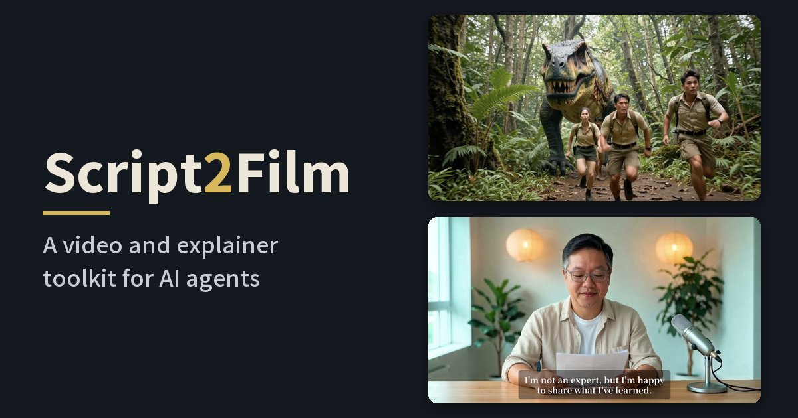
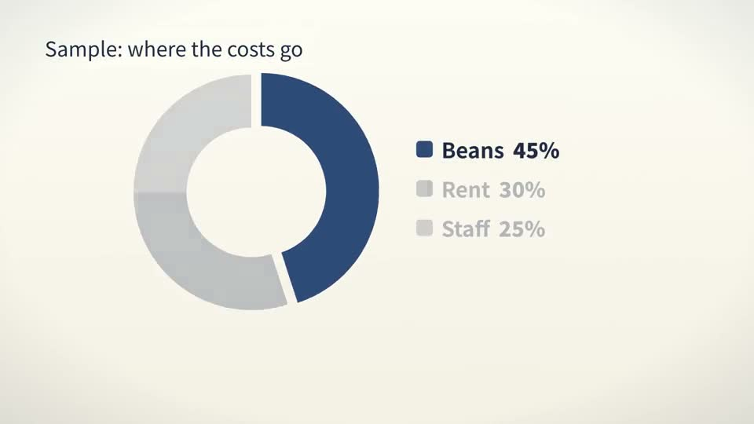
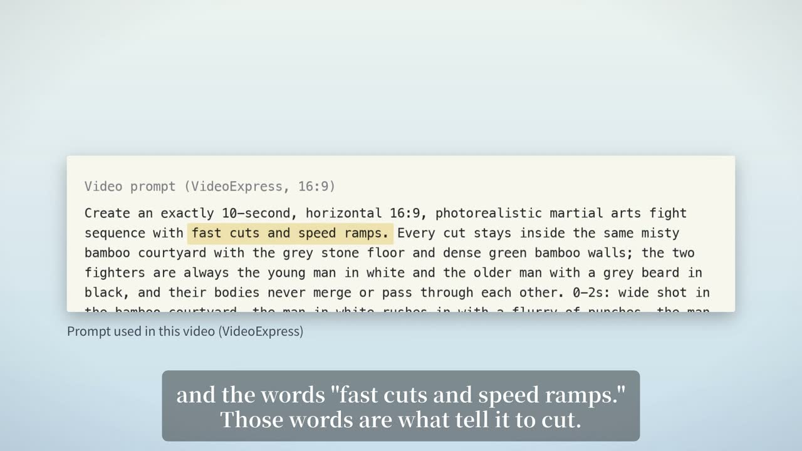
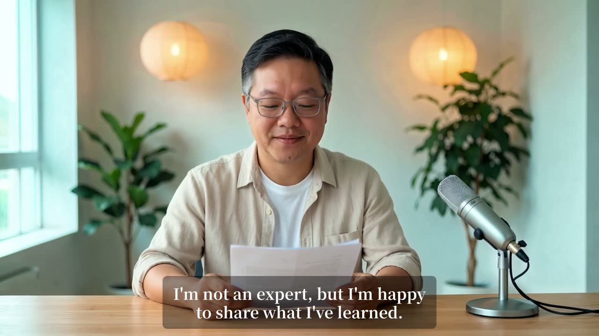
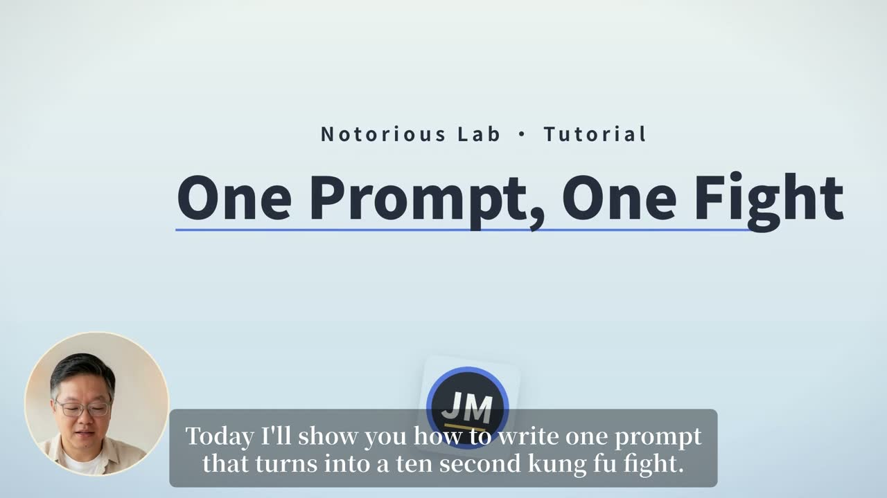
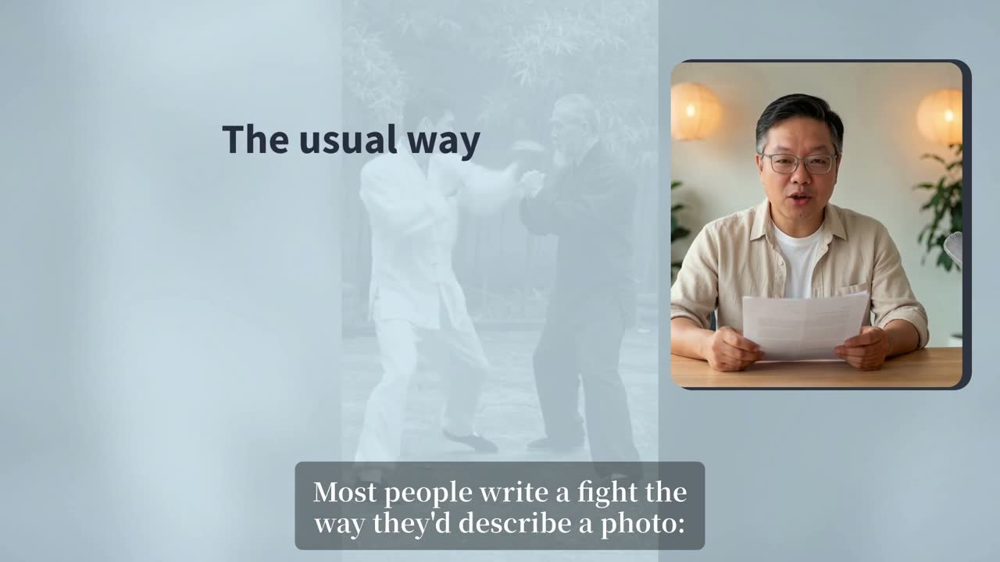
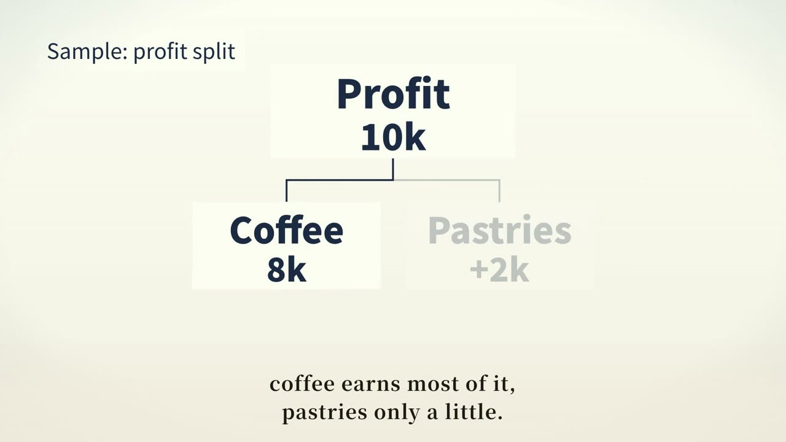
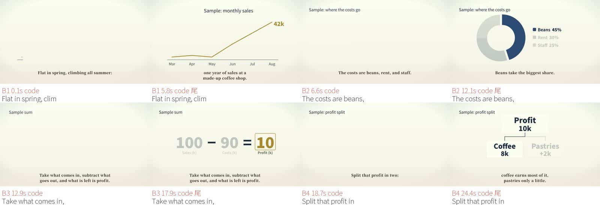
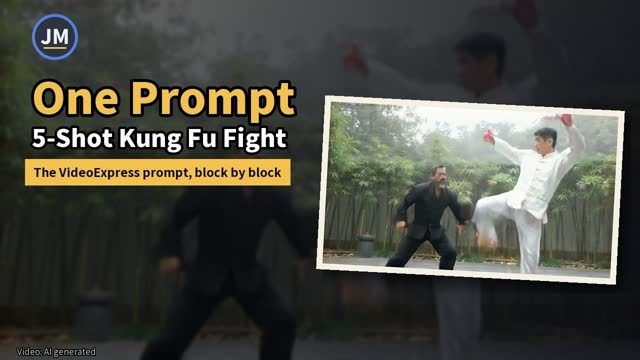

# Script2Film

**English** · [繁體中文](./README.zh-TW.md)

[](https://github.com/notoriouslab/script2film/releases)
[](./LICENSE)


**You bring the idea. The agent does the rest.**

A video and explainer toolkit for AI agents. Start from an idea or a script and get a finished film with narration,
subtitles, charts and a host. Every step is documented in plain language, and the core flow runs on your own computer
with no account and no API key.

[](https://notoriouslab.github.io/script2film/en/index.html)

[Website](https://notoriouslab.github.io/script2film/en/index.html) ·
[Watch a film made with it (1 min 52 s)](https://www.youtube.com/watch?v=qrFl_yrWPNk) ·
[27 scenes and 10 palettes](https://notoriouslab.github.io/script2film/en/gallery.html) ·
[Which tool each stage uses](https://notoriouslab.github.io/script2film/en/tools.html) ·
[Changelog](./CHANGELOG.md)

| 27 | 10 | 3 | 0 |
|:---:|:---:|:---:|:---:|
| code-drawn scenes | palettes | AI agents have run it | accounts or keys required |

- **Free tools are enough.** Voice, timing, visuals and assembly all run on your own computer. The first example runs
  start to finish on free tools.
- **Every stage is swappable.** Voice, generated shots, host, editor: use the ones you already like. Follow the setup
  notes and they plug in.
- **Agents run it from the docs.** In basic trials, three different agents read only the docs in this repository and
  each made a film that passed the checks, including a local model on a laptop and DeepSeek on its free tier.

## It is not another video editor

Most AI editing tools trim footage you already shot and add subtitles. Script2Film starts from the idea: the film is
built to match what you want to say.

| Typical AI editing tools | Script2Film |
|---|---|
| Start by cutting footage you shot | **Start from an idea.** The narration is in the script, and so is which line goes with which visual. |
| Visuals are stock, or generated wholesale | **27 scenes drawn by code.** Numbers come straight from the script, so they are never drawn wrong. Change the script and rerun. |
| The project is locked inside the app | **Every step leaves a readable file.** The script, the timing of every line and the edit plan are text files you can diff and version. |
| Export, and you are done | **Every exported film is checked.** A half-written file, black frames, wrong loudness, sound effects that never made it into the mix, or a film older than its inputs stops the upload. |
| Tied to one service | **Every stage can be swapped.** Voice, generated shots, host and editor each have a default and a documented alternative. |
| Monthly subscription | **The core flow costs nothing.** Generated shots and the host are optional, and only those steps need an outside service. |
| A GUI you drive with the mouse | **Tell an AI agent what you want.** It follows the docs step by step and asks you before spending credits, choosing a host look, or uploading. |

One beat in the script ([examples/coffee/doc.json](./examples/coffee/doc.json)) and what it draws: at "beans" the
first slice opens; at "biggest" that slice is highlighted.

```json
{ "lines": [2], "scene": "pie", "params": {
  "title": "Sample: where the costs go",
  "items": [
    { "label": "Beans", "value": 45, "at": "beans" },
    { "label": "Rent",  "value": 30, "at": "rent" },
    { "label": "Staff", "value": 25, "at": "staff" }
  ],
  "focus": [{ "i": 0, "at": "biggest" }]
}}
```



## What it does

Every image below is a real film frame or real tool output.

**01 · Narration on your own computer.** Each line is voiced several times, transcribed and compared with the script,
and the closest take is kept. About ten seconds of reference audio is enough to voice a whole film; with no voice at
hand, design one from a text description. Lines can be split between several speakers for dialogue.

**02 · 27 scenes that move on the word you say.** Line charts, pies, formulas, breakdowns, comparisons, lists,
timelines, map routes, text highlighted passage by passage. You write "appear when this word is spoken", and the
program lines it up with the real timing of the voice. A quotation can come out of a blur word by word as it is read,
a word can be struck out and rewritten ("not A, but B"), a long timeline slides from one stretch to the next, and a
relation chart can become a clue board with red string.

**15 looks, and three of them tried on your own script first.** Each look changes the colours, the shapes and the
ground together: flat teaching panels, paper collage, documentary, dark gold, newsroom, vintage poster, editorial
serif, cinematic dark. Before anything is voiced, `doc_theme_preview.py` plays three looks side by side on three of
this episode's own beats (about 45 seconds), so you pick with the script in front of you.



**03 · Generated shots for the beats that need live footage.** The tool works out how long each shot must be, writes
the prompts and lays them out as a run sheet. By default it submits to VideoExpress and collects the results; MiniMax
H3 on your own Google Colab GPU is another option (its licence excludes some territories, see
[tools/h3/README.md](./tools/h3/README.md)). With a Google AI plan, single shots can come from Google Flow (Omni, Veo):
the agent works in your signed-in Chrome and files each download with the model, settings and prompt that made it
([skills/google-flow](./skills/google-flow/SKILL.md)). Generating by hand works too.


**04 · A lip-synced host in three placements.** The narration is cut into segments, sent for lip sync and placed back
on the timeline: a corner circle, a frame on the right, or full screen. You pick the look first, and nothing is sent
until you do. Use only your own likeness, or one you have the right to use.

| Full frame | Circle | Side frame |
|---|---|---|
|  |  |  |

**05 · Subtitles follow the voice.** The voice track is transcribed locally to get the time of every word, and both
subtitles and visuals are laid out from that timing. Keywords can be coloured in the burned subtitles, and Chinese
narration can carry English subtitles only.



**06 · It checks its own work, and tells failures from judgement calls.** Every film exported through Concat is checked
on the spot, whatever kind of film it is: audio and video the same length, no black frames inside, loudness and peak,
sound effects really in the mix, and made from the current files. The result sits next to the film with its SHA-256,
and the release checklist will not upload a different file. For explainers the first and last frame of every beat
go into one sheet; the agent has to read it before reporting done, and reports what it cannot confirm instead of
guessing.

Some problems are matters of taste, so they are listed and never fail the film: music that does not step aside
between lines, an opening that holds one picture for more than five seconds (the cover does not count), generated
shots on so many lines that the high points no longer stand out, and an episode too close to the three before it.
The thresholds come from measuring the author's published films and from the format rules; where each number came from is written next to it in the code.



**Side by side with a film you like.** `tools/sample/` measures the rhythm of a film you admire and of your own films
the same way: shot lengths, how fast the opening changes picture, how much of the film is speech, how quiet it gets
between lines. It lays out a contact sheet with what is said under each frame. It only measures; what to change is
yours to decide.

**Also:** music composed by code from the on-screen events (or a song from MiniMax Music 3 on your own Colab or from Google Flow Music, set as the film's music in one step), sound
effects on the moment each element appears, start and release checklists that stop the run until rights and sources
are answered, YouTube upload with schedule, thumbnail and the altered-content label, and optional fonts (LXGW WenKai,
jf open-huninn) listed with their original download links.

## Made with it

The author uses it every week on two channels. One film of each of four kinds; each opens on YouTube.

| [](https://www.youtube.com/watch?v=qrFl_yrWPNk) | [](https://www.youtube.com/watch?v=1aTJSye-l38) |
|---|---|
| Twist comedy · English · 1 min 52 s | Tutorial · English · 3 min 43 s |
| [](https://www.youtube.com/watch?v=LjCb9Le6Vps) | [](https://www.youtube.com/watch?v=I51kD1EMYQ0) |
| Long explainer · Chinese · 6 min 39 s | Daily short · vertical · 1 min 25 s |

Channels: [NotoriousLab](https://www.youtube.com/channel/UCut6SxDwtJHblGQgX6LuTgA) (English) ·
[Jacob Mei](https://www.youtube.com/channel/UC7uSiyB1XIv71SPaWEzF3pw) (Chinese)

## Your first film in three steps

Verified so far on Apple Silicon Macs (tested on a MacBook Pro M3 Max). The first example is a four-line English film
of about 25 seconds and needs no account.

1. **Get the project** (not sure how? ask your AI):

   ```bash
   git clone https://github.com/notoriouslab/script2film.git
   ```

2. **Run the install check.** It only checks and installs nothing; it tells you what is missing and how to install
   it. A first install takes about 30 minutes and about 7 GB of downloads, most of it the voice step
   ([docs/INSTALL.md](./docs/INSTALL.md)).

   ```bash
   python3 tools/doctor/doctor.py
   ```

3. **Open your agent in this folder** and tell it:

   > Follow the docs and make examples/coffee into a film.

Agents load [AGENTS.md](./AGENTS.md) (the always-on rules) and the `script2film` skill
([skills/script2film/SKILL.md](./skills/script2film/SKILL.md)) from the workspace root; the skills are linked into
`.agents/skills/` and `.claude/skills/` (on Windows the links need git `core.symlinks`).

Next: [examples/brewing/](./examples/brewing/), five lines in Chinese with a generated shot and a lip-synced host. Its
`premade/` folder holds the generated files, so it also needs no account.

## Seven stages, and each one leaves a file behind

Each stage reads the file the previous one left and writes its own. You can stop at any stage to look, edit and
rerun. The steps and commands are in [docs/FLOW.md](./docs/FLOW.md).

| F0 Install check | F1 Script | F2 Voice | F3 Timing | F4 Visuals | F5 Assembly | F6 Check |
|---|---|---|---|---|---|---|
| what is missing and how to install it | narration and the visual for each beat, in one file | every line voiced, the most accurate take kept | when every word is spoken | code draws each beat to that timing | voice, visuals and subtitles become one film | measure, build the check sheet, read every frame |

Optional stages attach alongside: generated shots, host, music and sound effects, overlays in an editor, checklists,
and upload.

| Stage | In → out | Default | Optional |
|---|---|---|---|
| Script | topic and material → `doc.json` (lines and beats) | written by hand from the format guide | an AI agent following the skill |
| Voice | lines → one audio file per line, then the joined narration | Qwen3-TTS, on your machine | your own recording |
| Timing | narration → `beats.json`, subtitles | whisper.cpp, on your machine | Groq, ElevenLabs Scribe |
| Pictures: drawn | beats and parameters → one mp4 per beat | the scene engine in `skills/ve-director/doc/` (27 scenes) | |
| Pictures: footage | photos and clips → the picture of a beat | photos with a licence record | VideoExpress (`tools/ve-runner/`), MiniMax H3 on your own Colab (`tools/h3/`) |
| Host | narration → a presenter video | no host | TalkingPhotos, MiniMax H3 |
| Sound | beats → sound marks, music | the effects in `assets/sfx/`; music composed by `tools/score/` | CC BY tracks; your own VideoExpress sounds; MiniMax Music 3 on your own Colab (`tools/music3/`); Google Flow Music (`skills/google-flow/`) |
| Assembly | everything above → the film | `doc_cut.py --render` | Concat, for overlay layers |
| Publishing | the film → a platform | upload by hand | YouTube API |

From voice to a rendered film, the defaults need no other editing software and no API key
(`tools/check-standalone.sh` checks this in a clean environment).

## Three agents made it work from the docs alone

The trials ran on the author's MacBook Pro (M3 Max, 36 GB RAM). Every film passed the output check, and its length
fell within the range expected for the first example.

| Agent | Model | Core flow (no account) | Generated shots + host |
|---|---|---|---|
| Claude Code | Claude Opus | Works | Works |
| Google Antigravity | Gemini 4 Argon, low | Works | Works |
| opencode + Ollama | Qwen 27b (MLX), local | Works, about 13 minutes | Works, about 35 minutes |
| opencode | DeepSeek V4.1 Flash (free tier) | Works, two films in about 20 minutes | Not tried |

Where each one got stuck and how to get past it: [docs/AGENT-TRIALS.md](./docs/AGENT-TRIALS.md).

## What is where

<details>
<summary>The folders</summary>

| Path | What it is |
|---|---|
| `skills/script2film/` | the skill an agent follows to make an explainer film; it routes to `docs/FLOW.md` |
| `skills/ve-director/` | the storyboard skill for VideoExpress: plans a scene as a shot table, then renders checked prompts. Its rules live in `skills/ve-director/rules/` |
| `skills/ve-director/doc/` | doc mode: narrated explainer films. Narration, word timing, 27 drawn scenes, themes, fact checks, cutting. Start with its `README.md` |
| `skills/google-flow/` | optional: one clip from Google Flow (Omni, Veo) or a song from Flow Music in your own Google AI account, made in your signed-in Chrome; `scripts/flow_ingest.py` brings the download into the project with a provenance record |
| `tools/doctor/`, `tools/config/` | the install check, the voice setup (`setup_voice.sh`) and the per-machine settings file |
| `tools/tts/` | designing a voice, voiced lines for several characters, speaker similarity |
| `tools/nightly/`, `tools/checklist/`, `tools/qa/` | checks: the check every export runs (`film_check.py`), the explainer delivery check (`check.py`), the start and release checklists, frame-by-frame motion checks |
| `tools/sample/` | measures a sample film and your own side by side, with contact sheets |
| `tools/ve-runner/` | runs a storyboard on VideoExpress in a browser and collects the clips |
| `tools/tp/` | makes a talking host on TalkingPhotos |
| `tools/h3/`, `tools/music3/` | MiniMax H3 shots and host, and MiniMax Music 3 songs, on your own Google Colab GPU |
| `tools/assemble/`, `tools/concat/` | lays clips into a timeline; builds a Concat project from it |
| `tools/drama/` | cuts a lip-synced short drama (no narrator) from one timeline file, with or without Concat |
| `tools/score/` | composed background music that follows the picture, rendered offline from a SoundFont |
| `tools/assets/` | makes your own sound effects on your VideoExpress account; copies fonts and sounds from an older library |
| `tools/youtube/` | upload, schedule and retitle on your own channel |
| `tools/prompt-studio/` | Prompt Studio, a single-file HTML prompt builder for VideoExpress (the tool this repository started as) |
| `tools/agents/`, `tools/site/` | links the skills where each agent looks for them; builds the English website pages and the website copy of Prompt Studio |
| `examples/` | the two example films |
| `assets/` | the bundled sound effects (in git) and the two fonts (downloaded; see `assets/README.md`) |
| `docs/` | the install guide, the flow, the agent trials and the project website (English pages in `docs/en/`) |

</details>

## Requirements and accounts

It has only been verified on Apple Silicon Macs. The default transcription (whisper.cpp) also builds on Windows and Linux,
but Windows, Linux and Intel Macs have not been tried (see "Not covered" in [docs/INSTALL.md](./docs/INSTALL.md)).

No account or key is needed for the core flow: voice, timing, drawn scenes, `doc_cut.py --render` and the check. The
optional parts use your own accounts: VideoExpress (generated shots, sound effects), TalkingPhotos (host), Google
Colab (MiniMax H3 and Music 3), a Google AI plan (Flow and Flow Music, through your own signed-in Chrome), YouTube (upload), and both a Groq and an ElevenLabs key for cloud transcription.
Concat is a separate app you install. Each is described where it is used in [docs/FLOW.md](./docs/FLOW.md).

## Contributing

See [CONTRIBUTING.md](./CONTRIBUTING.md). Security issues: [SECURITY.md](./SECURITY.md).

## Licence

[MIT](./LICENSE). Where ideas, wording and assets came from, and the licence of every third-party component, is in
[NOTICE.md](./NOTICE.md).
