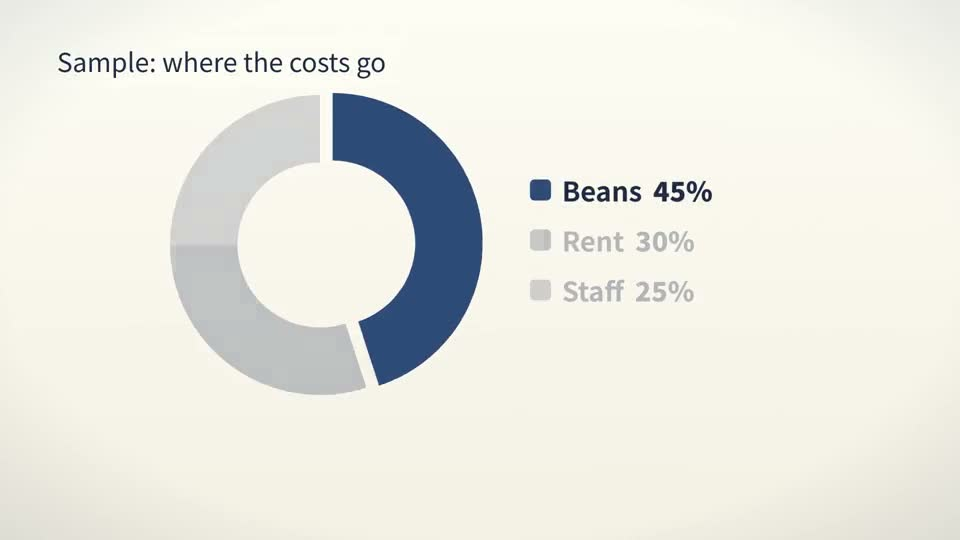
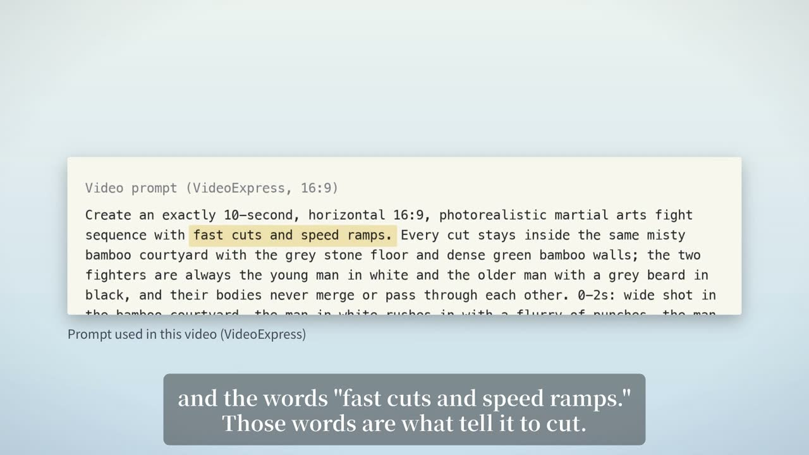
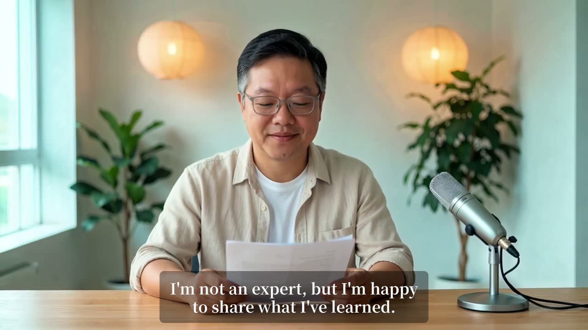
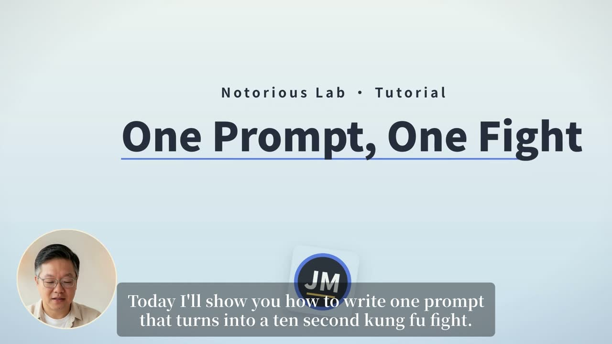
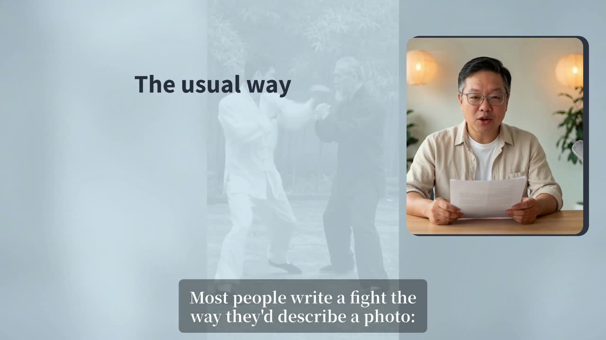
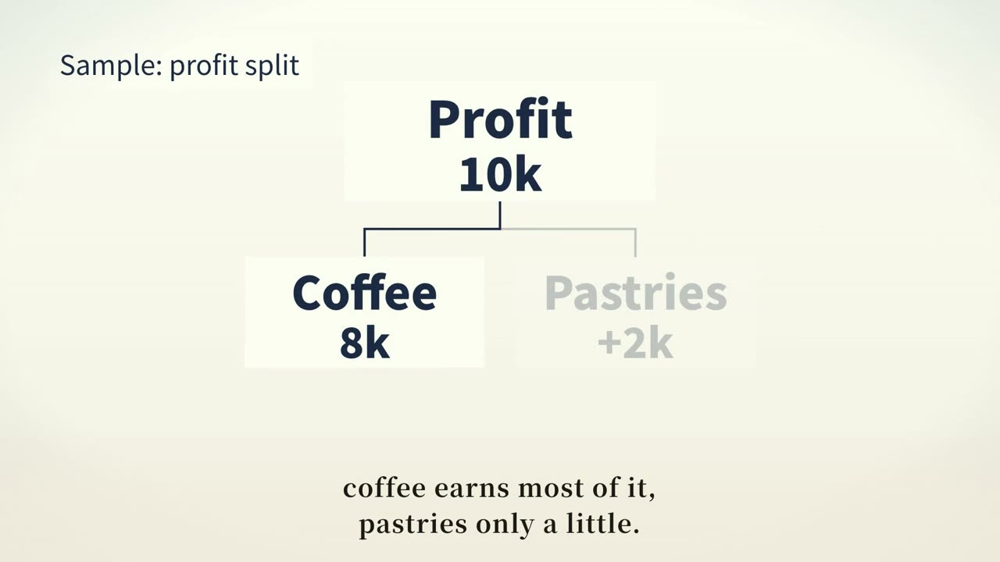
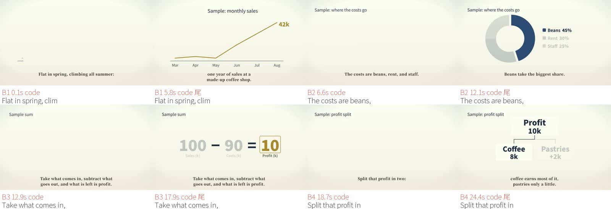
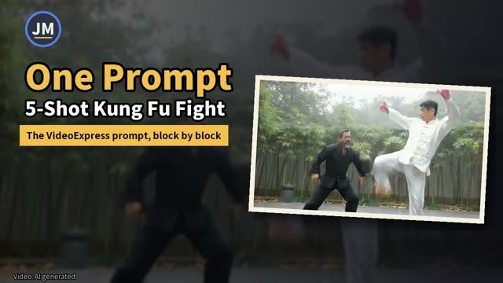

# Script2Film

[English](./README.md) · **繁體中文**

[](https://github.com/notoriouslab/script2film/releases)
[](./LICENSE)


**只要你有想法，剩下的交給 agent。**

給 AI agent 用的影片／解說片工具組。一段想法、一份稿件，一支有旁白、字幕、圖表與主持人的成片就可以出來。每一步都有看得懂的說明，
核心流程在你自己的電腦上跑，不用帳號，也不用 API 金鑰。

[](https://notoriouslab.github.io/script2film/)

[網站](https://notoriouslab.github.io/script2film/) ·
[看一支用它做的片（1 分 52 秒）](https://www.youtube.com/watch?v=qrFl_yrWPNk) ·
[27 種場景與 10 套色版](https://notoriouslab.github.io/script2film/gallery.html) ·
[每個環節用什麼工具](https://notoriouslab.github.io/script2film/tools.html) ·
[更新紀錄](./CHANGELOG.md)（英文）

| 27 | 10 | 3 | 0 |
|:---:|:---:|:---:|:---:|
| 種程式畫的場景 | 套色版 | 家 AI agent 實際跑過 | 個必要的帳號或金鑰 |

- **免費工具就能出片。** 配音、對時、畫面、組裝都可以在自己的電腦上跑。第一個範例從頭做到尾，免費工具就能跑。
- **每個環節都能換工具。** 配音、生成鏡頭、主持人、剪輯軟體，換成你習慣順手的，照設定跟著做就能接得上。
- **AI agent 照文件就能跑。** 基本測試三家不同的 agent 只讀專案裡的文件，都做出通過檢查的片，包含一個在筆電上跑的本機模型，
  以及免費額度的 DeepSeek。

## 它不是另一個剪輯軟體

一般的 AI 剪輯工具幫你把拍好的素材剪短、上字幕。Script2Film 從想法出發：作品是照著你的想法做出來的。

| 一般 AI 剪輯工具 | Script2Film |
|---|---|
| 從拍好的素材開始剪 | **從一個想法開始。** 旁白寫在稿裡，哪一句配哪個畫面也寫在稿裡。 |
| 畫面是找來的，或整段生成的 | **27 種場景由程式畫。** 圖表、算式、清單的數字照稿，不會畫錯；改了稿，重跑一次就好。 |
| 專案藏在軟體裡 | **每一步都留下看得懂的檔案。** 文稿、每句話的時間、剪輯計畫都是文字檔，可以比對、可以進版控。 |
| 輸出就結束 | **每一支出片都會被檢查。** 半截檔、片中黑格、響度不對、音效沒混進去、成片比素材舊，就不能上傳。 |
| 綁在固定的服務上 | **每個環節都能換。** 配音、生成鏡頭、主持人、剪輯軟體各有預設，也各有換別家的做法。 |
| 按月訂閱 | **核心流程不花錢。** 生成鏡頭與主持人是選用的，只有那幾步才需要外部服務。 |
| 有操作介面，用滑鼠拉 | **告訴 AI agent 要做什麼。** 它照文件一步步做；花額度、挑主持人造型、上傳之前都會先問你。 |

文稿裡的一拍（[examples/coffee/doc.json](./examples/coffee/doc.json)）和它畫出來的動作：唸到 beans，第一塊展開；
唸到 biggest，那一塊被強調。

```json
{ "lines": [2], "scene": "pie", "params": {
  "title": "Sample: where the costs go",
  "items": [
    { "label": "Beans", "value": 45, "at": "beans" },
    { "label": "Rent",  "value": 30, "at": "rent" },
    { "label": "Staff", "value": 25, "at": "staff" }
  ],
  "focus": [{ "i": 0, "at": "biggest" }]
}}
```



## 能做什麼

下面的畫面都是實際做出來的成片與工具輸出。

**01・在自己的電腦上配音。** 每句話錄幾條，轉成文字和稿比對，自動挑最接近的一條串接。十秒左右的參考聲音就能配整支片；
沒有現成的聲音，可以用文字描述設計一個。對話可以分給好幾個角色的聲音。

**02・27 種場景，說到哪個字，畫面動到哪裡。** 折線、圓餅、算式、拆解、對照、清單、時間軸、地圖路線、逐段標重點的文字。
你在稿裡寫「說到這個詞的時候出現」，程式照配音的實際時間對上去。引言可以隨著旁白逐字從模糊浮現，一個詞可以被劃掉改寫（「不是 A，而是 B」），
長時間軸可以從這一段滑到下一段，關係圖可以變成拉紅線的線索板。

**15 種長相，先用自己的稿試三種。** 每種長相連顏色、形狀、底紋一起換：扁平教學、剪紙拼貼、紀錄片、深底金字、新聞台、舊海報、雜誌明體、電影暗場。
還沒配音前，`doc_theme_preview.py` 就用這一集自己的三拍把三種長相並排播一次（約 45 秒），看稿時就能一起挑。



**03・需要實景的那幾拍，交給影片生成。** 工具先算出每個鏡頭要幾秒、寫好提示詞，排成一張跑單。預設接 VideoExpress，自動送出、收回；
也可以在自己的 Google Colab 顯示卡上跑 MiniMax H3（授權排除部分地區，見 [tools/h3/README.md](./tools/h3/README.md)）。
有 Google AI 方案的話，單一鏡頭可以交給 Google Flow（Omni、Veo）：agent 在你已登入的 Chrome 裡操作，下載後連同模型、參數、
提示詞一起歸檔（[skills/google-flow](./skills/google-flow/SKILL.md)）。手動生成後照檔名放回來也可以。


**04・對嘴的主持人，三種型態。** 旁白切段送去做對嘴，回來接回時間軸：角落圓框、右邊的框，或整個畫面。造型圖先給你挑，
定了才送出。只用你自己的樣子，或你有權使用的人物。

| 全版 | 圓框 | 右框 |
|---|---|---|
|  |  |  |

**05・字幕跟著聲音走，不用手動對。** 配音在本機轉出每個字的時間，字幕與畫面都照這份時間排。燒進畫面的字幕可以把關鍵字變色；
中文旁白也可以只上英文字幕。



**06・做完不是結束，AI 會自己再確認一遍，而且分得出「錯」和「該想一想」。** 經 Concat 出的每一支片，不論片型，出片當下就檢查：
音畫長度一致、片中沒有黑格、響度與峰值、音效真的混進去、用的是最新的素材。結果和成片的 SHA-256 一起寫在片旁，上傳清單只認這一支。
解說片另外把每一拍的開頭與結尾各截一格排成一張表，agent 必須實際讀過才能回報完成；看不清楚或無法確認的，直接回報，不亂猜。

有些問題是品味的判斷，所以只提醒、不擋：句子之間配樂沒讓開、開場同一個畫面停超過 5 秒（封面不算）、生成畫面用在太多句子而讓高點跳不出來、
這一集和前三集太像。門檻來自實測作者已上架的片與格式規範，每個數字的出處都寫在程式裡。



**看懂一支好片的節奏。** `tools/sample/` 把你欣賞的片和自己的片用同樣的方法並排量：鏡頭長度、開場換畫面的速度、說話佔全片多少、
句子之間靜到什麼程度，再排出每格下寫著當下旁白的聯絡表。它只量，要改什麼由你判斷。

**另外還有：** 照畫面事件作曲的配樂（或用自己 Colab 上的 MiniMax Music 3、Google Flow Music 生成一首歌，一步設成片子的配樂）、對準畫面出現那一刻的音效、
授權與出處沒答完就停下的開工與出片清單、一次帶上排程、縮圖、合成內容標記的 YouTube 上傳，以及附原始下載連結的選用字型（霞鶩文楷、jf 粉圓）。

## 這些都是用它做的

作者自己的兩個頻道每週在用。四種片型各一支，點了到 YouTube 看。

| [](https://www.youtube.com/watch?v=qrFl_yrWPNk) | [](https://www.youtube.com/watch?v=1aTJSye-l38) |
|---|---|
| 反轉喜劇・英文・1 分 52 秒 | 教學片・英文・3 分 43 秒 |
| [](https://www.youtube.com/watch?v=LjCb9Le6Vps) | [](https://www.youtube.com/watch?v=I51kD1EMYQ0) |
| 知識長片・中文・6 分 39 秒 | 每日短片・直式・1 分 25 秒 |

頻道：[NotoriousLab](https://www.youtube.com/channel/UCut6SxDwtJHblGQgX6LuTgA)（英文）・
[Jacob Mei](https://www.youtube.com/channel/UC7uSiyB1XIv71SPaWEzF3pw)（中文）

## 三步，做出第一支片

目前在 Apple Silicon 的 Mac 上驗證過（實測機型為 MacBook Pro M3 Max）。第一個範例是四句話、約 25 秒的英文片，不用任何帳號。

1. **把專案抓下來**（不懂怎麼做？問你的 AI）：

   ```bash
   git clone https://github.com/notoriouslab/script2film.git
   ```

2. **跑安裝檢查。** 它只檢查、不安裝，缺什麼會告訴你怎麼裝。新機器第一次安裝約 30 分鐘、下載約 7 GB，大部分是配音那一步
   （[docs/INSTALL.md](./docs/INSTALL.md)，英文）。

   ```bash
   python3 tools/doctor/doctor.py
   ```

3. **在這個資料夾打開你的 agent**，然後跟它說：

   > 照文件把 examples/coffee 做成一支片。

agent 從工作區根目錄載入 [AGENTS.md](./AGENTS.md)（每一輪都生效的規則）與 `script2film` skill
（[skills/script2film/SKILL.md](./skills/script2film/SKILL.md)）；skill 用符號連結接到 `.agents/skills/` 與 `.claude/skills/`，
Windows 要開 git 的 `core.symlinks`。

下一支：[examples/brewing/](./examples/brewing/)，五句中文旁白，有一個生成鏡頭與對嘴的主持人。生成好的檔附在 `premade/`，
所以同樣不用帳號。

## 七個環節，凡走過的必留下痕跡

每一個環節讀上一環節留下的檔，做完寫下自己的。中間任何一個環節都可以停下來看、改、重跑。步驟與命令在
[docs/FLOW.md](./docs/FLOW.md)（英文）。

| F0 安裝檢查 | F1 稿 | F2 聲音 | F3 對時 | F4 畫面 | F5 組裝 | F6 檢查 |
|---|---|---|---|---|---|---|
| 缺什麼、怎麼裝，一次列出來 | 旁白、每一拍配什麼畫面，寫成一個檔 | 配音，每句挑最準的一條 | 量出每個字落在第幾秒 | 程式照時間把每一拍畫出來 | 聲音、畫面、字幕接成一支片 | 量數字、排截圖表、逐格看 |

選用的環節接在旁邊：生成鏡頭、主持人、配樂與音效、進剪輯軟體加疊加層、清單、上傳。

| 環節 | 輸入 → 輸出 | 預設 | 選用 |
|---|---|---|---|
| 稿 | 題目與素材 → `doc.json`（台詞與拍） | 照格式文件手寫 | AI agent 照 skill 寫 |
| 聲音 | 台詞 → 每句音檔，再接成旁白 | Qwen3-TTS，在自己的電腦上跑 | 自己錄音 |
| 對時 | 旁白 → `beats.json`、字幕 | whisper.cpp，在自己的電腦上跑 | Groq、ElevenLabs Scribe |
| 畫面：程式畫面 | 拍與參數 → 每拍一支 mp4 | `skills/ve-director/doc/` 的場景引擎（27 個場景） | |
| 畫面：素材 | 照片與影片 → 某一拍的畫面 | 附授權紀錄的照片 | VideoExpress（`tools/ve-runner/`）、自己 Colab 上的 MiniMax H3（`tools/h3/`） |
| 主持人 | 旁白 → 主持人影片 | 不放主持人 | TalkingPhotos、MiniMax H3 |
| 音效配樂 | 拍 → 音效標記、配樂 | `assets/sfx/` 附帶的音效；`tools/score/` 程式作曲 | CC BY 曲；自己的 VideoExpress 音效；自己 Colab 上的 MiniMax Music 3（`tools/music3/`）；Google Flow Music（`skills/google-flow/`） |
| 組裝 | 以上全部 → 成片 | `doc_cut.py --render` | Concat，用來加疊加層 |
| 發佈 | 成片 → 平台 | 手動上傳 | YouTube API |

從配音到出片，預設路徑不需要其他剪輯軟體，也不需要任何 API 金鑰（`tools/check-standalone.sh` 在乾淨環境裡驗這件事）。

## 三家 agent，只讀文件，都可以做得出來

試跑在作者的 MacBook Pro（M3 Max，36 GB 記憶體）上。每一支都通過出片檢查，成片長度落在第一個範例預期的範圍內。

| Agent | 模型 | 核心流程（不用帳號） | 生成鏡頭＋主持人 |
|---|---|---|---|
| Claude Code | Claude Opus | 可以 | 可以 |
| Google Antigravity | Gemini 4 Argon, low | 可以 | 可以 |
| opencode + Ollama | Qwen 27b (MLX)，本機 | 可以，約 13 分鐘 | 可以，約 35 分鐘 |
| opencode | DeepSeek V4.1 Flash（免費額度） | 可以，兩支片約 20 分鐘 | 沒試 |

每一家卡在哪、怎麼排除：[docs/AGENT-TRIALS.md](./docs/AGENT-TRIALS.md)（英文）。

## 東西在哪

<details>
<summary>資料夾一覽</summary>

| 路徑 | 是什麼 |
|---|---|
| `skills/script2film/` | agent 做解說片時照著走的 skill；它把步驟導到 `docs/FLOW.md` |
| `skills/ve-director/` | VideoExpress 的分鏡 skill：先把一場戲排成分鏡表，再產出檢查過的提示詞。規則在 `skills/ve-director/rules/` |
| `skills/ve-director/doc/` | doc 模式：有旁白的解說片。配音、逐字對時、27 個程式畫面場景、主題、事實檢查、剪輯。先讀它的 `README.md` |
| `skills/google-flow/` | 選用：在自己的 Google AI 帳號裡用 Google Flow（Omni、Veo）做一段鏡頭，或用 Flow Music 做一首歌，透過已登入的 Chrome 操作；`scripts/flow_ingest.py` 把下載的檔案搬進專案並記下來源 |
| `tools/doctor/`、`tools/config/` | 安裝檢查、配音環境安裝（`setup_voice.sh`）、每台機器一份的設定檔 |
| `tools/tts/` | 設計聲音、多角色配音、語者相似度比對 |
| `tools/nightly/`、`tools/checklist/`、`tools/qa/` | 檢查：每次出片都跑的體檢（`film_check.py`）、解說片的出片檢查（`check.py`）、開工與出片清單、逐格的動態檢查 |
| `tools/sample/` | 把樣本片和自己的片並排量，附聯絡表 |
| `tools/ve-runner/` | 在瀏覽器裡把分鏡送到 VideoExpress 執行並收回片段 |
| `tools/tp/` | 用 TalkingPhotos 做會說話的主持人 |
| `tools/h3/`、`tools/music3/` | 在自己的 Google Colab 顯示卡上跑 MiniMax H3（鏡頭與主持人）和 MiniMax Music 3（歌曲） |
| `tools/assemble/`、`tools/concat/` | 把片段排成時間軸；再依它建 Concat 專案 |
| `tools/drama/` | 剪對嘴短劇（沒有旁白）：一份時間軸檔，有沒有 Concat 都能出片 |
| `tools/score/` | 跟著畫面走的程式作曲配樂，用 SoundFont 離線渲染 |
| `tools/assets/` | 用自己的 VideoExpress 帳號生成音效；從舊的素材庫複製字型與音效 |
| `tools/youtube/` | 在自己的頻道上傳、排定、改標題 |
| `tools/prompt-studio/` | Prompt Studio：給 VideoExpress 用的單檔 HTML 提示詞工具（這個倉庫最早的樣子） |
| `tools/agents/`、`tools/site/` | 把 skill 接到各家 agent 會找的位置；產生網站的英文頁與網站上的 Prompt Studio 複本 |
| `examples/` | 兩支範例片 |
| `assets/` | 隨倉庫附帶的音效（在 git 裡）與兩套字型（要下載，見 `assets/README.md`） |
| `docs/` | 安裝、流程、agent 試跑紀錄，以及專案網站（英文頁在 `docs/en/`） |

</details>

## 需求與帳號

目前只在 Apple Silicon 的 Mac 上驗證過。預設的轉錄（whisper.cpp）在 Windows、Linux 也能編譯，但 Windows、Linux 與 Intel Mac
都沒有試過（見 [docs/INSTALL.md](./docs/INSTALL.md) 的「Not covered」）。

核心流程不用任何帳號或金鑰：配音、對時、程式畫面、`doc_cut.py --render` 與檢查。選用的部分用你自己的帳號：VideoExpress
（生成鏡頭、音效）、TalkingPhotos（主持人）、Google Colab（MiniMax H3 與 Music 3）、Google AI 方案（Flow 與 Flow Music，透過你自己已登入的 Chrome）、YouTube（上傳），雲端轉錄要 Groq 與
ElevenLabs 兩把金鑰。Concat 是另外安裝的軟體。每一項在 [docs/FLOW.md](./docs/FLOW.md) 用到的地方都有說明。

## 參與貢獻

見 [CONTRIBUTING.md](./CONTRIBUTING.md)（英文）。安全問題：[SECURITY.md](./SECURITY.md)（英文）。

## 授權

[MIT](./LICENSE)。想法、文字與素材從哪裡來，以及每個第三方元件的授權，都記在 [NOTICE.md](./NOTICE.md)。
