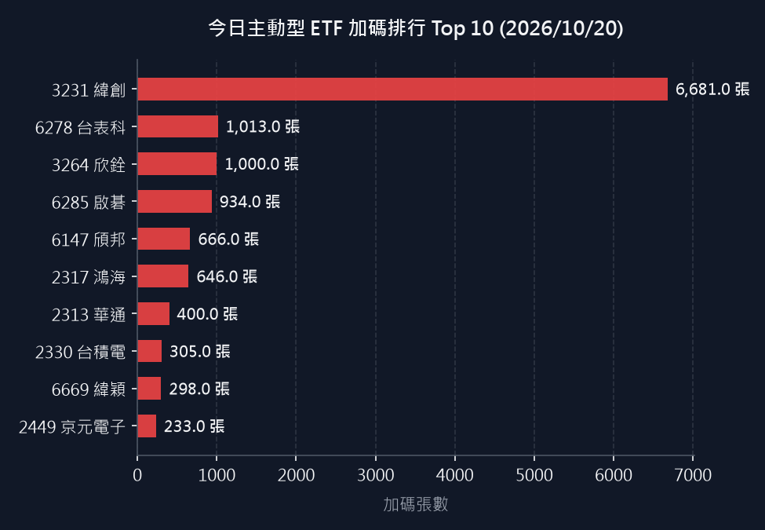
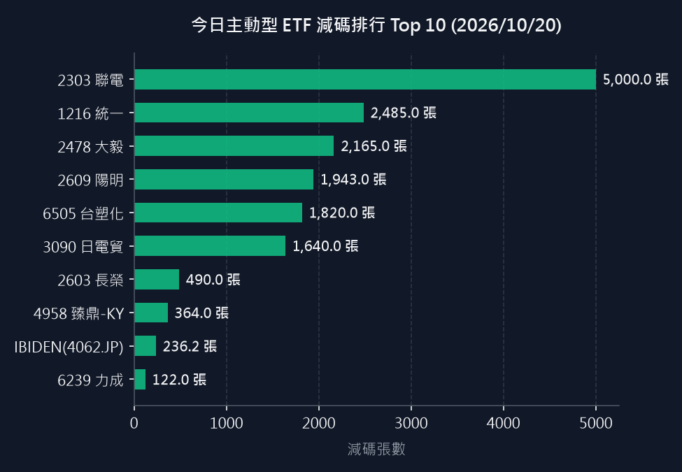

# 主動型 ETF 持股變動

資料來源：`主動型ETF持股明細.xlsx` 最近兩個日期分頁。

比較區間：`20261019` → `20261020`

## 今日加減碼視覺化排行

| 今日加碼 Top 10 | 今日減碼 Top 10 |
| :---: | :---: |
|  |  |

| ETF | 新增 | 刪除 | 比例變動 |
| :-- | --: | --: | --: |
| 00400A | 0 | 1 | 41 |
| 00401A | 1 | 1 | 49 |
| 00402A | 0 | 0 | 43 |
| 00403A | 0 | 0 | 30 |
| 00404A | 0 | 1 | 40 |
| 00405A | 0 | 0 | 23 |
| 00406A | 0 | 1 | 39 |
| 00407A | 1 | 1 | 38 |
| 00408A | 1 | 1 | 37 |
| 00980A | 0 | 0 | 43 |
| 00980D | 0 | 2 | 94 |
| 00981A | 1 | 0 | 25 |
| 00982A | 1 | 0 | 36 |
| 00983A | 0 | 0 | 33 |
| 00983D | 0 | 0 | 45 |
| 00984A | 0 | 0 | 53 |
| 00985A | 2 | 2 | 41 |
| 00986A | 0 | 0 | 33 |
| 00987A | 0 | 0 | 26 |
| 00988A | 0 | 0 | 38 |
| 00989A | 0 | 0 | 52 |
| 00990A | 1 | 3 | 31 |
| 00991A | 0 | 0 | 17 |
| 00992A | 1 | 0 | 38 |
| 00993A | 0 | 0 | 39 |
| 00994A | 2 | 1 | 31 |
| 00995A | 1 | 0 | 32 |
| 00996A | 0 | 0 | 32 |
| 00997A | 0 | 1 | 38 |
| 00998A | 0 | 0 | 50 |
| 00999A | 0 | 0 | 44 |

## 00400A

### 新增持股

- 無

### 刪除持股

- 3374 精材（0.14%，100 張）

### 投資比例變動

- 1303 南亞：4.16% → 4.13%（-0.03）
- 1476 儒鴻：0.07% → 0.08%（+0.01）
- 2059 川湖：3.00% → 3.79%（+0.79）
- 2303 聯電：1.81% → 1.78%（-0.03）
- 2308 台達電：2.56% → 2.55%（-0.01）
- 2317 鴻海：0.76% → 0.78%（+0.02）
- 2330 台積電：8.71% → 9.11%（+0.40）
- 2345 智邦：0.69% → 1.66%（+0.97）
- 2360 致茂：3.10% → 3.15%（+0.05）
- 2368 金像電：3.02% → 2.91%（-0.11）
- 2383 台光電：4.28% → 4.21%（-0.07）
- 2454 聯發科：6.16% → 7.15%（+0.99）
- 2603 長榮：1.61% → 1.63%（+0.02）
- 2881 富邦金：1.62% → 1.60%（-0.02）
- 2891 中信金：1.58% → 1.57%（-0.01）
- 3008 大立光：1.56% → 1.52%（-0.04）
- 3017 奇鋐：3.59% → 3.67%（+0.08）
- 3036 文曄：1.49% → 1.54%（+0.05）
- 3037 欣興：3.94% → 3.78%（-0.16）
- 3044 健鼎：2.44% → 2.45%（+0.01）
- 3081 聯亞：0.69% → 0.68%（-0.01）
- 3090 日電貿：0.32% → 0.31%（-0.01）
- 3231 緯創：0.96% → 1.02%（+0.06）
- 3293 鈊象：0.34% → 0.35%（+0.01）
- 3443 創意：2.50% → 2.52%（+0.02）
- 3653 健策：3.32% → 3.43%（+0.11）
- 3661 世芯-KY：2.25% → 2.24%（-0.01）
- 3665 貿聯-KY：1.48% → 1.47%（-0.01）
- 3711 日月光投控：1.02% → 1.03%（+0.01）
- 4958 臻鼎-KY：0.46% → 0.47%（+0.01）
- 5274 信驊：1.49% → 1.51%（+0.02）
- 6121 新普：0.21% → 0.22%（+0.01）
- 6187 萬潤：1.15% → 1.10%（-0.05）
- 6223 旺矽：3.12% → 2.97%（-0.15）
- 6278 台表科：1.74% → 2.74%（+1.00）
- 6488 環球晶：2.57% → 2.50%（-0.07）
- 6505 台塑化：2.35% → 1.54%（-0.81）
- 6669 緯穎：1.37% → 1.43%（+0.06）
- 7750 新代：0.73% → 0.75%（+0.02）
- 9939 宏全：0.07% → 0.08%（+0.01）
- ＸＡＧＸ金兌(3533.HK)：0.91% → 0.92%（+0.01）

## 00401A

### 新增持股

- 台股期貨11/26(FITXN*1.TF)（-0.07%，0.028 張）

### 刪除持股

- TAIEX FUTURES 18NOV26 FTX6（-0.01%，0.028 張）

### 投資比例變動

- 1303 南亞：1.25% → 1.24%（-0.01）
- 1477 聚陽：0.94% → 0.95%（+0.01）
- 2059 川湖：0.82% → 0.85%（+0.03）
- 2303 聯電：2.25% → 2.20%（-0.05）
- 2308 台達電：2.28% → 2.26%（-0.02）
- 2313 華通：1.55% → 1.54%（-0.01）
- 2317 鴻海：0.56% → 0.57%（+0.01）
- 2327 國巨*：0.61% → 0.60%（-0.01）
- 2330 台積電：20.58% → 20.71%（+0.13）
- 2357 華碩：1.89% → 1.93%（+0.04）
- 2360 致茂：1.31% → 1.32%（+0.01）
- 2379 瑞昱：1.13% → 1.14%（+0.01）
- 2382 廣達：2.07% → 2.14%（+0.07）
- 2383 台光電：1.05% → 1.03%（-0.02）
- 2412 中華電：0.89% → 0.90%（+0.01）
- 2881 富邦金：2.13% → 2.09%（-0.04）
- 2882 國泰金：1.09% → 1.06%（-0.03）
- 2883 凱基金：1.69% → 1.67%（-0.02）
- 2884 玉山金：2.14% → 2.12%（-0.02）
- 2887 台新新光金：1.11% → 1.09%（-0.02）
- 2890 永豐金：0.31% → 0.30%（-0.01）
- 2891 中信金：1.66% → 1.64%（-0.02）
- 3008 大立光：2.26% → 2.19%（-0.07）
- 3034 聯詠：0.23% → 0.22%（-0.01）
- 3037 欣興：2.34% → 2.23%（-0.11）
- 3131 弘塑：0.64% → 0.65%（+0.01）
- 3231 緯創：1.65% → 1.75%（+0.10）
- 3491 昇達科：1.62% → 1.57%（-0.05）
- 4904 遠傳：0.81% → 0.82%（+0.01）
- 4938 和碩：0.34% → 0.36%（+0.02）
- 4958 臻鼎-KY：1.42% → 1.44%（+0.02）
- 4991 環宇-KY：0.58% → 0.59%（+0.01）
- 5274 信驊：1.70% → 1.71%（+0.01）
- 5347 世界：1.29% → 1.27%（-0.02）
- 5904 寶雅*：0.56% → 0.57%（+0.01）
- 6147 頎邦：1.37% → 1.35%（-0.02）
- 6187 萬潤：0.75% → 0.72%（-0.03）
- 6223 旺矽：1.60% → 1.52%（-0.08）
- 6285 啟碁：1.43% → 1.45%（+0.02）
- 6515 穎崴：0.96% → 0.94%（-0.02）
- 6531 愛普*：1.47% → 1.45%（-0.02）
- 6669 緯穎：1.69% → 1.75%（+0.06）
- 7769 鴻勁：0.98% → 0.96%（-0.02）
- 7828 創新服務：1.46% → 1.45%（-0.01）
- 7856 漢測：0.72% → 0.71%（-0.01）
- 8464 億豐：0.98% → 0.99%（+0.01）
- 臺指選擇權10/26 46000 買權：-0.02% → -0.01%（+0.01）
- 臺指選擇權10/26 46400 買權：-0.25% → -0.10%（+0.15）
- 臺指選擇權10/26 46800 買權：-0.01% → 0.00%（+0.01）

## 00402A

### 新增持股

- 無

### 刪除持股

- 無

### 投資比例變動

- AAPL.US Apple：8.16% → 8.07%（-0.09）
- ADI.US Analog Devices：1.98% → 1.96%（-0.02）
- AMD.US AMD：5.74% → 5.79%（+0.05）
- AMZN.US Amazon：4.43% → 4.61%（+0.18）
- ANET.US Arista Networks：0.78% → 0.80%（+0.02）
- ASML.US ASML Holding：1.19% → 1.18%（-0.01）
- AVGO.US Broadcom：2.16% → 2.18%（+0.02）
- AXON.US Axon Enterprise：0.56% → 0.55%（-0.01）
- BABA.US Alibaba Group：0.51% → 0.50%（-0.01）
- BKNG.US Booking Holdings：0.55% → 0.54%（-0.01）
- CDNS.US Cadence Design Systems：1.50% → 1.52%（+0.02）
- CIEN.US Ciena：1.10% → 1.13%（+0.03）
- CLS.US Celestica：1.25% → 1.22%（-0.03）
- COHR.US Coherent：1.15% → 1.14%（-0.01）
- CRWD.US CrowdStrike Holdings：1.54% → 1.53%（-0.01）
- DASH.US DoorDash：0.49% → 0.50%（+0.01）
- GOOG.US Alphabet - Class C Capital Stock：3.47% → 3.48%（+0.01）
- GOOGL.US Alphabet - Class A Common Stock：3.49% → 3.50%（+0.01）
- INTC.US Intel：1.42% → 1.44%（+0.02）
- KLAC.US KLA：1.53% → 1.52%（-0.01）
- LITE.US Lumentum：1.69% → 1.70%（+0.01）
- LRCX.US Lam Research：2.44% → 2.49%（+0.05）
- MDB.US MongoDB：0.37% → 0.38%（+0.01）
- META.US Meta：3.89% → 3.84%（-0.05）
- MRVL.US Marvell：1.59% → 1.64%（+0.05）
- MU.US Micron：5.57% → 5.68%（+0.11）
- NFLX.US Netflix：1.03% → 1.01%（-0.02）
- NOW.US ServiceNow：1.14% → 1.16%（+0.02）
- NVDA.US NVIDIA：8.76% → 8.74%（-0.02）
- PANW.US Palo Alto：2.72% → 2.74%（+0.02）
- PLTR.US Palantir Technologies：2.13% → 2.20%（+0.07）
- SIMO.US Silicon Motion：0.48% → 0.49%（+0.01）
- SKHY.US SK hynix：0.76% → 0.79%（+0.03）
- SNOW.US Snowflake：1.28% → 1.30%（+0.02）
- SPOT.US Spotify：0.38% → 0.37%（-0.01）
- STX.US Seagate：1.00% → 1.03%（+0.03）
- TER.US Teradyne：0.74% → 0.76%（+0.02）
- TSM.US TSMC(ADR)：1.49% → 1.51%（+0.02）
- TTWO.US Take-Two：0.61% → 0.60%（-0.01）
- TXN.US Texas Instruments：2.43% → 2.41%（-0.02）
- UBER.US Uber：0.33% → 0.32%（-0.01）
- V.US Visa：1.26% → 1.25%（-0.01）
- WDC.US Western Digital：1.68% → 1.77%（+0.09）

## 00403A

### 新增持股

- 無

### 刪除持股

- 無

### 投資比例變動

- 1303 南亞：2.66% → 2.65%（-0.01）
- 1560 中砂：0.20% → 0.27%（+0.07）
- 2059 川湖：0.57% → 0.71%（+0.14）
- 2303 聯電：1.50% → 0.99%（-0.51）
- 2308 台達電：3.63% → 3.62%（-0.01）
- 2317 鴻海：0.58% → 0.60%（+0.02）
- 2330 台積電：14.21% → 14.39%（+0.18）
- 2368 金像電：0.78% → 0.76%（-0.02）
- 2383 台光電：4.69% → 4.61%（-0.08）
- 2408 南亞科：0.93% → 0.92%（-0.01）
- 2449 京元電子：0.80% → 0.81%（+0.01）
- 2454 聯發科：4.81% → 4.84%（+0.03）
- 2455 全新：0.07% → 0.08%（+0.01）
- 2882 國泰金：0.35% → 0.34%（-0.01）
- 3008 大立光：1.60% → 1.56%（-0.04）
- 3017 奇鋐：5.42% → 5.68%（+0.26）
- 3037 欣興：5.98% → 5.74%（-0.24）
- 3189 景碩：3.33% → 3.27%（-0.06）
- 3211 順達：0.52% → 0.53%（+0.01）
- 3443 創意：4.06% → 4.09%（+0.03）
- 3450 聯鈞：0.51% → 0.50%（-0.01）
- 3583 辛耘：0.39% → 0.38%（-0.01）
- 3653 健策：5.58% → 5.76%（+0.18）
- 3665 貿聯-KY：2.20% → 2.18%（-0.02）
- 5274 信驊：1.77% → 1.80%（+0.03）
- 6223 旺矽：3.71% → 3.54%（-0.17）
- 6274 台燿：2.98% → 2.89%（-0.09）
- 6669 緯穎：2.44% → 2.77%（+0.33）
- 8046 南電：3.17% → 3.05%（-0.12）
- 8996 高力：2.19% → 2.26%（+0.07）

## 00404A

### 新增持股

- 無

### 刪除持股

- 台股期貨10/26(FITXN*1.TF)（9.68%，0.041 張）

### 投資比例變動

- 1303 南亞：0.81% → 0.80%（-0.01）
- 2059 川湖：0.50% → 0.52%（+0.02）
- 2303 聯電：2.62% → 2.57%（-0.05）
- 2308 台達電：1.66% → 1.64%（-0.02）
- 2317 鴻海：0.65% → 0.67%（+0.02）
- 2330 台積電：22.66% → 22.84%（+0.18）
- 2347 聯強：2.03% → 2.02%（-0.01）
- 2357 華碩：1.22% → 1.26%（+0.04）
- 2379 瑞昱：1.16% → 1.17%（+0.01）
- 2382 廣達：0.96% → 0.99%（+0.03）
- 2383 台光電：2.85% → 2.79%（-0.06）
- 2395 研華：1.27% → 1.30%（+0.03）
- 2637 慧洋-KY：1.14% → 1.15%（+0.01）
- 2882 國泰金：2.89% → 2.82%（-0.07）
- 2885 元大金：2.56% → 2.55%（-0.01）
- 2887 台新新光金：1.51% → 1.48%（-0.03）
- 2890 永豐金：1.48% → 1.47%（-0.01）
- 3017 奇鋐：1.34% → 1.36%（+0.02）
- 3034 聯詠：2.26% → 2.22%（-0.04）
- 3037 欣興：0.28% → 0.27%（-0.01）
- 3264 欣銓：0.68% → 0.66%（-0.02）
- 3293 鈊象：1.17% → 1.20%（+0.03）
- 3653 健策：0.50% → 0.51%（+0.01）
- 5274 信驊：2.60% → 2.62%（+0.02）
- 5434 崇越：1.76% → 1.75%（-0.01）
- 5876 上海商銀：1.60% → 1.62%（+0.02）
- 5904 寶雅*：0.51% → 0.52%（+0.01）
- 6196 帆宣：1.72% → 1.73%（+0.01）
- 6223 旺矽：1.12% → 1.07%（-0.05）
- 6257 矽格：1.72% → 1.68%（-0.04）
- 6505 台塑化：0.55% → 0.51%（-0.04）
- 6669 緯穎：0.90% → 0.94%（+0.04）
- 6691 洋基工程：1.59% → 1.58%（-0.01）
- 7769 鴻勁：1.09% → 1.07%（-0.02）
- 8016 矽創：1.27% → 1.26%（-0.01）
- 8081 致新：0.87% → 0.89%（+0.02）
- 8299 群聯：1.16% → 1.18%（+0.02）
- iShares MSCI Japan SRI ETF(2851.JP)：1.21% → 1.19%（-0.02）
- 台指選擇權11/26 50900 買權：-0.13% → -0.11%（+0.02）
- 台股期貨11/26(FITXN*1.TF)：7.35% → 17.15%（+9.80）

## 00405A

### 新增持股

- 無

### 刪除持股

- 無

### 投資比例變動

- 2059 川湖：2.18% → 2.28%（+0.10）
- 2330 台積電：1.91% → 1.95%（+0.04）
- 2345 智邦：5.38% → 5.43%（+0.05）
- 2368 金像電：6.21% → 6.04%（-0.17）
- 2383 台光電：4.79% → 4.74%（-0.05）
- 2395 研華：0.01% → 0.02%（+0.01）
- 2454 聯發科：5.45% → 5.52%（+0.07）
- 3017 奇鋐：4.07% → 4.18%（+0.11）
- 3037 欣興：7.55% → 7.30%（-0.25）
- 3189 景碩：0.22% → 0.21%（-0.01）
- 3443 創意：5.97% → 6.06%（+0.09）
- 3653 健策：7.51% → 7.82%（+0.31）
- 5274 信驊：5.58% → 5.70%（+0.12）
- 6187 萬潤：0.92% → 0.88%（-0.04）
- 6223 旺矽：7.45% → 7.16%（-0.29）
- 6274 台燿：2.20% → 2.15%（-0.05）
- 6526 達發：0.50% → 0.53%（+0.03）
- 6531 愛普*：3.72% → 3.73%（+0.01）
- 6669 緯穎：0.82% → 0.86%（+0.04）
- 6805 富世達：3.51% → 3.53%（+0.02）
- 7769 鴻勁：2.85% → 2.83%（-0.02）
- 8046 南電：7.90% → 7.67%（-0.23）
- 8996 高力：1.34% → 1.40%（+0.06）

## 00406A

### 新增持股

- 無

### 刪除持股

- 臺股期貨 202610(FITXN*1.TF)（5.22%，0.572 張）

### 投資比例變動

- 1303 南亞：1.55% → 1.54%（-0.01）
- 2059 川湖：0.90% → 0.93%（+0.03）
- 2303 聯電：1.81% → 1.77%（-0.04）
- 2308 台達電：2.55% → 2.54%（-0.01）
- 2317 鴻海：0.33% → 0.34%（+0.01）
- 2327 國巨*：1.88% → 1.87%（-0.01）
- 2330 台積電：9.49% → 9.64%（+0.15）
- 2360 致茂：1.28% → 1.30%（+0.02）
- 2368 金像電：1.38% → 1.51%（+0.13）
- 2383 台光電：6.75% → 6.63%（-0.12）
- 2454 聯發科：5.72% → 5.74%（+0.02）
- 3008 大立光：1.54% → 1.50%（-0.04）
- 3017 奇鋐：5.18% → 5.27%（+0.09）
- 3037 欣興：5.73% → 5.67%（-0.06）
- 3081 聯亞：0.25% → 0.24%（-0.01）
- 3189 景碩：2.06% → 2.01%（-0.05）
- 3264 欣銓：0.28% → 0.39%（+0.11）
- 3443 創意：2.12% → 2.27%（+0.15）
- 3450 聯鈞：0.14% → 0.13%（-0.01）
- 3491 昇達科：0.45% → 0.44%（-0.01）
- 3653 健策：3.49% → 3.60%（+0.11）
- 3665 貿聯-KY：1.49% → 1.47%（-0.02）
- 4938 和碩：0.50% → 0.52%（+0.02）
- 4958 臻鼎-KY：1.01% → 1.03%（+0.02）
- 5274 信驊：2.04% → 2.07%（+0.03）
- 6147 頎邦：0.71% → 0.82%（+0.11）
- 6187 萬潤：0.22% → 0.21%（-0.01）
- 6213 聯茂：0.38% → 0.37%（-0.01）
- 6223 旺矽：3.03% → 3.06%（+0.03）
- 6274 台燿：1.51% → 1.58%（+0.07）
- 6488 環球晶：0.32% → 0.31%（-0.01）
- 6669 緯穎：1.60% → 1.67%（+0.07）
- 6715 嘉基：0.74% → 0.73%（-0.01）
- 7769 鴻勁：0.22% → 0.21%（-0.01）
- 8046 南電：2.95% → 2.84%（-0.11）
- 8150 南茂：0.05% → 0.04%（-0.01）
- 臺指選擇權：-16.80% → -19.14%（-2.34）
- 臺指選擇權第四週週五到期契約：-3.41% → -3.09%（+0.32）
- 臺股期貨 202611(FITXN*1.TF)：17.67% → 23.09%（+5.42）

## 00407A

### 新增持股

- 2313 華通（0.47%，400 張）

### 刪除持股

- 5289 宜鼎（0.30%，55.294 張）

### 投資比例變動

- 1303 南亞：1.00% → 0.99%（-0.01）
- 1560 中砂：1.00% → 1.01%（+0.01）
- 2059 川湖：1.88% → 1.95%（+0.07）
- 2301 光寶科：1.45% → 1.47%（+0.02）
- 2303 聯電：0.55% → 0.54%（-0.01）
- 2308 台達電：2.51% → 2.50%（-0.01）
- 2330 台積電：9.50% → 9.63%（+0.13）
- 2360 致茂：1.00% → 1.01%（+0.01）
- 2368 金像電：1.81% → 1.75%（-0.06）
- 2379 瑞昱：0.25% → 0.26%（+0.01）
- 2383 台光電：5.46% → 5.37%（-0.09）
- 2408 南亞科：0.88% → 0.87%（-0.01）
- 2451 創見：0.32% → 0.33%（+0.01）
- 2454 聯發科：5.35% → 5.38%（+0.03）
- 3008 大立光：1.54% → 1.50%（-0.04）
- 3017 奇鋐：5.89% → 6.01%（+0.12）
- 3034 聯詠：0.84% → 0.83%（-0.01）
- 3037 欣興：5.81% → 5.58%（-0.23）
- 3081 聯亞：1.37% → 1.36%（-0.01）
- 3131 弘塑：0.80% → 0.82%（+0.02）
- 3231 緯創：0.75% → 1.09%（+0.34）
- 3260 威剛：0.28% → 0.29%（+0.01）
- 3293 鈊象：0.63% → 0.65%（+0.02）
- 3443 創意：4.74% → 4.78%（+0.04）
- 3491 昇達科：0.88% → 0.87%（-0.01）
- 3533 嘉澤：0.46% → 0.47%（+0.01）
- 3653 健策：3.60% → 3.72%（+0.12）
- 3665 貿聯-KY：2.60% → 2.58%（-0.02）
- 3711 日月光投控：3.02% → 3.03%（+0.01）
- 4958 臻鼎-KY：1.08% → 1.10%（+0.02）
- 5274 信驊：1.28% → 1.30%（+0.02）
- 6187 萬潤：1.69% → 1.62%（-0.07）
- 6223 旺矽：2.82% → 2.22%（-0.60）
- 6274 台燿：4.16% → 4.03%（-0.13）
- 6510 精測：1.43% → 1.42%（-0.01）
- 6669 緯穎：3.46% → 3.60%（+0.14）
- 8046 南電：3.45% → 3.32%（-0.13）
- 8996 高力：1.29% → 1.33%（+0.04）

## 00408A

### 新增持股

- 2455 全新（0.42%，12 張）

### 刪除持股

- 6239 力成（0.41%，22 張）

### 投資比例變動

- 1303 南亞：3.67% → 3.64%（-0.03）
- 2059 川湖：0.28% → 1.02%（+0.74）
- 2303 聯電：1.36% → 1.33%（-0.03）
- 2308 台達電：2.66% → 2.65%（-0.01）
- 2327 國巨*：0.76% → 0.75%（-0.01）
- 2330 台積電：6.34% → 6.41%（+0.07）
- 2357 華碩：1.51% → 1.55%（+0.04）
- 2360 致茂：1.13% → 1.15%（+0.02）
- 2368 金像電：5.57% → 5.37%（-0.20）
- 2376 技嘉：1.37% → 1.41%（+0.04）
- 2382 廣達：0.22% → 0.23%（+0.01）
- 2383 台光電：4.89% → 4.81%（-0.08）
- 2395 研華：1.63% → 1.67%（+0.04）
- 2408 南亞科：1.29% → 1.28%（-0.01）
- 2454 聯發科：4.16% → 4.18%（+0.02）
- 2542 興富發：3.81% → 3.90%（+0.09）
- 2603 長榮：1.30% → 1.31%（+0.01）
- 3008 大立光：0.88% → 0.86%（-0.02）
- 3017 奇鋐：1.62% → 3.09%（+1.47）
- 3026 禾伸堂：0.78% → 0.86%（+0.08）
- 3037 欣興：2.38% → 2.28%（-0.10）
- 3081 聯亞：2.09% → 2.06%（-0.03）
- 3189 景碩：3.40% → 3.33%（-0.07）
- 3231 緯創：0.38% → 0.95%（+0.57）
- 3264 欣銓：0.78% → 0.76%（-0.02）
- 3653 健策：3.62% → 3.73%（+0.11）
- 3665 貿聯-KY：1.10% → 1.09%（-0.01）
- 6187 萬潤：1.09% → 1.05%（-0.04）
- 6223 旺矽：2.14% → 2.04%（-0.10）
- 6274 台燿：3.69% → 3.57%（-0.12）
- 6488 環球晶：0.87% → 0.85%（-0.02）
- 6526 達發：0.33% → 0.35%（+0.02）
- 6669 緯穎：1.97% → 2.05%（+0.08）
- 7769 鴻勁：0.57% → 0.56%（-0.01）
- 8046 南電：1.66% → 1.60%（-0.06）
- 8996 高力：1.94% → 2.45%（+0.51）
- 9802 鈺齊-KY：0.90% → 0.91%（+0.01）

## 00980A

### 新增持股

- 無

### 刪除持股

- 無

### 投資比例變動

- 1303 南亞：3.93% → 3.89%（-0.04）
- 2059 川湖：4.20% → 4.34%（+0.14）
- 2303 聯電：1.04% → 1.02%（-0.02）
- 2308 台達電：3.55% → 3.53%（-0.02）
- 2317 鴻海：2.07% → 2.12%（+0.05）
- 2327 國巨*：1.39% → 1.38%（-0.01）
- 2330 台積電：9.76% → 9.85%（+0.09）
- 2344 華邦電：1.91% → 1.90%（-0.01）
- 2360 致茂：1.59% → 1.61%（+0.02）
- 2368 金像電：2.26% → 2.17%（-0.09）
- 2376 技嘉：0.91% → 0.93%（+0.02）
- 2382 廣達：1.21% → 1.25%（+0.04）
- 2383 台光電：4.55% → 4.46%（-0.09）
- 2408 南亞科：2.56% → 2.52%（-0.04）
- 2454 聯發科：5.61% → 5.62%（+0.01）
- 2891 中信金：1.09% → 1.08%（-0.01）
- 3008 大立光：1.27% → 1.23%（-0.04）
- 3017 奇鋐：2.38% → 2.42%（+0.04）
- 3026 禾伸堂：1.13% → 1.24%（+0.11）
- 3036 文曄：1.00% → 1.02%（+0.02）
- 3037 欣興：3.75% → 3.59%（-0.16）
- 3081 聯亞：2.22% → 2.19%（-0.03）
- 3189 景碩：1.40% → 1.37%（-0.03）
- 3231 緯創：0.91% → 0.97%（+0.06）
- 3264 欣銓：0.90% → 0.87%（-0.03）
- 3293 鈊象：0.85% → 0.87%（+0.02）
- 3443 創意：2.47% → 2.49%（+0.02）
- 3529 力旺：0.63% → 0.64%（+0.01）
- 3653 健策：3.65% → 3.76%（+0.11）
- 5274 信驊：1.74% → 1.76%（+0.02）
- 5904 寶雅*：0.88% → 0.90%（+0.02）
- 6223 旺矽：2.07% → 1.97%（-0.10）
- 6274 台燿：1.25% → 1.21%（-0.04）
- 6515 穎崴：1.69% → 1.65%（-0.04）
- 6669 緯穎：1.57% → 1.62%（+0.05）
- 6805 富世達：0.68% → 0.67%（-0.01）
- 6831 邁科：0.40% → 0.41%（+0.01）
- 7751 竑騰：0.73% → 0.71%（-0.02）
- 7769 鴻勁：2.98% → 2.92%（-0.06）
- 8046 南電：1.85% → 1.78%（-0.07）
- 8299 群聯：1.66% → 1.69%（+0.03）
- 8996 高力：0.47% → 0.49%（+0.02）
- 台灣證交所加權股價指數(FITXN*1.TF)：1.50% → 1.52%（+0.02）

## 00980D

### 新增持股

- 無

### 刪除持股

- AVIANCA MIDCO 2 PLC SER REGS 10.25 % 07-JAN-2032（0.25%，N/A 張）
- AVIANCA MIDCO 2 PLC SER REGS 9.625000 % 14FEB2030（0.24%，N/A 張）

### 投資比例變動

- ALLY FINANCIAL INC (REG) 7.1% 15NOV2027：0.45% → 0.46%（+0.01）
- ALLY FINANCIAL INC (REG) 8% 01/11/2031：0.59% → 0.60%（+0.01）
- ALLY FINANCIAL INC (REG) VAR 03JAN2030：0.65% → 0.66%（+0.01）
- ALLY FINANCIAL INC (REG) VAR 13JUN2029：0.57% → 0.58%（+0.01）
- AMC GLOBAL MEDIA INC SER REGS (REG) (REG S) 10.5% 15JUL2032：0.71% → 0.72%（+0.01）
- AP CORE HOLDINGS II LLC SER REGS (REG S) 11% 15MAY2031：0.39% → 0.40%（+0.01）
- APOLLO DEBT SOLUTIONS BD 6.700000 % 29JUL2031：0.34% → 0.35%（+0.01）
- ARSENAL AIC PARENT LLC SER REGS 11.5 % 01-OCT-2031：0.33% → 0.34%（+0.01）
- ASURION LLC/ASURION CO 8.375% 01FEB2034：0.42% → 0.43%（+0.01）
- BANCO SANTANDER SA (REG) 6.607% 07NOV2028：0.68% → 0.69%（+0.01）
- BANCO SANTANDER SA 6.921% 08AUG2033：0.34% → 0.35%（+0.01）
- BLACKSTONE PRIVATE CRE 7.300000 % 27NOV2028：0.48% → 0.49%（+0.01）
- BLUE OWL CREDIT INCOME 7.750000 % 15JAN2029：0.55% → 0.56%（+0.01）
- BLUE OWL CREDIT INCOME 7.950000 % 13JUN2028：0.55% → 0.56%（+0.01）
- BLUE OWL CREDIT INCOME SER WI (REG) 7.75% 16SEP2027：0.57% → 0.58%（+0.01）
- BLUE OWL TECHNOLOGY FIN CORP II 6.75 % 04APR2029：0.57% → 0.58%（+0.01）
- BRIGHTHOUSE FINANCIAL IN (REG) 4.7% 22JUN2047：0.48% → 0.49%（+0.01）
- CALDERYS FINANCING LLC SER REGS (REG S) 11.25% 01JUN2028：0.34% → 0.35%（+0.01）
- CANTOR FITZGERALD LP SER REGS 7.200000 % 12DEC2028：0.33% → 0.34%（+0.01）
- CHARTER COMM OPT LLC/CAP 6.700000 % 01-DEC-2055：0.44% → 0.45%（+0.01）
- CHS/COMMUNITY HEALTH SYS SER REGS 9.750000 % 15JAN2034：0.33% → 0.34%（+0.01）
- CIMIC FINANCE USA PTY LT SER REGS (REG S) 7% 25MAR2034：0.33% → 0.34%（+0.01）
- CIVITAS RESOURCES INC SER REGS (REG) (REG S) 9.625% 15JUN2033：0.57% → 0.58%（+0.01）
- CONCENTRIX CORP (REG) 6.85% 02AUG2033：0.72% → 0.73%（+0.01）
- COREWEAVE INC SER REGS (REG S) 9.75% 01OCT2031：0.47% → 0.48%（+0.01）
- COREWEAVE INC SER REGS (REG) (REG S) 9.625% 15JUL2032：0.46% → 0.48%（+0.02）
- DAIMLER FINANCE NA LLC REG 8.5% 18JAN2031：0.65% → 0.66%（+0.01）
- DEUTSCHE BANK NY VAR 10FEB2034：0.34% → 0.35%（+0.01）
- DEUTSCHE BANK NY VAR 20NOV2029：0.48% → 0.49%（+0.01）
- DEUTSCHE TELEKOM INT FIN (REG) 8.75% 15JUN2030：0.42% → 0.43%（+0.01）
- DEVON ENERGY CORPORATION (REG) 7.875% 30SEP2031：0.48% → 0.49%（+0.01）
- DOW CHEMICAL CO/THE (REG) 5.55% 30NOV2048：0.46% → 0.47%（+0.01）
- DOW CHEMICAL CO/THE (REG) 5.6% 15FEB2054：0.61% → 0.62%（+0.01）
- DOW CHEMICAL CO/THE 9.4% 15MAY2039：0.55% → 0.56%（+0.01）
- ENBRIDGE ENERGY PARTNERS (REG) 7.375% 15OCT2045：0.52% → 0.53%（+0.01）
- ENERGY TRANSFER LP (REG) 7.5% 01JUL2038：0.33% → 0.34%（+0.01）
- FIFTH THIRD BANCORP (REG) 8.25% 01MAR2038：0.65% → 0.66%（+0.01）
- FORD MOTOR COMPANY (REG) 7.45% 16JUL2031：0.48% → 0.49%（+0.01）
- FORD MOTOR CREDIT CO LLC (REG) 7.2% 10JUN2030：0.34% → 0.35%（+0.01）
- FORD MOTOR CREDIT CO LLC (REG) 7.35% 04NOV2027：0.34% → 0.35%（+0.01）
- FORD MOTOR CREDIT CO LLC (REG) 7.35% 06MAR2030：0.34% → 0.35%（+0.01）
- FORD MOTOR CREDIT CO LLC 6.798% 07NOV2028：0.34% → 0.35%（+0.01）
- FORD MOTOR CREDIT CO LLC 7.122% 07NOV2033：0.34% → 0.35%（+0.01）
- GEORGIA-PACIFIC LLC (REG) 7.75% 15NOV2029：0.59% → 0.60%（+0.01）
- GLOBAL ATLANTIC FIN CO SER REGS 7.950000 % 15JUN2033：0.67% → 0.68%（+0.01）
- GRAY TELEVISION INC SER REGS (REG) (REG S) 10.5% 15JUL2029：0.20% → 0.21%（+0.01）
- HESS CORP (REG) 7.3% 15AUG2031：0.54% → 0.55%（+0.01）
- HISCOX LTD VAR 11JUN2036：0.43% → 0.44%（+0.01）
- HPS CORPORATE LENDING FU 6.750000 % 30JAN2029：0.55% → 0.56%（+0.01）
- HSBC HOLDINGS PLC (REG) VAR 13NOV2034：0.35% → 0.36%（+0.01）
- HSBC HOLDINGS PLC VAR 03NOV2033：0.36% → 0.37%（+0.01）
- HUTCHISON WHAM INT 03/33 SER REGS (REG S) 7.45% 24NOV2033：0.41% → 0.42%（+0.01）
- JETBLUE AIRWAYS/LOYALTY SER REGS (REG S) 9.875% 20SEP2031：0.35% → 0.33%（-0.02）
- KELLANOVA SER B (REG) 7.450000 % 01APR2031：0.58% → 0.59%（+0.01）
- KINDER MORGAN INC/DELAWA SER GMTN (REG) 7.75% 15JAN2032：0.33% → 0.34%（+0.01）
- KINDER MORGAN INC/DELAWA SER GMTN (REG) 7.8% 01AUG2031：0.32% → 0.33%（+0.01）
- KONINKLIJKE KPN NV (REG) 8.375% 01OCT2030：0.44% → 0.45%（+0.01）
- KYNDRYL HOLDINGS INC 7.8 % 28-SEP-2029：0.42% → 0.43%（+0.01）
- LBM ACQUISITION LLC SER REGS 9.500000 % 15JUN2031：0.42% → 0.41%（-0.01）
- LPL HOLDINGS INC (REG) 6.75% 17NOV2028：0.58% → 0.59%（+0.01）
- MACQUARIE BANK LTD SER REGS (REG S) 6.798% 18JAN2033：0.34% → 0.35%（+0.01）
- MDC HOLDINGS INC (REG) 6% 15JAN2043：0.32% → 0.33%（+0.01）
- METLIFE INC (REG) 10.75% 01AUG2039：0.46% → 0.47%（+0.01）
- MOHEGAN TRIBAL / MS DIG SER REGS 11.875000 % 15APR2031：0.69% → 0.70%（+0.01）
- MPLX LP 6.200000 % 15SEP2055：0.34% → 0.35%（+0.01）
- MYLAN INC (REG) 5.4% 29/11/2043：0.34% → 0.35%（+0.01）
- NAVIENT CORP (REG) 11.5% 15MAR2031：0.44% → 0.45%（+0.01）
- NRG ENERGY INC SER REGS (REG S) 7% 15MAR2033：0.32% → 0.33%（+0.01）
- OCCIDENTAL PETROLEUM COR 8.875% 15JUL2030：0.57% → 0.58%（+0.01）
- ORACLE CORP 6.100000 % 26-SEP-2065：0.50% → 0.49%（-0.01）
- ORACLE CORP 6.7 % 04-FEB-2056：0.20% → 0.19%（-0.01）
- ORACLE CORP 6.85 % 04-FEB-2066：0.53% → 0.52%（-0.01）
- ORACLE CORP 6.9% 09NOV2052：0.50% → 0.49%（-0.01）
- ORANGE SA (REG) 9% 01MAR2031：0.67% → 0.68%（+0.01）
- PBF HOLDING CO LLC SER REGS 9.875000 % 15MAR2030：0.37% → 0.38%（+0.01）
- PEPSICO INC (REG) 7.000000 % 01MAR2029：0.32% → 0.33%（+0.01）
- PLANET FINANCIAL GROUP SER REGS 10.500000 % 15DEC2029：0.49% → 0.48%（-0.01）
- RIO TINTO FIN USA LTD (REG) 7.125% 15JUL2028：0.58% → 0.59%（+0.01）
- RR DONNELLEY & SONS CO SER REGS (REG S) 9.5% 01AUG2029：0.43% → 0.44%（+0.01）
- SANTANDER HOLDINGS USA VAR 12JUN2029：0.60% → 0.61%（+0.01）
- SUNCOR ENERGY INC (REG) 7.15% 01FEB2032：0.32% → 0.33%（+0.01）
- TELEFONICA EUROPE BV (REG) 8.25% 15SEP2030：0.42% → 0.43%（+0.01）
- TRUIST FINANCIAL CORP SER MTN VAR 30OCT2029：0.66% → 0.67%（+0.01）
- UNISYS CORP SER REGS 10.625000 % 15JAN2031：0.60% → 0.61%（+0.01）
- US 10YR NOTE (CBT)DEC26 21-DEC-2026：18.25% → 18.43%（+0.18）
- US 10YR ULTRA FUT DEC26 21-DEC-2026：-1.60% → -1.61%（-0.01）
- US 2YR NOTE (CBT) DEC26 31-DEC-2026：1.70% → 1.72%（+0.02）
- US 5YR NOTE (CBT) DEC26 31-DEC-2026：-13.86% → -14.01%（-0.15）
- US ACUTE CARE SOLUTIONS SER REGS (REG S) 9.75% 15MAY2029：0.33% → 0.34%（+0.01）
- US LONG BOND(CBT) DEC26 21-DEC-2026：5.44% → 5.48%（+0.04）
- US ULTRA BOND CBT DEC26 21-DEC-2026：-0.53% → -0.54%（-0.01）
- VAR ENERGI ASA SER REGS (REG S) 7.5% 15JAN2028：0.34% → 0.35%（+0.01）
- VAR ENERGI ASA SER REGS (REG S) 8% 15NOV2032：0.36% → 0.37%（+0.01）
- VERIZON COMMUNICAT 7.750000 % 01DEC2030：0.45% → 0.46%（+0.01）

## 00981A

### 新增持股

- 3231 緯創（0.33%，4703 張）

### 刪除持股

- 無

### 投資比例變動

- 2303 聯電：3.79% → 3.75%（-0.04）
- 2308 台達電：4.50% → 4.51%（+0.01）
- 2327 國巨*：4.55% → 4.56%（+0.01）
- 2330 台積電：10.86% → 11.30%（+0.44）
- 2345 智邦：4.55% → 4.57%（+0.02）
- 2368 金像電：3.12% → 3.03%（-0.09）
- 2383 台光電：8.04% → 7.93%（-0.11）
- 2449 京元電子：0.49% → 0.61%（+0.12）
- 2454 聯發科：7.84% → 7.91%（+0.07）
- 3017 奇鋐：7.58% → 7.82%（+0.24）
- 3037 欣興：7.91% → 7.63%（-0.28）
- 3264 欣銓：0.25% → 0.24%（-0.01）
- 3376 新日興：0.11% → 0.12%（+0.01）
- 3443 創意：2.42% → 2.45%（+0.03）
- 3653 健策：5.95% → 6.19%（+0.24）
- 3665 貿聯-KY：2.07% → 2.06%（-0.01）
- 3711 日月光投控：2.03% → 2.04%（+0.01）
- 5274 信驊：1.17% → 1.19%（+0.02）
- 6223 旺矽：4.75% → 4.55%（-0.20）
- 6274 台燿：4.27% → 4.15%（-0.12）
- 6669 緯穎：2.24% → 2.34%（+0.10）
- 6805 富世達：0.65% → 0.70%（+0.05）
- 8046 南電：4.47% → 4.32%（-0.15）
- 8996 高力：0.54% → 0.56%（+0.02）
- 台指期貨 2026/11(FITXN*1.TF)：2.31% → 2.34%（+0.03）

## 00982A

### 新增持股

- 6510 精測（1.00%，150 張）

### 刪除持股

- 無

### 投資比例變動

- 2059 川湖：2.72% → 2.81%（+0.09）
- 2301 光寶科：1.82% → 1.83%（+0.01）
- 2303 聯電：1.44% → 1.41%（-0.03）
- 2330 台積電：7.95% → 8.01%（+0.06）
- 2360 致茂：3.63% → 3.67%（+0.04）
- 2376 技嘉：1.31% → 1.34%（+0.03）
- 2377 微星：0.35% → 0.36%（+0.01）
- 2383 台光電：3.37% → 3.30%（-0.07）
- 2395 研華：1.39% → 1.42%（+0.03）
- 2428 興勤：1.25% → 1.24%（-0.01）
- 2454 聯發科：7.03% → 7.04%（+0.01）
- 2478 大毅：1.13% → 0.57%（-0.56）
- 2486 一詮：0.73% → 0.72%（-0.01）
- 3008 大立光：3.36% → 3.26%（-0.10）
- 3017 奇鋐：2.64% → 2.68%（+0.04）
- 3090 日電貿：1.13% → 0.56%（-0.57）
- 3231 緯創：1.39% → 1.48%（+0.09）
- 3491 昇達科：3.48% → 3.39%（-0.09）
- 3583 辛耘：1.07% → 1.05%（-0.02）
- 3617 碩天：0.35% → 0.34%（-0.01）
- 3711 日月光投控：1.26% → 1.33%（+0.07）
- 4958 臻鼎-KY：3.68% → 3.73%（+0.05）
- 5274 信驊：1.22% → 1.23%（+0.01）
- 6139 亞翔：5.28% → 5.22%（-0.06）
- 6213 聯茂：1.54% → 1.52%（-0.02）
- 6214 精誠：1.44% → 1.46%（+0.02）
- 6223 旺矽：3.35% → 3.18%（-0.17）
- 6239 力成：1.07% → 1.06%（-0.01）
- 6274 台燿：1.46% → 1.41%（-0.05）
- 6472 保瑞：0.91% → 0.92%（+0.01）
- 6488 環球晶：2.05% → 1.99%（-0.06）
- 6531 愛普*：3.69% → 3.64%（-0.05）
- 6640 均華：0.30% → 0.29%（-0.01）
- 6669 緯穎：4.08% → 4.22%（+0.14）
- 6672 騰輝電子-KY：1.40% → 1.45%（+0.05）
- 8996 高力：1.24% → 1.27%（+0.03）

## 00983A

### 新增持股

- 無

### 刪除持股

- 無

### 投資比例變動

- ACHR.US Archer：0.10% → 0.05%（-0.05）
- AMZN.US Amazon：3.05% → 3.15%（+0.10）
- BEAM.US Beam Therapeutics：1.60% → 1.62%（+0.02）
- BLSH.US Bullish：2.15% → 1.96%（-0.19）
- BMNR.US BitMine：2.23% → 2.18%（-0.05）
- BWXT.US BWX Technologies：0.06% → 0.05%（-0.01）
- COIN.US Coinbase：4.82% → 4.61%（-0.21）
- CRCL.US Circle：5.38% → 5.24%（-0.14）
- CRWV.US CoreWeave：1.01% → 0.94%（-0.07）
- DE.US Deere：0.44% → 0.42%（-0.02）
- FTNT.US Fortinet：0.39% → 0.45%（+0.06）
- GOOG.US Alphabet - Class C Capital Stock：1.68% → 1.67%（-0.01）
- GOOGL.US Alphabet - Class A Common Stock：0.69% → 0.79%（+0.10）
- HOOD.US Robinhood Markets：4.02% → 3.86%（-0.16）
- ILMN.US Illumina：1.80% → 1.77%（-0.03）
- LLY.US Eli Lilly：0.85% → 0.82%（-0.03）
- META.US Meta：2.24% → 2.38%（+0.14）
- NET.US Cloudflare：1.30% → 1.35%（+0.05）
- NVDA.US NVIDIA：3.26% → 3.45%（+0.19）
- PACB.US Pacific Biosciences of Californi：0.11% → 0.05%（-0.06）
- PLTR.US Palantir Technologies：3.29% → 3.38%（+0.09）
- RXRX.US Recursion Pharmaceuticals：0.86% → 0.88%（+0.02）
- SHOP.US Shopify：5.26% → 5.23%（-0.03）
- SNOW.US Snowflake：0.55% → 0.56%（+0.01）
- SPCX.US SpaceX：6.97% → 6.95%（-0.02）
- TEM.US Tempus：5.38% → 5.27%（-0.11）
- TER.US Teradyne：0.60% → 0.61%（+0.01）
- TSLA.US Tesla：8.99% → 9.14%（+0.15）
- TSM.US TSMC(ADR)：2.74% → 2.75%（+0.01）
- TWST.US Twist Bioscience：3.54% → 3.67%（+0.13）
- TXG.US 10x Genomics：3.31% → 3.26%（-0.05）
- WGS.US GeneDx：0.49% → 0.51%（+0.02）
- XYZ.US Block：1.37% → 1.34%（-0.03）

## 00983D

### 新增持股

- 無

### 刪除持股

- 無

### 投資比例變動

- ABIBB 8.2 01/15/39：1.97% → 1.98%（+0.01）
- AET 6 5/8 06/15/36：0.73% → 0.74%（+0.01）
- ALLY 8 11/01/31：1.21% → 1.22%（+0.01）
- AWK 6.593 10/15/37：0.71% → 0.72%（+0.01）
- BACR 7.437 11/02/33：1.28% → 1.29%（+0.01）
- BATSLN 7.079 08/02/43：1.09% → 1.10%（+0.01）
- BHCCN 11 09/30/28：1.91% → 1.93%（+0.02）
- BNCN 7 3/8 03/01/33：1.11% → 1.12%（+0.01）
- BRITEL 9 5/8 12/15/30：1.37% → 1.38%（+0.01）
- BRKHEC 6 3/4 07/01/37：0.82% → 0.83%（+0.01）
- C 8 1/8 07/15/39：1.93% → 1.94%（+0.01）
- CP 7 1/8 10/15/31：0.83% → 0.84%（+0.01）
- CRWV 9 02/01/31：1.15% → 1.18%（+0.03）
- CYH 10 7/8 01/15/32：1.52% → 1.54%（+0.02）
- DELL 8.1 07/15/36：1.53% → 1.54%（+0.01）
- DOW 9.4 05/15/39：1.95% → 1.96%（+0.01）
- DT 9 1/4 06/01/32：1.51% → 1.53%（+0.02）
- DTV 8 7/8 02/01/30：1.62% → 1.64%（+0.02）
- DUK 7 3/4 03/01/31：1.58% → 1.59%（+0.01）
- GE 6 7/8 01/10/39：0.84% → 0.85%（+0.01）
- GTN 10 1/2 07/15/29：0.59% → 0.34%（-0.25）
- HAL 7.45 09/15/39：1.83% → 1.84%（+0.01）
- HSBC 6.332 03/09/44：1.06% → 1.07%（+0.01）
- IEP 10 11/15/29：1.55% → 1.56%（+0.01）
- KHC 6 7/8 01/26/39：1.01% → 1.02%（+0.01）
- KMI 6.95 01/15/38：1.07% → 1.08%（+0.01）
- LQDW.US iShares LQD Premium Income+ ETF：7.34% → 7.40%（+0.06）
- MBGGR 8 1/2 01/18/31：1.33% → 1.34%（+0.01）
- MINAU 9 1/4 10/01/28：0.90% → 0.91%（+0.01）
- MOHEGN 11 7/8 04/15/31：1.38% → 1.39%（+0.01）
- MS 7 1/4 04/01/32：1.65% → 1.66%（+0.01）
- NTRCN 7 1/8 05/23/36：0.55% → 0.56%（+0.01）
- ORCL 6.9 11/09/52：0.80% → 0.79%（-0.01）
- OXY 6.6 03/15/46：0.75% → 0.76%（+0.01）
- PFE 7.2 03/15/39：1.44% → 1.45%（+0.01）
- RAKUTN 11 1/4 02/15/27：1.84% → 1.86%（+0.02）
- S 8 3/4 03/15/32：1.50% → 1.51%（+0.01）
- SUCN 6.85 06/01/39：1.22% → 1.23%（+0.01）
- SVC 8 7/8 06/15/32：0.48% → 0.49%（+0.01）
- TELEFO 8 1/4 09/15/30：1.02% → 1.03%（+0.01）
- TLTW.US iShares TLT Premium Income+ ETF：8.01% → 8.05%（+0.04）
- TRPCN 7 5/8 01/15/39：1.69% → 1.70%（+0.01）
- UNITEDHEALTH GROUP INC 6.875 02/15/38：0.87% → 0.88%（+0.01）
- VENLNG 9 1/2 02/01/29：1.44% → 1.45%（+0.01）
- VZ 7 3/4 12/01/30：1.16% → 1.17%（+0.01）

## 00984A

### 新增持股

- 無

### 刪除持股

- 無

### 投資比例變動

- 1303 南亞：3.04% → 3.02%（-0.02）
- 1560 中砂：1.22% → 1.23%（+0.01）
- 1709 和益：0.67% → 0.75%（+0.08）
- 2059 川湖：2.10% → 2.18%（+0.08）
- 2301 光寶科：0.61% → 0.62%（+0.01）
- 2303 聯電：0.76% → 0.75%（-0.01）
- 2330 台積電：4.30% → 4.36%（+0.06）
- 2351 順德：0.62% → 0.61%（-0.01）
- 2357 華碩：0.64% → 0.66%（+0.02）
- 2379 瑞昱：0.32% → 0.33%（+0.01）
- 2383 台光電：1.33% → 1.31%（-0.02）
- 2395 研華：2.52% → 2.59%（+0.07）
- 2408 南亞科：1.91% → 1.89%（-0.02）
- 2409 友達：1.25% → 1.24%（-0.01）
- 2464 盟立：1.18% → 1.19%（+0.01）
- 2603 長榮：1.92% → 1.94%（+0.02）
- 2615 萬海：1.00% → 1.01%（+0.01）
- 2634 漢翔：0.30% → 0.31%（+0.01）
- 2855 統一證：0.66% → 0.65%（-0.01）
- 2880 華南金：1.65% → 1.67%（+0.02）
- 2881 富邦金：4.34% → 4.29%（-0.05）
- 2882 國泰金：3.34% → 3.27%（-0.07）
- 2883 凱基金：2.49% → 2.48%（-0.01）
- 2885 元大金：3.42% → 3.43%（+0.01）
- 2886 兆豐金：2.23% → 2.25%（+0.02）
- 2887 台新新光金：3.51% → 3.47%（-0.04）
- 2890 永豐金：2.44% → 2.43%（-0.01）
- 2892 第一金：1.33% → 1.34%（+0.01）
- 3006 晶豪科：0.56% → 0.55%（-0.01）
- 3008 大立光：1.62% → 1.58%（-0.04）
- 3017 奇鋐：4.39% → 4.49%（+0.10）
- 3034 聯詠：0.34% → 0.33%（-0.01）
- 3037 欣興：1.69% → 1.62%（-0.07）
- 3045 台灣大：1.78% → 1.82%（+0.04）
- 3189 景碩：1.55% → 1.52%（-0.03）
- 3231 緯創：0.63% → 0.67%（+0.04）
- 3264 欣銓：1.89% → 1.85%（-0.04）
- 3443 創意：1.20% → 1.21%（+0.01）
- 3653 健策：1.76% → 1.82%（+0.06）
- 3711 日月光投控：0.60% → 0.61%（+0.01）
- 4958 臻鼎-KY：0.62% → 0.63%（+0.01）
- 5274 信驊：1.10% → 1.12%（+0.02）
- 5904 寶雅*：1.01% → 1.03%（+0.02）
- 6187 萬潤：2.24% → 2.15%（-0.09）
- 6197 佳必琪：0.66% → 0.65%（-0.01）
- 6213 聯茂：1.54% → 1.53%（-0.01）
- 6214 精誠：0.67% → 0.69%（+0.02）
- 6223 旺矽：0.15% → 0.14%（-0.01）
- 6505 台塑化：3.67% → 3.43%（-0.24）
- 6669 緯穎：0.76% → 0.79%（+0.03）
- 7750 新代：0.61% → 0.63%（+0.02）
- 8039 台虹：0.66% → 0.67%（+0.01）
- 8046 南電：0.65% → 0.63%（-0.02）

## 00985A

### 新增持股

- 3231 緯創（1.00%，1538 張）
- 6285 啟碁（0.79%，934 張）

### 刪除持股

- 2395 研華（0.00%，1 張）
- 2881 富邦金（0.01%，17 張）

### 投資比例變動

- 1216 統一：3.16% → 2.48%（-0.68）
- 1301 台塑：0.46% → 0.44%（-0.02）
- 1605 華新：1.40% → 1.39%（-0.01）
- 2027 大成鋼：1.88% → 1.86%（-0.02）
- 2059 川湖：2.29% → 2.35%（+0.06）
- 2303 聯電：1.39% → 1.35%（-0.04）
- 2308 台達電：2.57% → 2.54%（-0.03）
- 2317 鴻海：1.28% → 1.84%（+0.56）
- 2327 國巨*：1.81% → 1.79%（-0.02）
- 2330 台積電：13.78% → 13.85%（+0.07）
- 2344 華邦電：1.21% → 1.20%（-0.01）
- 2345 智邦：2.74% → 2.72%（-0.02）
- 2368 金像電：1.32% → 1.26%（-0.06）
- 2376 技嘉：2.11% → 2.15%（+0.04）
- 2377 微星：0.85% → 0.89%（+0.04）
- 2383 台光電：2.87% → 2.80%（-0.07）
- 2408 南亞科：1.61% → 1.58%（-0.03）
- 2412 中華電：1.48% → 1.49%（+0.01）
- 2603 長榮：1.83% → 1.40%（-0.43）
- 2609 陽明：1.81% → 1.38%（-0.43）
- 3008 大立光：1.78% → 1.72%（-0.06）
- 3017 奇鋐：1.63% → 1.65%（+0.02）
- 3036 文曄：2.54% → 2.60%（+0.06）
- 3037 欣興：2.11% → 2.01%（-0.10）
- 3081 聯亞：1.98% → 1.94%（-0.04）
- 3105 穩懋：1.09% → 1.08%（-0.01）
- 3189 景碩：0.50% → 0.48%（-0.02）
- 3491 昇達科：0.19% → 0.18%（-0.01）
- 3653 健策：3.25% → 3.33%（+0.08）
- 3665 貿聯-KY：1.41% → 1.39%（-0.02）
- 3711 日月光投控：1.60% → 1.59%（-0.01）
- 4904 遠傳：2.74% → 2.76%（+0.02）
- 6442 光聖：1.02% → 1.00%（-0.02）
- 6446 藥華藥：2.19% → 2.18%（-0.01）
- 6488 環球晶：1.47% → 1.42%（-0.05）
- 6526 達發：0.27% → 0.86%（+0.59）
- 6531 愛普*：1.08% → 1.07%（-0.01）
- 6669 緯穎：2.50% → 3.54%（+1.04）
- 7750 新代：0.60% → 0.61%（+0.01）
- 7769 鴻勁：3.07% → 3.00%（-0.07）
- 台積電期貨(FICDFN*1.TF)：1.56% → 1.58%（+0.02）

## 00986A

### 新增持股

- 無

### 刪除持股

- 無

### 投資比例變動

- 2330 台積電：8.25% → 8.16%（-0.09）
- 2454 聯發科：1.61% → 1.58%（-0.03）
- AAPL.US Apple：2.63% → 2.61%（-0.02）
- AMD.US AMD：4.54% → 4.59%（+0.05）
- AMZN.US Amazon：4.30% → 4.48%（+0.18）
- AVGO.US Broadcom：3.63% → 3.67%（+0.04）
- BE.US Bloom Energy：0.95% → 0.97%（+0.02）
- CRWD.US CrowdStrike Holdings：4.19% → 4.17%（-0.02）
- DDOG.US Datadog：1.06% → 1.11%（+0.05）
- ETN.US Eaton：2.40% → 2.39%（-0.01）
- GEV.US GE Vernova：2.83% → 2.77%（-0.06）
- GOOGL.US Alphabet - Class A Common Stock：6.27% → 6.29%（+0.02）
- GS.US Goldman Sachs：1.08% → 1.07%（-0.01）
- HOOD.US Robinhood Markets：0.73% → 0.71%（-0.02）
- ILMN.US Illumina：0.65% → 0.64%（-0.01）
- JPM.US JPMorgan Chase：2.29% → 2.24%（-0.05）
- LITE.US Lumentum：3.94% → 3.97%（+0.03）
- LLY.US Eli Lilly：3.47% → 3.40%（-0.07）
- MA.US Mastercard：1.33% → 1.31%（-0.02）
- MU.US Micron：4.31% → 4.41%（+0.10）
- MUFG(8306.JP)：1.08% → 1.07%（-0.01）
- Murata Mfg.(6981.JP)：1.88% → 1.84%（-0.04）
- NTRA.US Natera：0.72% → 0.73%（+0.01）
- NVDA.US NVIDIA：6.57% → 6.62%（+0.05）
- PLTR.US Palantir Technologies：0.91% → 0.95%（+0.04）
- SNOW.US Snowflake：2.07% → 2.11%（+0.04）
- Siemens Energy AG：2.05% → 2.00%（-0.05）
- TER.US Teradyne：1.00% → 1.02%（+0.02）
- TSEM.US Tower Semiconductor：1.02% → 1.04%（+0.02）
- 嘉能可公司：1.91% → 1.83%（-0.08）
- 尼比厄斯集團公眾有限公司：0.76% → 0.78%（+0.02）
- 施奈德電機公司：1.57% → 1.56%（-0.01）
- 艾司摩爾控股公司：1.22% → 1.23%（+0.01）

## 00987A

### 新增持股

- 無

### 刪除持股

- 無

### 投資比例變動

- 1815 富喬：1.11% → 1.13%（+0.02）
- 2330 台積電：9.53% → 9.67%（+0.14）
- 2368 金像電：3.28% → 3.18%（-0.10）
- 2383 台光電：6.50% → 6.41%（-0.09）
- 2454 聯發科：4.97% → 5.01%（+0.04）
- 2455 全新：2.47% → 2.50%（+0.03）
- 3017 奇鋐：7.55% → 7.73%（+0.18）
- 3037 欣興：5.69% → 5.47%（-0.22）
- 3081 聯亞：3.35% → 3.32%（-0.03）
- 3363 上詮：2.17% → 2.14%（-0.03）
- 3443 創意：4.45% → 4.50%（+0.05）
- 3455 由田：2.30% → 2.35%（+0.05）
- 3491 昇達科：3.15% → 3.09%（-0.06）
- 3529 力旺：1.89% → 1.90%（+0.01）
- 3653 健策：5.17% → 5.35%（+0.18）
- 3665 貿聯-KY：3.80% → 3.79%（-0.01）
- 4958 臻鼎-KY：2.39% → 2.44%（+0.05）
- 4991 環宇-KY：2.30% → 2.34%（+0.04）
- 6223 旺矽：1.15% → 1.09%（-0.06）
- 6274 台燿：5.35% → 5.20%（-0.15）
- 6510 精測：3.47% → 3.46%（-0.01）
- 6515 穎崴：1.81% → 1.77%（-0.04）
- 7856 漢測：0.91% → 0.90%（-0.01）
- 8046 南電：2.78% → 2.68%（-0.10）
- 8358 金居：2.84% → 2.81%（-0.03）
- 8996 高力：2.34% → 2.42%（+0.08）

## 00988A

### 新增持股

- 無

### 刪除持股

- 無

### 投資比例變動

- 1303 南亞：1.51% → 1.47%（-0.04）
- 2330 台積電：1.69% → 1.67%（-0.02）
- 2383 台光電：2.82% → 2.76%（-0.06）
- 2454 聯發科：1.53% → 1.49%（-0.04）
- 3017 奇鋐：4.35% → 4.29%（-0.06）
- 3037 欣興：6.19% → 6.27%（+0.08）
- 3443 創意：0.49% → 0.81%（+0.32）
- 6223 旺矽：1.25% → 1.24%（-0.01）
- AAPL.US Apple：2.19% → 2.40%（+0.21）
- AMD.US AMD：2.84% → 2.86%（+0.02）
- BE.US Bloom Energy：6.58% → 6.66%（+0.08）
- COIN.US Coinbase：0.86% → 0.83%（-0.03）
- CRWD.US CrowdStrike Holdings：2.99% → 2.97%（-0.02）
- Furukawa Electric(5801.JP)：1.21% → 1.18%（-0.03）
- HOOD.US Robinhood Markets：2.80% → 2.71%（-0.09）
- INFINEON TECHNOLOGIES AG：1.25% → 1.24%（-0.01）
- INTC.US Intel：2.54% → 2.58%（+0.04）
- LENOVO GROUP LTD：0.93% → 0.92%（-0.01）
- LITE.US Lumentum：5.37% → 5.38%（+0.01）
- META.US Meta：1.26% → 1.24%（-0.02）
- MRVL.US Marvell：2.42% → 2.49%（+0.07）
- MSFT.US Microsoft：2.25% → 2.92%（+0.67）
- MU.US Micron：1.00% → 1.01%（+0.01）
- Meiko Electronics(6787.JP)：2.13% → 2.42%（+0.29）
- Murata Mfg.(6981.JP)：1.55% → 1.51%（-0.04）
- NET.US Cloudflare：1.72% → 1.71%（-0.01）
- NOW.US ServiceNow：2.31% → 2.34%（+0.03）
- NVDA.US NVIDIA：4.39% → 4.41%（+0.02）
- OKTA.US Okta：2.65% → 2.66%（+0.01）
- PANW.US Palo Alto：3.99% → 4.01%（+0.02）
- PLTR.US Palantir Technologies：4.08% → 4.22%（+0.14）
- ROBOTECHNIK INTELLIGENT TE-A：0.80% → 0.79%（-0.01）
- SNOW.US Snowflake：2.17% → 2.21%（+0.04）
- SPCX.US SpaceX：5.68% → 5.70%（+0.02）
- Samsung Elec Mech(009150.KS)：2.90% → 2.46%（-0.44）
- TDK(6762.JP)：0.92% → 0.90%（-0.02）
- TWLO.US Twilio：2.08% → 2.16%（+0.08）
- ZS.US Zscaler：0.73% → 0.74%（+0.01）

## 00989A

### 新增持股

- 無

### 刪除持股

- 無

### 投資比例變動

- ADBE.US Adobe：1.31% → 1.30%（-0.01）
- ADI.US Analog Devices：1.17% → 1.15%（-0.02）
- ALGM.US Allegro MicroSystems：0.30% → 0.31%（+0.01）
- AMD.US AMD：2.89% → 3.10%（+0.21）
- AMZN.US Amazon：1.09% → 1.13%（+0.04）
- ASML.US ASML Holding：2.24% → 2.21%（-0.03）
- AVGO.US Broadcom：3.37% → 3.38%（+0.01）
- CBRS.US Cerebras：0.12% → 0.11%（-0.01）
- CIEN.US Ciena：0.91% → 0.93%（+0.02）
- CRM.US Salesforce：3.35% → 3.32%（-0.03）
- CRWD.US CrowdStrike Holdings：3.38% → 3.34%（-0.04）
- DDOG.US Datadog：0.79% → 0.82%（+0.03）
- DOCN.US DigitalOcean：1.21% → 1.22%（+0.01）
- ENTG.US Entegris：0.47% → 0.48%（+0.01）
- ESTC.US Elastic：0.80% → 0.81%（+0.01）
- GLW.US Corning：0.62% → 0.61%（-0.01）
- GOOG.US Alphabet - Class C Capital Stock：2.41% → 2.39%（-0.02）
- HOOD.US Robinhood Markets：1.77% → 1.71%（-0.06）
- ILMN.US Illumina：1.01% → 0.99%（-0.02）
- INTC.US Intel：2.22% → 2.24%（+0.02）
- LMND.US Lemonade：0.73% → 0.70%（-0.03）
- LRCX.US Lam Research：2.18% → 2.21%（+0.03）
- MDB.US MongoDB：0.70% → 0.71%（+0.01）
- META.US Meta：4.57% → 4.48%（-0.09）
- MPWR.US Monolithic Power Systems：0.96% → 0.98%（+0.02）
- MSFT.US Microsoft：3.00% → 2.98%（-0.02）
- MU.US Micron：0.57% → 0.58%（+0.01）
- NET.US Cloudflare：2.74% → 2.71%（-0.03）
- NOW.US ServiceNow：2.01% → 2.03%（+0.02）
- NU.US Nu：0.35% → 0.34%（-0.01）
- PLTR.US Palantir Technologies：1.33% → 1.37%（+0.04）
- RIVN.US Rivian：1.11% → 1.09%（-0.02）
- ROK.US Rockwell Automation：0.85% → 0.84%（-0.01）
- SHOP.US Shopify：3.28% → 3.26%（-0.02）
- SNDK.US Sandisk：0.58% → 0.60%（+0.02）
- SNOW.US Snowflake：2.80% → 2.83%（+0.03）
- SWKS.US Skyworks Solutions：0.32% → 0.31%（-0.01）
- TEAM.US Atlassian：1.44% → 1.46%（+0.02）
- TEM.US Tempus：1.08% → 1.06%（-0.02）
- TSLA.US Tesla：2.92% → 2.99%（+0.07）
- TTMI.US TTM Technologies：0.31% → 0.32%（+0.01）
- TTWO.US Take-Two：2.99% → 2.94%（-0.05）
- TWLO.US Twilio：2.20% → 2.28%（+0.08）
- TWST.US Twist Bioscience：0.36% → 0.37%（+0.01）
- TXG.US 10x Genomics：0.46% → 0.45%（-0.01）
- TXN.US Texas Instruments：1.52% → 1.49%（-0.03）
- U.US Unity Software：0.91% → 0.90%（-0.01）
- VEEV.US Veeva Systems：1.03% → 1.04%（+0.01）
- WDAY.US Workday：0.28% → 0.29%（+0.01）
- WRBY.US Warby Parker：0.67% → 0.71%（+0.04）
- XYZ.US Block：0.53% → 0.52%（-0.01）
- ZM.US Zoom：1.69% → 1.73%（+0.04）

## 00990A

### 新增持股

- AAPL.US Apple（1.48%，44.64 張）

### 刪除持股

- 2449 京元電子（0.80%，967 張）
- 4958 臻鼎-KY（0.61%，364 張）
- IBIDEN(4062.JP)（1.42%，236.2 張）

### 投資比例變動

- 2308 台達電：2.07% → 2.04%（-0.03）
- 2330 台積電：2.96% → 2.91%（-0.05）
- 2383 台光電：2.08% → 2.04%（-0.04）
- 2454 聯發科：2.11% → 2.06%（-0.05）
- 3017 奇鋐：1.58% → 1.56%（-0.02）
- 3037 欣興：2.19% → 2.21%（+0.02）
- 3443 創意：0.52% → 0.53%（+0.01）
- AMD.US AMD：4.20% → 4.22%（+0.02）
- Advantest(6857.JP)：1.27% → 1.25%（-0.02）
- BE.US Bloom Energy：3.91% → 3.95%（+0.04）
- CRWD.US CrowdStrike Holdings：1.65% → 1.63%（-0.02）
- DDOG.US Datadog：2.36% → 2.46%（+0.10）
- INTC.US Intel：1.01% → 1.03%（+0.02）
- LITE.US Lumentum：5.30% → 4.31%（-0.99）
- Lasertec Corporation(6920.JP)：1.09% → 1.04%（-0.05）
- META.US Meta：5.63% → 5.53%（-0.10）
- MRK.US Merck：1.57% → 1.53%（-0.04）
- MRNA.US Moderna：0.95% → 0.98%（+0.03）
- MRVL.US Marvell：1.82% → 1.05%（-0.77）
- MSFT.US Microsoft：4.17% → 4.66%（+0.49）
- MU.US Micron：1.82% → 1.85%（+0.03）
- NET.US Cloudflare：2.10% → 2.09%（-0.01）
- NOW.US ServiceNow：2.61% → 2.64%（+0.03）
- NVDA.US NVIDIA：4.87% → 5.88%（+1.01）
- PLTR.US Palantir Technologies：3.89% → 4.01%（+0.12）
- SMTC.US Semtech：1.90% → 1.96%（+0.06）
- SNOW.US Snowflake：3.03% → 3.08%（+0.05）
- SPCX.US SpaceX：3.65% → 3.66%（+0.01）
- TEAM.US Atlassian：1.67% → 1.71%（+0.04）
- TWST.US Twist Bioscience：1.35% → 1.40%（+0.05）
- ZS.US Zscaler：1.99% → 2.01%（+0.02）

## 00991A

### 新增持股

- 無

### 刪除持股

- 無

### 投資比例變動

- 1303 南亞：4.33% → 4.31%（-0.02）
- 2059 川湖：6.64% → 7.08%（+0.44）
- 2330 台積電：14.48% → 14.69%（+0.21）
- 2383 台光電：9.86% → 9.71%（-0.15）
- 2408 南亞科：7.27% → 7.18%（-0.09）
- 2454 聯發科：6.29% → 6.34%（+0.05）
- 3008 大立光：1.34% → 1.48%（+0.14）
- 3017 奇鋐：6.39% → 6.53%（+0.14）
- 3026 禾伸堂：3.14% → 3.47%（+0.33）
- 3037 欣興：8.54% → 8.21%（-0.33）
- 3081 聯亞：2.93% → 2.90%（-0.03）
- 3189 景碩：6.47% → 6.35%（-0.12）
- 3653 健策：3.18% → 3.29%（+0.11）
- 3711 日月光投控：1.81% → 1.82%（+0.01）
- 5274 信驊：2.52% → 2.56%（+0.04）
- 6505 台塑化：2.48% → 2.32%（-0.16）
- 8046 南電：6.69% → 6.45%（-0.24）

## 00992A

### 新增持股

- 3264 欣銓（0.27%，500 張）

### 刪除持股

- 無

### 投資比例變動

- 1303 南亞：3.48% → 3.43%（-0.05）
- 1815 富喬：4.25% → 4.30%（+0.05）
- 2059 川湖：3.97% → 4.09%（+0.12）
- 2308 台達電：0.72% → 0.71%（-0.01）
- 2330 台積電：6.17% → 6.20%（+0.03）
- 2345 智邦：5.51% → 5.47%（-0.04）
- 2357 華碩：0.44% → 0.45%（+0.01）
- 2360 致茂：1.87% → 1.88%（+0.01）
- 2368 金像電：2.08% → 1.99%（-0.09）
- 2376 技嘉：0.41% → 0.42%（+0.01）
- 2383 台光電：4.71% → 4.59%（-0.12）
- 2454 聯發科：1.65% → 1.64%（-0.01）
- 3008 大立光：4.41% → 4.27%（-0.14）
- 3017 奇鋐：6.69% → 6.77%（+0.08）
- 3026 禾伸堂：0.59% → 1.00%（+0.41）
- 3037 欣興：6.08% → 5.79%（-0.29）
- 3081 聯亞：0.39% → 0.38%（-0.01）
- 3189 景碩：2.87% → 2.79%（-0.08）
- 3231 緯創：1.75% → 1.86%（+0.11）
- 3653 健策：0.99% → 1.01%（+0.02）
- 3665 貿聯-KY：5.36% → 5.28%（-0.08）
- 3711 日月光投控：1.11% → 1.10%（-0.01）
- 4958 臻鼎-KY：1.44% → 1.45%（+0.01）
- 5274 信驊：0.38% → 0.39%（+0.01）
- 5289 宜鼎：0.38% → 0.37%（-0.01）
- 5347 世界：0.23% → 0.22%（-0.01）
- 6139 亞翔：0.39% → 0.38%（-0.01）
- 6187 萬潤：0.85% → 0.81%（-0.04）
- 6213 聯茂：1.81% → 1.79%（-0.02）
- 6223 旺矽：4.17% → 3.94%（-0.23）
- 6274 台燿：1.90% → 1.83%（-0.07）
- 6515 穎崴：0.64% → 0.63%（-0.01）
- 6584 南俊國際：1.97% → 1.95%（-0.02）
- 6669 緯穎：1.82% → 1.88%（+0.06）
- 8021 尖點：3.05% → 2.90%（-0.15）
- 8046 南電：3.04% → 2.91%（-0.13）
- 8150 南茂：0.46% → 0.45%（-0.01）
- 8996 高力：5.55% → 5.68%（+0.13）

## 00993A

### 新增持股

- 無

### 刪除持股

- 無

### 投資比例變動

- 1560 中砂：1.63% → 1.65%（+0.02）
- 2059 川湖：1.05% → 1.09%（+0.04）
- 2301 光寶科：0.63% → 0.64%（+0.01）
- 2303 聯電：1.85% → 1.83%（-0.02）
- 2313 華通：0.49% → 0.50%（+0.01）
- 2330 台積電：8.48% → 8.66%（+0.18）
- 2344 華邦電：1.47% → 1.48%（+0.01）
- 2345 智邦：1.18% → 1.19%（+0.01）
- 2360 致茂：0.53% → 0.54%（+0.01）
- 2368 金像電：0.34% → 0.33%（-0.01）
- 2383 台光電：6.11% → 6.05%（-0.06）
- 2395 研華：1.48% → 1.52%（+0.04）
- 2404 漢唐：0.49% → 0.50%（+0.01）
- 2408 南亞科：2.65% → 2.64%（-0.01）
- 2454 聯發科：1.46% → 1.48%（+0.02）
- 2455 全新：0.80% → 0.81%（+0.01）
- 3008 大立光：1.65% → 1.62%（-0.03）
- 3017 奇鋐：6.16% → 6.33%（+0.17）
- 3037 欣興：6.21% → 6.01%（-0.20）
- 3081 聯亞：1.33% → 1.32%（-0.01）
- 3105 穩懋：1.09% → 1.10%（+0.01）
- 3189 景碩：4.81% → 4.75%（-0.06）
- 3264 欣銓：0.60% → 0.59%（-0.01）
- 3406 玉晶光：1.28% → 1.31%（+0.03）
- 3443 創意：3.72% → 3.77%（+0.05）
- 3491 昇達科：0.93% → 0.92%（-0.01）
- 3653 健策：0.76% → 0.79%（+0.03）
- 3711 日月光投控：1.78% → 1.80%（+0.02）
- 4958 臻鼎-KY：2.46% → 2.53%（+0.07）
- 5274 信驊：4.32% → 4.41%（+0.09）
- 6187 萬潤：1.85% → 1.79%（-0.06）
- 6223 旺矽：4.20% → 4.03%（-0.17）
- 6257 矽格：1.03% → 1.02%（-0.01）
- 6274 台燿：4.28% → 4.18%（-0.10）
- 6505 台塑化：1.34% → 1.26%（-0.08）
- 6669 緯穎：1.97% → 2.07%（+0.10）
- 8021 尖點：1.00% → 0.97%（-0.03）
- 8046 南電：4.09% → 3.97%（-0.12）
- 8996 高力：1.61% → 1.67%（+0.06）

## 00994A

### 新增持股

- 2455 全新（0.31%，25 張）
- 3231 緯創（0.39%，80 張）

### 刪除持股

- 6239 力成（0.66%，100 張）

### 投資比例變動

- 2059 川湖：2.72% → 3.36%（+0.64）
- 2330 台積電：15.71% → 16.04%（+0.33）
- 2345 智邦：1.55% → 1.56%（+0.01）
- 2360 致茂：1.25% → 1.28%（+0.03）
- 2368 金像電：2.24% → 2.18%（-0.06）
- 2383 台光電：6.51% → 6.45%（-0.06）
- 2454 聯發科：5.77% → 5.85%（+0.08）
- 2603 長榮：0.84% → 0.85%（+0.01）
- 2880 華南金：0.25% → 0.26%（+0.01）
- 3008 大立光：0.47% → 0.46%（-0.01）
- 3017 奇鋐：5.58% → 6.42%（+0.84）
- 3026 禾伸堂：0.62% → 0.69%（+0.07）
- 3037 欣興：5.22% → 5.04%（-0.18）
- 3081 聯亞：2.18% → 2.16%（-0.02）
- 3105 穩懋：0.48% → 0.49%（+0.01）
- 3189 景碩：2.94% → 2.90%（-0.04）
- 3264 欣銓：0.32% → 0.31%（-0.01）
- 3443 創意：2.16% → 2.19%（+0.03）
- 3653 健策：4.41% → 4.59%（+0.18）
- 3711 日月光投控：2.10% → 2.13%（+0.03）
- 5274 信驊：2.56% → 2.61%（+0.05）
- 6187 萬潤：0.88% → 0.84%（-0.04）
- 6223 旺矽：4.16% → 4.00%（-0.16）
- 6274 台燿：5.61% → 5.47%（-0.14）
- 6488 環球晶：0.33% → 0.32%（-0.01）
- 6526 達發：0.31% → 0.33%（+0.02）
- 6669 緯穎：1.76% → 1.85%（+0.09）
- 6805 富世達：2.73% → 2.75%（+0.02）
- 7769 鴻勁：0.54% → 0.53%（-0.01）
- 8046 南電：3.27% → 3.17%（-0.10）
- 8996 高力：1.41% → 1.78%（+0.37）

## 00995A

### 新增持股

- 6415 矽力*-KY（0.11%，10 張）

### 刪除持股

- 無

### 投資比例變動

- 1326 台化：0.69% → 0.68%（-0.01）
- 2059 川湖：0.45% → 0.47%（+0.02）
- 2303 聯電：0.98% → 0.97%（-0.01）
- 2330 台積電：9.59% → 9.10%（-0.49）
- 2345 智邦：3.87% → 3.88%（+0.01）
- 2360 致茂：2.23% → 2.27%（+0.04）
- 2368 金像電：1.08% → 1.04%（-0.04）
- 2383 台光電：8.37% → 8.25%（-0.12）
- 2449 京元電子：1.02% → 1.03%（+0.01）
- 2454 聯發科：7.06% → 7.12%（+0.06）
- 3008 大立光：1.28% → 1.25%（-0.03）
- 3017 奇鋐：6.03% → 6.16%（+0.13）
- 3037 欣興：3.51% → 3.37%（-0.14）
- 3189 景碩：0.69% → 0.68%（-0.01）
- 3264 欣銓：0.89% → 0.87%（-0.02）
- 3443 創意：2.84% → 2.87%（+0.03）
- 3653 健策：4.91% → 5.09%（+0.18）
- 3665 貿聯-KY：3.63% → 3.61%（-0.02）
- 3711 日月光投控：3.30% → 3.32%（+0.02）
- 4958 臻鼎-KY：1.61% → 1.65%（+0.04）
- 5274 信驊：3.19% → 3.24%（+0.05）
- 6147 頎邦：0.44% → 0.75%（+0.31）
- 6187 萬潤：0.48% → 0.46%（-0.02）
- 6223 旺矽：4.51% → 4.32%（-0.19）
- 6274 台燿：2.52% → 2.44%（-0.08）
- 6510 精測：2.52% → 2.94%（+0.42）
- 6515 穎崴：0.35% → 0.34%（-0.01）
- 6669 緯穎：3.65% → 3.80%（+0.15）
- 7769 鴻勁：1.35% → 1.33%（-0.02）
- 8046 南電：5.32% → 5.14%（-0.18）
- 8150 南茂：0.70% → 0.69%（-0.01）
- 8996 高力：0.69% → 0.72%（+0.03）

## 00996A

### 新增持股

- 無

### 刪除持股

- 無

### 投資比例變動

- 2303 聯電：2.71% → 2.67%（-0.04）
- 2330 台積電：8.75% → 8.88%（+0.13）
- 2368 金像電：0.95% → 0.92%（-0.03）
- 2382 廣達：0.03% → 0.04%（+0.01）
- 2383 台光電：4.27% → 4.21%（-0.06）
- 2408 南亞科：0.49% → 0.48%（-0.01）
- 2454 聯發科：6.49% → 6.54%（+0.05）
- 2472 立隆電：2.66% → 2.70%（+0.04）
- 2881 富邦金：0.20% → 0.19%（-0.01）
- 3017 奇鋐：3.41% → 3.49%（+0.08）
- 3037 欣興：2.88% → 2.77%（-0.11）
- 3042 晶技：0.95% → 0.96%（+0.01）
- 3189 景碩：3.55% → 3.49%（-0.06）
- 3363 上詮：1.12% → 1.10%（-0.02）
- 3443 創意：4.72% → 4.77%（+0.05）
- 3533 嘉澤：1.03% → 1.05%（+0.02）
- 3653 健策：2.91% → 3.01%（+0.10）
- 3665 貿聯-KY：0.11% → 0.10%（-0.01）
- 3693 營邦：0.35% → 0.36%（+0.01）
- 4958 臻鼎-KY：7.12% → 7.27%（+0.15）
- 5269 祥碩：0.18% → 0.19%（+0.01）
- 6223 旺矽：2.04% → 1.95%（-0.09）
- 6274 台燿：1.82% → 1.77%（-0.05）
- 6278 台表科：3.85% → 3.92%（+0.07）
- 6510 精測：5.57% → 5.55%（-0.02）
- 6683 雍智科技：3.26% → 3.23%（-0.03）
- 6830 汎銓：1.33% → 1.31%（-0.02）
- 6831 邁科：1.41% → 1.45%（+0.04）
- 7751 竑騰：3.00% → 2.94%（-0.06）
- 8021 尖點：3.52% → 3.38%（-0.14）
- 8046 南電：2.18% → 2.10%（-0.08）
- 8996 高力：1.24% → 1.29%（+0.05）

## 00997A

### 新增持股

- 無

### 刪除持股

- VICR.US Vicor Corporation（0.71%，12.556 張）

### 投資比例變動

- 2330 台積電：2.92% → 2.87%（-0.05）
- 2383 台光電：1.94% → 1.89%（-0.05）
- 2454 聯發科：0.97% → 0.94%（-0.03）
- 3037 欣興：3.59% → 3.62%（+0.03）
- AAPL.US Apple：4.25% → 4.19%（-0.06）
- ADI.US Analog Devices：1.03% → 1.01%（-0.02）
- AMAT.US Applied Materials：2.55% → 2.54%（-0.01）
- AMD.US AMD：3.31% → 3.33%（+0.02）
- ANET.US Arista Networks：1.55% → 1.59%（+0.04）
- ARM.US Arm：0.70% → 0.69%（-0.01）
- AVGO.US Broadcom：1.07% → 1.08%（+0.01）
- Advantest(6857.JP)：0.97% → 0.96%（-0.01）
- BE.US Bloom Energy：1.36% → 1.37%（+0.01）
- CRWD.US CrowdStrike Holdings：4.28% → 4.24%（-0.04）
- CSCO.US Cisco：1.02% → 1.00%（-0.02）
- DDOG.US Datadog：0.87% → 0.90%（+0.03）
- DELL.US Dell：2.27% → 2.26%（-0.01）
- DT.US Dynatrace：3.47% → 3.45%（-0.02）
- FTNT.US Fortinet：2.43% → 2.44%（+0.01）
- GE.US GE Aerospace：1.02% → 1.00%（-0.02）
- HWM.US Howmet Aerospace：0.99% → 0.97%（-0.02）
- IBIDEN(4062.JP)：2.12% → 2.04%（-0.08）
- INTC.US Intel：1.69% → 1.71%（+0.02）
- LMT.US Lockheed Martin：0.79% → 0.78%（-0.01）
- LRCX.US Lam Research：1.72% → 1.76%（+0.04）
- MRVL.US Marvell：3.80% → 3.91%（+0.11）
- MSFT.US Microsoft：3.30% → 3.28%（-0.02）
- MU.US Micron：3.49% → 3.55%（+0.06）
- NTRA.US Natera：2.21% → 2.22%（+0.01）
- NVDA.US NVIDIA：3.71% → 3.72%（+0.01）
- PLTR.US Palantir Technologies：1.30% → 1.34%（+0.04）
- SNDK.US Sandisk：2.79% → 2.91%（+0.12）
- SNOW.US Snowflake：0.54% → 0.55%（+0.01）
- STX.US Seagate：1.43% → 1.46%（+0.03）
- Samsung Elec Mech(009150.KS)：1.22% → 1.19%（-0.03）
- TXN.US Texas Instruments：0.81% → 0.80%（-0.01）
- VRT.US Vertiv：0.74% → 0.73%（-0.01）
- WDC.US Western Digital：1.15% → 1.21%（+0.06）

## 00998A

### 新增持股

- 無

### 刪除持股

- 無

### 投資比例變動

- 2882 國泰金：1.77% → 1.78%（+0.01）
- ASR荷蘭公眾有限公司：3.36% → 3.40%（+0.04）
- Admiral集團公開有限公司：2.49% → 2.52%（+0.03）
- Ageas：1.50% → 1.51%（+0.01）
- BLK.US BlackRock：2.04% → 2.06%（+0.02）
- BNY.US Bank of New York Mellon：1.09% → 1.11%（+0.02）
- BPM銀行股份公司：1.39% → 1.36%（-0.03）
- CHYM.US Chime：1.20% → 1.22%（+0.02）
- Chiba Bank(8331.JP)：1.28% → 1.32%（+0.04）
- EQH.US Equitable Holdings：2.27% → 2.32%（+0.05）
- Eurobank SA：1.01% → 1.03%（+0.02）
- GPN.US Global Payments：0.75% → 0.78%（+0.03）
- Hokuhoku FG(8377.JP)：0.55% → 0.56%（+0.01）
- JPM.US JPMorgan Chase：2.29% → 2.30%（+0.01）
- KB Financial Group(105560.KS)：0.75% → 0.78%（+0.03）
- M&G公開有限公司：1.88% → 1.90%（+0.02）
- MRX.US Marex：1.90% → 1.92%（+0.02）
- MS&AD Insurance Group Holdings(8725.JP)：1.17% → 1.20%（+0.03）
- Mebuki Financial Group(7167.JP)：1.49% → 1.52%（+0.03）
- Mizuho Financial(8411.JP)：2.17% → 2.23%（+0.06）
- Piraeus Bank SA：2.71% → 2.74%（+0.03）
- Resona(8308.JP)：1.46% → 1.49%（+0.03）
- Samsung Fire & Marine Insurance(000810.KS)：0.73% → 0.77%（+0.04）
- Sumitomo Mitsui Trust Group(8309.JP)：0.95% → 0.98%（+0.03）
- TRV.US Travelers：1.33% → 1.34%（+0.01）
- Tokio Marine Holdings(8766.JP)：1.33% → 1.35%（+0.02）
- Unipol保險股份公司：0.03% → 0.02%（-0.01）
- V.US Visa：3.07% → 3.14%（+0.07）
- VCTR.US Victory Capital Holdings：1.22% → 1.24%（+0.02）
- WFC.US Wells Fargo：0.57% → 0.56%（-0.01）
- 凱克薩銀行有限責任公司：1.20% → 1.21%（+0.01）
- 勞埃德銀行集團：1.88% → 1.89%（+0.01）
- 國民西敏集團公開有限公司：2.15% → 2.14%（-0.01）
- 安盛有限責任公司：0.82% → 0.83%（+0.01）
- 希臘國家銀行：1.57% → 1.58%（+0.01）
- 德意志證交所：2.03% → 2.05%（+0.02）
- 德意志銀行：1.04% → 1.03%（-0.01）
- 忠意保險股份公司：0.87% → 0.86%（-0.01）
- 東方匯理資產管理有限責任公司：1.12% → 1.13%（+0.01）
- 標準人壽公開有限公司：3.54% → 3.62%（+0.08）
- 比利時聯合金融集團：0.73% → 0.72%（-0.01）
- 法國巴黎銀行股份有限公司：1.09% → 1.08%（-0.01）
- 法通保險集團公開有限公司：1.25% → 1.27%（+0.02）
- 泛歐交易所：2.53% → 2.61%（+0.08）
- 渣打集團有限公司：2.29% → 2.28%（-0.01）
- 英傑華保險：2.69% → 2.73%（+0.04）
- 荷蘭保險公司：2.57% → 2.58%（+0.01）
- 荷蘭國際集團：2.43% → 2.42%（-0.01）
- 裕信銀行：2.04% → 2.03%（-0.01）
- 賽普勒斯銀行控股公開有限公司：3.26% → 3.27%（+0.01）

## 00999A

### 新增持股

- 無

### 刪除持股

- 無

### 投資比例變動

- 1303 南亞：2.00% → 1.97%（-0.03）
- 2027 大成鋼：0.86% → 0.85%（-0.01）
- 2059 川湖：4.15% → 4.28%（+0.13）
- 2308 台達電：2.82% → 2.80%（-0.02）
- 2330 台積電：6.48% → 6.53%（+0.05）
- 2357 華碩：2.15% → 2.20%（+0.05）
- 2368 金像電：2.72% → 2.61%（-0.11）
- 2382 廣達：2.76% → 2.85%（+0.09）
- 2383 台光電：3.96% → 3.87%（-0.09）
- 2408 南亞科：1.59% → 1.56%（-0.03）
- 2441 超豐：0.96% → 0.94%（-0.02）
- 2451 創見：1.14% → 1.15%（+0.01）
- 2618 長榮航：1.31% → 1.32%（+0.01）
- 2884 玉山金：1.46% → 1.45%（-0.01）
- 2885 元大金：1.31% → 1.30%（-0.01）
- 2887 台新新光金：1.82% → 1.79%（-0.03）
- 2890 永豐金：1.15% → 1.14%（-0.01）
- 3008 大立光：2.44% → 2.37%（-0.07）
- 3017 奇鋐：2.07% → 2.10%（+0.03）
- 3026 禾伸堂：1.68% → 1.84%（+0.16）
- 3037 欣興：3.48% → 3.32%（-0.16）
- 3044 健鼎：1.19% → 1.18%（-0.01）
- 3081 聯亞：2.02% → 1.99%（-0.03）
- 3090 日電貿：0.91% → 0.89%（-0.02）
- 3293 鈊象：1.48% → 1.52%（+0.04）
- 3653 健策：4.09% → 4.20%（+0.11）
- 3665 貿聯-KY：1.52% → 1.51%（-0.01）
- 3702 大聯大：1.12% → 1.13%（+0.01）
- 3706 神達：0.99% → 1.01%（+0.02）
- 4551 智伸科：0.61% → 0.60%（-0.01）
- 4904 遠傳：1.05% → 1.06%（+0.01）
- 5274 信驊：1.34% → 1.35%（+0.01）
- 5439 高技：0.77% → 0.75%（-0.02）
- 5904 寶雅*：1.11% → 1.13%（+0.02）
- 6121 新普：1.08% → 1.09%（+0.01）
- 6138 茂達：0.82% → 0.83%（+0.01）
- 6223 旺矽：2.34% → 2.22%（-0.12）
- 6274 台燿：0.79% → 0.76%（-0.03）
- 6515 穎崴：1.49% → 1.45%（-0.04）
- 6669 緯穎：3.32% → 3.43%（+0.11）
- 7769 鴻勁：2.71% → 2.65%（-0.06）
- 8046 南電：0.76% → 0.73%（-0.03）
- 9958 世紀鋼：0.29% → 0.30%（+0.01）
- 台灣證交所加權股價指數(FITXN*1.TF)：2.61% → 2.63%（+0.02）
