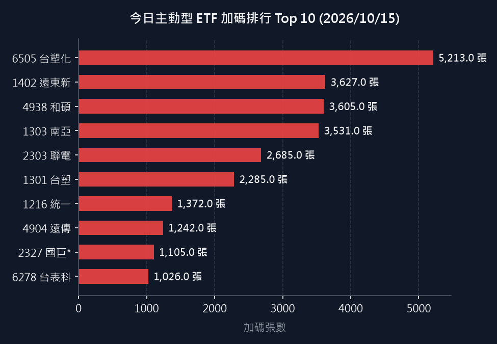
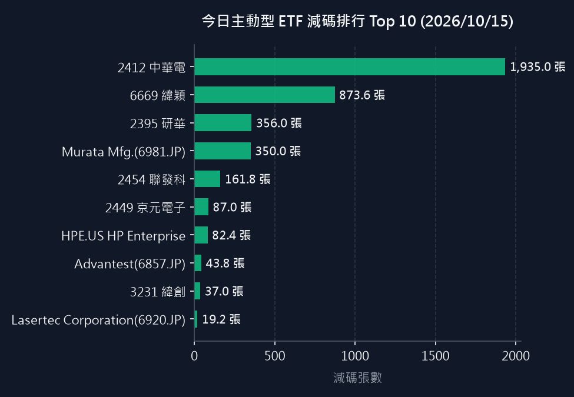

# 主動型 ETF 持股變動

資料來源：`主動型ETF持股明細.xlsx` 最近兩個日期分頁。

比較區間：`20261014` → `20261015`

## 今日加減碼視覺化排行

| 今日加碼 Top 10 | 今日減碼 Top 10 |
| :---: | :---: |
|  |  |

| ETF | 新增 | 刪除 | 比例變動 |
| :-- | --: | --: | --: |
| 00400A | 0 | 0 | 46 |
| 00401A | 0 | 0 | 58 |
| 00402A | 0 | 0 | 42 |
| 00403A | 0 | 0 | 30 |
| 00404A | 3 | 4 | 47 |
| 00405A | 0 | 0 | 23 |
| 00406A | 1 | 0 | 64 |
| 00407A | 0 | 0 | 42 |
| 00408A | 0 | 0 | 44 |
| 00980A | 0 | 0 | 47 |
| 00980D | 0 | 0 | 144 |
| 00981A | 0 | 0 | 27 |
| 00982A | 0 | 0 | 42 |
| 00983A | 0 | 1 | 35 |
| 00983D | 0 | 0 | 67 |
| 00984A | 0 | 0 | 73 |
| 00985A | 0 | 0 | 51 |
| 00986A | 0 | 0 | 37 |
| 00987A | 0 | 0 | 24 |
| 00988A | 1 | 0 | 36 |
| 00989A | 0 | 0 | 60 |
| 00990A | 2 | 0 | 40 |
| 00991A | 0 | 0 | 19 |
| 00992A | 0 | 0 | 41 |
| 00993A | 0 | 0 | 46 |
| 00994A | 0 | 1 | 40 |
| 00995A | 0 | 0 | 38 |
| 00996A | 0 | 0 | 50 |
| 00997A | 0 | 0 | 45 |
| 00998A | 0 | 0 | 50 |
| 00999A | 0 | 0 | 50 |

## 00400A

### 新增持股

- 無

### 刪除持股

- 無

### 投資比例變動

- 1303 南亞：4.72% → 4.47%（-0.25）
- 1476 儒鴻：0.07% → 0.08%（+0.01）
- 2059 川湖：2.53% → 2.58%（+0.05）
- 2303 聯電：1.93% → 1.91%（-0.02）
- 2308 台達電：2.75% → 2.64%（-0.11）
- 2313 華通：0.90% → 0.86%（-0.04）
- 2317 鴻海：0.76% → 0.78%（+0.02）
- 2327 國巨*：1.44% → 1.38%（-0.06）
- 2330 台積電：8.85% → 9.10%（+0.25）
- 2360 致茂：3.43% → 3.24%（-0.19）
- 2368 金像電：3.00% → 2.98%（-0.02）
- 2383 台光電：4.55% → 4.43%（-0.12）
- 2449 京元電子：0.96% → 0.93%（-0.03）
- 2454 聯發科：6.00% → 5.86%（-0.14）
- 2603 長榮：1.60% → 1.64%（+0.04）
- 2637 慧洋-KY：0.48% → 0.49%（+0.01）
- 2881 富邦金：1.62% → 1.69%（+0.07）
- 2891 中信金：1.52% → 1.63%（+0.11）
- 3008 大立光：1.59% → 1.60%（+0.01）
- 3017 奇鋐：3.54% → 3.46%（-0.08）
- 3036 文曄：1.55% → 1.57%（+0.02）
- 3037 欣興：4.11% → 3.92%（-0.19）
- 3044 健鼎：2.52% → 2.57%（+0.05）
- 3081 聯亞：0.77% → 0.74%（-0.03）
- 3167 大量：0.36% → 0.38%（+0.02）
- 3231 緯創：0.98% → 0.97%（-0.01）
- 3293 鈊象：0.35% → 0.37%（+0.02）
- 3374 精材：0.55% → 0.52%（-0.03）
- 3443 創意：2.60% → 2.54%（-0.06）
- 3529 力旺：1.23% → 1.19%（-0.04）
- 3653 健策：3.54% → 3.55%（+0.01）
- 3661 世芯-KY：2.35% → 2.32%（-0.03）
- 3665 貿聯-KY：1.66% → 1.57%（-0.09）
- 3711 日月光投控：1.13% → 1.06%（-0.07）
- 5274 信驊：1.61% → 1.54%（-0.07）
- 6121 新普：0.21% → 0.22%（+0.01）
- 6147 頎邦：0.97% → 0.95%（-0.02）
- 6187 萬潤：1.48% → 1.40%（-0.08）
- 6223 旺矽：3.46% → 3.27%（-0.19）
- 6278 台表科：0.76% → 1.89%（+1.13）
- 6488 環球晶：2.93% → 2.78%（-0.15）
- 6505 台塑化：2.39% → 2.34%（-0.05）
- 6669 緯穎：3.01% → 2.85%（-0.16）
- 7769 鴻勁：0.13% → 0.12%（-0.01）
- 9939 宏全：0.07% → 0.08%（+0.01）
- 台指選擇權 2026/10：0.05% → 0.01%（-0.04）

## 00401A

### 新增持股

- 無

### 刪除持股

- 無

### 投資比例變動

- 1216 統一：0.27% → 0.29%（+0.02）
- 1303 南亞：1.38% → 1.31%（-0.07）
- 1477 聚陽：0.89% → 0.96%（+0.07）
- 2059 川湖：0.79% → 0.81%（+0.02）
- 2303 聯電：2.32% → 2.30%（-0.02）
- 2308 台達電：2.38% → 2.29%（-0.09）
- 2313 華通：1.50% → 1.44%（-0.06）
- 2317 鴻海：0.54% → 0.56%（+0.02）
- 2327 國巨*：0.67% → 0.65%（-0.02）
- 2330 台積電：20.25% → 20.95%（+0.70）
- 2345 智邦：0.35% → 0.34%（-0.01）
- 2357 華碩：1.84% → 1.91%（+0.07）
- 2360 致茂：1.41% → 1.34%（-0.07）
- 2379 瑞昱：1.08% → 1.11%（+0.03）
- 2382 廣達：2.04% → 2.11%（+0.07）
- 2383 台光電：1.09% → 1.06%（-0.03）
- 2412 中華電：0.81% → 0.88%（+0.07）
- 2454 聯發科：6.12% → 6.02%（-0.10）
- 2455 全新：2.16% → 2.11%（-0.05）
- 2603 長榮：1.10% → 1.14%（+0.04）
- 2881 富邦金：2.07% → 2.17%（+0.10）
- 2882 國泰金：1.03% → 1.09%（+0.06）
- 2883 凱基金：1.63% → 1.71%（+0.08）
- 2884 玉山金：1.96% → 2.14%（+0.18）
- 2886 兆豐金：1.33% → 1.44%（+0.11）
- 2887 台新新光金：1.07% → 1.10%（+0.03）
- 2890 永豐金：0.29% → 0.31%（+0.02）
- 2891 中信金：1.55% → 1.67%（+0.12）
- 2912 統一超：0.25% → 0.27%（+0.02）
- 3008 大立光：2.39% → 2.42%（+0.03）
- 3034 聯詠：0.21% → 0.22%（+0.01）
- 3037 欣興：2.37% → 2.27%（-0.10）
- 3131 弘塑：0.68% → 0.66%（-0.02）
- 3231 緯創：1.64% → 1.63%（-0.01）
- 3491 昇達科：1.57% → 1.56%（-0.01）
- 3711 日月光投控：2.74% → 2.60%（-0.14）
- 4904 遠傳：0.75% → 0.82%（+0.07）
- 4938 和碩：0.32% → 0.33%（+0.01）
- 4958 臻鼎-KY：1.41% → 1.36%（-0.05）
- 4991 環宇-KY：0.66% → 0.61%（-0.05）
- 5274 信驊：1.86% → 1.71%（-0.15）
- 5347 世界：1.32% → 1.28%（-0.04）
- 5871 中租-KY：0.13% → 0.14%（+0.01）
- 5904 寶雅*：0.52% → 0.57%（+0.05）
- 6147 頎邦：1.46% → 1.42%（-0.04）
- 6187 萬潤：0.78% → 0.75%（-0.03）
- 6223 旺矽：1.73% → 1.65%（-0.08）
- 6515 穎崴：1.06% → 0.96%（-0.10）
- 6531 愛普*：1.57% → 1.50%（-0.07）
- 6669 緯穎：1.81% → 1.73%（-0.08）
- 7769 鴻勁：1.06% → 0.97%（-0.09）
- 7828 創新服務：1.58% → 1.57%（-0.01）
- 7856 漢測：0.73% → 0.69%（-0.04）
- 8464 億豐：0.97% → 1.04%（+0.07）
- 台股期貨10/26(FITXN*1.TF)：0.39% → 0.13%（-0.26）
- 臺指選擇權10/26 46000 買權：-0.07% → -0.04%（+0.03）
- 臺指選擇權10/26 46400 買權：-1.02% → -0.46%（+0.56）
- 臺指選擇權10/26 46800 買權：-0.05% → -0.02%（+0.03）

## 00402A

### 新增持股

- 無

### 刪除持股

- 無

### 投資比例變動

- AAPL.US Apple：7.50% → 7.85%（+0.35）
- ADI.US Analog Devices：1.92% → 1.95%（+0.03）
- AMD.US AMD：6.08% → 5.97%（-0.11）
- AMZN.US Amazon：4.24% → 4.34%（+0.10）
- ARM.US Arm：0.85% → 0.83%（-0.02）
- AVGO.US Broadcom：2.17% → 2.19%（+0.02）
- AXON.US Axon Enterprise：0.55% → 0.57%（+0.02）
- BABA.US Alibaba Group：0.48% → 0.50%（+0.02）
- BKNG.US Booking Holdings：0.49% → 0.52%（+0.03）
- CDNS.US Cadence Design Systems：1.45% → 1.49%（+0.04）
- CIEN.US Ciena：1.23% → 1.15%（-0.08）
- CLS.US Celestica：1.36% → 1.28%（-0.08）
- COHR.US Coherent：1.33% → 1.25%（-0.08）
- CRWD.US CrowdStrike Holdings：1.63% → 1.62%（-0.01）
- FSLY.US Fastly：0.38% → 0.36%（-0.02）
- GOOG.US Alphabet - Class C Capital Stock：3.33% → 3.41%（+0.08）
- GOOGL.US Alphabet - Class A Common Stock：3.36% → 3.43%（+0.07）
- INTC.US Intel：1.50% → 1.49%（-0.01）
- IOT.US Samsara：0.52% → 0.54%（+0.02）
- KLAC.US KLA：1.57% → 1.59%（+0.02）
- LITE.US Lumentum：1.87% → 1.77%（-0.10）
- LRCX.US Lam Research：2.57% → 2.55%（-0.02）
- META.US Meta：3.87% → 3.90%（+0.03）
- MRVL.US Marvell：1.74% → 1.65%（-0.09）
- MSFT.US Microsoft：5.28% → 5.39%（+0.11）
- MU.US Micron：5.58% → 5.57%（-0.01）
- NFLX.US Netflix：0.95% → 0.99%（+0.04）
- NOW.US ServiceNow：1.03% → 1.08%（+0.05）
- NVDA.US NVIDIA：8.67% → 8.70%（+0.03）
- PANW.US Palo Alto：2.92% → 2.87%（-0.05）
- PLTR.US Palantir Technologies：2.21% → 2.22%（+0.01）
- SHOP.US Shopify：1.19% → 1.21%（+0.02）
- SIMO.US Silicon Motion：0.52% → 0.49%（-0.03）
- SKHY.US SK hynix：1.12% → 1.10%（-0.02）
- SNOW.US Snowflake：1.38% → 1.34%（-0.04）
- SPCX.US SpaceX：0.74% → 0.75%（+0.01）
- SPOT.US Spotify：0.35% → 0.37%（+0.02）
- TER.US Teradyne：0.81% → 0.79%（-0.02）
- TSM.US TSMC(ADR)：1.49% → 1.50%（+0.01）
- TTWO.US Take-Two：0.55% → 0.57%（+0.02）
- TXN.US Texas Instruments：2.34% → 2.38%（+0.04）
- V.US Visa：1.15% → 1.18%（+0.03）

## 00403A

### 新增持股

- 無

### 刪除持股

- 無

### 投資比例變動

- 1303 南亞：2.88% → 2.76%（-0.12）
- 2059 川湖：0.54% → 0.56%（+0.02）
- 2308 台達電：3.71% → 3.61%（-0.10）
- 2313 華通：0.22% → 0.21%（-0.01）
- 2317 鴻海：0.56% → 0.58%（+0.02）
- 2327 國巨*：3.96% → 3.85%（-0.11）
- 2330 台積電：13.75% → 14.34%（+0.59）
- 2345 智邦：2.35% → 2.38%（+0.03）
- 2368 金像電：0.43% → 0.44%（+0.01）
- 2383 台光電：5.54% → 5.47%（-0.07）
- 2408 南亞科：0.97% → 0.94%（-0.03）
- 2449 京元電子：0.85% → 0.83%（-0.02）
- 2454 聯發科：6.26% → 5.40%（-0.86）
- 2455 全新：0.08% → 0.07%（-0.01）
- 2882 國泰金：0.33% → 0.35%（+0.02）
- 3008 大立光：1.65% → 1.69%（+0.04）
- 3017 奇鋐：4.99% → 4.94%（-0.05）
- 3037 欣興：5.95% → 5.74%（-0.21）
- 3189 景碩：3.35% → 3.32%（-0.03）
- 3211 順達：0.52% → 0.53%（+0.01）
- 3443 創意：3.87% → 3.83%（-0.04）
- 3583 辛耘：0.41% → 0.40%（-0.01）
- 3653 健策：5.65% → 5.76%（+0.11）
- 3665 貿聯-KY：2.34% → 2.24%（-0.10）
- 5274 信驊：1.83% → 1.77%（-0.06）
- 6223 旺矽：3.93% → 3.76%（-0.17）
- 6274 台燿：2.71% → 2.85%（+0.14）
- 6488 環球晶：0.22% → 0.21%（-0.01）
- 6669 緯穎：2.58% → 2.47%（-0.11）
- 8996 高力：2.27% → 2.18%（-0.09）

## 00404A

### 新增持股

- 台指選擇權11/26 50900 買權（-0.21%，-0.403 張）
- 台指選擇權12/26 51800 買權（-0.02%，-0.021 張）
- 台股期貨11/26(FITXN*1.TF)（7.37%，0.031 張）

### 刪除持股

- 台指選擇權10/26 49100 買權（-0.11%，-0.227 張）
- 台指選擇權11/26 50300 買權（-0.01%，-0.011 張）
- 台指選擇權11/26 52300 買權（-0.08%，-0.175 張）
- 台指選擇權12/26 53300 買權（-0.01%，-0.009 張）

### 投資比例變動

- 1303 南亞：0.89% → 0.84%（-0.05）
- 2059 川湖：0.48% → 0.49%（+0.01）
- 2301 光寶科：0.56% → 0.55%（-0.01）
- 2303 聯電：2.71% → 2.66%（-0.05）
- 2308 台達電：1.73% → 1.64%（-0.09）
- 2317 鴻海：0.63% → 0.65%（+0.02）
- 2330 台積電：22.35% → 22.83%（+0.48）
- 2347 聯強：1.98% → 2.06%（+0.08）
- 2351 順德：0.37% → 0.38%（+0.01）
- 2357 華碩：1.20% → 1.23%（+0.03）
- 2360 致茂：0.49% → 0.46%（-0.03）
- 2379 瑞昱：1.11% → 1.14%（+0.03）
- 2382 廣達：0.95% → 0.97%（+0.02）
- 2383 台光電：2.94% → 2.84%（-0.10）
- 2395 研華：1.28% → 1.30%（+0.02）
- 2436 偉詮電：1.13% → 1.14%（+0.01）
- 2454 聯發科：6.66% → 6.46%（-0.20）
- 2637 慧洋-KY：1.13% → 1.15%（+0.02）
- 2882 國泰金：2.76% → 2.87%（+0.11）
- 2885 元大金：2.47% → 2.59%（+0.12）
- 2887 台新新光金：1.46% → 1.48%（+0.02）
- 2890 永豐金：1.38% → 1.49%（+0.11）
- 3017 奇鋐：1.28% → 1.24%（-0.04）
- 3034 聯詠：2.07% → 2.18%（+0.11）
- 3037 欣興：0.29% → 0.27%（-0.02）
- 3293 鈊象：1.18% → 1.23%（+0.05）
- 3374 精材：0.12% → 0.11%（-0.01）
- 3443 創意：1.00% → 0.97%（-0.03）
- 3680 家登：0.50% → 0.49%（-0.01）
- 3711 日月光投控：3.51% → 3.29%（-0.22）
- 5274 信驊：2.73% → 2.59%（-0.14）
- 5434 崇越：1.76% → 1.77%（+0.01）
- 5876 上海商銀：1.47% → 1.58%（+0.11）
- 5904 寶雅*：0.48% → 0.51%（+0.03）
- 6196 帆宣：1.81% → 1.76%（-0.05）
- 6206 飛捷：0.72% → 0.75%（+0.03）
- 6223 旺矽：1.21% → 1.14%（-0.07）
- 6257 矽格：1.85% → 1.80%（-0.05）
- 6491 晶碩：0.85% → 0.88%（+0.03）
- 6505 台塑化：0.54% → 0.53%（-0.01）
- 6669 緯穎：0.97% → 0.91%（-0.06）
- 7769 鴻勁：1.12% → 1.05%（-0.07）
- 8016 矽創：1.23% → 1.28%（+0.05）
- 8081 致新：0.85% → 0.87%（+0.02）
- 8299 群聯：1.19% → 1.15%（-0.04）
- iShares MSCI Japan SRI ETF(2851.JP)：1.18% → 1.26%（+0.08）
- 台股期貨10/26(FITXN*1.TF)：20.78% → 9.70%（-11.08）

## 00405A

### 新增持股

- 無

### 刪除持股

- 無

### 投資比例變動

- 1590 亞德客-KY：0.00% → 0.01%（+0.01）
- 2059 川湖：2.08% → 2.17%（+0.09）
- 2308 台達電：0.70% → 0.68%（-0.02）
- 2330 台積電：1.85% → 1.95%（+0.10）
- 2345 智邦：5.19% → 5.31%（+0.12）
- 2368 金像電：5.91% → 5.99%（+0.08）
- 2383 台光電：4.87% → 4.85%（-0.02）
- 2395 研華：0.01% → 0.02%（+0.01）
- 3037 欣興：7.54% → 7.35%（-0.19）
- 3653 健策：7.65% → 7.86%（+0.21）
- 3665 貿聯-KY：6.18% → 5.99%（-0.19）
- 5274 信驊：5.77% → 5.65%（-0.12）
- 6187 萬潤：0.95% → 0.92%（-0.03）
- 6223 旺矽：7.91% → 7.65%（-0.26）
- 6274 台燿：2.21% → 2.22%（+0.01）
- 6515 穎崴：0.54% → 0.52%（-0.02）
- 6526 達發：0.49% → 0.51%（+0.02）
- 6531 愛普*：3.95% → 3.82%（-0.13）
- 6669 緯穎：0.87% → 0.84%（-0.03）
- 6805 富世達：3.11% → 3.22%（+0.11）
- 7769 鴻勁：2.88% → 2.80%（-0.08）
- 8046 南電：7.73% → 7.81%（+0.08）
- 8996 高力：1.40% → 1.36%（-0.04）

## 00406A

### 新增持股

- 4938 和碩（0.41%，3600 張）

### 刪除持股

- 無

### 投資比例變動

- 1303 南亞：0.95% → 1.13%（+0.18）
- 1326 台化：0.27% → 0.22%（-0.05）
- 1560 中砂：0.51% → 0.44%（-0.07）
- 2059 川湖：1.02% → 0.89%（-0.13）
- 2303 聯電：1.95% → 1.85%（-0.10）
- 2308 台達電：2.71% → 2.61%（-0.10）
- 2317 鴻海：0.43% → 0.39%（-0.04）
- 2327 國巨*：1.61% → 1.85%（+0.24）
- 2330 台積電：9.39% → 9.45%（+0.06）
- 2344 華邦電：0.25% → 0.21%（-0.04）
- 2345 智邦：3.79% → 3.76%（-0.03）
- 2360 致茂：1.22% → 1.29%（+0.07）
- 2368 金像電：0.98% → 1.04%（+0.06）
- 2383 台光電：6.56% → 6.89%（+0.33）
- 2395 研華：0.11% → 0.10%（-0.01）
- 2449 京元電子：0.50% → 0.41%（-0.09）
- 2454 聯發科：5.95% → 5.63%（-0.32）
- 2481 強茂：0.38% → 0.48%（+0.10）
- 2486 一詮：0.24% → 0.20%（-0.04）
- 2885 元大金：0.79% → 0.72%（-0.07）
- 2886 兆豐金：0.16% → 0.15%（-0.01）
- 3008 大立光：0.69% → 0.89%（+0.20）
- 3017 奇鋐：5.25% → 5.07%（-0.18）
- 3037 欣興：5.79% → 5.36%（-0.43）
- 3081 聯亞：0.36% → 0.30%（-0.06）
- 3105 穩懋：0.15% → 0.12%（-0.03）
- 3131 弘塑：0.07% → 0.06%（-0.01）
- 3167 大量：0.80% → 0.72%（-0.08）
- 3189 景碩：1.65% → 1.68%（+0.03）
- 3264 欣銓：0.21% → 0.18%（-0.03）
- 3363 上詮：0.28% → 0.23%（-0.05）
- 3443 創意：2.28% → 2.18%（-0.10）
- 3450 聯鈞：0.20% → 0.17%（-0.03）
- 3491 昇達科：0.59% → 0.50%（-0.09）
- 3529 力旺：0.27% → 0.23%（-0.04）
- 3653 健策：3.65% → 3.69%（+0.04）
- 3661 世芯-KY：0.65% → 0.77%（+0.12）
- 3665 貿聯-KY：2.20% → 1.78%（-0.42）
- 3711 日月光投控：2.23% → 2.20%（-0.03）
- 4958 臻鼎-KY：1.06% → 1.01%（-0.05）
- 5274 信驊：2.25% → 2.07%（-0.18）
- 6139 亞翔：0.07% → 0.06%（-0.01）
- 6147 頎邦：0.73% → 0.71%（-0.02）
- 6187 萬潤：0.31% → 0.26%（-0.05）
- 6213 聯茂：0.55% → 0.46%（-0.09）
- 6223 旺矽：3.31% → 2.95%（-0.36）
- 6274 台燿：1.52% → 1.28%（-0.24）
- 6285 啟碁：0.10% → 0.09%（-0.01）
- 6488 環球晶：0.48% → 0.39%（-0.09）
- 6510 精測：1.13% → 0.92%（-0.21）
- 6515 穎崴：0.39% → 0.31%（-0.08）
- 6531 愛普*：0.19% → 0.16%（-0.03）
- 6669 緯穎：1.92% → 1.91%（-0.01）
- 6715 嘉基：0.49% → 0.70%（+0.21）
- 6805 富世達：0.06% → 0.05%（-0.01）
- 7769 鴻勁：0.30% → 0.25%（-0.05）
- 8046 南電：3.10% → 3.03%（-0.07）
- 8150 南茂：0.07% → 0.06%（-0.01）
- 8358 金居：0.15% → 0.12%（-0.03）
- 8996 高力：0.33% → 0.27%（-0.06）
- 臺指選擇權：-4.64% → -2.02%（+2.62）
- 臺指選擇權第三週週五到期契約：-1.93% → -15.49%（-13.56）
- 臺股期貨 202610(FITXN*1.TF)：13.69% → 11.86%（-1.83）
- 臺股期貨 202611(FITXN*1.TF)：8.74% → 8.66%（-0.08）

## 00407A

### 新增持股

- 無

### 刪除持股

- 無

### 投資比例變動

- 1303 南亞：1.09% → 1.04%（-0.05）
- 1560 中砂：1.03% → 1.05%（+0.02）
- 2059 川湖：1.79% → 1.86%（+0.07）
- 2301 光寶科：1.47% → 1.49%（+0.02）
- 2308 台達電：2.58% → 2.52%（-0.06）
- 2327 國巨*：2.51% → 2.45%（-0.06）
- 2330 台積電：9.25% → 9.68%（+0.43）
- 2345 智邦：2.20% → 2.24%（+0.04）
- 2360 致茂：1.06% → 1.02%（-0.04）
- 2368 金像電：1.33% → 1.74%（+0.41）
- 2379 瑞昱：0.24% → 0.25%（+0.01）
- 2383 台光電：5.56% → 5.51%（-0.05）
- 2408 南亞科：0.92% → 0.89%（-0.03）
- 2451 創見：0.31% → 0.32%（+0.01）
- 2454 聯發科：5.39% → 5.35%（-0.04）
- 2615 萬海：1.03% → 1.05%（+0.02）
- 3008 大立光：1.60% → 1.64%（+0.04）
- 3017 奇鋐：5.56% → 5.53%（-0.03）
- 3034 聯詠：0.76% → 0.82%（+0.06）
- 3037 欣興：5.82% → 5.64%（-0.18）
- 3081 聯亞：1.46% → 1.43%（-0.03）
- 3131 弘塑：0.85% → 0.82%（-0.03）
- 3231 緯創：0.73% → 0.74%（+0.01）
- 3260 威剛：0.29% → 0.30%（+0.01）
- 3293 鈊象：0.62% → 0.66%（+0.04）
- 3443 創意：4.72% → 4.69%（-0.03）
- 3653 健策：3.67% → 3.75%（+0.08）
- 3665 貿聯-KY：2.78% → 2.68%（-0.10）
- 3711 日月光投控：3.18% → 3.06%（-0.12）
- 4958 臻鼎-KY：1.06% → 1.04%（-0.02）
- 5274 信驊：1.32% → 1.29%（-0.03）
- 5434 崇越：0.22% → 0.23%（+0.01）
- 6187 萬潤：1.76% → 1.69%（-0.07）
- 6223 旺矽：3.00% → 2.89%（-0.11）
- 6274 台燿：4.18% → 4.19%（+0.01）
- 6446 藥華藥：0.31% → 0.34%（+0.03）
- 6510 精測：1.37% → 1.32%（-0.05）
- 6531 愛普*：0.32% → 0.31%（-0.01）
- 6669 緯穎：3.67% → 3.53%（-0.14）
- 6805 富世達：1.10% → 1.13%（+0.03）
- 8046 南電：3.09% → 3.39%（+0.30）
- 8996 高力：1.35% → 1.30%（-0.05）

## 00408A

### 新增持股

- 無

### 刪除持股

- 無

### 投資比例變動

- 1216 統一：0.10% → 0.11%（+0.01）
- 1303 南亞：3.97% → 3.79%（-0.18）
- 2303 聯電：1.73% → 1.42%（-0.31）
- 2308 台達電：3.32% → 2.63%（-0.69）
- 2327 國巨*：0.96% → 0.93%（-0.03）
- 2330 台積電：6.10% → 6.39%（+0.29）
- 2345 智邦：0.82% → 0.83%（+0.01）
- 2357 華碩：1.98% → 2.06%（+0.08）
- 2360 致茂：1.20% → 1.14%（-0.06）
- 2376 技嘉：1.30% → 1.35%（+0.05）
- 2383 台光電：4.96% → 4.88%（-0.08）
- 2395 研華：1.62% → 1.67%（+0.05）
- 2408 南亞科：1.34% → 1.30%（-0.04）
- 2449 京元電子：1.03% → 0.90%（-0.13）
- 2454 聯發科：3.58% → 3.53%（-0.05）
- 2542 興富發：3.57% → 3.75%（+0.18）
- 2603 長榮：0.53% → 0.54%（+0.01）
- 2880 華南金：1.14% → 1.23%（+0.09）
- 3008 大立光：1.37% → 1.40%（+0.03）
- 3017 奇鋐：3.07% → 1.50%（-1.57）
- 3026 禾伸堂：0.85% → 0.86%（+0.01）
- 3037 欣興：3.31% → 2.28%（-1.03）
- 3081 聯亞：2.21% → 2.14%（-0.07）
- 3105 穩懋：0.52% → 0.50%（-0.02）
- 3189 景碩：2.87% → 2.83%（-0.04）
- 3264 欣銓：0.80% → 0.81%（+0.01）
- 3653 健策：3.67% → 3.72%（+0.05）
- 3665 貿聯-KY：1.18% → 1.12%（-0.06）
- 3711 日月光投控：1.59% → 1.52%（-0.07）
- 5434 崇越：2.30% → 2.36%（+0.06）
- 6187 萬潤：1.13% → 1.08%（-0.05）
- 6223 旺矽：2.27% → 2.17%（-0.10）
- 6239 力成：1.33% → 1.28%（-0.05）
- 6274 台燿：3.70% → 3.67%（-0.03）
- 6488 環球晶：0.95% → 0.91%（-0.04）
- 6510 精測：0.43% → 0.41%（-0.02）
- 6526 達發：0.32% → 0.33%（+0.01）
- 6669 緯穎：3.77% → 3.60%（-0.17）
- 6691 洋基工程：0.34% → 0.35%（+0.01）
- 6805 富世達：1.32% → 1.34%（+0.02）
- 7769 鴻勁：0.58% → 0.55%（-0.03）
- 8046 南電：1.62% → 1.61%（-0.01）
- 8996 高力：2.02% → 1.93%（-0.09）
- 9802 鈺齊-KY：0.85% → 0.90%（+0.05）

## 00980A

### 新增持股

- 無

### 刪除持股

- 無

### 投資比例變動

- 1303 南亞：4.27% → 4.09%（-0.18）
- 2059 川湖：4.00% → 4.13%（+0.13）
- 2308 台達電：3.65% → 3.55%（-0.10）
- 2317 鴻海：1.99% → 2.08%（+0.09）
- 2327 國巨*：1.54% → 1.50%（-0.04）
- 2330 台積電：9.49% → 9.89%（+0.40）
- 2344 華邦電：1.92% → 1.91%（-0.01）
- 2345 智邦：1.47% → 1.49%（+0.02）
- 2360 致茂：1.69% → 1.61%（-0.08）
- 2368 金像電：2.15% → 2.16%（+0.01）
- 2376 技嘉：0.87% → 0.90%（+0.03）
- 2382 廣達：1.17% → 1.22%（+0.05）
- 2383 台光電：4.64% → 4.58%（-0.06）
- 2408 南亞科：2.67% → 2.59%（-0.08）
- 2454 聯發科：5.64% → 5.58%（-0.06）
- 2884 玉山金：0.71% → 0.78%（+0.07）
- 2891 中信金：1.01% → 1.09%（+0.08）
- 3008 大立光：1.32% → 1.35%（+0.03）
- 3017 奇鋐：2.25% → 2.23%（-0.02）
- 3026 禾伸堂：1.24% → 1.25%（+0.01）
- 3036 文曄：0.99% → 1.01%（+0.02）
- 3037 欣興：3.75% → 3.62%（-0.13）
- 3044 健鼎：0.60% → 0.62%（+0.02）
- 3081 聯亞：2.36% → 2.30%（-0.06）
- 3189 景碩：1.41% → 1.40%（-0.01）
- 3264 欣銓：0.91% → 0.94%（+0.03）
- 3293 鈊象：0.84% → 0.89%（+0.05）
- 3443 創意：2.46% → 2.44%（-0.02）
- 3529 力旺：0.64% → 0.63%（-0.01）
- 3653 健策：3.72% → 3.79%（+0.07）
- 3665 貿聯-KY：0.55% → 0.52%（-0.03）
- 3711 日月光投控：2.35% → 2.25%（-0.10）
- 5274 信驊：1.80% → 1.74%（-0.06）
- 5904 寶雅*：0.82% → 0.89%（+0.07）
- 6213 聯茂：1.09% → 1.08%（-0.01）
- 6223 旺矽：2.20% → 2.11%（-0.09）
- 6274 台燿：1.26% → 1.25%（-0.01）
- 6515 穎崴：1.73% → 1.66%（-0.07）
- 6669 緯穎：1.66% → 1.59%（-0.07）
- 6805 富世達：0.60% → 0.61%（+0.01）
- 6831 邁科：0.44% → 0.42%（-0.02）
- 7751 竑騰：0.78% → 0.76%（-0.02）
- 7769 鴻勁：3.01% → 2.90%（-0.11）
- 8210 勤誠：0.41% → 0.43%（+0.02）
- 8299 群聯：1.67% → 1.66%（-0.01）
- 8996 高力：0.49% → 0.47%（-0.02）
- 台灣證交所加權股價指數(FITXN*1.TF)：1.48% → 1.52%（+0.04）

## 00980D

### 新增持股

- 無

### 刪除持股

- 無

### 投資比例變動

- AHOLD FINANCE USA LLC 6.88% 01MAY2029：0.49% → 0.50%（+0.01）
- ALLY FINANCIAL INC (REG) 7.1% 15NOV2027：0.44% → 0.45%（+0.01）
- ALLY FINANCIAL INC (REG) 8% 01/11/2031：0.58% → 0.59%（+0.01）
- ALLY FINANCIAL INC (REG) 8% 01NOV2031：0.53% → 0.54%（+0.01）
- ALLY FINANCIAL INC (REG) VAR 03JAN2030：0.64% → 0.65%（+0.01）
- ALLY FINANCIAL INC (REG) VAR 13JUN2029：0.56% → 0.57%（+0.01）
- ANHEUSER-BUSCH INBEV WOR (REG) 8.2% 15JAN2039：0.51% → 0.53%（+0.02）
- APOLLO DEBT SOLUTIONS BD 6.900000 % 13APR2029：0.56% → 0.57%（+0.01）
- ARCELORMITTAL SA 6.55% 29NOV2027：0.56% → 0.57%（+0.01）
- ARIS WATER HOLDINGS LLC SER REGS 7.250000 % 01APR2030：0.48% → 0.49%（+0.01）
- ASURION LLC/ASURION CO 8.375% 01FEB2034：0.42% → 0.39%（-0.03）
- ATHENE HOLDING LTD (REG) 6.25% 01APR2054：0.75% → 0.76%（+0.01）
- ATHENE HOLDING LTD 6.625000 % 19MAY2055：0.56% → 0.57%（+0.01）
- AVIANCA MIDCO 2 PLC SER REGS 10.25 % 07-JAN-2032：0.27% → 0.28%（+0.01）
- AVIANCA MIDCO 2 PLC SER REGS 9.625000 % 14FEB2030：0.27% → 0.28%（+0.01）
- BANCO SANTANDER SA (REG) 6.607% 07NOV2028：0.67% → 0.68%（+0.01）
- BANK OF AMERICA CORP (REG) 7.75% 14MAY2038：0.51% → 0.52%（+0.01）
- BARCLAYS PLC (REG) VAR 27JUN2034：0.34% → 0.35%（+0.01）
- BAT CAPITAL CORP (REG) 7.081% 02AUG2053：0.57% → 0.58%（+0.01）
- BAT CAPITAL CORP (REG) 7.75% 19OCT2032：0.45% → 0.46%（+0.01）
- BLUE OWL CREDIT INCOME (REG) 6.6% 15SEP2029：0.39% → 0.40%（+0.01）
- BLUE OWL CREDIT INCOME (REG) 6.65% 15MAR2031：0.53% → 0.54%（+0.01）
- BLUE OWL CREDIT INCOME 7.750000 % 15JAN2029：0.54% → 0.55%（+0.01）
- BLUE OWL CREDIT INCOME 7.950000 % 13JUN2028：0.54% → 0.55%（+0.01）
- BLUE OWL CREDIT INCOME SER WI (REG) 7.75% 16SEP2027：0.56% → 0.57%（+0.01）
- BLUE OWL TECHNOLOGY FIN CORP II 6.75 % 04APR2029：0.56% → 0.57%（+0.01）
- BOSTON PROPERTIES LP (REG) 6.750000 % 01-DEC-2027：0.47% → 0.48%（+0.01）
- BPCE SA SER REGS VAR 14JAN2046：0.38% → 0.39%（+0.01）
- BPCE SA SER REGS VAR 19OCT2034：0.42% → 0.43%（+0.01）
- BRIGHTHOUSE FINANCIAL IN (REG) 4.7% 22JUN2047：0.47% → 0.48%（+0.01）
- BRITISH TELECOMMUNICATIO (BR) 9.625% 15DEC2030：0.58% → 0.59%（+0.01）
- CAPITAL ONE FINANCIAL CO SER . (REG) VAR 30OCT2031：0.59% → 0.60%（+0.01）
- CHARTER COMM OPT 6.484% 23OCT2045 W/I：0.43% → 0.44%（+0.01）
- CHARTER COMM OPT LLC/CAP (REG) 6.834000 % 23OCT2055：0.43% → 0.44%（+0.01）
- CHC GROUP LLC SER REGS 11.750000 % 01-SEP-2030：0.44% → 0.45%（+0.01）
- CHS/COMMUNITY HEALTH SYS SER REGS 10.875000 % 15JAN2032：0.50% → 0.51%（+0.01）
- CHS/COMMUNITY HEALTH SYS SER REGS 9.750000 % 15JAN2034：0.33% → 0.34%（+0.01）
- CITIGROUP INC 8.125% 15JUL2039：0.62% → 0.63%（+0.01）
- CIVITAS RESOURCES INC SER REGS (REG) (REG S) 9.625% 15JUN2033：0.56% → 0.57%（+0.01）
- CONCENTRIX CORP (REG) 6.6% 02AUG2028：0.53% → 0.54%（+0.01）
- CONCENTRIX CORP (REG) 6.85% 02AUG2033：0.71% → 0.72%（+0.01）
- CONOCOPHILLIPS COMPANY (REG) 6.95% 15APR2029：0.52% → 0.53%（+0.01）
- CONSOLIDATED ENERGY FIN SER REGS 12.000000 % 15FEB2031：0.58% → 0.59%（+0.01）
- COREWEAVE INC SER REGS (REG S) 9.25% 01JUN2030：0.41% → 0.40%（-0.01）
- COX COMMUNICATIONS INC SER REGS 5.800000 % 15DEC2053：0.49% → 0.50%（+0.01）
- COX COMMUNICATIONS INC SER REGS 5.950000 % 01SEP2054：0.52% → 0.53%（+0.01）
- DAIMLER FINANCE NA LLC REG 8.5% 18JAN2031：0.64% → 0.65%（+0.01）
- DELL INT LLC / EMC CORP (REG) 8.1% 15JUL2036：0.58% → 0.59%（+0.01）
- DELL INT LLC / EMC CORP (REG) 8.35% 15JUL2046：0.55% → 0.56%（+0.01）
- DEUTSCHE BANK NY VAR 20NOV2029：0.47% → 0.48%（+0.01）
- DEUTSCHE TELEKOM INT FIN (REG) 8.75% 15JUN2030：0.41% → 0.42%（+0.01）
- DEUTSCHE TELEKOM INT FIN (REG) 9.25% 01JUN2032：0.42% → 0.43%（+0.01）
- DEVON ENERGY CORPORATION (REG) 7.875% 30SEP2031：0.47% → 0.48%（+0.01）
- DIRECTV FIN LLC/COINC SER REGS 10.000000 % 15FEB2031：0.41% → 0.42%（+0.01）
- DISCOVER FINANCIAL SVS (REG) VAR 02NOV2034：0.63% → 0.65%（+0.02）
- DOW CHEMICAL CO/THE (REG) 5.55% 30NOV2048：0.45% → 0.46%（+0.01）
- DOW CHEMICAL CO/THE (REG) 5.6% 15FEB2054：0.59% → 0.61%（+0.02）
- DOW CHEMICAL CO/THE 6.9% 15MAY2053：0.60% → 0.61%（+0.01）
- DOW CHEMICAL CO/THE 7.375% 01NOV2029：0.62% → 0.63%（+0.01）
- DOW CHEMICAL CO/THE 9.4% 15MAY2039：0.54% → 0.55%（+0.01）
- EDISON INTERNATIONAL (REG) 6.95% 15NOV2029：0.58% → 0.59%（+0.01）
- ENBRIDGE ENERGY PARTNERS (REG) 7.375% 15OCT2045：0.51% → 0.52%（+0.01）
- ENEL FINANCE INTL NV SER REGS (REG S) 7.5% 14OCT2032：0.35% → 0.36%（+0.01）
- ENEL FINANCE INTL NV SER REGS (REG S) 7.75% 14OCT2052：0.36% → 0.37%（+0.01）
- F&G ANNUITIES & LIFE INC 6.250000 % 04OCT2034：0.49% → 0.50%（+0.01）
- FIFTH THIRD BANCORP (REG) 8.25% 01MAR2038：0.64% → 0.65%（+0.01）
- FORD MOTOR COMPANY (REG) 7.45% 16JUL2031：0.47% → 0.48%（+0.01）
- FORD MOTOR CREDIT CO LLC 6.500000 % 07FEB2035：0.32% → 0.33%（+0.01）
- GENERAL MOTORS CO (REG) 6.75% 01APR2046：0.56% → 0.57%（+0.01）
- GENERAL MOTORS CO (REG) 6.8% 01OCT2027：0.57% → 0.58%（+0.01）
- GEORGIA-PACIFIC LLC (REG) 7.75% 15NOV2029：0.58% → 0.59%（+0.01）
- GLENCORE FINANCE CANADA SER REGS 6.900000 % 15-NOV-2037：0.39% → 0.40%（+0.01）
- GLOBAL ATLANTIC FIN CO SER REGS 6.750000 % 15MAR2054：0.61% → 0.62%（+0.01）
- GLOBAL ATLANTIC FIN CO SER REGS 7.950000 % 15JUN2033：0.66% → 0.67%（+0.01）
- GLOBAL AUTO HO/AAG FH UK SER REGS (REG S) 8.75% 15JAN2032：0.42% → 0.41%（-0.01）
- GRAY TELEVISION INC SER REGS (REG) (REG S) 10.5% 15JUL2029：0.20% → 0.21%（+0.01）
- HA SUSTAINABLE INF CAP (REG) 6.375% 01JUL2034：0.34% → 0.35%（+0.01）
- HERTZ CORP/THE SER REGS (REG S) 12.625% 15JUL2029：0.32% → 0.31%（-0.01）
- HESS CORP (REG) 7.3% 15AUG2031：0.53% → 0.54%（+0.01）
- HISCOX LTD VAR 11JUN2036：0.43% → 0.44%（+0.01）
- HORIZON MUTUAL HOLDINGS SER REGS 6.200000 % 15NOV2034：0.32% → 0.33%（+0.01）
- HPS CORPORATE LENDING FU 6.750000 % 30JAN2029：0.54% → 0.55%（+0.01）
- HUTCHISON WHAM INT 03/33 SER REGS (REG S) 7.45% 24NOV2033：0.40% → 0.41%（+0.01）
- ICAHN ENTERPRISES/FIN (REG) 9.75% 15JAN2029：0.32% → 0.33%（+0.01）
- ICAHN ENTERPRISES/FIN SER REGS 10.000000 % 15NOV2029：0.32% → 0.33%（+0.01）
- INTESA SANPAOLO SPA SER REGS (REG S) 7.8% 28NOV2053：0.36% → 0.37%（+0.01）
- JBS USA HOLD/FOOD/LUX CO 7.250000 % 15NOV2053：0.46% → 0.47%（+0.01）
- JBS USA/FOOD/FINANCE (REG) 6.5% 01DEC2052：0.45% → 0.46%（+0.01）
- JETBLUE AIRWAYS/LOYALTY SER REGS (REG S) 9.875% 20SEP2031：0.37% → 0.35%（-0.02）
- KELLANOVA SER B (REG) 7.450000 % 01APR2031：0.57% → 0.58%（+0.01）
- KYNDRYL HOLDINGS INC 7.8 % 28-SEP-2029：0.41% → 0.42%（+0.01）
- LADDER CAP FIN LLLP/CORP SER REGS 7.000000 % 15JUL2031：0.33% → 0.34%（+0.01）
- LINCOLN NATIONAL CORP (REG) 7.000000 % 15JUN2040：0.45% → 0.46%（+0.01）
- LPL HOLDINGS INC (REG) 6.75% 17NOV2028：0.57% → 0.58%（+0.01）
- M&T BANK CORPORATION (REG) VAR 30OCT2029：0.55% → 0.56%（+0.01）
- META PLATFORMS INC 5.750000 % 15-NOV-2065：0.41% → 0.42%（+0.01）
- METLIFE INC (REG) 10.75% 01AUG2039：0.45% → 0.46%（+0.01）
- MOHEGAN TRIBAL / MS DIG SER REGS 11.875000 % 15APR2031：0.68% → 0.69%（+0.01）
- MPLX LP 6.200000 % 15SEP2055：0.33% → 0.34%（+0.01）
- MYLAN INC (REG) 5.4% 29/11/2043：0.33% → 0.34%（+0.01）
- MYLAN INC SER WI (REG) 5.2% 15APR2048WI：0.49% → 0.50%（+0.01）
- MYLAN NV 5.25% 15JUN2046 WI：0.53% → 0.54%（+0.01）
- NEPTUNE BIDCO US INC SER REGS (REG S) 9.29% 15APR2029：0.35% → 0.36%（+0.01）
- NISSAN MOTOR CO SER REGS 8.125000 % 17JUL2035：0.51% → 0.52%（+0.01）
- OCCIDENTAL PETROLEUM COR (REG) 7.5% 01MAY2031：0.33% → 0.34%（+0.01）
- OCCIDENTAL PETROLEUM COR 8.875% 15JUL2030：0.56% → 0.57%（+0.01）
- ONEOK INC 6.625% 01SEP2053：0.58% → 0.59%（+0.01）
- ORACLE CORP 6.125000 % 03AUG2065：0.53% → 0.54%（+0.01）
- ORACLE CORP 6.85 % 04-FEB-2066：0.53% → 0.54%（+0.01）
- ORANGE SA (REG) 9% 01MAR2031：0.66% → 0.67%（+0.01）
- OVINTIV INC 7.375% 01NOV2031：0.33% → 0.34%（+0.01）
- PACIFIC GAS & ELECTRIC 6.95% 15MAR2034：0.33% → 0.34%（+0.01）
- POLARIS INC 6.950000 % 15MAR2029：0.48% → 0.49%（+0.01）
- PROGRESS ENERGY INC (REG) 7.75% 01MAR2031：0.58% → 0.59%（+0.01）
- RIO TINTO FIN USA LTD (REG) 7.125% 15JUL2028：0.57% → 0.58%（+0.01）
- SALESFORCE INC (REG) 6.55% 15MAR2056：0.54% → 0.55%（+0.01）
- SALESFORCE INC (REG) 6.7% 15MAR2066：0.53% → 0.54%（+0.01）
- SANTANDER HOLDINGS USA VAR 09MAR2029：0.48% → 0.49%（+0.01）
- SANTANDER HOLDINGS USA VAR 09NOV2031：0.59% → 0.60%（+0.01）
- SANTANDER HOLDINGS USA VAR 12JUN2029：0.59% → 0.60%（+0.01）
- SANTANDER UK GROUP HLDGS (REG) VAR 10JAN2029：0.33% → 0.34%（+0.01）
- SANTOS FINANCE LTD SER REGS (REG S) 6.875% 19SEP2033：0.28% → 0.29%（+0.01）
- SEAGATE DATA STOR SER * 9.625 % 01-DEC-2032：0.57% → 0.58%（+0.01）
- SES GLOBAL AMERICAS HLDG SER REGS (REG) 5.300000 % 25MAR2044：0.29% → 0.30%（+0.01）
- SPRINT CAPITAL CORP (REG) 6.875% 15NOV2028：0.32% → 0.33%（+0.01）
- SPRINT CAPITAL CORP (REG) 8.75% 15MAR2032：0.41% → 0.42%（+0.01）
- STELLANTIS FIN US INC SER REGS 6.450000 % 18MAR2035：0.31% → 0.32%（+0.01）
- SUNCOR ENERGY INC (REG) 6.85% 01JUN2039：0.33% → 0.34%（+0.01）
- TIME WARNER ENTERTAINMEN 8.375% 15JUL2033：0.63% → 0.64%（+0.01）
- TRUIST FINANCIAL CORP SER MTN VAR 30OCT2029：0.65% → 0.66%（+0.01）
- UNISYS CORP SER REGS 10.625000 % 15JAN2031：0.59% → 0.60%（+0.01）
- US 10YR NOTE (CBT)DEC26 21-DEC-2026：17.84% → 18.16%（+0.32）
- US 10YR ULTRA FUT DEC26 21-DEC-2026：-1.56% → -1.59%（-0.03）
- US 2YR NOTE (CBT) DEC26 31-DEC-2026：1.67% → 1.70%（+0.03）
- US 5YR NOTE (CBT) DEC26 31-DEC-2026：-13.59% → -13.82%（-0.23）
- US LONG BOND(CBT) DEC26 21-DEC-2026：5.27% → 5.38%（+0.11）
- US ULTRA BOND CBT DEC26 21-DEC-2026：-0.52% → -0.53%（-0.01）
- VALERO ENERGY CORP (REG) 7.5% 15APR2032：0.48% → 0.49%（+0.01）
- VERIZON COMMUNICAT 7.750000 % 01DEC2030：0.44% → 0.45%（+0.01）
- VIACOMCBS INC (REG) 4.95% 19MAY2050：0.41% → 0.42%（+0.01）
- VIACOMCBS INC 6.875% 30APR2036：0.24% → 0.23%（-0.01）
- VIRGINIA ELEC & POWER CO (REG) 8.875% 15NOV2038：0.58% → 0.59%（+0.01）
- VISTRA OPERATIONS CO LLC SER REGS (REG S) 6.95% 15OCT2033：0.41% → 0.42%（+0.01）
- WESTLAKE CORP 6.375000 % 15-NOV-2055：0.52% → 0.53%（+0.01）

## 00981A

### 新增持股

- 無

### 刪除持股

- 無

### 投資比例變動

- 2303 聯電：4.00% → 4.01%（+0.01）
- 2308 台達電：4.66% → 4.54%（-0.12）
- 2327 國巨*：5.22% → 5.08%（-0.14）
- 2330 台積電：10.73% → 11.22%（+0.49）
- 2345 智邦：4.54% → 4.61%（+0.07）
- 2368 金像電：2.42% → 2.61%（+0.19）
- 2383 台光電：8.45% → 8.36%（-0.09）
- 2454 聯發科：8.05% → 7.99%（-0.06）
- 3017 奇鋐：7.21% → 7.15%（-0.06）
- 3037 欣興：7.85% → 7.68%（-0.17）
- 3264 欣銓：0.12% → 0.13%（+0.01）
- 3376 新日興：0.11% → 0.12%（+0.01）
- 3443 創意：2.19% → 2.17%（-0.02）
- 3653 健策：6.26% → 6.39%（+0.13）
- 3665 貿聯-KY：2.28% → 2.20%（-0.08）
- 3711 日月光投控：2.21% → 2.12%（-0.09）
- 5274 信驊：1.16% → 1.12%（-0.04）
- 6187 萬潤：0.07% → 0.06%（-0.01）
- 6223 旺矽：5.21% → 5.01%（-0.20）
- 6274 台燿：4.20% → 4.32%（+0.12）
- 6510 精測：0.54% → 0.52%（-0.02）
- 6669 緯穎：2.45% → 2.36%（-0.09）
- 6805 富世達：0.39% → 0.40%（+0.01）
- 8046 南電：4.52% → 4.53%（+0.01）
- 8210 勤誠：0.14% → 0.15%（+0.01）
- 8996 高力：0.41% → 0.40%（-0.01）
- 台指期貨 2026/10(FITXN*1.TF)：2.34% → 2.40%（+0.06）

## 00982A

### 新增持股

- 無

### 刪除持股

- 無

### 投資比例變動

- 2059 川湖：2.58% → 2.67%（+0.09）
- 2301 光寶科：1.82% → 1.84%（+0.02）
- 2303 聯電：1.45% → 1.46%（+0.01）
- 2330 台積電：7.68% → 8.03%（+0.35）
- 2360 致茂：3.80% → 3.65%（-0.15）
- 2376 技嘉：1.24% → 1.28%（+0.04）
- 2377 微星：0.32% → 0.34%（+0.02）
- 2383 台光電：3.41% → 3.37%（-0.04）
- 2395 研華：1.38% → 1.43%（+0.05）
- 2428 興勤：1.26% → 1.29%（+0.03）
- 2454 聯發科：6.58% → 6.53%（-0.05）
- 2455 全新：1.60% → 1.58%（-0.02）
- 2467 志聖：1.09% → 1.08%（-0.01）
- 2476 鉅祥：0.32% → 0.33%（+0.01）
- 2478 大毅：1.19% → 1.31%（+0.12）
- 2486 一詮：0.71% → 0.73%（+0.02）
- 2885 元大金：0.32% → 0.34%（+0.02）
- 3008 大立光：3.45% → 3.53%（+0.08）
- 3017 奇鋐：2.46% → 2.45%（-0.01）
- 3105 穩懋：6.35% → 6.11%（-0.24）
- 3265 台星科：1.96% → 1.98%（+0.02）
- 3491 昇達科：3.32% → 3.33%（+0.01）
- 3583 辛耘：1.12% → 1.10%（-0.02）
- 3617 碩天：0.34% → 0.35%（+0.01）
- 3711 日月光投控：1.31% → 1.26%（-0.05）
- 4958 臻鼎-KY：3.58% → 3.49%（-0.09）
- 5274 信驊：1.26% → 1.22%（-0.04）
- 5425 台半：1.24% → 1.26%（+0.02）
- 5536 聖暉*：0.83% → 0.84%（+0.01）
- 6139 亞翔：5.39% → 5.51%（+0.12）
- 6213 聯茂：1.61% → 1.60%（-0.01）
- 6214 精誠：1.35% → 1.44%（+0.09）
- 6223 旺矽：3.54% → 3.40%（-0.14）
- 6239 力成：1.14% → 1.10%（-0.04）
- 6446 藥華藥：0.10% → 0.11%（+0.01）
- 6472 保瑞：0.88% → 0.93%（+0.05）
- 6488 環球晶：2.21% → 2.13%（-0.08）
- 6531 愛普*：3.88% → 3.72%（-0.16）
- 6669 緯穎：4.30% → 4.12%（-0.18）
- 6672 騰輝電子-KY：0.86% → 1.21%（+0.35）
- 8070 長華*：0.45% → 0.47%（+0.02）
- 8996 高力：1.29% → 1.24%（-0.05）

## 00983A

### 新增持股

- 無

### 刪除持股

- XE.US X-Energy（0.33%，7.456 張）

### 投資比例變動

- ACHR.US Archer：0.32% → 0.30%（-0.02）
- AMD.US AMD：3.57% → 3.47%（-0.10）
- AMZN.US Amazon：2.94% → 2.98%（+0.04）
- BLSH.US Bullish：2.15% → 2.12%（-0.03）
- BMNR.US BitMine：2.25% → 2.20%（-0.05）
- CBRS.US Cerebras：0.41% → 0.40%（-0.01）
- COIN.US Coinbase：4.71% → 4.62%（-0.09）
- CRCL.US Circle：5.14% → 5.00%（-0.14）
- CRSP.US CRISPR Therapeutics：3.62% → 3.74%（+0.12）
- CRWV.US CoreWeave：1.20% → 1.04%（-0.16）
- DE.US Deere：0.41% → 0.43%（+0.02）
- GOOG.US Alphabet - Class C Capital Stock：1.62% → 1.64%（+0.02）
- HOOD.US Robinhood Markets：4.19% → 3.95%（-0.24）
- ILMN.US Illumina：1.73% → 1.79%（+0.06）
- LLY.US Eli Lilly：0.73% → 0.78%（+0.05）
- META.US Meta：1.98% → 2.13%（+0.15）
- NET.US Cloudflare：1.37% → 1.32%（-0.05）
- NTLA.US Intellia Therapeutics：0.60% → 0.59%（-0.01）
- NTRA.US Natera：1.60% → 1.64%（+0.04）
- NVDA.US NVIDIA：2.87% → 3.04%（+0.17）
- PLTR.US Palantir Technologies：3.89% → 3.86%（-0.03）
- RKLB.US Rocket Lab：1.35% → 1.28%（-0.07）
- SHOP.US Shopify：5.11% → 5.14%（+0.03）
- SNOW.US Snowflake：0.60% → 0.58%（-0.02）
- SOFI.US SoFi Technologies：0.44% → 0.42%（-0.02）
- SPCX.US SpaceX：6.96% → 6.98%（+0.02）
- TEM.US Tempus：5.29% → 5.46%（+0.17）
- TER.US Teradyne：0.65% → 0.64%（-0.01）
- TSLA.US Tesla：8.95% → 9.01%（+0.06）
- TSM.US TSMC(ADR)：2.75% → 2.74%（-0.01）
- TWST.US Twist Bioscience：3.76% → 3.80%（+0.04）
- TXG.US 10x Genomics：3.17% → 3.33%（+0.16）
- VCYT.US Veracyte：0.12% → 0.13%（+0.01）
- WGS.US GeneDx：0.47% → 0.51%（+0.04）
- XYZ.US Block：1.26% → 1.28%（+0.02）

## 00983D

### 新增持股

- 無

### 刪除持股

- 無

### 投資比例變動

- ABIBB 8.2 01/15/39：1.93% → 1.95%（+0.02）
- ABXCN 7 1/2 09/15/38：0.53% → 0.54%（+0.01）
- AET 6 5/8 06/15/36：0.72% → 0.73%（+0.01）
- ALLY 8 11/01/31：1.20% → 1.21%（+0.01）
- ATH 6 5/8 05/19/55：0.98% → 0.99%（+0.01）
- AWK 6.593 10/15/37：0.70% → 0.71%（+0.01）
- BACR 7.437 11/02/33：1.27% → 1.28%（+0.01）
- BATSLN 7.079 08/02/43：1.07% → 1.08%（+0.01）
- BATSLN 7.081 08/02/53：1.31% → 1.32%（+0.01）
- BHCCN 11 09/30/28：1.89% → 1.91%（+0.02）
- BNCN 7 3/8 03/01/33：1.10% → 1.11%（+0.01）
- BRITEL 9 5/8 12/15/30：1.35% → 1.37%（+0.02）
- BRKHEC 6 3/4 07/01/37：0.81% → 0.82%（+0.01）
- C 8 1/8 07/15/39：1.91% → 1.93%（+0.02）
- CEG 6 1/2 10/01/53：0.77% → 0.78%（+0.01）
- CMCSA 6.95 08/15/37：0.65% → 0.66%（+0.01）
- CP 7 1/8 10/15/31：0.82% → 0.83%（+0.01）
- CRWV 9 02/01/31：1.20% → 1.16%（-0.04）
- CYH 10 7/8 01/15/32：1.51% → 1.52%（+0.01）
- DELL 8.1 07/15/36：1.51% → 1.53%（+0.02）
- DELL 8.35 07/15/46：1.38% → 1.40%（+0.02）
- DIS 7 3/4 12/01/45：0.59% → 0.60%（+0.01）
- DOW 6.9 05/15/53：0.74% → 0.75%（+0.01）
- DOW 9.4 05/15/39：1.92% → 1.94%（+0.02）
- DT 9 1/4 06/01/32：1.49% → 1.51%（+0.02）
- DTV 8 7/8 02/01/30：1.62% → 1.63%（+0.01）
- DUK 7 3/4 03/01/31：1.56% → 1.57%（+0.01）
- ED 6 3/4 04/01/38：0.61% → 0.62%（+0.01）
- ENBCN 6.7 11/15/53：1.11% → 0.79%（-0.32）
- FFHCN 6.35 03/22/54：0.69% → 0.70%（+0.01）
- GE 6 7/8 01/10/39：0.83% → 0.84%（+0.01）
- GM 6 3/4 04/01/46：1.16% → 0.86%（-0.30）
- GT 8 7/8 07/15/32：0.90% → 0.89%（-0.01）
- HAL 7.45 09/15/39：1.80% → 1.82%（+0.02）
- HPE 6.35 10/15/45：0.98% → 0.99%（+0.01）
- HSBC 6.332 03/09/44：1.04% → 1.06%（+0.02）
- IEP 10 11/15/29：1.54% → 1.55%（+0.01）
- KHC 6 7/8 01/26/39：0.99% → 1.01%（+0.02）
- KMI 6.95 01/15/38：1.05% → 1.07%（+0.02）
- LOW 6.65 09/15/37：0.83% → 0.84%（+0.01）
- LQDW.US iShares LQD Premium Income+ ETF：7.22% → 7.30%（+0.08）
- MBGGR 8 1/2 01/18/31：1.31% → 1.33%（+0.02）
- MCD 6.3 03/01/38：0.72% → 0.40%（-0.32）
- MINAU 9 1/4 10/01/28：0.90% → 0.91%（+0.01）
- MOHEGN 11 7/8 04/15/31：1.37% → 1.38%（+0.01）
- MS 7 1/4 04/01/32：1.63% → 1.64%（+0.01）
- NVDA 5.55 06/15/46：1.14% → 1.15%（+0.01）
- OKE 6 5/8 09/01/53：0.70% → 0.71%（+0.01）
- OXY 6.6 03/15/46：0.74% → 0.75%（+0.01）
- PCG 6 3/4 01/15/53：1.11% → 1.12%（+0.01）
- PCG 6.7 04/01/53：1.08% → 1.09%（+0.01）
- PFE 7.2 03/15/39：1.41% → 1.43%（+0.02）
- RAKUTN 11 1/4 02/15/27：1.83% → 1.85%（+0.02）
- RIOLN 7 1/4 03/15/31：0.51% → 0.52%（+0.01）
- S 8 3/4 03/15/32：1.48% → 1.50%（+0.02）
- SJM 6 1/2 11/15/43：0.19% → 0.20%（+0.01）
- SJM 6 1/2 11/15/53：0.19% → 0.20%（+0.01）
- SPCX 6.6 07/15/46：1.11% → 1.12%（+0.01）
- SUCN 6.85 06/01/39：1.20% → 1.21%（+0.01）
- T 6.55 02/15/39：0.19% → 0.20%（+0.01）
- TELEFO 8 1/4 09/15/30：1.01% → 1.02%（+0.01）
- TELEFONICA EMISIONES SAU 7.045 06/20/36：1.53% → 1.54%（+0.01）
- TLTW.US iShares TLT Premium Income+ ETF：7.78% → 7.90%（+0.12）
- TRPCN 7 5/8 01/15/39：1.67% → 1.68%（+0.01）
- VENLNG 9 1/2 02/01/29：1.43% → 1.44%（+0.01）
- VLO 6 5/8 06/15/37：0.73% → 0.74%（+0.01）
- VZ 7 3/4 12/01/30：1.14% → 1.15%（+0.01）

## 00984A

### 新增持股

- 無

### 刪除持股

- 無

### 投資比例變動

- 1216 統一：0.32% → 0.34%（+0.02）
- 1303 南亞：3.34% → 3.12%（-0.22）
- 1326 台化：1.13% → 1.05%（-0.08）
- 1409 新纖：0.68% → 0.66%（-0.02）
- 1560 中砂：1.26% → 1.25%（-0.01）
- 1709 和益：0.81% → 0.76%（-0.05）
- 2006 東和鋼鐵：0.32% → 0.33%（+0.01）
- 2059 川湖：1.97% → 2.03%（+0.06）
- 2301 光寶科：0.62% → 0.61%（-0.01）
- 2303 聯電：0.78% → 0.76%（-0.02）
- 2313 華通：0.16% → 0.15%（-0.01）
- 2330 台積電：4.19% → 4.29%（+0.10）
- 2344 華邦電：0.67% → 0.65%（-0.02）
- 2351 順德：0.61% → 0.63%（+0.02）
- 2357 華碩：0.63% → 0.64%（+0.01）
- 2383 台光電：1.35% → 1.31%（-0.04）
- 2395 研華：2.53% → 2.56%（+0.03）
- 2404 漢唐：0.38% → 0.39%（+0.01）
- 2408 南亞科：1.99% → 1.91%（-0.08）
- 2454 聯發科：0.80% → 0.79%（-0.01）
- 2464 盟立：1.23% → 1.19%（-0.04）
- 2603 長榮：1.84% → 1.87%（+0.03）
- 2615 萬海：1.01% → 1.00%（-0.01）
- 2618 長榮航：0.31% → 0.32%（+0.01）
- 2634 漢翔：0.29% → 0.30%（+0.01）
- 2801 彰銀：0.32% → 0.33%（+0.01）
- 2851 中再保：0.70% → 0.75%（+0.05）
- 2855 統一證：0.68% → 0.69%（+0.01）
- 2880 華南金：1.59% → 1.67%（+0.08）
- 2881 富邦金：4.20% → 4.30%（+0.10）
- 2882 國泰金：3.18% → 3.28%（+0.10）
- 2883 凱基金：2.41% → 2.48%（+0.07）
- 2884 玉山金：2.23% → 2.39%（+0.16）
- 2885 元大金：3.29% → 3.44%（+0.15）
- 2886 兆豐金：2.02% → 2.15%（+0.13）
- 2887 台新新光金：3.38% → 3.41%（+0.03）
- 2890 永豐金：2.27% → 2.43%（+0.16）
- 2892 第一金：1.25% → 1.33%（+0.08）
- 3006 晶豪科：0.55% → 0.53%（-0.02）
- 3008 大立光：1.68% → 1.70%（+0.02）
- 3017 奇鋐：4.20% → 4.05%（-0.15）
- 3034 聯詠：0.31% → 0.32%（+0.01）
- 3037 欣興：1.71% → 1.60%（-0.11）
- 3045 台灣大：1.65% → 1.77%（+0.12）
- 3189 景碩：1.58% → 1.53%（-0.05）
- 3231 緯創：0.62% → 0.61%（-0.01）
- 3443 創意：1.16% → 1.17%（+0.01）
- 3450 聯鈞：0.69% → 0.67%（-0.02）
- 3605 宏致：0.71% → 0.68%（-0.03）
- 3653 健策：1.79% → 1.80%（+0.01）
- 3661 世芯-KY：0.26% → 0.28%（+0.02）
- 3665 貿聯-KY：0.61% → 0.57%（-0.04）
- 3711 日月光投控：0.65% → 0.60%（-0.05）
- 3714 富采：0.57% → 0.56%（-0.01）
- 4958 臻鼎-KY：0.61% → 0.58%（-0.03）
- 5274 信驊：1.18% → 1.09%（-0.09）
- 5351 鈺創：0.63% → 0.61%（-0.02）
- 5871 中租-KY：0.31% → 0.32%（+0.01）
- 5876 上海商銀：0.32% → 0.34%（+0.02）
- 5904 寶雅*：0.95% → 1.00%（+0.05）
- 6187 萬潤：2.34% → 2.19%（-0.15）
- 6213 聯茂：1.68% → 1.59%（-0.09）
- 6214 精誠：0.64% → 0.67%（+0.03）
- 6223 旺矽：0.11% → 0.15%（+0.04）
- 6274 台燿：0.08% → 0.09%（+0.01）
- 6446 藥華藥：1.45% → 1.53%（+0.08）
- 6505 台塑化：3.45% → 3.49%（+0.04）
- 6531 愛普*：0.03% → 0.04%（+0.01）
- 6669 緯穎：0.81% → 0.76%（-0.05）
- 6670 復盛應用：0.30% → 0.32%（+0.02）
- 6691 洋基工程：0.63% → 0.62%（-0.01）
- 8039 台虹：0.64% → 0.62%（-0.02）
- 8046 南電：0.64% → 0.63%（-0.01）

## 00985A

### 新增持股

- 無

### 刪除持股

- 無

### 投資比例變動

- 1101 台泥：1.78% → 1.64%（-0.14）
- 1216 統一：3.53% → 3.72%（+0.19）
- 1301 台塑：0.40% → 1.01%（+0.61）
- 1402 遠東新：1.42% → 1.69%（+0.27）
- 1504 東元：0.60% → 0.54%（-0.06）
- 1605 華新：2.18% → 1.90%（-0.28）
- 2027 大成鋼：1.61% → 1.47%（-0.14）
- 2059 川湖：2.64% → 2.38%（-0.26）
- 2303 聯電：0.95% → 1.49%（+0.54）
- 2308 台達電：1.87% → 1.99%（+0.12）
- 2317 鴻海：1.49% → 1.36%（-0.13）
- 2327 國巨*：1.22% → 1.59%（+0.37）
- 2330 台積電：13.81% → 14.75%（+0.94）
- 2344 華邦電：0.10% → 0.09%（-0.01）
- 2345 智邦：3.01% → 2.65%（-0.36）
- 2368 金像電：1.52% → 1.33%（-0.19）
- 2376 技嘉：1.98% → 1.79%（-0.19）
- 2377 微星：0.97% → 0.90%（-0.07）
- 2383 台光電：3.45% → 3.00%（-0.45）
- 2395 研華：1.01% → 0.00%（-1.01）
- 2408 南亞科：1.67% → 1.73%（+0.06）
- 2412 中華電：1.64% → 0.50%（-1.14）
- 2454 聯發科：1.77% → 1.53%（-0.24）
- 2603 長榮：1.42% → 1.29%（-0.13）
- 2609 陽明：1.43% → 1.29%（-0.14）
- 2610 華航：1.31% → 1.21%（-0.10）
- 2881 富邦金：1.31% → 1.21%（-0.10）
- 3008 大立光：0.03% → 0.02%（-0.01）
- 3017 奇鋐：1.86% → 1.61%（-0.25）
- 3036 文曄：3.06% → 2.73%（-0.33）
- 3037 欣興：1.75% → 2.15%（+0.40）
- 3081 聯亞：2.07% → 2.24%（+0.17）
- 3105 穩懋：1.44% → 1.20%（-0.24）
- 3189 景碩：0.77% → 0.67%（-0.10）
- 3491 昇達科：1.71% → 1.49%（-0.22）
- 3653 健策：3.68% → 3.55%（-0.13）
- 3661 世芯-KY：0.78% → 0.68%（-0.10）
- 3665 貿聯-KY：1.05% → 1.53%（+0.48）
- 3711 日月光投控：0.99% → 1.70%（+0.71）
- 4904 遠傳：2.90% → 3.31%（+0.41）
- 6442 光聖：0.57% → 1.11%（+0.54）
- 6446 藥華藥：0.77% → 1.21%（+0.44）
- 6488 環球晶：1.23% → 1.63%（+0.40）
- 6526 達發：0.32% → 0.29%（-0.03）
- 6531 愛普*：1.39% → 1.16%（-0.23）
- 6669 緯穎：0.94% → 1.56%（+0.62）
- 7750 新代：0.71% → 0.63%（-0.08）
- 7769 鴻勁：3.12% → 3.01%（-0.11）
- 8046 南電：0.47% → 1.10%（+0.63）
- 8996 高力：0.01% → 0.60%（+0.59）
- 台積電期貨(FICDFN*1.TF)：1.85% → 1.66%（-0.19）

## 00986A

### 新增持股

- 無

### 刪除持股

- 無

### 投資比例變動

- 2330 台積電：7.78% → 8.04%（+0.26）
- 2454 聯發科：1.57% → 1.61%（+0.04）
- AAPL.US Apple：2.10% → 2.17%（+0.07）
- AMAT.US Applied Materials：1.82% → 1.80%（-0.02）
- AMD.US AMD：4.74% → 4.60%（-0.14）
- AMZN.US Amazon：4.05% → 4.10%（+0.05）
- BE.US Bloom Energy：0.88% → 0.96%（+0.08）
- COHR.US Coherent：2.11% → 1.97%（-0.14）
- CRWD.US CrowdStrike Holdings：4.38% → 4.31%（-0.07）
- DDOG.US Datadog：1.11% → 1.09%（-0.02）
- ETN.US Eaton：2.39% → 2.35%（-0.04）
- GEV.US GE Vernova：2.81% → 2.71%（-0.10）
- GOOGL.US Alphabet - Class A Common Stock：5.93% → 6.00%（+0.07）
- GS.US Goldman Sachs：1.00% → 1.01%（+0.01）
- HOOD.US Robinhood Markets：0.74% → 0.70%（-0.04）
- ILMN.US Illumina：0.61% → 0.63%（+0.02）
- JPM.US JPMorgan Chase：2.04% → 2.12%（+0.08）
- LITE.US Lumentum：4.31% → 4.03%（-0.28）
- LLY.US Eli Lilly：2.93% → 3.13%（+0.20）
- MA.US Mastercard：1.18% → 1.22%（+0.04）
- MSFT.US Microsoft：3.04% → 3.07%（+0.03）
- MU.US Micron：4.26% → 4.21%（-0.05）
- MUFG(8306.JP)：1.00% → 1.01%（+0.01）
- Murata Mfg.(6981.JP)：1.88% → 1.91%（+0.03）
- NET.US Cloudflare：2.33% → 2.24%（-0.09）
- NTRA.US Natera：0.36% → 0.38%（+0.02）
- NVDA.US NVIDIA：6.39% → 6.37%（-0.02）
- SNDK.US Sandisk：0.91% → 0.89%（-0.02）
- SNOW.US Snowflake：2.20% → 2.12%（-0.08）
- Siemens Energy AG：1.97% → 1.92%（-0.05）
- TER.US Teradyne：1.06% → 1.03%（-0.03）
- TSEM.US Tower Semiconductor：1.06% → 1.02%（-0.04）
- 嘉能可公司：1.72% → 1.76%（+0.04）
- 尼比厄斯集團公眾有限公司：0.87% → 0.80%（-0.07）
- 施奈德電機公司：1.49% → 1.54%（+0.05）
- 艾司摩爾控股公司：1.13% → 1.18%（+0.05）
- 英飛凌科技股份有限公司：2.45% → 1.07%（-1.38）

## 00987A

### 新增持股

- 無

### 刪除持股

- 無

### 投資比例變動

- 2330 台積電：9.40% → 9.87%（+0.47）
- 2368 金像電：3.17% → 3.21%（+0.04）
- 2383 台光電：6.71% → 6.67%（-0.04）
- 2454 聯發科：6.01% → 5.05%（-0.96）
- 2455 全新：2.52% → 2.50%（-0.02）
- 3017 奇鋐：7.23% → 7.21%（-0.02）
- 3037 欣興：5.76% → 5.60%（-0.16）
- 3081 聯亞：3.60% → 3.54%（-0.06）
- 3443 創意：4.50% → 4.48%（-0.02）
- 3491 昇達科：3.07% → 3.10%（+0.03）
- 3529 力旺：1.93% → 1.91%（-0.02）
- 3653 健策：5.34% → 5.47%（+0.13）
- 3665 貿聯-KY：4.12% → 3.98%（-0.14）
- 4958 臻鼎-KY：2.38% → 2.33%（-0.05）
- 4991 環宇-KY：2.49% → 2.42%（-0.07）
- 6223 旺矽：1.23% → 1.19%（-0.04）
- 6274 台燿：5.46% → 5.48%（+0.02）
- 6510 精測：3.38% → 3.26%（-0.12）
- 6515 穎崴：1.88% → 1.82%（-0.06）
- 6805 富世達：3.31% → 3.42%（+0.11）
- 7856 漢測：0.92% → 0.89%（-0.03）
- 8046 南電：2.76% → 2.78%（+0.02）
- 8358 金居：2.82% → 2.78%（-0.04）
- 8996 高力：2.47% → 2.39%（-0.08）

## 00988A

### 新增持股

- ZS.US Zscaler（0.73%，50 張）

### 刪除持股

- 無

### 投資比例變動

- 1303 南亞：1.42% → 1.61%（+0.19）
- 2303 聯電：1.00% → 1.05%（+0.05）
- 2308 台達電：0.70% → 0.73%（+0.03）
- 2330 台積電：0.98% → 1.02%（+0.04）
- 2383 台光電：2.73% → 2.83%（+0.10）
- 2454 聯發科：2.41% → 2.02%（-0.39）
- 3017 奇鋐：3.62% → 3.80%（+0.18）
- 3037 欣興：6.05% → 6.31%（+0.26）
- 6223 旺矽：0.59% → 0.96%（+0.37）
- AAPL.US Apple：0.98% → 1.02%（+0.04）
- AMD.US AMD：2.62% → 2.55%（-0.07）
- BE.US Bloom Energy：7.03% → 6.61%（-0.42）
- COIN.US Coinbase：0.81% → 0.80%（-0.01）
- CRWD.US CrowdStrike Holdings：2.50% → 2.47%（-0.03）
- Furukawa Electric(5801.JP)：1.25% → 1.29%（+0.04）
- HOOD.US Robinhood Markets：2.81% → 2.66%（-0.15）
- INFINEON TECHNOLOGIES AG：1.19% → 1.22%（+0.03）
- INTC.US Intel：2.61% → 2.58%（-0.03）
- IREN.US IREN：0.72% → 0.65%（-0.07）
- LENOVO GROUP LTD：1.51% → 1.53%（+0.02）
- LITE.US Lumentum：7.34% → 6.90%（-0.44）
- MRVL.US Marvell：2.56% → 2.42%（-0.14）
- MU.US Micron：0.97% → 0.96%（-0.01）
- Meiko Electronics(6787.JP)：1.31% → 1.74%（+0.43）
- Murata Mfg.(6981.JP)：4.11% → 3.12%（-0.99）
- NET.US Cloudflare：1.81% → 1.75%（-0.06）
- NOW.US ServiceNow：2.02% → 2.12%（+0.10）
- NVDA.US NVIDIA：4.21% → 4.22%（+0.01）
- OKTA.US Okta：2.88% → 2.79%（-0.09）
- PANW.US Palo Alto：4.16% → 4.07%（-0.09）
- ROBOTECHNIK INTELLIGENT TE-A：1.57% → 1.60%（+0.03）
- SNOW.US Snowflake：2.27% → 2.20%（-0.07）
- SPCX.US SpaceX：5.47% → 5.51%（+0.04）
- Samsung Elec Mech(009150.KS)：4.51% → 4.74%（+0.23）
- TDK(6762.JP)：0.88% → 0.92%（+0.04）
- TWLO.US Twilio：2.15% → 2.14%（-0.01）

## 00989A

### 新增持股

- 無

### 刪除持股

- 無

### 投資比例變動

- ADBE.US Adobe：1.16% → 1.23%（+0.07）
- ADI.US Analog Devices：1.13% → 1.15%（+0.02）
- ALAB.US Astera Labs：0.74% → 0.71%（-0.03）
- AMD.US AMD：3.05% → 3.00%（-0.05）
- AMZN.US Amazon：1.04% → 1.06%（+0.02）
- AVGO.US Broadcom：3.38% → 3.41%（+0.03）
- BE.US Bloom Energy：1.18% → 0.93%（-0.25）
- CDNS.US Cadence Design Systems：0.89% → 0.92%（+0.03）
- CIEN.US Ciena：1.01% → 0.95%（-0.06）
- CRDO.US Credo：0.90% → 0.85%（-0.05）
- CRM.US Salesforce：3.05% → 3.15%（+0.10）
- CRWD.US CrowdStrike Holdings：3.58% → 3.55%（-0.03）
- CRWV.US CoreWeave：0.67% → 0.19%（-0.48）
- DDOG.US Datadog：0.84% → 0.83%（-0.01）
- DOCN.US DigitalOcean：1.45% → 1.29%（-0.16）
- ESTC.US Elastic：0.76% → 0.77%（+0.01）
- GENB.US Generate Biomedicines：0.08% → 0.09%（+0.01）
- GLW.US Corning：0.98% → 0.97%（-0.01）
- GOOG.US Alphabet - Class C Capital Stock：2.30% → 2.36%（+0.06）
- GWRE.US Guidewire Software：0.64% → 0.66%（+0.02）
- HOOD.US Robinhood Markets：1.83% → 1.74%（-0.09）
- HUBS.US HubSpot：1.68% → 1.79%（+0.11）
- ILMN.US Illumina：0.96% → 1.00%（+0.04）
- INTC.US Intel：2.79% → 2.32%（-0.47）
- LITE.US Lumentum：1.74% → 1.40%（-0.34）
- LMND.US Lemonade：0.68% → 0.69%（+0.01）
- LRCX.US Lam Research：2.29% → 2.27%（-0.02）
- MDB.US MongoDB：0.72% → 0.71%（-0.01）
- META.US Meta：4.53% → 4.56%（+0.03）
- MPWR.US Monolithic Power Systems：0.96% → 0.94%（-0.02）
- MSFT.US Microsoft：2.84% → 2.90%（+0.06）
- MTSI.US MACOM Technology Solutions：0.68% → 0.67%（-0.01）
- MU.US Micron：1.07% → 0.77%（-0.30）
- NET.US Cloudflare：2.75% → 2.67%（-0.08）
- NOW.US ServiceNow：1.81% → 1.90%（+0.09）
- NVDA.US NVIDIA：4.50% → 4.53%（+0.03）
- OKTA.US Okta：0.85% → 0.83%（-0.02）
- PANW.US Palo Alto：3.48% → 3.42%（-0.06）
- PLTR.US Palantir Technologies：1.17% → 1.18%（+0.01）
- RIVN.US Rivian：1.10% → 1.11%（+0.01）
- ROK.US Rockwell Automation：0.80% → 0.81%（+0.01）
- SHOP.US Shopify：3.15% → 3.20%（+0.05）
- SMCI.US Super Micro Computer：0.46% → 0.25%（-0.21）
- SNDK.US Sandisk：0.81% → 0.60%（-0.21）
- SNOW.US Snowflake：3.01% → 2.93%（-0.08）
- SPCX.US SpaceX：0.85% → 0.86%（+0.01）
- SYM.US Symbotic：0.46% → 0.44%（-0.02）
- TEAM.US Atlassian：1.33% → 1.36%（+0.03）
- TEM.US Tempus：1.05% → 1.09%（+0.04）
- TSLA.US Tesla：2.85% → 2.91%（+0.06）
- TSM.US TSMC(ADR)：0.94% → 0.95%（+0.01）
- TTMI.US TTM Technologies：0.36% → 0.33%（-0.03）
- TTWO.US Take-Two：2.69% → 2.82%（+0.13）
- TXG.US 10x Genomics：0.44% → 0.46%（+0.02）
- TXN.US Texas Instruments：1.46% → 1.48%（+0.02）
- U.US Unity Software：0.97% → 0.89%（-0.08）
- VEEV.US Veeva Systems：0.77% → 0.79%（+0.02）
- VICR.US Vicor Corporation：0.42% → 0.40%（-0.02）
- WRBY.US Warby Parker：0.71% → 0.69%（-0.02）
- XYZ.US Block：0.48% → 0.50%（+0.02）

## 00990A

### 新增持股

- GOOGL.US Alphabet - Class A Common Stock（0.77%，24.04 張）
- ZS.US Zscaler（1.50%，74.3 張）

### 刪除持股

- 無

### 投資比例變動

- 2308 台達電：2.04% → 2.14%（+0.10）
- 2330 台積電：2.77% → 2.88%（+0.11）
- 2345 智邦：1.08% → 1.13%（+0.05）
- 2360 致茂：0.78% → 0.83%（+0.05）
- 2368 金像電：0.50% → 0.56%（+0.06）
- 2383 台光電：2.04% → 2.11%（+0.07）
- 2449 京元電子：0.81% → 0.82%（+0.01）
- 2454 聯發科：2.05% → 2.10%（+0.05）
- 3017 奇鋐：1.42% → 1.49%（+0.07）
- 3037 欣興：2.16% → 2.25%（+0.09）
- 3443 創意：0.51% → 0.54%（+0.03）
- 4958 臻鼎-KY：0.55% → 0.59%（+0.04）
- 8046 南電：1.37% → 1.42%（+0.05）
- AMD.US AMD：4.34% → 4.26%（-0.08）
- Advantest(6857.JP)：2.32% → 1.39%（-0.93）
- BE.US Bloom Energy：5.79% → 5.46%（-0.33）
- CRWD.US CrowdStrike Holdings：1.71% → 1.70%（-0.01）
- DDOG.US Datadog：2.45% → 2.42%（-0.03）
- HPE.US HP Enterprise：1.68% → 1.13%（-0.55）
- IBIDEN(4062.JP)：1.40% → 1.43%（+0.03）
- INTC.US Intel：1.05% → 1.04%（-0.01）
- LITE.US Lumentum：7.96% → 7.51%（-0.45）
- Lasertec Corporation(6920.JP)：1.59% → 1.13%（-0.46）
- META.US Meta：5.47% → 5.50%（+0.03）
- MRVL.US Marvell：2.46% → 2.33%（-0.13）
- MSFT.US Microsoft：3.88% → 3.96%（+0.08）
- MU.US Micron：2.28% → 1.78%（-0.50）
- Murata Mfg.(6981.JP)：0.74% → 0.76%（+0.02）
- NET.US Cloudflare：2.23% → 2.16%（-0.07）
- NOW.US ServiceNow：1.00% → 1.05%（+0.05）
- NVDA.US NVIDIA：4.70% → 4.73%（+0.03）
- OKTA.US Okta：1.65% → 1.60%（-0.05）
- PANW.US Palo Alto：1.68% → 1.65%（-0.03）
- PLTR.US Palantir Technologies：3.45% → 3.95%（+0.50）
- SHOP.US Shopify：3.18% → 3.23%（+0.05）
- SMTC.US Semtech：2.17% → 2.10%（-0.07）
- SNOW.US Snowflake：3.19% → 3.11%（-0.08）
- SPCX.US SpaceX：3.54% → 3.58%（+0.04）
- TEAM.US Atlassian：1.51% → 1.55%（+0.04）
- TWST.US Twist Bioscience：1.39% → 1.41%（+0.02）

## 00991A

### 新增持股

- 無

### 刪除持股

- 無

### 投資比例變動

- 1303 南亞：4.05% → 4.30%（+0.25）
- 2059 川湖：6.27% → 6.51%（+0.24）
- 2327 國巨*：4.85% → 4.74%（-0.11）
- 2330 台積電：13.95% → 14.61%（+0.66）
- 2383 台光電：9.94% → 9.85%（-0.09）
- 2408 南亞科：7.50% → 7.33%（-0.17）
- 2454 聯發科：6.27% → 6.23%（-0.04）
- 3008 大立光：1.19% → 1.41%（+0.22）
- 3017 奇鋐：5.53% → 5.50%（-0.03）
- 3026 禾伸堂：2.96% → 3.01%（+0.05）
- 3037 欣興：8.45% → 8.20%（-0.25）
- 3081 聯亞：3.07% → 3.01%（-0.06）
- 3189 景碩：6.47% → 6.45%（-0.02）
- 3653 健策：2.73% → 3.09%（+0.36）
- 3711 日月光投控：1.69% → 1.63%（-0.06）
- 5274 信驊：2.58% → 2.51%（-0.07）
- 6505 台塑化：1.59% → 2.38%（+0.79）
- 6669 緯穎：3.24% → 0.00%（-3.24）
- 8046 南電：6.48% → 6.52%（+0.04）

## 00992A

### 新增持股

- 無

### 刪除持股

- 無

### 投資比例變動

- 1303 南亞：2.71% → 3.61%（+0.90）
- 1815 富喬：3.61% → 3.52%（-0.09）
- 2059 川湖：3.91% → 3.89%（-0.02）
- 2301 光寶科：0.42% → 0.41%（-0.01）
- 2308 台達電：0.76% → 0.71%（-0.05）
- 2330 台積電：6.19% → 6.22%（+0.03）
- 2345 智邦：5.49% → 5.35%（-0.14）
- 2357 華碩：0.43% → 0.44%（+0.01）
- 2360 致茂：2.04% → 1.89%（-0.15）
- 2368 金像電：0.96% → 1.98%（+1.02）
- 2383 台光電：5.59% → 5.32%（-0.27）
- 2404 漢唐：0.41% → 0.40%（-0.01）
- 2454 聯發科：1.71% → 1.63%（-0.08）
- 3008 大立光：4.74% → 4.67%（-0.07）
- 3017 奇鋐：6.51% → 6.22%（-0.29）
- 3026 禾伸堂：0.67% → 0.65%（-0.02）
- 3037 欣興：6.27% → 5.84%（-0.43）
- 3081 聯亞：0.42% → 0.40%（-0.02）
- 3131 弘塑：0.01% → 0.00%（-0.01）
- 3189 景碩：2.99% → 2.86%（-0.13）
- 3231 緯創：2.89% → 2.77%（-0.12）
- 3443 創意：3.55% → 3.39%（-0.16）
- 3653 健策：1.04% → 1.02%（-0.02）
- 3665 貿聯-KY：5.92% → 5.47%（-0.45）
- 3711 日月光投控：1.20% → 1.11%（-0.09）
- 4958 臻鼎-KY：1.45% → 1.36%（-0.09）
- 5274 信驊：0.41% → 0.38%（-0.03）
- 5289 宜鼎：0.38% → 0.37%（-0.01）
- 5347 世界：0.24% → 0.22%（-0.02）
- 6139 亞翔：0.41% → 0.40%（-0.01）
- 6187 萬潤：0.91% → 0.85%（-0.06）
- 6213 聯茂：0.87% → 1.89%（+1.02）
- 6223 旺矽：4.57% → 4.22%（-0.35）
- 6274 台燿：0.68% → 1.89%（+1.21）
- 6515 穎崴：0.68% → 0.63%（-0.05）
- 6584 南俊國際：2.07% → 2.03%（-0.04）
- 6669 緯穎：1.99% → 1.84%（-0.15）
- 8021 尖點：3.07% → 2.97%（-0.10）
- 8046 南電：3.07% → 2.96%（-0.11）
- 8150 南茂：0.51% → 0.47%（-0.04）
- 8996 高力：5.98% → 5.53%（-0.45）

## 00993A

### 新增持股

- 無

### 刪除持股

- 無

### 投資比例變動

- 1303 南亞：2.92% → 2.82%（-0.10）
- 1560 中砂：1.67% → 1.71%（+0.04）
- 2027 大成鋼：0.41% → 0.43%（+0.02）
- 2059 川湖：0.99% → 1.03%（+0.04）
- 2301 光寶科：0.64% → 0.65%（+0.01）
- 2303 聯電：1.87% → 1.89%（+0.02）
- 2313 華通：0.47% → 0.46%（-0.01）
- 2330 台積電：8.20% → 8.66%（+0.46）
- 2344 華邦電：1.46% → 1.47%（+0.01）
- 2345 智邦：1.14% → 1.16%（+0.02）
- 2360 致茂：0.56% → 0.54%（-0.02）
- 2368 金像電：0.32% → 0.33%（+0.01）
- 2383 台光電：6.17% → 6.14%（-0.03）
- 2395 研華：1.46% → 1.53%（+0.07）
- 2404 漢唐：0.48% → 0.49%（+0.01）
- 2408 南亞科：2.74% → 2.69%（-0.05）
- 2455 全新：0.80% → 0.79%（-0.01）
- 2606 裕民：0.41% → 0.42%（+0.01）
- 3008 大立光：1.70% → 1.75%（+0.05）
- 3017 奇鋐：5.77% → 5.76%（-0.01）
- 3037 欣興：6.17% → 6.00%（-0.17）
- 3042 晶技：0.63% → 0.62%（-0.01）
- 3044 健鼎：0.81% → 0.85%（+0.04）
- 3081 聯亞：1.40% → 1.37%（-0.03）
- 3105 穩懋：1.18% → 1.14%（-0.04）
- 3264 欣銓：0.60% → 0.62%（+0.02）
- 3406 玉晶光：1.22% → 1.37%（+0.15）
- 3443 創意：3.67% → 3.66%（-0.01）
- 3491 昇達科：0.89% → 0.90%（+0.01）
- 3653 健策：0.77% → 0.79%（+0.02）
- 3665 貿聯-KY：0.31% → 0.30%（-0.01）
- 3711 日月光投控：1.86% → 1.80%（-0.06）
- 4958 臻鼎-KY：2.40% → 2.35%（-0.05）
- 5274 信驊：4.43% → 4.33%（-0.10）
- 5347 世界：0.31% → 0.30%（-0.01）
- 6187 萬潤：1.91% → 1.84%（-0.07）
- 6223 旺矽：4.43% → 4.27%（-0.16）
- 6257 矽格：1.09% → 1.08%（-0.01）
- 6271 同欣電：0.27% → 0.28%（+0.01）
- 6274 台燿：4.28% → 4.29%（+0.01）
- 6669 緯穎：2.08% → 2.00%（-0.08）
- 6805 富世達：1.11% → 1.14%（+0.03）
- 8021 尖點：0.97% → 0.98%（+0.01）
- 8046 南電：3.98% → 4.01%（+0.03）
- 8996 高力：1.67% → 1.61%（-0.06）
- 台指期貨 2026/10(FITXN*1.TF)：1.71% → 1.90%（+0.19）

## 00994A

### 新增持股

- 無

### 刪除持股

- 2449 京元電子（0.56%，82 張）

### 投資比例變動

- 1303 南亞：2.51% → 2.44%（-0.07）
- 1560 中砂：0.35% → 0.36%（+0.01）
- 2059 川湖：2.55% → 2.66%（+0.11）
- 2303 聯電：0.92% → 0.60%（-0.32）
- 2308 台達電：2.09% → 0.83%（-1.26）
- 2327 國巨*：0.61% → 0.60%（-0.01）
- 2330 台積電：15.04% → 15.84%（+0.80）
- 2345 智邦：1.47% → 1.51%（+0.04）
- 2360 致茂：1.30% → 1.26%（-0.04）
- 2368 金像電：1.75% → 1.78%（+0.03）
- 2383 台光電：6.52% → 6.50%（-0.02）
- 2454 聯發科：5.29% → 5.30%（+0.01）
- 2603 長榮：0.35% → 0.37%（+0.02）
- 2880 華南金：0.24% → 0.26%（+0.02）
- 3008 大立光：0.80% → 0.82%（+0.02）
- 3017 奇鋐：6.10% → 5.19%（-0.91）
- 3026 禾伸堂：0.67% → 0.69%（+0.02）
- 3037 欣興：5.68% → 5.01%（-0.67）
- 3081 聯亞：2.27% → 2.24%（-0.03）
- 3105 穩懋：0.52% → 0.50%（-0.02）
- 3189 景碩：2.55% → 2.56%（+0.01）
- 3264 欣銓：0.32% → 0.33%（+0.01）
- 3443 創意：3.06% → 3.07%（+0.01）
- 3653 健策：4.42% → 4.55%（+0.13）
- 3665 貿聯-KY：0.93% → 0.90%（-0.03）
- 3711 日月光投控：2.18% → 2.11%（-0.07）
- 5274 信驊：2.60% → 2.55%（-0.05）
- 6187 萬潤：0.89% → 0.87%（-0.02）
- 6223 旺矽：4.35% → 4.21%（-0.14）
- 6239 力成：1.21% → 1.18%（-0.03）
- 6274 台燿：5.54% → 5.58%（+0.04）
- 6488 環球晶：0.35% → 0.34%（-0.01）
- 6510 精測：0.30% → 0.29%（-0.01）
- 6526 達發：0.30% → 0.31%（+0.01）
- 6669 緯穎：2.72% → 2.63%（-0.09）
- 6691 洋基工程：0.34% → 0.35%（+0.01）
- 6805 富世達：1.88% → 1.95%（+0.07）
- 7769 鴻勁：0.54% → 0.52%（-0.02）
- 8046 南電：3.15% → 3.18%（+0.03）
- 8996 高力：1.44% → 1.40%（-0.04）

## 00995A

### 新增持股

- 無

### 刪除持股

- 無

### 投資比例變動

- 1326 台化：0.72% → 0.69%（-0.03）
- 2059 川湖：0.42% → 0.44%（+0.02）
- 2303 聯電：0.98% → 0.99%（+0.01）
- 2308 台達電：4.11% → 4.02%（-0.09）
- 2330 台積電：9.02% → 9.52%（+0.50）
- 2345 智邦：3.65% → 3.72%（+0.07）
- 2360 致茂：2.31% → 2.23%（-0.08）
- 2368 金像電：1.00% → 1.01%（+0.01）
- 2383 台光電：8.31% → 8.27%（-0.04）
- 2449 京元電子：1.06% → 1.04%（-0.02）
- 2454 聯發科：6.93% → 6.92%（-0.01）
- 2455 全新：0.44% → 0.43%（-0.01）
- 2467 志聖：0.31% → 0.23%（-0.08）
- 2885 元大金：0.17% → 0.18%（+0.01）
- 3008 大立光：0.58% → 0.89%（+0.31）
- 3017 奇鋐：5.55% → 5.54%（-0.01）
- 3037 欣興：3.42% → 3.33%（-0.09）
- 3264 欣銓：0.88% → 0.91%（+0.03）
- 3443 創意：2.59% → 2.58%（-0.01）
- 3653 健策：4.88% → 5.01%（+0.13）
- 3661 世芯-KY：0.74% → 0.75%（+0.01）
- 3665 貿聯-KY：3.79% → 3.66%（-0.13）
- 3711 日月光投控：3.39% → 3.28%（-0.11）
- 4958 臻鼎-KY：1.54% → 1.51%（-0.03）
- 5274 信驊：3.22% → 3.15%（-0.07）
- 6147 頎邦：0.46% → 0.45%（-0.01）
- 6187 萬潤：0.64% → 0.47%（-0.17）
- 6223 旺矽：4.68% → 4.52%（-0.16）
- 6274 台燿：2.47% → 2.48%（+0.01）
- 6488 環球晶：1.07% → 0.97%（-0.10）
- 6510 精測：1.55% → 1.50%（-0.05）
- 6515 穎崴：0.59% → 0.34%（-0.25）
- 6669 緯穎：3.77% → 3.64%（-0.13）
- 6715 嘉基：0.70% → 0.72%（+0.02）
- 7769 鴻勁：2.06% → 1.29%（-0.77）
- 8046 南電：5.09% → 5.13%（+0.04）
- 8150 南茂：0.73% → 0.71%（-0.02）
- 8996 高力：0.71% → 0.68%（-0.03）

## 00996A

### 新增持股

- 無

### 刪除持股

- 無

### 投資比例變動

- 1303 南亞：0.23% → 0.20%（-0.03）
- 1802 台玻：0.12% → 0.11%（-0.01）
- 2303 聯電：2.53% → 2.51%（-0.02）
- 2308 台達電：4.53% → 4.30%（-0.23）
- 2327 國巨*：5.38% → 5.10%（-0.28）
- 2330 台積電：8.19% → 8.31%（+0.12）
- 2344 華邦電：0.73% → 0.66%（-0.07）
- 2360 致茂：0.09% → 0.08%（-0.01）
- 2368 金像電：0.34% → 0.47%（+0.13）
- 2383 台光電：3.74% → 3.55%（-0.19）
- 2408 南亞科：0.59% → 0.52%（-0.07）
- 2449 京元電子：0.18% → 0.16%（-0.02）
- 2454 聯發科：5.80% → 5.61%（-0.19）
- 2467 志聖：0.26% → 0.24%（-0.02）
- 2472 立隆電：2.91% → 2.83%（-0.08）
- 2881 富邦金：0.22% → 0.21%（-0.01）
- 2882 國泰金：0.21% → 0.20%（-0.01）
- 3017 奇鋐：2.63% → 2.54%（-0.09）
- 3037 欣興：2.57% → 2.25%（-0.32）
- 3042 晶技：0.88% → 0.78%（-0.10）
- 3131 弘塑：0.23% → 0.20%（-0.03）
- 3189 景碩：3.27% → 3.15%（-0.12）
- 3363 上詮：1.28% → 1.15%（-0.13）
- 3443 創意：4.31% → 4.16%（-0.15）
- 3533 嘉澤：0.60% → 0.68%（+0.08）
- 3653 健策：3.15% → 3.04%（-0.11）
- 3665 貿聯-KY：0.13% → 0.11%（-0.02）
- 3693 營邦：0.41% → 0.37%（-0.04）
- 3711 日月光投控：0.07% → 0.06%（-0.01）
- 4958 臻鼎-KY：6.11% → 5.82%（-0.29）
- 5269 祥碩：0.21% → 0.20%（-0.01）
- 6213 聯茂：0.10% → 0.09%（-0.01）
- 6223 旺矽：2.28% → 2.18%（-0.10）
- 6239 力成：0.14% → 0.12%（-0.02）
- 6274 台燿：1.65% → 1.64%（-0.01）
- 6278 台表科：4.22% → 4.26%（+0.04）
- 6415 矽力*-KY：0.15% → 0.14%（-0.01）
- 6510 精測：4.62% → 4.35%（-0.27）
- 6526 達發：0.19% → 0.18%（-0.01）
- 6531 愛普*：0.09% → 0.08%（-0.01）
- 6683 雍智科技：3.19% → 2.98%（-0.21）
- 6770 力積電：0.51% → 0.46%（-0.05）
- 6830 汎銓：1.25% → 1.14%（-0.11）
- 6831 邁科：1.80% → 1.56%（-0.24）
- 7751 竑騰：2.88% → 2.78%（-0.10）
- 8021 尖點：3.45% → 3.14%（-0.31）
- 8046 南電：1.97% → 1.94%（-0.03）
- 8210 勤誠：1.07% → 1.01%（-0.06）
- 8358 金居：1.00% → 0.89%（-0.11）
- 8996 高力：1.50% → 1.31%（-0.19）

## 00997A

### 新增持股

- 無

### 刪除持股

- 無

### 投資比例變動

- 2330 台積電：2.73% → 2.84%（+0.11）
- 2383 台光電：1.89% → 1.96%（+0.07）
- 2454 聯發科：0.94% → 0.97%（+0.03）
- 3037 欣興：3.53% → 3.69%（+0.16）
- AAPL.US Apple：3.05% → 3.18%（+0.13）
- ADI.US Analog Devices：0.97% → 0.98%（+0.01）
- AMD.US AMD：3.43% → 3.35%（-0.08）
- ANET.US Arista Networks：1.62% → 1.61%（-0.01）
- APH.US Amphenol：1.21% → 1.20%（-0.01）
- ARM.US Arm：0.71% → 0.69%（-0.02）
- AVGO.US Broadcom：1.05% → 1.06%（+0.01）
- Advantest(6857.JP)：1.02% → 1.06%（+0.04）
- BE.US Bloom Energy：1.46% → 1.37%（-0.09）
- CDNS.US Cadence Design Systems：0.39% → 0.40%（+0.01）
- CRWD.US CrowdStrike Holdings：4.44% → 4.40%（-0.04）
- CSCO.US Cisco：0.98% → 1.01%（+0.03）
- DDOG.US Datadog：0.90% → 0.89%（-0.01）
- DELL.US Dell：2.60% → 2.40%（-0.20）
- DT.US Dynatrace：3.31% → 3.39%（+0.08）
- GE.US GE Aerospace：0.90% → 0.93%（+0.03）
- GOOGL.US Alphabet - Class A Common Stock：2.55% → 2.59%（+0.04）
- HWM.US Howmet Aerospace：0.88% → 0.91%（+0.03）
- IBIDEN(4062.JP)：4.16% → 4.26%（+0.10）
- INTC.US Intel：1.75% → 1.73%（-0.02）
- KLAC.US KLA：0.55% → 0.56%（+0.01）
- LITE.US Lumentum：4.23% → 3.98%（-0.25）
- LMT.US Lockheed Martin：0.65% → 0.70%（+0.05）
- LRCX.US Lam Research：1.78% → 1.76%（-0.02）
- MRVL.US Marvell：4.05% → 3.84%（-0.21）
- MSFT.US Microsoft：3.06% → 3.12%（+0.06）
- MU.US Micron：3.43% → 3.41%（-0.02）
- NTRA.US Natera：2.01% → 2.08%（+0.07）
- NVDA.US NVIDIA：3.58% → 3.60%（+0.02）
- OKTA.US Okta：2.77% → 2.69%（-0.08）
- PANW.US Palo Alto：2.73% → 2.67%（-0.06）
- PLTR.US Palantir Technologies：1.32% → 1.31%（-0.01）
- SNDK.US Sandisk：2.88% → 2.83%（-0.05）
- SNOW.US Snowflake：0.57% → 0.55%（-0.02）
- SPCX.US SpaceX：2.45% → 2.47%（+0.02）
- STX.US Seagate：1.51% → 1.50%（-0.01）
- Samsung Elec Mech(009150.KS)：2.50% → 2.63%（+0.13）
- TXN.US Texas Instruments：0.77% → 0.78%（+0.01）
- VICR.US Vicor Corporation：0.93% → 0.89%（-0.04）
- VRT.US Vertiv：0.77% → 0.75%（-0.02）
- WDC.US Western Digital：1.19% → 1.18%（-0.01）

## 00998A

### 新增持股

- 無

### 刪除持股

- 無

### 投資比例變動

- 2881 富邦金：1.06% → 1.07%（+0.01）
- 2882 國泰金：1.45% → 1.77%（+0.32）
- 2885 元大金：1.29% → 1.73%（+0.44）
- ASR荷蘭公眾有限公司：2.58% → 2.61%（+0.03）
- Admiral集團公開有限公司：2.47% → 2.42%（-0.05）
- BLK.US BlackRock：1.45% → 1.46%（+0.01）
- BNY.US Bank of New York Mellon：0.58% → 0.56%（-0.02）
- BPM銀行股份公司：1.49% → 1.47%（-0.02）
- C.US Citigroup：1.92% → 1.89%（-0.03）
- CHYM.US Chime：1.22% → 1.19%（-0.03）
- Chiba Bank(8331.JP)：1.36% → 1.32%（-0.04）
- EQH.US Equitable Holdings：2.29% → 2.28%（-0.01）
- HOOD.US Robinhood Markets：1.20% → 1.10%（-0.10）
- Hokuhoku FG(8377.JP)：0.59% → 0.56%（-0.03）
- IBKR.US Interactive Brokers：1.11% → 1.07%（-0.04）
- JPM.US JPMorgan Chase：2.25% → 2.28%（+0.03）
- KB Financial Group(105560.KS)：0.77% → 0.76%（-0.01）
- M&G公開有限公司：1.85% → 1.86%（+0.01）
- MRX.US Marex：1.96% → 1.89%（-0.07）
- MS&AD Insurance Group Holdings(8725.JP)：1.15% → 1.14%（-0.01）
- MS.US Morgan Stanley：1.27% → 1.24%（-0.03）
- Mebuki Financial Group(7167.JP)：1.57% → 1.51%（-0.06）
- Mizuho Financial(8411.JP)：2.28% → 2.22%（-0.06）
- Piraeus Bank SA：2.73% → 2.71%（-0.02）
- Resona(8308.JP)：1.54% → 1.48%（-0.06）
- SHINHAN FINANCIAL GROUP(055550.KS)：1.35% → 1.29%（-0.06）
- Samsung Fire & Marine Insurance(000810.KS)：0.76% → 0.73%（-0.03）
- Sumitomo Mitsui Trust Group(8309.JP)：0.99% → 0.96%（-0.03）
- UBS.US UBS Group：0.76% → 0.75%（-0.01）
- Unipol保險股份公司：0.03% → 0.02%（-0.01）
- V.US Visa：3.05% → 3.02%（-0.03）
- VCTR.US Victory Capital Holdings：1.24% → 1.21%（-0.03）
- 凱克薩銀行有限責任公司：1.20% → 1.21%（+0.01）
- 勞埃德銀行集團：1.88% → 1.89%（+0.01）
- 國民西敏集團公開有限公司：2.16% → 2.18%（+0.02）
- 安盛有限責任公司：0.81% → 0.82%（+0.01）
- 希臘國家銀行：1.57% → 1.58%（+0.01）
- 德意志證交所：1.97% → 2.01%（+0.04）
- 德意志銀行：1.97% → 1.96%（-0.01）
- 標準人壽公開有限公司：3.42% → 3.45%（+0.03）
- 法國巴黎銀行股份有限公司：1.10% → 1.09%（-0.01）
- 法通保險集團公開有限公司：1.22% → 1.23%（+0.01）
- 泛歐交易所：2.53% → 2.55%（+0.02）
- 渣打集團有限公司：2.34% → 2.29%（-0.05）
- 畢爾巴鄂比斯開銀行：1.10% → 1.09%（-0.01）
- 英傑華保險：2.61% → 2.64%（+0.03）
- 荷蘭保險公司：2.59% → 2.58%（-0.01）
- 荷蘭國際集團：2.44% → 2.45%（+0.01）
- 荷蘭銀行公眾有限公司：3.55% → 3.54%（-0.01）
- 賽普勒斯銀行控股公開有限公司：3.23% → 3.21%（-0.02）

## 00999A

### 新增持股

- 無

### 刪除持股

- 無

### 投資比例變動

- 2059 川湖：4.34% → 4.43%（+0.09）
- 2308 台達電：2.93% → 2.80%（-0.13）
- 2330 台積電：6.35% → 6.53%（+0.18）
- 2357 華碩：2.09% → 2.16%（+0.07）
- 2360 致茂：1.40% → 1.32%（-0.08）
- 2368 金像電：2.61% → 2.59%（-0.02）
- 2382 廣達：2.01% → 2.07%（+0.06）
- 2383 台光電：4.55% → 4.43%（-0.12）
- 2408 南亞科：2.04% → 1.96%（-0.08）
- 2441 超豐：1.01% → 0.98%（-0.03）
- 2451 創見：1.12% → 1.14%（+0.02）
- 2454 聯發科：4.40% → 4.30%（-0.10）
- 2618 長榮航：1.27% → 1.34%（+0.07）
- 2880 華南金：1.27% → 1.36%（+0.09）
- 2884 玉山金：1.33% → 1.44%（+0.11）
- 2885 元大金：1.25% → 1.32%（+0.07）
- 2886 兆豐金：1.22% → 1.32%（+0.10）
- 2887 台新新光金：1.38% → 1.42%（+0.04）
- 2890 永豐金：1.07% → 1.16%（+0.09）
- 2892 第一金：1.32% → 1.41%（+0.09）
- 3008 大立光：1.89% → 1.90%（+0.01）
- 3017 奇鋐：1.97% → 1.92%（-0.05）
- 3037 欣興：3.51% → 3.34%（-0.17）
- 3081 聯亞：2.60% → 2.50%（-0.10）
- 3090 日電貿：0.97% → 0.96%（-0.01）
- 3227 原相：1.00% → 1.05%（+0.05）
- 3293 鈊象：1.48% → 1.55%（+0.07）
- 3529 力旺：1.25% → 1.21%（-0.04）
- 3653 健策：4.82% → 4.84%（+0.02）
- 3665 貿聯-KY：1.29% → 1.22%（-0.07）
- 3702 大聯大：1.57% → 1.61%（+0.04）
- 3706 神達：1.38% → 1.40%（+0.02）
- 4551 智伸科：0.61% → 0.62%（+0.01）
- 4746 台耀：0.31% → 0.33%（+0.02）
- 4904 遠傳：0.96% → 1.06%（+0.10）
- 5274 信驊：1.40% → 1.33%（-0.07）
- 5434 崇越：0.84% → 0.86%（+0.02）
- 5534 長虹：0.22% → 0.23%（+0.01）
- 5904 寶雅*：1.04% → 1.12%（+0.08）
- 6121 新普：1.02% → 1.08%（+0.06）
- 6138 茂達：0.82% → 0.83%（+0.01）
- 6223 旺矽：2.50% → 2.37%（-0.13）
- 6274 台燿：1.60% → 1.57%（-0.03）
- 6515 穎崴：2.04% → 1.93%（-0.11）
- 6669 緯穎：3.55% → 3.35%（-0.20）
- 6805 富世達：0.82% → 0.83%（+0.01）
- 7769 鴻勁：3.28% → 3.11%（-0.17）
- 9941 裕融：0.14% → 0.15%（+0.01）
- 9958 世紀鋼：0.86% → 0.88%（+0.02）
- 台灣證交所加權股價指數(FITXN*1.TF)：2.59% → 2.62%（+0.03）
