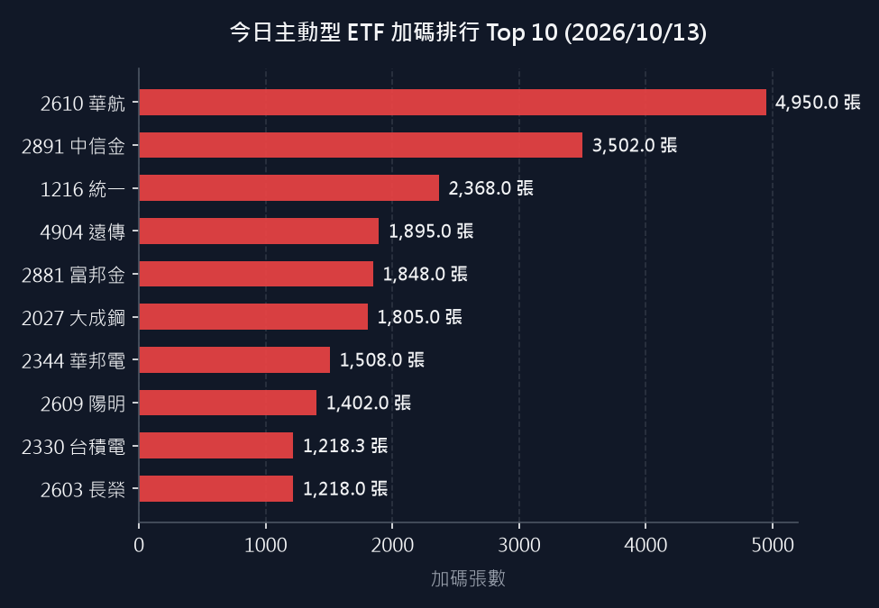
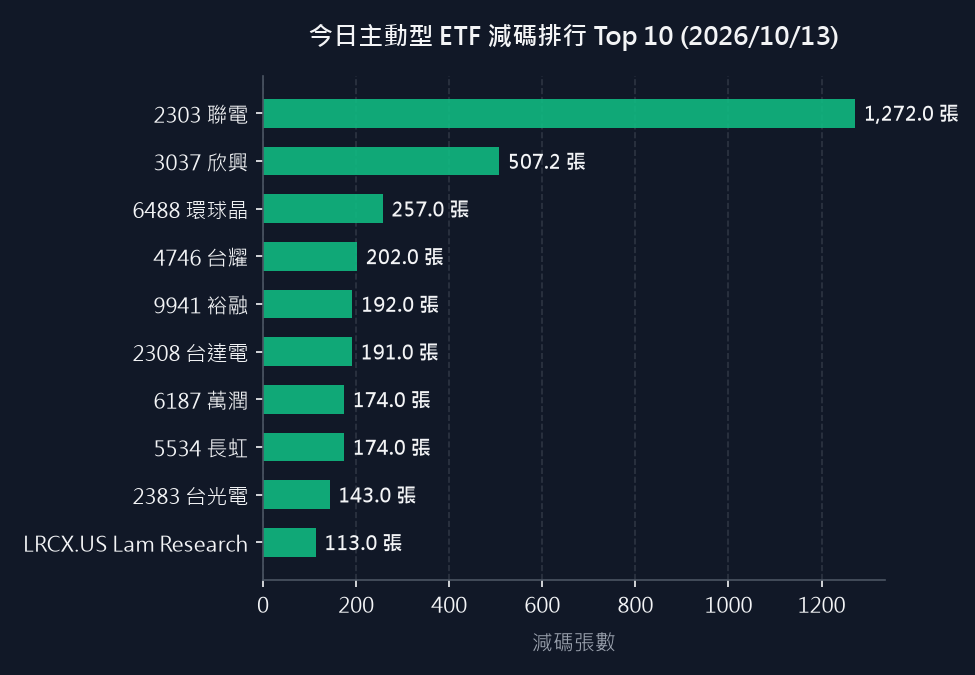

# 主動型 ETF 持股變動

資料來源：`主動型ETF持股明細.xlsx` 最近兩個日期分頁。

比較區間：`20261012` → `20261013`

## 今日加減碼視覺化排行

| 今日加碼 Top 10 | 今日減碼 Top 10 |
| :---: | :---: |
|  |  |

## 00400A

### 新增持股

- 無

### 刪除持股

- 2885 元大金（0.05%，241.04 張）

### 投資比例變動

- 1303 南亞：4.07% → 4.37%（+0.30）
- 2059 川湖：2.66% → 2.58%（-0.08）
- 2308 台達電：4.10% → 2.77%（-1.33）
- 2313 華通：0.90% → 0.89%（-0.01）
- 2327 國巨*：0.96% → 0.92%（-0.04）
- 2330 台積電：8.47% → 8.96%（+0.49）
- 2345 智邦：0.51% → 0.50%（-0.01）
- 2360 致茂：3.58% → 3.40%（-0.18）
- 2368 金像電：1.51% → 1.95%（+0.44）
- 2383 台光電：5.59% → 4.63%（-0.96）
- 2449 京元電子：0.97% → 1.00%（+0.03）
- 2454 聯發科：6.16% → 6.15%（-0.01）
- 2603 長榮：0.96% → 1.62%（+0.66）
- 2637 慧洋-KY：0.27% → 0.48%（+0.21）
- 2881 富邦金：1.59% → 1.63%（+0.04）
- 2891 中信金：0.69% → 1.54%（+0.85）
- 3008 大立光：1.20% → 1.70%（+0.50）
- 3017 奇鋐：4.12% → 3.55%（-0.57）
- 3037 欣興：4.89% → 4.15%（-0.74）
- 3044 健鼎：1.93% → 1.95%（+0.02）
- 3081 聯亞：0.80% → 0.74%（-0.06）
- 3167 大量：0.40% → 0.37%（-0.03）
- 3231 緯創：0.50% → 0.99%（+0.49）
- 3293 鈊象：0.34% → 0.35%（+0.01）
- 3374 精材：0.53% → 0.52%（-0.01）
- 3443 創意：2.53% → 2.58%（+0.05）
- 3529 力旺：1.21% → 1.22%（+0.01）
- 3653 健策：4.06% → 3.54%（-0.52）
- 3661 世芯-KY：2.61% → 2.45%（-0.16）
- 3665 貿聯-KY：1.73% → 1.70%（-0.03）
- 3711 日月光投控：1.14% → 1.13%（-0.01）
- 5434 崇越：0.38% → 0.39%（+0.01）
- 6187 萬潤：3.22% → 2.08%（-1.14）
- 6223 旺矽：3.58% → 3.54%（-0.04）
- 6278 台表科：0.71% → 0.70%（-0.01）
- 6488 環球晶：3.18% → 2.95%（-0.23）
- 6505 台塑化：2.15% → 2.41%（+0.26）
- 6669 緯穎：3.21% → 3.16%（-0.05）
- 7750 新代：0.75% → 0.73%（-0.02）
- 7769 鴻勁：0.15% → 0.14%（-0.01）
- 台指選擇權 2026/10：0.07% → 0.04%（-0.03）

## 00401A

### 新增持股

- 無

### 刪除持股

- 無

### 投資比例變動

- 1216 統一：0.26% → 0.27%（+0.01）
- 1303 南亞：1.17% → 1.26%（+0.09）
- 1477 聚陽：0.87% → 0.89%（+0.02）
- 2059 川湖：0.82% → 0.79%（-0.03）
- 2303 聯電：2.32% → 2.31%（-0.01）
- 2308 台達電：2.51% → 2.41%（-0.10）
- 2313 華通：1.47% → 1.45%（-0.02）
- 2327 國巨*：0.67% → 0.64%（-0.03）
- 2330 台積電：20.17% → 20.20%（+0.03）
- 2345 智邦：0.36% → 0.35%（-0.01）
- 2357 華碩：1.75% → 1.78%（+0.03）
- 2360 致茂：1.44% → 1.37%（-0.07）
- 2379 瑞昱：1.00% → 1.05%（+0.05）
- 2382 廣達：1.98% → 2.03%（+0.05）
- 2383 台光電：1.22% → 1.11%（-0.11）
- 2412 中華電：0.78% → 0.81%（+0.03）
- 2455 全新：2.28% → 2.10%（-0.18）
- 2603 長榮：1.04% → 1.11%（+0.07）
- 2881 富邦金：1.99% → 2.05%（+0.06）
- 2882 國泰金：1.00% → 1.03%（+0.03）
- 2883 凱基金：1.60% → 1.63%（+0.03）
- 2884 玉山金：1.86% → 1.93%（+0.07）
- 2886 兆豐金：1.27% → 1.32%（+0.05）
- 2887 台新新光金：1.05% → 1.07%（+0.02）
- 2891 中信金：1.48% → 1.55%（+0.07）
- 3008 大立光：2.53% → 2.57%（+0.04）
- 3037 欣興：2.45% → 2.35%（-0.10）
- 3131 弘塑：0.72% → 0.68%（-0.04）
- 3231 緯創：1.62% → 1.64%（+0.02）
- 3491 昇達科：1.68% → 1.61%（-0.07）
- 3711 日月光投控：2.71% → 2.70%（-0.01）
- 4904 遠傳：0.71% → 0.74%（+0.03）
- 4938 和碩：0.31% → 0.33%（+0.02）
- 4958 臻鼎-KY：1.44% → 1.40%（-0.04）
- 4991 環宇-KY：0.70% → 0.66%（-0.04）
- 5274 信驊：1.85% → 1.83%（-0.02）
- 5347 世界：1.33% → 1.31%（-0.02）
- 5871 中租-KY：0.12% → 0.13%（+0.01）
- 6147 頎邦：1.40% → 1.38%（-0.02）
- 6187 萬潤：0.84% → 0.81%（-0.03）
- 6223 旺矽：1.80% → 1.78%（-0.02）
- 6285 啟碁：1.42% → 1.35%（-0.07）
- 6515 穎崴：1.14% → 1.09%（-0.05）
- 6531 愛普*：1.60% → 1.58%（-0.02）
- 6669 緯穎：1.93% → 1.88%（-0.05）
- 7769 鴻勁：1.20% → 1.13%（-0.07）
- 7828 創新服務：1.66% → 1.59%（-0.07）
- 8464 億豐：0.96% → 0.99%（+0.03）
- 台股期貨10/26(FITXN*1.TF)：0.48% → 0.34%（-0.14）
- 臺指選擇權10/26 46000 買權：-0.09% → -0.07%（+0.02）
- 臺指選擇權10/26 46400 買權：-1.26% → -0.92%（+0.34）
- 臺指選擇權10/26 46800 買權：-0.07% → -0.05%（+0.02）

## 00402A

### 新增持股

- 無

### 刪除持股

- 無

### 投資比例變動

- AAPL.US Apple：7.63% → 7.45%（-0.18）
- ADI.US Analog Devices：1.92% → 1.87%（-0.05）
- AMD.US AMD：6.35% → 5.93%（-0.42）
- AMZN.US Amazon：4.25% → 4.23%（-0.02）
- ANET.US Arista Networks：0.88% → 0.85%（-0.03）
- ARM.US Arm：0.94% → 0.85%（-0.09）
- ASML.US ASML Holding：1.21% → 1.17%（-0.04）
- AVGO.US Broadcom：2.23% → 2.15%（-0.08）
- AXON.US Axon Enterprise：0.57% → 0.55%（-0.02）
- BABA.US Alibaba Group：0.46% → 0.47%（+0.01）
- BKNG.US Booking Holdings：0.51% → 0.49%（-0.02）
- CDNS.US Cadence Design Systems：1.55% → 1.51%（-0.04）
- CIEN.US Ciena：1.33% → 1.24%（-0.09）
- CLS.US Celestica：1.24% → 1.31%（+0.07）
- COHR.US Coherent：1.41% → 1.31%（-0.10）
- CRWD.US CrowdStrike Holdings：1.67% → 1.63%（-0.04）
- DASH.US DoorDash：0.47% → 0.46%（-0.01）
- FSLY.US Fastly：0.36% → 0.37%（+0.01）
- GOOG.US Alphabet - Class C Capital Stock：3.35% → 3.31%（-0.04）
- GOOGL.US Alphabet - Class A Common Stock：3.37% → 3.33%（-0.04）
- INTC.US Intel：1.60% → 1.47%（-0.13）
- IOT.US Samsara：0.53% → 0.52%（-0.01）
- KLAC.US KLA：1.71% → 1.61%（-0.10）
- LITE.US Lumentum：2.03% → 1.88%（-0.15）
- LRCX.US Lam Research：2.79% → 2.63%（-0.16）
- MCHP.US Microchip Technology：1.31% → 1.25%（-0.06）
- META.US Meta：3.73% → 3.75%（+0.02）
- MRVL.US Marvell：1.81% → 1.71%（-0.10）
- MSFT.US Microsoft：5.17% → 5.22%（+0.05）
- MU.US Micron：6.18% → 5.76%（-0.42）
- NFLX.US Netflix：0.98% → 0.94%（-0.04）
- NOW.US ServiceNow：0.87% → 1.04%（+0.17）
- NVDA.US NVIDIA：8.85% → 8.53%（-0.32）
- PANW.US Palo Alto：2.85% → 2.96%（+0.11）
- PLTR.US Palantir Technologies：2.01% → 2.20%（+0.19）
- SHOP.US Shopify：0.99% → 1.20%（+0.21）
- SIMO.US Silicon Motion：0.57% → 0.52%（-0.05）
- SKHY.US SK hynix：1.24% → 1.15%（-0.09）
- SNOW.US Snowflake：1.11% → 1.38%（+0.27）
- SPCX.US SpaceX：0.78% → 0.77%（-0.01）
- SPOT.US Spotify：0.36% → 0.35%（-0.01）
- STX.US Seagate：1.15% → 1.09%（-0.06）
- TER.US Teradyne：0.86% → 0.81%（-0.05）
- TSM.US TSMC(ADR)：1.56% → 1.48%（-0.08）
- TTWO.US Take-Two：0.58% → 0.57%（-0.01）
- TXN.US Texas Instruments：2.39% → 2.28%（-0.11）
- V.US Visa：1.11% → 1.12%（+0.01）
- WDC.US Western Digital：1.97% → 1.80%（-0.17）

## 00403A

### 新增持股

- 無

### 刪除持股

- 無

### 投資比例變動

- 1303 南亞：2.43% → 2.64%（+0.21）
- 2059 川湖：0.55% → 0.54%（-0.01）
- 2303 聯電：2.03% → 2.04%（+0.01）
- 2308 台達電：3.84% → 3.71%（-0.13）
- 2313 華通：0.14% → 0.21%（+0.07）
- 2327 國巨*：3.91% → 3.80%（-0.11）
- 2330 台積電：13.65% → 13.81%（+0.16）
- 2345 智邦：2.38% → 2.35%（-0.03）
- 2368 金像電：0.41% → 0.40%（-0.01）
- 2383 台光電：6.01% → 5.59%（-0.42）
- 2408 南亞科：1.03% → 0.98%（-0.05）
- 2449 京元電子：0.84% → 0.88%（+0.04）
- 2454 聯發科：6.29% → 6.35%（+0.06）
- 2455 全新：0.08% → 0.07%（-0.01）
- 2481 強茂：0.16% → 0.08%（-0.08）
- 2882 國泰金：0.32% → 0.33%（+0.01）
- 3008 大立光：1.24% → 1.75%（+0.51）
- 3037 欣興：6.83% → 5.95%（-0.88）
- 3189 景碩：3.29% → 3.33%（+0.04）
- 3211 順達：0.53% → 0.52%（-0.01）
- 3443 創意：3.62% → 3.73%（+0.11）
- 3450 聯鈞：0.54% → 0.51%（-0.03）
- 3583 辛耘：0.42% → 0.41%（-0.01）
- 3653 健策：5.57% → 5.61%（+0.04）
- 3665 貿聯-KY：2.40% → 2.38%（-0.02）
- 5274 信驊：1.45% → 1.47%（+0.02）
- 6274 台燿：2.54% → 2.50%（-0.04）
- 6442 光聖：0.42% → 0.41%（-0.01）
- 6488 環球晶：0.54% → 0.22%（-0.32）
- 6669 緯穎：2.70% → 2.68%（-0.02）
- 8046 南電：3.02% → 3.12%（+0.10）
- 8996 高力：2.16% → 2.32%（+0.16）

## 00404A

### 新增持股

- 無

### 刪除持股

- 無

### 投資比例變動

- 1303 南亞：0.77% → 0.82%（+0.05）
- 2059 川湖：0.51% → 0.49%（-0.02）
- 2301 光寶科：0.56% → 0.55%（-0.01）
- 2303 聯電：2.74% → 2.72%（-0.02）
- 2308 台達電：1.82% → 1.73%（-0.09）
- 2330 台積電：22.51% → 22.47%（-0.04）
- 2345 智邦：0.92% → 0.89%（-0.03）
- 2347 聯強：1.88% → 1.95%（+0.07）
- 2357 華碩：1.17% → 1.18%（+0.01）
- 2360 致茂：0.51% → 0.48%（-0.03）
- 2379 瑞昱：1.05% → 1.09%（+0.04）
- 2382 廣達：0.93% → 0.95%（+0.02）
- 2383 台光電：3.23% → 2.97%（-0.26）
- 2395 研華：1.27% → 1.29%（+0.02）
- 2436 偉詮電：1.10% → 1.11%（+0.01）
- 2454 聯發科：6.79% → 6.77%（-0.02）
- 2637 慧洋-KY：1.10% → 1.13%（+0.03）
- 2882 國泰金：2.70% → 2.79%（+0.09）
- 2885 元大金：2.37% → 2.43%（+0.06）
- 2887 台新新光金：1.45% → 1.48%（+0.03）
- 2890 永豐金：1.40% → 1.41%（+0.01）
- 3017 奇鋐：1.29% → 1.28%（-0.01）
- 3034 聯詠：1.93% → 2.03%（+0.10）
- 3037 欣興：0.30% → 0.29%（-0.01）
- 3264 欣銓：0.68% → 0.69%（+0.01）
- 3293 鈊象：1.14% → 1.16%（+0.02）
- 3374 精材：0.12% → 0.11%（-0.01）
- 3443 創意：0.97% → 0.98%（+0.01）
- 3680 家登：0.52% → 0.51%（-0.01）
- 3711 日月光投控：3.53% → 3.49%（-0.04）
- 5434 崇越：1.73% → 1.77%（+0.04）
- 5876 上海商銀：1.41% → 1.48%（+0.07）
- 6196 帆宣：1.79% → 1.78%（-0.01）
- 6206 飛捷：0.72% → 0.73%（+0.01）
- 6223 旺矽：1.24% → 1.23%（-0.01）
- 6257 矽格：1.89% → 1.87%（-0.02）
- 6491 晶碩：0.84% → 0.86%（+0.02）
- 6505 台塑化：0.48% → 0.54%（+0.06）
- 6669 緯穎：1.03% → 1.01%（-0.02）
- 6691 洋基工程：1.64% → 1.61%（-0.03）
- 7769 鴻勁：1.24% → 1.18%（-0.06）
- 8016 矽創：1.18% → 1.22%（+0.04）
- 8081 致新：0.83% → 0.84%（+0.01）
- 8299 群聯：1.23% → 1.20%（-0.03）
- iShares MSCI Japan SRI ETF(2851.JP)：1.08% → 1.12%（+0.04）
- 台指選擇權10/26 49100 買權：-0.21% → -0.10%（+0.11）
- 台指選擇權11/26 52300 買權：-0.11% → -0.08%（+0.03）
- 台股期貨10/26(FITXN*1.TF)：20.75% → 20.72%（-0.03）

## 00405A

### 新增持股

- 無

### 刪除持股

- 無

### 投資比例變動

- 2059 川湖：2.13% → 2.10%（-0.03）
- 2308 台達電：0.72% → 0.70%（-0.02）
- 2330 台積電：1.83% → 1.86%（+0.03）
- 2345 智邦：5.23% → 5.18%（-0.05）
- 2368 金像電：5.61% → 5.50%（-0.11）
- 2383 台光電：5.25% → 4.90%（-0.35）
- 2454 聯發科：5.48% → 5.54%（+0.06）
- 3017 奇鋐：3.79% → 3.80%（+0.01）
- 3037 欣興：7.74% → 7.52%（-0.22）
- 3189 景碩：0.21% → 0.22%（+0.01）
- 3443 創意：5.65% → 5.84%（+0.19）
- 3653 健策：7.50% → 7.57%（+0.07）
- 3665 貿聯-KY：6.31% → 6.26%（-0.05）
- 5274 信驊：5.65% → 5.73%（+0.08）
- 6187 萬潤：1.00% → 0.99%（-0.01）
- 6223 旺矽：7.98% → 8.00%（+0.02）
- 6274 台燿：2.14% → 2.11%（-0.03）
- 6285 啟碁：0.11% → 0.10%（-0.01）
- 6515 穎崴：0.56% → 0.55%（-0.01）
- 6526 達發：0.46% → 0.48%（+0.02）
- 6531 愛普*：3.93% → 3.98%（+0.05）
- 6805 富世達：3.12% → 3.14%（+0.02）
- 7769 鴻勁：3.14% → 3.04%（-0.10）
- 8046 南電：7.54% → 7.80%（+0.26）
- 8996 高力：1.39% → 1.43%（+0.04）

## 00406A

### 新增持股

- 臺股期貨 202611(FITXN*1.TF)（2.57%，0.2 張）

### 刪除持股

- 無

### 投資比例變動

- 1303 南亞：0.64% → 0.90%（+0.26）
- 1326 台化：0.28% → 0.26%（-0.02）
- 1560 中砂：0.62% → 0.53%（-0.09）
- 2059 川湖：1.24% → 1.07%（-0.17）
- 2303 聯電：2.08% → 1.83%（-0.25）
- 2308 台達電：3.12% → 2.64%（-0.48）
- 2317 鴻海：0.50% → 0.44%（-0.06）
- 2327 國巨*：1.53% → 1.59%（+0.06）
- 2330 台積電：8.97% → 9.36%（+0.39）
- 2344 華邦電：0.30% → 0.25%（-0.05）
- 2345 智邦：3.21% → 3.44%（+0.23）
- 2360 致茂：1.30% → 1.24%（-0.06）
- 2368 金像電：0.77% → 0.95%（+0.18）
- 2383 台光電：6.41% → 6.25%（-0.16）
- 2395 研華：0.13% → 0.12%（-0.01）
- 2449 京元電子：0.58% → 0.53%（-0.05）
- 2454 聯發科：5.98% → 5.77%（-0.21）
- 2481 強茂：0.27% → 0.39%（+0.12）
- 2486 一詮：0.29% → 0.24%（-0.05）
- 2885 元大金：0.88% → 0.81%（-0.07）
- 2886 兆豐金：0.18% → 0.17%（-0.01）
- 3008 大立光：0.43% → 0.39%（-0.04）
- 3017 奇鋐：5.47% → 5.16%（-0.31）
- 3037 欣興：5.98% → 5.71%（-0.27）
- 3081 聯亞：0.43% → 0.35%（-0.08）
- 3105 穩懋：0.18% → 0.16%（-0.02）
- 3131 弘塑：0.09% → 0.07%（-0.02）
- 3167 大量：0.71% → 0.84%（+0.13）
- 3189 景碩：1.61% → 1.70%（+0.09）
- 3264 欣銓：0.24% → 0.21%（-0.03）
- 3363 上詮：0.34% → 0.28%（-0.06）
- 3443 創意：2.28% → 2.22%（-0.06）
- 3450 聯鈞：0.24% → 0.20%（-0.04）
- 3491 昇達科：0.74% → 0.63%（-0.11）
- 3529 力旺：0.31% → 0.28%（-0.03）
- 3653 健策：3.93% → 3.75%（-0.18）
- 3661 世芯-KY：0.42% → 0.54%（+0.12）
- 3665 貿聯-KY：2.66% → 2.31%（-0.35）
- 3711 日月光投控：2.45% → 2.30%（-0.15）
- 4958 臻鼎-KY：0.49% → 0.90%（+0.41）
- 5274 信驊：2.51% → 2.32%（-0.19）
- 6139 亞翔：0.08% → 0.07%（-0.01）
- 6147 頎邦：0.71% → 0.72%（+0.01）
- 6187 萬潤：0.39% → 0.34%（-0.05）
- 6213 聯茂：0.60% → 0.53%（-0.07）
- 6223 旺矽：3.60% → 3.15%（-0.45）
- 6274 台燿：1.75% → 1.51%（-0.24）
- 6285 啟碁：0.12% → 0.11%（-0.01）
- 6488 環球晶：0.61% → 0.50%（-0.11）
- 6510 精測：1.23% → 1.19%（-0.04）
- 6515 穎崴：0.48% → 0.41%（-0.07）
- 6531 愛普*：0.23% → 0.20%（-0.03）
- 6669 緯穎：2.37% → 2.07%（-0.30）
- 6805 富世達：0.07% → 0.06%（-0.01）
- 7769 鴻勁：0.39% → 0.33%（-0.06）
- 8046 南電：2.75% → 3.05%（+0.30）
- 8150 南茂：0.08% → 0.07%（-0.01）
- 8358 金居：0.18% → 0.15%（-0.03）
- 8996 高力：0.38% → 0.35%（-0.03）
- 臺指選擇權第三週週五到期契約：-2.62% → -0.87%（+1.75）
- 臺指選擇權第二週週三到期契約：-16.81% → -15.61%（+1.20）
- 臺股期貨 202610(FITXN*1.TF)：23.12% → 20.50%（-2.62）

## 00407A

### 新增持股

- 無

### 刪除持股

- 無

### 投資比例變動

- 1303 南亞：0.91% → 1.00%（+0.09）
- 1560 中砂：1.05% → 1.04%（-0.01）
- 2059 川湖：2.29% → 1.81%（-0.48）
- 2301 光寶科：1.45% → 1.44%（-0.01）
- 2303 聯電：0.55% → 0.56%（+0.01）
- 2308 台達電：2.66% → 2.57%（-0.09）
- 2327 國巨*：2.47% → 2.41%（-0.06）
- 2330 台積電：9.13% → 9.28%（+0.15）
- 2345 智邦：2.21% → 2.20%（-0.01）
- 2360 致茂：1.08% → 1.04%（-0.04）
- 2368 金像電：0.60% → 0.59%（-0.01）
- 2379 瑞昱：0.22% → 0.23%（+0.01）
- 2383 台光電：6.00% → 5.60%（-0.40）
- 2408 南亞科：0.97% → 0.93%（-0.04）
- 2454 聯發科：5.39% → 5.46%（+0.07）
- 2615 萬海：0.71% → 1.01%（+0.30）
- 3008 大立光：1.65% → 1.70%（+0.05）
- 3017 奇鋐：5.50% → 5.52%（+0.02）
- 3034 聯詠：0.69% → 0.74%（+0.05）
- 3037 欣興：5.96% → 5.81%（-0.15）
- 3081 聯亞：1.48% → 1.38%（-0.10）
- 3131 弘塑：0.88% → 0.85%（-0.03）
- 3231 緯創：0.72% → 0.74%（+0.02）
- 3260 威剛：0.28% → 0.29%（+0.01）
- 3293 鈊象：0.59% → 0.61%（+0.02）
- 3443 創意：5.02% → 5.20%（+0.18）
- 3491 昇達科：0.89% → 0.88%（-0.01）
- 3529 力旺：0.22% → 0.23%（+0.01）
- 3653 健策：3.60% → 3.64%（+0.04）
- 3665 貿聯-KY：2.84% → 2.82%（-0.02）
- 3711 日月光投控：3.14% → 3.16%（+0.02）
- 4958 臻鼎-KY：1.05% → 1.04%（-0.01）
- 5274 信驊：1.30% → 1.32%（+0.02）
- 5434 崇越：0.21% → 0.22%（+0.01）
- 6187 萬潤：1.85% → 1.83%（-0.02）
- 6223 旺矽：3.03% → 3.04%（+0.01）
- 6274 台燿：4.05% → 4.00%（-0.05）
- 6446 藥華藥：0.30% → 0.31%（+0.01）
- 6510 精測：1.41% → 1.40%（-0.01）
- 6805 富世達：1.10% → 1.11%（+0.01）
- 8046 南電：3.01% → 3.12%（+0.11）
- 8996 高力：2.41% → 2.49%（+0.08）

## 00408A

### 新增持股

- 2603 長榮（0.53%，30 張）
- 2880 華南金（0.79%，240 張）

### 刪除持股

- 3491 昇達科（0.20%，2 張）

### 投資比例變動

- 1303 南亞：3.37% → 3.66%（+0.29）
- 1560 中砂：0.39% → 0.38%（-0.01）
- 2059 川湖：0.34% → 0.27%（-0.07）
- 2303 聯電：1.73% → 1.74%（+0.01）
- 2308 台達電：3.57% → 3.32%（-0.25）
- 2327 國巨*：1.53% → 0.92%（-0.61）
- 2330 台積電：5.64% → 5.72%（+0.08）
- 2344 華邦電：0.45% → 0.43%（-0.02）
- 2345 智邦：0.83% → 0.82%（-0.01）
- 2357 華碩：1.91% → 1.94%（+0.03）
- 2360 致茂：1.23% → 1.18%（-0.05）
- 2368 金像電：4.50% → 4.39%（-0.11）
- 2376 技嘉：1.27% → 1.31%（+0.04）
- 2382 廣達：0.21% → 0.22%（+0.01）
- 2383 台光電：5.40% → 5.02%（-0.38）
- 2395 研華：1.60% → 1.64%（+0.04）
- 2408 南亞科：1.78% → 1.37%（-0.41）
- 2449 京元電子：1.02% → 1.06%（+0.04）
- 2454 聯發科：3.61% → 3.64%（+0.03）
- 2542 興富發：3.52% → 3.59%（+0.07）
- 3008 大立光：0.95% → 1.46%（+0.51）
- 3026 禾伸堂：0.33% → 0.32%（-0.01）
- 3037 欣興：3.92% → 3.32%（-0.60）
- 3081 聯亞：1.87% → 1.74%（-0.13）
- 3105 穩懋：0.53% → 0.52%（-0.01）
- 3189 景碩：2.83% → 2.86%（+0.03）
- 3231 緯創：0.37% → 0.38%（+0.01）
- 3264 欣銓：0.76% → 0.77%（+0.01）
- 3653 健策：2.70% → 2.72%（+0.02）
- 3665 貿聯-KY：1.21% → 1.20%（-0.01）
- 5434 崇越：2.24% → 2.31%（+0.07）
- 6187 萬潤：1.20% → 1.18%（-0.02）
- 6274 台燿：3.16% → 3.11%（-0.05）
- 6488 環球晶：1.02% → 0.95%（-0.07）
- 6510 精測：0.45% → 0.44%（-0.01）
- 6669 緯穎：3.96% → 3.94%（-0.02）
- 7769 鴻勁：0.63% → 0.61%（-0.02）
- 8046 南電：1.59% → 1.64%（+0.05）
- 8996 高力：2.01% → 2.07%（+0.06）
- 9802 鈺齊-KY：0.83% → 0.86%（+0.03）

## 00980A

### 新增持股

- 無

### 刪除持股

- 無

### 投資比例變動

- 1303 南亞：3.61% → 3.94%（+0.33）
- 2059 川湖：4.12% → 4.06%（-0.06）
- 2303 聯電：1.06% → 1.07%（+0.01）
- 2308 台達電：3.79% → 3.66%（-0.13）
- 2317 鴻海：1.95% → 1.98%（+0.03）
- 2327 國巨*：1.52% → 1.48%（-0.04）
- 2330 台積電：9.43% → 9.58%（+0.15）
- 2344 華邦電：1.97% → 1.89%（-0.08）
- 2345 智邦：1.49% → 1.48%（-0.01）
- 2360 致茂：1.73% → 1.66%（-0.07）
- 2368 金像電：2.05% → 2.01%（-0.04）
- 2376 技嘉：0.85% → 0.88%（+0.03）
- 2382 廣達：1.14% → 1.18%（+0.04）
- 2383 台光電：5.03% → 4.70%（-0.33）
- 2408 南亞科：2.85% → 2.73%（-0.12）
- 2454 聯發科：5.68% → 5.75%（+0.07）
- 2884 玉山金：0.67% → 0.70%（+0.03）
- 2891 中信金：0.96% → 1.02%（+0.06）
- 3008 大立光：1.37% → 1.41%（+0.04）
- 3036 文曄：0.97% → 0.98%（+0.01）
- 3037 欣興：3.87% → 3.77%（-0.10）
- 3044 健鼎：0.56% → 0.57%（+0.01）
- 3081 聯亞：2.41% → 2.25%（-0.16）
- 3189 景碩：1.39% → 1.41%（+0.02）
- 3231 緯創：0.89% → 0.91%（+0.02）
- 3264 欣銓：0.87% → 0.89%（+0.02）
- 3293 鈊象：0.80% → 0.83%（+0.03）
- 3443 創意：2.36% → 2.44%（+0.08）
- 3529 力旺：0.62% → 0.63%（+0.01）
- 3653 健策：3.67% → 3.71%（+0.04）
- 3711 日月光投控：2.33% → 2.35%（+0.02）
- 5274 信驊：1.77% → 1.80%（+0.03）
- 5904 寶雅*：0.80% → 0.82%（+0.02）
- 6213 聯茂：1.01% → 1.02%（+0.01）
- 6274 台燿：1.22% → 1.21%（-0.01）
- 6515 穎崴：1.81% → 1.78%（-0.03）
- 6805 富世達：0.60% → 0.61%（+0.01）
- 7751 竑騰：0.74% → 0.76%（+0.02）
- 7769 鴻勁：3.30% → 3.19%（-0.11）
- 8046 南電：1.78% → 1.85%（+0.07）
- 8210 勤誠：0.40% → 0.41%（+0.01）
- 8299 群聯：1.70% → 1.69%（-0.01）
- 8996 高力：0.49% → 0.51%（+0.02）
- 台灣證交所加權股價指數(FITXN*1.TF)：3.02% → 1.48%（-1.54）

## 00980D

### 新增持股

- 無

### 刪除持股

- 無

### 投資比例變動

- 無

## 00981A

### 新增持股

- 無

### 刪除持股

- 無

### 投資比例變動

- 2002 中鋼：0.03% → 0.04%（+0.01）
- 2303 聯電：3.97% → 4.00%（+0.03）
- 2308 台達電：4.82% → 4.66%（-0.16）
- 2327 國巨*：5.13% → 5.01%（-0.12）
- 2330 台積電：10.30% → 10.79%（+0.49）
- 2345 智邦：4.58% → 4.54%（-0.04）
- 2368 金像電：1.58% → 1.56%（-0.02）
- 2383 台光電：9.81% → 8.53%（-1.28）
- 2449 京元電子：0.43% → 0.45%（+0.02）
- 2454 聯發科：8.07% → 8.18%（+0.11）
- 3017 奇鋐：7.04% → 7.17%（+0.13）
- 3037 欣興：8.06% → 7.85%（-0.21）
- 3443 創意：1.90% → 1.97%（+0.07）
- 3653 健策：6.14% → 6.22%（+0.08）
- 3665 貿聯-KY：2.33% → 2.32%（-0.01）
- 3711 日月光投控：2.18% → 2.20%（+0.02）
- 5274 信驊：0.96% → 0.97%（+0.01）
- 6223 旺矽：5.26% → 5.29%（+0.03）
- 8046 南電：4.41% → 4.57%（+0.16）
- 8996 高力：0.28% → 0.35%（+0.07）
- 台指期貨 2026/10(FITXN*1.TF)：2.30% → 2.34%（+0.04）

## 00982A

### 新增持股

- 無

### 刪除持股

- 無

### 投資比例變動

- 2059 川湖：3.67% → 3.62%（-0.05）
- 2301 光寶科：1.79% → 1.78%（-0.01）
- 2303 聯電：1.44% → 1.45%（+0.01）
- 2330 台積電：7.60% → 7.72%（+0.12）
- 2360 致茂：3.87% → 3.73%（-0.14）
- 2376 技嘉：1.20% → 1.24%（+0.04）
- 2377 微星：1.00% → 0.53%（-0.47）
- 2383 台光電：3.68% → 3.44%（-0.24）
- 2395 研華：1.35% → 1.39%（+0.04）
- 2428 興勤：1.24% → 1.21%（-0.03）
- 2454 聯發科：6.59% → 6.69%（+0.10）
- 2455 全新：1.67% → 1.56%（-0.11）
- 2467 志聖：1.14% → 1.12%（-0.02）
- 2476 鉅祥：0.32% → 0.33%（+0.01）
- 2486 一詮：0.73% → 0.71%（-0.02）
- 2885 元大金：0.30% → 0.31%（+0.01）
- 3008 大立光：3.56% → 3.67%（+0.11）
- 3017 奇鋐：2.44% → 2.45%（+0.01）
- 3090 日電貿：1.09% → 1.10%（+0.01）
- 3105 穩懋：6.41% → 6.38%（-0.03）
- 3231 緯創：1.34% → 1.37%（+0.03）
- 3265 台星科：1.70% → 1.79%（+0.09）
- 3491 昇達科：3.49% → 3.44%（-0.05）
- 3583 辛耘：1.16% → 1.13%（-0.03）
- 3617 碩天：0.31% → 0.33%（+0.02）
- 3711 日月光投控：1.29% → 1.30%（+0.01）
- 4958 臻鼎-KY：3.55% → 3.50%（-0.05）
- 5274 信驊：1.23% → 1.25%（+0.02）
- 5425 台半：1.24% → 1.23%（-0.01）
- 5483 中美晶：1.41% → 1.42%（+0.01）
- 6139 亞翔：5.44% → 5.40%（-0.04）
- 6213 聯茂：1.48% → 1.50%（+0.02）
- 6214 精誠：1.29% → 1.34%（+0.05）
- 6223 旺矽：3.57% → 3.59%（+0.02）
- 6239 力成：1.13% → 1.14%（+0.01）
- 6274 台燿：1.40% → 1.39%（-0.01）
- 6472 保瑞：0.84% → 0.87%（+0.03）
- 6488 環球晶：2.34% → 2.21%（-0.13）
- 6531 愛普*：3.85% → 3.91%（+0.06）
- 6640 均華：0.32% → 0.31%（-0.01）
- 6672 騰輝電子-KY：0.84% → 0.79%（-0.05）
- 8070 長華*：0.44% → 0.45%（+0.01）
- 8996 高力：1.27% → 1.32%（+0.05）

## 00983A

### 新增持股

- 無

### 刪除持股

- 無

### 投資比例變動

- ACHR.US Archer：0.34% → 0.33%（-0.01）
- AMD.US AMD：3.67% → 3.48%（-0.19）
- AMZN.US Amazon：2.76% → 2.80%（+0.04）
- AVGO.US Broadcom：1.53% → 1.49%（-0.04）
- BEAM.US Beam Therapeutics：1.57% → 1.59%（+0.02）
- BMNR.US BitMine：2.31% → 2.27%（-0.04）
- CBRS.US Cerebras：0.98% → 0.84%（-0.14）
- COIN.US Coinbase：4.47% → 4.64%（+0.17）
- CRCL.US Circle：4.94% → 5.08%（+0.14）
- CRSP.US CRISPR Therapeutics：3.86% → 3.91%（+0.05）
- CRWV.US CoreWeave：1.26% → 1.23%（-0.03）
- DE.US Deere：0.52% → 0.50%（-0.02）
- GOOG.US Alphabet - Class C Capital Stock：1.60% → 1.61%（+0.01）
- HOOD.US Robinhood Markets：4.48% → 4.53%（+0.05）
- ILMN.US Illumina：1.69% → 1.76%（+0.07）
- META.US Meta：1.87% → 1.91%（+0.04）
- NET.US Cloudflare：1.35% → 1.37%（+0.02）
- NTLA.US Intellia Therapeutics：0.64% → 0.63%（-0.01）
- NTRA.US Natera：1.58% → 1.59%（+0.01）
- NVDA.US NVIDIA：2.90% → 2.82%（-0.08）
- PACB.US Pacific Biosciences of Californi：0.14% → 0.13%（-0.01）
- PLTR.US Palantir Technologies：3.71% → 3.86%（+0.15）
- RKLB.US Rocket Lab：1.44% → 1.37%（-0.07）
- RXRX.US Recursion Pharmaceuticals：0.91% → 0.92%（+0.01）
- SHOP.US Shopify：4.77% → 5.15%（+0.38）
- SNOW.US Snowflake：0.57% → 0.60%（+0.03）
- SOFI.US SoFi Technologies：0.45% → 0.43%（-0.02）
- SPCX.US SpaceX：7.16% → 7.22%（+0.06）
- TEM.US Tempus：5.38% → 5.23%（-0.15）
- TER.US Teradyne：0.69% → 0.66%（-0.03）
- TSLA.US Tesla：9.18% → 9.15%（-0.03）
- TSM.US TSMC(ADR)：2.84% → 2.73%（-0.11）
- TWST.US Twist Bioscience：3.79% → 3.75%（-0.04）
- TXG.US 10x Genomics：3.42% → 3.29%（-0.13）
- WGS.US GeneDx：0.49% → 0.46%（-0.03）
- XE.US X-Energy：0.72% → 0.68%（-0.04）
- XYZ.US Block：1.23% → 1.25%（+0.02）

## 00983D

### 新增持股

- 無

### 刪除持股

- 無

### 投資比例變動

- 無

## 00984A

### 新增持股

- 無

### 刪除持股

- 9933 中鼎（0.01%，18.618 張）

### 投資比例變動

- 1216 統一：0.30% → 0.32%（+0.02）
- 1303 南亞：2.89% → 3.09%（+0.20）
- 1326 台化：1.00% → 1.04%（+0.04）
- 1409 新纖：0.64% → 0.65%（+0.01）
- 1560 中砂：1.33% → 1.28%（-0.05）
- 1709 和益：0.76% → 0.77%（+0.01）
- 2006 東和鋼鐵：0.31% → 0.32%（+0.01）
- 2059 川湖：2.14% → 2.01%（-0.13）
- 2301 光寶科：0.63% → 0.61%（-0.02）
- 2313 華通：0.16% → 0.15%（-0.01）
- 2330 台積電：4.30% → 4.27%（-0.03）
- 2344 華邦電：0.70% → 0.66%（-0.04）
- 2357 華碩：0.64% → 0.63%（-0.01）
- 2383 台光電：1.54% → 1.37%（-0.17）
- 2395 研華：2.50% → 2.58%（+0.08）
- 2404 漢唐：0.40% → 0.38%（-0.02）
- 2408 南亞科：2.24% → 2.05%（-0.19）
- 2409 友達：1.14% → 1.13%（-0.01）
- 2454 聯發科：0.85% → 0.82%（-0.03）
- 2464 盟立：1.24% → 1.21%（-0.03）
- 2603 長榮：1.78% → 1.87%（+0.09）
- 2615 萬海：0.96% → 0.99%（+0.03）
- 2618 長榮航：0.30% → 0.31%（+0.01）
- 2634 漢翔：0.29% → 0.30%（+0.01）
- 2637 慧洋-KY：0.32% → 0.33%（+0.01）
- 2801 彰銀：0.30% → 0.32%（+0.02）
- 2851 中再保：0.65% → 0.68%（+0.03）
- 2880 華南金：1.52% → 1.62%（+0.10）
- 2881 富邦金：4.07% → 4.24%（+0.17）
- 2882 國泰金：3.09% → 3.23%（+0.14）
- 2883 凱基金：2.41% → 2.44%（+0.03）
- 2884 玉山金：2.13% → 2.23%（+0.10）
- 2885 元大金：3.15% → 3.26%（+0.11）
- 2886 兆豐金：1.94% → 2.04%（+0.10）
- 2887 台新新光金：3.34% → 3.45%（+0.11）
- 2890 永豐金：2.32% → 2.33%（+0.01）
- 2892 第一金：1.20% → 1.27%（+0.07）
- 3006 晶豪科：0.59% → 0.54%（-0.05）
- 3008 大立光：1.83% → 1.80%（-0.03）
- 3017 奇鋐：4.27% → 4.21%（-0.06）
- 3037 欣興：1.86% → 1.73%（-0.13）
- 3045 台灣大：1.58% → 1.65%（+0.07）
- 3189 景碩：1.59% → 1.58%（-0.01）
- 3264 欣銓：1.88% → 1.91%（+0.03）
- 3443 創意：1.17% → 1.16%（-0.01）
- 3450 聯鈞：0.72% → 0.66%（-0.06）
- 3605 宏致：0.69% → 0.70%（+0.01）
- 3653 健策：1.86% → 1.80%（-0.06）
- 3661 世芯-KY：0.30% → 0.27%（-0.03）
- 3665 貿聯-KY：0.66% → 0.62%（-0.04）
- 3714 富采：0.55% → 0.54%（-0.01）
- 4958 臻鼎-KY：0.63% → 0.60%（-0.03）
- 5274 信驊：0.89% → 1.19%（+0.30）
- 5351 鈺創：0.65% → 0.63%（-0.02）
- 5876 上海商銀：0.31% → 0.33%（+0.02）
- 5904 寶雅*：0.94% → 0.96%（+0.02）
- 6187 萬潤：2.53% → 2.47%（-0.06）
- 6197 佳必琪：0.73% → 0.69%（-0.04）
- 6213 聯茂：1.63% → 1.58%（-0.05）
- 6214 精誠：0.65% → 0.64%（-0.01）
- 6223 旺矽：0.12% → 0.11%（-0.01）
- 6446 藥華藥：1.45% → 1.44%（-0.01）
- 6505 台塑化：3.21% → 3.49%（+0.28）
- 6669 緯穎：0.89% → 0.85%（-0.04）
- 6691 洋基工程：0.63% → 0.62%（-0.01）
- 7750 新代：0.61% → 0.59%（-0.02）
- 8039 台虹：0.62% → 0.59%（-0.03）

## 00985A

### 新增持股

- 無

### 刪除持股

- 無

### 投資比例變動

- 1101 台泥：1.52% → 1.25%（-0.27）
- 1216 統一：3.03% → 3.37%（+0.34）
- 1301 台塑：1.21% → 1.39%（+0.18）
- 1504 東元：0.77% → 0.64%（-0.13）
- 1605 華新：1.45% → 1.18%（-0.27）
- 2027 大成鋼：1.23% → 1.42%（+0.19）
- 2059 川湖：2.84% → 2.87%（+0.03）
- 2303 聯電：2.25% → 1.02%（-1.23）
- 2308 台達電：1.58% → 2.01%（+0.43）
- 2317 鴻海：1.48% → 1.23%（-0.25）
- 2327 國巨*：2.21% → 1.74%（-0.47）
- 2330 台積電：14.02% → 14.81%（+0.79）
- 2344 華邦電：0.00% → 1.02%（+1.02）
- 2345 智邦：3.18% → 3.24%（+0.06）
- 2368 金像電：1.26% → 1.53%（+0.27）
- 2376 技嘉：2.08% → 2.14%（+0.06）
- 2377 微星：0.00% → 1.04%（+1.04）
- 2383 台光電：2.90% → 3.54%（+0.64）
- 2395 研華：1.31% → 1.10%（-0.21）
- 2408 南亞科：1.14% → 1.41%（+0.27）
- 2412 中華電：1.37% → 1.77%（+0.40）
- 2454 聯發科：1.15% → 1.52%（+0.37）
- 2603 長榮：1.25% → 1.54%（+0.29）
- 2609 陽明：1.35% → 1.54%（+0.19）
- 2610 華航：1.16% → 1.41%（+0.25）
- 2881 富邦金：0.71% → 1.41%（+0.70）
- 3008 大立光：1.13% → 0.49%（-0.64）
- 3017 奇鋐：2.12% → 2.00%（-0.12）
- 3036 文曄：3.59% → 3.24%（-0.35）
- 3037 欣興：2.09% → 1.52%（-0.57）
- 3081 聯亞：1.88% → 1.83%（-0.05）
- 3105 穩懋：1.31% → 1.56%（+0.25）
- 3189 景碩：0.99% → 0.83%（-0.16）
- 3491 昇達科：1.95% → 1.90%（-0.05）
- 3653 健策：3.52% → 3.49%（-0.03）
- 3661 世芯-KY：1.11% → 0.87%（-0.24）
- 3665 貿聯-KY：1.41% → 1.15%（-0.26）
- 3711 日月光投控：0.92% → 0.76%（-0.16）
- 4904 遠傳：2.63% → 3.12%（+0.49）
- 6187 萬潤：1.06% → 0.01%（-1.05）
- 6442 光聖：0.77% → 0.62%（-0.15）
- 6446 藥華藥：0.98% → 0.82%（-0.16）
- 6488 環球晶：0.92% → 1.32%（+0.40）
- 6526 達發：0.40% → 0.34%（-0.06）
- 6531 愛普*：1.58% → 1.51%（-0.07）
- 6669 緯穎：1.29% → 1.05%（-0.24）
- 7750 新代：0.92% → 0.74%（-0.18）
- 7769 鴻勁：4.28% → 3.54%（-0.74）
- 8046 南電：0.61% → 0.51%（-0.10）
- 8996 高力：0.17% → 0.14%（-0.03）
- 台積電期貨(FICDFN*1.TF)：2.40% → 1.99%（-0.41）

## 00986A

### 新增持股

- 無

### 刪除持股

- 無

### 投資比例變動

- 2330 台積電：7.92% → 7.94%（+0.02）
- 2454 聯發科：1.62% → 1.61%（-0.01）
- AAPL.US Apple：2.06% → 2.08%（+0.02）
- AMAT.US Applied Materials：1.97% → 1.93%（-0.04）
- AMD.US AMD：4.79% → 4.62%（-0.17）
- AMZN.US Amazon：3.92% → 4.03%（+0.11）
- AVGO.US Broadcom：3.57% → 3.54%（-0.03）
- BE.US Bloom Energy：0.45% → 0.87%（+0.42）
- COHR.US Coherent：2.17% → 2.08%（-0.09）
- CRWD.US CrowdStrike Holdings：4.35% → 4.38%（+0.03）
- DDOG.US Datadog：1.06% → 1.12%（+0.06）
- ETN.US Eaton：2.34% → 2.37%（+0.03）
- GEV.US GE Vernova：2.75% → 2.76%（+0.01）
- GOOGL.US Alphabet - Class A Common Stock：5.76% → 5.87%（+0.11）
- GS.US Goldman Sachs：0.97% → 0.99%（+0.02）
- HOOD.US Robinhood Markets：0.71% → 0.73%（+0.02）
- ILMN.US Illumina：0.58% → 0.62%（+0.04）
- JPM.US JPMorgan Chase：2.01% → 2.04%（+0.03）
- LITE.US Lumentum：4.51% → 4.31%（-0.20）
- LLY.US Eli Lilly：2.90% → 2.95%（+0.05）
- MA.US Mastercard：1.11% → 1.16%（+0.05）
- MSFT.US Microsoft：2.88% → 3.00%（+0.12）
- MU.US Micron：4.57% → 4.39%（-0.18）
- MUFG(8306.JP)：0.98% → 0.97%（-0.01）
- Murata Mfg.(6981.JP)：2.02% → 1.95%（-0.07）
- NET.US Cloudflare：2.26% → 2.34%（+0.08）
- NVDA.US NVIDIA：6.35% → 6.28%（-0.07）
- PLTR.US Palantir Technologies：0.44% → 0.93%（+0.49）
- SNDK.US Sandisk：0.98% → 0.91%（-0.07）
- SNOW.US Snowflake：2.08% → 2.20%（+0.12）
- Siemens Energy AG：1.93% → 2.01%（+0.08）
- TER.US Teradyne：0.88% → 1.06%（+0.18）
- TSEM.US Tower Semiconductor：1.07% → 1.02%（-0.05）
- 嘉能可公司：1.65% → 1.72%（+0.07）
- 尼比厄斯集團公眾有限公司：0.91% → 0.87%（-0.04）
- 施奈德電機公司：1.45% → 1.48%（+0.03）
- 艾司摩爾控股公司：1.21% → 1.18%（-0.03）
- 英飛凌科技股份有限公司：2.54% → 2.49%（-0.05）

## 00987A

### 新增持股

- 無

### 刪除持股

- 無

### 投資比例變動

- 2330 台積電：9.25% → 9.47%（+0.22）
- 2368 金像電：3.00% → 2.97%（-0.03）
- 2383 台光電：7.21% → 6.80%（-0.41）
- 2408 南亞科：2.13% → 2.06%（-0.07）
- 2454 聯發科：5.99% → 6.12%（+0.13）
- 2455 全新：2.62% → 2.47%（-0.15）
- 3017 奇鋐：7.12% → 7.21%（+0.09）
- 3037 欣興：5.89% → 5.79%（-0.10）
- 3081 聯亞：3.65% → 3.43%（-0.22）
- 3363 上詮：2.26% → 2.14%（-0.12）
- 3443 創意：4.26% → 4.45%（+0.19）
- 3455 由田：2.16% → 2.25%（+0.09）
- 3491 昇達科：3.21% → 3.19%（-0.02）
- 3529 力旺：1.84% → 1.90%（+0.06）
- 3653 健策：5.21% → 5.32%（+0.11）
- 3665 貿聯-KY：4.19% → 4.20%（+0.01）
- 4958 臻鼎-KY：2.35% → 2.33%（-0.02）
- 4991 環宇-KY：2.52% → 2.44%（-0.08）
- 5274 信驊：0.21% → 0.22%（+0.01）
- 6223 旺矽：1.24% → 1.26%（+0.02）
- 6274 台燿：5.26% → 5.25%（-0.01）
- 6515 穎崴：1.95% → 1.93%（-0.02）
- 6805 富世達：3.31% → 3.36%（+0.05）
- 7856 漢測：0.93% → 0.96%（+0.03）
- 8046 南電：2.68% → 2.80%（+0.12）
- 8358 金居：2.83% → 2.79%（-0.04）
- 8996 高力：2.43% → 2.54%（+0.11）

## 00988A

### 新增持股

- 無

### 刪除持股

- 無

### 投資比例變動

- 1303 南亞：1.34% → 1.32%（-0.02）
- 2308 台達電：0.38% → 0.74%（+0.36）
- 2330 台積電：0.98% → 0.99%（+0.01）
- 2383 台光電：2.88% → 2.99%（+0.11）
- 2454 聯發科：3.43% → 3.06%（-0.37）
- 3017 奇鋐：3.37% → 3.35%（-0.02）
- 3037 欣興：6.35% → 6.34%（-0.01）
- AMD.US AMD：2.59% → 2.51%（-0.08）
- BE.US Bloom Energy：7.03% → 6.84%（-0.19）
- COIN.US Coinbase：0.74% → 0.78%（+0.04）
- CRWD.US CrowdStrike Holdings：2.11% → 2.46%（+0.35）
- Furukawa Electric(5801.JP)：1.31% → 1.28%（-0.03）
- HOOD.US Robinhood Markets：2.63% → 2.71%（+0.08）
- INFINEON TECHNOLOGIES AG：1.21% → 1.19%（-0.02）
- INTC.US Intel：2.63% → 2.52%（-0.11）
- IREN.US IREN：0.71% → 0.70%（-0.01）
- LENOVO GROUP LTD：1.52% → 1.54%（+0.02）
- LITE.US Lumentum：7.53% → 7.23%（-0.30）
- MRVL.US Marvell：2.53% → 2.48%（-0.05）
- MU.US Micron：2.54% → 1.97%（-0.57）
- Meiko Electronics(6787.JP)：1.31% → 1.34%（+0.03）
- Murata Mfg.(6981.JP)：4.33% → 4.22%（-0.11）
- NET.US Cloudflare：1.72% → 1.79%（+0.07）
- NOW.US ServiceNow：1.97% → 2.00%（+0.03）
- NVDA.US NVIDIA：4.10% → 4.08%（-0.02）
- OKTA.US Okta：2.70% → 2.82%（+0.12）
- PANW.US Palo Alto：3.67% → 4.14%（+0.47）
- PLTR.US Palantir Technologies：3.36% → 3.57%（+0.21）
- ROBOTECHNIK INTELLIGENT TE-A：1.56% → 1.50%（-0.06）
- SNOW.US Snowflake：2.11% → 2.24%（+0.13）
- SPCX.US SpaceX：5.42% → 5.58%（+0.16）
- Samsung Elec Mech(009150.KS)：4.96% → 4.85%（-0.11）
- TDK(6762.JP)：0.91% → 0.90%（-0.01）
- TWLO.US Twilio：2.03% → 2.11%（+0.08）

## 00989A

### 新增持股

- DDOG.US Datadog（0.85%，1.015 張）

### 刪除持股

- 無

### 投資比例變動

- ADBE.US Adobe：1.18% → 1.17%（-0.01）
- ADI.US Analog Devices：1.10% → 1.11%（+0.01）
- ALAB.US Astera Labs：0.79% → 0.73%（-0.06）
- ALGM.US Allegro MicroSystems：0.52% → 0.29%（-0.23）
- AMD.US AMD：3.12% → 2.99%（-0.13）
- AMZN.US Amazon：1.02% → 1.04%（+0.02）
- ASML.US ASML Holding：2.21% → 2.19%（-0.02）
- AVGO.US Broadcom：3.55% → 3.35%（-0.20）
- BE.US Bloom Energy：1.22% → 1.17%（-0.05）
- CBRS.US Cerebras：0.14% → 0.13%（-0.01）
- CIEN.US Ciena：1.08% → 1.02%（-0.06）
- CRDO.US Credo：0.96% → 0.91%（-0.05）
- CRM.US Salesforce：2.91% → 2.99%（+0.08）
- CRWV.US CoreWeave：0.70% → 0.69%（-0.01）
- DOCN.US DigitalOcean：1.40% → 1.49%（+0.09）
- ENTG.US Entegris：0.60% → 0.50%（-0.10）
- GLW.US Corning：1.01% → 0.97%（-0.04）
- GOOG.US Alphabet - Class C Capital Stock：2.26% → 2.29%（+0.03）
- HOOD.US Robinhood Markets：1.76% → 1.80%（+0.04）
- HUBS.US HubSpot：1.75% → 1.69%（-0.06）
- ILMN.US Illumina：0.74% → 0.98%（+0.24）
- INTC.US Intel：2.89% → 2.74%（-0.15）
- LITE.US Lumentum：1.84% → 1.74%（-0.10）
- LMND.US Lemonade：0.71% → 0.68%（-0.03）
- LRCX.US Lam Research：2.43% → 2.35%（-0.08）
- MDB.US MongoDB：0.71% → 0.73%（+0.02）
- META.US Meta：4.11% → 4.24%（+0.13）
- MPWR.US Monolithic Power Systems：1.00% → 0.96%（-0.04）
- MSFT.US Microsoft：2.72% → 2.82%（+0.10）
- MTSI.US MACOM Technology Solutions：0.86% → 0.82%（-0.04）
- MU.US Micron：1.16% → 1.11%（-0.05）
- NET.US Cloudflare：2.69% → 2.77%（+0.08）
- NOW.US ServiceNow：1.82% → 1.83%（+0.01）
- NU.US Nu：0.34% → 0.35%（+0.01）
- NVDA.US NVIDIA：4.52% → 4.44%（-0.08）
- OKTA.US Okta：0.82% → 0.85%（+0.03）
- PANW.US Palo Alto：3.48% → 3.53%（+0.05）
- PLTR.US Palantir Technologies：1.11% → 1.17%（+0.06）
- RIVN.US Rivian：1.18% → 1.11%（-0.07）
- SHOP.US Shopify：2.77% → 3.02%（+0.25）
- SMCI.US Super Micro Computer：0.50% → 0.47%（-0.03）
- SNDK.US Sandisk：0.87% → 0.81%（-0.06）
- SNOW.US Snowflake：2.88% → 3.02%（+0.14）
- SPCX.US SpaceX：0.87% → 0.89%（+0.02）
- SYM.US Symbotic：0.47% → 0.46%（-0.01）
- TEAM.US Atlassian：1.29% → 1.32%（+0.03）
- TEM.US Tempus：1.06% → 1.04%（-0.02）
- TSLA.US Tesla：2.84% → 2.86%（+0.02）
- TSM.US TSMC(ADR)：0.97% → 0.94%（-0.03）
- TTMI.US TTM Technologies：0.51% → 0.34%（-0.17）
- TWLO.US Twilio：2.28% → 2.34%（+0.06）
- TXG.US 10x Genomics：0.47% → 0.46%（-0.01）
- TXN.US Texas Instruments：1.45% → 1.42%（-0.03）
- U.US Unity Software：0.95% → 0.97%（+0.02）
- VEEV.US Veeva Systems：0.72% → 0.75%（+0.03）
- VICR.US Vicor Corporation：0.41% → 0.40%（-0.01）
- WRBY.US Warby Parker：0.66% → 0.69%（+0.03）
- XYZ.US Block：0.67% → 0.48%（-0.19）
- ZM.US Zoom：1.56% → 1.62%（+0.06）

## 00990A

### 新增持股

- 無

### 刪除持股

- AXTI.US AXT（0.87%，141.5 張）
- LRCX.US Lam Research（3.10%，113 張）
- SNDK.US Sandisk（1.00%，7.263 張）
- Samsung Elec Mech(009150.KS)（0.71%，7.234 張）
- VSH.US Vishay（0.61%，206.9 張）
- WOLF.US Wolfspeed（0.48%，179.224 張）

### 投資比例變動

- 2308 台達電：3.33% → 3.27%（-0.06）
- 2330 台積電：2.77% → 2.80%（+0.03）
- 2345 智邦：1.07% → 1.12%（+0.05）
- 2360 致茂：0.81% → 0.83%（+0.02）
- 2368 金像電：0.54% → 0.52%（-0.02）
- 2383 台光電：2.15% → 2.24%（+0.09）
- 4958 臻鼎-KY：0.58% → 0.57%（-0.01）
- 8046 南電：1.37% → 1.36%（-0.01）
- AMD.US AMD：4.32% → 4.19%（-0.13）
- Advantest(6857.JP)：2.28% → 2.35%（+0.07）
- BE.US Bloom Energy：5.81% → 5.66%（-0.15）
- CLS.US Celestica：1.38% → 1.36%（-0.02）
- CRWD.US CrowdStrike Holdings：1.67% → 1.69%（+0.02）
- DDOG.US Datadog：1.55% → 2.44%（+0.89）
- HPE.US HP Enterprise：1.68% → 1.69%（+0.01）
- IBIDEN(4062.JP)：1.51% → 1.49%（-0.02）
- INTC.US Intel：1.06% → 1.02%（-0.04）
- LITE.US Lumentum：8.19% → 7.88%（-0.31）
- Lasertec Corporation(6920.JP)：1.56% → 1.65%（+0.09）
- META.US Meta：5.02% → 5.24%（+0.22）
- MRVL.US Marvell：2.44% → 2.39%（-0.05）
- MSFT.US Microsoft：2.17% → 3.30%（+1.13）
- MU.US Micron：2.40% → 2.33%（-0.07）
- MXL.US MaxLinear：0.64% → 0.62%（-0.02）
- Murata Mfg.(6981.JP)：1.87% → 1.82%（-0.05）
- NET.US Cloudflare：2.13% → 2.21%（+0.08）
- NVDA.US NVIDIA：4.59% → 4.57%（-0.02）
- OKTA.US Okta：1.08% → 1.63%（+0.55）
- PANW.US Palo Alto：1.63% → 1.68%（+0.05）
- PLTR.US Palantir Technologies：3.18% → 3.39%（+0.21）
- RBRK.US Rubrik：0.70% → 1.00%（+0.30）
- SHOP.US Shopify：2.39% → 3.17%（+0.78）
- SMTC.US Semtech：2.29% → 2.08%（-0.21）
- SNOW.US Snowflake：1.11% → 3.16%（+2.05）
- SPCX.US SpaceX：3.52% → 3.63%（+0.11）
- TTMI.US TTM Technologies：1.30% → 1.23%（-0.07）
- TWST.US Twist Bioscience：1.35% → 1.37%（+0.02）
- ZETA.US Zeta：0.53% → 0.54%（+0.01）

## 00991A

### 新增持股

- 無

### 刪除持股

- 無

### 投資比例變動

- 1303 南亞：3.32% → 3.72%（+0.40）
- 2059 川湖：6.41% → 6.34%（-0.07）
- 2308 台達電：0.49% → 0.00%（-0.49）
- 2327 國巨*：4.76% → 4.66%（-0.10）
- 2330 台積電：13.75% → 14.03%（+0.28）
- 2383 台光電：10.70% → 10.04%（-0.66）
- 2408 南亞科：7.95% → 7.66%（-0.29）
- 2454 聯發科：6.26% → 6.38%（+0.12）
- 3008 大立光：0.81% → 1.07%（+0.26）
- 3017 奇鋐：5.45% → 5.50%（+0.05）
- 3026 禾伸堂：2.82% → 2.81%（-0.01）
- 3037 欣興：8.54% → 8.47%（-0.07）
- 3081 聯亞：3.12% → 2.93%（-0.19）
- 3189 景碩：6.31% → 6.45%（+0.14）
- 3653 健策：2.68% → 2.72%（+0.04）
- 3711 日月光投控：1.67% → 1.69%（+0.02）
- 5274 信驊：2.52% → 2.57%（+0.05）
- 6505 台塑化：1.40% → 1.60%（+0.20）
- 6669 緯穎：3.37% → 3.39%（+0.02）
- 8046 南電：6.31% → 6.57%（+0.26）

## 00992A

### 新增持股

- 無

### 刪除持股

- 無

### 投資比例變動

- 1303 南亞：2.39% → 2.49%（+0.10）
- 1815 富喬：3.29% → 3.52%（+0.23）
- 2059 川湖：4.03% → 3.94%（-0.09）
- 2301 光寶科：0.42% → 0.41%（-0.01）
- 2308 台達電：0.82% → 0.76%（-0.06）
- 2330 台積電：6.14% → 6.22%（+0.08）
- 2345 智邦：5.66% → 5.49%（-0.17）
- 2360 致茂：2.17% → 2.01%（-0.16）
- 2368 金像電：0.96% → 0.90%（-0.06）
- 2376 技嘉：0.40% → 0.41%（+0.01）
- 2383 台光電：6.32% → 5.64%（-0.68）
- 2404 漢唐：0.42% → 0.41%（-0.01）
- 2454 聯發科：1.79% → 1.74%（-0.05）
- 3008 大立光：4.65% → 5.04%（+0.39）
- 3017 奇鋐：6.55% → 6.47%（-0.08）
- 3026 禾伸堂：0.49% → 0.63%（+0.14）
- 3037 欣興：6.74% → 6.28%（-0.46）
- 3081 聯亞：0.42% → 0.40%（-0.02）
- 3189 景碩：1.97% → 2.03%（+0.06）
- 3231 緯創：2.97% → 2.90%（-0.07）
- 3443 創意：3.40% → 3.50%（+0.10）
- 3653 健策：0.53% → 1.03%（+0.50）
- 3665 貿聯-KY：5.92% → 6.01%（+0.09）
- 3711 日月光投控：0.42% → 1.20%（+0.78）
- 4958 臻鼎-KY：1.26% → 1.42%（+0.16）
- 5274 信驊：0.42% → 0.41%（-0.01）
- 5289 宜鼎：0.41% → 0.39%（-0.02）
- 5347 世界：0.25% → 0.24%（-0.01）
- 6139 亞翔：0.42% → 0.41%（-0.01）
- 6187 萬潤：0.49% → 0.95%（+0.46）
- 6213 聯茂：0.67% → 0.82%（+0.15）
- 6223 旺矽：4.57% → 4.63%（+0.06）
- 6274 台燿：0.50% → 0.65%（+0.15）
- 6515 穎崴：0.68% → 0.70%（+0.02）
- 6584 南俊國際：2.15% → 2.01%（-0.14）
- 6669 緯穎：2.17% → 2.07%（-0.10）
- 8021 尖點：3.21% → 3.13%（-0.08）
- 8046 南電：3.07% → 3.11%（+0.04）
- 8150 南茂：0.53% → 0.51%（-0.02）
- 8996 高力：6.07% → 6.11%（+0.04）

## 00993A

### 新增持股

- 8996 高力（1.71%，100 張）

### 刪除持股

- 無

### 投資比例變動

- 1303 南亞：2.47% → 2.68%（+0.21）
- 1560 中砂：1.67% → 1.68%（+0.01）
- 2027 大成鋼：0.39% → 0.40%（+0.01）
- 2059 川湖：1.12% → 1.00%（-0.12）
- 2303 聯電：1.87% → 1.88%（+0.01）
- 2313 華通：0.45% → 0.46%（+0.01）
- 2330 台積電：8.35% → 8.26%（-0.09）
- 2344 華邦電：1.50% → 1.44%（-0.06）
- 2345 智邦：1.15% → 1.14%（-0.01）
- 2360 致茂：0.52% → 0.55%（+0.03）
- 2383 台光電：6.27% → 6.23%（-0.04）
- 2395 研華：1.43% → 1.47%（+0.04）
- 2408 南亞科：2.93% → 2.80%（-0.13）
- 2454 聯發科：1.51% → 1.48%（-0.03）
- 2455 全新：0.84% → 0.78%（-0.06）
- 2467 志聖：0.55% → 0.54%（-0.01）
- 2481 強茂：0.25% → 0.26%（+0.01）
- 2606 裕民：0.39% → 0.41%（+0.02）
- 3008 大立光：1.76% → 1.81%（+0.05）
- 3017 奇鋐：5.73% → 5.74%（+0.01）
- 3037 欣興：6.26% → 6.17%（-0.09）
- 3042 晶技：0.58% → 0.60%（+0.02）
- 3044 健鼎：0.75% → 0.77%（+0.02）
- 3081 聯亞：1.34% → 1.33%（-0.01）
- 3105 穩懋：1.14% → 1.18%（+0.04）
- 3189 景碩：4.73% → 4.80%（+0.07）
- 3264 欣銓：0.56% → 0.58%（+0.02）
- 3406 玉晶光：1.19% → 1.36%（+0.17）
- 3443 創意：3.51% → 3.62%（+0.11）
- 3491 昇達科：0.91% → 0.92%（+0.01）
- 3665 貿聯-KY：0.32% → 0.31%（-0.01）
- 3711 日月光投控：1.82% → 1.85%（+0.03）
- 4958 臻鼎-KY：2.30% → 2.34%（+0.04）
- 5274 信驊：4.36% → 4.42%（+0.06）
- 5347 世界：0.30% → 0.31%（+0.01）
- 6187 萬潤：1.95% → 1.99%（+0.04）
- 6223 旺矽：4.48% → 4.49%（+0.01）
- 6257 矽格：1.07% → 1.10%（+0.03）
- 6271 同欣電：0.26% → 0.27%（+0.01）
- 6274 台燿：4.07% → 4.10%（+0.03）
- 6505 台塑化：1.14% → 1.29%（+0.15）
- 6669 緯穎：4.27% → 2.17%（-2.10）
- 6805 富世達：1.11% → 1.12%（+0.01）
- 8021 尖點：0.97% → 0.99%（+0.02）
- 8046 南電：3.89% → 4.02%（+0.13）

## 00994A

### 新增持股

- 2603 長榮（0.35%，58 張）
- 2880 華南金（0.23%，200 張）

### 刪除持股

- 2408 南亞科（0.52%，45 張）

### 投資比例變動

- 1303 南亞：2.07% → 2.29%（+0.22）
- 2059 川湖：3.02% → 2.55%（-0.47）
- 2303 聯電：0.90% → 0.91%（+0.01）
- 2308 台達電：2.78% → 2.31%（-0.47）
- 2327 國巨*：1.19% → 0.58%（-0.61）
- 2330 台積電：14.23% → 14.65%（+0.42）
- 2345 智邦：1.45% → 1.46%（+0.01）
- 2360 致茂：1.30% → 1.27%（-0.03）
- 2368 金像電：1.17% → 1.16%（-0.01）
- 2383 台光電：6.90% → 6.52%（-0.38）
- 2449 京元電子：0.54% → 0.58%（+0.04）
- 2454 聯發科：5.20% → 5.33%（+0.13）
- 3008 大立光：0.48% → 0.84%（+0.36）
- 3017 奇鋐：5.92% → 6.01%（+0.09）
- 3026 禾伸堂：0.31% → 0.32%（+0.01）
- 3037 欣興：6.35% → 5.63%（-0.72）
- 3081 聯亞：2.00% → 1.88%（-0.12）
- 3189 景碩：2.45% → 2.52%（+0.07）
- 3264 欣銓：0.29% → 0.30%（+0.01）
- 3443 創意：2.86% → 3.00%（+0.14）
- 3653 健策：3.78% → 3.87%（+0.09）
- 3665 貿聯-KY：1.19% → 1.20%（+0.01）
- 3711 日月光投控：2.11% → 2.15%（+0.04）
- 5274 信驊：2.50% → 2.57%（+0.07）
- 6223 旺矽：4.30% → 4.37%（+0.07）
- 6239 力成：1.17% → 1.19%（+0.02）
- 6274 台燿：5.27% → 5.26%（-0.01）
- 6488 環球晶：0.37% → 0.35%（-0.02）
- 6669 緯穎：2.78% → 2.81%（+0.03）
- 6805 富世達：1.85% → 1.88%（+0.03）
- 7769 鴻勁：0.57% → 0.56%（-0.01）
- 8046 南電：3.01% → 3.15%（+0.14）
- 8996 高力：1.40% → 1.46%（+0.06）

## 00995A

### 新增持股

- 無

### 刪除持股

- 無

### 投資比例變動

- 1326 台化：0.62% → 0.65%（+0.03）
- 2059 川湖：0.43% → 0.42%（-0.01）
- 2303 聯電：0.97% → 0.98%（+0.01）
- 2308 台達電：4.21% → 4.10%（-0.11）
- 2330 台積電：8.91% → 9.08%（+0.17）
- 2345 智邦：3.65% → 3.64%（-0.01）
- 2360 致茂：2.34% → 2.26%（-0.08）
- 2368 金像電：0.95% → 0.93%（-0.02）
- 2383 台光電：8.90% → 8.37%（-0.53）
- 2449 京元電子：1.03% → 1.09%（+0.06）
- 2454 聯發科：6.90% → 7.02%（+0.12）
- 2455 全新：1.15% → 1.08%（-0.07）
- 2467 志聖：0.32% → 0.31%（-0.01）
- 2885 元大金：0.16% → 0.17%（+0.01）
- 3017 奇鋐：5.46% → 5.50%（+0.04）
- 3037 欣興：3.49% → 3.42%（-0.07）
- 3189 景碩：0.66% → 0.68%（+0.02）
- 3264 欣銓：0.84% → 0.86%（+0.02）
- 3443 創意：2.29% → 2.38%（+0.09）
- 3450 聯鈞：0.42% → 0.40%（-0.02）
- 3653 健策：4.76% → 4.84%（+0.08）
- 3661 世芯-KY：0.80% → 0.77%（-0.03）
- 3665 貿聯-KY：3.85% → 3.84%（-0.01）
- 3711 日月光投控：3.33% → 3.37%（+0.04）
- 4958 臻鼎-KY：1.52% → 1.51%（-0.01）
- 5274 信驊：3.14% → 3.20%（+0.06）
- 6147 頎邦：0.43% → 0.44%（+0.01）
- 6187 萬潤：0.68% → 0.67%（-0.01）
- 6213 聯茂：0.82% → 0.83%（+0.01）
- 6223 旺矽：4.70% → 4.73%（+0.03）
- 6274 台燿：2.38% → 2.36%（-0.02）
- 6488 環球晶：1.12% → 1.06%（-0.06）
- 6510 精測：1.59% → 1.58%（-0.01）
- 6515 穎崴：0.61% → 0.60%（-0.01）
- 6669 緯穎：3.91% → 3.93%（+0.02）
- 6715 嘉基：0.61% → 0.64%（+0.03）
- 7769 鴻勁：2.22% → 2.16%（-0.06）
- 8046 南電：4.94% → 5.14%（+0.20）
- 8150 南茂：0.74% → 0.73%（-0.01）
- 8358 金居：0.37% → 0.36%（-0.01）
- 8996 高力：0.69% → 0.72%（+0.03）

## 00996A

### 新增持股

- 無

### 刪除持股

- 無

### 投資比例變動

- 1802 台玻：0.12% → 0.11%（-0.01）
- 2303 聯電：2.30% → 2.39%（+0.09）
- 2308 台達電：4.78% → 4.60%（-0.18）
- 2317 鴻海：0.05% → 0.04%（-0.01）
- 2327 國巨*：5.37% → 5.24%（-0.13）
- 2330 台積電：8.39% → 8.37%（-0.02）
- 2344 華邦電：0.82% → 0.73%（-0.09）
- 2360 致茂：0.10% → 0.09%（-0.01）
- 2368 金像電：0.36% → 0.32%（-0.04）
- 2383 台光電：4.09% → 3.84%（-0.25）
- 2408 南亞科：0.69% → 0.61%（-0.08）
- 2449 京元電子：0.04% → 0.20%（+0.16）
- 2454 聯發科：5.86% → 5.99%（+0.13）
- 2467 志聖：0.31% → 0.27%（-0.04）
- 2472 立隆電：2.83% → 2.87%（+0.04）
- 2881 富邦金：0.07% → 0.22%（+0.15）
- 2882 國泰金：0.06% → 0.22%（+0.16）
- 3017 奇鋐：2.18% → 2.20%（+0.02）
- 3037 欣興：2.63% → 2.61%（-0.02）
- 3042 晶技：0.69% → 0.85%（+0.16）
- 3131 弘塑：0.26% → 0.23%（-0.03）
- 3189 景碩：3.22% → 3.31%（+0.09）
- 3363 上詮：1.48% → 1.27%（-0.21）
- 3443 創意：4.21% → 4.32%（+0.11）
- 3533 嘉澤：0.47% → 0.59%（+0.12）
- 3653 健策：3.13% → 3.18%（+0.05）
- 3665 貿聯-KY：0.15% → 0.13%（-0.02）
- 3693 營邦：0.42% → 0.39%（-0.03）
- 3711 日月光投控：0.08% → 0.07%（-0.01）
- 4749 新應材：0.08% → 0.07%（-0.01）
- 4958 臻鼎-KY：6.15% → 6.08%（-0.07）
- 5269 祥碩：0.22% → 0.21%（-0.01）
- 6213 聯茂：0.10% → 0.09%（-0.01）
- 6223 旺矽：2.42% → 2.35%（-0.07）
- 6239 力成：0.15% → 0.14%（-0.01）
- 6274 台燿：1.34% → 1.41%（+0.07）
- 6278 台表科：4.25% → 3.92%（-0.33）
- 6415 矽力*-KY：0.15% → 0.14%（-0.01）
- 6510 精測：4.76% → 4.79%（+0.03）
- 6526 達發：0.20% → 0.19%（-0.01）
- 6531 愛普*：0.10% → 0.09%（-0.01）
- 6770 力積電：0.55% → 0.50%（-0.05）
- 6830 汎銓：1.20% → 1.09%（-0.11）
- 6831 邁科：1.75% → 1.84%（+0.09）
- 7751 竑騰：2.52% → 2.65%（+0.13）
- 8021 尖點：3.82% → 3.57%（-0.25）
- 8046 南電：1.89% → 2.02%（+0.13）
- 8210 勤誠：1.16% → 1.08%（-0.08）
- 8358 金居：1.12% → 1.00%（-0.12）
- 8996 高力：1.64% → 1.56%（-0.08）

## 00997A

### 新增持股

- 無

### 刪除持股

- 無

### 投資比例變動

- 2330 台積電：2.70% → 2.74%（+0.04）
- 2383 台光電：1.98% → 2.06%（+0.08）
- 2454 聯發科：0.94% → 0.95%（+0.01）
- 3037 欣興：3.67% → 3.70%（+0.03）
- AAPL.US Apple：2.23% → 2.28%（+0.05）
- ADI.US Analog Devices：0.91% → 0.93%（+0.02）
- AMAT.US Applied Materials：2.75% → 2.74%（-0.01）
- AMD.US AMD：3.37% → 3.29%（-0.08）
- ANET.US Arista Networks：1.61% → 1.64%（+0.03）
- APH.US Amphenol：1.15% → 1.18%（+0.03）
- ARM.US Arm：1.16% → 1.09%（-0.07）
- Advantest(6857.JP)：0.99% → 1.03%（+0.04）
- BE.US Bloom Energy：1.45% → 1.42%（-0.03）
- CDNS.US Cadence Design Systems：0.39% → 0.40%（+0.01）
- CRWD.US CrowdStrike Holdings：4.29% → 4.37%（+0.08）
- CSCO.US Cisco：0.94% → 0.97%（+0.03）
- DDOG.US Datadog：0.83% → 0.89%（+0.06）
- DELL.US Dell：2.50% → 2.57%（+0.07）
- DT.US Dynatrace：2.73% → 2.97%（+0.24）
- FTNT.US Fortinet：2.36% → 2.45%（+0.09）
- GE.US GE Aerospace：0.86% → 0.88%（+0.02）
- GOOGL.US Alphabet - Class A Common Stock：1.82% → 1.88%（+0.06）
- HWM.US Howmet Aerospace：0.86% → 0.88%（+0.02）
- IBIDEN(4062.JP)：4.43% → 4.40%（-0.03）
- INTC.US Intel：2.75% → 2.66%（-0.09）
- KLAC.US KLA：0.57% → 0.56%（-0.01）
- LITE.US Lumentum：4.93% → 4.77%（-0.16）
- LMT.US Lockheed Martin：0.63% → 0.65%（+0.02）
- LRCX.US Lam Research：2.21% → 2.18%（-0.03）
- MRVL.US Marvell：3.97% → 3.92%（-0.05）
- MSFT.US Microsoft：1.42% → 1.50%（+0.08）
- MU.US Micron：4.76% → 4.63%（-0.13）
- NTRA.US Natera：1.90% → 1.98%（+0.08）
- NVDA.US NVIDIA：3.46% → 3.47%（+0.01）
- OKTA.US Okta：2.08% → 2.72%（+0.64）
- PANW.US Palo Alto：2.62% → 2.71%（+0.09）
- PLTR.US Palantir Technologies：1.20% → 1.29%（+0.09）
- SNDK.US Sandisk：3.00% → 2.82%（-0.18）
- SNOW.US Snowflake：0.53% → 0.56%（+0.03）
- SPCX.US SpaceX：2.41% → 2.50%（+0.09）
- STX.US Seagate：1.98% → 1.97%（-0.01）
- Samsung Elec Mech(009150.KS)：2.73% → 2.69%（-0.04）
- TXN.US Texas Instruments：0.74% → 0.73%（-0.01）
- VICR.US Vicor Corporation：0.88% → 0.89%（+0.01）
- WDC.US Western Digital：1.18% → 1.19%（+0.01）

## 00998A

### 新增持股

- 2881 富邦金（1.06%，470 張）
- MS.US Morgan Stanley（1.29%，15 張）
- VCTR.US Victory Capital Holdings（1.26%，25 張）
- 畢爾巴鄂比斯開銀行（1.11%，93 張）

### 刪除持股

- 無

### 投資比例變動

- 2882 國泰金：1.01% → 1.45%（+0.44）
- 2885 元大金：0.99% → 1.30%（+0.31）
- ASR荷蘭公眾有限公司：2.73% → 2.57%（-0.16）
- Admiral集團公開有限公司：2.57% → 2.43%（-0.14）
- BLK.US BlackRock：1.56% → 1.48%（-0.08）
- BNY.US Bank of New York Mellon：0.63% → 0.58%（-0.05）
- BPM銀行股份公司：1.60% → 1.51%（-0.09）
- C.US Citigroup：1.06% → 2.04%（+0.98）
- CHYM.US Chime：1.27% → 1.24%（-0.03）
- Chiba Bank(8331.JP)：1.46% → 1.34%（-0.12）
- EQH.US Equitable Holdings：2.48% → 2.31%（-0.17）
- Eurobank SA：1.09% → 1.02%（-0.07）
- GPN.US Global Payments：0.81% → 0.75%（-0.06）
- HOOD.US Robinhood Markets：1.25% → 1.19%（-0.06）
- Hokuhoku FG(8377.JP)：0.65% → 0.59%（-0.06）
- IBKR.US Interactive Brokers：1.18% → 1.12%（-0.06）
- JPM.US JPMorgan Chase：1.78% → 2.28%（+0.50）
- KB Financial Group(105560.KS)：0.83% → 0.78%（-0.05）
- M&G公開有限公司：1.96% → 1.85%（-0.11）
- MRX.US Marex：2.09% → 1.97%（-0.12）
- MS&AD Insurance Group Holdings(8725.JP)：0.42% → 0.39%（-0.03）
- Mebuki Financial Group(7167.JP)：1.69% → 1.54%（-0.15）
- Mizuho Financial(8411.JP)：2.45% → 2.24%（-0.21）
- Piraeus Bank SA：2.90% → 2.73%（-0.17）
- Resona(8308.JP)：1.66% → 1.51%（-0.15）
- SHINHAN FINANCIAL GROUP(055550.KS)：1.45% → 1.37%（-0.08）
- Samsung Fire & Marine Insurance(000810.KS)：0.82% → 0.78%（-0.04）
- Sumitomo Mitsui Trust Group(8309.JP)：1.05% → 0.97%（-0.08）
- UBS.US UBS Group：0.80% → 0.76%（-0.04）
- Unipol保險股份公司：0.83% → 0.02%（-0.81）
- V.US Visa：3.11% → 3.00%（-0.11）
- WFC.US Wells Fargo：0.60% → 0.57%（-0.03）
- 凱克薩銀行有限責任公司：1.30% → 1.22%（-0.08）
- 勞埃德銀行集團：1.95% → 1.88%（-0.07）
- 匯豐控股有限公司：0.98% → 0.95%（-0.03）
- 國民西敏集團公開有限公司：2.23% → 2.12%（-0.11）
- 安盛有限責任公司：0.86% → 0.81%（-0.05）
- 希臘國家銀行：1.68% → 1.57%（-0.11）
- 德意志證交所：2.08% → 1.97%（-0.11）
- 德意志銀行：2.11% → 2.00%（-0.11）
- 忠意保險股份公司：0.90% → 0.86%（-0.04）
- 東方匯理資產管理有限責任公司：1.19% → 1.12%（-0.07）
- 標準人壽公開有限公司：3.51% → 3.35%（-0.16）
- 比利時聯合金融集團：0.79% → 0.74%（-0.05）
- 法國巴黎銀行股份有限公司：1.17% → 1.10%（-0.07）
- 法通保險集團公開有限公司：1.29% → 1.22%（-0.07）
- 泛歐交易所：2.03% → 2.53%（+0.50）
- 渣打集團有限公司：2.45% → 2.34%（-0.11）
- 義大利西恩那銀行股份公司：1.78% → 1.70%（-0.08）
- 英傑華保險：2.73% → 2.60%（-0.13）
- 荷蘭保險公司：2.75% → 2.59%（-0.16）
- 荷蘭國際集團：2.57% → 2.44%（-0.13）
- 荷蘭銀行公眾有限公司：3.70% → 3.52%（-0.18）
- 華僑銀行有限公司：0.33% → 0.31%（-0.02）
- 裕信銀行：2.18% → 2.06%（-0.12）
- 西班牙洲際銀行有限責任公司：0.76% → 0.71%（-0.05）
- 賽普勒斯銀行控股公開有限公司：3.38% → 3.22%（-0.16）

## 00999A

### 新增持股

- 無

### 刪除持股

- 無

### 投資比例變動

- 2059 川湖：4.46% → 4.38%（-0.08）
- 2308 台達電：3.02% → 2.92%（-0.10）
- 2330 台積電：6.29% → 6.37%（+0.08）
- 2345 智邦：1.85% → 1.83%（-0.02）
- 2357 華碩：2.00% → 2.04%（+0.04）
- 2360 致茂：1.42% → 1.37%（-0.05）
- 2368 金像電：2.49% → 2.43%（-0.06）
- 2382 廣達：1.95% → 2.02%（+0.07）
- 2383 台光電：4.92% → 4.58%（-0.34）
- 2408 南亞科：2.17% → 2.08%（-0.09）
- 2441 超豐：1.00% → 1.01%（+0.01）
- 2451 創見：1.12% → 1.11%（-0.01）
- 2454 聯發科：4.42% → 4.46%（+0.04）
- 2618 長榮航：1.20% → 1.26%（+0.06）
- 2880 華南金：1.20% → 1.29%（+0.09）
- 2884 玉山金：1.26% → 1.32%（+0.06）
- 2885 元大金：1.18% → 1.23%（+0.05）
- 2886 兆豐金：1.16% → 1.22%（+0.06）
- 2887 台新新光金：1.36% → 1.40%（+0.04）
- 2890 永豐金：1.06% → 1.09%（+0.03）
- 2892 第一金：1.25% → 1.31%（+0.06）
- 3008 大立光：1.95% → 2.00%（+0.05）
- 3026 禾伸堂：1.78% → 1.76%（-0.02）
- 3037 欣興：3.61% → 3.50%（-0.11）
- 3081 聯亞：2.65% → 2.46%（-0.19）
- 3090 日電貿：0.88% → 0.89%（+0.01）
- 3227 原相：0.97% → 0.99%（+0.02）
- 3293 鈊象：1.41% → 1.46%（+0.05）
- 3529 力旺：1.20% → 1.22%（+0.02）
- 3653 健策：4.74% → 4.78%（+0.04）
- 3665 貿聯-KY：1.32% → 1.31%（-0.01）
- 3702 大聯大：1.49% → 1.56%（+0.07）
- 3706 神達：1.31% → 1.37%（+0.06）
- 4551 智伸科：0.63% → 0.61%（-0.02）
- 4746 台耀：0.46% → 0.39%（-0.07）
- 4904 遠傳：0.91% → 0.96%（+0.05）
- 5274 信驊：1.37% → 1.39%（+0.02）
- 5434 崇越：0.82% → 0.85%（+0.03）
- 5439 高技：0.80% → 0.77%（-0.03）
- 5534 長虹：0.53% → 0.44%（-0.09）
- 5904 寶雅*：1.02% → 1.04%（+0.02）
- 6121 新普：0.99% → 1.01%（+0.02）
- 6138 茂達：0.80% → 0.81%（+0.01）
- 6274 台燿：1.55% → 1.53%（-0.02）
- 6515 穎崴：2.12% → 2.08%（-0.04）
- 6669 緯穎：3.70% → 3.69%（-0.01）
- 7769 鴻勁：3.57% → 3.45%（-0.12）
- 9941 裕融：0.47% → 0.36%（-0.11）
- 9958 世紀鋼：0.84% → 0.86%（+0.02）
- 台灣證交所加權股價指數(FITXN*1.TF)：2.55% → 2.58%（+0.03）
