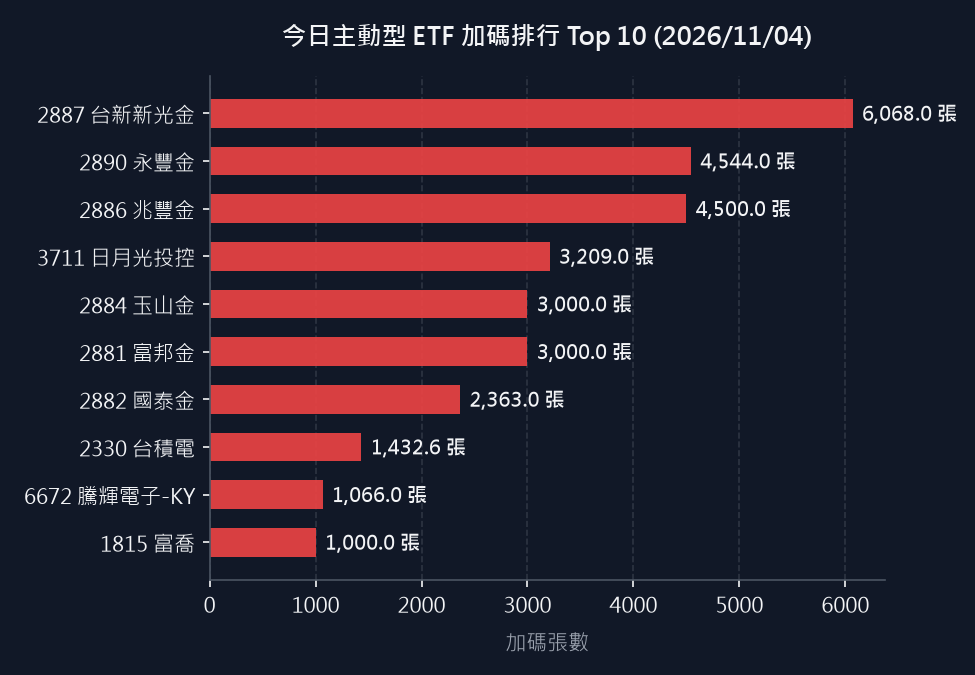
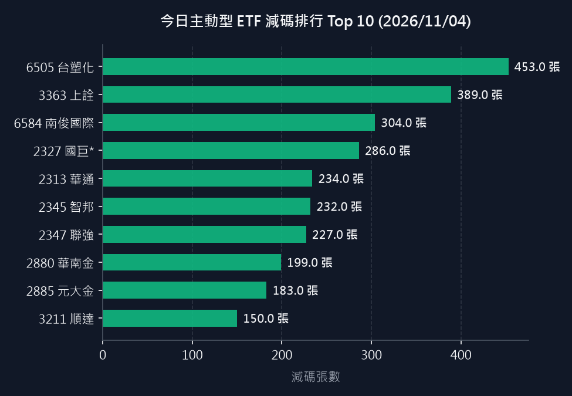

# 主動型 ETF 持股變動

資料來源：`主動型ETF持股明細.xlsx` 最近兩個日期分頁。

比較區間：`20261103` → `20261104`

## 今日加減碼視覺化排行

| 今日加碼 Top 10 | 今日減碼 Top 10 |
| :---: | :---: |
|  |  |

| ETF | 新增 | 刪除 | 比例變動 |
| :-- | --: | --: | --: |
| 00400A | 0 | 0 | 45 |
| 00401A | 1 | 0 | 54 |
| 00402A | 0 | 0 | 38 |
| 00403A | 0 | 0 | 33 |
| 00404A | 0 | 0 | 48 |
| 00405A | 0 | 1 | 28 |
| 00406A | 1 | 3 | 66 |
| 00407A | 0 | 0 | 46 |
| 00408A | 0 | 2 | 40 |
| 00980A | 0 | 0 | 47 |
| 00980D | 0 | 0 | 63 |
| 00981A | 0 | 0 | 30 |
| 00982A | 0 | 1 | 48 |
| 00983A | 0 | 0 | 34 |
| 00983D | 0 | 0 | 46 |
| 00984A | 1 | 1 | 72 |
| 00985A | 0 | 0 | 46 |
| 00986A | 0 | 2 | 32 |
| 00987A | 0 | 2 | 25 |
| 00988A | 1 | 1 | 30 |
| 00989A | 0 | 0 | 56 |
| 00990A | 4 | 4 | 33 |
| 00991A | 0 | 0 | 17 |
| 00992A | 0 | 0 | 36 |
| 00993A | 7 | 7 | 44 |
| 00994A | 0 | 2 | 36 |
| 00995A | 2 | 2 | 42 |
| 00996A | 0 | 1 | 33 |
| 00997A | 0 | 1 | 43 |
| 00998A | 0 | 1 | 36 |
| 00999A | 0 | 0 | 52 |

## 00400A

### 新增持股

- 無

### 刪除持股

- 無

### 投資比例變動

- 1303 南亞：4.16% → 3.95%（-0.21）
- 1476 儒鴻：0.07% → 0.08%（+0.01）
- 2059 川湖：3.50% → 3.30%（-0.20）
- 2303 聯電：1.53% → 1.52%（-0.01）
- 2308 台達電：2.14% → 1.99%（-0.15）
- 2313 華通：0.75% → 0.69%（-0.06）
- 2317 鴻海：0.80% → 0.79%（-0.01）
- 2327 國巨*：1.17% → 1.09%（-0.08）
- 2330 台積電：8.74% → 8.77%（+0.03）
- 2345 智邦：1.35% → 1.28%（-0.07）
- 2360 致茂：2.67% → 2.37%（-0.30）
- 2368 金像電：2.58% → 2.43%（-0.15）
- 2449 京元電子：0.87% → 0.85%（-0.02）
- 2454 聯發科：7.23% → 7.00%（-0.23）
- 2603 長榮：2.67% → 2.70%（+0.03）
- 2891 中信金：1.63% → 1.64%（+0.01）
- 3008 大立光：1.38% → 1.31%（-0.07）
- 3017 奇鋐：3.34% → 3.18%（-0.16）
- 3036 文曄：1.50% → 1.55%（+0.05）
- 3037 欣興：3.54% → 3.26%（-0.28）
- 3044 健鼎：2.25% → 2.14%（-0.11）
- 3081 聯亞：0.66% → 0.59%（-0.07）
- 3090 日電貿：0.29% → 0.28%（-0.01）
- 3167 大量：0.35% → 0.34%（-0.01）
- 3406 玉晶光：0.84% → 0.79%（-0.05）
- 3443 創意：2.34% → 2.37%（+0.03）
- 3529 力旺：1.13% → 1.05%（-0.08）
- 3653 健策：3.23% → 3.41%（+0.18）
- 3661 世芯-KY：2.16% → 2.09%（-0.07）
- 3711 日月光投控：1.04% → 1.00%（-0.04）
- 4958 臻鼎-KY：0.42% → 0.38%（-0.04）
- 5274 信驊：2.82% → 2.62%（-0.20）
- 5434 崇越：0.36% → 0.35%（-0.01）
- 6147 頎邦：0.82% → 0.78%（-0.04）
- 6187 萬潤：0.99% → 0.91%（-0.08）
- 6223 旺矽：2.80% → 2.57%（-0.23）
- 6271 同欣電：0.24% → 0.23%（-0.01）
- 6274 台燿：1.12% → 1.07%（-0.05）
- 6278 台表科：2.36% → 2.14%（-0.22）
- 6488 環球晶：2.23% → 1.88%（-0.35）
- 6505 台塑化：1.48% → 1.45%（-0.03）
- 7750 新代：0.74% → 0.62%（-0.12）
- 7769 鴻勁：0.65% → 0.60%（-0.05）
- 9939 宏全：0.07% → 0.08%（+0.01）
- ＸＡＧＸ金兌(3533.HK)：0.92% → 0.95%（+0.03）

## 00401A

### 新增持股

- TAIWAN TAIE C 18NOV26 43300 TWSE（-0.04%，-0.03 張）

### 刪除持股

- 無

### 投資比例變動

- 1303 南亞：1.24% → 1.12%（-0.12）
- 1476 儒鴻：0.64% → 1.71%（+1.07）
- 1477 聚陽：0.93% → 0.91%（-0.02）
- 2059 川湖：0.78% → 0.70%（-0.08）
- 2303 聯電：2.32% → 2.21%（-0.11）
- 2308 台達電：1.88% → 1.67%（-0.21）
- 2313 華通：1.28% → 1.13%（-0.15）
- 2317 鴻海：0.58% → 0.55%（-0.03）
- 2327 國巨*：0.57% → 0.51%（-0.06）
- 2330 台積電：19.72% → 19.21%（-0.51）
- 2345 智邦：0.11% → 0.10%（-0.01）
- 2357 華碩：1.77% → 1.68%（-0.09）
- 2360 致茂：1.74% → 1.71%（-0.03）
- 2379 瑞昱：1.14% → 1.07%（-0.07）
- 2382 廣達：2.09% → 1.97%（-0.12）
- 2383 台光電：0.96% → 0.92%（-0.04）
- 2454 聯發科：5.65% → 5.24%（-0.41）
- 2455 全新：1.94% → 1.64%（-0.30）
- 2603 長榮：2.35% → 2.28%（-0.07）
- 2881 富邦金：2.14% → 2.05%（-0.09）
- 2882 國泰金：1.10% → 1.04%（-0.06）
- 2883 凱基金：1.64% → 1.52%（-0.12）
- 2884 玉山金：2.10% → 2.04%（-0.06）
- 2886 兆豐金：1.47% → 1.44%（-0.03）
- 2887 台新新光金：1.09% → 1.04%（-0.05）
- 2890 永豐金：1.14% → 1.59%（+0.45）
- 2891 中信金：2.16% → 2.35%（+0.19）
- 2912 統一超：0.27% → 0.26%（-0.01）
- 3008 大立光：1.98% → 2.24%（+0.26）
- 3034 聯詠：0.22% → 0.20%（-0.02）
- 3037 欣興：1.61% → 1.42%（-0.19）
- 3131 弘塑：0.57% → 0.51%（-0.06）
- 3231 緯創：1.65% → 2.04%（+0.39）
- 3491 昇達科：1.51% → 1.41%（-0.10）
- 3711 日月光投控：3.97% → 4.38%（+0.41）
- 4958 臻鼎-KY：1.26% → 1.11%（-0.15）
- 4991 環宇-KY：0.53% → 0.47%（-0.06）
- 5274 信驊：1.66% → 1.47%（-0.19）
- 5347 世界：1.13% → 1.06%（-0.07）
- 5871 中租-KY：0.14% → 0.13%（-0.01）
- 5904 寶雅*：0.56% → 0.55%（-0.01）
- 6147 頎邦：1.25% → 1.13%（-0.12）
- 6187 萬潤：0.82% → 1.17%（+0.35）
- 6223 旺矽：1.42% → 1.49%（+0.07）
- 6285 啟碁：1.26% → 1.15%（-0.11）
- 6515 穎崴：0.83% → 0.74%（-0.09）
- 6531 愛普*：1.38% → 1.27%（-0.11）
- 6669 緯穎：1.63% → 1.58%（-0.05）
- 7769 鴻勁：0.76% → 0.67%（-0.09）
- 7828 創新服務：1.20% → 1.16%（-0.04）
- 7856 漢測：0.67% → 0.84%（+0.17）
- 8464 億豐：1.02% → 0.97%（-0.05）
- 台股期貨11/26(FITXN*1.TF)：-0.26% → -0.58%（-0.32）
- 臺指選擇權11/26 46500 買權：-0.26% → -0.08%（+0.18）

## 00402A

### 新增持股

- 無

### 刪除持股

- 無

### 投資比例變動

- AAPL.US Apple：8.65% → 8.35%（-0.30）
- AMD.US AMD：5.45% → 5.56%（+0.11）
- AMZN.US Amazon：4.68% → 4.71%（+0.03）
- ANET.US Arista Networks：0.78% → 0.79%（+0.01）
- ARM.US Arm：0.77% → 0.78%（+0.01）
- AVGO.US Broadcom：2.28% → 2.31%（+0.03）
- AXON.US Axon Enterprise：0.66% → 0.64%（-0.02）
- BABA.US Alibaba Group：0.51% → 0.49%（-0.02）
- CDNS.US Cadence Design Systems：1.67% → 1.61%（-0.06）
- CIEN.US Ciena：1.01% → 1.05%（+0.04）
- CLS.US Celestica：1.10% → 1.13%（+0.03）
- COHR.US Coherent：1.06% → 1.09%（+0.03）
- CRWD.US CrowdStrike Holdings：1.90% → 1.89%（-0.01）
- GOOG.US Alphabet - Class C Capital Stock：3.08% → 3.04%（-0.04）
- GOOGL.US Alphabet - Class A Common Stock：3.08% → 3.04%（-0.04）
- INTC.US Intel：1.02% → 1.01%（-0.01）
- IOT.US Samsara：0.61% → 0.59%（-0.02）
- KLAC.US KLA：1.39% → 1.40%（+0.01）
- LITE.US Lumentum：1.51% → 1.48%（-0.03）
- MCHP.US Microchip Technology：1.51% → 1.52%（+0.01）
- META.US Meta：3.58% → 3.61%（+0.03）
- MRVL.US Marvell：1.29% → 1.27%（-0.02）
- MSFT.US Microsoft：5.72% → 5.79%（+0.07）
- MU.US Micron：5.68% → 5.73%（+0.05）
- NFLX.US Netflix：0.97% → 0.98%（+0.01）
- NOW.US ServiceNow：0.91% → 0.93%（+0.02）
- NVDA.US NVIDIA：8.88% → 8.89%（+0.01）
- PANW.US Palo Alto：3.01% → 2.95%（-0.06）
- PLTR.US Palantir Technologies：2.20% → 2.13%（-0.07）
- SHOP.US Shopify：1.23% → 1.10%（-0.13）
- SIMO.US Silicon Motion：0.46% → 0.49%（+0.03）
- SKHY.US SK hynix：0.88% → 0.89%（+0.01）
- SPCX.US SpaceX：0.75% → 0.77%（+0.02）
- STX.US Seagate：1.00% → 1.01%（+0.01）
- TER.US Teradyne：0.64% → 0.65%（+0.01）
- TXN.US Texas Instruments：2.86% → 2.91%（+0.05）
- V.US Visa：1.44% → 1.40%（-0.04）
- WDC.US Western Digital：1.84% → 1.86%（+0.02）

## 00403A

### 新增持股

- 無

### 刪除持股

- 無

### 投資比例變動

- 1303 南亞：2.88% → 2.79%（-0.09）
- 1560 中砂：0.43% → 0.41%（-0.02）
- 2059 川湖：0.68% → 0.72%（+0.04）
- 2308 台達電：2.34% → 2.22%（-0.12）
- 2313 華通：0.33% → 0.31%（-0.02）
- 2327 國巨*：3.50% → 3.32%（-0.18）
- 2330 台積電：14.30% → 14.99%（+0.69）
- 2345 智邦：1.89% → 1.57%（-0.32）
- 2368 金像電：0.87% → 0.83%（-0.04）
- 2383 台光電：4.50% → 4.59%（+0.09）
- 2408 南亞科：1.02% → 0.94%（-0.08）
- 2449 京元電子：0.84% → 0.83%（-0.01）
- 2454 聯發科：5.00% → 5.05%（+0.05）
- 2455 全新：0.07% → 0.06%（-0.01）
- 3008 大立光：1.64% → 1.58%（-0.06）
- 3017 奇鋐：5.78% → 5.61%（-0.17）
- 3037 欣興：5.72% → 5.37%（-0.35）
- 3189 景碩：3.23% → 3.07%（-0.16）
- 3211 順達：0.48% → 0.42%（-0.06）
- 3443 創意：4.12% → 4.24%（+0.12）
- 3450 聯鈞：0.50% → 0.48%（-0.02）
- 3583 辛耘：0.26% → 0.25%（-0.01）
- 3653 健策：5.19% → 5.58%（+0.39）
- 3665 貿聯-KY：1.89% → 1.93%（+0.04）
- 3711 日月光投控：1.02% → 1.00%（-0.02）
- 5274 信驊：2.25% → 2.13%（-0.12）
- 6223 旺矽：3.45% → 3.23%（-0.22）
- 6274 台燿：2.32% → 2.25%（-0.07）
- 6442 光聖：0.32% → 0.24%（-0.08）
- 6488 環球晶：0.18% → 0.16%（-0.02）
- 6669 緯穎：2.69% → 2.77%（+0.08）
- 6805 富世達：0.58% → 0.54%（-0.04）
- 8046 南電：2.84% → 2.73%（-0.11）

## 00404A

### 新增持股

- 無

### 刪除持股

- 無

### 投資比例變動

- 1303 南亞：0.78% → 0.79%（+0.01）
- 2059 川湖：0.50% → 0.70%（+0.20）
- 2301 光寶科：0.51% → 0.50%（-0.01）
- 2303 聯電：2.20% → 2.79%（+0.59）
- 2308 台達電：1.37% → 1.88%（+0.51）
- 2317 鴻海：0.72% → 0.70%（-0.02）
- 2330 台積電：23.02% → 22.22%（-0.80）
- 2345 智邦：0.73% → 0.88%（+0.15）
- 2347 聯強：1.97% → 1.79%（-0.18）
- 2357 華碩：1.20% → 1.18%（-0.02）
- 2360 致茂：0.38% → 0.52%（+0.14）
- 2379 瑞昱：1.21% → 1.07%（-0.14）
- 2382 廣達：1.02% → 0.99%（-0.03）
- 2383 台光電：2.61% → 3.08%（+0.47）
- 2395 研華：1.24% → 1.26%（+0.02）
- 2436 偉詮電：1.06% → 1.07%（+0.01）
- 2454 聯發科：6.11% → 7.17%（+1.06）
- 2637 慧洋-KY：1.19% → 1.08%（-0.11）
- 2851 中再保：1.24% → 1.09%（-0.15）
- 2882 國泰金：3.06% → 2.59%（-0.47）
- 2885 元大金：2.64% → 2.29%（-0.35）
- 2887 台新新光金：1.57% → 1.32%（-0.25）
- 2890 永豐金：1.61% → 1.40%（-0.21）
- 3017 奇鋐：1.27% → 1.37%（+0.10）
- 3034 聯詠：2.30% → 1.99%（-0.31）
- 3037 欣興：0.24% → 0.36%（+0.12）
- 3264 欣銓：0.55% → 0.56%（+0.01）
- 3293 鈊象：1.26% → 1.09%（-0.17）
- 3443 創意：0.92% → 1.15%（+0.23）
- 3653 健策：0.49% → 0.52%（+0.03）
- 3711 日月光投控：3.23% → 3.29%（+0.06）
- 5274 信驊：2.56% → 2.82%（+0.26）
- 5434 崇越：1.75% → 1.70%（-0.05）
- 5876 上海商銀：1.67% → 1.41%（-0.26）
- 5904 寶雅*：0.55% → 0.43%（-0.12）
- 6196 帆宣：1.50% → 1.81%（+0.31）
- 6223 旺矽：0.96% → 1.17%（+0.21）
- 6257 矽格：1.42% → 1.81%（+0.39）
- 6491 晶碩：0.94% → 0.93%（-0.01）
- 6505 台塑化：0.48% → 0.49%（+0.01）
- 6669 緯穎：0.91% → 1.06%（+0.15）
- 6691 洋基工程：1.51% → 1.81%（+0.30）
- 7769 鴻勁：0.97% → 1.18%（+0.21）
- 8016 矽創：1.24% → 1.21%（-0.03）
- 8081 致新：0.90% → 0.81%（-0.09）
- 8299 群聯：1.14% → 1.15%（+0.01）
- 台指選擇權11/26 48000 買權：-0.06% → -0.05%（+0.01）
- 台股期貨11/26(FITXN*1.TF)：19.69% → 19.60%（-0.09）

## 00405A

### 新增持股

- 無

### 刪除持股

- 6510 精測（0.01%，1 張）

### 投資比例變動

- 2059 川湖：2.26% → 2.15%（-0.11）
- 2308 台達電：0.61% → 0.57%（-0.04）
- 2330 台積電：2.00% → 2.03%（+0.03）
- 2345 智邦：4.72% → 4.52%（-0.20）
- 2368 金像電：5.73% → 5.44%（-0.29）
- 2383 台光電：4.79% → 4.84%（+0.05）
- 2454 聯發科：5.60% → 5.47%（-0.13）
- 3017 奇鋐：1.88% → 1.81%（-0.07）
- 3037 欣興：7.32% → 4.58%（-2.74）
- 3189 景碩：0.22% → 0.21%（-0.01）
- 3264 欣銓：0.04% → 0.03%（-0.01）
- 3443 創意：2.55% → 2.60%（+0.05）
- 3653 健策：7.89% → 8.40%（+0.51）
- 3665 貿聯-KY：5.19% → 5.23%（+0.04）
- 5274 信驊：6.85% → 6.42%（-0.43）
- 5347 世界：0.15% → 0.14%（-0.01）
- 6187 萬潤：0.85% → 0.79%（-0.06）
- 6223 旺矽：7.22% → 6.69%（-0.53）
- 6274 台燿：1.78% → 1.71%（-0.07）
- 6285 啟碁：0.11% → 0.10%（-0.01）
- 6415 矽力*-KY：0.60% → 0.57%（-0.03）
- 6515 穎崴：0.50% → 0.46%（-0.04）
- 6531 愛普*：3.83% → 3.71%（-0.12）
- 6669 緯穎：0.87% → 0.89%（+0.02）
- 6805 富世達：3.06% → 1.78%（-1.28）
- 7769 鴻勁：2.83% → 2.62%（-0.21）
- 8046 南電：7.39% → 7.03%（-0.36）
- 8996 高力：1.45% → 1.43%（-0.02）

## 00406A

### 新增持股

- 臺指選擇權第二週週三到期契約（-6.01%，-5 張）

### 刪除持股

- 3363 上詮（0.13%，389 張）
- 6515 穎崴（0.06%，18 張）
- 臺指選擇權第一週週三到期契約（-11.73%，-10 張）

### 投資比例變動

- 1303 南亞：2.35% → 2.20%（-0.15）
- 1326 台化：0.60% → 0.53%（-0.07）
- 1560 中砂：0.27% → 0.24%（-0.03）
- 1815 富喬：0.49% → 0.54%（+0.05）
- 2059 川湖：1.43% → 1.73%（+0.30）
- 2303 聯電：1.25% → 1.23%（-0.02）
- 2308 台達電：1.78% → 1.53%（-0.25）
- 2317 鴻海：0.26% → 0.24%（-0.02）
- 2327 國巨*：1.79% → 1.53%（-0.26）
- 2330 台積電：9.47% → 9.17%（-0.30）
- 2344 華邦電：0.07% → 0.06%（-0.01）
- 2345 智邦：2.34% → 2.04%（-0.30）
- 2360 致茂：0.83% → 0.68%（-0.15）
- 2368 金像電：2.23% → 2.54%（+0.31）
- 2383 台光電：6.15% → 6.14%（-0.01）
- 2395 研華：0.06% → 0.05%（-0.01）
- 2449 京元電子：0.47% → 0.42%（-0.05）
- 2454 聯發科：6.18% → 5.93%（-0.25）
- 2481 強茂：0.36% → 0.32%（-0.04）
- 2486 一詮：0.12% → 0.10%（-0.02）
- 2881 富邦金：0.38% → 0.68%（+0.30）
- 2882 國泰金：0.35% → 0.51%（+0.16）
- 2884 玉山金：0.22% → 0.30%（+0.08）
- 2885 元大金：0.52% → 0.48%（-0.04）
- 2886 兆豐金：0.12% → 0.28%（+0.16）
- 2887 台新新光金：0.27% → 0.42%（+0.15）
- 2890 永豐金：0.21% → 0.31%（+0.10）
- 3008 大立光：1.20% → 1.04%（-0.16）
- 3017 奇鋐：4.98% → 5.28%（+0.30）
- 3037 欣興：5.84% → 5.50%（-0.34）
- 3081 聯亞：1.24% → 1.22%（-0.02）
- 3105 穩懋：0.44% → 0.57%（+0.13）
- 3167 大量：0.64% → 0.58%（-0.06）
- 3189 景碩：1.89% → 1.92%（+0.03）
- 3231 緯創：0.38% → 0.35%（-0.03）
- 3264 欣銓：0.35% → 0.31%（-0.04）
- 3443 創意：2.19% → 2.03%（-0.16）
- 3450 聯鈞：0.10% → 0.08%（-0.02）
- 3491 昇達科：0.32% → 0.29%（-0.03）
- 3529 力旺：0.13% → 0.11%（-0.02）
- 3653 健策：4.58% → 4.72%（+0.14）
- 3661 世芯-KY：0.81% → 0.72%（-0.09）
- 3665 貿聯-KY：0.93% → 0.85%（-0.08）
- 3711 日月光投控：2.07% → 2.09%（+0.02）
- 4938 和碩：0.53% → 0.50%（-0.03）
- 4958 臻鼎-KY：1.08% → 0.91%（-0.17）
- 5274 信驊：1.68% → 1.44%（-0.24）
- 6147 頎邦：0.81% → 0.70%（-0.11）
- 6187 萬潤：0.14% → 0.12%（-0.02）
- 6213 聯茂：0.49% → 0.43%（-0.06）
- 6223 旺矽：3.01% → 3.06%（+0.05）
- 6274 台燿：1.91% → 2.15%（+0.24）
- 6278 台表科：0.27% → 0.22%（-0.05）
- 6446 藥華藥：0.38% → 0.60%（+0.22）
- 6488 環球晶：0.21% → 0.16%（-0.05）
- 6510 精測：0.58% → 0.54%（-0.04）
- 6531 愛普*：0.09% → 0.08%（-0.01）
- 6669 緯穎：1.18% → 1.10%（-0.08）
- 6715 嘉基：0.74% → 0.64%（-0.10）
- 6805 富世達：0.85% → 1.08%（+0.23）
- 7769 鴻勁：0.15% → 0.13%（-0.02）
- 8046 南電：2.90% → 3.02%（+0.12）
- 8358 金居：0.07% → 0.06%（-0.01）
- 8996 高力：0.62% → 0.76%（+0.14）
- 臺指選擇權第一週週五到期契約：-4.35% → -14.32%（-9.97）
- 臺股期貨 202611(FITXN*1.TF)：23.64% → 22.07%（-1.57）

## 00407A

### 新增持股

- 無

### 刪除持股

- 無

### 投資比例變動

- 1303 南亞：3.30% → 3.19%（-0.11）
- 1560 中砂：1.05% → 1.01%（-0.04）
- 2059 川湖：1.89% → 1.81%（-0.08）
- 2301 光寶科：1.41% → 1.38%（-0.03）
- 2303 聯電：0.48% → 0.49%（+0.01）
- 2308 台達電：2.19% → 2.07%（-0.12）
- 2313 華通：0.41% → 0.38%（-0.03）
- 2327 國巨*：2.23% → 2.12%（-0.11）
- 2330 台積電：9.68% → 10.33%（+0.65）
- 2344 華邦電：0.15% → 0.14%（-0.01）
- 2345 智邦：1.46% → 1.41%（-0.05）
- 2360 致茂：0.90% → 0.81%（-0.09）
- 2368 金像電：2.09% → 1.99%（-0.10）
- 2383 台光電：5.60% → 6.01%（+0.41）
- 2408 南亞科：1.61% → 1.48%（-0.13）
- 2451 創見：0.36% → 0.35%（-0.01）
- 2454 聯發科：5.64% → 5.74%（+0.10）
- 2615 萬海：1.11% → 1.12%（+0.01）
- 3008 大立光：1.42% → 1.36%（-0.06）
- 3017 奇鋐：5.74% → 5.56%（-0.18）
- 3034 聯詠：0.86% → 0.85%（-0.01）
- 3037 欣興：5.97% → 5.59%（-0.38）
- 3081 聯亞：1.85% → 1.69%（-0.16）
- 3131 弘塑：0.76% → 0.72%（-0.04）
- 3231 緯創：1.09% → 1.11%（+0.02）
- 3293 鈊象：0.68% → 0.70%（+0.02）
- 3406 玉晶光：0.23% → 0.22%（-0.01）
- 3443 創意：4.66% → 4.78%（+0.12）
- 3491 昇達科：0.88% → 0.87%（-0.01）
- 3533 嘉澤：0.95% → 1.00%（+0.05）
- 3653 健策：3.67% → 3.94%（+0.27）
- 3665 貿聯-KY：2.26% → 2.30%（+0.04）
- 3711 日月光投控：3.51% → 3.43%（-0.08）
- 4958 臻鼎-KY：1.02% → 0.95%（-0.07）
- 5274 信驊：1.82% → 1.72%（-0.10）
- 6187 萬潤：1.52% → 1.43%（-0.09）
- 6223 旺矽：2.18% → 2.04%（-0.14）
- 6274 台燿：1.87% → 1.81%（-0.06）
- 6446 藥華藥：0.35% → 0.38%（+0.03）
- 6510 精測：1.35% → 1.38%（+0.03）
- 6531 愛普*：0.30% → 0.29%（-0.01）
- 6669 緯穎：2.44% → 2.52%（+0.08）
- 6805 富世達：1.32% → 1.23%（-0.09）
- 8046 南電：3.60% → 3.45%（-0.15）
- 8299 群聯：0.32% → 0.31%（-0.01）
- 8996 高力：1.36% → 1.35%（-0.01）

## 00408A

### 新增持股

- 無

### 刪除持股

- 2303 聯電（0.86%，106 張）
- 3105 穩懋（0.61%，14 張）

### 投資比例變動

- 1303 南亞：4.00% → 3.77%（-0.23）
- 1560 中砂：0.83% → 0.78%（-0.05）
- 2059 川湖：0.97% → 0.91%（-0.06）
- 2308 台達電：1.69% → 1.56%（-0.13）
- 2327 國巨*：0.52% → 0.48%（-0.04）
- 2344 華邦電：0.48% → 0.43%（-0.05）
- 2345 智邦：0.66% → 0.62%（-0.04）
- 2360 致茂：1.01% → 0.89%（-0.12）
- 2368 金像電：4.93% → 4.60%（-0.33）
- 2383 台光電：4.69% → 4.66%（-0.03）
- 2395 研華：1.64% → 1.62%（-0.02）
- 2408 南亞科：2.06% → 1.85%（-0.21）
- 2449 京元電子：0.91% → 0.89%（-0.02）
- 2454 聯發科：4.10% → 3.94%（-0.16）
- 2455 全新：0.80% → 0.70%（-0.10）
- 2542 興富發：3.88% → 3.91%（+0.03）
- 2603 長榮：1.78% → 1.79%（+0.01）
- 2880 華南金：1.28% → 1.30%（+0.02）
- 3017 奇鋐：2.91% → 2.76%（-0.15）
- 3026 禾伸堂：0.71% → 0.67%（-0.04）
- 3037 欣興：3.02% → 2.76%（-0.26）
- 3044 健鼎：0.39% → 0.37%（-0.02）
- 3045 台灣大：0.12% → 0.13%（+0.01）
- 3081 聯亞：2.05% → 0.80%（-1.25）
- 3189 景碩：3.29% → 3.05%（-0.24）
- 3264 欣銓：0.69% → 0.34%（-0.35）
- 3653 健策：3.64% → 3.81%（+0.17）
- 3711 日月光投控：2.34% → 2.23%（-0.11）
- 5434 崇越：2.35% → 2.27%（-0.08）
- 6187 萬潤：0.97% → 0.89%（-0.08）
- 6223 旺矽：1.99% → 1.81%（-0.18）
- 6274 台燿：2.59% → 2.20%（-0.39）
- 6526 達發：0.34% → 0.33%（-0.01）
- 6669 緯穎：1.98% → 2.00%（+0.02）
- 6691 洋基工程：0.33% → 0.32%（-0.01）
- 6805 富世達：2.43% → 2.21%（-0.22）
- 7769 鴻勁：0.91% → 0.83%（-0.08）
- 8046 南電：1.49% → 1.15%（-0.34）
- 8996 高力：2.45% → 2.38%（-0.07）
- 9802 鈺齊-KY：0.87% → 0.90%（+0.03）

## 00980A

### 新增持股

- 無

### 刪除持股

- 無

### 投資比例變動

- 1303 南亞：3.53% → 3.39%（-0.14）
- 2059 川湖：4.13% → 3.94%（-0.19）
- 2308 台達電：3.04% → 2.86%（-0.18）
- 2327 國巨*：0.88% → 0.83%（-0.05）
- 2330 台積電：9.73% → 9.87%（+0.14）
- 2344 華邦電：1.74% → 1.59%（-0.15）
- 2345 智邦：0.90% → 0.86%（-0.04）
- 2360 致茂：1.05% → 0.94%（-0.11）
- 2368 金像電：1.98% → 1.88%（-0.10）
- 2382 廣達：1.94% → 1.93%（-0.01）
- 2383 台光電：3.76% → 3.80%（+0.04）
- 2408 南亞科：2.45% → 2.24%（-0.21）
- 2454 聯發科：5.48% → 5.36%（-0.12）
- 2884 玉山金：1.31% → 1.34%（+0.03）
- 2891 中信金：1.62% → 1.66%（+0.04）
- 3008 大立光：1.98% → 1.89%（-0.09）
- 3017 奇鋐：2.27% → 2.19%（-0.08）
- 3026 禾伸堂：1.01% → 0.97%（-0.04）
- 3036 文曄：1.03% → 1.07%（+0.04）
- 3037 欣興：3.46% → 3.22%（-0.24）
- 3044 健鼎：1.32% → 1.26%（-0.06）
- 3081 聯亞：1.60% → 1.46%（-0.14）
- 3189 景碩：1.34% → 1.27%（-0.07）
- 3231 緯創：1.67% → 1.69%（+0.02）
- 3264 欣銓：0.78% → 0.74%（-0.04）
- 3293 鈊象：0.49% → 0.50%（+0.01）
- 3443 創意：1.82% → 1.86%（+0.04）
- 3529 力旺：0.16% → 0.15%（-0.01）
- 3653 健策：3.15% → 3.37%（+0.22）
- 3665 貿聯-KY：1.29% → 1.30%（+0.01）
- 3711 日月光投控：2.32% → 2.26%（-0.06）
- 5274 信驊：1.76% → 1.65%（-0.11）
- 5904 寶雅*：0.69% → 0.73%（+0.04）
- 6213 聯茂：1.30% → 1.26%（-0.04）
- 6223 旺矽：1.27% → 1.17%（-0.10）
- 6274 台燿：1.18% → 1.14%（-0.04）
- 6442 光聖：0.27% → 0.25%（-0.02）
- 6515 穎崴：1.52% → 1.42%（-0.10）
- 6669 緯穎：1.87% → 1.92%（+0.05）
- 6805 富世達：0.70% → 0.65%（-0.05）
- 6831 邁科：0.26% → 0.25%（-0.01）
- 7751 竑騰：0.63% → 0.65%（+0.02）
- 7769 鴻勁：1.94% → 1.80%（-0.14）
- 8046 南電：1.65% → 1.57%（-0.08）
- 8210 勤誠：0.37% → 0.35%（-0.02）
- 8299 群聯：1.08% → 1.03%（-0.05）
- 8996 高力：0.49% → 0.48%（-0.01）

## 00980D

### 新增持股

- 無

### 刪除持股

- 無

### 投資比例變動

- AHOLD FINANCE USA LLC 6.88% 01MAY2029：0.50% → 0.51%（+0.01）
- ALLY FINANCIAL INC (REG) 7.1% 15NOV2027：0.45% → 0.46%（+0.01）
- ALLY FINANCIAL INC (REG) 8% 01NOV2031：0.54% → 0.55%（+0.01）
- ALLY FINANCIAL INC (REG) VAR 03JAN2030：0.65% → 0.66%（+0.01）
- ALLY FINANCIAL INC (REG) VAR 13JUN2029：0.57% → 0.58%（+0.01）
- AMC GLOBAL MEDIA INC SER REGS (REG) (REG S) 10.5% 15JUL2032：0.68% → 0.69%（+0.01）
- AP CORE HOLDINGS II LLC SER REGS (REG S) 11% 15MAY2031：0.39% → 0.40%（+0.01）
- APOLLO DEBT SOLUTIONS BD 6.900000 % 13APR2029：0.57% → 0.58%（+0.01）
- ARSENAL AIC PARENT LLC SER REGS 11.5 % 01-OCT-2031：0.33% → 0.34%（+0.01）
- BANK OF AMERICA CORP (REG) 7.75% 14MAY2038：0.53% → 0.54%（+0.01）
- BAT CAPITAL CORP (REG) 7.081% 02AUG2053：0.59% → 0.60%（+0.01）
- BLUE OWL CREDIT INCOME 7.950000 % 13JUN2028：0.55% → 0.56%（+0.01）
- BRITISH TELECOMMUNICATIO (BR) 9.625% 15DEC2030：0.59% → 0.60%（+0.01）
- CHARTER COMM OPT 6.484% 23OCT2045 W/I：0.44% → 0.45%（+0.01）
- CHARTER COMM OPT LLC/CAP (REG) 5.5% 01APR2063：0.47% → 0.48%（+0.01）
- CHS/COMMUNITY HEALTH SYS SER REGS 9.750000 % 15JAN2034：0.48% → 0.47%（-0.01）
- CITIGROUP INC 8.125% 15JUL2039：0.64% → 0.65%（+0.01）
- CONCENTRIX CORP (REG) 6.85% 02AUG2033：0.73% → 0.74%（+0.01）
- CONOCOPHILLIPS COMPANY (REG) 6.95% 15APR2029：0.53% → 0.54%（+0.01）
- CONSOLIDATED ENERGY FIN SER REGS 12.000000 % 15FEB2031：0.58% → 0.59%（+0.01）
- COREWEAVE INC SER REGS (REG S) 9.75% 01OCT2031：0.47% → 0.48%（+0.01）
- COX COMMUNICATIONS INC SER REGS 5.800000 % 15DEC2053：0.49% → 0.50%（+0.01）
- DOW CHEMICAL CO/THE 7.375% 01NOV2029：0.63% → 0.64%（+0.01）
- DOW CHEMICAL CO/THE 9.4% 15MAY2039：0.56% → 0.57%（+0.01）
- ENBRIDGE ENERGY PARTNERS (REG) 7.375% 15OCT2045：0.53% → 0.54%（+0.01）
- ENEL FINANCE INTL NV SER REGS (REG S) 7.75% 14OCT2052：0.37% → 0.38%（+0.01）
- FIFTH THIRD BANCORP (REG) 8.25% 01MAR2038：0.66% → 0.67%（+0.01）
- FORD MOTOR COMPANY 5.291% 08DEC2046：0.29% → 0.30%（+0.01）
- FORD MOTOR CREDIT CO LLC (REG) 7.35% 04NOV2027：0.34% → 0.35%（+0.01）
- GENERAL MOTORS CO (REG) 6.8% 01OCT2027：0.58% → 0.59%（+0.01）
- GLOBAL ATLANTIC FIN CO SER REGS 7.950000 % 15JUN2033：0.68% → 0.69%（+0.01）
- GLOBAL AUTO HO/AAG FH UK SER REGS (REG S) 8.75% 15JAN2032：0.40% → 0.41%（+0.01）
- HERTZ CORP/THE SER REGS (REG S) 12.625% 15JUL2029：0.30% → 0.29%（-0.01）
- HORIZON MUTUAL HOLDINGS SER REGS 6.200000 % 15NOV2034：0.33% → 0.34%（+0.01）
- HSBC HOLDINGS PLC VAR 03NOV2028：0.34% → 0.35%（+0.01）
- ICAHN ENTERPRISES/FIN (REG) 9.75% 15JAN2029：0.32% → 0.33%（+0.01）
- INTESA SANPAOLO SPA SER REGS (REG S) 7.8% 28NOV2053：0.37% → 0.38%（+0.01）
- JBS USA HOLD/FOOD/LUX CO 7.250000 % 15NOV2053：0.48% → 0.49%（+0.01）
- JETBLUE AIRWAYS/LOYALTY SER REGS (REG S) 9.875% 20SEP2031：0.33% → 0.32%（-0.01）
- JH NORTH AMERICA HOLDING SER REGS 6.125000 % 31JUL2032：0.41% → 0.42%（+0.01）
- KYNDRYL HOLDINGS INC 7.8 % 28-SEP-2029：0.42% → 0.43%（+0.01）
- LPL HOLDINGS INC (REG) 6.75% 17NOV2028：0.58% → 0.59%（+0.01）
- MOHEGAN TRIBAL / MS DIG SER REGS 11.875000 % 15APR2031：0.70% → 0.71%（+0.01）
- NISSAN MOTOR CO SER REGS 8.125000 % 17JUL2035：0.51% → 0.52%（+0.01）
- OCCIDENTAL PETROLEUM COR (REG) 7.5% 01MAY2031：0.34% → 0.35%（+0.01）
- ORACLE CORP 6.125000 % 03AUG2065：0.54% → 0.55%（+0.01）
- OVINTIV INC 7.375% 01NOV2031：0.34% → 0.35%（+0.01）
- PROGRESS ENERGY INC (REG) 7.75% 01MAR2031：0.59% → 0.60%（+0.01）
- RR DONNELLEY & SONS CO SER REGS (REG S) 9.5% 01AUG2029：0.43% → 0.44%（+0.01）
- SALESFORCE INC (REG) 6.55% 15MAR2056：0.55% → 0.56%（+0.01）
- SANTANDER HOLDINGS USA VAR 09MAR2029：0.49% → 0.50%（+0.01）
- SANTANDER HOLDINGS USA VAR 09NOV2031：0.61% → 0.62%（+0.01）
- SOCIETE GENERALE SER REGS (REG) (REG S) 7.367% 10JAN2053：0.32% → 0.33%（+0.01）
- TOUCAN FINCO LTD/CAN/US SER REGS 9.500000 % 15MAY2030：0.25% → 0.26%（+0.01）
- UNISYS CORP SER REGS 10.625000 % 15JAN2031：0.63% → 0.64%（+0.01）
- US 10YR NOTE (CBT)DEC26 21-DEC-2026：18.63% → 18.72%（+0.09）
- US 10YR ULTRA FUT DEC26 21-DEC-2026：-2.36% → -2.19%（+0.17）
- US 2YR NOTE (CBT) DEC26 31-DEC-2026：1.71% → 1.73%（+0.02）
- US 5YR NOTE (CBT) DEC26 31-DEC-2026：-14.26% → -15.41%（-1.15）
- VAR ENERGI ASA SER REGS (REG S) 7.5% 15JAN2028：0.34% → 0.35%（+0.01）
- VIACOM INC (REG) 5.85% 01SEP2043：0.49% → 0.50%（+0.01）
- VIACOMCBS INC (REG) 4.95% 19MAY2050：0.44% → 0.45%（+0.01）
- VISTRA OPERATIONS CO LLC SER REGS (REG S) 6.95% 15OCT2033：0.42% → 0.43%（+0.01）

## 00981A

### 新增持股

- 無

### 刪除持股

- 無

### 投資比例變動

- 1802 台玻：0.23% → 0.22%（-0.01）
- 2303 聯電：3.22% → 3.25%（+0.03）
- 2308 台達電：3.78% → 3.58%（-0.20）
- 2327 國巨*：4.19% → 4.09%（-0.10）
- 2330 台積電：13.05% → 13.36%（+0.31）
- 2345 智邦：3.72% → 3.63%（-0.09）
- 2368 金像電：2.94% → 2.88%（-0.06）
- 2383 台光電：7.48% → 7.63%（+0.15）
- 2449 京元電子：0.77% → 0.75%（-0.02）
- 2454 聯發科：7.91% → 8.07%（+0.16）
- 3017 奇鋐：7.63% → 7.26%（-0.37）
- 3037 欣興：7.00% → 6.78%（-0.22）
- 3231 緯創：0.42% → 0.41%（-0.01）
- 3264 欣銓：0.39% → 0.38%（-0.01）
- 3443 創意：2.47% → 2.62%（+0.15）
- 3653 健策：5.96% → 6.27%（+0.31）
- 3665 貿聯-KY：1.79% → 1.75%（-0.04）
- 3711 日月光投控：3.74% → 4.10%（+0.36）
- 5274 信驊：1.38% → 1.30%（-0.08）
- 6223 旺矽：4.12% → 4.01%（-0.11）
- 6271 同欣電：0.17% → 0.18%（+0.01）
- 6274 台燿：3.12% → 3.17%（+0.05）
- 6510 精測：0.48% → 0.50%（+0.02）
- 6669 緯穎：2.28% → 2.27%（-0.01）
- 6805 富世達：1.20% → 1.14%（-0.06）
- 8046 南電：3.78% → 3.76%（-0.02）
- 8210 勤誠：0.04% → 0.03%（-0.01）
- 8358 金居：0.10% → 0.09%（-0.01）
- 8996 高力：0.52% → 0.54%（+0.02）
- 台指期貨 2026/11(FITXN*1.TF)：2.31% → 2.27%（-0.04）

## 00982A

### 新增持股

- 無

### 刪除持股

- 1519 華城（0.00%，0.66 張）

### 投資比例變動

- 2059 川湖：2.68% → 2.65%（-0.03）
- 2301 光寶科：1.73% → 1.70%（-0.03）
- 2303 聯電：1.25% → 1.27%（+0.02）
- 2330 台積電：8.25% → 8.31%（+0.06）
- 2360 致茂：3.59% → 3.27%（-0.32）
- 2376 技嘉：1.31% → 1.33%（+0.02）
- 2377 微星：0.35% → 0.38%（+0.03）
- 2383 台光電：3.20% → 3.30%（+0.10）
- 2395 研華：1.39% → 1.41%（+0.02）
- 2428 興勤：1.16% → 1.15%（-0.01）
- 2454 聯發科：6.88% → 7.57%（+0.69）
- 2455 全新：1.52% → 1.38%（-0.14）
- 2467 志聖：0.92% → 0.86%（-0.06）
- 2478 大毅：0.32% → 0.34%（+0.02）
- 2486 一詮：0.68% → 0.65%（-0.03）
- 3008 大立光：3.06% → 2.96%（-0.10）
- 3017 奇鋐：2.52% → 2.46%（-0.06）
- 3037 欣興：0.88% → 0.81%（-0.07）
- 3090 日電貿：0.32% → 0.34%（+0.02）
- 3105 穩懋：9.14% → 8.08%（-1.06）
- 3231 緯創：1.93% → 1.97%（+0.04）
- 3265 台星科：1.44% → 1.39%（-0.05）
- 3491 昇達科：3.38% → 3.30%（-0.08）
- 3529 力旺：0.01% → 0.00%（-0.01）
- 3583 辛耘：0.68% → 0.64%（-0.04）
- 3711 日月光投控：2.01% → 1.97%（-0.04）
- 4958 臻鼎-KY：3.39% → 3.12%（-0.27）
- 5274 信驊：1.23% → 1.18%（-0.05）
- 5425 台半：1.20% → 1.18%（-0.02）
- 5483 中美晶：1.32% → 1.29%（-0.03）
- 5536 聖暉*：0.77% → 0.75%（-0.02）
- 6139 亞翔：5.25% → 5.34%（+0.09）
- 6196 帆宣：0.36% → 0.34%（-0.02）
- 6213 聯茂：1.36% → 1.74%（+0.38）
- 6214 精誠：1.53% → 1.46%（-0.07）
- 6223 旺矽：3.08% → 2.84%（-0.24）
- 6239 力成：1.37% → 1.32%（-0.05）
- 6274 台燿：1.12% → 1.10%（-0.02）
- 6446 藥華藥：0.11% → 0.12%（+0.01）
- 6472 保瑞：0.83% → 0.87%（+0.04）
- 6488 環球晶：1.83% → 1.59%（-0.24）
- 6510 精測：0.94% → 0.95%（+0.01）
- 6531 愛普*：3.92% → 3.78%（-0.14）
- 6640 均華：0.28% → 0.27%（-0.01）
- 6669 緯穎：2.03% → 2.06%（+0.03）
- 6672 騰輝電子-KY：1.37% → 2.70%（+1.33）
- 8070 長華*：0.67% → 0.69%（+0.02）
- 8996 高力：1.27% → 1.25%（-0.02）

## 00983A

### 新增持股

- 無

### 刪除持股

- 無

### 投資比例變動

- AMD.US AMD：3.05% → 3.12%（+0.07）
- AMZN.US Amazon：4.02% → 4.05%（+0.03）
- AVGO.US Broadcom：1.85% → 1.88%（+0.03）
- BEAM.US Beam Therapeutics：2.47% → 2.48%（+0.01）
- BMNR.US BitMine：1.38% → 1.43%（+0.05）
- COIN.US Coinbase：3.14% → 3.26%（+0.12）
- CRCL.US Circle：4.06% → 4.17%（+0.11）
- CRSP.US CRISPR Therapeutics：4.00% → 3.95%（-0.05）
- CRWV.US CoreWeave：0.27% → 0.13%（-0.14）
- DE.US Deere：0.47% → 0.46%（-0.01）
- FTNT.US Fortinet：0.22% → 0.11%（-0.11）
- GOOG.US Alphabet - Class C Capital Stock：2.26% → 2.39%（+0.13）
- GOOGL.US Alphabet - Class A Common Stock：1.51% → 1.49%（-0.02）
- HOOD.US Robinhood Markets：2.52% → 2.54%（+0.02）
- ILMN.US Illumina：1.61% → 1.66%（+0.05）
- LLY.US Eli Lilly：1.96% → 1.93%（-0.03）
- META.US Meta：3.03% → 3.05%（+0.02）
- MSFT.US Microsoft：1.04% → 1.06%（+0.02）
- NET.US Cloudflare：1.27% → 1.29%（+0.02）
- NTRA.US Natera：1.69% → 1.71%（+0.02）
- NVDA.US NVIDIA：3.76% → 3.79%（+0.03）
- PLTR.US Palantir Technologies：3.26% → 3.16%（-0.10）
- RKLB.US Rocket Lab：1.31% → 1.35%（+0.04）
- RXRX.US Recursion Pharmaceuticals：0.98% → 0.93%（-0.05）
- SHOP.US Shopify：5.01% → 4.51%（-0.50）
- SPCX.US SpaceX：6.72% → 6.87%（+0.15）
- TEM.US Tempus：6.75% → 6.60%（-0.15）
- TER.US Teradyne：0.50% → 0.51%（+0.01）
- TSLA.US Tesla：9.26% → 8.73%（-0.53）
- TSM.US TSMC(ADR)：2.73% → 2.74%（+0.01）
- TWST.US Twist Bioscience：3.56% → 3.81%（+0.25）
- TXG.US 10x Genomics：3.02% → 3.15%（+0.13）
- WGS.US GeneDx：0.51% → 0.54%（+0.03）
- XYZ.US Block：1.40% → 1.36%（-0.04）

## 00983D

### 新增持股

- 無

### 刪除持股

- 無

### 投資比例變動

- ABIBB 8.2 01/15/39：2.03% → 2.04%（+0.01）
- ALLY 8 11/01/31：1.25% → 1.26%（+0.01）
- AMCX 10 1/2 07/15/32：1.58% → 1.60%（+0.02）
- BACR 7.437 11/02/33：1.32% → 1.33%（+0.01）
- BATSLN 7.079 08/02/43：1.13% → 1.14%（+0.01）
- BATSLN 7.081 08/02/53：1.20% → 1.21%（+0.01）
- BHCCN 11 09/30/28：2.00% → 2.02%（+0.02）
- BNCN 7 3/8 03/01/33：1.15% → 1.16%（+0.01）
- BRITEL 9 5/8 12/15/30：1.40% → 1.41%（+0.01）
- C 8 1/8 07/15/39：2.01% → 2.02%（+0.01）
- CEG 6 1/2 10/01/53：0.81% → 0.82%（+0.01）
- CMCSA 6.95 08/15/37：0.69% → 0.70%（+0.01）
- CP 7 1/8 10/15/31：0.85% → 0.86%（+0.01）
- CYH 10 7/8 01/15/32：1.39% → 1.37%（-0.02）
- DOW 9.4 05/15/39：2.03% → 2.04%（+0.01）
- DT 9 1/4 06/01/32：1.56% → 1.57%（+0.01）
- DTV 8 7/8 02/01/30：1.67% → 1.68%（+0.01）
- DUK 7 3/4 03/01/31：1.62% → 1.63%（+0.01）
- ED 6 3/4 04/01/38：0.64% → 0.65%（+0.01）
- ENBCN 6.7 11/15/53：0.62% → 0.63%（+0.01）
- FFHCN 6.35 03/22/54：0.73% → 0.74%（+0.01）
- GE 6 3/4 03/15/32：0.60% → 0.61%（+0.01）
- GM 6 3/4 04/01/46：0.89% → 0.77%（-0.12）
- HAL 7.45 09/15/39：1.90% → 1.91%（+0.01）
- HPE 6.35 10/15/45：1.02% → 1.03%（+0.01）
- HSBC 6.332 03/09/44：1.10% → 1.11%（+0.01）
- IEP 10 11/15/29：1.52% → 1.54%（+0.02）
- KHC 6 7/8 01/26/39：1.05% → 1.06%（+0.01）
- LQDW.US iShares LQD Premium Income+ ETF：7.07% → 7.01%（-0.06）
- MBGGR 8 1/2 01/18/31：1.37% → 1.38%（+0.01）
- MINAU 9 1/4 10/01/28：0.93% → 0.94%（+0.01）
- MOHEGN 11 7/8 04/15/31：1.42% → 1.43%（+0.01）
- MS 7 1/4 04/01/32：1.71% → 1.72%（+0.01）
- NTRCN 7 1/8 05/23/36：0.57% → 0.58%（+0.01）
- NVDA 5.55 06/15/46：1.17% → 1.18%（+0.01）
- ORCL 6.9 11/09/52：0.42% → 0.41%（-0.01）
- PFE 7.2 03/15/39：1.12% → 0.94%（-0.18）
- RAKUTN 11 1/4 02/15/27：1.89% → 1.90%（+0.01）
- SJM 6 1/2 11/15/43：0.20% → 0.21%（+0.01）
- SUCN 6.85 06/01/39：1.06% → 0.89%（-0.17）
- TELEFO 8 1/4 09/15/30：1.04% → 1.05%（+0.01）
- TIME WARNER CABLE INC 7.300 07/01/38：0.49% → 0.50%（+0.01）
- TLTW.US iShares TLT Premium Income+ ETF：8.40% → 8.34%（-0.06）
- VENLNG 9 1/2 02/01/29：1.48% → 1.49%（+0.01）
- VLO 6 5/8 06/15/37：0.77% → 0.78%（+0.01）
- VZ 7 3/4 12/01/30：1.19% → 1.20%（+0.01）

## 00984A

### 新增持股

- 6957 裕慶-KY（0.68%，150 張）

### 刪除持股

- 7750 新代（0.60%，33 張）

### 投資比例變動

- 1216 統一：1.02% → 1.09%（+0.07）
- 1301 台塑：0.63% → 0.65%（+0.02）
- 1303 南亞：1.85% → 1.78%（-0.07）
- 1326 台化：2.32% → 2.33%（+0.01）
- 1560 中砂：1.53% → 1.48%（-0.05）
- 1605 華新：0.66% → 0.65%（-0.01）
- 1709 和益：0.64% → 0.68%（+0.04）
- 2006 東和鋼鐵：1.03% → 1.08%（+0.05）
- 2027 大成鋼：0.63% → 0.66%（+0.03）
- 2059 川湖：2.05% → 1.95%（-0.10）
- 2301 光寶科：0.65% → 0.64%（-0.01）
- 2313 華通：0.50% → 0.47%（-0.03）
- 2330 台積電：2.63% → 2.66%（+0.03）
- 2351 順德：0.63% → 0.61%（-0.02）
- 2357 華碩：0.62% → 0.65%（+0.03）
- 2377 微星：0.62% → 0.65%（+0.03）
- 2379 瑞昱：0.98% → 1.00%（+0.02）
- 2395 研華：2.23% → 2.24%（+0.01）
- 2408 南亞科：1.41% → 1.29%（-0.12）
- 2409 友達：0.65% → 0.64%（-0.01）
- 2455 全新：1.06% → 0.98%（-0.08）
- 2603 長榮：2.53% → 2.60%（+0.07）
- 2615 萬海：1.65% → 1.69%（+0.04）
- 2618 長榮航：1.02% → 1.11%（+0.09）
- 2634 漢翔：1.02% → 1.04%（+0.02）
- 2637 慧洋-KY：1.02% → 1.06%（+0.04）
- 2801 彰銀：1.65% → 1.68%（+0.03）
- 2851 中再保：0.65% → 0.66%（+0.01）
- 2880 華南金：1.73% → 1.69%（-0.04）
- 2881 富邦金：3.06% → 3.10%（+0.04）
- 2883 凱基金：1.66% → 1.61%（-0.05）
- 2884 玉山金：1.67% → 1.70%（+0.03）
- 2885 元大金：2.74% → 2.76%（+0.02）
- 2886 兆豐金：1.02% → 1.05%（+0.03）
- 2887 台新新光金：2.82% → 2.84%（+0.02）
- 2890 永豐金：1.66% → 1.63%（-0.03）
- 2891 中信金：0.62% → 0.66%（+0.04）
- 2892 第一金：1.64% → 1.68%（+0.04）
- 3008 大立光：1.57% → 1.55%（-0.02）
- 3017 奇鋐：3.75% → 3.61%（-0.14）
- 3034 聯詠：0.99% → 1.00%（+0.01）
- 3037 欣興：1.37% → 1.27%（-0.10）
- 3044 健鼎：0.65% → 0.64%（-0.01）
- 3045 台灣大：1.67% → 1.77%（+0.10）
- 3189 景碩：2.24% → 2.15%（-0.09）
- 3264 欣銓：0.66% → 0.63%（-0.03）
- 3406 玉晶光：1.16% → 1.13%（-0.03）
- 3443 創意：1.73% → 1.83%（+0.10）
- 3450 聯鈞：0.21% → 0.20%（-0.01）
- 3605 宏致：0.65% → 0.67%（+0.02）
- 3653 健策：1.12% → 1.20%（+0.08）
- 3702 大聯大：0.61% → 0.62%（+0.01）
- 3711 日月光投控：1.81% → 1.80%（-0.01）
- 4958 臻鼎-KY：0.46% → 0.42%（-0.04）
- 5274 信驊：0.49% → 0.46%（-0.03）
- 5351 鈺創：0.65% → 0.61%（-0.04）
- 5434 崇越：0.98% → 0.99%（+0.01）
- 5871 中租-KY：1.00% → 1.06%（+0.06）
- 5876 上海商銀：1.63% → 1.67%（+0.04）
- 5904 寶雅*：1.04% → 1.09%（+0.05）
- 6187 萬潤：0.80% → 0.75%（-0.05）
- 6196 帆宣：0.62% → 0.61%（-0.01）
- 6197 佳必琪：0.65% → 0.60%（-0.05）
- 6213 聯茂：0.62% → 0.61%（-0.01）
- 6446 藥華藥：0.97% → 1.06%（+0.09）
- 6505 台塑化：3.86% → 3.83%（-0.03）
- 6669 緯穎：0.77% → 0.81%（+0.04）
- 6670 復盛應用：0.57% → 0.59%（+0.02）
- 6672 騰輝電子-KY：0.63% → 0.68%（+0.05）
- 6691 洋基工程：0.64% → 0.65%（+0.01）
- 6770 力積電：0.62% → 0.61%（-0.01）
- 9933 中鼎：0.64% → 0.72%（+0.08）

## 00985A

### 新增持股

- 無

### 刪除持股

- 無

### 投資比例變動

- 1101 台泥：1.39% → 1.41%（+0.02）
- 1216 統一：1.96% → 2.05%（+0.09）
- 1402 遠東新：1.35% → 1.38%（+0.03）
- 1504 東元：0.53% → 0.52%（-0.01）
- 1605 華新：1.45% → 1.39%（-0.06）
- 2027 大成鋼：2.04% → 2.06%（+0.02）
- 2059 川湖：2.25% → 2.30%（+0.05）
- 2308 台達電：2.63% → 2.61%（-0.02）
- 2317 鴻海：1.96% → 1.95%（-0.01）
- 2327 國巨*：1.75% → 1.64%（-0.11）
- 2330 台積電：13.74% → 13.88%（+0.14）
- 2344 華邦電：1.53% → 1.54%（+0.01）
- 2345 智邦：2.40% → 2.29%（-0.11）
- 2368 金像電：1.28% → 1.21%（-0.07）
- 2376 技嘉：2.11% → 2.10%（-0.01）
- 2383 台光電：2.84% → 2.86%（+0.02）
- 2408 南亞科：1.33% → 1.22%（-0.11）
- 2412 中華電：1.72% → 1.82%（+0.10）
- 2454 聯發科：1.76% → 1.71%（-0.05）
- 2603 長榮：1.51% → 1.54%（+0.03）
- 2609 陽明：1.46% → 1.48%（+0.02）
- 2610 華航：1.40% → 1.45%（+0.05）
- 3008 大立光：1.62% → 1.54%（-0.08）
- 3017 奇鋐：1.17% → 1.27%（+0.10）
- 3036 文曄：2.97% → 3.09%（+0.12）
- 3037 欣興：1.94% → 1.95%（+0.01）
- 3081 聯亞：2.05% → 2.00%（-0.05）
- 3105 穩懋：0.23% → 0.36%（+0.13）
- 3189 景碩：0.48% → 0.45%（-0.03）
- 3231 緯創：0.98% → 0.99%（+0.01）
- 3491 昇達科：0.18% → 0.33%（+0.15）
- 3653 健策：3.24% → 3.44%（+0.20）
- 3661 世芯-KY：0.61% → 0.59%（-0.02）
- 3665 貿聯-KY：1.47% → 1.48%（+0.01）
- 3711 日月光投控：1.67% → 1.61%（-0.06）
- 4904 遠傳：2.22% → 2.32%（+0.10）
- 6285 啟碁：0.72% → 0.69%（-0.03）
- 6442 光聖：1.02% → 0.95%（-0.07）
- 6446 藥華藥：2.98% → 3.26%（+0.28）
- 6488 環球晶：1.43% → 1.36%（-0.07）
- 6526 達發：0.85% → 0.82%（-0.03）
- 6531 愛普*：1.36% → 1.32%（-0.04）
- 6669 緯穎：2.96% → 3.02%（+0.06）
- 7750 新代：1.18% → 1.14%（-0.04）
- 7769 鴻勁：2.90% → 2.68%（-0.22）
- 台積電期貨(FICDFN*1.TF)：1.56% → 1.59%（+0.03）

## 00986A

### 新增持股

- 無

### 刪除持股

- HOOD.US Robinhood Markets（0.65%，1.2 張）
- NTRA.US Natera（0.99%，0.4 張）

### 投資比例變動

- 2330 台積電：8.35% → 8.43%（+0.08）
- 2454 聯發科：1.58% → 1.50%（-0.08）
- AAPL.US Apple：2.75% → 2.78%（+0.03）
- AMD.US AMD：4.25% → 4.54%（+0.29）
- AMZN.US Amazon：4.47% → 4.70%（+0.23）
- AVGO.US Broadcom：3.77% → 4.01%（+0.24）
- BE.US Bloom Energy：1.91% → 2.15%（+0.24）
- CRWD.US CrowdStrike Holdings：4.72% → 4.92%（+0.20）
- DDOG.US Datadog：0.98% → 1.03%（+0.05）
- DELL.US Dell：0.77% → 0.82%（+0.05）
- ETN.US Eaton：2.38% → 2.62%（+0.24）
- GEV.US GE Vernova：2.80% → 3.08%（+0.28）
- GOOGL.US Alphabet - Class A Common Stock：5.44% → 5.63%（+0.19）
- GS.US Goldman Sachs：1.17% → 1.20%（+0.03）
- ILMN.US Illumina：0.59% → 0.64%（+0.05）
- JPM.US JPMorgan Chase：2.44% → 2.49%（+0.05）
- LITE.US Lumentum：3.47% → 3.55%（+0.08）
- LLY.US Eli Lilly：4.13% → 4.25%（+0.12）
- MA.US Mastercard：1.50% → 1.52%（+0.02）
- MSFT.US Microsoft：3.30% → 3.49%（+0.19）
- MU.US Micron：4.34% → 4.58%（+0.24）
- MUFG(8306.JP)：1.12% → 1.15%（+0.03）
- NET.US Cloudflare：2.07% → 2.20%（+0.13）
- NVDA.US NVIDIA：6.57% → 6.92%（+0.35）
- PLTR.US Palantir Technologies：1.39% → 1.41%（+0.02）
- RBRK.US Rubrik：0.97% → 1.01%（+0.04）
- SKHY.US SK hynix：0.96% → 1.01%（+0.05）
- SNOW.US Snowflake：2.08% → 2.17%（+0.09）
- TSEM.US Tower Semiconductor：0.86% → 0.93%（+0.07）
- 施奈德電機公司：1.57% → 1.62%（+0.05）
- 艾司摩爾控股公司：2.05% → 2.08%（+0.03）
- 英飛凌科技股份有限公司：1.13% → 1.18%（+0.05）

## 00987A

### 新增持股

- 無

### 刪除持股

- 3455 由田（2.26%，205 張）
- 3529 力旺（1.82%，16 張）

### 投資比例變動

- 1815 富喬：2.13% → 2.20%（+0.07）
- 2330 台積電：9.97% → 10.29%（+0.32）
- 2368 金像電：3.02% → 2.93%（-0.09）
- 2383 台光電：6.49% → 6.68%（+0.19）
- 2454 聯發科：5.10% → 5.07%（-0.03）
- 2455 全新：2.46% → 2.23%（-0.23）
- 3017 奇鋐：7.57% → 7.42%（-0.15）
- 3037 欣興：5.50% → 5.21%（-0.29）
- 3081 聯亞：3.42% → 3.17%（-0.25）
- 3363 上詮：2.02% → 1.97%（-0.05）
- 3443 創意：4.50% → 4.68%（+0.18）
- 3491 昇達科：3.21% → 3.22%（+0.01）
- 3653 健策：5.41% → 5.87%（+0.46）
- 3665 貿聯-KY：3.40% → 3.49%（+0.09）
- 4958 臻鼎-KY：2.32% → 2.19%（-0.13）
- 4991 環宇-KY：2.27% → 2.93%（+0.66）
- 5274 信驊：0.22% → 0.21%（-0.01）
- 6223 旺矽：1.11% → 1.05%（-0.06）
- 6274 台燿：4.32% → 4.23%（-0.09）
- 6510 精測：3.39% → 3.50%（+0.11）
- 6515 穎崴：1.71% → 2.44%（+0.73）
- 6805 富世達：4.02% → 3.79%（-0.23）
- 8046 南電：2.59% → 2.51%（-0.08）
- 8358 金居：1.67% → 1.56%（-0.11）
- 8996 高力：3.09% → 3.11%（+0.02）

## 00988A

### 新增持股

- 3711 日月光投控（0.69%，470 張）

### 刪除持股

- MRVL.US Marvell（1.93%，130.352 張）

### 投資比例變動

- 1303 南亞：1.93% → 1.83%（-0.10）
- 2308 台達電：0.62% → 0.30%（-0.32）
- 2383 台光電：2.70% → 2.62%（-0.08）
- 2454 聯發科：0.72% → 0.70%（-0.02）
- 3017 奇鋐：4.29% → 4.21%（-0.08）
- 3037 欣興：5.94% → 5.60%（-0.34）
- 3443 創意：2.29% → 2.43%（+0.14）
- 6223 旺矽：1.17% → 1.10%（-0.07）
- AAPL.US Apple：4.28% → 4.69%（+0.41）
- BE.US Bloom Energy：6.88% → 7.55%（+0.67）
- CRWD.US CrowdStrike Holdings：4.16% → 4.24%（+0.08）
- INFINEON TECHNOLOGIES AG：1.28% → 1.38%（+0.10）
- LITE.US Lumentum：4.17% → 2.99%（-1.18）
- META.US Meta：1.16% → 1.22%（+0.06）
- MSFT.US Microsoft：5.03% → 5.72%（+0.69）
- MU.US Micron：1.06% → 1.07%（+0.01）
- Meiko Electronics(6787.JP)：2.04% → 2.06%（+0.02）
- Murata Mfg.(6981.JP)：1.52% → 1.58%（+0.06）
- NET.US Cloudflare：1.73% → 1.76%（+0.03）
- NOW.US ServiceNow：0.91% → 0.98%（+0.07）
- NVDA.US NVIDIA：4.46% → 4.70%（+0.24）
- OKTA.US Okta：3.13% → 2.98%（-0.15）
- PANW.US Palo Alto：4.54% → 4.12%（-0.42）
- PLTR.US Palantir Technologies：4.85% → 4.81%（-0.04）
- SNOW.US Snowflake：2.30% → 2.31%（+0.01）
- SPCX.US SpaceX：5.57% → 6.10%（+0.53）
- Samsung Elec Mech(009150.KS)：2.70% → 2.59%（-0.11）
- TDK(6762.JP)：0.86% → 0.87%（+0.01）
- TWLO.US Twilio：0.93% → 1.01%（+0.08）
- ZS.US Zscaler：1.79% → 1.77%（-0.02）

## 00989A

### 新增持股

- 無

### 刪除持股

- 無

### 投資比例變動

- ADI.US Analog Devices：1.28% → 1.31%（+0.03）
- ALAB.US Astera Labs：0.82% → 0.75%（-0.07）
- AMD.US AMD：3.06% → 2.98%（-0.08）
- AMZN.US Amazon：1.08% → 1.15%（+0.07）
- ASML.US ASML Holding：2.21% → 2.22%（+0.01）
- AVGO.US Broadcom：3.47% → 3.58%（+0.11）
- BE.US Bloom Energy：0.57% → 0.61%（+0.04）
- CIEN.US Ciena：0.91% → 0.87%（-0.04）
- CRDO.US Credo：0.77% → 0.78%（+0.01）
- CRM.US Salesforce：3.30% → 3.25%（-0.05）
- CRWD.US CrowdStrike Holdings：3.86% → 3.82%（-0.04）
- DDOG.US Datadog：0.78% → 0.75%（-0.03）
- DOCN.US DigitalOcean：1.14% → 1.17%（+0.03）
- ESTC.US Elastic：0.88% → 0.83%（-0.05）
- GENB.US Generate Biomedicines：0.11% → 0.10%（-0.01）
- GLW.US Corning：0.60% → 0.62%（+0.02）
- GOOG.US Alphabet - Class C Capital Stock：2.06% → 2.09%（+0.03）
- GWRE.US Guidewire Software：0.70% → 0.71%（+0.01）
- HOOD.US Robinhood Markets：1.58% → 1.62%（+0.04）
- HUBS.US HubSpot：2.00% → 1.96%（-0.04）
- ILMN.US Illumina：1.03% → 1.16%（+0.13）
- INTC.US Intel：1.68% → 1.57%（-0.11）
- LITE.US Lumentum：1.42% → 1.17%（-0.25）
- LMND.US Lemonade：0.73% → 0.72%（-0.01）
- LRCX.US Lam Research：2.04% → 2.00%（-0.04）
- MDB.US MongoDB：0.76% → 0.73%（-0.03）
- META.US Meta：4.11% → 4.21%（+0.10）
- MPWR.US Monolithic Power Systems：0.99% → 1.22%（+0.23）
- MSFT.US Microsoft：3.07% → 3.11%（+0.04）
- MTSI.US MACOM Technology Solutions：0.58% → 0.59%（+0.01）
- MU.US Micron：0.60% → 0.59%（-0.01）
- NET.US Cloudflare：2.69% → 2.66%（-0.03）
- NOW.US ServiceNow：1.54% → 1.63%（+0.09）
- NVDA.US NVIDIA：4.53% → 4.64%（+0.11）
- OKTA.US Okta：0.88% → 0.81%（-0.07）
- PANW.US Palo Alto：3.60% → 3.50%（-0.10）
- PLTR.US Palantir Technologies：1.36% → 1.32%（-0.04）
- RIVN.US Rivian：1.13% → 1.25%（+0.12）
- ROK.US Rockwell Automation：0.90% → 0.94%（+0.04）
- SHOP.US Shopify：3.16% → 2.90%（-0.26）
- SNOW.US Snowflake：2.90% → 2.83%（-0.07）
- SPCX.US SpaceX：0.83% → 0.88%（+0.05）
- TEAM.US Atlassian：1.37% → 1.39%（+0.02）
- TEM.US Tempus：1.25% → 1.36%（+0.11）
- TSLA.US Tesla：3.42% → 3.45%（+0.03）
- TSM.US TSMC(ADR)：0.97% → 0.98%（+0.01）
- TTWO.US Take-Two：2.87% → 2.99%（+0.12）
- TWLO.US Twilio：1.91% → 2.02%（+0.11）
- TWST.US Twist Bioscience：0.56% → 0.53%（-0.03）
- TXG.US 10x Genomics：0.68% → 0.74%（+0.06）
- TXN.US Texas Instruments：1.71% → 1.80%（+0.09）
- U.US Unity Software：0.88% → 0.96%（+0.08）
- VEEV.US Veeva Systems：1.08% → 1.06%（-0.02）
- VICR.US Vicor Corporation：0.33% → 0.32%（-0.01）
- WRBY.US Warby Parker：0.74% → 0.67%（-0.07）
- ZM.US Zoom：1.78% → 1.73%（-0.05）

## 00990A

### 新增持股

- AVGO.US Broadcom（1.53%，43.04 張）
- GOOGL.US Alphabet - Class A Common Stock（2.98%，99.48 張）
- HWM.US Howmet Aerospace（1.55%，65.1 張）
- SEI.US Solaris Energy Infrastructure（0.81%，109.4 張）

### 刪除持股

- CLS.US Celestica（1.03%，37.68 張）
- OKTA.US Okta（1.78%，82.6 張）
- RBRK.US Rubrik（1.81%，140.8 張）
- SMTC.US Semtech（1.43%，108.3 張）

### 投資比例變動

- 2308 台達電：0.75% → 0.44%（-0.31）
- 2330 台積電：3.05% → 3.04%（-0.01）
- 2368 金像電：1.19% → 1.16%（-0.03）
- 2383 台光電：1.99% → 1.92%（-0.07）
- 2454 聯發科：2.05% → 1.98%（-0.07）
- 3017 奇鋐：1.55% → 1.51%（-0.04）
- 3037 欣興：2.09% → 1.96%（-0.13）
- 3443 創意：1.07% → 0.97%（-0.10）
- 8046 南電：0.76% → 0.49%（-0.27）
- AMD.US AMD：4.25% → 4.21%（-0.04）
- AMZN.US Amazon：1.98% → 3.14%（+1.16）
- BE.US Bloom Energy：5.28% → 5.75%（+0.47）
- CRWD.US CrowdStrike Holdings：1.92% → 1.94%（+0.02）
- DDOG.US Datadog：2.38% → 1.30%（-1.08）
- GE.US GE Aerospace：1.01% → 2.12%（+1.11）
- GH.US Guardant Health：1.10% → 1.11%（+0.01）
- LITE.US Lumentum：5.15% → 1.68%（-3.47）
- LLY.US Eli Lilly：1.08% → 2.43%（+1.35）
- META.US Meta：4.11% → 4.29%（+0.18）
- MSFT.US Microsoft：6.80% → 7.02%（+0.22）
- MU.US Micron：3.48% → 3.47%（-0.01）
- NET.US Cloudflare：2.13% → 1.64%（-0.49）
- NOW.US ServiceNow：0.98% → 1.05%（+0.07）
- NVDA.US NVIDIA：5.94% → 6.20%（+0.26）
- PLTR.US Palantir Technologies：5.08% → 5.00%（-0.08）
- RPRX.US Royalty Pharma：0.64% → 0.66%（+0.02）
- Recruit Holdings(6098.JP)：2.19% → 2.12%（-0.07）
- SHOP.US Shopify：3.32% → 3.11%（-0.21）
- SNOW.US Snowflake：3.20% → 3.19%（-0.01）
- SPCX.US SpaceX：3.57% → 3.88%（+0.31）
- TSLA.US Tesla：1.06% → 1.89%（+0.83）
- TWST.US Twist Bioscience：1.64% → 0.81%（-0.83）
- ZS.US Zscaler：2.42% → 2.37%（-0.05）

## 00991A

### 新增持股

- 無

### 刪除持股

- 無

### 投資比例變動

- 1303 南亞：5.00% → 5.06%（+0.06）
- 2327 國巨*：3.99% → 3.86%（-0.13）
- 2330 台積電：14.52% → 15.12%（+0.60）
- 2383 台光電：9.43% → 9.79%（+0.36）
- 2408 南亞科：7.93% → 7.44%（-0.49）
- 2454 聯發科：6.27% → 6.39%（+0.12）
- 3017 奇鋐：6.58% → 6.74%（+0.16）
- 3026 禾伸堂：2.84% → 2.80%（-0.04）
- 3037 欣興：8.00% → 7.65%（-0.35）
- 3081 聯亞：2.87% → 2.01%（-0.86）
- 3189 景碩：6.28% → 6.09%（-0.19）
- 3653 健策：3.52% → 3.85%（+0.33）
- 3711 日月光投控：3.10% → 3.60%（+0.50）
- 5274 信驊：2.68% → 2.58%（-0.10）
- 6505 台塑化：1.99% → 2.02%（+0.03）
- 8046 南電：6.24% → 6.11%（-0.13）
- 8299 群聯：0.47% → 0.46%（-0.01）

## 00992A

### 新增持股

- 無

### 刪除持股

- 無

### 投資比例變動

- 1303 南亞：3.41% → 3.44%（+0.03）
- 1815 富喬：3.97% → 4.04%（+0.07）
- 2059 川湖：4.83% → 4.44%（-0.39）
- 2301 光寶科：0.38% → 0.37%（-0.01）
- 2308 台達電：1.07% → 1.01%（-0.06）
- 2330 台積電：6.86% → 6.67%（-0.19）
- 2345 智邦：4.86% → 4.75%（-0.11）
- 2357 華碩：0.44% → 0.43%（-0.01）
- 2360 致茂：1.53% → 1.44%（-0.09）
- 2368 金像電：1.77% → 1.73%（-0.04）
- 2376 技嘉：0.42% → 0.41%（-0.01）
- 2383 台光電：5.33% → 5.45%（+0.12）
- 2404 漢唐：0.40% → 0.39%（-0.01）
- 3017 奇鋐：6.49% → 6.15%（-0.34）
- 3026 禾伸堂：0.78% → 0.79%（+0.01）
- 3037 欣興：5.80% → 5.64%（-0.16）
- 3081 聯亞：0.72% → 0.69%（-0.03）
- 3189 景碩：2.62% → 2.60%（-0.02）
- 3231 緯創：1.89% → 1.86%（-0.03）
- 3443 創意：3.29% → 3.40%（+0.11）
- 3653 健策：1.00% → 1.05%（+0.05）
- 3665 貿聯-KY：5.07% → 5.88%（+0.81）
- 4958 臻鼎-KY：1.28% → 1.23%（-0.05）
- 5274 信驊：1.13% → 1.06%（-0.07）
- 6187 萬潤：0.72% → 0.70%（-0.02）
- 6213 聯茂：1.55% → 1.56%（+0.01）
- 6223 旺矽：3.66% → 3.57%（-0.09）
- 6274 台燿：1.39% → 1.41%（+0.02）
- 6415 矽力*-KY：0.67% → 0.64%（-0.03）
- 6515 穎崴：0.56% → 0.54%（-0.02）
- 6584 南俊國際：1.70% → 1.36%（-0.34）
- 6669 緯穎：1.87% → 1.86%（-0.01）
- 8021 尖點：2.51% → 2.45%（-0.06）
- 8046 南電：2.97% → 2.96%（-0.01）
- 8150 南茂：0.41% → 0.40%（-0.01）
- 8996 高力：5.69% → 5.90%（+0.21）

## 00993A

### 新增持股

- 1301 台塑（0.33%，402 張）
- 2404 漢唐（0.51%，43 張）
- 2412 中華電（1.04%，534 張）
- 3045 台灣大（0.61%，377 張）
- 3231 緯創（0.53%，253 張）
- 6285 啟碁（0.23%，94 張）
- 6415 矽力*-KY（0.27%，49 張）

### 刪除持股

- 2313 華通（0.55%，241 張）
- 2327 國巨*（1.59%，286 張）
- 2345 智邦（0.54%，30 張）
- 3042 晶技（0.24%，133 張）
- 3491 昇達科（0.29%，20 張）
- 3665 貿聯-KY（0.56%，31 張）
- 6505 台塑化（0.56%，483 張）

### 投資比例變動

- 1303 南亞：5.38% → 4.76%（-0.62）
- 1560 中砂：2.05% → 1.53%（-0.52）
- 2006 東和鋼鐵：0.41% → 0.50%（+0.09）
- 2027 大成鋼：0.48% → 0.56%（+0.08）
- 2059 川湖：2.53% → 3.20%（+0.67）
- 2303 聯電：2.16% → 0.77%（-1.39）
- 2308 台達電：0.85% → 0.59%（-0.26）
- 2330 台積電：8.90% → 12.44%（+3.54）
- 2344 華邦電：0.30% → 0.35%（+0.05）
- 2347 聯強：1.62% → 1.48%（-0.14）
- 2360 致茂：0.46% → 0.32%（-0.14）
- 2368 金像電：1.28% → 0.74%（-0.54）
- 2383 台光電：4.52% → 3.23%（-1.29）
- 2395 研華：0.92% → 2.79%（+1.87）
- 2408 南亞科：1.85% → 2.91%（+1.06）
- 2454 聯發科：3.06% → 2.86%（-0.20）
- 2455 全新：1.27% → 0.75%（-0.52）
- 2603 長榮：0.59% → 0.84%（+0.25）
- 2606 裕民：0.25% → 0.30%（+0.05）
- 3008 大立光：0.80% → 0.72%（-0.08）
- 3017 奇鋐：3.93% → 2.98%（-0.95）
- 3037 欣興：4.78% → 4.07%（-0.71）
- 3044 健鼎：0.36% → 0.28%（-0.08）
- 3081 聯亞：3.24% → 2.30%（-0.94）
- 3105 穩懋：1.50% → 2.90%（+1.40）
- 3189 景碩：5.74% → 5.16%（-0.58）
- 3406 玉晶光：2.15% → 1.76%（-0.39）
- 3443 創意：6.03% → 5.30%（-0.73）
- 3653 健策：1.77% → 2.32%（+0.55）
- 3711 日月光投控：1.94% → 2.74%（+0.80）
- 4904 遠傳：0.30% → 0.49%（+0.19）
- 4958 臻鼎-KY：1.79% → 1.94%（+0.15）
- 5274 信驊：4.82% → 3.14%（-1.68）
- 6147 頎邦：0.43% → 0.42%（-0.01）
- 6196 帆宣：0.97% → 0.80%（-0.17）
- 6213 聯茂：2.65% → 3.20%（+0.55）
- 6223 旺矽：2.65% → 1.84%（-0.81）
- 6274 台燿：1.72% → 1.31%（-0.41）
- 6669 緯穎：1.08% → 0.62%（-0.46）
- 6782 視陽：0.20% → 0.42%（+0.22）
- 6805 富世達：1.26% → 0.92%（-0.34）
- 8046 南電：2.72% → 3.54%（+0.82）
- 8996 高力：0.74% → 0.67%（-0.07）
- 台指期貨 2026/11(FITXN*1.TF)：1.95% → 2.09%（+0.14）

## 00994A

### 新增持股

- 無

### 刪除持股

- 3105 穩懋（0.64%，40 張）
- 3264 欣銓（0.29%，49 張）

### 投資比例變動

- 1303 南亞：2.86% → 2.81%（-0.05）
- 1560 中砂：0.40% → 0.39%（-0.01）
- 2059 川湖：3.35% → 3.28%（-0.07）
- 2330 台積電：15.61% → 16.18%（+0.57）
- 2360 致茂：1.17% → 1.08%（-0.09）
- 2368 金像電：2.09% → 2.04%（-0.05）
- 2383 台光電：6.57% → 6.81%（+0.24）
- 2408 南亞科：0.31% → 0.29%（-0.02）
- 2454 聯發科：5.99% → 6.00%（+0.01）
- 2455 全新：0.62% → 0.56%（-0.06）
- 2603 長榮：0.97% → 1.01%（+0.04）
- 2880 華南金：0.29% → 0.30%（+0.01）
- 2891 中信金：0.21% → 0.22%（+0.01）
- 3017 奇鋐：6.33% → 6.24%（-0.09）
- 3026 禾伸堂：0.59% → 0.58%（-0.01）
- 3037 欣興：5.68% → 5.42%（-0.26）
- 3044 健鼎：0.32% → 0.31%（-0.01）
- 3045 台灣大：0.01% → 0.02%（+0.01）
- 3081 聯亞：2.25% → 1.05%（-1.20）
- 3189 景碩：2.99% → 2.89%（-0.10）
- 3231 緯創：0.40% → 0.42%（+0.02）
- 3443 創意：3.00% → 3.14%（+0.14）
- 3653 健策：4.67% → 5.11%（+0.44）
- 3711 日月光投控：2.71% → 2.70%（-0.01）
- 5274 信驊：2.75% → 2.64%（-0.11）
- 6187 萬潤：0.82% → 0.78%（-0.04）
- 6223 旺矽：4.07% → 3.87%（-0.20）
- 6274 台燿：3.91% → 3.27%（-0.64）
- 6488 環球晶：0.31% → 0.27%（-0.04）
- 6510 精測：0.31% → 0.32%（+0.01）
- 6669 緯穎：1.87% → 1.96%（+0.09）
- 6691 洋基工程：0.35% → 0.36%（+0.01）
- 6805 富世達：3.03% → 2.87%（-0.16）
- 7769 鴻勁：0.67% → 0.64%（-0.03）
- 8046 南電：3.08% → 2.31%（-0.77）
- 8996 高力：1.86% → 1.89%（+0.03）

## 00995A

### 新增持股

- 3105 穩懋（0.01%，1 張）
- 6526 達發（0.02%，1 張）

### 刪除持股

- 2486 一詮（0.00%，1 張）
- 3450 聯鈞（0.01%，1 張）

### 投資比例變動

- 1303 南亞：2.82% → 2.74%（-0.08）
- 1326 台化：0.72% → 0.71%（-0.01）
- 1560 中砂：0.34% → 0.33%（-0.01）
- 2059 川湖：0.46% → 0.89%（+0.43）
- 2303 聯電：0.56% → 0.57%（+0.01）
- 2308 台達電：3.07% → 2.93%（-0.14）
- 2330 台積電：9.26% → 9.53%（+0.27）
- 2345 智邦：1.97% → 1.91%（-0.06）
- 2360 致茂：2.05% → 1.48%（-0.57）
- 2368 金像電：2.07% → 1.99%（-0.08）
- 2383 台光電：8.25% → 8.47%（+0.22）
- 2449 京元電子：1.09% → 1.10%（+0.01）
- 2454 聯發科：6.77% → 6.72%（-0.05）
- 3008 大立光：1.74% → 2.07%（+0.33）
- 3017 奇鋐：5.96% → 5.83%（-0.13）
- 3037 欣興：3.35% → 3.17%（-0.18）
- 3081 聯亞：1.29% → 1.19%（-0.10）
- 3189 景碩：0.69% → 0.66%（-0.03）
- 3264 欣銓：0.80% → 0.77%（-0.03）
- 3443 創意：2.84% → 2.94%（+0.10）
- 3653 健策：5.08% → 5.50%（+0.42）
- 3661 世芯-KY：0.74% → 0.33%（-0.41）
- 3665 貿聯-KY：2.49% → 2.55%（+0.06）
- 3711 日月光投控：3.56% → 3.51%（-0.05）
- 4770 上品：0.49% → 0.53%（+0.04）
- 4958 臻鼎-KY：2.14% → 2.01%（-0.13）
- 5274 信驊：3.35% → 3.19%（-0.16）
- 6147 頎邦：0.75% → 0.72%（-0.03）
- 6187 萬潤：0.15% → 0.14%（-0.01）
- 6213 聯茂：0.80% → 0.79%（-0.01）
- 6223 旺矽：4.31% → 4.06%（-0.25）
- 6415 矽力*-KY：0.85% → 0.83%（-0.02）
- 6510 精測：2.08% → 2.15%（+0.07）
- 6515 穎崴：0.11% → 0.10%（-0.01）
- 6531 愛普*：1.00% → 0.98%（-0.02）
- 6669 緯穎：2.23% → 2.32%（+0.09）
- 6805 富世達：0.06% → 0.11%（+0.05）
- 7769 鴻勁：1.32% → 1.24%（-0.08）
- 8046 南電：4.91% → 4.74%（-0.17）
- 8150 南茂：0.67% → 0.65%（-0.02）
- 8358 金居：0.20% → 0.19%（-0.01）
- 8996 高力：1.10% → 1.11%（+0.01）

## 00996A

### 新增持股

- 無

### 刪除持股

- 6831 邁科（0.78%，120 張）

### 投資比例變動

- 2303 聯電：2.38% → 2.40%（+0.02）
- 2308 台達電：3.82% → 3.61%（-0.21）
- 2327 國巨*：5.41% → 5.28%（-0.13）
- 2330 台積電：9.32% → 9.03%（-0.29）
- 2368 金像電：0.83% → 0.81%（-0.02）
- 2383 台光電：4.11% → 4.20%（+0.09）
- 2408 南亞科：0.03% → 0.02%（-0.01）
- 2454 聯發科：6.37% → 6.33%（-0.04）
- 2467 志聖：0.19% → 0.18%（-0.01）
- 2472 立隆電：2.45% → 2.43%（-0.02）
- 2881 富邦金：0.22% → 0.21%（-0.01）
- 3017 奇鋐：3.39% → 3.21%（-0.18）
- 3037 欣興：2.61% → 2.52%（-0.09）
- 3042 晶技：0.86% → 0.83%（-0.03）
- 3189 景碩：3.33% → 3.29%（-0.04）
- 3443 創意：4.60% → 4.74%（+0.14）
- 3533 嘉澤：1.11% → 1.14%（+0.03）
- 3653 健策：1.92% → 2.02%（+0.10）
- 4958 臻鼎-KY：6.48% → 6.23%（-0.25）
- 6223 旺矽：1.84% → 1.78%（-0.06）
- 6274 台燿：1.37% → 1.38%（+0.01）
- 6278 台表科：2.95% → 2.78%（-0.17）
- 6415 矽力*-KY：0.86% → 0.82%（-0.04）
- 6510 精測：5.17% → 5.54%（+0.37）
- 6683 雍智科技：2.70% → 2.66%（-0.04）
- 6770 力積電：1.81% → 1.94%（+0.13）
- 6830 汎銓：1.29% → 1.39%（+0.10）
- 7751 竑騰：2.53% → 2.93%（+0.40）
- 8021 尖點：3.14% → 3.23%（+0.09）
- 8046 南電：1.90% → 1.88%（-0.02）
- 8210 勤誠：0.84% → 0.81%（-0.03）
- 8358 金居：0.77% → 0.74%（-0.03）
- 8996 高力：0.98% → 1.01%（+0.03）

## 00997A

### 新增持股

- 無

### 刪除持股

- Samsung Elec Mech(009150.KS)（1.31%，4.612 張）

### 投資比例變動

- 2330 台積電：3.01% → 2.94%（-0.07）
- 2383 台光電：1.89% → 1.75%（-0.14）
- 2454 聯發科：0.97% → 0.89%（-0.08）
- 3037 欣興：3.51% → 3.15%（-0.36）
- AAPL.US Apple：4.51% → 4.41%（-0.10）
- ADI.US Analog Devices：1.16% → 1.17%（+0.01）
- AMAT.US Applied Materials：1.87% → 1.90%（+0.03）
- AMD.US AMD：2.08% → 2.15%（+0.07）
- ANET.US Arista Networks：1.55% → 1.61%（+0.06）
- APH.US Amphenol：1.34% → 1.41%（+0.07）
- ARM.US Arm：0.65% → 0.67%（+0.02）
- AVGO.US Broadcom：1.13% → 1.16%（+0.03）
- BE.US Bloom Energy：1.90% → 2.06%（+0.16）
- CDNS.US Cadence Design Systems：0.46% → 0.45%（-0.01）
- CRL.US Charles River：2.02% → 2.09%（+0.07）
- CRWD.US CrowdStrike Holdings：4.90% → 4.95%（+0.05）
- CSCO.US Cisco：1.04% → 1.05%（+0.01）
- DDOG.US Datadog：0.82% → 0.83%（+0.01）
- DELL.US Dell：2.13% → 2.21%（+0.08）
- DT.US Dynatrace：3.38% → 2.87%（-0.51）
- FTNT.US Fortinet：0.82% → 0.83%（+0.01）
- GE.US GE Aerospace：1.10% → 1.12%（+0.02）
- HWM.US Howmet Aerospace：1.03% → 1.08%（+0.05）
- INTC.US Intel：1.22% → 1.23%（+0.01）
- KLAC.US KLA：0.55% → 0.56%（+0.01）
- LITE.US Lumentum：3.50% → 1.98%（-1.52）
- LMT.US Lockheed Martin：1.00% → 0.99%（-0.01）
- LRCX.US Lam Research：1.60% → 1.62%（+0.02）
- MSFT.US Microsoft：3.41% → 3.49%（+0.08）
- MU.US Micron：3.03% → 3.10%（+0.07）
- NTRA.US Natera：2.79% → 2.85%（+0.06）
- NVDA.US NVIDIA：3.78% → 3.85%（+0.07）
- OKTA.US Okta：2.70% → 2.76%（+0.06）
- PANW.US Palo Alto：2.88% → 2.86%（-0.02）
- PLTR.US Palantir Technologies：1.34% → 1.32%（-0.02）
- SNDK.US Sandisk：2.06% → 2.15%（+0.09）
- SNOW.US Snowflake：0.55% → 0.56%（+0.01）
- SPCX.US SpaceX：3.17% → 3.28%（+0.11）
- STX.US Seagate：1.43% → 1.46%（+0.03）
- TXN.US Texas Instruments：0.96% → 0.99%（+0.03）
- VEEV.US Veeva Systems：1.06% → 1.04%（-0.02）
- VRT.US Vertiv：0.87% → 0.91%（+0.04）
- WDC.US Western Digital：1.27% → 1.30%（+0.03）

## 00998A

### 新增持股

- 無

### 刪除持股

- KB Financial Group(105560.KS)（0.75%，14 張）

### 投資比例變動

- 2881 富邦金：1.07% → 1.03%（-0.04）
- 2882 國泰金：1.83% → 1.77%（-0.06）
- 2885 元大金：1.74% → 1.68%（-0.06）
- ASR荷蘭公眾有限公司：3.57% → 3.59%（+0.02）
- Admiral集團公開有限公司：2.91% → 2.92%（+0.01）
- Ageas：2.77% → 2.78%（+0.01）
- Alpha Bank SA：1.24% → 1.28%（+0.04）
- BLK.US BlackRock：2.18% → 2.17%（-0.01）
- BNY.US Bank of New York Mellon：1.17% → 1.19%（+0.02）
- CHYM.US Chime：1.20% → 0.59%（-0.61）
- EQH.US Equitable Holdings：2.78% → 2.84%（+0.06）
- Eurobank SA：2.56% → 3.33%（+0.77）
- GPN.US Global Payments：0.93% → 0.92%（-0.01）
- ICE.US Intercontinental Exchange：1.41% → 1.40%（-0.01）
- JPM.US JPMorgan Chase：2.38% → 2.37%（-0.01）
- M&G公開有限公司：2.02% → 2.03%（+0.01）
- MRX.US Marex：1.21% → 1.28%（+0.07）
- Mizuho Financial(8411.JP)：2.13% → 2.14%（+0.01）
- Piraeus Bank SA：2.73% → 2.80%（+0.07）
- Resona(8308.JP)：1.44% → 1.45%（+0.01）
- V.US Visa：3.37% → 3.34%（-0.03）
- VCTR.US Victory Capital Holdings：1.33% → 1.35%（+0.02）
- 國民西敏集團公開有限公司：1.11% → 1.09%（-0.02）
- 安盛有限責任公司：0.85% → 0.86%（+0.01）
- 安聯集團：1.24% → 1.25%（+0.01）
- 希臘國家銀行：1.57% → 1.58%（+0.01）
- 德意志證交所：2.13% → 2.14%（+0.01）
- 法通保險集團公開有限公司：1.34% → 1.35%（+0.01）
- 泛歐交易所：2.68% → 2.66%（-0.02）
- 渣打集團有限公司：2.31% → 2.32%（+0.01）
- 英傑華保險：3.33% → 3.34%（+0.01）
- 荷蘭保險公司：2.63% → 2.64%（+0.01）
- 荷蘭國際集團：2.35% → 2.32%（-0.03）
- 荷蘭銀行公眾有限公司：3.55% → 3.54%（-0.01）
- 西班牙洲際銀行有限責任公司：0.68% → 0.67%（-0.01）
- 賽普勒斯銀行控股公開有限公司：3.38% → 3.42%（+0.04）

## 00999A

### 新增持股

- 無

### 刪除持股

- 無

### 投資比例變動

- 1303 南亞：2.08% → 1.99%（-0.09）
- 2027 大成鋼：0.89% → 0.90%（+0.01）
- 2059 川湖：4.14% → 3.95%（-0.19）
- 2308 台達電：2.45% → 2.30%（-0.15）
- 2330 台積電：6.55% → 6.64%（+0.09）
- 2345 智邦：1.01% → 0.97%（-0.04）
- 2357 華碩：2.12% → 2.13%（+0.01）
- 2368 金像電：2.42% → 2.30%（-0.12）
- 2382 廣達：2.93% → 2.91%（-0.02）
- 2383 台光電：3.81% → 3.86%（+0.05）
- 2408 南亞科：1.75% → 1.60%（-0.15）
- 2441 超豐：0.98% → 1.01%（+0.03）
- 2451 創見：1.26% → 1.22%（-0.04）
- 2454 聯發科：4.30% → 4.20%（-0.10）
- 2603 長榮：2.06% → 2.10%（+0.04）
- 2618 長榮航：1.39% → 1.48%（+0.09）
- 2880 華南金：1.42% → 1.47%（+0.05）
- 2884 玉山金：1.51% → 1.55%（+0.04）
- 2885 元大金：1.37% → 1.38%（+0.01）
- 2886 兆豐金：1.43% → 1.47%（+0.04）
- 2887 台新新光金：1.88% → 1.90%（+0.02）
- 2890 永豐金：1.22% → 1.24%（+0.02）
- 2892 第一金：1.56% → 1.58%（+0.02）
- 3008 大立光：2.25% → 2.15%（-0.10）
- 3017 奇鋐：2.00% → 1.93%（-0.07）
- 3026 禾伸堂：1.53% → 1.47%（-0.06）
- 3037 欣興：3.25% → 3.02%（-0.23）
- 3044 健鼎：1.14% → 1.09%（-0.05）
- 3081 聯亞：2.00% → 1.81%（-0.19）
- 3090 日電貿：0.86% → 0.84%（-0.02）
- 3293 鈊象：1.60% → 1.63%（+0.03）
- 3529 力旺：1.15% → 1.08%（-0.07）
- 3653 健策：4.14% → 4.41%（+0.27）
- 3665 貿聯-KY：1.32% → 1.33%（+0.01）
- 3702 大聯大：1.09% → 1.07%（-0.02）
- 3706 神達：0.99% → 0.98%（-0.01）
- 4551 智伸科：0.60% → 0.58%（-0.02）
- 4904 遠傳：1.12% → 1.17%（+0.05）
- 5274 信驊：1.37% → 1.29%（-0.08）
- 5434 崇越：0.86% → 0.84%（-0.02）
- 5439 高技：0.72% → 0.71%（-0.01）
- 5904 寶雅*：1.18% → 1.23%（+0.05）
- 6121 新普：1.15% → 1.18%（+0.03）
- 6138 茂達：0.82% → 0.81%（-0.01）
- 6223 旺矽：2.18% → 2.02%（-0.16）
- 6274 台燿：0.61% → 0.59%（-0.02）
- 6515 穎崴：1.36% → 1.27%（-0.09）
- 6669 緯穎：3.36% → 3.44%（+0.08）
- 6805 富世達：0.96% → 0.89%（-0.07）
- 7769 鴻勁：2.59% → 2.40%（-0.19）
- 8046 南電：0.68% → 0.65%（-0.03）
- 台灣證交所加權股價指數(FITXN*1.TF)：2.65% → 2.64%（-0.01）
