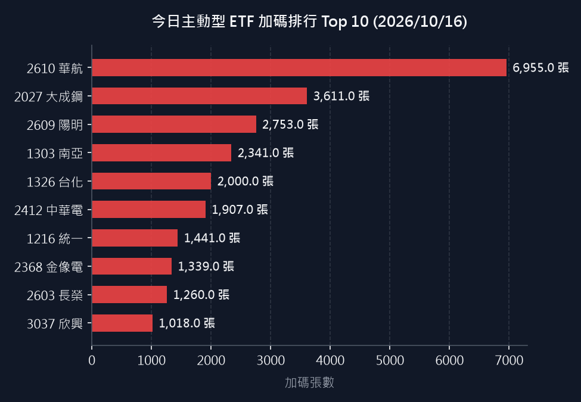
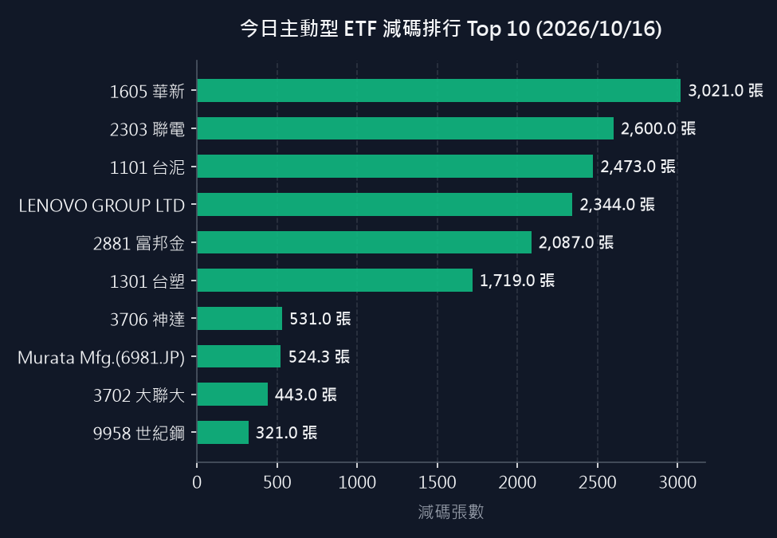

# 主動型 ETF 持股變動

資料來源：`主動型ETF持股明細.xlsx` 最近兩個日期分頁。

比較區間：`20261015` → `20261016`

## 今日加減碼視覺化排行

| 今日加碼 Top 10 | 今日減碼 Top 10 |
| :---: | :---: |
|  |  |

| ETF | 新增 | 刪除 | 比例變動 |
| :-- | --: | --: | --: |
| 00400A | 1 | 0 | 45 |
| 00401A | 0 | 0 | 44 |
| 00402A | 0 | 0 | 45 |
| 00403A | 0 | 0 | 30 |
| 00404A | 0 | 0 | 43 |
| 00405A | 0 | 0 | 20 |
| 00406A | 1 | 1 | 60 |
| 00407A | 0 | 0 | 41 |
| 00408A | 1 | 0 | 46 |
| 00980A | 0 | 0 | 45 |
| 00980D | 0 | 1 | 47 |
| 00981A | 1 | 1 | 28 |
| 00982A | 0 | 0 | 40 |
| 00983A | 0 | 1 | 36 |
| 00983D | 0 | 1 | 37 |
| 00984A | 0 | 0 | 61 |
| 00985A | 0 | 0 | 50 |
| 00986A | 0 | 3 | 34 |
| 00987A | 1 | 0 | 26 |
| 00988A | 2 | 2 | 36 |
| 00989A | 0 | 1 | 54 |
| 00990A | 1 | 3 | 40 |
| 00991A | 0 | 0 | 18 |
| 00992A | 0 | 0 | 39 |
| 00993A | 0 | 0 | 46 |
| 00994A | 1 | 0 | 32 |
| 00995A | 0 | 2 | 32 |
| 00996A | 0 | 0 | 49 |
| 00997A | 0 | 0 | 44 |
| 00998A | 3 | 4 | 45 |
| 00999A | 4 | 0 | 43 |

## 00400A

### 新增持股

- 4958 臻鼎-KY（0.48%，257 張）

### 刪除持股

- 無

### 投資比例變動

- 1303 南亞：4.47% → 4.26%（-0.21）
- 2059 川湖：2.58% → 3.05%（+0.47）
- 2303 聯電：1.91% → 1.85%（-0.06）
- 2308 台達電：2.64% → 2.58%（-0.06）
- 2313 華通：0.86% → 0.91%（+0.05）
- 2327 國巨*：1.38% → 1.34%（-0.04）
- 2330 台積電：9.10% → 8.81%（-0.29）
- 2360 致茂：3.24% → 3.13%（-0.11）
- 2368 金像電：2.98% → 3.04%（+0.06）
- 2383 台光電：4.43% → 4.36%（-0.07）
- 2449 京元電子：0.93% → 0.91%（-0.02）
- 2454 聯發科：5.86% → 6.29%（+0.43）
- 2603 長榮：1.64% → 1.65%（+0.01）
- 2637 慧洋-KY：0.49% → 0.48%（-0.01）
- 2881 富邦金：1.69% → 1.67%（-0.02）
- 2891 中信金：1.63% → 1.60%（-0.03）
- 3008 大立光：1.60% → 1.51%（-0.09）
- 3017 奇鋐：3.46% → 3.63%（+0.17）
- 3036 文曄：1.57% → 1.54%（-0.03）
- 3037 欣興：3.92% → 3.88%（-0.04）
- 3044 健鼎：2.57% → 2.50%（-0.07）
- 3081 聯亞：0.74% → 0.69%（-0.05）
- 3090 日電貿：0.35% → 0.34%（-0.01）
- 3167 大量：0.38% → 0.40%（+0.02）
- 3231 緯創：0.97% → 0.98%（+0.01）
- 3293 鈊象：0.37% → 0.35%（-0.02）
- 3374 精材：0.52% → 0.27%（-0.25）
- 3443 創意：2.54% → 2.41%（-0.13）
- 3529 力旺：1.19% → 1.21%（+0.02）
- 3653 健策：3.55% → 3.45%（-0.10）
- 3661 世芯-KY：2.32% → 2.26%（-0.06）
- 3665 貿聯-KY：1.57% → 1.53%（-0.04）
- 3711 日月光投控：1.06% → 1.04%（-0.02）
- 5274 信驊：1.54% → 1.56%（+0.02）
- 5434 崇越：0.39% → 0.38%（-0.01）
- 6147 頎邦：0.95% → 0.89%（-0.06）
- 6187 萬潤：1.40% → 1.38%（-0.02）
- 6223 旺矽：3.27% → 3.13%（-0.14）
- 6271 同欣電：0.27% → 0.26%（-0.01）
- 6278 台表科：1.89% → 1.82%（-0.07）
- 6488 環球晶：2.78% → 2.65%（-0.13）
- 6505 台塑化：2.34% → 2.50%（+0.16）
- 6669 緯穎：2.85% → 1.36%（-1.49）
- 7750 新代：0.75% → 0.74%（-0.01）
- ＸＡＧＸ金兌(3533.HK)：0.48% → 0.91%（+0.43）

## 00401A

### 新增持股

- 無

### 刪除持股

- 無

### 投資比例變動

- 1303 南亞：1.31% → 1.26%（-0.05）
- 2059 川湖：0.81% → 0.82%（+0.01）
- 2303 聯電：2.30% → 2.27%（-0.03）
- 2308 台達電：2.29% → 2.27%（-0.02）
- 2313 華通：1.44% → 1.55%（+0.11）
- 2317 鴻海：0.56% → 0.57%（+0.01）
- 2327 國巨*：0.65% → 0.64%（-0.01）
- 2330 台積電：20.95% → 20.57%（-0.38）
- 2357 華碩：1.91% → 1.93%（+0.02）
- 2360 致茂：1.34% → 1.31%（-0.03）
- 2379 瑞昱：1.11% → 1.12%（+0.01）
- 2382 廣達：2.11% → 2.12%（+0.01）
- 2454 聯發科：6.02% → 6.08%（+0.06）
- 2455 全新：2.11% → 2.13%（+0.02）
- 2603 長榮：1.14% → 1.16%（+0.02）
- 2882 國泰金：1.09% → 1.10%（+0.01）
- 2883 凱基金：1.71% → 1.73%（+0.02）
- 2884 玉山金：2.14% → 2.13%（-0.01）
- 2886 兆豐金：1.44% → 1.46%（+0.02）
- 2887 台新新光金：1.10% → 1.11%（+0.01）
- 2912 統一超：0.27% → 0.26%（-0.01）
- 3008 大立光：2.42% → 2.32%（-0.10）
- 3034 聯詠：0.22% → 0.23%（+0.01）
- 3037 欣興：2.27% → 2.28%（+0.01）
- 3231 緯創：1.63% → 1.67%（+0.04）
- 3491 昇達科：1.56% → 1.70%（+0.14）
- 3711 日月光投控：2.60% → 2.57%（-0.03）
- 4938 和碩：0.33% → 0.34%（+0.01）
- 4958 臻鼎-KY：1.36% → 1.45%（+0.09）
- 4991 環宇-KY：0.61% → 0.60%（-0.01）
- 5274 信驊：1.71% → 1.75%（+0.04）
- 5347 世界：1.28% → 1.31%（+0.03）
- 6147 頎邦：1.42% → 1.36%（-0.06）
- 6187 萬潤：0.75% → 0.76%（+0.01）
- 6223 旺矽：1.65% → 1.60%（-0.05）
- 6285 啟碁：1.40% → 1.47%（+0.07）
- 6515 穎崴：0.96% → 0.97%（+0.01）
- 6531 愛普*：1.50% → 1.57%（+0.07）
- 6669 緯穎：1.73% → 1.65%（-0.08）
- 7828 創新服務：1.57% → 1.51%（-0.06）
- 7856 漢測：0.69% → 0.73%（+0.04）
- 8464 億豐：1.04% → 1.02%（-0.02）
- 台股期貨10/26(FITXN*1.TF)：0.13% → 0.18%（+0.05）
- 臺指選擇權10/26 46400 買權：-0.46% → -0.43%（+0.03）

## 00402A

### 新增持股

- 無

### 刪除持股

- 無

### 投資比例變動

- AAPL.US Apple：7.85% → 7.84%（-0.01）
- AMD.US AMD：5.97% → 5.89%（-0.08）
- AMZN.US Amazon：4.34% → 4.36%（+0.02）
- ANET.US Arista Networks：0.83% → 0.79%（-0.04）
- ARM.US Arm：0.83% → 0.85%（+0.02）
- ASML.US ASML Holding：1.15% → 1.16%（+0.01）
- AVGO.US Broadcom：2.19% → 2.18%（-0.01）
- AXON.US Axon Enterprise：0.57% → 0.58%（+0.01）
- BKNG.US Booking Holdings：0.52% → 0.54%（+0.02）
- CDNS.US Cadence Design Systems：1.49% → 1.47%（-0.02）
- CIEN.US Ciena：1.15% → 1.14%（-0.01）
- CLS.US Celestica：1.28% → 1.25%（-0.03）
- COHR.US Coherent：1.25% → 1.20%（-0.05）
- CRWD.US CrowdStrike Holdings：1.62% → 1.59%（-0.03）
- DASH.US DoorDash：0.46% → 0.48%（+0.02）
- FSLY.US Fastly：0.36% → 0.37%（+0.01）
- GOOG.US Alphabet - Class C Capital Stock：3.41% → 3.43%（+0.02）
- GOOGL.US Alphabet - Class A Common Stock：3.43% → 3.46%（+0.03）
- INTC.US Intel：1.49% → 1.45%（-0.04）
- IOT.US Samsara：0.54% → 0.56%（+0.02）
- KLAC.US KLA：1.59% → 1.55%（-0.04）
- LITE.US Lumentum：1.77% → 1.72%（-0.05）
- LRCX.US Lam Research：2.55% → 2.47%（-0.08）
- MCHP.US Microchip Technology：1.26% → 1.32%（+0.06）
- MDB.US MongoDB：0.37% → 0.38%（+0.01）
- MRVL.US Marvell：1.65% → 1.63%（-0.02）
- MSFT.US Microsoft：5.39% → 5.46%（+0.07）
- MU.US Micron：5.57% → 5.69%（+0.12）
- NFLX.US Netflix：0.99% → 1.02%（+0.03）
- NOW.US ServiceNow：1.08% → 1.15%（+0.07）
- NVDA.US NVIDIA：8.70% → 8.58%（-0.12）
- PANW.US Palo Alto：2.87% → 2.84%（-0.03）
- SHOP.US Shopify：1.21% → 1.25%（+0.04）
- SIMO.US Silicon Motion：0.49% → 0.48%（-0.01）
- SKHY.US SK hynix：1.10% → 0.78%（-0.32）
- SNOW.US Snowflake：1.34% → 1.35%（+0.01）
- SPCX.US SpaceX：0.75% → 0.74%（-0.01）
- STX.US Seagate：1.08% → 1.05%（-0.03）
- TER.US Teradyne：0.79% → 0.76%（-0.03）
- TSM.US TSMC(ADR)：1.50% → 1.47%（-0.03）
- TTWO.US Take-Two：0.57% → 0.60%（+0.03）
- TXN.US Texas Instruments：2.38% → 2.37%（-0.01）
- UBER.US Uber：0.31% → 0.32%（+0.01）
- V.US Visa：1.18% → 1.21%（+0.03）
- WDC.US Western Digital：1.78% → 1.74%（-0.04）

## 00403A

### 新增持股

- 無

### 刪除持股

- 無

### 投資比例變動

- 1303 南亞：2.76% → 2.68%（-0.08）
- 2059 川湖：0.56% → 0.57%（+0.01）
- 2303 聯電：1.53% → 1.52%（-0.01）
- 2308 台達電：3.61% → 3.60%（-0.01）
- 2313 華通：0.21% → 0.38%（+0.17）
- 2317 鴻海：0.58% → 0.59%（+0.01）
- 2327 國巨*：3.85% → 3.79%（-0.06）
- 2330 台積電：14.34% → 14.17%（-0.17）
- 2345 智邦：2.38% → 2.41%（+0.03）
- 2368 金像電：0.44% → 0.66%（+0.22）
- 2383 台光電：5.47% → 4.71%（-0.76）
- 2408 南亞科：0.94% → 0.95%（+0.01）
- 2449 京元電子：0.83% → 0.84%（+0.01）
- 2454 聯發科：5.40% → 5.49%（+0.09）
- 3008 大立光：1.69% → 1.63%（-0.06）
- 3017 奇鋐：4.94% → 5.39%（+0.45）
- 3037 欣興：5.74% → 5.80%（+0.06）
- 3189 景碩：3.32% → 3.38%（+0.06）
- 3443 創意：3.83% → 3.72%（-0.11）
- 3450 聯鈞：0.54% → 0.52%（-0.02）
- 3653 健策：5.76% → 5.70%（-0.06）
- 5274 信驊：1.77% → 1.82%（+0.05）
- 6223 旺矽：3.76% → 3.68%（-0.08）
- 6274 台燿：2.85% → 2.82%（-0.03）
- 6285 啟碁：0.06% → 0.07%（+0.01）
- 6442 光聖：0.41% → 0.40%（-0.01）
- 6669 緯穎：2.47% → 2.38%（-0.09）
- 6805 富世達：0.27% → 0.43%（+0.16）
- 8046 南電：3.09% → 3.10%（+0.01）
- 8996 高力：2.18% → 2.24%（+0.06）

## 00404A

### 新增持股

- 無

### 刪除持股

- 無

### 投資比例變動

- 1303 南亞：0.84% → 0.82%（-0.02）
- 2059 川湖：0.49% → 0.50%（+0.01）
- 2301 光寶科：0.55% → 0.54%（-0.01）
- 2303 聯電：2.66% → 2.63%（-0.03）
- 2317 鴻海：0.65% → 0.66%（+0.01）
- 2330 台積電：22.83% → 22.51%（-0.32）
- 2357 華碩：1.23% → 1.25%（+0.02）
- 2360 致茂：0.46% → 0.45%（-0.01）
- 2379 瑞昱：1.14% → 1.15%（+0.01）
- 2382 廣達：0.97% → 0.98%（+0.01）
- 2383 台光電：2.84% → 2.85%（+0.01）
- 2395 研華：1.30% → 1.27%（-0.03）
- 2454 聯發科：6.46% → 6.55%（+0.09）
- 2882 國泰金：2.87% → 2.91%（+0.04）
- 2885 元大金：2.59% → 2.58%（-0.01）
- 2887 台新新光金：1.48% → 1.50%（+0.02）
- 2890 永豐金：1.49% → 1.48%（-0.01）
- 3017 奇鋐：1.24% → 1.33%（+0.09）
- 3034 聯詠：2.18% → 2.21%（+0.03）
- 3264 欣銓：0.71% → 0.68%（-0.03）
- 3293 鈊象：1.23% → 1.20%（-0.03）
- 3443 創意：0.97% → 0.94%（-0.03）
- 3711 日月光投控：3.29% → 3.26%（-0.03）
- 5274 信驊：2.59% → 2.66%（+0.07）
- 5434 崇越：1.77% → 1.76%（-0.01）
- 5876 上海商銀：1.58% → 1.60%（+0.02）
- 5904 寶雅*：0.51% → 0.52%（+0.01）
- 6196 帆宣：1.76% → 1.74%（-0.02）
- 6223 旺矽：1.14% → 1.11%（-0.03）
- 6257 矽格：1.80% → 1.74%（-0.06）
- 6491 晶碩：0.88% → 0.89%（+0.01）
- 6505 台塑化：0.53% → 0.57%（+0.04）
- 6669 緯穎：0.91% → 0.88%（-0.03）
- 6691 洋基工程：1.63% → 1.61%（-0.02）
- 7769 鴻勁：1.05% → 1.06%（+0.01）
- 8016 矽創：1.28% → 1.29%（+0.01）
- 8081 致新：0.87% → 0.89%（+0.02）
- 8299 群聯：1.15% → 1.18%（+0.03）
- iShares MSCI Japan SRI ETF(2851.JP)：1.26% → 1.15%（-0.11）
- 台指選擇權11/26 50900 買權：-0.21% → -0.13%（+0.08）
- 台指選擇權12/26 51800 買權：-0.02% → -0.01%（+0.01）
- 台股期貨10/26(FITXN*1.TF)：9.70% → 9.72%（+0.02）
- 台股期貨11/26(FITXN*1.TF)：7.37% → 7.38%（+0.01）

## 00405A

### 新增持股

- 無

### 刪除持股

- 無

### 投資比例變動

- 2059 川湖：2.17% → 2.19%（+0.02）
- 2330 台積電：1.95% → 1.91%（-0.04）
- 2368 金像電：5.99% → 6.18%（+0.19）
- 2383 台光電：4.85% → 4.83%（-0.02）
- 2454 聯發科：5.47% → 5.51%（+0.04）
- 3017 奇鋐：3.83% → 4.06%（+0.23）
- 3443 創意：5.93% → 5.70%（-0.23）
- 3653 健策：7.86% → 7.71%（-0.15）
- 3665 貿聯-KY：5.99% → 5.90%（-0.09）
- 5274 信驊：5.65% → 5.76%（+0.11）
- 5347 世界：0.15% → 0.16%（+0.01）
- 6223 旺矽：7.65% → 7.41%（-0.24）
- 6274 台燿：2.22% → 2.18%（-0.04）
- 6526 達發：0.51% → 0.50%（-0.01）
- 6531 愛普*：3.82% → 4.00%（+0.18）
- 6669 緯穎：0.84% → 0.81%（-0.03）
- 6805 富世達：3.22% → 3.38%（+0.16）
- 7769 鴻勁：2.80% → 2.79%（-0.01）
- 8046 南電：7.81% → 7.76%（-0.05）
- 8996 高力：1.36% → 1.38%（+0.02）

## 00406A

### 新增持股

- 臺指選擇權第四週週五到期契約（-2.84%，-1.6 張）

### 刪除持股

- 臺指選擇權第三週週五到期契約（-15.49%，-6.8 張）

### 投資比例變動

- 1303 南亞：1.13% → 1.48%（+0.35）
- 1326 台化：0.22% → 0.37%（+0.15）
- 1560 中砂：0.44% → 0.39%（-0.05）
- 2059 川湖：0.89% → 0.83%（-0.06）
- 2303 聯電：1.85% → 1.81%（-0.04）
- 2308 台達電：2.61% → 2.72%（+0.11）
- 2317 鴻海：0.39% → 0.36%（-0.03）
- 2327 國巨*：1.85% → 1.93%（+0.08）
- 2330 台積電：9.45% → 8.50%（-0.95）
- 2344 華邦電：0.21% → 0.20%（-0.01）
- 2345 智邦：3.76% → 3.85%（+0.09）
- 2360 致茂：1.29% → 1.37%（+0.08）
- 2368 金像電：1.04% → 1.25%（+0.21）
- 2383 台光電：6.89% → 7.00%（+0.11）
- 2395 研華：0.10% → 0.09%（-0.01）
- 2449 京元電子：0.41% → 0.38%（-0.03）
- 2454 聯發科：5.63% → 5.64%（+0.01）
- 2481 強茂：0.48% → 0.58%（+0.10）
- 2486 一詮：0.20% → 0.19%（-0.01）
- 2885 元大金：0.72% → 0.66%（-0.06）
- 2886 兆豐金：0.15% → 0.14%（-0.01）
- 3008 大立光：0.89% → 1.68%（+0.79）
- 3017 奇鋐：5.07% → 4.95%（-0.12）
- 3037 欣興：5.36% → 5.56%（+0.20）
- 3081 聯亞：0.30% → 0.26%（-0.04）
- 3105 穩懋：0.12% → 0.11%（-0.01）
- 3131 弘塑：0.06% → 0.05%（-0.01）
- 3167 大量：0.72% → 0.71%（-0.01）
- 3189 景碩：1.68% → 1.92%（+0.24）
- 3264 欣銓：0.18% → 0.16%（-0.02）
- 3363 上詮：0.23% → 0.22%（-0.01）
- 3443 創意：2.18% → 2.16%（-0.02）
- 3450 聯鈞：0.17% → 0.15%（-0.02）
- 3529 力旺：0.23% → 0.22%（-0.01）
- 3653 健策：3.69% → 3.47%（-0.22）
- 3661 世芯-KY：0.77% → 0.69%（-0.08）
- 3665 貿聯-KY：1.78% → 1.62%（-0.16）
- 3711 日月光投控：2.20% → 2.16%（-0.04）
- 4938 和碩：0.41% → 0.49%（+0.08）
- 4958 臻鼎-KY：1.01% → 0.98%（-0.03）
- 5274 信驊：2.07% → 2.11%（+0.04）
- 6139 亞翔：0.06% → 0.05%（-0.01）
- 6147 頎邦：0.71% → 0.75%（+0.04）
- 6187 萬潤：0.26% → 0.24%（-0.02）
- 6213 聯茂：0.46% → 0.40%（-0.06）
- 6223 旺矽：2.95% → 2.94%（-0.01）
- 6274 台燿：1.28% → 1.16%（-0.12）
- 6488 環球晶：0.39% → 0.35%（-0.04）
- 6510 精測：0.92% → 0.89%（-0.03）
- 6515 穎崴：0.31% → 0.29%（-0.02）
- 6531 愛普*：0.16% → 0.15%（-0.01）
- 6669 緯穎：1.91% → 1.68%（-0.23）
- 6715 嘉基：0.70% → 0.82%（+0.12）
- 7769 鴻勁：0.25% → 0.23%（-0.02）
- 8046 南電：3.03% → 2.95%（-0.08）
- 8150 南茂：0.06% → 0.05%（-0.01）
- 8996 高力：0.27% → 0.25%（-0.02）
- 臺指選擇權：-2.02% → -14.53%（-12.51）
- 臺股期貨 202610(FITXN*1.TF)：11.86% → 6.04%（-5.82）
- 臺股期貨 202611(FITXN*1.TF)：8.66% → 16.71%（+8.05）

## 00407A

### 新增持股

- 無

### 刪除持股

- 無

### 投資比例變動

- 1303 南亞：1.04% → 1.01%（-0.03）
- 1560 中砂：1.05% → 1.01%（-0.04）
- 2059 川湖：1.86% → 1.89%（+0.03）
- 2301 光寶科：1.49% → 1.45%（-0.04）
- 2303 聯電：0.56% → 0.55%（-0.01）
- 2308 台達電：2.52% → 2.50%（-0.02）
- 2327 國巨*：2.45% → 2.41%（-0.04）
- 2330 台積電：9.68% → 9.52%（-0.16）
- 2345 智邦：2.24% → 2.25%（+0.01）
- 2360 致茂：1.02% → 1.00%（-0.02）
- 2368 金像電：1.74% → 1.81%（+0.07）
- 2408 南亞科：0.89% → 0.90%（+0.01）
- 2451 創見：0.32% → 0.33%（+0.01）
- 2454 聯發科：5.35% → 5.42%（+0.07）
- 2615 萬海：1.05% → 1.07%（+0.02）
- 3008 大立光：1.64% → 1.58%（-0.06）
- 3017 奇鋐：5.53% → 5.89%（+0.36）
- 3034 聯詠：0.82% → 0.83%（+0.01）
- 3037 欣興：5.64% → 5.67%（+0.03）
- 3081 聯亞：1.43% → 1.36%（-0.07）
- 3131 弘塑：0.82% → 0.83%（+0.01）
- 3231 緯創：0.74% → 0.76%（+0.02）
- 3293 鈊象：0.66% → 0.64%（-0.02）
- 3443 創意：4.69% → 4.54%（-0.15）
- 3491 昇達科：0.85% → 0.93%（+0.08）
- 3533 嘉澤：0.47% → 0.46%（-0.01）
- 3653 健策：3.75% → 3.70%（-0.05）
- 3665 貿聯-KY：2.68% → 2.65%（-0.03）
- 3711 日月光投控：3.06% → 3.03%（-0.03）
- 4958 臻鼎-KY：1.04% → 1.10%（+0.06）
- 5274 信驊：1.29% → 1.32%（+0.03）
- 5289 宜鼎：0.29% → 0.31%（+0.02）
- 6187 萬潤：1.69% → 1.70%（+0.01）
- 6223 旺矽：2.89% → 2.81%（-0.08）
- 6274 台燿：4.19% → 4.13%（-0.06）
- 6446 藥華藥：0.34% → 0.35%（+0.01）
- 6510 精測：1.32% → 1.40%（+0.08）
- 6531 愛普*：0.31% → 0.32%（+0.01）
- 6669 緯穎：3.53% → 3.39%（-0.14）
- 6805 富世達：1.13% → 1.19%（+0.06）
- 8996 高力：1.30% → 1.33%（+0.03）

## 00408A

### 新增持股

- 2891 中信金（0.31%，60 張）

### 刪除持股

- 無

### 投資比例變動

- 1303 南亞：3.79% → 3.69%（-0.10）
- 1560 中砂：0.38% → 0.37%（-0.01）
- 2059 川湖：0.27% → 0.28%（+0.01）
- 2303 聯電：1.42% → 1.41%（-0.01）
- 2327 國巨*：0.93% → 0.92%（-0.01）
- 2330 台積電：6.39% → 6.29%（-0.10）
- 2344 華邦電：0.44% → 0.45%（+0.01）
- 2345 智邦：0.83% → 0.84%（+0.01）
- 2357 華碩：2.06% → 2.10%（+0.04）
- 2360 致茂：1.14% → 1.13%（-0.01）
- 2368 金像電：4.95% → 5.52%（+0.57）
- 2376 技嘉：1.35% → 1.38%（+0.03）
- 2382 廣達：0.22% → 0.23%（+0.01）
- 2383 台光電：4.88% → 4.90%（+0.02）
- 2395 研華：1.67% → 1.64%（-0.03）
- 2408 南亞科：1.30% → 1.32%（+0.02）
- 2449 京元電子：0.90% → 0.91%（+0.01）
- 2454 聯發科：3.53% → 4.18%（+0.65）
- 2542 興富發：3.75% → 3.76%（+0.01）
- 2603 長榮：0.54% → 1.31%（+0.77）
- 2880 華南金：1.23% → 1.20%（-0.03）
- 3008 大立光：1.40% → 0.90%（-0.50）
- 3017 奇鋐：1.50% → 1.61%（+0.11）
- 3026 禾伸堂：0.86% → 0.85%（-0.01）
- 3037 欣興：2.28% → 2.30%（+0.02）
- 3081 聯亞：2.14% → 2.06%（-0.08）
- 3105 穩懋：0.50% → 0.49%（-0.01）
- 3189 景碩：2.83% → 3.45%（+0.62）
- 3231 緯創：0.37% → 0.38%（+0.01）
- 3264 欣銓：0.81% → 0.78%（-0.03）
- 3653 健策：3.72% → 3.69%（-0.03）
- 3711 日月光投控：1.52% → 1.51%（-0.01）
- 5434 崇越：2.36% → 2.35%（-0.01）
- 6187 萬潤：1.08% → 1.09%（+0.01）
- 6223 旺矽：2.17% → 2.12%（-0.05）
- 6239 力成：1.28% → 1.29%（+0.01）
- 6274 台燿：3.67% → 3.63%（-0.04）
- 6488 環球晶：0.91% → 0.89%（-0.02）
- 6510 精測：0.41% → 0.44%（+0.03）
- 6669 緯穎：3.60% → 1.92%（-1.68）
- 6691 洋基工程：0.35% → 0.34%（-0.01）
- 6805 富世達：1.34% → 1.90%（+0.56）
- 7769 鴻勁：0.55% → 0.56%（+0.01）
- 8046 南電：1.61% → 1.62%（+0.01）
- 8996 高力：1.93% → 1.99%（+0.06）
- 9802 鈺齊-KY：0.90% → 0.91%（+0.01）

## 00980A

### 新增持股

- 無

### 刪除持股

- 無

### 投資比例變動

- 1303 南亞：4.09% → 3.96%（-0.13）
- 2059 川湖：4.13% → 4.20%（+0.07）
- 2303 聯電：1.06% → 1.05%（-0.01）
- 2308 台達電：3.55% → 3.53%（-0.02）
- 2317 鴻海：2.08% → 2.10%（+0.02）
- 2327 國巨*：1.50% → 1.47%（-0.03）
- 2330 台積電：9.89% → 9.73%（-0.16）
- 2344 華邦電：1.91% → 1.98%（+0.07）
- 2345 智邦：1.49% → 1.50%（+0.01）
- 2360 致茂：1.61% → 1.58%（-0.03）
- 2368 金像電：2.16% → 2.24%（+0.08）
- 2376 技嘉：0.90% → 0.92%（+0.02）
- 2382 廣達：1.22% → 1.23%（+0.01）
- 2408 南亞科：2.59% → 2.62%（+0.03）
- 2454 聯發科：5.58% → 5.65%（+0.07）
- 3008 大立光：1.35% → 1.30%（-0.05）
- 3017 奇鋐：2.23% → 2.37%（+0.14）
- 3026 禾伸堂：1.25% → 1.23%（-0.02）
- 3036 文曄：1.01% → 1.02%（+0.01）
- 3037 欣興：3.62% → 3.64%（+0.02）
- 3044 健鼎：0.62% → 0.61%（-0.01）
- 3081 聯亞：2.30% → 2.19%（-0.11）
- 3189 景碩：1.40% → 1.42%（+0.02）
- 3231 緯創：0.90% → 0.92%（+0.02）
- 3264 欣銓：0.94% → 0.90%（-0.04）
- 3293 鈊象：0.89% → 0.87%（-0.02）
- 3443 創意：2.44% → 2.36%（-0.08）
- 3529 力旺：0.63% → 0.65%（+0.02）
- 3653 健策：3.79% → 3.74%（-0.05）
- 3711 日月光投控：2.25% → 2.22%（-0.03）
- 5274 信驊：1.74% → 1.79%（+0.05）
- 6213 聯茂：1.08% → 1.04%（-0.04）
- 6223 旺矽：2.11% → 2.06%（-0.05）
- 6274 台燿：1.25% → 1.23%（-0.02）
- 6442 光聖：0.32% → 0.31%（-0.01）
- 6515 穎崴：1.66% → 1.68%（+0.02）
- 6669 緯穎：1.59% → 1.53%（-0.06）
- 6805 富世達：0.61% → 0.65%（+0.04）
- 6831 邁科：0.42% → 0.41%（-0.01）
- 7751 竑騰：0.76% → 0.75%（-0.01）
- 7769 鴻勁：2.90% → 2.91%（+0.01）
- 8210 勤誠：0.43% → 0.42%（-0.01）
- 8299 群聯：1.66% → 1.69%（+0.03）
- 8996 高力：0.47% → 0.49%（+0.02）
- 台灣證交所加權股價指數(FITXN*1.TF)：1.52% → 1.51%（-0.01）

## 00980D

### 新增持股

- 無

### 刪除持股

- SEAGATE DATA STOR SER * 9.625 % 01-DEC-2032（0.58%，N/A 張）

### 投資比例變動

- APA CORP 6.750000 % 15-FEB-2055：0.37% → 0.38%（+0.01）
- ARCELORMITTAL SA 6.55% 29NOV2027：0.57% → 0.56%（-0.01）
- ASURION LLC/ASURION CO 8.375% 01FEB2034：0.39% → 0.42%（+0.03）
- BAYER US FINANCE LLC SER REGS 6.875000 % 21NOV2053：0.35% → 0.36%（+0.01）
- CHARTER COMM OPT LLC/CAP (REG) 5.5% 01APR2063：0.46% → 0.47%（+0.01）
- CHS/COMMUNITY HEALTH SYS SER REGS 9.750000 % 15JAN2034：0.34% → 0.33%（-0.01）
- CONCENTRIX CORP (REG) 6.6% 02AUG2028：0.54% → 0.53%（-0.01）
- CONSOLIDATED ENERGY FIN SER REGS 12.000000 % 15FEB2031：0.59% → 0.58%（-0.01）
- COREWEAVE INC SER REGS (REG S) 9.25% 01JUN2030：0.40% → 0.41%（+0.01）
- COREWEAVE INC SER REGS (REG S) 9.75% 01OCT2031：0.47% → 0.48%（+0.01）
- COREWEAVE INC SER REGS (REG) (REG S) 9.625% 15JUL2032：0.46% → 0.48%（+0.02）
- DOW CHEMICAL CO/THE 6.9% 15MAY2053：0.61% → 0.62%（+0.01）
- FMC CORP (REG) 6.375000 % 18MAY2053：0.44% → 0.31%（-0.13）
- FORD MOTOR COMPANY 5.291% 08DEC2046：0.28% → 0.29%（+0.01）
- GLOBAL AUTO HO/AAG FH UK SER REGS (REG S) 11.5% 15AUG2029：0.37% → 0.36%（-0.01）
- GLOBAL AUTO HO/AAG FH UK SER REGS (REG S) 8.75% 15JAN2032：0.41% → 0.40%（-0.01）
- GRAY TELEVISION INC SER REGS (REG) (REG S) 10.5% 15JUL2029：0.21% → 0.20%（-0.01）
- HISCOX LTD VAR 11JUN2036：0.44% → 0.43%（-0.01）
- INTESA SANPAOLO SPA SER REGS (REG) 7.200000 % 28NOV2033：0.35% → 0.36%（+0.01）
- JBS USA HOLD/FOOD/LUX CO 7.250000 % 15NOV2053：0.47% → 0.48%（+0.01）
- JETBLUE AIRWAYS/LOYALTY SER REGS (REG S) 9.875% 20SEP2031：0.35% → 0.36%（+0.01）
- JH NORTH AMERICA HOLDING SER REGS 6.125000 % 31JUL2032：0.40% → 0.41%（+0.01）
- LADDER CAP FIN LLLP/CORP SER REGS 7.000000 % 15JUL2031：0.34% → 0.33%（-0.01）
- LINCOLN NATIONAL CORP (REG) 7.000000 % 15JUN2040：0.46% → 0.47%（+0.01）
- M&T BANK CORPORATION (REG) VAR 30OCT2029：0.56% → 0.55%（-0.01）
- MDC HOLDINGS INC (REG) 6% 15JAN2043：0.32% → 0.33%（+0.01）
- MYLAN INC SER WI (REG) 5.2% 15APR2048WI：0.50% → 0.51%（+0.01）
- MYLAN NV 5.25% 15JUN2046 WI：0.54% → 0.55%（+0.01）
- NATIONWIDE MUTUAL INSUR 9.375% 15AUG2039：0.52% → 0.53%（+0.01）
- ONEOK INC 6.625% 01SEP2053：0.59% → 0.60%（+0.01）
- ORACLE CORP 6.000000 % 03AUG2055：0.29% → 0.30%（+0.01）
- ORACLE CORP 6.85 % 04-FEB-2066：0.54% → 0.53%（-0.01）
- PACIFIC GAS & ELECTRIC (REG) 6.7% 01APR2053：0.33% → 0.34%（+0.01）
- PHOTO HOLDINGS LLC SER REGS (REG) (REG S) 12% 01JUL2031：0.50% → 0.49%（-0.01）
- POLARIS INC 6.950000 % 15MAR2029：0.49% → 0.48%（-0.01）
- SES GLOBAL AMERICAS HLDG SER REGS (REG) 5.300000 % 25MAR2044：0.30% → 0.29%（-0.01）
- SPACE EXPLORATION TECH SER 144A (REG) 6.65% 15JUL2056：0.31% → 0.32%（+0.01）
- SUNCOR ENERGY INC (REG) 6.8% 15MAY2038：0.42% → 0.43%（+0.01）
- SYMETRA LIFE INSURANCE SER REGS 6.550000 % 01OCT2055：0.31% → 0.32%（+0.01）
- TRANSCANADA PIPELINES LTD 7.625PCT 15/01/2039：0.53% → 0.54%（+0.01）
- US 10YR NOTE (CBT)DEC26 21-DEC-2026：18.16% → 18.22%（+0.06）
- US 10YR ULTRA FUT DEC26 21-DEC-2026：-1.59% → -1.60%（-0.01）
- US 2YR NOTE (CBT) DEC26 31-DEC-2026：1.70% → 1.69%（-0.01）
- US 5YR NOTE (CBT) DEC26 31-DEC-2026：-13.82% → -13.83%（-0.01）
- US ACUTE CARE SOLUTIONS SER REGS (REG S) 9.75% 15MAY2029：0.33% → 0.34%（+0.01）
- US LONG BOND(CBT) DEC26 21-DEC-2026：5.38% → 5.43%（+0.05）
- ZIONS BANCORP NA VAR 19NOV2035：0.41% → 0.42%（+0.01）

## 00981A

### 新增持股

- 台指期貨 2026/11(FITXN*1.TF)（2.37%，0.679 張）

### 刪除持股

- 台指期貨 2026/10(FITXN*1.TF)（2.40%，0.679 張）

### 投資比例變動

- 2303 聯電：4.01% → 3.89%（-0.12）
- 2308 台達電：4.54% → 4.51%（-0.03）
- 2313 華通：0.04% → 0.05%（+0.01）
- 2327 國巨*：5.08% → 4.90%（-0.18）
- 2330 台積電：11.22% → 10.84%（-0.38）
- 2345 智邦：4.61% → 4.56%（-0.05）
- 2368 金像電：2.61% → 3.06%（+0.45）
- 2383 台光電：8.36% → 8.21%（-0.15）
- 2449 京元電子：0.43% → 0.42%（-0.01）
- 2454 聯發科：7.99% → 8.03%（+0.04）
- 3017 奇鋐：7.15% → 7.68%（+0.53）
- 3037 欣興：7.68% → 7.76%（+0.08）
- 3264 欣銓：0.13% → 0.18%（+0.05）
- 3376 新日興：0.12% → 0.11%（-0.01）
- 3443 創意：2.17% → 2.06%（-0.11）
- 3653 健策：6.39% → 6.19%（-0.20）
- 3665 貿聯-KY：2.20% → 2.14%（-0.06）
- 3711 日月光投控：2.12% → 2.06%（-0.06）
- 4979 華星光：0.20% → 0.18%（-0.02）
- 5274 信驊：1.12% → 1.22%（+0.10）
- 6223 旺矽：5.01% → 4.79%（-0.22）
- 6271 同欣電：0.19% → 0.18%（-0.01）
- 6274 台燿：4.32% → 4.29%（-0.03）
- 6510 精測：0.52% → 0.54%（+0.02）
- 6669 緯穎：2.36% → 2.22%（-0.14）
- 6805 富世達：0.40% → 0.54%（+0.14）
- 8046 南電：4.53% → 4.45%（-0.08）
- 8996 高力：0.40% → 0.57%（+0.17）

## 00982A

### 新增持股

- 無

### 刪除持股

- 無

### 投資比例變動

- 2059 川湖：2.67% → 2.70%（+0.03）
- 2301 光寶科：1.84% → 1.79%（-0.05）
- 2303 聯電：1.46% → 1.43%（-0.03）
- 2330 台積電：8.03% → 7.87%（-0.16）
- 2360 致茂：3.65% → 3.56%（-0.09）
- 2376 技嘉：1.28% → 1.31%（+0.03）
- 2377 微星：0.34% → 0.35%（+0.01）
- 2383 台光電：3.37% → 3.36%（-0.01）
- 2395 研華：1.43% → 1.39%（-0.04）
- 2428 興勤：1.29% → 1.25%（-0.04）
- 2454 聯發科：6.53% → 6.59%（+0.06）
- 2455 全新：1.58% → 1.59%（+0.01）
- 2467 志聖：1.08% → 1.07%（-0.01）
- 2478 大毅：1.31% → 1.21%（-0.10）
- 3008 大立光：3.53% → 3.38%（-0.15）
- 3017 奇鋐：2.45% → 2.60%（+0.15）
- 3090 日電貿：1.20% → 1.18%（-0.02）
- 3105 穩懋：6.11% → 6.02%（-0.09）
- 3231 緯創：1.36% → 1.40%（+0.04）
- 3265 台星科：1.98% → 1.89%（-0.09）
- 3491 昇達科：3.33% → 3.62%（+0.29）
- 3583 辛耘：1.10% → 1.08%（-0.02）
- 3711 日月光投控：1.26% → 1.24%（-0.02）
- 4958 臻鼎-KY：3.49% → 3.70%（+0.21）
- 5274 信驊：1.22% → 1.25%（+0.03）
- 5425 台半：1.26% → 1.24%（-0.02）
- 5483 中美晶：1.42% → 1.44%（+0.02）
- 5536 聖暉*：0.84% → 0.82%（-0.02）
- 6139 亞翔：5.51% → 5.34%（-0.17）
- 6196 帆宣：0.40% → 0.39%（-0.01）
- 6213 聯茂：1.60% → 1.53%（-0.07）
- 6214 精誠：1.44% → 1.43%（-0.01）
- 6223 旺矽：3.40% → 3.30%（-0.10）
- 6274 台燿：1.45% → 1.42%（-0.03）
- 6472 保瑞：0.93% → 0.92%（-0.01）
- 6488 環球晶：2.13% → 2.05%（-0.08）
- 6531 愛普*：3.72% → 3.92%（+0.20）
- 6669 緯穎：4.12% → 3.95%（-0.17）
- 6672 騰輝電子-KY：1.21% → 1.46%（+0.25）
- 8996 高力：1.24% → 1.26%（+0.02）

## 00983A

### 新增持股

- 無

### 刪除持股

- CBRS.US Cerebras（0.40%，0.788 張）

### 投資比例變動

- ACHR.US Archer：0.30% → 0.31%（+0.01）
- AMD.US AMD：3.47% → 3.40%（-0.07）
- AMZN.US Amazon：2.98% → 2.97%（-0.01）
- AVGO.US Broadcom：1.52% → 1.50%（-0.02）
- BEAM.US Beam Therapeutics：1.55% → 1.61%（+0.06）
- BLSH.US Bullish：2.12% → 2.22%（+0.10）
- BMNR.US BitMine：2.20% → 2.29%（+0.09）
- COIN.US Coinbase：4.62% → 4.89%（+0.27）
- CRCL.US Circle：5.00% → 5.44%（+0.44）
- CRSP.US CRISPR Therapeutics：3.74% → 3.82%（+0.08）
- CRWV.US CoreWeave：1.04% → 1.10%（+0.06）
- DE.US Deere：0.43% → 0.42%（-0.01）
- FTNT.US Fortinet：0.31% → 0.35%（+0.04）
- HOOD.US Robinhood Markets：3.95% → 4.04%（+0.09）
- ILMN.US Illumina：1.79% → 1.76%（-0.03）
- KTOS.US Kratos Defense & Security：0.25% → 0.26%（+0.01）
- LLY.US Eli Lilly：0.78% → 0.81%（+0.03）
- META.US Meta：2.13% → 2.12%（-0.01）
- NET.US Cloudflare：1.32% → 1.33%（+0.01）
- NTRA.US Natera：1.64% → 1.67%（+0.03）
- NVDA.US NVIDIA：3.04% → 3.16%（+0.12）
- PACB.US Pacific Biosciences of Californi：0.13% → 0.12%（-0.01）
- PLTR.US Palantir Technologies：3.86% → 3.39%（-0.47）
- RXRX.US Recursion Pharmaceuticals：0.89% → 0.99%（+0.10）
- SHOP.US Shopify：5.14% → 5.29%（+0.15）
- SNOW.US Snowflake：0.58% → 0.57%（-0.01）
- SOFI.US SoFi Technologies：0.42% → 0.21%（-0.21）
- SPCX.US SpaceX：6.98% → 6.78%（-0.20）
- TEM.US Tempus：5.46% → 5.66%（+0.20）
- TER.US Teradyne：0.64% → 0.61%（-0.03）
- TSLA.US Tesla：9.01% → 8.76%（-0.25）
- TSM.US TSMC(ADR)：2.74% → 2.68%（-0.06）
- TWST.US Twist Bioscience：3.80% → 3.68%（-0.12）
- TXG.US 10x Genomics：3.33% → 3.28%（-0.05）
- WGS.US GeneDx：0.51% → 0.52%（+0.01）
- XYZ.US Block：1.28% → 1.34%（+0.06）

## 00983D

### 新增持股

- 無

### 刪除持股

- TIME WARNER CABLE INC 6.750 06/15/39（0.45%，N/A 張）

### 投資比例變動

- ABIBB 8.2 01/15/39：1.95% → 1.97%（+0.02）
- AMCX 10 1/2 07/15/32：1.61% → 1.62%（+0.01）
- BATSLN 7.079 08/02/43：1.08% → 1.09%（+0.01）
- BATSLN 7.081 08/02/53：1.32% → 1.34%（+0.02）
- C 8 1/8 07/15/39：1.93% → 1.94%（+0.01）
- CEG 6 1/2 10/01/53：0.78% → 0.79%（+0.01）
- CMCSA 6.95 08/15/37：0.66% → 0.67%（+0.01）
- CRWV 9 02/01/31：1.16% → 1.20%（+0.04）
- DELL 8.35 07/15/46：1.40% → 1.41%（+0.01）
- DIS 7 3/4 12/01/45：0.60% → 0.61%（+0.01）
- DOW 6.9 05/15/53：0.75% → 0.76%（+0.01）
- DOW 9.4 05/15/39：1.94% → 1.95%（+0.01）
- DTV 8 7/8 02/01/30：1.63% → 1.62%（-0.01）
- ENBCN 6.7 11/15/53：0.79% → 0.80%（+0.01）
- FFHCN 6.35 03/22/54：0.70% → 0.71%（+0.01）
- GM 6 3/4 04/01/46：0.86% → 0.87%（+0.01）
- GM 6.6 04/01/36：0.39% → 0.40%（+0.01）
- HAL 7.45 09/15/39：1.82% → 1.83%（+0.01）
- HPE 6.35 10/15/45：0.99% → 1.00%（+0.01）
- LQDW.US iShares LQD Premium Income+ ETF：7.30% → 7.33%（+0.03）
- MINAU 9 1/4 10/01/28：0.91% → 0.90%（-0.01）
- MPC 6 1/2 03/01/41：0.16% → 0.17%（+0.01）
- MS 7 1/4 04/01/32：1.64% → 1.65%（+0.01）
- NVDA 5.55 06/15/46：1.15% → 1.16%（+0.01）
- OKE 6 5/8 09/01/53：0.71% → 0.72%（+0.01）
- PCG 6 3/4 01/15/53：1.12% → 1.13%（+0.01）
- PCG 6.7 04/01/53：1.09% → 1.10%（+0.01）
- PFE 7.2 03/15/39：1.43% → 1.44%（+0.01）
- RAKUTN 11 1/4 02/15/27：1.85% → 1.84%（-0.01）
- SPCX 6.6 07/15/46：1.12% → 1.13%（+0.01）
- SUCN 6.85 06/01/39：1.21% → 1.22%（+0.01）
- SYY 6.6 04/01/50：0.19% → 0.20%（+0.01）
- TLTW.US iShares TLT Premium Income+ ETF：7.90% → 8.00%（+0.10）
- TRPCN 7 5/8 01/15/39：1.68% → 1.69%（+0.01）
- UNITEDHEALTH GROUP INC 6.875 02/15/38：0.86% → 0.87%（+0.01）
- VLO 6 5/8 06/15/37：0.74% → 0.75%（+0.01）
- VZ 7 3/4 12/01/30：1.15% → 1.16%（+0.01）

## 00984A

### 新增持股

- 無

### 刪除持股

- 無

### 投資比例變動

- 1216 統一：0.34% → 0.33%（-0.01）
- 1303 南亞：3.12% → 2.99%（-0.13）
- 1326 台化：1.05% → 1.06%（+0.01）
- 1409 新纖：0.66% → 0.65%（-0.01）
- 1560 中砂：1.25% → 1.19%（-0.06）
- 1709 和益：0.76% → 0.69%（-0.07）
- 2059 川湖：2.03% → 2.04%（+0.01）
- 2301 光寶科：0.61% → 0.59%（-0.02）
- 2303 聯電：0.76% → 0.74%（-0.02）
- 2313 華通：0.15% → 0.16%（+0.01）
- 2330 台積電：4.29% → 4.18%（-0.11）
- 2344 華邦電：0.65% → 0.67%（+0.02）
- 2351 順德：0.63% → 0.62%（-0.01）
- 2383 台光電：1.31% → 1.30%（-0.01）
- 2395 研華：2.56% → 2.47%（-0.09）
- 2404 漢唐：0.39% → 0.38%（-0.01）
- 2409 友達：1.18% → 1.19%（+0.01）
- 2464 盟立：1.19% → 1.17%（-0.02）
- 2603 長榮：1.87% → 1.89%（+0.02）
- 2615 萬海：1.00% → 1.01%（+0.01）
- 2637 慧洋-KY：0.33% → 0.32%（-0.01）
- 2851 中再保：0.75% → 0.67%（-0.08）
- 2855 統一證：0.69% → 0.67%（-0.02）
- 2880 華南金：1.67% → 1.61%（-0.06）
- 2881 富邦金：4.30% → 4.31%（+0.01）
- 2882 國泰金：3.28% → 3.29%（+0.01）
- 2884 玉山金：2.39% → 2.36%（-0.03）
- 2885 元大金：3.44% → 3.38%（-0.06）
- 2886 兆豐金：2.15% → 2.16%（+0.01）
- 2887 台新新光金：3.41% → 3.42%（+0.01）
- 2890 永豐金：2.43% → 2.40%（-0.03）
- 2892 第一金：1.33% → 1.30%（-0.03）
- 3006 晶豪科：0.53% → 0.55%（+0.02）
- 3008 大立光：1.70% → 1.61%（-0.09）
- 3017 奇鋐：4.05% → 4.27%（+0.22）
- 3045 台灣大：1.77% → 1.73%（-0.04）
- 3231 緯創：0.61% → 0.62%（+0.01）
- 3264 欣銓：1.95% → 1.84%（-0.11）
- 3443 創意：1.17% → 1.12%（-0.05）
- 3450 聯鈞：0.67% → 0.64%（-0.03）
- 3605 宏致：0.68% → 0.66%（-0.02）
- 3653 健策：1.80% → 1.76%（-0.04）
- 3665 貿聯-KY：0.57% → 0.56%（-0.01）
- 3711 日月光投控：0.60% → 0.59%（-0.01）
- 3714 富采：0.56% → 0.57%（+0.01）
- 4958 臻鼎-KY：0.58% → 0.61%（+0.03）
- 5274 信驊：1.09% → 1.11%（+0.02）
- 5351 鈺創：0.61% → 0.62%（+0.01）
- 5871 中租-KY：0.32% → 0.31%（-0.01）
- 5904 寶雅*：1.00% → 0.99%（-0.01）
- 6187 萬潤：2.19% → 2.18%（-0.01）
- 6197 佳必琪：0.69% → 0.67%（-0.02）
- 6213 聯茂：1.59% → 1.51%（-0.08）
- 6214 精誠：0.67% → 0.66%（-0.01）
- 6446 藥華藥：1.53% → 1.55%（+0.02）
- 6505 台塑化：3.49% → 3.76%（+0.27）
- 6669 緯穎：0.76% → 0.72%（-0.04）
- 6670 復盛應用：0.32% → 0.31%（-0.01）
- 6691 洋基工程：0.62% → 0.61%（-0.01）
- 8039 台虹：0.62% → 0.67%（+0.05）
- 8046 南電：0.63% → 0.62%（-0.01）

## 00985A

### 新增持股

- 無

### 刪除持股

- 無

### 投資比例變動

- 1101 台泥：1.64% → 1.24%（-0.40）
- 1216 統一：3.72% → 3.61%（-0.11）
- 1301 台塑：1.01% → 0.44%（-0.57）
- 1402 遠東新：1.69% → 1.47%（-0.22）
- 1504 東元：0.54% → 0.48%（-0.06）
- 1605 華新：1.90% → 1.33%（-0.57）
- 2027 大成鋼：1.47% → 1.74%（+0.27）
- 2059 川湖：2.38% → 2.13%（-0.25）
- 2303 聯電：1.49% → 1.30%（-0.19）
- 2308 台達電：1.99% → 1.75%（-0.24）
- 2317 鴻海：1.36% → 1.21%（-0.15）
- 2327 國巨*：1.59% → 1.37%（-0.22）
- 2330 台積電：14.75% → 12.77%（-1.98）
- 2344 華邦電：0.09% → 0.08%（-0.01）
- 2345 智邦：2.65% → 2.35%（-0.30）
- 2368 金像電：1.33% → 1.22%（-0.11）
- 2376 技嘉：1.79% → 1.99%（+0.20）
- 2377 微星：0.90% → 0.80%（-0.10）
- 2383 台光電：3.00% → 2.65%（-0.35）
- 2408 南亞科：1.73% → 1.54%（-0.19）
- 2412 中華電：0.50% → 1.35%（+0.85）
- 2454 聯發科：1.53% → 1.36%（-0.17）
- 2603 長榮：1.29% → 1.72%（+0.43）
- 2609 陽明：1.29% → 1.71%（+0.42）
- 2610 華航：1.21% → 1.54%（+0.33）
- 2881 富邦金：1.21% → 0.01%（-1.20）
- 3008 大立光：0.02% → 1.69%（+1.67）
- 3017 奇鋐：1.61% → 1.51%（-0.10）
- 3036 文曄：2.73% → 2.41%（-0.32）
- 3037 欣興：2.15% → 1.90%（-0.25）
- 3081 聯亞：2.24% → 1.89%（-0.35）
- 3105 穩懋：1.20% → 1.05%（-0.15）
- 3189 景碩：0.67% → 0.00%（-0.67）
- 3491 昇達科：1.49% → 0.18%（-1.31）
- 3653 健策：3.55% → 3.09%（-0.46）
- 3661 世芯-KY：0.68% → 0.59%（-0.09）
- 3665 貿聯-KY：1.53% → 1.34%（-0.19）
- 3711 日月光投控：1.70% → 1.48%（-0.22）
- 4904 遠傳：3.31% → 3.26%（-0.05）
- 6442 光聖：1.11% → 0.95%（-0.16）
- 6446 藥華藥：1.21% → 2.15%（+0.94）
- 6488 環球晶：1.63% → 1.39%（-0.24）
- 6526 達發：0.29% → 0.25%（-0.04）
- 6531 愛普*：1.16% → 1.08%（-0.08）
- 6669 緯穎：1.56% → 1.32%（-0.24）
- 7750 新代：0.63% → 0.56%（-0.07）
- 7769 鴻勁：3.01% → 2.66%（-0.35）
- 8046 南電：1.10% → 0.01%（-1.09）
- 8996 高力：0.60% → 0.00%（-0.60）
- 台積電期貨(FICDFN*1.TF)：1.66% → 1.45%（-0.21）

## 00986A

### 新增持股

- 無

### 刪除持股

- AMAT.US Applied Materials（1.80%，0.7 張）
- COHR.US Coherent（1.97%，1.3 張）
- SNDK.US Sandisk（0.89%，0.11 張）

### 投資比例變動

- 2330 台積電：8.04% → 8.11%（+0.07）
- 2454 聯發科：1.61% → 1.54%（-0.07）
- AAPL.US Apple：2.17% → 2.56%（+0.39）
- AMD.US AMD：4.60% → 4.71%（+0.11）
- AMZN.US Amazon：4.10% → 4.27%（+0.17）
- AVGO.US Broadcom：3.59% → 3.71%（+0.12）
- BE.US Bloom Energy：0.96% → 0.99%（+0.03）
- CRWD.US CrowdStrike Holdings：4.31% → 4.39%（+0.08）
- DDOG.US Datadog：1.09% → 1.12%（+0.03）
- ETN.US Eaton：2.35% → 2.41%（+0.06）
- GEV.US GE Vernova：2.71% → 2.77%（+0.06）
- GOOGL.US Alphabet - Class A Common Stock：6.00% → 6.27%（+0.27）
- GS.US Goldman Sachs：1.01% → 1.07%（+0.06）
- HOOD.US Robinhood Markets：0.70% → 0.75%（+0.05）
- ILMN.US Illumina：0.63% → 0.64%（+0.01）
- JPM.US JPMorgan Chase：2.12% → 2.21%（+0.09）
- LITE.US Lumentum：4.03% → 4.06%（+0.03）
- LLY.US Eli Lilly：3.13% → 3.37%（+0.24）
- MA.US Mastercard：1.22% → 1.29%（+0.07）
- MSFT.US Microsoft：3.07% → 3.23%（+0.16）
- MU.US Micron：4.21% → 4.46%（+0.25）
- MUFG(8306.JP)：1.01% → 1.04%（+0.03）
- Murata Mfg.(6981.JP)：1.91% → 1.79%（-0.12）
- NET.US Cloudflare：2.24% → 2.27%（+0.03）
- NTRA.US Natera：0.38% → 0.73%（+0.35）
- NVDA.US NVIDIA：6.37% → 6.51%（+0.14）
- PLTR.US Palantir Technologies：0.93% → 0.96%（+0.03）
- SNOW.US Snowflake：2.12% → 2.21%（+0.09）
- Siemens Energy AG：1.92% → 1.95%（+0.03）
- TSEM.US Tower Semiconductor：1.02% → 1.07%（+0.05）
- 嘉能可公司：1.76% → 1.82%（+0.06）
- 尼比厄斯集團公眾有限公司：0.80% → 0.85%（+0.05）
- 施奈德電機公司：1.54% → 1.56%（+0.02）
- 英飛凌科技股份有限公司：1.07% → 1.06%（-0.01）

## 00987A

### 新增持股

- 1815 富喬（1.00%，164 張）

### 刪除持股

- 無

### 投資比例變動

- 2330 台積電：9.87% → 9.53%（-0.34）
- 2368 金像電：3.21% → 3.27%（+0.06）
- 2383 台光電：6.67% → 6.55%（-0.12）
- 2454 聯發科：5.05% → 5.02%（-0.03）
- 2455 全新：2.50% → 2.48%（-0.02）
- 3017 奇鋐：7.21% → 7.54%（+0.33）
- 3037 欣興：5.60% → 5.53%（-0.07）
- 3081 聯亞：3.54% → 3.32%（-0.22）
- 3363 上詮：2.17% → 2.15%（-0.02）
- 3443 創意：4.48% → 4.25%（-0.23）
- 3455 由田：2.21% → 2.48%（+0.27）
- 3491 昇達科：3.10% → 3.31%（+0.21）
- 3529 力旺：1.91% → 1.93%（+0.02）
- 3653 健策：5.47% → 5.30%（-0.17）
- 3665 貿聯-KY：3.98% → 3.88%（-0.10）
- 4958 臻鼎-KY：2.33% → 2.44%（+0.11）
- 4991 環宇-KY：2.42% → 2.36%（-0.06）
- 6223 旺矽：1.19% → 1.14%（-0.05）
- 6274 台燿：5.48% → 5.30%（-0.18）
- 6510 精測：3.26% → 3.41%（+0.15）
- 6515 穎崴：1.82% → 1.81%（-0.01）
- 6805 富世達：3.42% → 3.54%（+0.12）
- 7856 漢測：0.89% → 0.92%（+0.03）
- 8046 南電：2.78% → 2.73%（-0.05）
- 8358 金居：2.78% → 2.77%（-0.01）
- 8996 高力：2.39% → 2.40%（+0.01）

## 00988A

### 新增持股

- 3443 創意（0.49%，30 張）
- MSFT.US Microsoft（2.23%，60 張）

### 刪除持股

- 2303 聯電（1.05%，3600 張）
- IREN.US IREN（0.65%，325 張）

### 投資比例變動

- 1303 南亞：1.61% → 1.50%（-0.11）
- 2308 台達電：0.73% → 0.69%（-0.04）
- 2330 台積電：1.02% → 1.65%（+0.63）
- 2383 台光電：2.83% → 2.71%（-0.12）
- 2454 聯發科：2.02% → 1.46%（-0.56）
- 3017 奇鋐：3.80% → 3.66%（-0.14）
- 3037 欣興：6.31% → 5.92%（-0.39）
- 6223 旺矽：0.96% → 0.90%（-0.06）
- AAPL.US Apple：1.02% → 2.12%（+1.10）
- AMD.US AMD：2.55% → 2.63%（+0.08）
- BE.US Bloom Energy：6.61% → 6.82%（+0.21）
- COIN.US Coinbase：0.80% → 0.88%（+0.08）
- CRWD.US CrowdStrike Holdings：2.47% → 2.53%（+0.06）
- Furukawa Electric(5801.JP)：1.29% → 1.18%（-0.11）
- HOOD.US Robinhood Markets：2.66% → 2.86%（+0.20）
- INFINEON TECHNOLOGIES AG：1.22% → 1.21%（-0.01）
- INTC.US Intel：2.58% → 2.62%（+0.04）
- LENOVO GROUP LTD：1.53% → 0.83%（-0.70）
- LITE.US Lumentum：6.90% → 5.50%（-1.40）
- MRVL.US Marvell：2.42% → 2.49%（+0.07）
- MU.US Micron：0.96% → 1.02%（+0.06）
- Meiko Electronics(6787.JP)：1.74% → 1.49%（-0.25）
- Murata Mfg.(6981.JP)：3.12% → 1.91%（-1.21）
- NET.US Cloudflare：1.75% → 1.78%（+0.03）
- NOW.US ServiceNow：2.12% → 2.35%（+0.23）
- NVDA.US NVIDIA：4.22% → 4.33%（+0.11）
- OKTA.US Okta：2.79% → 2.87%（+0.08）
- PANW.US Palo Alto：4.07% → 4.20%（+0.13）
- PLTR.US Palantir Technologies：3.64% → 3.79%（+0.15）
- ROBOTECHNIK INTELLIGENT TE-A：1.60% → 0.80%（-0.80）
- SNOW.US Snowflake：2.20% → 2.30%（+0.10）
- SPCX.US SpaceX：5.51% → 5.62%（+0.11）
- Samsung Elec Mech(009150.KS)：4.74% → 3.16%（-1.58）
- TDK(6762.JP)：0.92% → 0.88%（-0.04）
- TWLO.US Twilio：2.14% → 2.26%（+0.12）
- ZS.US Zscaler：0.73% → 0.76%（+0.03）

## 00989A

### 新增持股

- 無

### 刪除持股

- CRWV.US CoreWeave（0.19%，0.955 張）

### 投資比例變動

- ADBE.US Adobe：1.23% → 1.28%（+0.05）
- ADI.US Analog Devices：1.15% → 1.14%（-0.01）
- AMD.US AMD：3.00% → 2.94%（-0.06）
- AVGO.US Broadcom：3.41% → 3.38%（-0.03）
- BE.US Bloom Energy：0.93% → 0.91%（-0.02）
- CDNS.US Cadence Design Systems：0.92% → 0.90%（-0.02）
- CIEN.US Ciena：0.95% → 0.94%（-0.01）
- CRDO.US Credo：0.85% → 0.84%（-0.01）
- CRM.US Salesforce：3.15% → 3.28%（+0.13）
- CRWD.US CrowdStrike Holdings：3.55% → 3.47%（-0.08）
- DDOG.US Datadog：0.83% → 0.82%（-0.01）
- ENTG.US Entegris：0.50% → 0.48%（-0.02）
- ESTC.US Elastic：0.77% → 0.81%（+0.04）
- GLW.US Corning：0.97% → 0.95%（-0.02）
- GWRE.US Guidewire Software：0.66% → 0.70%（+0.04）
- HOOD.US Robinhood Markets：1.74% → 1.78%（+0.04）
- HUBS.US HubSpot：1.79% → 1.88%（+0.09）
- ILMN.US Illumina：1.00% → 0.98%（-0.02）
- INTC.US Intel：2.32% → 2.25%（-0.07）
- LITE.US Lumentum：1.40% → 1.36%（-0.04）
- LMND.US Lemonade：0.69% → 0.72%（+0.03）
- LRCX.US Lam Research：2.27% → 2.19%（-0.08）
- MDB.US MongoDB：0.71% → 0.73%（+0.02）
- META.US Meta：4.56% → 4.54%（-0.02）
- MPWR.US Monolithic Power Systems：0.94% → 0.95%（+0.01）
- MSFT.US Microsoft：2.90% → 2.92%（+0.02）
- MTSI.US MACOM Technology Solutions：0.67% → 0.62%（-0.05）
- MU.US Micron：0.77% → 0.78%（+0.01）
- NET.US Cloudflare：2.67% → 2.59%（-0.08）
- NOW.US ServiceNow：1.90% → 2.01%（+0.11）
- NVDA.US NVIDIA：4.53% → 4.43%（-0.10）
- OKTA.US Okta：0.83% → 0.81%（-0.02）
- PANW.US Palo Alto：3.42% → 3.36%（-0.06）
- PLTR.US Palantir Technologies：1.18% → 1.17%（-0.01）
- SHOP.US Shopify：3.20% → 3.29%（+0.09）
- SMCI.US Super Micro Computer：0.25% → 0.24%（-0.01）
- SNDK.US Sandisk：0.60% → 0.59%（-0.01）
- SNOW.US Snowflake：2.93% → 2.92%（-0.01）
- SPCX.US SpaceX：0.86% → 0.84%（-0.02）
- SYM.US Symbotic：0.44% → 0.46%（+0.02）
- TEAM.US Atlassian：1.36% → 1.43%（+0.07）
- TEM.US Tempus：1.09% → 1.13%（+0.04）
- TSLA.US Tesla：2.91% → 2.86%（-0.05）
- TSM.US TSMC(ADR)：0.95% → 0.93%（-0.02）
- TTMI.US TTM Technologies：0.33% → 0.32%（-0.01）
- TTWO.US Take-Two：2.82% → 2.92%（+0.10）
- TWLO.US Twilio：2.34% → 2.35%（+0.01）
- TXN.US Texas Instruments：1.48% → 1.46%（-0.02）
- U.US Unity Software：0.89% → 0.93%（+0.04）
- VEEV.US Veeva Systems：0.79% → 0.83%（+0.04）
- VICR.US Vicor Corporation：0.40% → 0.35%（-0.05）
- WRBY.US Warby Parker：0.69% → 0.68%（-0.01）
- XYZ.US Block：0.50% → 0.52%（+0.02）
- ZM.US Zoom：1.63% → 1.69%（+0.06）

## 00990A

### 新增持股

- MRK.US Merck（1.51%，110.2 張）

### 刪除持股

- 2360 致茂（0.83%，130 張）
- HPE.US HP Enterprise（1.13%，194.7 張）
- Murata Mfg.(6981.JP)（0.76%，174.3 張）

### 投資比例變動

- 2308 台達電：2.14% → 1.99%（-0.15）
- 2330 台積電：2.88% → 2.89%（+0.01）
- 2345 智邦：1.13% → 1.10%（-0.03）
- 2368 金像電：0.56% → 0.54%（-0.02）
- 2383 台光電：2.11% → 2.00%（-0.11）
- 2449 京元電子：0.82% → 0.77%（-0.05）
- 2454 聯發科：2.10% → 2.00%（-0.10）
- 3017 奇鋐：1.49% → 1.42%（-0.07）
- 3037 欣興：2.25% → 2.09%（-0.16）
- 3443 創意：0.54% → 0.51%（-0.03）
- 4958 臻鼎-KY：0.59% → 0.55%（-0.04）
- 8046 南電：1.42% → 1.36%（-0.06）
- AMD.US AMD：4.26% → 4.32%（+0.06）
- Advantest(6857.JP)：1.39% → 1.22%（-0.17）
- BE.US Bloom Energy：5.46% → 4.05%（-1.41）
- CRWD.US CrowdStrike Holdings：1.70% → 1.71%（+0.01）
- DDOG.US Datadog：2.42% → 2.46%（+0.04）
- GOOGL.US Alphabet - Class A Common Stock：0.77% → 0.79%（+0.02）
- IBIDEN(4062.JP)：1.43% → 1.30%（-0.13）
- LITE.US Lumentum：7.51% → 5.42%（-2.09）
- Lasertec Corporation(6920.JP)：1.13% → 1.01%（-0.12）
- META.US Meta：5.50% → 5.66%（+0.16）
- MRVL.US Marvell：2.33% → 1.86%（-0.47）
- MSFT.US Microsoft：3.96% → 4.12%（+0.16）
- MU.US Micron：1.78% → 1.86%（+0.08）
- NET.US Cloudflare：2.16% → 2.17%（+0.01）
- NOW.US ServiceNow：1.05% → 1.14%（+0.09）
- NVDA.US NVIDIA：4.73% → 4.78%（+0.05）
- OKTA.US Okta：1.60% → 1.63%（+0.03）
- PANW.US Palo Alto：1.65% → 1.68%（+0.03）
- PLTR.US Palantir Technologies：3.95% → 4.06%（+0.11）
- RBRK.US Rubrik：1.00% → 1.08%（+0.08）
- SHOP.US Shopify：3.23% → 3.43%（+0.20）
- SMTC.US Semtech：2.10% → 1.94%（-0.16）
- SNOW.US Snowflake：3.11% → 3.20%（+0.09）
- SPCX.US SpaceX：3.58% → 3.60%（+0.02）
- TEAM.US Atlassian：1.55% → 1.69%（+0.14）
- TWST.US Twist Bioscience：1.41% → 1.42%（+0.01）
- ZETA.US Zeta：0.55% → 0.59%（+0.04）
- ZS.US Zscaler：1.50% → 1.55%（+0.05）

## 00991A

### 新增持股

- 無

### 刪除持股

- 無

### 投資比例變動

- 1303 南亞：4.30% → 4.33%（+0.03）
- 2059 川湖：6.51% → 6.60%（+0.09）
- 2327 國巨*：4.74% → 4.64%（-0.10）
- 2330 台積電：14.61% → 14.34%（-0.27）
- 2383 台光電：9.85% → 9.84%（-0.01）
- 2408 南亞科：7.33% → 7.39%（+0.06）
- 2454 聯發科：6.23% → 6.29%（+0.06）
- 3008 大立光：1.41% → 1.35%（-0.06）
- 3017 奇鋐：5.50% → 5.85%（+0.35）
- 3026 禾伸堂：3.01% → 3.18%（+0.17）
- 3037 欣興：8.20% → 8.23%（+0.03）
- 3081 聯亞：3.01% → 2.87%（-0.14）
- 3189 景碩：6.45% → 6.52%（+0.07）
- 3653 健策：3.09% → 3.23%（+0.14）
- 3711 日月光投控：1.63% → 1.80%（+0.17）
- 5274 信驊：2.51% → 2.57%（+0.06）
- 6505 台塑化：2.38% → 2.59%（+0.21）
- 8046 南電：6.52% → 6.50%（-0.02）

## 00992A

### 新增持股

- 無

### 刪除持股

- 無

### 投資比例變動

- 1303 南亞：3.61% → 3.39%（-0.22）
- 1815 富喬：3.52% → 3.72%（+0.20）
- 2059 川湖：3.89% → 3.83%（-0.06）
- 2301 光寶科：0.41% → 0.39%（-0.02）
- 2308 台達電：0.71% → 0.69%（-0.02）
- 2330 台積電：6.22% → 5.94%（-0.28）
- 2345 智邦：5.35% → 5.23%（-0.12）
- 2357 華碩：0.44% → 0.43%（-0.01）
- 2360 致茂：1.89% → 1.79%（-0.10）
- 2368 金像電：1.98% → 1.99%（+0.01）
- 2376 技嘉：0.41% → 0.40%（-0.01）
- 2383 台光電：5.32% → 5.16%（-0.16）
- 2404 漢唐：0.40% → 0.39%（-0.01）
- 2454 聯發科：1.63% → 1.60%（-0.03）
- 3008 大立光：4.67% → 4.35%（-0.32）
- 3017 奇鋐：6.22% → 6.42%（+0.20）
- 3026 禾伸堂：0.65% → 0.62%（-0.03）
- 3037 欣興：5.84% → 5.69%（-0.15）
- 3081 聯亞：0.40% → 0.37%（-0.03）
- 3189 景碩：2.86% → 2.81%（-0.05）
- 3231 緯創：2.77% → 2.76%（-0.01）
- 3443 創意：3.39% → 3.18%（-0.21）
- 3653 健策：1.02% → 0.98%（-0.04）
- 3665 貿聯-KY：5.47% → 5.26%（-0.21）
- 3711 日月光投控：1.11% → 1.07%（-0.04）
- 4958 臻鼎-KY：1.36% → 1.41%（+0.05）
- 5289 宜鼎：0.37% → 0.38%（+0.01）
- 6139 亞翔：0.40% → 0.38%（-0.02）
- 6187 萬潤：0.85% → 0.82%（-0.03）
- 6213 聯茂：1.89% → 1.76%（-0.13）
- 6223 旺矽：4.22% → 3.99%（-0.23）
- 6274 台燿：1.89% → 1.81%（-0.08）
- 6515 穎崴：0.63% → 0.62%（-0.01）
- 6584 南俊國際：2.03% → 1.90%（-0.13）
- 6669 緯穎：1.84% → 1.71%（-0.13）
- 8021 尖點：2.97% → 2.79%（-0.18）
- 8046 南電：2.96% → 2.87%（-0.09）
- 8150 南茂：0.47% → 0.45%（-0.02）
- 8996 高力：5.53% → 5.49%（-0.04）

## 00993A

### 新增持股

- 無

### 刪除持股

- 無

### 投資比例變動

- 1303 南亞：2.82% → 2.73%（-0.09）
- 1560 中砂：1.71% → 1.64%（-0.07）
- 2027 大成鋼：0.43% → 0.44%（+0.01）
- 2059 川湖：1.03% → 1.05%（+0.02）
- 2301 光寶科：0.65% → 0.63%（-0.02）
- 2303 聯電：1.89% → 1.86%（-0.03）
- 2313 華通：0.46% → 0.49%（+0.03）
- 2330 台積電：8.66% → 8.47%（-0.19）
- 2344 華邦電：1.47% → 1.52%（+0.05）
- 2345 智邦：1.16% → 1.17%（+0.01）
- 2360 致茂：0.54% → 0.53%（-0.01）
- 2368 金像電：0.33% → 0.34%（+0.01）
- 2383 台光電：6.14% → 6.13%（-0.01）
- 2395 研華：1.53% → 1.48%（-0.05）
- 2408 南亞科：2.69% → 2.71%（+0.02）
- 2454 聯發科：1.46% → 1.47%（+0.01）
- 2455 全新：0.79% → 0.80%（+0.01）
- 2467 志聖：0.53% → 0.52%（-0.01）
- 3008 大立光：1.75% → 1.68%（-0.07）
- 3017 奇鋐：5.76% → 6.13%（+0.37）
- 3037 欣興：6.00% → 6.03%（+0.03）
- 3042 晶技：0.62% → 0.61%（-0.01）
- 3044 健鼎：0.85% → 0.83%（-0.02）
- 3081 聯亞：1.37% → 1.31%（-0.06）
- 3105 穩懋：1.14% → 1.13%（-0.01）
- 3189 景碩：4.82% → 4.88%（+0.06）
- 3264 欣銓：0.62% → 0.60%（-0.02）
- 3406 玉晶光：1.37% → 1.32%（-0.05）
- 3443 創意：3.66% → 3.54%（-0.12）
- 3491 昇達科：0.90% → 0.98%（+0.08）
- 3653 健策：0.79% → 0.78%（-0.01）
- 3711 日月光投控：1.80% → 1.78%（-0.02）
- 4958 臻鼎-KY：2.35% → 2.50%（+0.15）
- 5274 信驊：4.33% → 4.43%（+0.10）
- 5347 世界：0.30% → 0.31%（+0.01）
- 6187 萬潤：1.84% → 1.85%（+0.01）
- 6223 旺矽：4.27% → 4.16%（-0.11）
- 6257 矽格：1.08% → 1.05%（-0.03）
- 6271 同欣電：0.28% → 0.27%（-0.01）
- 6274 台燿：4.29% → 4.23%（-0.06）
- 6505 台塑化：1.29% → 1.41%（+0.12）
- 6669 緯穎：2.00% → 1.92%（-0.08）
- 6805 富世達：1.14% → 1.21%（+0.07）
- 8021 尖點：0.98% → 0.95%（-0.03）
- 8046 南電：4.01% → 4.00%（-0.01）
- 8996 高力：1.61% → 1.65%（+0.04）

## 00994A

### 新增持股

- 2891 中信金（0.00%，1 張）

### 刪除持股

- 無

### 投資比例變動

- 1303 南亞：2.44% → 2.37%（-0.07）
- 1560 中砂：0.36% → 0.35%（-0.01）
- 2059 川湖：2.66% → 2.71%（+0.05）
- 2303 聯電：0.60% → 0.59%（-0.01）
- 2327 國巨*：0.60% → 0.59%（-0.01）
- 2330 台積電：15.84% → 15.66%（-0.18）
- 2345 智邦：1.51% → 1.52%（+0.01）
- 2360 致茂：1.26% → 1.24%（-0.02）
- 2368 金像電：1.78% → 2.22%（+0.44）
- 2383 台光電：6.50% → 6.53%（+0.03）
- 2454 聯發科：5.30% → 5.80%（+0.50）
- 2603 長榮：0.37% → 0.84%（+0.47）
- 2880 華南金：0.26% → 0.25%（-0.01）
- 3008 大立光：0.82% → 0.48%（-0.34）
- 3017 奇鋐：5.19% → 5.55%（+0.36）
- 3026 禾伸堂：0.69% → 0.68%（-0.01）
- 3037 欣興：5.01% → 5.05%（+0.04）
- 3081 聯亞：2.24% → 2.14%（-0.10）
- 3189 景碩：2.56% → 2.97%（+0.41）
- 3264 欣銓：0.33% → 0.31%（-0.02）
- 3443 創意：3.07% → 2.05%（-1.02）
- 3653 健策：4.55% → 4.50%（-0.05）
- 3711 日月光投控：2.11% → 2.10%（-0.01）
- 5274 信驊：2.55% → 2.62%（+0.07）
- 6223 旺矽：4.21% → 4.11%（-0.10）
- 6239 力成：1.18% → 1.19%（+0.01）
- 6274 台燿：5.58% → 5.52%（-0.06）
- 6510 精測：0.29% → 0.31%（+0.02）
- 6669 緯穎：2.63% → 1.72%（-0.91）
- 6805 富世達：1.95% → 2.40%（+0.45）
- 8046 南電：3.18% → 3.19%（+0.01）
- 8996 高力：1.40% → 1.44%（+0.04）

## 00995A

### 新增持股

- 無

### 刪除持股

- 3131 弘塑（0.05%，1 張）
- 6139 亞翔（0.02%，1 張）

### 投資比例變動

- 1326 台化：0.69% → 0.70%（+0.01）
- 2303 聯電：0.99% → 0.97%（-0.02）
- 2308 台達電：4.02% → 3.98%（-0.04）
- 2330 台積電：9.52% → 9.33%（-0.19）
- 2360 致茂：2.23% → 2.17%（-0.06）
- 2368 金像電：1.01% → 1.05%（+0.04）
- 2383 台光電：8.27% → 8.22%（-0.05）
- 2454 聯發科：6.92% → 6.95%（+0.03）
- 2455 全新：0.43% → 0.44%（+0.01）
- 2467 志聖：0.23% → 0.22%（-0.01）
- 3008 大立光：0.89% → 1.27%（+0.38）
- 3017 奇鋐：5.54% → 5.86%（+0.32）
- 3189 景碩：0.68% → 0.69%（+0.01）
- 3264 欣銓：0.91% → 0.87%（-0.04）
- 3443 創意：2.58% → 2.48%（-0.10）
- 3653 健策：5.01% → 4.91%（-0.10）
- 3661 世芯-KY：0.75% → 0.73%（-0.02）
- 3665 貿聯-KY：3.66% → 3.61%（-0.05）
- 3711 日月光投控：3.28% → 3.22%（-0.06）
- 4958 臻鼎-KY：1.51% → 1.60%（+0.09）
- 5274 信驊：3.15% → 3.21%（+0.06）
- 6147 頎邦：0.45% → 0.43%（-0.02）
- 6213 聯茂：0.90% → 0.86%（-0.04）
- 6223 旺矽：4.52% → 4.37%（-0.15）
- 6274 台燿：2.48% → 2.43%（-0.05）
- 6488 環球晶：0.97% → 0.80%（-0.17）
- 6510 精測：1.50% → 1.72%（+0.22）
- 6669 緯穎：3.64% → 3.48%（-0.16）
- 6715 嘉基：0.72% → 0.66%（-0.06）
- 8046 南電：5.13% → 5.09%（-0.04）
- 8150 南茂：0.71% → 0.70%（-0.01）
- 8996 高力：0.68% → 0.69%（+0.01）

## 00996A

### 新增持股

- 無

### 刪除持股

- 無

### 投資比例變動

- 1303 南亞：0.20% → 0.18%（-0.02）
- 1802 台玻：0.11% → 0.10%（-0.01）
- 2303 聯電：2.51% → 2.32%（-0.19）
- 2308 台達電：4.30% → 4.00%（-0.30）
- 2327 國巨*：5.10% → 5.62%（+0.52）
- 2330 台積電：8.31% → 8.57%（+0.26）
- 2344 華邦電：0.66% → 0.64%（-0.02）
- 2360 致茂：0.08% → 0.07%（-0.01）
- 2368 金像電：0.47% → 0.69%（+0.22）
- 2382 廣達：0.04% → 0.03%（-0.01）
- 2383 台光電：3.55% → 4.04%（+0.49）
- 2408 南亞科：0.52% → 0.49%（-0.03）
- 2449 京元電子：0.16% → 0.15%（-0.01）
- 2454 聯發科：5.61% → 6.20%（+0.59）
- 2467 志聖：0.24% → 0.22%（-0.02）
- 2472 立隆電：2.83% → 2.75%（-0.08）
- 2881 富邦金：0.21% → 0.20%（-0.01）
- 2882 國泰金：0.20% → 0.19%（-0.01）
- 3017 奇鋐：2.54% → 3.17%（+0.63）
- 3037 欣興：2.25% → 2.50%（+0.25）
- 3042 晶技：0.78% → 0.96%（+0.18）
- 3131 弘塑：0.20% → 0.19%（-0.01）
- 3189 景碩：3.15% → 3.37%（+0.22）
- 3363 上詮：1.15% → 1.09%（-0.06）
- 3443 創意：4.16% → 4.42%（+0.26）
- 3533 嘉澤：0.68% → 0.85%（+0.17）
- 3653 健策：3.04% → 2.92%（-0.12）
- 3665 貿聯-KY：0.11% → 0.10%（-0.01）
- 3693 營邦：0.37% → 0.35%（-0.02）
- 4749 新應材：0.07% → 0.06%（-0.01）
- 4958 臻鼎-KY：5.82% → 6.81%（+0.99）
- 5269 祥碩：0.20% → 0.18%（-0.02）
- 6213 聯茂：0.09% → 0.08%（-0.01）
- 6223 旺矽：2.18% → 1.99%（-0.19）
- 6239 力成：0.12% → 0.11%（-0.01）
- 6274 台燿：1.64% → 1.77%（+0.13）
- 6278 台表科：4.26% → 3.89%（-0.37）
- 6510 精測：4.35% → 5.09%（+0.74）
- 6526 達發：0.18% → 0.16%（-0.02）
- 6683 雍智科技：2.98% → 3.04%（+0.06）
- 6770 力積電：0.46% → 0.44%（-0.02）
- 6830 汎銓：1.14% → 1.29%（+0.15）
- 6831 邁科：1.56% → 1.42%（-0.14）
- 7751 竑騰：2.78% → 2.69%（-0.09）
- 8021 尖點：3.14% → 2.85%（-0.29）
- 8046 南電：1.94% → 1.93%（-0.01）
- 8210 勤誠：1.01% → 0.94%（-0.07）
- 8358 金居：0.89% → 0.84%（-0.05）
- 8996 高力：1.31% → 1.25%（-0.06）

## 00997A

### 新增持股

- 無

### 刪除持股

- 無

### 投資比例變動

- 2383 台光電：1.96% → 1.85%（-0.11）
- 2454 聯發科：0.97% → 0.92%（-0.05）
- 3037 欣興：3.69% → 3.41%（-0.28）
- AAPL.US Apple：3.18% → 4.08%（+0.90）
- ADI.US Analog Devices：0.98% → 1.01%（+0.03）
- AMAT.US Applied Materials：2.61% → 2.59%（-0.02）
- AMD.US AMD：3.35% → 3.40%（+0.05）
- ANET.US Arista Networks：1.61% → 1.57%（-0.04）
- APH.US Amphenol：1.20% → 1.22%（+0.02）
- ARM.US Arm：0.69% → 0.73%（+0.04）
- AVGO.US Broadcom：1.06% → 1.08%（+0.02）
- Advantest(6857.JP)：1.06% → 0.93%（-0.13）
- BE.US Bloom Energy：1.37% → 1.40%（+0.03）
- CDNS.US Cadence Design Systems：0.40% → 0.41%（+0.01）
- CRWD.US CrowdStrike Holdings：4.40% → 4.44%（+0.04）
- CSCO.US Cisco：1.01% → 1.00%（-0.01）
- DDOG.US Datadog：0.89% → 0.90%（+0.01）
- DELL.US Dell：2.40% → 2.30%（-0.10）
- DT.US Dynatrace：3.39% → 3.50%（+0.11）
- FTNT.US Fortinet：2.48% → 2.53%（+0.05）
- GE.US GE Aerospace：0.93% → 0.97%（+0.04）
- GOOGL.US Alphabet - Class A Common Stock：2.59% → 2.68%（+0.09）
- HWM.US Howmet Aerospace：0.91% → 0.95%（+0.04）
- IBIDEN(4062.JP)：4.26% → 1.93%（-2.33）
- INTC.US Intel：1.73% → 1.74%（+0.01）
- LMT.US Lockheed Martin：0.70% → 0.74%（+0.04）
- LRCX.US Lam Research：1.76% → 1.75%（-0.01）
- MRVL.US Marvell：3.84% → 3.89%（+0.05）
- MSFT.US Microsoft：3.12% → 3.24%（+0.12）
- MU.US Micron：3.41% → 3.57%（+0.16）
- NTRA.US Natera：2.08% → 2.20%（+0.12）
- NVDA.US NVIDIA：3.60% → 3.64%（+0.04）
- OKTA.US Okta：2.69% → 2.73%（+0.04）
- PANW.US Palo Alto：2.67% → 2.72%（+0.05）
- PLTR.US Palantir Technologies：1.31% → 1.35%（+0.04）
- SNDK.US Sandisk：2.83% → 2.89%（+0.06）
- SNOW.US Snowflake：0.55% → 0.57%（+0.02）
- SPCX.US SpaceX：2.47% → 2.48%（+0.01）
- STX.US Seagate：1.50% → 1.49%（-0.01）
- Samsung Elec Mech(009150.KS)：2.63% → 1.14%（-1.49）
- TXN.US Texas Instruments：0.78% → 0.79%（+0.01）
- VICR.US Vicor Corporation：0.89% → 0.79%（-0.10）
- VRT.US Vertiv：0.75% → 0.74%（-0.01）
- WDC.US Western Digital：1.18% → 1.19%（+0.01）

## 00998A

### 新增持股

- Ageas（1.50%，40 張）
- TRV.US Travelers（1.33%，7.6 張）
- Tokio Marine Holdings(8766.JP)（1.31%，840 張）

### 刪除持股

- HOOD.US Robinhood Markets（1.10%，24 張）
- IBKR.US Interactive Brokers（1.07%，28 張）
- MS.US Morgan Stanley（1.24%，15 張）
- SHINHAN FINANCIAL GROUP(055550.KS)（1.29%，40 張）

### 投資比例變動

- 2881 富邦金：1.07% → 1.05%（-0.02）
- 2882 國泰金：1.77% → 1.75%（-0.02）
- ASR荷蘭公眾有限公司：2.61% → 3.34%（+0.73）
- Admiral集團公開有限公司：2.42% → 2.48%（+0.06）
- BLK.US BlackRock：1.46% → 1.53%（+0.07）
- BNY.US Bank of New York Mellon：0.56% → 0.58%（+0.02）
- BPM銀行股份公司：1.47% → 1.43%（-0.04）
- C.US Citigroup：1.89% → 1.90%（+0.01）
- CHYM.US Chime：1.19% → 1.23%（+0.04）
- Chiba Bank(8331.JP)：1.32% → 1.28%（-0.04）
- EQH.US Equitable Holdings：2.28% → 2.31%（+0.03）
- Eurobank SA：1.02% → 1.01%（-0.01）
- GPN.US Global Payments：0.74% → 0.77%（+0.03）
- Hokuhoku FG(8377.JP)：0.56% → 0.55%（-0.01）
- JPM.US JPMorgan Chase：2.28% → 2.29%（+0.01）
- KB Financial Group(105560.KS)：0.76% → 0.74%（-0.02）
- M&G公開有限公司：1.86% → 1.87%（+0.01）
- MRX.US Marex：1.89% → 1.97%（+0.08）
- MS&AD Insurance Group Holdings(8725.JP)：1.14% → 1.16%（+0.02）
- Mebuki Financial Group(7167.JP)：1.51% → 1.49%（-0.02）
- Mizuho Financial(8411.JP)：2.22% → 2.16%（-0.06）
- Piraeus Bank SA：2.71% → 2.66%（-0.05）
- Resona(8308.JP)：1.48% → 1.44%（-0.04）
- UBS.US UBS Group：0.75% → 0.76%（+0.01）
- V.US Visa：3.02% → 3.09%（+0.07）
- VCTR.US Victory Capital Holdings：1.21% → 1.24%（+0.03）
- WFC.US Wells Fargo：0.55% → 0.56%（+0.01）
- 勞埃德銀行集團：1.89% → 1.91%（+0.02）
- 國民西敏集團公開有限公司：2.18% → 2.19%（+0.01）
- 安盛有限責任公司：0.82% → 0.83%（+0.01）
- 希臘國家銀行：1.58% → 1.55%（-0.03）
- 德意志證交所：2.01% → 2.02%（+0.01）
- 德意志銀行：1.96% → 1.93%（-0.03）
- 東方匯理資產管理有限責任公司：1.13% → 1.12%（-0.01）
- 標準人壽公開有限公司：3.45% → 3.50%（+0.05）
- 法通保險集團公開有限公司：1.23% → 1.24%（+0.01）
- 泛歐交易所：2.55% → 2.53%（-0.02）
- 渣打集團有限公司：2.29% → 2.30%（+0.01）
- 義大利西恩那銀行股份公司：1.70% → 1.69%（-0.01）
- 英傑華保險：2.64% → 2.69%（+0.05）
- 荷蘭國際集團：2.45% → 2.41%（-0.04）
- 荷蘭銀行公眾有限公司：3.54% → 3.48%（-0.06）
- 裕信銀行：2.07% → 2.03%（-0.04）
- 西班牙洲際銀行有限責任公司：0.72% → 0.71%（-0.01）
- 賽普勒斯銀行控股公開有限公司：3.21% → 3.22%（+0.01）

## 00999A

### 新增持股

- 1303 南亞（1.25%，441 張）
- 2027 大成鋼（0.49%，1036 張）
- 2603 長榮（1.18%，482 張）
- 3044 健鼎（1.19%，221 張）

### 刪除持股

- 無

### 投資比例變動

- 2059 川湖：4.43% → 4.14%（-0.29）
- 2330 台積電：6.53% → 6.44%（-0.09）
- 2345 智邦：1.83% → 1.17%（-0.66）
- 2357 華碩：2.16% → 2.19%（+0.03）
- 2360 致茂：1.32% → 0.65%（-0.67）
- 2368 金像電：2.59% → 2.69%（+0.10）
- 2382 廣達：2.07% → 2.81%（+0.74）
- 2383 台光電：4.43% → 3.96%（-0.47）
- 2408 南亞科：1.96% → 1.62%（-0.34）
- 2441 超豐：0.98% → 1.00%（+0.02）
- 2451 創見：1.14% → 1.16%（+0.02）
- 2454 聯發科：4.30% → 4.36%（+0.06）
- 2880 華南金：1.36% → 1.33%（-0.03）
- 2884 玉山金：1.44% → 1.45%（+0.01）
- 2886 兆豐金：1.32% → 1.34%（+0.02）
- 2887 台新新光金：1.42% → 1.82%（+0.40）
- 2892 第一金：1.41% → 1.40%（-0.01）
- 3008 大立光：1.90% → 2.48%（+0.58）
- 3017 奇鋐：1.92% → 2.05%（+0.13）
- 3026 禾伸堂：1.86% → 1.83%（-0.03）
- 3037 欣興：3.34% → 3.37%（+0.03）
- 3081 聯亞：2.50% → 2.39%（-0.11）
- 3090 日電貿：0.96% → 0.94%（-0.02）
- 3227 原相：1.05% → 0.73%（-0.32）
- 3293 鈊象：1.55% → 1.51%（-0.04）
- 3529 力旺：1.21% → 1.25%（+0.04）
- 3653 健策：4.84% → 4.17%（-0.67）
- 3665 貿聯-KY：1.22% → 1.55%（+0.33）
- 3702 大聯大：1.61% → 1.14%（-0.47）
- 3706 神達：1.40% → 1.00%（-0.40）
- 4551 智伸科：0.62% → 0.61%（-0.01）
- 4746 台耀：0.33% → 0.26%（-0.07）
- 5274 信驊：1.33% → 1.37%（+0.04）
- 5434 崇越：0.86% → 0.85%（-0.01）
- 5534 長虹：0.23% → 0.11%（-0.12）
- 6138 茂達：0.83% → 0.84%（+0.01）
- 6223 旺矽：2.37% → 2.31%（-0.06）
- 6274 台燿：1.57% → 0.78%（-0.79）
- 6515 穎崴：1.93% → 1.48%（-0.45）
- 6669 緯穎：3.35% → 3.23%（-0.12）
- 6805 富世達：0.83% → 0.87%（+0.04）
- 7769 鴻勁：3.11% → 2.64%（-0.47）
- 9958 世紀鋼：0.88% → 0.61%（-0.27）
