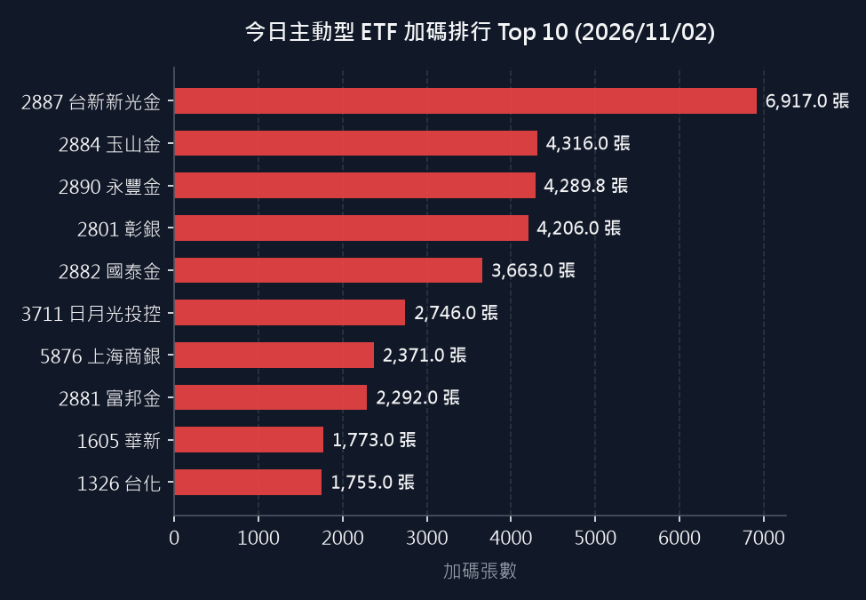
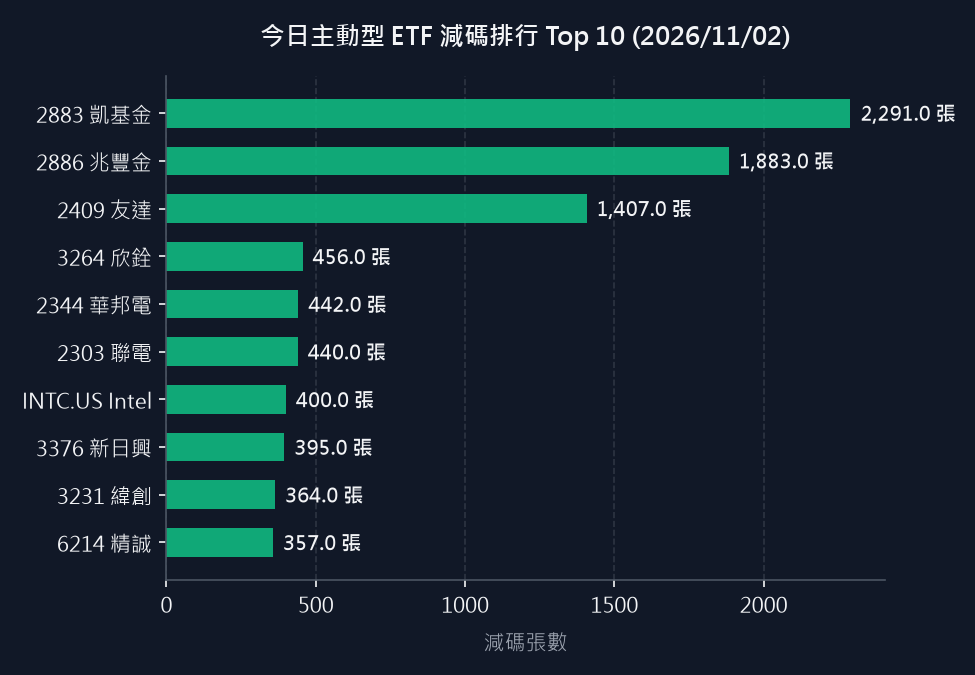

# 主動型 ETF 持股變動

資料來源：`主動型ETF持股明細.xlsx` 最近兩個日期分頁。

比較區間：`20261030` → `20261102`

## 今日加減碼視覺化排行

| 今日加碼 Top 10 | 今日減碼 Top 10 |
| :---: | :---: |
|  |  |

| ETF | 新增 | 刪除 | 比例變動 |
| :-- | --: | --: | --: |
| 00400A | 0 | 0 | 42 |
| 00401A | 1 | 0 | 44 |
| 00402A | 0 | 0 | 48 |
| 00403A | 0 | 0 | 26 |
| 00404A | 0 | 0 | 45 |
| 00405A | 0 | 0 | 22 |
| 00406A | 5 | 0 | 54 |
| 00407A | 0 | 0 | 38 |
| 00408A | 1 | 0 | 35 |
| 00980A | 0 | 0 | 44 |
| 00980D | 2 | 0 | 52 |
| 00981A | 0 | 0 | 30 |
| 00982A | 0 | 0 | 38 |
| 00983A | 0 | 0 | 37 |
| 00983D | 0 | 0 | 28 |
| 00984A | 16 | 15 | 63 |
| 00985A | 0 | 0 | 37 |
| 00986A | 0 | 1 | 32 |
| 00987A | 0 | 0 | 26 |
| 00988A | 0 | 2 | 31 |
| 00989A | 0 | 0 | 59 |
| 00990A | 4 | 1 | 32 |
| 00991A | 0 | 0 | 17 |
| 00992A | 0 | 0 | 33 |
| 00993A | 0 | 0 | 40 |
| 00994A | 1 | 0 | 27 |
| 00995A | 0 | 0 | 34 |
| 00996A | 0 | 0 | 31 |
| 00997A | 0 | 0 | 43 |
| 00998A | 1 | 1 | 42 |
| 00999A | 0 | 0 | 43 |

## 00400A

### 新增持股

- 無

### 刪除持股

- 無

### 投資比例變動

- 1303 南亞：4.14% → 4.16%（+0.02）
- 1476 儒鴻：0.08% → 0.07%（-0.01）
- 2059 川湖：3.62% → 3.50%（-0.12）
- 2303 聯電：1.57% → 1.53%（-0.04）
- 2308 台達電：2.13% → 2.14%（+0.01）
- 2317 鴻海：0.79% → 0.80%（+0.01）
- 2327 國巨*：1.19% → 1.17%（-0.02）
- 2330 台積電：8.99% → 8.74%（-0.25）
- 2345 智邦：1.36% → 1.35%（-0.01）
- 2360 致茂：2.77% → 2.67%（-0.10）
- 2368 金像電：2.51% → 2.58%（+0.07）
- 2383 台光電：3.98% → 3.97%（-0.01）
- 2449 京元電子：0.85% → 0.87%（+0.02）
- 2454 聯發科：6.75% → 7.23%（+0.48）
- 2603 長榮：1.70% → 2.67%（+0.97）
- 2881 富邦金：1.68% → 1.64%（-0.04）
- 2891 中信金：1.66% → 1.63%（-0.03）
- 3017 奇鋐：3.41% → 3.34%（-0.07）
- 3036 文曄：1.53% → 1.50%（-0.03）
- 3037 欣興：3.55% → 3.54%（-0.01）
- 3044 健鼎：2.21% → 2.25%（+0.04）
- 3081 聯亞：0.65% → 0.66%（+0.01）
- 3167 大量：0.36% → 0.35%（-0.01）
- 3231 緯創：0.99% → 0.97%（-0.02）
- 3293 鈊象：0.36% → 0.35%（-0.01）
- 3406 玉晶光：0.89% → 0.84%（-0.05）
- 3443 創意：2.48% → 2.34%（-0.14）
- 3529 力旺：1.19% → 1.13%（-0.06）
- 3653 健策：3.26% → 3.23%（-0.03）
- 3661 世芯-KY：2.21% → 2.16%（-0.05）
- 3665 貿聯-KY：1.24% → 1.23%（-0.01）
- 5274 信驊：2.43% → 2.82%（+0.39）
- 5434 崇越：0.37% → 0.36%（-0.01）
- 6147 頎邦：0.85% → 0.82%（-0.03）
- 6271 同欣電：0.22% → 0.24%（+0.02）
- 6274 台燿：1.18% → 1.12%（-0.06）
- 6278 台表科：2.41% → 2.36%（-0.05）
- 6488 環球晶：2.24% → 2.23%（-0.01）
- 6505 台塑化：1.43% → 1.48%（+0.05）
- 7750 新代：0.83% → 0.74%（-0.09）
- 7769 鴻勁：0.66% → 0.65%（-0.01）
- ＸＡＧＸ金兌(3533.HK)：0.95% → 0.92%（-0.03）

## 00401A

### 新增持股

- 1476 儒鴻（0.64%，78 張）

### 刪除持股

- 無

### 投資比例變動

- 1216 統一：0.30% → 0.29%（-0.01）
- 1303 南亞：1.23% → 1.24%（+0.01）
- 1477 聚陽：0.94% → 0.93%（-0.01）
- 2059 川湖：0.80% → 0.78%（-0.02）
- 2303 聯電：1.92% → 2.32%（+0.40）
- 2308 台達電：1.87% → 1.88%（+0.01）
- 2313 華通：1.27% → 1.28%（+0.01）
- 2327 國巨*：0.58% → 0.57%（-0.01）
- 2330 台積電：20.29% → 19.72%（-0.57）
- 2360 致茂：1.80% → 1.74%（-0.06）
- 2379 瑞昱：1.17% → 1.14%（-0.03）
- 2382 廣達：2.11% → 2.09%（-0.02）
- 2383 台光電：0.97% → 0.96%（-0.01）
- 2412 中華電：0.92% → 0.91%（-0.01）
- 2454 聯發科：5.63% → 5.65%（+0.02）
- 2455 全新：1.95% → 1.94%（-0.01）
- 2881 富邦金：2.19% → 2.14%（-0.05）
- 2882 國泰金：1.11% → 1.10%（-0.01）
- 2883 凱基金：1.68% → 1.64%（-0.04）
- 2884 玉山金：2.14% → 2.10%（-0.04）
- 2886 兆豐金：1.50% → 1.47%（-0.03）
- 2887 台新新光金：1.11% → 1.09%（-0.02）
- 2890 永豐金：1.17% → 1.14%（-0.03）
- 2891 中信金：2.21% → 2.16%（-0.05）
- 3034 聯詠：0.23% → 0.22%（-0.01）
- 3037 欣興：1.90% → 1.61%（-0.29）
- 3231 緯創：1.69% → 1.65%（-0.04）
- 3491 昇達科：1.47% → 1.51%（+0.04）
- 3711 日月光投控：3.70% → 3.97%（+0.27）
- 4904 遠傳：0.83% → 0.81%（-0.02）
- 4938 和碩：0.35% → 0.34%（-0.01）
- 4958 臻鼎-KY：1.27% → 1.26%（-0.01）
- 5274 信驊：1.71% → 1.66%（-0.05）
- 5347 世界：1.14% → 1.13%（-0.01）
- 6147 頎邦：1.29% → 1.25%（-0.04）
- 6187 萬潤：0.83% → 0.82%（-0.01）
- 6285 啟碁：1.24% → 1.26%（+0.02）
- 6515 穎崴：0.86% → 0.83%（-0.03）
- 6531 愛普*：1.40% → 1.38%（-0.02）
- 7769 鴻勁：0.78% → 0.76%（-0.02）
- 7828 創新服務：1.21% → 1.20%（-0.01）
- 7856 漢測：0.68% → 0.67%（-0.01）
- 8464 億豐：1.01% → 1.02%（+0.01）
- 臺指選擇權11/26 46500 買權：-0.32% → -0.26%（+0.06）

## 00402A

### 新增持股

- 無

### 刪除持股

- 無

### 投資比例變動

- AAPL.US Apple：8.25% → 8.55%（+0.30）
- ADI.US Analog Devices：2.16% → 2.18%（+0.02）
- AMD.US AMD：6.12% → 5.72%（-0.40）
- AMZN.US Amazon：4.30% → 4.45%（+0.15）
- ANET.US Arista Networks：0.81% → 0.78%（-0.03）
- ARM.US Arm：0.82% → 0.78%（-0.04）
- ASML.US ASML Holding：1.21% → 1.18%（-0.03）
- AVGO.US Broadcom：2.26% → 2.24%（-0.02）
- AXON.US Axon Enterprise：0.63% → 0.65%（+0.02）
- BABA.US Alibaba Group：0.46% → 0.48%（+0.02）
- BKNG.US Booking Holdings：0.51% → 0.52%（+0.01）
- CDNS.US Cadence Design Systems：1.60% → 1.61%（+0.01）
- CIEN.US Ciena：1.15% → 1.11%（-0.04）
- CLS.US Celestica：1.15% → 1.14%（-0.01）
- COHR.US Coherent：1.17% → 1.09%（-0.08）
- CRWD.US CrowdStrike Holdings：1.90% → 1.91%（+0.01）
- FSLY.US Fastly：0.39% → 0.37%（-0.02）
- GOOG.US Alphabet - Class C Capital Stock：2.90% → 2.99%（+0.09）
- GOOGL.US Alphabet - Class A Common Stock：2.89% → 2.99%（+0.10）
- INTC.US Intel：1.45% → 1.08%（-0.37）
- IOT.US Samsara：0.56% → 0.60%（+0.04）
- KLAC.US KLA：1.41% → 1.39%（-0.02）
- LITE.US Lumentum：1.88% → 1.80%（-0.08）
- LRCX.US Lam Research：2.23% → 2.20%（-0.03）
- MDB.US MongoDB：0.42% → 0.40%（-0.02）
- META.US Meta：3.41% → 3.52%（+0.11）
- MRVL.US Marvell：1.52% → 1.43%（-0.09）
- MSFT.US Microsoft：5.53% → 5.72%（+0.19）
- MU.US Micron：5.88% → 5.85%（-0.03）
- NFLX.US Netflix：0.90% → 0.94%（+0.04）
- NOW.US ServiceNow：0.87% → 0.88%（+0.01）
- NVDA.US NVIDIA：8.66% → 8.70%（+0.04）
- PANW.US Palo Alto：3.01% → 3.04%（+0.03）
- PLTR.US Palantir Technologies：2.24% → 2.20%（-0.04）
- SHOP.US Shopify：1.21% → 1.20%（-0.01）
- SIMO.US Silicon Motion：0.52% → 0.50%（-0.02）
- SKHY.US SK hynix：0.89% → 0.86%（-0.03）
- SNOW.US Snowflake：1.37% → 1.33%（-0.04）
- SPCX.US SpaceX：0.73% → 0.72%（-0.01）
- SPOT.US Spotify：0.40% → 0.45%（+0.05）
- STX.US Seagate：1.09% → 1.05%（-0.04）
- TER.US Teradyne：0.68% → 0.66%（-0.02）
- TSM.US TSMC(ADR)：1.55% → 1.53%（-0.02）
- TTWO.US Take-Two：0.57% → 0.59%（+0.02）
- TXN.US Texas Instruments：2.74% → 2.76%（+0.02）
- UBER.US Uber：0.30% → 0.32%（+0.02）
- V.US Visa：1.28% → 1.35%（+0.07）
- WDC.US Western Digital：1.99% → 1.94%（-0.05）

## 00403A

### 新增持股

- 無

### 刪除持股

- 無

### 投資比例變動

- 1303 南亞：2.85% → 2.88%（+0.03）
- 2059 川湖：0.70% → 0.68%（-0.02）
- 2308 台達電：2.33% → 2.34%（+0.01）
- 2313 華通：0.32% → 0.33%（+0.01）
- 2317 鴻海：0.63% → 0.64%（+0.01）
- 2327 國巨*：3.55% → 3.50%（-0.05）
- 2330 台積電：14.65% → 14.30%（-0.35）
- 2345 智邦：2.07% → 1.89%（-0.18）
- 2368 金像電：0.76% → 0.87%（+0.11）
- 2449 京元電子：0.81% → 0.84%（+0.03）
- 2454 聯發科：4.81% → 5.00%（+0.19）
- 3008 大立光：1.63% → 1.64%（+0.01）
- 3017 奇鋐：5.89% → 5.78%（-0.11）
- 3189 景碩：3.33% → 3.23%（-0.10）
- 3443 創意：4.35% → 4.12%（-0.23）
- 3450 聯鈞：0.49% → 0.50%（+0.01）
- 3653 健策：5.07% → 5.19%（+0.12）
- 3665 貿聯-KY：1.90% → 1.89%（-0.01）
- 3711 日月光投控：0.86% → 1.02%（+0.16）
- 5274 信驊：2.31% → 2.25%（-0.06）
- 6223 旺矽：3.44% → 3.45%（+0.01）
- 6274 台燿：2.44% → 2.32%（-0.12）
- 6442 光聖：0.35% → 0.32%（-0.03）
- 6805 富世達：0.59% → 0.58%（-0.01）
- 8046 南電：2.87% → 2.84%（-0.03）
- 8996 高力：2.17% → 2.26%（+0.09）

## 00404A

### 新增持股

- 無

### 刪除持股

- 無

### 投資比例變動

- 1303 南亞：0.81% → 0.83%（+0.02）
- 2059 川湖：0.50% → 0.49%（-0.01）
- 2301 光寶科：0.51% → 0.52%（+0.01）
- 2303 聯電：2.27% → 2.26%（-0.01）
- 2308 台達電：1.38% → 1.41%（+0.03）
- 2317 鴻海：0.68% → 0.71%（+0.03）
- 2330 台積電：22.70% → 22.49%（-0.21）
- 2345 智邦：0.75% → 0.76%（+0.01）
- 2347 聯強：2.05% → 1.96%（-0.09）
- 2351 順德：0.35% → 0.34%（-0.01）
- 2357 華碩：1.17% → 1.19%（+0.02）
- 2360 致茂：0.41% → 0.40%（-0.01）
- 2379 瑞昱：1.22% → 1.21%（-0.01）
- 2382 廣達：0.99% → 1.00%（+0.01）
- 2383 台光電：2.66% → 2.69%（+0.03）
- 2395 研華：1.30% → 1.26%（-0.04）
- 2436 偉詮電：1.13% → 1.11%（-0.02）
- 2454 聯發科：6.22% → 6.35%（+0.13）
- 2637 慧洋-KY：1.17% → 1.19%（+0.02）
- 2882 國泰金：3.00% → 3.02%（+0.02）
- 2885 元大金：2.65% → 2.63%（-0.02）
- 2887 台新新光金：1.54% → 1.53%（-0.01）
- 2890 永豐金：1.55% → 1.60%（+0.05）
- 3017 奇鋐：1.28% → 1.27%（-0.01）
- 3264 欣銓：0.60% → 0.59%（-0.01）
- 3293 鈊象：1.25% → 1.24%（-0.01）
- 3374 精材：0.13% → 0.12%（-0.01）
- 3443 創意：0.99% → 0.95%（-0.04）
- 3711 日月光投控：3.35% → 3.40%（+0.05）
- 5274 信驊：2.66% → 2.62%（-0.04）
- 5434 崇越：1.76% → 1.74%（-0.02）
- 5876 上海商銀：1.65% → 1.66%（+0.01）
- 5904 寶雅*：0.52% → 0.53%（+0.01）
- 6223 旺矽：1.01% → 1.03%（+0.02）
- 6257 矽格：1.50% → 1.51%（+0.01）
- 6491 晶碩：0.93% → 0.95%（+0.02）
- 6505 台塑化：0.47% → 0.50%（+0.03）
- 6669 緯穎：0.89% → 0.90%（+0.01）
- 6691 洋基工程：1.51% → 1.53%（+0.02）
- 8016 矽創：1.27% → 1.23%（-0.04）
- 8081 致新：0.91% → 0.90%（-0.01）
- 8299 群聯：1.25% → 1.22%（-0.03）
- 台指選擇權11/26 48000 買權：-0.17% → -0.13%（+0.04）
- 台指選擇權12/26 49000 買權：-0.02% → -0.01%（+0.01）
- 台股期貨11/26(FITXN*1.TF)：19.65% → 19.77%（+0.12）

## 00405A

### 新增持股

- 無

### 刪除持股

- 無

### 投資比例變動

- 2059 川湖：2.32% → 2.26%（-0.06）
- 2303 聯電：0.02% → 0.01%（-0.01）
- 2308 台達電：0.60% → 0.61%（+0.01）
- 2330 台積電：2.04% → 2.00%（-0.04）
- 2345 智邦：4.73% → 4.72%（-0.01）
- 2368 金像電：5.53% → 5.73%（+0.20）
- 2383 台光電：4.77% → 4.79%（+0.02）
- 2454 聯發科：5.53% → 5.60%（+0.07）
- 3017 奇鋐：1.90% → 1.88%（-0.02）
- 3037 欣興：7.28% → 7.32%（+0.04）
- 3443 創意：2.68% → 2.55%（-0.13）
- 3665 貿聯-KY：5.20% → 5.19%（-0.01）
- 5274 信驊：7.01% → 6.85%（-0.16）
- 6223 旺矽：7.16% → 7.22%（+0.06）
- 6274 台燿：1.86% → 1.78%（-0.08）
- 6285 啟碁：0.10% → 0.11%（+0.01）
- 6531 愛普*：3.84% → 3.83%（-0.01）
- 6669 緯穎：0.86% → 0.87%（+0.01）
- 6805 富世達：3.11% → 3.06%（-0.05）
- 7769 鴻勁：2.86% → 2.83%（-0.03）
- 8046 南電：7.43% → 7.39%（-0.04）
- 8996 高力：1.38% → 1.45%（+0.07）

## 00406A

### 新增持股

- 2881 富邦金（0.38%，3200 張）
- 2882 國泰金（0.35%，4065 張）
- 2884 玉山金（0.22%，6000 張）
- 2887 台新新光金（0.27%，8700 張）
- 2890 永豐金（0.21%，6200 張）

### 刪除持股

- 無

### 投資比例變動

- 1303 南亞：2.39% → 2.35%（-0.04）
- 1326 台化：0.61% → 0.60%（-0.01）
- 1560 中砂：0.28% → 0.27%（-0.01）
- 1815 富喬：0.46% → 0.49%（+0.03）
- 2059 川湖：1.52% → 1.43%（-0.09）
- 2303 聯電：1.31% → 1.25%（-0.06）
- 2308 台達電：1.82% → 1.78%（-0.04）
- 2327 國巨*：1.86% → 1.79%（-0.07）
- 2330 台積電：9.43% → 9.47%（+0.04）
- 2345 智邦：2.42% → 2.34%（-0.08）
- 2360 致茂：0.88% → 0.83%（-0.05）
- 2368 金像電：2.22% → 2.23%（+0.01）
- 2383 台光電：6.25% → 6.15%（-0.10）
- 2454 聯發科：5.80% → 6.18%（+0.38）
- 2481 強茂：0.38% → 0.36%（-0.02）
- 2885 元大金：0.48% → 0.52%（+0.04）
- 2886 兆豐金：0.11% → 0.12%（+0.01）
- 3008 大立光：1.23% → 1.20%（-0.03）
- 3017 奇鋐：5.21% → 4.98%（-0.23）
- 3081 聯亞：1.04% → 1.24%（+0.20）
- 3105 穩懋：0.45% → 0.44%（-0.01）
- 3167 大量：0.69% → 0.64%（-0.05）
- 3189 景碩：2.00% → 1.89%（-0.11）
- 3231 緯創：0.39% → 0.38%（-0.01）
- 3264 欣銓：0.37% → 0.35%（-0.02）
- 3363 上詮：0.14% → 0.13%（-0.01）
- 3443 創意：2.37% → 2.19%（-0.18）
- 3529 力旺：0.14% → 0.13%（-0.01）
- 3653 健策：4.44% → 4.58%（+0.14）
- 3661 世芯-KY：0.84% → 0.81%（-0.03）
- 3665 貿聯-KY：0.96% → 0.93%（-0.03）
- 3711 日月光投控：2.02% → 2.07%（+0.05）
- 4938 和碩：0.55% → 0.53%（-0.02）
- 4958 臻鼎-KY：1.11% → 1.08%（-0.03）
- 5274 信驊：1.78% → 1.68%（-0.10）
- 6147 頎邦：0.85% → 0.81%（-0.04）
- 6187 萬潤：0.15% → 0.14%（-0.01）
- 6213 聯茂：0.53% → 0.49%（-0.04）
- 6223 旺矽：3.08% → 3.01%（-0.07）
- 6274 台燿：1.78% → 1.91%（+0.13）
- 6278 台表科：0.28% → 0.27%（-0.01）
- 6446 藥華藥：0.39% → 0.38%（-0.01）
- 6488 環球晶：0.22% → 0.21%（-0.01）
- 6510 精測：0.60% → 0.58%（-0.02）
- 6531 愛普*：0.10% → 0.09%（-0.01）
- 6669 緯穎：1.21% → 1.18%（-0.03）
- 6715 嘉基：0.82% → 0.74%（-0.08）
- 6805 富世達：0.80% → 0.85%（+0.05）
- 7769 鴻勁：0.16% → 0.15%（-0.01）
- 8046 南電：3.01% → 2.90%（-0.11）
- 8996 高力：0.61% → 0.62%（+0.01）
- 臺指選擇權第一週週三到期契約：-6.01% → -11.73%（-5.72）
- 臺指選擇權第一週週五到期契約：-2.87% → -4.35%（-1.48）
- 臺股期貨 202611(FITXN*1.TF)：24.49% → 23.64%（-0.85）

## 00407A

### 新增持股

- 無

### 刪除持股

- 無

### 投資比例變動

- 1303 南亞：2.96% → 3.30%（+0.34）
- 1560 中砂：1.06% → 1.05%（-0.01）
- 2059 川湖：1.94% → 1.89%（-0.05）
- 2301 光寶科：1.40% → 1.41%（+0.01）
- 2303 聯電：0.49% → 0.48%（-0.01）
- 2308 台達電：2.16% → 2.19%（+0.03）
- 2327 國巨*：2.26% → 2.23%（-0.03）
- 2330 台積電：9.88% → 9.68%（-0.20）
- 2360 致茂：0.93% → 0.90%（-0.03）
- 2368 金像電：1.71% → 2.09%（+0.38）
- 2379 瑞昱：0.28% → 0.27%（-0.01）
- 2383 台光電：5.59% → 5.60%（+0.01）
- 2454 聯發科：5.29% → 5.64%（+0.35）
- 3008 大立光：1.41% → 1.42%（+0.01）
- 3017 奇鋐：5.82% → 5.74%（-0.08）
- 3034 聯詠：0.87% → 0.86%（-0.01）
- 3037 欣興：5.94% → 5.97%（+0.03）
- 3081 聯亞：1.82% → 1.85%（+0.03）
- 3231 緯創：1.10% → 1.09%（-0.01）
- 3260 威剛：0.31% → 0.30%（-0.01）
- 3293 鈊象：0.69% → 0.68%（-0.01）
- 3406 玉晶光：0.24% → 0.23%（-0.01）
- 3443 創意：4.90% → 4.66%（-0.24）
- 3491 昇達科：0.85% → 0.88%（+0.03）
- 3533 嘉澤：0.97% → 0.95%（-0.02）
- 3653 健策：3.68% → 3.67%（-0.01）
- 3665 貿聯-KY：2.27% → 2.26%（-0.01）
- 3711 日月光投控：3.19% → 3.51%（+0.32）
- 5274 信驊：1.87% → 1.82%（-0.05）
- 5434 崇越：0.23% → 0.22%（-0.01）
- 6223 旺矽：2.17% → 2.18%（+0.01）
- 6274 台燿：1.96% → 1.87%（-0.09）
- 6510 精測：1.34% → 1.35%（+0.01）
- 6669 緯穎：2.43% → 2.44%（+0.01）
- 6805 富世達：1.34% → 1.32%（-0.02）
- 8046 南電：3.63% → 3.60%（-0.03）
- 8299 群聯：0.33% → 0.32%（-0.01）
- 8996 高力：1.29% → 1.36%（+0.07）

## 00408A

### 新增持股

- 3044 健鼎（0.39%，10 張）

### 刪除持股

- 無

### 投資比例變動

- 1303 南亞：3.93% → 4.00%（+0.07）
- 2059 川湖：1.00% → 0.97%（-0.03）
- 2303 聯電：0.87% → 0.86%（-0.01）
- 2308 台達電：1.66% → 1.69%（+0.03）
- 2330 台積電：6.29% → 6.17%（-0.12）
- 2344 華邦電：0.49% → 0.48%（-0.01）
- 2360 致茂：1.04% → 1.01%（-0.03）
- 2368 金像電：4.74% → 4.93%（+0.19）
- 2383 台光電：4.65% → 4.69%（+0.04）
- 2395 研華：1.70% → 1.64%（-0.06）
- 2408 南亞科：2.04% → 2.06%（+0.02）
- 2449 京元電子：0.88% → 0.91%（+0.03）
- 2454 聯發科：4.04% → 4.10%（+0.06）
- 2455 全新：0.79% → 0.80%（+0.01）
- 2542 興富發：3.91% → 3.88%（-0.03）
- 2603 長榮：1.76% → 1.78%（+0.02）
- 2880 華南金：1.30% → 1.28%（-0.02）
- 2891 中信金：0.84% → 0.83%（-0.01）
- 3017 奇鋐：2.94% → 2.91%（-0.03）
- 3026 禾伸堂：0.78% → 0.71%（-0.07）
- 3037 欣興：2.99% → 3.02%（+0.03）
- 3081 聯亞：2.01% → 2.05%（+0.04）
- 3105 穩懋：0.60% → 0.61%（+0.01）
- 3189 景碩：3.37% → 3.29%（-0.08）
- 3231 緯創：0.96% → 0.95%（-0.01）
- 3264 欣銓：0.70% → 0.69%（-0.01）
- 3443 創意：0.56% → 0.54%（-0.02）
- 3653 健策：3.63% → 3.64%（+0.01）
- 3711 日月光投控：1.92% → 2.34%（+0.42）
- 5434 崇越：2.39% → 2.35%（-0.04）
- 6223 旺矽：1.97% → 1.99%（+0.02）
- 6274 台燿：2.71% → 2.59%（-0.12）
- 6669 緯穎：1.97% → 1.98%（+0.01）
- 6805 富世達：2.46% → 2.43%（-0.03）
- 8996 高力：2.33% → 2.45%（+0.12）

## 00980A

### 新增持股

- 無

### 刪除持股

- 無

### 投資比例變動

- 1303 南亞：3.51% → 3.53%（+0.02）
- 2059 川湖：4.27% → 4.13%（-0.14）
- 2303 聯電：1.42% → 1.39%（-0.03）
- 2308 台達電：3.02% → 3.04%（+0.02）
- 2317 鴻海：3.37% → 3.41%（+0.04）
- 2327 國巨*：0.90% → 0.88%（-0.02）
- 2330 台積電：9.99% → 9.73%（-0.26）
- 2344 華邦電：1.78% → 1.74%（-0.04）
- 2360 致茂：1.08% → 1.05%（-0.03）
- 2368 金像電：1.92% → 1.98%（+0.06）
- 2382 廣達：1.96% → 1.94%（-0.02）
- 2383 台光電：3.77% → 3.76%（-0.01）
- 2408 南亞科：2.46% → 2.45%（-0.01）
- 2454 聯發科：5.46% → 5.48%（+0.02）
- 2884 玉山金：1.33% → 1.31%（-0.02）
- 2891 中信金：1.66% → 1.62%（-0.04）
- 3017 奇鋐：2.32% → 2.27%（-0.05）
- 3026 禾伸堂：1.13% → 1.01%（-0.12）
- 3036 文曄：1.05% → 1.03%（-0.02）
- 3044 健鼎：1.29% → 1.32%（+0.03）
- 3081 聯亞：1.59% → 1.60%（+0.01）
- 3189 景碩：1.39% → 1.34%（-0.05）
- 3231 緯創：1.70% → 1.67%（-0.03）
- 3264 欣銓：0.80% → 0.78%（-0.02）
- 3293 鈊象：0.50% → 0.49%（-0.01）
- 3443 創意：1.92% → 1.82%（-0.10）
- 3529 力旺：0.17% → 0.16%（-0.01）
- 3653 健策：3.18% → 3.15%（-0.03）
- 3665 貿聯-KY：1.30% → 1.29%（-0.01）
- 5274 信驊：1.81% → 1.76%（-0.05）
- 6213 聯茂：1.37% → 1.30%（-0.07）
- 6223 旺矽：1.26% → 1.27%（+0.01）
- 6274 台燿：1.25% → 1.18%（-0.07）
- 6442 光聖：0.26% → 0.27%（+0.01）
- 6515 穎崴：1.56% → 1.52%（-0.04）
- 6669 緯穎：1.88% → 1.87%（-0.01）
- 6805 富世達：0.72% → 0.70%（-0.02）
- 7751 竑騰：0.66% → 0.63%（-0.03）
- 7769 鴻勁：1.97% → 1.94%（-0.03）
- 8046 南電：1.67% → 1.65%（-0.02）
- 8210 勤誠：0.38% → 0.37%（-0.01）
- 8299 群聯：1.12% → 1.08%（-0.04）
- 8996 高力：0.47% → 0.49%（+0.02）
- 台灣證交所加權股價指數(FITXN*1.TF)：1.52% → 3.01%（+1.49）

## 00980D

### 新增持股

- COREWEAVE INC SER REGS 9.000000 % 01FEB2031（0.23%，N/A 張）
- OWENS-BROCKWAY SER REGS (REG) (REG S) 9.5% 01JUN2033（0.50%，N/A 張）

### 刪除持股

- 無

### 投資比例變動

- AMC GLOBAL MEDIA INC SER REGS (REG) (REG S) 10.5% 15JUL2032：0.70% → 0.68%（-0.02）
- AP CORE HOLDINGS II LLC SER REGS (REG S) 11% 15MAY2031：0.40% → 0.39%（-0.01）
- ASURION LLC/ASURION CO 8.375% 01FEB2034：0.44% → 0.43%（-0.01）
- BAT CAPITAL CORP (REG) 7.75% 19OCT2032：0.46% → 0.47%（+0.01）
- CAPITAL ONE FINANCIAL CO SER . (REG) VAR 30OCT2031：0.60% → 0.61%（+0.01）
- CHARTER COMM OPT LLC/CAP 6.700000 % 01-DEC-2055：0.45% → 0.44%（-0.01）
- CHC GROUP LLC SER REGS 11.750000 % 01-SEP-2030：0.45% → 0.46%（+0.01）
- CHS/COMMUNITY HEALTH SYS SER REGS 10.875000 % 15JAN2032：0.47% → 0.46%（-0.01）
- CHS/COMMUNITY HEALTH SYS SER REGS 9.750000 % 15JAN2034：0.31% → 0.48%（+0.17）
- CONSOLIDATED ENERGY FIN SER REGS 12.000000 % 15FEB2031：0.59% → 0.58%（-0.01）
- COREWEAVE INC SER REGS (REG S) 9.25% 01JUN2030：0.42% → 0.40%（-0.02）
- COREWEAVE INC SER REGS (REG S) 9.75% 01OCT2031：0.49% → 0.48%（-0.01）
- COREWEAVE INC SER REGS (REG) (REG S) 9.625% 15JUL2032：0.49% → 0.47%（-0.02）
- DEUTSCHE BANK NY VAR 10FEB2034：0.34% → 0.35%（+0.01）
- DEUTSCHE BANK NY VAR 20NOV2029：0.48% → 0.49%（+0.01）
- DEUTSCHE TELEKOM INT FIN (REG) 9.25% 01JUN2032：0.43% → 0.44%（+0.01）
- DISCOVER FINANCIAL SVS (REG) VAR 02NOV2034：0.65% → 0.66%（+0.01）
- DOW CHEMICAL CO/THE 6.9% 15MAY2053：0.63% → 0.64%（+0.01）
- F&G ANNUITIES & LIFE INC 6.250000 % 04OCT2034：0.50% → 0.51%（+0.01）
- FMC CORP (REG) 6.375000 % 18MAY2053：0.32% → 0.34%（+0.02）
- FORD MOTOR COMPANY (REG) 7.45% 16JUL2031：0.48% → 0.49%（+0.01）
- FORD MOTOR CREDIT CO LLC (REG) 7.2% 10JUN2030：0.34% → 0.35%（+0.01）
- GEORGIA-PACIFIC LLC (REG) 7.75% 15NOV2029：0.59% → 0.60%（+0.01）
- GLENCORE FINANCE CANADA SER REGS 6.900000 % 15-NOV-2037：0.40% → 0.41%（+0.01）
- HA SUSTAINABLE INF CAP (REG) 6.375% 01JUL2034：0.35% → 0.36%（+0.01）
- HAH GROUP HOLDING CO LLC SER REGS (REG S) 9.75% 01OCT2031：0.31% → 0.50%（+0.19）
- HPS CORPORATE LENDING FU 6.750000 % 30JAN2029：0.55% → 0.56%（+0.01）
- HSBC HOLDINGS PLC (REG) VAR 13NOV2034：0.35% → 0.36%（+0.01）
- ICAHN ENTERPRISES/FIN (REG) 9.75% 15JAN2029：0.33% → 0.32%（-0.01）
- JETBLUE AIRWAYS/LOYALTY SER REGS (REG S) 9.875% 20SEP2031：0.33% → 0.30%（-0.03）
- KELLANOVA SER B (REG) 7.450000 % 01APR2031：0.58% → 0.59%（+0.01）
- NRG ENERGY INC SER REGS (REG S) 7% 15MAR2033：0.32% → 0.33%（+0.01）
- ORACLE CORP 6.000000 % 03AUG2055：0.31% → 0.30%（-0.01）
- ORACLE CORP 6.100000 % 26-SEP-2065：0.52% → 0.51%（-0.01）
- ORACLE CORP 6.7 % 04-FEB-2056：0.21% → 0.20%（-0.01）
- ORACLE CORP 6.9% 09NOV2052：0.52% → 0.51%（-0.01）
- PHOTO HOLDINGS LLC SER REGS (REG) (REG S) 12% 01JUL2031：0.49% → 0.48%（-0.01）
- PLANET FINANCIAL GROUP SER REGS 10.500000 % 15DEC2029：0.48% → 0.47%（-0.01）
- RR DONNELLEY & SONS CO SER REGS (REG S) 9.5% 01AUG2029：0.44% → 0.43%（-0.01）
- SANTANDER HOLDINGS USA VAR 12JUN2029：0.60% → 0.61%（+0.01）
- SANTOS FINANCE LTD SER REGS (REG S) 6.875% 19SEP2033：0.29% → 0.30%（+0.01）
- SBL HOLDINGS INC SER REGS 7.200000 % 30OCT2034：0.52% → 0.53%（+0.01）
- SES GLOBAL AMERICAS HLDG SER REGS (REG) 5.300000 % 25MAR2044：0.30% → 0.31%（+0.01）
- SUNCOR ENERGY INC (REG) 6.85% 01JUN2039：0.34% → 0.35%（+0.01）
- TELEFONICA EUROPE BV (REG) 8.25% 15SEP2030：0.42% → 0.43%（+0.01）
- US 10YR NOTE (CBT)DEC26 21-DEC-2026：18.49% → 18.59%（+0.10）
- US 10YR ULTRA FUT DEC26 21-DEC-2026：-2.34% → -2.36%（-0.02）
- US 5YR NOTE (CBT) DEC26 31-DEC-2026：-14.00% → -14.24%（-0.24）
- US LONG BOND(CBT) DEC26 21-DEC-2026：5.57% → 5.59%（+0.02）
- VERIZON COMMUNICAT 7.750000 % 01DEC2030：0.45% → 0.46%（+0.01）
- VIACOM INC (REG) 5.85% 01SEP2043：0.50% → 0.49%（-0.01）
- VIACOMCBS INC (REG) 4.95% 19MAY2050：0.45% → 0.44%（-0.01）

## 00981A

### 新增持股

- 無

### 刪除持股

- 無

### 投資比例變動

- 2303 聯電：3.35% → 3.25%（-0.10）
- 2308 台達電：3.82% → 3.81%（-0.01）
- 2327 國巨*：4.45% → 4.35%（-0.10）
- 2330 台積電：11.84% → 11.86%（+0.02）
- 2345 智邦：3.86% → 3.79%（-0.07）
- 2368 金像電：2.94% → 3.03%（+0.09）
- 2383 台光電：7.63% → 7.55%（-0.08）
- 2449 京元電子：0.72% → 0.76%（+0.04）
- 2454 聯發科：7.92% → 8.06%（+0.14）
- 3017 奇鋐：7.72% → 7.50%（-0.22）
- 3037 欣興：7.36% → 7.29%（-0.07）
- 3231 緯創：0.42% → 0.40%（-0.02）
- 3264 欣銓：0.42% → 0.40%（-0.02）
- 3376 新日興：0.09% → 0.07%（-0.02）
- 3443 創意：2.66% → 2.49%（-0.17）
- 3653 健策：5.98% → 5.88%（-0.10）
- 3665 貿聯-KY：1.77% → 1.74%（-0.03）
- 3711 日月光投控：3.42% → 3.86%（+0.44）
- 4979 華星光：0.16% → 0.15%（-0.01）
- 5274 信驊：1.44% → 1.38%（-0.06）
- 6223 旺矽：4.35% → 4.32%（-0.03）
- 6271 同欣電：0.16% → 0.18%（+0.02）
- 6274 台燿：3.46% → 3.27%（-0.19）
- 6515 穎崴：0.12% → 0.11%（-0.01）
- 6669 緯穎：2.24% → 2.21%（-0.03）
- 6805 富世達：1.27% → 1.23%（-0.04）
- 8046 南電：4.03% → 3.95%（-0.08）
- 8210 勤誠：0.08% → 0.06%（-0.02）
- 8996 高力：0.53% → 0.55%（+0.02）
- 台指期貨 2026/11(FITXN*1.TF)：2.32% → 2.28%（-0.04）

## 00982A

### 新增持股

- 無

### 刪除持股

- 無

### 投資比例變動

- 2059 川湖：2.74% → 2.68%（-0.06）
- 2301 光寶科：1.71% → 1.73%（+0.02）
- 2303 聯電：1.27% → 1.25%（-0.02）
- 2330 台積電：8.40% → 8.25%（-0.15）
- 2360 致茂：3.68% → 3.59%（-0.09）
- 2376 技嘉：1.30% → 1.31%（+0.01）
- 2383 台光電：3.18% → 3.20%（+0.02）
- 2395 研華：1.44% → 1.39%（-0.05）
- 2428 興勤：1.14% → 1.16%（+0.02）
- 2454 聯發科：6.78% → 6.88%（+0.10）
- 2467 志聖：0.95% → 0.92%（-0.03）
- 2478 大毅：0.31% → 0.32%（+0.01）
- 3008 大立光：3.03% → 3.06%（+0.03）
- 3017 奇鋐：2.55% → 2.52%（-0.03）
- 3037 欣興：0.87% → 0.88%（+0.01）
- 3105 穩懋：8.99% → 9.14%（+0.15）
- 3231 緯創：1.96% → 1.93%（-0.03）
- 3265 台星科：1.45% → 1.44%（-0.01）
- 3491 昇達科：3.26% → 3.38%（+0.12）
- 3617 碩天：0.33% → 0.34%（+0.01）
- 3711 日月光投控：1.99% → 2.01%（+0.02）
- 4958 臻鼎-KY：3.38% → 3.39%（+0.01）
- 5274 信驊：1.26% → 1.23%（-0.03）
- 5425 台半：1.21% → 1.20%（-0.01）
- 5536 聖暉*：0.76% → 0.77%（+0.01）
- 6213 聯茂：1.43% → 1.36%（-0.07）
- 6214 精誠：1.52% → 1.53%（+0.01）
- 6223 旺矽：3.06% → 3.08%（+0.02）
- 6239 力成：1.36% → 1.37%（+0.01）
- 6274 台燿：1.17% → 1.12%（-0.05）
- 6472 保瑞：0.86% → 0.83%（-0.03）
- 6488 環球晶：1.82% → 1.83%（+0.01）
- 6510 精測：0.93% → 0.94%（+0.01）
- 6531 愛普*：3.93% → 3.92%（-0.01）
- 6640 均華：0.29% → 0.28%（-0.01）
- 6669 緯穎：2.34% → 2.03%（-0.31）
- 6672 騰輝電子-KY：1.36% → 1.37%（+0.01）
- 8996 高力：1.21% → 1.27%（+0.06）

## 00983A

### 新增持股

- 無

### 刪除持股

- 無

### 投資比例變動

- AMD.US AMD：3.36% → 3.23%（-0.13）
- AMZN.US Amazon：3.42% → 3.77%（+0.35）
- AVGO.US Broadcom：1.80% → 1.83%（+0.03）
- BEAM.US Beam Therapeutics：1.85% → 2.37%（+0.52）
- BLSH.US Bullish：1.81% → 1.44%（-0.37）
- BMNR.US BitMine：1.88% → 1.58%（-0.30）
- COIN.US Coinbase：3.89% → 3.46%（-0.43）
- CRCL.US Circle：4.40% → 4.21%（-0.19）
- CRSP.US CRISPR Therapeutics：3.95% → 4.03%（+0.08）
- CRWV.US CoreWeave：0.71% → 0.29%（-0.42）
- DE.US Deere：0.42% → 0.47%（+0.05）
- FTNT.US Fortinet：0.43% → 0.45%（+0.02）
- GOOG.US Alphabet - Class C Capital Stock：1.62% → 2.05%（+0.43）
- GOOGL.US Alphabet - Class A Common Stock：1.39% → 1.48%（+0.09）
- ILMN.US Illumina：1.87% → 1.64%（-0.23）
- KTOS.US Kratos Defense & Security：0.10% → 0.11%（+0.01）
- LLY.US Eli Lilly：1.74% → 1.93%（+0.19）
- META.US Meta：2.67% → 2.84%（+0.17）
- MSFT.US Microsoft：0.99% → 1.05%（+0.06）
- NET.US Cloudflare：1.35% → 1.31%（-0.04）
- NTLA.US Intellia Therapeutics：0.67% → 1.34%（+0.67）
- NTRA.US Natera：1.77% → 1.81%（+0.04）
- NVDA.US NVIDIA：3.61% → 3.73%（+0.12）
- PLTR.US Palantir Technologies：3.26% → 3.30%（+0.04）
- RKLB.US Rocket Lab：1.35% → 1.34%（-0.01）
- RXRX.US Recursion Pharmaceuticals：0.99% → 1.01%（+0.02）
- SHOP.US Shopify：4.86% → 4.95%（+0.09）
- SOFI.US SoFi Technologies：0.17% → 0.18%（+0.01）
- SPCX.US SpaceX：6.44% → 6.51%（+0.07）
- TEM.US Tempus：6.07% → 6.08%（+0.01）
- TSLA.US Tesla：9.04% → 9.61%（+0.57）
- TSM.US TSMC(ADR)：2.69% → 2.73%（+0.04）
- TWST.US Twist Bioscience：4.34% → 4.12%（-0.22）
- TXG.US 10x Genomics：3.62% → 3.36%（-0.26）
- VCYT.US Veracyte：0.15% → 0.52%（+0.37）
- WGS.US GeneDx：0.52% → 0.54%（+0.02）
- XYZ.US Block：1.27% → 1.35%（+0.08）

## 00983D

### 新增持股

- 無

### 刪除持股

- 無

### 投資比例變動

- AMCX 10 1/2 07/15/32：1.61% → 1.58%（-0.03）
- ATH 6 5/8 05/19/55：1.03% → 1.02%（-0.01）
- BHCCN 11 09/30/28：1.99% → 2.00%（+0.01）
- C 8 1/8 07/15/39：2.00% → 2.01%（+0.01）
- CRWV 9 02/01/31：1.23% → 1.19%（-0.04）
- CYH 10 7/8 01/15/32：1.42% → 1.39%（-0.03）
- DELL 8.35 07/15/46：1.44% → 1.43%（-0.01）
- DOW 6.9 05/15/53：0.79% → 0.80%（+0.01）
- DOW 9.4 05/15/39：2.02% → 2.03%（+0.01）
- GE 6 7/8 01/10/39：0.87% → 0.88%（+0.01）
- GT 8 7/8 07/15/32：0.88% → 0.87%（-0.01）
- HPE 6.35 10/15/45：1.03% → 1.02%（-0.01）
- IEP 10 11/15/29：1.53% → 1.52%（-0.01）
- LOW 6.65 09/15/37：0.87% → 0.88%（+0.01）
- LQDW.US iShares LQD Premium Income+ ETF：7.06% → 7.07%（+0.01）
- MBGGR 8 1/2 01/18/31：1.36% → 1.37%（+0.01）
- MCD 6.3 03/01/38：0.41% → 0.42%（+0.01）
- MS 7 1/4 04/01/32：1.70% → 1.71%（+0.01）
- NVDA 5.55 06/15/46：1.18% → 1.17%（-0.01）
- ORCL 6.9 11/09/52：0.43% → 0.42%（-0.01）
- PFE 7.2 03/15/39：1.11% → 1.12%（+0.01）
- RIOLN 7 1/4 03/15/31：0.53% → 0.54%（+0.01）
- S 8 3/4 03/15/32：1.53% → 1.54%（+0.01）
- SPCX 6.6 07/15/46：1.15% → 1.13%（-0.02）
- SUCN 6.85 06/01/39：1.05% → 1.06%（+0.01）
- TELEFONICA EMISIONES SAU 7.045 06/20/36：1.41% → 1.42%（+0.01）
- TLTW.US iShares TLT Premium Income+ ETF：8.38% → 8.40%（+0.02）
- TRPCN 7 5/8 01/15/39：1.75% → 1.76%（+0.01）

## 00984A

### 新增持股

- 1301 台塑（0.63%，878 張）
- 1605 華新（0.66%，1773 張）
- 2027 大成鋼（0.63%，1269 張）
- 2317 鴻海（0.04%，15 張）
- 2377 微星（0.62%，403 張）
- 2449 京元電子（0.38%，145 張）
- 2455 全新（1.06%，238 張）
- 2891 中信金（0.62%，840 張）
- 3044 健鼎（0.65%，124 張）
- 3406 玉晶光（1.16%，113 張）
- 3702 大聯大（0.61%，586 張）
- 6196 帆宣（0.62%，117 張）
- 6415 矽力*-KY（0.56%，113 張）
- 6672 騰輝電子-KY（0.63%，120 張）
- 6770 力積電（0.62%，955 張）
- 9933 中鼎（0.64%，1406 張）

### 刪除持股

- 1409 新纖（0.63%，2702 張）
- 2303 聯電（0.66%，599 張）
- 2344 華邦電（0.71%，442 張）
- 2404 漢唐（0.39%，37 張）
- 2464 盟立（1.17%，710 張）
- 3006 晶豪科（0.66%，242 張）
- 3231 緯創（0.66%，364 張）
- 3661 世芯-KY（0.27%，8 張）
- 3665 貿聯-KY（0.48%，30 張）
- 3714 富采（0.55%，962 張）
- 6214 精誠（0.71%，357 張）
- 6223 旺矽（0.14%，3 張）
- 6531 愛普*（0.04%，5 張）
- 8039 台虹（0.55%，230 張）
- 8046 南電（0.57%，49 張）

### 投資比例變動

- 1216 統一：0.35% → 1.02%（+0.67）
- 1303 南亞：3.03% → 1.85%（-1.18）
- 1326 台化：1.03% → 2.32%（+1.29）
- 1560 中砂：1.24% → 1.53%（+0.29）
- 2006 東和鋼鐵：0.34% → 1.03%（+0.69）
- 2059 川湖：2.09% → 2.05%（-0.04）
- 2301 光寶科：0.57% → 0.65%（+0.08）
- 2313 華通：0.13% → 0.50%（+0.37）
- 2330 台積電：4.31% → 2.63%（-1.68）
- 2351 順德：0.58% → 0.63%（+0.05）
- 2357 華碩：0.61% → 0.62%（+0.01）
- 2379 瑞昱：0.34% → 0.98%（+0.64）
- 2383 台光電：1.24% → 0.19%（-1.05）
- 2395 研華：2.58% → 2.23%（-0.35）
- 2408 南亞科：2.04% → 1.41%（-0.63）
- 2409 友達：1.07% → 0.65%（-0.42）
- 2454 聯發科：0.77% → 0.31%（-0.46）
- 2603 長榮：2.04% → 2.53%（+0.49）
- 2615 萬海：1.04% → 1.65%（+0.61）
- 2618 長榮航：0.32% → 1.02%（+0.70）
- 2634 漢翔：0.30% → 1.02%（+0.72）
- 2637 慧洋-KY：0.34% → 1.02%（+0.68）
- 2801 彰銀：0.36% → 1.65%（+1.29）
- 2851 中再保：0.71% → 0.65%（-0.06）
- 2855 統一證：0.66% → 0.65%（-0.01）
- 2880 華南金：1.75% → 1.73%（-0.02）
- 2881 富邦金：4.56% → 3.06%（-1.50）
- 2882 國泰金：3.46% → 3.02%（-0.44）
- 2883 凱基金：2.52% → 1.66%（-0.86）
- 2884 玉山金：2.48% → 1.67%（-0.81）
- 2885 元大金：3.55% → 2.74%（-0.81）
- 2886 兆豐金：2.33% → 1.02%（-1.31）
- 2887 台新新光金：3.58% → 2.82%（-0.76）
- 2890 永豐金：2.57% → 1.66%（-0.91）
- 2892 第一金：1.47% → 1.64%（+0.17）
- 3008 大立光：1.44% → 1.57%（+0.13）
- 3017 奇鋐：4.20% → 3.75%（-0.45）
- 3034 聯詠：0.34% → 0.99%（+0.65）
- 3037 欣興：1.53% → 1.37%（-0.16）
- 3045 台灣大：1.86% → 1.67%（-0.19）
- 3189 景碩：1.50% → 2.24%（+0.74）
- 3264 欣銓：1.66% → 0.66%（-1.00）
- 3443 創意：1.20% → 1.73%（+0.53）
- 3450 聯鈞：0.61% → 0.21%（-0.40）
- 3653 健策：1.74% → 1.12%（-0.62）
- 3711 日月光投控：0.62% → 1.81%（+1.19）
- 4958 臻鼎-KY：0.56% → 0.46%（-0.10）
- 5274 信驊：1.13% → 0.49%（-0.64）
- 5351 鈺創：0.66% → 0.65%（-0.01）
- 5434 崇越：0.32% → 0.98%（+0.66）
- 5871 中租-KY：0.32% → 1.00%（+0.68）
- 5876 上海商銀：0.36% → 1.63%（+1.27）
- 5904 寶雅*：1.03% → 1.04%（+0.01）
- 6187 萬潤：1.94% → 0.80%（-1.14）
- 6197 佳必琪：0.60% → 0.65%（+0.05）
- 6213 聯茂：1.41% → 0.62%（-0.79）
- 6274 台燿：0.07% → 0.37%（+0.30）
- 6446 藥華藥：1.56% → 0.97%（-0.59）
- 6505 台塑化：3.18% → 3.86%（+0.68）
- 6669 緯穎：0.74% → 0.77%（+0.03）
- 6670 復盛應用：0.31% → 0.57%（+0.26）
- 6691 洋基工程：0.58% → 0.64%（+0.06）
- 7750 新代：0.70% → 0.60%（-0.10）

## 00985A

### 新增持股

- 無

### 刪除持股

- 無

### 投資比例變動

- 1101 台泥：1.41% → 1.39%（-0.02）
- 1402 遠東新：1.34% → 1.35%（+0.01）
- 1605 華新：1.39% → 1.45%（+0.06）
- 2059 川湖：2.31% → 2.25%（-0.06）
- 2303 聯電：1.67% → 1.65%（-0.02）
- 2308 台達電：2.60% → 2.63%（+0.03）
- 2317 鴻海：1.92% → 1.96%（+0.04）
- 2327 國巨*：1.77% → 1.75%（-0.02）
- 2330 台積電：14.01% → 13.74%（-0.27）
- 2344 華邦電：1.56% → 1.53%（-0.03）
- 2345 智邦：2.41% → 2.40%（-0.01）
- 2368 金像電：1.23% → 1.28%（+0.05）
- 2376 技嘉：2.09% → 2.11%（+0.02）
- 2383 台光電：2.83% → 2.84%（+0.01）
- 2412 中華電：1.73% → 1.72%（-0.01）
- 2454 聯發科：1.74% → 1.76%（+0.02）
- 2603 長榮：1.50% → 1.51%（+0.01）
- 2609 陽明：1.45% → 1.46%（+0.01）
- 2610 華航：1.37% → 1.40%（+0.03）
- 3008 大立光：1.61% → 1.62%（+0.01）
- 3017 奇鋐：1.19% → 1.17%（-0.02）
- 3036 文曄：3.01% → 2.97%（-0.04）
- 3037 欣興：1.93% → 1.94%（+0.01）
- 3081 聯亞：2.02% → 2.05%（+0.03）
- 3189 景碩：0.49% → 0.48%（-0.01）
- 3231 緯創：0.99% → 0.98%（-0.01）
- 3665 貿聯-KY：1.48% → 1.47%（-0.01）
- 3711 日月光投控：1.66% → 1.67%（+0.01）
- 4904 遠傳：2.23% → 2.22%（-0.01）
- 6285 啟碁：0.70% → 0.72%（+0.02）
- 6442 光聖：0.99% → 1.02%（+0.03）
- 6446 藥華藥：2.99% → 2.98%（-0.01）
- 6531 愛普*：1.37% → 1.36%（-0.01）
- 6669 緯穎：2.95% → 2.96%（+0.01）
- 7750 新代：1.31% → 1.18%（-0.13）
- 7769 鴻勁：2.93% → 2.90%（-0.03）
- 台積電期貨(FICDFN*1.TF)：1.59% → 1.56%（-0.03）

## 00986A

### 新增持股

- 無

### 刪除持股

- TER.US Teradyne（0.90%，0.5 張）

### 投資比例變動

- 2330 台積電：8.11% → 8.29%（+0.18）
- 2454 聯發科：1.51% → 1.52%（+0.01）
- AAPL.US Apple：2.65% → 2.73%（+0.08）
- AMD.US AMD：4.82% → 4.48%（-0.34）
- AMZN.US Amazon：4.15% → 4.27%（+0.12）
- AVGO.US Broadcom：3.78% → 3.72%（-0.06）
- BE.US Bloom Energy：1.89% → 1.93%（+0.04）
- DDOG.US Datadog：1.13% → 1.04%（-0.09）
- DELL.US Dell：0.43% → 0.81%（+0.38）
- ETN.US Eaton：2.39% → 2.34%（-0.05）
- GEV.US GE Vernova：2.70% → 2.72%（+0.02）
- GOOGL.US Alphabet - Class A Common Stock：5.18% → 5.32%（+0.14）
- HOOD.US Robinhood Markets：0.67% → 0.65%（-0.02）
- ILMN.US Illumina：0.71% → 0.60%（-0.11）
- JPM.US JPMorgan Chase：2.30% → 2.35%（+0.05）
- LITE.US Lumentum：4.36% → 4.16%（-0.20）
- LLY.US Eli Lilly：3.76% → 4.04%（+0.28）
- MA.US Mastercard：1.35% → 1.42%（+0.07）
- MSFT.US Microsoft：3.22% → 3.31%（+0.09）
- MU.US Micron：4.55% → 4.49%（-0.06）
- MUFG(8306.JP)：1.07% → 1.11%（+0.04）
- NET.US Cloudflare：2.26% → 2.13%（-0.13）
- NTRA.US Natera：1.06% → 1.05%（-0.01）
- NVDA.US NVIDIA：6.50% → 6.48%（-0.02）
- PLTR.US Palantir Technologies：1.43% → 1.40%（-0.03）
- RBRK.US Rubrik：0.98% → 1.02%（+0.04）
- SKHY.US SK hynix：0.49% → 0.95%（+0.46）
- SNOW.US Snowflake：2.21% → 2.13%（-0.08）
- TSEM.US Tower Semiconductor：0.97% → 0.90%（-0.07）
- 嘉能可公司：1.73% → 1.76%（+0.03）
- 艾司摩爾控股公司：2.04% → 2.00%（-0.04）
- 英飛凌科技股份有限公司：1.10% → 1.07%（-0.03）

## 00987A

### 新增持股

- 無

### 刪除持股

- 無

### 投資比例變動

- 1815 富喬：0.99% → 2.13%（+1.14）
- 2330 台積電：10.13% → 9.97%（-0.16）
- 2368 金像電：2.91% → 3.02%（+0.11）
- 2383 台光電：6.44% → 6.49%（+0.05）
- 2454 聯發科：5.02% → 5.10%（+0.08）
- 2455 全新：2.44% → 2.46%（+0.02）
- 3017 奇鋐：7.65% → 7.57%（-0.08）
- 3037 欣興：5.45% → 5.50%（+0.05）
- 3081 聯亞：3.36% → 3.42%（+0.06）
- 3363 上詮：2.09% → 2.02%（-0.07）
- 3443 創意：4.72% → 4.50%（-0.22）
- 3455 由田：2.32% → 2.26%（-0.06）
- 3491 昇達科：3.10% → 3.21%（+0.11）
- 3529 力旺：1.89% → 1.82%（-0.07）
- 3653 健策：5.40% → 5.41%（+0.01）
- 4958 臻鼎-KY：2.31% → 2.32%（+0.01）
- 4991 環宇-KY：2.25% → 2.27%（+0.02）
- 5274 信驊：0.23% → 0.22%（-0.01）
- 6223 旺矽：1.10% → 1.11%（+0.01）
- 6274 台燿：4.51% → 4.32%（-0.19）
- 6510 精測：3.35% → 3.39%（+0.04）
- 6515 穎崴：1.73% → 1.71%（-0.02）
- 6805 富世達：4.08% → 4.02%（-0.06）
- 8046 南電：2.60% → 2.59%（-0.01）
- 8358 金居：1.62% → 1.67%（+0.05）
- 8996 高力：2.93% → 3.09%（+0.16）

## 00988A

### 新增持股

- 無

### 刪除持股

- INTC.US Intel（2.60%，400 張）
- Shengyi Technology Co Ltd-A.600183 ch（0.66%，660 張）

### 投資比例變動

- 1303 南亞：1.91% → 1.93%（+0.02）
- 2308 台達電：0.64% → 0.62%（-0.02）
- 2330 台積電：1.68% → 1.75%（+0.07）
- 2383 台光電：2.72% → 2.70%（-0.02）
- 2454 聯發科：0.70% → 0.72%（+0.02）
- 3017 奇鋐：4.04% → 4.29%（+0.25）
- 3037 欣興：5.86% → 5.94%（+0.08）
- 3443 創意：1.66% → 2.29%（+0.63）
- 6223 旺矽：1.15% → 1.17%（+0.02）
- AAPL.US Apple：3.08% → 4.28%（+1.20）
- AMD.US AMD：4.00% → 3.80%（-0.20）
- BE.US Bloom Energy：7.07% → 6.88%（-0.19）
- CRWD.US CrowdStrike Holdings：4.07% → 4.16%（+0.09）
- INFINEON TECHNOLOGIES AG：1.27% → 1.28%（+0.01）
- LITE.US Lumentum：4.29% → 4.17%（-0.12）
- META.US Meta：1.10% → 1.16%（+0.06）
- MRVL.US Marvell：2.31% → 1.93%（-0.38）
- MSFT.US Microsoft：4.79% → 5.03%（+0.24）
- Meiko Electronics(6787.JP)：2.16% → 2.04%（-0.12）
- Murata Mfg.(6981.JP)：1.54% → 1.52%（-0.02）
- NET.US Cloudflare：1.80% → 1.73%（-0.07）
- NOW.US ServiceNow：1.78% → 0.91%（-0.87）
- NVDA.US NVIDIA：4.38% → 4.46%（+0.08）
- PANW.US Palo Alto：4.44% → 4.54%（+0.10）
- PLTR.US Palantir Technologies：4.86% → 4.85%（-0.01）
- SNOW.US Snowflake：2.33% → 2.30%（-0.03）
- SPCX.US SpaceX：5.59% → 5.57%（-0.02）
- Samsung Elec Mech(009150.KS)：2.74% → 2.70%（-0.04）
- TDK(6762.JP)：0.87% → 0.86%（-0.01）
- TWLO.US Twilio：1.03% → 0.93%（-0.10）
- ZS.US Zscaler：1.75% → 1.79%（+0.04）

## 00989A

### 新增持股

- 無

### 刪除持股

- 無

### 投資比例變動

- ACN.US Accenture：0.97% → 1.07%（+0.10）
- ADBE.US Adobe：1.30% → 1.38%（+0.08）
- ADI.US Analog Devices：1.26% → 1.28%（+0.02）
- ALAB.US Astera Labs：0.87% → 0.82%（-0.05）
- AMD.US AMD：3.25% → 3.06%（-0.19）
- AMZN.US Amazon：1.04% → 1.08%（+0.04）
- ASML.US ASML Holding：2.24% → 2.21%（-0.03）
- BE.US Bloom Energy：0.59% → 0.57%（-0.02）
- CDNS.US Cadence Design Systems：0.98% → 0.99%（+0.01）
- CIEN.US Ciena：0.94% → 0.91%（-0.03）
- CRDO.US Credo：0.80% → 0.77%（-0.03）
- CRM.US Salesforce：3.15% → 3.30%（+0.15）
- CRWD.US CrowdStrike Holdings：3.81% → 3.86%（+0.05）
- DDOG.US Datadog：0.84% → 0.78%（-0.06）
- DOCN.US DigitalOcean：1.21% → 1.14%（-0.07）
- ENTG.US Entegris：0.53% → 0.54%（+0.01）
- GLW.US Corning：0.59% → 0.60%（+0.01）
- GOOG.US Alphabet - Class C Capital Stock：1.98% → 2.06%（+0.08）
- GWRE.US Guidewire Software：0.65% → 0.70%（+0.05）
- HOOD.US Robinhood Markets：1.61% → 1.58%（-0.03）
- HUBS.US HubSpot：1.93% → 2.00%（+0.07）
- ILMN.US Illumina：1.20% → 1.03%（-0.17）
- INTC.US Intel：2.23% → 1.68%（-0.55）
- LITE.US Lumentum：1.47% → 1.42%（-0.05）
- LMND.US Lemonade：0.74% → 0.73%（-0.01）
- LRCX.US Lam Research：2.06% → 2.04%（-0.02）
- MDB.US MongoDB：0.79% → 0.76%（-0.03）
- META.US Meta：3.95% → 4.11%（+0.16）
- MPWR.US Monolithic Power Systems：0.93% → 0.99%（+0.06）
- MSFT.US Microsoft：2.95% → 3.07%（+0.12）
- MTSI.US MACOM Technology Solutions：0.59% → 0.58%（-0.01）
- NET.US Cloudflare：2.81% → 2.69%（-0.12）
- NOW.US ServiceNow：1.52% → 1.54%（+0.02）
- NU.US Nu：0.28% → 0.29%（+0.01）
- NVDA.US NVIDIA：4.47% → 4.53%（+0.06）
- PANW.US Palo Alto：3.55% → 3.60%（+0.05）
- PLTR.US Palantir Technologies：1.38% → 1.36%（-0.02）
- RIVN.US Rivian：1.01% → 1.13%（+0.12）
- ROK.US Rockwell Automation：0.89% → 0.90%（+0.01）
- SHOP.US Shopify：3.17% → 3.16%（-0.01）
- SNDK.US Sandisk：0.48% → 0.44%（-0.04）
- SNOW.US Snowflake：2.96% → 2.90%（-0.06）
- SWKS.US Skyworks Solutions：0.35% → 0.36%（+0.01）
- SYM.US Symbotic：0.45% → 0.48%（+0.03）
- TEAM.US Atlassian：1.38% → 1.37%（-0.01）
- TEM.US Tempus：1.27% → 1.25%（-0.02）
- TSLA.US Tesla：3.26% → 3.42%（+0.16）
- TTWO.US Take-Two：2.77% → 2.87%（+0.10）
- TWLO.US Twilio：2.14% → 1.91%（-0.23）
- TWST.US Twist Bioscience：0.61% → 0.56%（-0.05）
- TXG.US 10x Genomics：0.75% → 0.68%（-0.07）
- TXN.US Texas Instruments：1.68% → 1.71%（+0.03）
- U.US Unity Software：0.87% → 0.88%（+0.01）
- VEEV.US Veeva Systems：1.01% → 1.08%（+0.07）
- VICR.US Vicor Corporation：0.34% → 0.33%（-0.01）
- WDAY.US Workday：0.29% → 0.31%（+0.02）
- WRBY.US Warby Parker：0.70% → 0.74%（+0.04）
- XYZ.US Block：0.51% → 0.54%（+0.03）
- ZM.US Zoom：1.72% → 1.78%（+0.06）

## 00990A

### 新增持股

- AAPL.US Apple（1.04%，29.2 張）
- GE.US GE Aerospace（1.01%，32.52 張）
- LLY.US Eli Lilly（1.08%，7.4 張）
- RPRX.US Royalty Pharma（0.64%，92.7 張）

### 刪除持股

- GOOGL.US Alphabet - Class A Common Stock（1.09%，39.28 張）

### 投資比例變動

- 2308 台達電：0.78% → 0.75%（-0.03）
- 2330 台積電：2.95% → 3.05%（+0.10）
- 2368 金像電：1.24% → 1.19%（-0.05）
- 2383 台光電：2.02% → 1.99%（-0.03）
- 2454 聯發科：2.01% → 2.05%（+0.04）
- 3017 奇鋐：1.48% → 1.55%（+0.07）
- 3443 創意：1.01% → 1.07%（+0.06）
- 8046 南電：1.31% → 0.76%（-0.55）
- AMD.US AMD：4.52% → 4.25%（-0.27）
- AMZN.US Amazon：1.90% → 1.98%（+0.08）
- BE.US Bloom Energy：5.47% → 5.28%（-0.19）
- CLS.US Celestica：1.04% → 1.03%（-0.01）
- CRWD.US CrowdStrike Holdings：1.90% → 1.92%（+0.02）
- DDOG.US Datadog：2.55% → 2.38%（-0.17）
- GH.US Guardant Health：0.58% → 1.10%（+0.52）
- LITE.US Lumentum：5.34% → 5.15%（-0.19）
- META.US Meta：3.95% → 4.11%（+0.16）
- MSFT.US Microsoft：6.55% → 6.80%（+0.25）
- NET.US Cloudflare：2.73% → 2.13%（-0.60）
- NOW.US ServiceNow：2.46% → 0.98%（-1.48）
- NVDA.US NVIDIA：5.88% → 5.94%（+0.06）
- OKTA.US Okta：1.80% → 1.78%（-0.02）
- PLTR.US Palantir Technologies：5.13% → 5.08%（-0.05）
- RBRK.US Rubrik：1.84% → 1.81%（-0.03）
- Recruit Holdings(6098.JP)：2.04% → 2.19%（+0.15）
- SHOP.US Shopify：3.34% → 3.32%（-0.02）
- SMTC.US Semtech：1.49% → 1.43%（-0.06）
- SNOW.US Snowflake：3.27% → 3.20%（-0.07）
- SPCX.US SpaceX：3.62% → 3.57%（-0.05）
- TSLA.US Tesla：1.01% → 1.06%（+0.05）
- TWST.US Twist Bioscience：1.77% → 1.64%（-0.13）
- ZS.US Zscaler：2.39% → 2.42%（+0.03）

## 00991A

### 新增持股

- 無

### 刪除持股

- 無

### 投資比例變動

- 1303 南亞：4.84% → 5.00%（+0.16）
- 2059 川湖：6.96% → 6.78%（-0.18）
- 2327 國巨*：4.03% → 3.99%（-0.04）
- 2330 台積電：14.80% → 14.52%（-0.28）
- 2383 台光電：9.38% → 9.43%（+0.05）
- 2408 南亞科：7.90% → 7.93%（+0.03）
- 2454 聯發科：6.11% → 6.27%（+0.16）
- 3026 禾伸堂：3.15% → 2.84%（-0.31）
- 3037 欣興：7.86% → 8.00%（+0.14）
- 3081 聯亞：2.82% → 2.87%（+0.05）
- 3189 景碩：6.44% → 6.28%（-0.16）
- 3653 健策：3.43% → 3.52%（+0.09）
- 3711 日月光投控：2.98% → 3.10%（+0.12）
- 5274 信驊：2.62% → 2.68%（+0.06）
- 6505 台塑化：1.90% → 1.99%（+0.09）
- 8046 南電：6.19% → 6.24%（+0.05）
- 8299 群聯：0.49% → 0.47%（-0.02）

## 00992A

### 新增持股

- 無

### 刪除持股

- 無

### 投資比例變動

- 1303 南亞：3.52% → 3.56%（+0.04）
- 1815 富喬：3.62% → 3.96%（+0.34）
- 2059 川湖：4.00% → 3.89%（-0.11）
- 2308 台達電：0.60% → 0.61%（+0.01）
- 2330 台積電：6.69% → 6.55%（-0.14）
- 2345 智邦：4.96% → 4.94%（-0.02）
- 2360 致茂：1.64% → 1.60%（-0.04）
- 2368 金像電：1.75% → 1.82%（+0.07）
- 2383 台光電：5.35% → 5.36%（+0.01）
- 2454 聯發科：1.59% → 1.60%（+0.01）
- 3008 大立光：3.97% → 4.00%（+0.03）
- 3017 奇鋐：6.46% → 6.36%（-0.10）
- 3026 禾伸堂：0.91% → 0.82%（-0.09）
- 3037 欣興：6.01% → 6.04%（+0.03）
- 3081 聯亞：0.74% → 0.75%（+0.01）
- 3189 景碩：2.82% → 2.74%（-0.08）
- 3231 緯創：1.85% → 1.83%（-0.02）
- 3264 欣銓：0.25% → 0.24%（-0.01）
- 3443 創意：3.49% → 3.32%（-0.17）
- 3653 健策：0.99% → 0.98%（-0.01）
- 3665 貿聯-KY：4.94% → 4.92%（-0.02）
- 3711 日月光投控：1.14% → 1.15%（+0.01）
- 5274 信驊：1.16% → 1.13%（-0.03）
- 5289 宜鼎：0.39% → 0.38%（-0.01）
- 6139 亞翔：0.51% → 0.50%（-0.01）
- 6213 聯茂：1.68% → 1.60%（-0.08）
- 6223 旺矽：3.80% → 3.83%（+0.03）
- 6274 台燿：1.53% → 1.46%（-0.07）
- 6515 穎崴：0.59% → 0.58%（-0.01）
- 6584 南俊國際：1.75% → 1.71%（-0.04）
- 8021 尖點：2.60% → 2.63%（+0.03）
- 8046 南電：3.12% → 3.10%（-0.02）
- 8996 高力：5.67% → 5.94%（+0.27）

## 00993A

### 新增持股

- 無

### 刪除持股

- 無

### 投資比例變動

- 1303 南亞：5.24% → 5.38%（+0.14）
- 1560 中砂：2.04% → 2.05%（+0.01）
- 2006 東和鋼鐵：0.40% → 0.41%（+0.01）
- 2059 川湖：2.57% → 2.53%（-0.04）
- 2303 聯電：2.17% → 2.16%（-0.01）
- 2308 台達電：0.83% → 0.85%（+0.02）
- 2313 華通：0.54% → 0.55%（+0.01）
- 2330 台積電：8.96% → 8.90%（-0.06）
- 2347 聯強：1.69% → 1.62%（-0.07）
- 2360 致茂：0.47% → 0.46%（-0.01）
- 2368 金像電：1.22% → 1.28%（+0.06）
- 2383 台光電：4.45% → 4.52%（+0.07）
- 2395 研華：0.95% → 0.92%（-0.03）
- 2408 南亞科：1.83% → 1.85%（+0.02）
- 2454 聯發科：2.99% → 3.06%（+0.07）
- 2455 全新：1.25% → 1.27%（+0.02）
- 2603 長榮：0.58% → 0.59%（+0.01）
- 3008 大立光：0.78% → 0.80%（+0.02）
- 3017 奇鋐：3.94% → 3.93%（-0.01）
- 3037 欣興：4.70% → 4.78%（+0.08）
- 3044 健鼎：0.35% → 0.36%（+0.01）
- 3081 聯亞：3.15% → 3.24%（+0.09）
- 3105 穩懋：1.46% → 1.50%（+0.04）
- 3189 景碩：5.82% → 5.74%（-0.08）
- 3406 玉晶光：2.24% → 2.15%（-0.09）
- 3443 創意：6.26% → 6.03%（-0.23）
- 3491 昇達科：0.28% → 0.29%（+0.01）
- 3653 健策：1.75% → 1.77%（+0.02）
- 3711 日月光投控：1.91% → 1.94%（+0.03）
- 4958 臻鼎-KY：1.77% → 1.79%（+0.02）
- 5274 信驊：4.88% → 4.82%（-0.06）
- 6213 聯茂：2.76% → 2.65%（-0.11）
- 6223 旺矽：2.60% → 2.65%（+0.05）
- 6274 台燿：1.78% → 1.72%（-0.06）
- 6505 台塑化：0.53% → 0.56%（+0.03）
- 6669 緯穎：1.06% → 1.08%（+0.02）
- 6805 富世達：1.27% → 1.26%（-0.01）
- 8046 南電：2.70% → 2.72%（+0.02）
- 8996 高力：0.70% → 0.74%（+0.04）
- 台指期貨 2026/11(FITXN*1.TF)：1.90% → 1.95%（+0.05）

## 00994A

### 新增持股

- 3044 健鼎（0.32%，22 張）

### 刪除持股

- 無

### 投資比例變動

- 1303 南亞：2.79% → 2.86%（+0.07）
- 2059 川湖：3.41% → 3.35%（-0.06）
- 2330 台積電：15.74% → 15.61%（-0.13）
- 2360 致茂：1.19% → 1.17%（-0.02）
- 2368 金像電：2.00% → 2.09%（+0.09）
- 2383 台光電：6.48% → 6.57%（+0.09）
- 2454 聯發科：5.87% → 5.99%（+0.12）
- 2455 全新：0.61% → 0.62%（+0.01）
- 2603 長榮：0.95% → 0.97%（+0.02）
- 3017 奇鋐：6.36% → 6.33%（-0.03）
- 3026 禾伸堂：0.65% → 0.59%（-0.06）
- 3037 欣興：5.59% → 5.68%（+0.09）
- 3081 聯亞：2.19% → 2.25%（+0.06）
- 3105 穩懋：0.63% → 0.64%（+0.01）
- 3189 景碩：3.04% → 2.99%（-0.05）
- 3443 創意：3.13% → 3.00%（-0.13）
- 3653 健策：4.64% → 4.67%（+0.03）
- 3711 日月光投控：2.65% → 2.71%（+0.06）
- 5274 信驊：2.79% → 2.75%（-0.04）
- 6187 萬潤：0.81% → 0.82%（+0.01）
- 6223 旺矽：4.00% → 4.07%（+0.07）
- 6274 台燿：4.06% → 3.91%（-0.15）
- 6526 達發：0.33% → 0.34%（+0.01）
- 6669 緯穎：1.85% → 1.87%（+0.02）
- 6805 富世達：3.05% → 3.03%（-0.02）
- 8046 南電：3.07% → 3.08%（+0.01）
- 8996 高力：1.76% → 1.86%（+0.10）

## 00995A

### 新增持股

- 無

### 刪除持股

- 無

### 投資比例變動

- 1303 南亞：2.64% → 2.82%（+0.18）
- 1326 台化：0.71% → 0.72%（+0.01）
- 2059 川湖：0.47% → 0.46%（-0.01）
- 2303 聯電：0.57% → 0.56%（-0.01）
- 2308 台達電：3.04% → 3.07%（+0.03）
- 2330 台積電：9.50% → 9.26%（-0.24）
- 2345 智邦：1.98% → 1.97%（-0.01）
- 2360 致茂：2.11% → 2.05%（-0.06）
- 2368 金像電：1.55% → 2.07%（+0.52）
- 2449 京元電子：1.06% → 1.09%（+0.03）
- 2454 聯發科：6.24% → 6.77%（+0.53）
- 3008 大立光：1.73% → 1.74%（+0.01）
- 3017 奇鋐：6.07% → 5.96%（-0.11）
- 3081 聯亞：1.28% → 1.29%（+0.01）
- 3189 景碩：0.71% → 0.69%（-0.02）
- 3264 欣銓：0.82% → 0.80%（-0.02）
- 3443 創意：2.99% → 2.84%（-0.15）
- 3653 健策：5.11% → 5.08%（-0.03）
- 3661 世芯-KY：0.76% → 0.74%（-0.02）
- 3665 貿聯-KY：2.51% → 2.49%（-0.02）
- 3711 日月光投控：3.55% → 3.56%（+0.01）
- 4770 上品：0.50% → 0.49%（-0.01）
- 5274 信驊：3.45% → 3.35%（-0.10）
- 6147 頎邦：0.77% → 0.75%（-0.02）
- 6213 聯茂：0.84% → 0.80%（-0.04）
- 6223 旺矽：4.29% → 4.31%（+0.02）
- 6274 台燿：0.31% → 0.29%（-0.02）
- 6415 矽力*-KY：0.86% → 0.85%（-0.01）
- 6510 精測：2.07% → 2.08%（+0.01）
- 6531 愛普*：1.01% → 1.00%（-0.01）
- 6715 嘉基：0.34% → 0.31%（-0.03）
- 7769 鴻勁：1.33% → 1.32%（-0.01）
- 8046 南電：4.96% → 4.91%（-0.05）
- 8996 高力：1.06% → 1.10%（+0.04）

## 00996A

### 新增持股

- 無

### 刪除持股

- 無

### 投資比例變動

- 2303 聯電：2.43% → 2.40%（-0.03）
- 2308 台達電：3.78% → 3.84%（+0.06）
- 2327 國巨*：5.65% → 5.62%（-0.03）
- 2330 台積電：9.07% → 8.93%（-0.14）
- 2344 華邦電：0.03% → 0.02%（-0.01）
- 2368 金像電：0.82% → 0.86%（+0.04）
- 2383 台光電：4.12% → 4.15%（+0.03）
- 2449 京元電子：0.15% → 0.16%（+0.01）
- 2454 聯發科：6.39% → 6.49%（+0.10）
- 2472 立隆電：2.50% → 2.54%（+0.04）
- 3017 奇鋐：3.37% → 3.33%（-0.04）
- 3037 欣興：2.69% → 2.72%（+0.03）
- 3189 景碩：3.57% → 3.49%（-0.08）
- 3443 創意：4.87% → 4.65%（-0.22）
- 3533 嘉澤：1.12% → 1.09%（-0.03）
- 4958 臻鼎-KY：6.70% → 6.72%（+0.02）
- 5269 祥碩：0.19% → 0.18%（-0.01）
- 6213 聯茂：0.08% → 0.07%（-0.01）
- 6223 旺矽：1.90% → 1.92%（+0.02）
- 6274 台燿：1.50% → 1.43%（-0.07）
- 6278 台表科：3.07% → 3.05%（-0.02）
- 6510 精測：5.24% → 5.30%（+0.06）
- 6683 雍智科技：2.89% → 2.83%（-0.06）
- 6770 力積電：1.89% → 1.85%（-0.04）
- 6830 汎銓：1.28% → 1.33%（+0.05）
- 7751 竑騰：2.77% → 2.65%（-0.12）
- 8021 尖點：3.24% → 3.29%（+0.05）
- 8046 南電：1.99% → 1.98%（-0.01）
- 8210 勤誠：0.87% → 0.86%（-0.01）
- 8358 金居：0.78% → 0.81%（+0.03）
- 8996 高力：0.97% → 1.02%（+0.05）

## 00997A

### 新增持股

- 無

### 刪除持股

- 無

### 投資比例變動

- 2330 台積電：2.83% → 2.95%（+0.12）
- 2383 台光電：1.82% → 1.80%（-0.02）
- 2454 聯發科：0.90% → 0.92%（+0.02）
- 3037 欣興：3.32% → 3.35%（+0.03）
- AAPL.US Apple：4.21% → 4.42%（+0.21）
- ADI.US Analog Devices：1.10% → 1.12%（+0.02）
- AMAT.US Applied Materials：1.91% → 1.87%（-0.04）
- AMD.US AMD：2.28% → 2.16%（-0.12）
- ANET.US Arista Networks：1.58% → 1.54%（-0.04）
- APH.US Amphenol：1.24% → 1.28%（+0.04）
- ARM.US Arm：0.69% → 0.66%（-0.03）
- BE.US Bloom Energy：1.94% → 1.89%（-0.05）
- CRL.US Charles River：2.03% → 2.06%（+0.03）
- CRWD.US CrowdStrike Holdings：4.79% → 4.88%（+0.09）
- CSCO.US Cisco：1.00% → 1.03%（+0.03）
- DDOG.US Datadog：0.91% → 0.86%（-0.05）
- DELL.US Dell：2.33% → 2.21%（-0.12）
- DT.US Dynatrace：3.38% → 3.40%（+0.02）
- FTNT.US Fortinet：0.82% → 0.85%（+0.03）
- GE.US GE Aerospace：0.99% → 1.01%（+0.02）
- GOOGL.US Alphabet - Class A Common Stock：2.20% → 2.31%（+0.11）
- HWM.US Howmet Aerospace：0.90% → 0.93%（+0.03）
- IBIDEN(4062.JP)：2.09% → 1.88%（-0.21）
- INTC.US Intel：1.69% → 1.28%（-0.41）
- LITE.US Lumentum：4.25% → 4.13%（-0.12）
- LMT.US Lockheed Martin：0.90% → 0.95%（+0.05）
- MRVL.US Marvell：2.73% → 1.33%（-1.40）
- MSFT.US Microsoft：3.22% → 3.37%（+0.15）
- MU.US Micron：3.07% → 3.09%（+0.02）
- NTRA.US Natera：2.90% → 2.93%（+0.03）
- NVDA.US NVIDIA：3.61% → 3.68%（+0.07）
- OKTA.US Okta：2.93% → 2.92%（-0.01）
- PANW.US Palo Alto：2.82% → 2.88%（+0.06）
- PLTR.US Palantir Technologies：1.34% → 1.33%（-0.01）
- SNDK.US Sandisk：2.31% → 2.12%（-0.19）
- SNOW.US Snowflake：0.57% → 0.56%（-0.01）
- SPCX.US SpaceX：3.03% → 3.02%（-0.01）
- STX.US Seagate：1.53% → 1.50%（-0.03）
- Samsung Elec Mech(009150.KS)：1.29% → 1.27%（-0.02）
- TXN.US Texas Instruments：0.90% → 0.92%（+0.02）
- VEEV.US Veeva Systems：0.97% → 1.04%（+0.07）
- VRT.US Vertiv：0.86% → 0.87%（+0.01）
- WDC.US Western Digital：1.34% → 1.32%（-0.02）

## 00998A

### 新增持股

- ICE.US Intercontinental Exchange（1.38%，17.5 張）

### 刪除持股

- 勞埃德銀行集團（1.81%，3000 張）

### 投資比例變動

- 2881 富邦金：1.08% → 1.09%（+0.01）
- 2882 國泰金：1.81% → 1.83%（+0.02）
- 2885 元大金：1.76% → 1.77%（+0.01）
- ASR荷蘭公眾有限公司：3.89% → 3.56%（-0.33）
- Admiral集團公開有限公司：2.81% → 2.91%（+0.10）
- Ageas：2.72% → 2.76%（+0.04）
- Alpha Bank SA：1.25% → 1.27%（+0.02）
- BLK.US BlackRock：2.16% → 2.14%（-0.02）
- C.US Citigroup：1.97% → 1.95%（-0.02）
- CHYM.US Chime：1.20% → 1.18%（-0.02）
- EQH.US Equitable Holdings：2.76% → 2.77%（+0.01）
- Eurobank SA：1.62% → 1.65%（+0.03）
- GPN.US Global Payments：0.79% → 0.90%（+0.11）
- JPM.US JPMorgan Chase：2.37% → 2.36%（-0.01）
- M&G公開有限公司：1.98% → 2.00%（+0.02）
- MS&AD Insurance Group Holdings(8725.JP)：1.52% → 1.56%（+0.04）
- Samsung Fire & Marine Insurance(000810.KS)：0.83% → 0.85%（+0.02）
- Sumitomo Mitsui Trust Group(8309.JP)：0.97% → 0.98%（+0.01）
- TRV.US Travelers：1.39% → 1.41%（+0.02）
- Tokio Marine Holdings(8766.JP)：1.39% → 1.44%（+0.05）
- Unipol保險股份公司：0.91% → 0.92%（+0.01）
- V.US Visa：3.21% → 3.28%（+0.07）
- VCTR.US Victory Capital Holdings：1.31% → 1.29%（-0.02）
- WFC.US Wells Fargo：0.59% → 0.58%（-0.01）
- 國民西敏集團公開有限公司：2.10% → 1.96%（-0.14）
- 安盛有限責任公司：0.83% → 0.85%（+0.02）
- 安聯集團：1.22% → 1.24%（+0.02）
- 希臘國家銀行：1.57% → 1.56%（-0.01）
- 德意志證交所：2.10% → 2.18%（+0.08）
- 忠意保險股份公司：0.87% → 0.89%（+0.02）
- 東方匯理資產管理有限責任公司：1.17% → 1.19%（+0.02）
- 標準人壽公開有限公司：3.69% → 3.77%（+0.08）
- 法通保險集團公開有限公司：1.31% → 1.33%（+0.02）
- 泛歐交易所：2.72% → 2.78%（+0.06）
- 渣打集團有限公司：2.33% → 2.32%（-0.01）
- 畢爾巴鄂比斯開銀行：1.04% → 1.02%（-0.02）
- 義大利西恩那銀行股份公司：1.68% → 1.70%（+0.02）
- 英傑華保險：3.27% → 3.35%（+0.08）
- 荷蘭保險公司：2.60% → 2.63%（+0.03）
- 荷蘭國際集團：2.37% → 2.36%（-0.01）
- 荷蘭銀行公眾有限公司：3.50% → 3.52%（+0.02）
- 賽普勒斯銀行控股公開有限公司：3.34% → 3.38%（+0.04）

## 00999A

### 新增持股

- 無

### 刪除持股

- 無

### 投資比例變動

- 1303 南亞：2.04% → 2.08%（+0.04）
- 2059 川湖：4.24% → 4.14%（-0.10）
- 2308 台達電：2.41% → 2.45%（+0.04）
- 2330 台積電：6.67% → 6.55%（-0.12）
- 2357 華碩：2.11% → 2.12%（+0.01）
- 2368 金像電：2.33% → 2.42%（+0.09）
- 2383 台光電：3.79% → 3.81%（+0.02）
- 2408 南亞科：1.74% → 1.75%（+0.01）
- 2441 超豐：0.93% → 0.98%（+0.05）
- 2454 聯發科：4.24% → 4.30%（+0.06）
- 2603 長榮：2.04% → 2.06%（+0.02）
- 2618 長榮航：1.38% → 1.39%（+0.01）
- 2880 華南金：1.45% → 1.42%（-0.03）
- 2884 玉山金：1.53% → 1.51%（-0.02）
- 2885 元大金：1.39% → 1.37%（-0.02）
- 2886 兆豐金：1.45% → 1.43%（-0.02）
- 2887 台新新光金：1.91% → 1.88%（-0.03）
- 2890 永豐金：1.24% → 1.22%（-0.02）
- 2892 第一金：1.59% → 1.56%（-0.03）
- 3008 大立光：2.23% → 2.25%（+0.02）
- 3017 奇鋐：2.03% → 2.00%（-0.03）
- 3026 禾伸堂：1.70% → 1.53%（-0.17）
- 3037 欣興：3.23% → 3.25%（+0.02）
- 3044 健鼎：1.11% → 1.14%（+0.03）
- 3081 聯亞：1.96% → 2.00%（+0.04）
- 3090 日電貿：0.87% → 0.86%（-0.01）
- 3293 鈊象：1.63% → 1.60%（-0.03）
- 3529 力旺：1.19% → 1.15%（-0.04）
- 3653 健策：4.13% → 4.14%（+0.01）
- 3702 大聯大：1.12% → 1.09%（-0.03）
- 5274 信驊：1.40% → 1.37%（-0.03）
- 5434 崇越：0.87% → 0.86%（-0.01）
- 5439 高技：0.70% → 0.72%（+0.02）
- 5904 寶雅*：1.17% → 1.18%（+0.01）
- 6138 茂達：0.83% → 0.82%（-0.01）
- 6223 旺矽：2.16% → 2.18%（+0.02）
- 6274 台燿：0.64% → 0.61%（-0.03）
- 6515 穎崴：1.38% → 1.36%（-0.02）
- 6669 緯穎：3.35% → 3.36%（+0.01）
- 6805 富世達：0.98% → 0.96%（-0.02）
- 7769 鴻勁：2.61% → 2.59%（-0.02）
- 8046 南電：0.69% → 0.68%（-0.01）
- 9958 世紀鋼：0.30% → 0.31%（+0.01）
