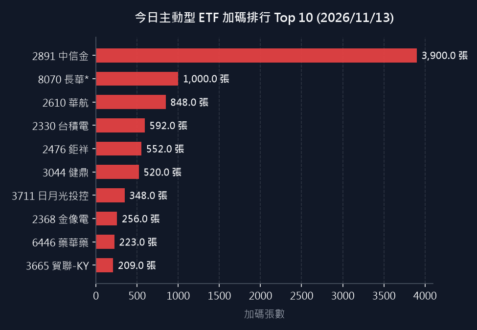
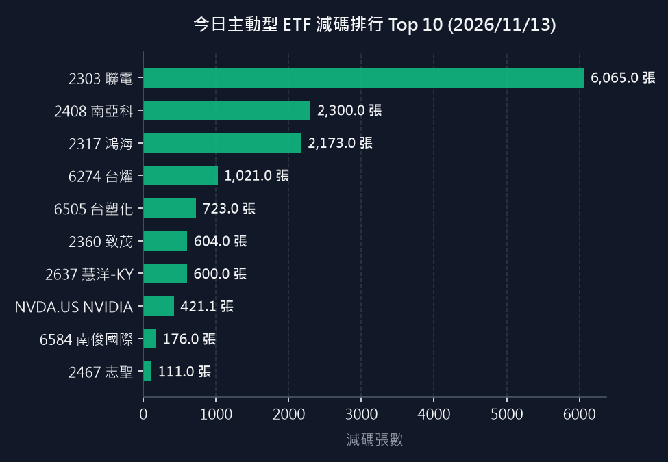

# 主動型 ETF 持股變動

資料來源：`主動型ETF持股明細.xlsx` 最近兩個日期分頁。

比較區間：`20261112` → `20261113`

## 今日加減碼視覺化排行

| 今日加碼 Top 10 | 今日減碼 Top 10 |
| :---: | :---: |
|  |  |

| ETF | 新增 | 刪除 | 比例變動 |
| :-- | --: | --: | --: |
| 00400A | 0 | 2 | 43 |
| 00401A | 0 | 0 | 52 |
| 00402A | 0 | 0 | 40 |
| 00403A | 0 | 0 | 33 |
| 00404A | 4 | 3 | 43 |
| 00405A | 0 | 0 | 27 |
| 00406A | 2 | 2 | 43 |
| 00407A | 0 | 0 | 41 |
| 00408A | 1 | 2 | 37 |
| 00980A | 0 | 0 | 47 |
| 00980D | 0 | 0 | 45 |
| 00981A | 1 | 1 | 26 |
| 00982A | 0 | 0 | 46 |
| 00983A | 0 | 0 | 31 |
| 00983D | 0 | 0 | 76 |
| 00984A | 0 | 0 | 58 |
| 00985A | 0 | 0 | 41 |
| 00986A | 0 | 0 | 25 |
| 00987A | 0 | 0 | 25 |
| 00988A | 0 | 1 | 28 |
| 00989A | 0 | 0 | 52 |
| 00990A | 0 | 1 | 33 |
| 00991A | 0 | 0 | 26 |
| 00992A | 0 | 0 | 37 |
| 00993A | 1 | 1 | 37 |
| 00994A | 1 | 1 | 28 |
| 00995A | 1 | 0 | 42 |
| 00996A | 0 | 0 | 34 |
| 00997A | 0 | 0 | 44 |
| 00998A | 0 | 1 | 48 |
| 00999A | 0 | 0 | 44 |

## 00400A

### 新增持股

- 無

### 刪除持股

- 2317 鴻海（1.66%，2173 張）
- 6505 台塑化（0.21%，723 張）

### 投資比例變動

- 1303 南亞：4.12% → 3.58%（-0.54）
- 1476 儒鴻：0.08% → 0.09%（+0.01）
- 2059 川湖：4.52% → 4.15%（-0.37）
- 2303 聯電：1.38% → 1.36%（-0.02）
- 2308 台達電：1.94% → 1.89%（-0.05）
- 2313 華通：0.67% → 0.73%（+0.06）
- 2327 國巨*：0.95% → 0.93%（-0.02）
- 2330 台積電：9.02% → 8.99%（-0.03）
- 2345 智邦：1.25% → 1.23%（-0.02）
- 2360 致茂：2.03% → 2.11%（+0.08）
- 2383 台光電：5.13% → 5.79%（+0.66）
- 2449 京元電子：0.73% → 0.68%（-0.05）
- 2454 聯發科：6.92% → 7.26%（+0.34）
- 2603 長榮：2.39% → 2.43%（+0.04）
- 2637 慧洋-KY：0.27% → 0.09%（-0.18）
- 2891 中信金：1.54% → 1.65%（+0.11）
- 3008 大立光：1.28% → 1.29%（+0.01）
- 3017 奇鋐：4.15% → 5.19%（+1.04）
- 3036 文曄：1.35% → 1.32%（-0.03）
- 3037 欣興：2.92% → 2.69%（-0.23）
- 3044 健鼎：3.09% → 4.10%（+1.01）
- 3081 聯亞：0.78% → 0.75%（-0.03）
- 3167 大量：0.32% → 0.30%（-0.02）
- 3293 鈊象：0.33% → 0.34%（+0.01）
- 3406 玉晶光：1.08% → 1.09%（+0.01）
- 3443 創意：3.39% → 3.76%（+0.37）
- 3529 力旺：1.03% → 1.08%（+0.05）
- 3653 健策：3.99% → 3.48%（-0.51）
- 3661 世芯-KY：2.21% → 2.48%（+0.27）
- 3665 貿聯-KY：1.14% → 1.11%（-0.03）
- 3711 日月光投控：0.90% → 0.89%（-0.01）
- 4958 臻鼎-KY：0.37% → 0.36%（-0.01）
- 5274 信驊：3.03% → 2.94%（-0.09）
- 6147 頎邦：0.70% → 0.71%（+0.01）
- 6187 萬潤：0.80% → 0.76%（-0.04）
- 6223 旺矽：2.94% → 3.12%（+0.18）
- 6271 同欣電：0.23% → 0.24%（+0.01）
- 6274 台燿：0.93% → 0.87%（-0.06）
- 6278 台表科：2.54% → 2.50%（-0.04）
- 6488 環球晶：1.26% → 1.27%（+0.01）
- 7750 新代：0.36% → 0.35%（-0.01）
- 7769 鴻勁：0.82% → 0.79%（-0.03）
- ＸＡＧＸ金兌(3533.HK)：1.36% → 1.81%（+0.45）

## 00401A

### 新增持股

- 無

### 刪除持股

- 無

### 投資比例變動

- 1303 南亞：1.14% → 1.17%（+0.03）
- 1476 儒鴻：1.93% → 2.00%（+0.07）
- 1477 聚陽：0.92% → 0.96%（+0.04）
- 2059 川湖：1.83% → 1.75%（-0.08）
- 2303 聯電：2.36% → 2.35%（-0.01）
- 2308 台達電：1.62% → 1.61%（-0.01）
- 2313 華通：1.16% → 1.20%（+0.04）
- 2330 台積電：21.15% → 21.06%（-0.09）
- 2357 華碩：1.63% → 1.60%（-0.03）
- 2360 致茂：1.58% → 1.55%（-0.03）
- 2379 瑞昱：1.01% → 1.03%（+0.02）
- 2382 廣達：1.73% → 1.70%（-0.03）
- 2383 台光電：0.79% → 0.81%（+0.02）
- 2454 聯發科：5.19% → 5.50%（+0.31）
- 2455 全新：1.54% → 1.59%（+0.05）
- 2603 長榮：2.04% → 2.07%（+0.03）
- 2881 富邦金：2.02% → 2.03%（+0.01）
- 2882 國泰金：1.00% → 1.02%（+0.02）
- 2883 凱基金：1.47% → 1.50%（+0.03）
- 2884 玉山金：1.76% → 1.78%（+0.02）
- 2886 兆豐金：1.39% → 1.41%（+0.02）
- 2887 台新新光金：0.98% → 1.00%（+0.02）
- 2891 中信金：2.32% → 2.40%（+0.08）
- 3008 大立光：1.79% → 1.87%（+0.08）
- 3037 欣興：0.52% → 0.51%（-0.01）
- 3131 弘塑：0.48% → 0.49%（+0.01）
- 3443 創意：2.31% → 2.50%（+0.19）
- 3491 昇達科：1.60% → 1.56%（-0.04）
- 3653 健策：0.82% → 0.78%（-0.04）
- 3711 日月光投控：3.91% → 3.96%（+0.05）
- 4904 遠傳：0.73% → 0.74%（+0.01）
- 4938 和碩：0.29% → 0.28%（-0.01）
- 4958 臻鼎-KY：1.05% → 1.07%（+0.02）
- 5274 信驊：1.20% → 1.19%（-0.01）
- 5347 世界：0.98% → 0.99%（+0.01）
- 5871 中租-KY：0.12% → 0.13%（+0.01）
- 5904 寶雅*：0.54% → 0.55%（+0.01）
- 6147 頎邦：1.04% → 1.05%（+0.01）
- 6187 萬潤：1.42% → 1.41%（-0.01）
- 6285 啟碁：1.02% → 1.05%（+0.03）
- 6515 穎崴：0.70% → 0.72%（+0.02）
- 6531 愛普*：1.14% → 1.20%（+0.06）
- 6669 緯穎：1.33% → 1.37%（+0.04）
- 7769 鴻勁：0.60% → 0.59%（-0.01）
- 7828 創新服務：1.30% → 1.24%（-0.06）
- 7856 漢測：0.79% → 0.73%（-0.06）
- 8464 億豐：0.90% → 0.91%（+0.01）
- TAIWAN TAIE C 16DEC26 40000 TWSE：-0.10% → -0.11%（-0.01）
- TAIWAN TAIE C 18NOV26 40000 TWSE：-0.04% → -0.05%（-0.01）
- 台股期貨11/26(FITXN*1.TF)：-0.54% → -0.41%（+0.13）
- 臺指選擇權11/26 43300 買權：-0.03% → -0.04%（-0.01）
- 臺指選擇權11/26 46500 買權：-0.02% → -0.01%（+0.01）

## 00402A

### 新增持股

- 無

### 刪除持股

- 無

### 投資比例變動

- AAPL.US Apple：9.06% → 9.04%（-0.02）
- AMD.US AMD：6.41% → 6.80%（+0.39）
- AMZN.US Amazon：5.04% → 5.08%（+0.04）
- ANET.US Arista Networks：0.92% → 0.97%（+0.05）
- ARM.US Arm：0.79% → 0.77%（-0.02）
- ASML.US ASML Holding：1.19% → 1.16%（-0.03）
- AVGO.US Broadcom：2.42% → 2.56%（+0.14）
- AXON.US Axon Enterprise：0.49% → 0.48%（-0.01）
- BABA.US Alibaba Group：0.50% → 0.47%（-0.03）
- CDNS.US Cadence Design Systems：1.65% → 1.68%（+0.03）
- CIEN.US Ciena：1.05% → 1.04%（-0.01）
- CLS.US Celestica：1.06% → 1.12%（+0.06）
- COHR.US Coherent：1.24% → 1.23%（-0.01）
- CRWD.US CrowdStrike Holdings：1.78% → 1.80%（+0.02）
- GOOG.US Alphabet - Class C Capital Stock：3.20% → 3.26%（+0.06）
- GOOGL.US Alphabet - Class A Common Stock：3.21% → 3.28%（+0.07）
- INTC.US Intel：1.05% → 1.04%（-0.01）
- IOT.US Samsara：0.61% → 0.60%（-0.01）
- KLAC.US KLA：1.45% → 1.42%（-0.03）
- LITE.US Lumentum：1.42% → 1.37%（-0.05）
- LRCX.US Lam Research：2.22% → 2.20%（-0.02）
- META.US Meta：3.68% → 3.66%（-0.02）
- MRVL.US Marvell：1.26% → 1.23%（-0.03）
- MSFT.US Microsoft：5.84% → 5.88%（+0.04）
- MU.US Micron：5.49% → 5.41%（-0.08）
- NFLX.US Netflix：1.00% → 0.98%（-0.02）
- NOW.US ServiceNow：0.88% → 0.86%（-0.02）
- NVDA.US NVIDIA：7.57% → 6.44%（-1.13）
- PANW.US Palo Alto：2.84% → 2.75%（-0.09）
- SHOP.US Shopify：1.16% → 1.29%（+0.13）
- SIMO.US Silicon Motion：0.45% → 0.44%（-0.01）
- SKHY.US SK hynix：0.84% → 0.82%（-0.02）
- SNOW.US Snowflake：1.34% → 1.33%（-0.01）
- SPCX.US SpaceX：0.76% → 0.77%（+0.01）
- SPOT.US Spotify：0.47% → 0.46%（-0.01）
- TSM.US TSMC(ADR)：1.60% → 1.57%（-0.03）
- TTWO.US Take-Two：0.73% → 1.30%（+0.57）
- TXN.US Texas Instruments：2.91% → 2.95%（+0.04）
- UBER.US Uber：0.35% → 0.34%（-0.01）
- V.US Visa：1.42% → 1.55%（+0.13）

## 00403A

### 新增持股

- 無

### 刪除持股

- 無

### 投資比例變動

- 1303 南亞：3.53% → 3.59%（+0.06）
- 1560 中砂：0.46% → 0.47%（+0.01）
- 1717 長興：0.05% → 0.04%（-0.01）
- 2059 川湖：0.67% → 0.64%（-0.03）
- 2308 台達電：2.22% → 2.18%（-0.04）
- 2313 華通：0.32% → 0.33%（+0.01）
- 2317 鴻海：0.63% → 0.62%（-0.01）
- 2327 國巨*：2.96% → 2.92%（-0.04）
- 2330 台積電：15.93% → 15.68%（-0.25）
- 2345 智邦：1.59% → 1.55%（-0.04）
- 2368 金像電：0.83% → 0.86%（+0.03）
- 2383 台光電：4.07% → 4.09%（+0.02）
- 2408 南亞科：0.88% → 0.85%（-0.03）
- 2449 京元電子：0.71% → 0.69%（-0.02）
- 2454 聯發科：5.97% → 6.36%（+0.39）
- 3008 大立光：1.56% → 1.61%（+0.05）
- 3017 奇鋐：5.73% → 6.27%（+0.54）
- 3037 欣興：4.71% → 4.57%（-0.14）
- 3044 健鼎：0.20% → 0.19%（-0.01）
- 3189 景碩：2.45% → 2.40%（-0.05）
- 3443 創意：4.86% → 5.43%（+0.57）
- 3653 健策：4.76% → 4.45%（-0.31）
- 3665 貿聯-KY：1.83% → 1.79%（-0.04）
- 3711 日月光投控：1.22% → 1.38%（+0.16）
- 5274 信驊：1.78% → 1.75%（-0.03）
- 6223 旺矽：3.57% → 3.51%（-0.06）
- 6274 台燿：1.26% → 0.71%（-0.55）
- 6442 光聖：0.23% → 0.24%（+0.01）
- 6515 穎崴：0.10% → 0.30%（+0.20）
- 6669 緯穎：2.48% → 2.53%（+0.05）
- 6805 富世達：0.60% → 0.59%（-0.01）
- 8046 南電：2.41% → 2.38%（-0.03）
- 8996 高力：2.21% → 2.19%（-0.02）

## 00404A

### 新增持股

- 台指選擇權01/27 47500 買權（-0.03%，-0.025 張）
- 台指選擇權12/26 46500 買權（-0.45%，-0.483 張）
- 台股期貨11/26(FITXN*1.TF)（10.73%，0.046 張）
- 台股期貨12/26(FITXN*1.TF)（8.64%，0.037 張）

### 刪除持股

- 台指選擇權11/26 48000 買權（-0.01%，-0.488 張）
- 台指選擇權12/26 49000 買權（-0.01%，-0.025 張）
- 台股期貨11/26（19.51%，0.084 張）

### 投資比例變動

- 1303 南亞：0.77% → 0.75%（-0.02）
- 2006 東和鋼鐵：1.10% → 1.25%（+0.15）
- 2301 光寶科：0.52% → 0.50%（-0.02）
- 2303 聯電：1.21% → 1.20%（-0.01）
- 2317 鴻海：0.45% → 0.46%（+0.01）
- 2330 台積電：22.24% → 22.06%（-0.18）
- 2347 聯強：1.53% → 1.48%（-0.05）
- 2357 華碩：1.19% → 1.17%（-0.02）
- 2360 致茂：0.47% → 0.48%（+0.01）
- 2377 微星：0.40% → 0.39%（-0.01）
- 2379 瑞昱：2.03% → 2.04%（+0.01）
- 2382 廣達：0.43% → 0.40%（-0.03）
- 2383 台光電：2.60% → 2.47%（-0.13）
- 2454 聯發科：6.98% → 7.29%（+0.31）
- 2603 長榮：1.31% → 1.33%（+0.02）
- 2637 慧洋-KY：1.03% → 1.05%（+0.02）
- 2851 中再保：1.01% → 1.07%（+0.06）
- 2882 國泰金：3.16% → 3.23%（+0.07）
- 2885 元大金：3.08% → 3.18%（+0.10）
- 2887 台新新光金：1.75% → 1.78%（+0.03）
- 2890 永豐金：1.10% → 1.14%（+0.04）
- 3014 聯陽：1.16% → 1.15%（-0.01）
- 3017 奇鋐：1.28% → 1.29%（+0.01）
- 3034 聯詠：2.04% → 2.03%（-0.01）
- 3036 文曄：1.05% → 1.02%（-0.03）
- 3037 欣興：0.34% → 0.31%（-0.03）
- 3264 欣銓：0.44% → 0.43%（-0.01）
- 3293 鈊象：1.77% → 1.85%（+0.08）
- 3374 精材：0.12% → 0.14%（+0.02）
- 3443 創意：1.87% → 2.06%（+0.19）
- 3653 健策：0.98% → 0.85%（-0.13）
- 3711 日月光投控：3.38% → 3.31%（-0.07）
- 5274 信驊：2.13% → 2.06%（-0.07）
- 5434 崇越：1.79% → 1.78%（-0.01）
- 6196 帆宣：1.79% → 1.69%（-0.10）
- 6223 旺矽：0.77% → 0.81%（+0.04）
- 6491 晶碩：0.89% → 0.90%（+0.01）
- 6505 台塑化：0.45% → 0.46%（+0.01）
- 6669 緯穎：0.97% → 0.96%（-0.01）
- 6691 洋基工程：1.33% → 1.30%（-0.03）
- 7769 鴻勁：1.14% → 1.09%（-0.05）
- 8016 矽創：1.62% → 1.75%（+0.13）
- 8299 群聯：1.14% → 1.09%（-0.05）

## 00405A

### 新增持股

- 無

### 刪除持股

- 無

### 投資比例變動

- 2059 川湖：2.03% → 1.94%（-0.09）
- 2308 台達電：0.58% → 0.57%（-0.01）
- 2330 台積電：5.70% → 5.65%（-0.05）
- 2345 智邦：4.63% → 4.55%（-0.08）
- 2368 金像電：5.48% → 5.71%（+0.23）
- 2383 台光電：4.34% → 4.40%（+0.06）
- 2395 研華：0.02% → 0.01%（-0.01）
- 2449 京元電子：0.05% → 0.04%（-0.01）
- 2454 聯發科：6.72% → 7.09%（+0.37）
- 3017 奇鋐：1.77% → 1.91%（+0.14）
- 3037 欣興：4.07% → 3.98%（-0.09）
- 3189 景碩：0.17% → 0.16%（-0.01）
- 3443 創意：2.86% → 3.09%（+0.23）
- 3653 健策：7.26% → 6.84%（-0.42）
- 3665 貿聯-KY：5.02% → 4.97%（-0.05）
- 3711 日月光投控：1.47% → 1.48%（+0.01）
- 5274 信驊：5.44% → 5.39%（-0.05）
- 6187 萬潤：0.70% → 0.69%（-0.01）
- 6223 旺矽：7.49% → 7.42%（-0.07）
- 6274 台燿：1.46% → 1.47%（+0.01）
- 6285 啟碁：0.09% → 0.10%（+0.01）
- 6515 穎崴：0.46% → 0.47%（+0.01）
- 6531 愛普*：3.48% → 3.63%（+0.15）
- 6669 緯穎：0.78% → 0.80%（+0.02）
- 6805 富世達：1.69% → 1.66%（-0.03）
- 7769 鴻勁：2.46% → 2.41%（-0.05）
- 8046 南電：6.29% → 6.24%（-0.05）

## 00406A

### 新增持股

- 臺指選擇權（-9.47%，-12 張）
- 臺指選擇權第三週週五到期契約（-6.16%，-6.884 張）

### 刪除持股

- 2360 致茂（0.58%，626 張）
- 臺指選擇權第二週週五到期契約（-8.96%，-7.947 張）

### 投資比例變動

- 1303 南亞：2.49% → 2.51%（+0.02）
- 1326 台化：0.51% → 0.52%（+0.01）
- 1815 富喬：0.63% → 0.64%（+0.01）
- 2059 川湖：1.73% → 1.63%（-0.10）
- 2303 聯電：1.23% → 1.20%（-0.03）
- 2308 台達電：1.61% → 1.57%（-0.04）
- 2327 國巨*：1.30% → 1.27%（-0.03）
- 2330 台積電：9.58% → 9.39%（-0.19）
- 2345 智邦：2.00% → 1.94%（-0.06）
- 2368 金像電：2.40% → 2.47%（+0.07）
- 2449 京元電子：0.34% → 0.33%（-0.01）
- 2454 聯發科：6.19% → 6.45%（+0.26）
- 2881 富邦金：0.65% → 0.64%（-0.01）
- 2885 元大金：0.69% → 0.68%（-0.01）
- 3008 大立光：0.98% → 1.00%（+0.02）
- 3017 奇鋐：5.48% → 5.85%（+0.37）
- 3037 欣興：5.15% → 4.97%（-0.18）
- 3081 聯亞：1.13% → 1.11%（-0.02）
- 3105 穩懋：0.55% → 0.59%（+0.04）
- 3167 大量：0.55% → 0.50%（-0.05）
- 3189 景碩：1.45% → 1.41%（-0.04）
- 3443 創意：2.30% → 2.45%（+0.15）
- 3491 昇達科：0.32% → 0.30%（-0.02）
- 3653 健策：4.71% → 4.37%（-0.34）
- 3661 世芯-KY：0.77% → 0.82%（+0.05）
- 3665 貿聯-KY：1.02% → 1.00%（-0.02）
- 3711 日月光投控：2.14% → 2.12%（-0.02）
- 4938 和碩：0.42% → 0.40%（-0.02）
- 5274 信驊：1.22% → 1.19%（-0.03）
- 6147 頎邦：0.63% → 0.62%（-0.01）
- 6223 旺矽：3.22% → 3.15%（-0.07）
- 6274 台燿：1.72% → 1.70%（-0.02）
- 6278 台表科：0.22% → 0.21%（-0.01）
- 6446 藥華藥：0.61% → 0.80%（+0.19）
- 6510 精測：0.58% → 0.59%（+0.01）
- 6669 緯穎：0.90% → 0.91%（+0.01）
- 6715 嘉基：0.85% → 0.80%（-0.05）
- 6805 富世達：0.96% → 0.93%（-0.03）
- 8046 南電：3.03% → 2.97%（-0.06）
- 8150 南茂：0.03% → 0.02%（-0.01）
- 8996 高力：0.70% → 0.69%（-0.01）
- 臺股期貨 202611(FITXN*1.TF)：21.22% → 21.01%（-0.21）
- 臺股期貨 202612(FITXN*1.TF)：2.27% → 2.25%（-0.02）

## 00407A

### 新增持股

- 無

### 刪除持股

- 無

### 投資比例變動

- 1303 南亞：3.58% → 3.64%（+0.06）
- 1560 中砂：0.87% → 0.88%（+0.01）
- 2059 川湖：1.67% → 0.81%（-0.86）
- 2301 光寶科：1.36% → 1.35%（-0.01）
- 2308 台達電：2.05% → 2.01%（-0.04）
- 2313 華通：0.40% → 0.41%（+0.01）
- 2327 國巨*：1.87% → 1.85%（-0.02）
- 2330 台積電：11.25% → 11.05%（-0.20）
- 2344 華邦電：0.12% → 0.11%（-0.01）
- 2345 智邦：1.41% → 1.38%（-0.03）
- 2360 致茂：0.77% → 0.74%（-0.03）
- 2368 金像電：1.97% → 2.03%（+0.06）
- 2383 台光電：5.73% → 5.75%（+0.02）
- 2408 南亞科：1.37% → 1.34%（-0.03）
- 2451 創見：0.30% → 0.29%（-0.01）
- 2454 聯發科：6.18% → 6.47%（+0.29）
- 2615 萬海：1.02% → 1.00%（-0.02）
- 3008 大立光：1.34% → 1.38%（+0.04）
- 3017 奇鋐：5.33% → 5.71%（+0.38）
- 3037 欣興：5.02% → 4.87%（-0.15）
- 3081 聯亞：1.65% → 1.62%（-0.03）
- 3231 緯創：1.04% → 1.03%（-0.01）
- 3293 鈊象：0.67% → 0.68%（+0.01）
- 3406 玉晶光：1.01% → 0.99%（-0.02）
- 3443 創意：5.15% → 5.52%（+0.37）
- 3491 昇達科：1.00% → 0.97%（-0.03）
- 3533 嘉澤：0.93% → 1.00%（+0.07）
- 3653 健策：3.34% → 3.11%（-0.23）
- 3665 貿聯-KY：2.80% → 2.75%（-0.05）
- 3711 日月光投控：3.33% → 3.32%（-0.01）
- 5274 信驊：1.43% → 1.40%（-0.03）
- 6187 萬潤：1.24% → 1.22%（-0.02）
- 6223 旺矽：2.24% → 2.88%（+0.64）
- 6274 台燿：1.52% → 1.51%（-0.01）
- 6510 精測：1.55% → 1.58%（+0.03）
- 6531 愛普*：0.27% → 0.28%（+0.01）
- 6669 緯穎：1.37% → 1.40%（+0.03）
- 6805 富世達：1.14% → 1.11%（-0.03）
- 8046 南電：3.03% → 2.98%（-0.05）
- 8299 群聯：0.29% → 0.28%（-0.01）
- 8996 高力：1.62% → 1.60%（-0.02）

## 00408A

### 新增持股

- 3167 大量（0.44%，7 張）

### 刪除持股

- 6223 旺矽（2.12%，5.79 張）
- 6274 台燿（1.20%，16 張）

### 投資比例變動

- 1303 南亞：4.55% → 4.63%（+0.08）
- 1560 中砂：1.27% → 1.28%（+0.01）
- 2059 川湖：0.90% → 0.85%（-0.05）
- 2327 國巨*：0.67% → 0.66%（-0.01）
- 2330 台積電：7.80% → 7.69%（-0.11）
- 2344 華邦電：0.40% → 0.38%（-0.02）
- 2345 智邦：0.60% → 0.58%（-0.02）
- 2368 金像電：5.51% → 5.70%（+0.19）
- 2383 台光電：4.35% → 4.38%（+0.03）
- 2395 研華：1.61% → 1.59%（-0.02）
- 2408 南亞科：1.22% → 1.19%（-0.03）
- 2449 京元電子：0.79% → 0.77%（-0.02）
- 2454 聯發科：5.14% → 5.39%（+0.25）
- 2542 興富發：4.02% → 3.99%（-0.03）
- 2603 長榮：1.44% → 1.45%（+0.01）
- 2880 華南金：1.35% → 1.36%（+0.01）
- 2891 中信金：2.31% → 2.36%（+0.05）
- 3017 奇鋐：3.68% → 3.95%（+0.27）
- 3026 禾伸堂：1.35% → 1.34%（-0.01）
- 3037 欣興：3.29% → 3.20%（-0.09）
- 3044 健鼎：1.30% → 1.27%（-0.03）
- 3105 穩懋：0.65% → 0.70%（+0.05）
- 3189 景碩：2.57% → 2.52%（-0.05）
- 3231 緯創：1.48% → 1.46%（-0.02）
- 3443 創意：1.85% → 1.99%（+0.14）
- 3653 健策：4.31% → 4.03%（-0.28）
- 3661 世芯-KY：1.73% → 1.86%（+0.13）
- 4904 遠傳：1.02% → 1.01%（-0.01）
- 5434 崇越：2.30% → 2.28%（-0.02）
- 6510 精測：1.25% → 2.05%（+0.80）
- 6526 達發：0.32% → 0.35%（+0.03）
- 6669 緯穎：1.20% → 1.23%（+0.03）
- 6805 富世達：2.80% → 2.73%（-0.07）
- 8021 尖點：0.61% → 0.59%（-0.02）
- 8046 南電：1.53% → 1.50%（-0.03）
- 8996 高力：3.13% → 3.10%（-0.03）
- 9802 鈺齊-KY：0.92% → 0.91%（-0.01）

## 00980A

### 新增持股

- 無

### 刪除持股

- 無

### 投資比例變動

- 1303 南亞：3.79% → 3.87%（+0.08）
- 2059 川湖：3.94% → 3.74%（-0.20）
- 2303 聯電：1.32% → 1.31%（-0.01）
- 2308 台達電：2.88% → 2.83%（-0.05）
- 2317 鴻海：3.59% → 3.55%（-0.04）
- 2327 國巨*：0.75% → 0.74%（-0.01）
- 2330 台積電：10.11% → 10.01%（-0.10）
- 2344 華邦電：1.51% → 1.45%（-0.06）
- 2345 智邦：0.88% → 0.86%（-0.02）
- 2360 致茂：0.90% → 0.87%（-0.03）
- 2368 金像電：1.89% → 1.96%（+0.07）
- 2376 技嘉：1.55% → 1.50%（-0.05）
- 2382 廣達：1.87% → 1.83%（-0.04）
- 2383 台光電：3.60% → 3.65%（+0.05）
- 2408 南亞科：2.24% → 2.19%（-0.05）
- 2454 聯發科：5.86% → 6.17%（+0.31）
- 2884 玉山金：1.40% → 1.41%（+0.01）
- 2891 中信金：1.80% → 1.85%（+0.05）
- 3008 大立光：2.00% → 2.07%（+0.07）
- 3017 奇鋐：2.26% → 2.44%（+0.18）
- 3036 文曄：0.95% → 0.96%（+0.01）
- 3037 欣興：2.84% → 2.77%（-0.07）
- 3044 健鼎：1.47% → 1.44%（-0.03）
- 3081 聯亞：1.44% → 1.43%（-0.01）
- 3189 景碩：1.02% → 1.00%（-0.02）
- 3231 緯創：1.72% → 1.70%（-0.02）
- 3264 欣銓：0.69% → 0.71%（+0.02）
- 3293 鈊象：0.48% → 0.50%（+0.02）
- 3443 創意：2.17% → 2.34%（+0.17）
- 3529 力旺：0.15% → 0.16%（+0.01）
- 3653 健策：3.09% → 2.90%（-0.19）
- 3665 貿聯-KY：1.32% → 1.31%（-0.01）
- 3711 日月光投控：2.22% → 2.23%（+0.01）
- 5274 信驊：1.46% → 1.45%（-0.01）
- 5904 寶雅*：0.73% → 0.74%（+0.01）
- 6223 旺矽：1.31% → 1.29%（-0.02）
- 6442 光聖：0.24% → 0.25%（+0.01）
- 6515 穎崴：1.39% → 1.42%（+0.03）
- 6669 緯穎：1.78% → 1.82%（+0.04）
- 6805 富世達：0.61% → 0.60%（-0.01）
- 6831 邁科：0.23% → 0.24%（+0.01）
- 7751 竑騰：0.61% → 0.59%（-0.02）
- 7769 鴻勁：1.77% → 1.73%（-0.04）
- 8046 南電：1.40% → 1.39%（-0.01）
- 8210 勤誠：0.33% → 0.32%（-0.01）
- 8299 群聯：1.04% → 1.03%（-0.01）
- 台灣證交所加權股價指數(FITXN*1.TF)：4.95% → 4.96%（+0.01）

## 00980D

### 新增持股

- 無

### 刪除持股

- 無

### 投資比例變動

- ALLY FINANCIAL INC (REG) 8% 01/11/2031：0.60% → 0.61%（+0.01）
- ALLY FINANCIAL INC (REG) VAR 03JAN2030：0.66% → 0.67%（+0.01）
- AMC GLOBAL MEDIA INC SER REGS (REG) (REG S) 10.5% 15JUL2032：0.71% → 0.72%（+0.01）
- ANHEUSER-BUSCH INBEV WOR (REG) 8.2% 15JAN2039：0.55% → 0.54%（-0.01）
- APOLLO DEBT SOLUTIONS BD 6.700000 % 29JUL2031：0.35% → 0.36%（+0.01）
- ASURION LLC/ASURION CO 8.375% 01FEB2034：0.46% → 0.45%（-0.01）
- BLUE OWL CREDIT INCOME (REG) 6.65% 15MAR2031：0.55% → 0.56%（+0.01）
- BLUE OWL CREDIT INCOME 7.750000 % 15JAN2029：0.56% → 0.57%（+0.01）
- BLUE OWL CREDIT INCOME SER WI (REG) 7.75% 16SEP2027：0.58% → 0.59%（+0.01）
- CALDERYS FINANCING LLC SER REGS (REG S) 11.25% 01JUN2028：0.35% → 0.36%（+0.01）
- CHC GROUP LLC SER REGS 11.750000 % 01-SEP-2030：0.45% → 0.43%（-0.02）
- CHS/COMMUNITY HEALTH SYS SER REGS 9.750000 % 15JAN2034：0.46% → 0.47%（+0.01）
- CIVITAS RESOURCES INC SER REGS (REG) (REG S) 9.625% 15JUN2033：0.58% → 0.59%（+0.01）
- COREWEAVE INC SER REGS (REG S) 9.25% 01JUN2030：0.41% → 0.42%（+0.01）
- COREWEAVE INC SER REGS (REG S) 9.75% 01OCT2031：0.48% → 0.50%（+0.02）
- COREWEAVE INC SER REGS (REG) (REG S) 9.625% 15JUL2032：0.48% → 0.50%（+0.02）
- COREWEAVE INC SER REGS 9.000000 % 01FEB2031：0.23% → 0.24%（+0.01）
- DELL INT LLC / EMC CORP (REG) 8.35% 15JUL2046：0.57% → 0.56%（-0.01）
- FMC CORP (REG) 6.375000 % 18MAY2053：0.34% → 0.31%（-0.03）
- GLOBAL AUTO HO/AAG FH UK SER REGS (REG S) 11.5% 15AUG2029：0.39% → 0.38%（-0.01）
- GLOBAL AUTO HO/AAG FH UK SER REGS (REG S) 8.75% 15JAN2032：0.43% → 0.42%（-0.01）
- HPS CORPORATE LENDING FU 6.750000 % 30JAN2029：0.56% → 0.57%（+0.01）
- ICAHN ENTERPRISES/FIN (REG) 9.75% 15JAN2029：0.31% → 0.30%（-0.01）
- JBS USA HOLD/FOOD/LUX CO 7.250000 % 15NOV2053：0.49% → 0.48%（-0.01）
- JETBLUE AIRWAYS/LOYALTY SER REGS (REG S) 9.875% 20SEP2031：0.39% → 0.37%（-0.02）
- KONINKLIJKE KPN NV (REG) 8.375% 01OCT2030：0.45% → 0.46%（+0.01）
- LADDER CAP FIN LLLP/CORP SER REGS 7.000000 % 15JUL2031：0.34% → 0.35%（+0.01）
- META PLATFORMS INC 5.750000 % 15-NOV-2065：0.44% → 0.43%（-0.01）
- MOHEGAN TRIBAL / MS DIG SER REGS 11.875000 % 15APR2031：0.71% → 0.72%（+0.01）
- NAVIENT CORP (REG) 11.5% 15MAR2031：0.41% → 0.40%（-0.01）
- ONEOK INC 6.625% 01SEP2053：0.62% → 0.61%（-0.01）
- PHOTO HOLDINGS LLC SER REGS (REG) (REG S) 12% 01JUL2031：0.48% → 0.47%（-0.01）
- RR DONNELLEY & SONS CO SER REGS (REG S) 9.5% 01AUG2029：0.44% → 0.45%（+0.01）
- SABRE GLBL INC SER REGS 11.125000 % 15JUL2030：0.50% → 0.51%（+0.01）
- SANTANDER HOLDINGS USA VAR 12JUN2029：0.61% → 0.62%（+0.01）
- SANTANDER UK GROUP HLDGS (REG) VAR 10JAN2029：0.34% → 0.35%（+0.01）
- STAPLES INC SER REGS (REG S) 10.75% 01SEP2029：0.52% → 0.53%（+0.01）
- SYMETRA LIFE INSURANCE SER REGS 6.550000 % 01OCT2055：0.33% → 0.32%（-0.01）
- US 10YR NOTE (CBT)DEC26 21-DEC-2026：18.47% → 18.45%（-0.02）
- US 10YR ULTRA FUT DEC26 21-DEC-2026：-2.57% → -2.56%（+0.01）
- US 2YR NOTE (CBT) DEC26 31-DEC-2026：1.74% → 1.75%（+0.01）
- US 5YR NOTE (CBT) DEC26 31-DEC-2026：-15.86% → -15.87%（-0.01）
- US LONG BOND(CBT) DEC26 21-DEC-2026：5.67% → 5.63%（-0.04）
- US ULTRA BOND CBT DEC26 21-DEC-2026：-0.56% → -0.55%（+0.01）
- VIACOM INC (REG) 5.85% 01SEP2043：0.51% → 0.50%（-0.01）

## 00981A

### 新增持股

- 台指期貨 2026/12(FITXN*1.TF)（2.77%，0.867 張）

### 刪除持股

- 台指期貨 2026/11(FITXN*1.TF)（2.78%，0.867 張）

### 投資比例變動

- 1802 台玻：0.29% → 0.30%（+0.01）
- 2002 中鋼：0.04% → 0.03%（-0.01）
- 2303 聯電：2.80% → 2.53%（-0.27）
- 2308 台達電：3.49% → 3.42%（-0.07）
- 2327 國巨*：3.55% → 3.51%（-0.04）
- 2330 台積電：16.18% → 16.38%（+0.20）
- 2345 智邦：4.01% → 3.92%（-0.09）
- 2368 金像電：2.91% → 3.01%（+0.10）
- 2383 台光電：6.59% → 6.63%（+0.04）
- 2449 京元電子：0.62% → 0.60%（-0.02）
- 2454 聯發科：8.16% → 8.55%（+0.39）
- 2891 中信金：0.15% → 0.27%（+0.12）
- 3017 奇鋐：7.17% → 7.69%（+0.52）
- 3037 欣興：5.80% → 5.63%（-0.17）
- 3231 緯創：0.75% → 0.74%（-0.01）
- 3443 創意：2.96% → 3.18%（+0.22）
- 3653 健策：5.31% → 4.96%（-0.35）
- 3665 貿聯-KY：1.72% → 1.69%（-0.03）
- 5274 信驊：1.06% → 1.04%（-0.02）
- 6223 旺矽：4.59% → 4.51%（-0.08）
- 6271 同欣電：0.23% → 0.24%（+0.01）
- 6510 精測：0.56% → 0.57%（+0.01）
- 6669 緯穎：1.38% → 1.40%（+0.02）
- 6805 富世達：1.23% → 1.20%（-0.03）
- 8046 南電：3.24% → 3.19%（-0.05）
- 8996 高力：0.52% → 0.51%（-0.01）

## 00982A

### 新增持股

- 無

### 刪除持股

- 無

### 投資比例變動

- 2059 川湖：2.60% → 2.45%（-0.15）
- 2301 光寶科：1.70% → 1.68%（-0.02）
- 2303 聯電：1.23% → 1.20%（-0.03）
- 2330 台積電：8.40% → 8.04%（-0.36）
- 2360 致茂：3.20% → 3.07%（-0.13）
- 2376 技嘉：1.19% → 1.14%（-0.05）
- 2377 微星：0.38% → 0.36%（-0.02）
- 2383 台光電：3.00% → 3.01%（+0.01）
- 2395 研華：1.36% → 1.33%（-0.03）
- 2428 興勤：0.98% → 0.95%（-0.03）
- 2454 聯發科：8.22% → 8.38%（+0.16）
- 2455 全新：1.36% → 1.37%（+0.01）
- 2467 志聖：0.23% → 0.14%（-0.09）
- 2476 鉅祥：0.32% → 0.46%（+0.14）
- 2486 一詮：0.40% → 0.39%（-0.01）
- 2885 元大金：0.35% → 0.34%（-0.01）
- 3008 大立光：2.98% → 3.04%（+0.06）
- 3017 奇鋐：2.41% → 2.57%（+0.16）
- 3037 欣興：0.71% → 0.67%（-0.04）
- 3045 台灣大：0.83% → 0.80%（-0.03）
- 3090 日電貿：0.35% → 0.34%（-0.01）
- 3105 穩懋：8.14% → 8.53%（+0.39）
- 3231 緯創：1.90% → 1.86%（-0.04）
- 3265 台星科：1.22% → 1.25%（+0.03）
- 3491 昇達科：3.83% → 3.59%（-0.24）
- 3617 碩天：0.39% → 0.51%（+0.12）
- 3711 日月光投控：2.48% → 2.45%（-0.03）
- 4958 臻鼎-KY：3.03% → 2.95%（-0.08）
- 5274 信驊：1.33% → 1.30%（-0.03）
- 5483 中美晶：1.30% → 1.27%（-0.03）
- 5536 聖暉*：0.92% → 0.88%（-0.04）
- 6139 亞翔：5.29% → 5.26%（-0.03）
- 6213 聯茂：1.46% → 1.42%（-0.04）
- 6223 旺矽：3.12% → 2.99%（-0.13）
- 6239 力成：1.94% → 1.93%（-0.01）
- 6274 台燿：0.96% → 0.30%（-0.66）
- 6446 藥華藥：0.13% → 0.12%（-0.01）
- 6472 保瑞：0.94% → 0.90%（-0.04）
- 6488 環球晶：1.60% → 1.58%（-0.02）
- 6510 精測：1.07% → 1.06%（-0.01）
- 6531 愛普*：7.00% → 7.06%（+0.06）
- 6640 均華：0.20% → 0.19%（-0.01）
- 6669 緯穎：1.77% → 1.76%（-0.01）
- 6672 騰輝電子-KY：2.56% → 2.55%（-0.01）
- 8070 長華*：0.69% → 0.78%（+0.09）
- 8996 高力：1.21% → 1.17%（-0.04）

## 00983A

### 新增持股

- 無

### 刪除持股

- 無

### 投資比例變動

- AMD.US AMD：3.63% → 3.91%（+0.28）
- AMZN.US Amazon：4.37% → 4.47%（+0.10）
- AVGO.US Broadcom：1.18% → 1.27%（+0.09）
- BEAM.US Beam Therapeutics：2.66% → 2.52%（-0.14）
- BMNR.US BitMine：1.23% → 1.20%（-0.03）
- COIN.US Coinbase：2.66% → 2.59%（-0.07）
- CRCL.US Circle：3.37% → 3.27%（-0.10）
- CRSP.US CRISPR Therapeutics：3.68% → 3.49%（-0.19）
- GOOG.US Alphabet - Class C Capital Stock：2.80% → 2.89%（+0.09）
- GOOGL.US Alphabet - Class A Common Stock：1.59% → 1.65%（+0.06）
- HOOD.US Robinhood Markets：2.55% → 2.50%（-0.05）
- ILMN.US Illumina：1.51% → 1.52%（+0.01）
- LLY.US Eli Lilly：2.01% → 2.03%（+0.02）
- META.US Meta：3.29% → 3.32%（+0.03）
- MSFT.US Microsoft：1.83% → 2.05%（+0.22）
- NET.US Cloudflare：1.58% → 1.63%（+0.05）
- NTLA.US Intellia Therapeutics：1.86% → 1.75%（-0.11）
- NTRA.US Natera：1.43% → 1.47%（+0.04）
- NVDA.US NVIDIA：3.24% → 3.16%（-0.08）
- PLTR.US Palantir Technologies：3.16% → 3.20%（+0.04）
- RKLB.US Rocket Lab：1.63% → 1.61%（-0.02）
- RXRX.US Recursion Pharmaceuticals：1.16% → 1.10%（-0.06）
- SHOP.US Shopify：4.80% → 4.81%（+0.01）
- SOFI.US SoFi Technologies：0.18% → 0.17%（-0.01）
- SPCX.US SpaceX：7.72% → 8.13%（+0.41）
- TEM.US Tempus：6.85% → 6.03%（-0.82）
- TSLA.US Tesla：8.85% → 9.14%（+0.29）
- TWST.US Twist Bioscience：3.39% → 3.21%（-0.18）
- TXG.US 10x Genomics：3.05% → 2.95%（-0.10）
- WGS.US GeneDx：0.44% → 0.42%（-0.02）
- XYZ.US Block：2.17% → 2.12%（-0.05）

## 00983D

### 新增持股

- 無

### 刪除持股

- 無

### 投資比例變動

- ABIBB 8.2 01/15/39：1.93% → 1.69%（-0.24）
- ABXCN 7 1/2 09/15/38：0.59% → 0.60%（+0.01）
- AET 6 5/8 06/15/36：0.80% → 0.83%（+0.03）
- ALLY 8 11/01/31：1.31% → 1.36%（+0.05）
- AMCX 10 1/2 07/15/32：1.69% → 1.79%（+0.10）
- ATH 6 5/8 05/19/55：0.92% → 0.95%（+0.03）
- AWK 6.593 10/15/37：0.78% → 0.80%（+0.02）
- BACR 7.437 11/02/33：1.39% → 1.44%（+0.05）
- BATSLN 7.079 08/02/43：1.19% → 1.23%（+0.04）
- BATSLN 7.081 08/02/53：1.26% → 1.30%（+0.04）
- BHCCN 11 09/30/28：2.12% → 2.20%（+0.08）
- BNCN 7 3/8 03/01/33：1.21% → 1.25%（+0.04）
- BRITEL 9 5/8 12/15/30：1.48% → 1.53%（+0.05）
- BRKHEC 6 3/4 07/01/37：0.52% → 0.54%（+0.02）
- C 8 1/8 07/15/39：1.91% → 1.66%（-0.25）
- CEG 6 1/2 10/01/53：0.50% → 0.51%（+0.01）
- CMCSA 6.95 08/15/37：0.55% → 0.56%（+0.01）
- CP 7 1/8 10/15/31：0.90% → 0.93%（+0.03）
- CRWV 9 02/01/31：0.85% → 0.91%（+0.06）
- CYH 10 7/8 01/15/32：1.42% → 1.46%（+0.04）
- DELL 8.1 07/15/36：1.64% → 1.50%（-0.14）
- DELL 8.35 07/15/46：1.50% → 1.55%（+0.05）
- DIS 7 3/4 12/01/45：0.66% → 0.68%（+0.02）
- DOW 6.9 05/15/53：0.83% → 0.86%（+0.03）
- DOW 9.4 05/15/39：1.90% → 1.64%（-0.26）
- DT 9 1/4 06/01/32：1.65% → 1.49%（-0.16）
- DTV 8 7/8 02/01/30：1.78% → 1.84%（+0.06）
- DUK 7 3/4 03/01/31：1.71% → 1.57%（-0.14）
- ED 6 3/4 04/01/38：0.68% → 0.70%（+0.02）
- ENBCN 6.7 11/15/53：0.65% → 0.67%（+0.02）
- FFHCN 6.35 03/22/54：0.78% → 0.80%（+0.02）
- GE 6 3/4 03/15/32：0.64% → 0.66%（+0.02）
- GE 6 7/8 01/10/39：0.92% → 0.95%（+0.03）
- GM 6 3/4 04/01/46：0.81% → 0.83%（+0.02）
- GM 6.6 04/01/36：0.43% → 0.45%（+0.02）
- GS 6 1/4 02/01/41：0.35% → 0.36%（+0.01）
- GT 8 7/8 07/15/32：0.89% → 0.88%（-0.01）
- GTN 10 1/2 07/15/29：0.37% → 0.38%（+0.01）
- HAL 7.45 09/15/39：1.80% → 1.57%（-0.23）
- HPE 6.35 10/15/45：0.67% → 0.69%（+0.02）
- IEP 10 11/15/29：1.51% → 1.53%（+0.02）
- KHC 6 7/8 01/26/39：1.11% → 1.14%（+0.03）
- KMI 6.95 01/15/38：1.16% → 1.19%（+0.03）
- LOW 6.65 09/15/37：0.55% → 0.57%（+0.02）
- LQDW.US iShares LQD Premium Income+ ETF：7.36% → 7.64%（+0.28）
- MBGGR 8 1/2 01/18/31：1.44% → 1.49%（+0.05）
- MCD 6.3 03/01/38：0.44% → 0.45%（+0.01）
- MINAU 9 1/4 10/01/28：0.98% → 1.02%（+0.04）
- MOHEGN 11 7/8 04/15/31：1.50% → 1.56%（+0.06）
- MS 7 1/4 04/01/32：1.61% → 1.46%（-0.15）
- NTRCN 7 1/8 05/23/36：0.60% → 0.62%（+0.02）
- NVDA 5.55 06/15/46：1.24% → 1.27%（+0.03）
- OKE 6 5/8 09/01/53：0.78% → 0.80%（+0.02）
- ORCL 6 1/2 04/15/38：0.40% → 0.42%（+0.02）
- ORCL 6.9 11/09/52：0.23% → 0.24%（+0.01）
- OXY 6.6 03/15/46：0.82% → 0.84%（+0.02）
- PCG 6 3/4 01/15/53：0.90% → 0.93%（+0.03）
- PCG 6.7 04/01/53：1.04% → 1.07%（+0.03）
- PFE 7.2 03/15/39：0.98% → 1.01%（+0.03）
- RAKUTN 11 1/4 02/15/27：1.99% → 2.07%（+0.08）
- RIOLN 7 1/4 03/15/31：0.56% → 0.58%（+0.02）
- S 8 3/4 03/15/32：1.62% → 1.47%（-0.15）
- SPCX 6.6 07/15/46：1.20% → 1.23%（+0.03）
- SUCN 6.85 06/01/39：0.93% → 0.95%（+0.02）
- SVC 8 7/8 06/15/32：0.53% → 0.55%（+0.02）
- SYY 6.6 04/01/50：0.21% → 0.22%（+0.01）
- T 6.55 02/15/39：0.21% → 0.22%（+0.01）
- TELEFO 8 1/4 09/15/30：1.10% → 1.14%（+0.04）
- TELEFONICA EMISIONES SAU 7.045 06/20/36：1.50% → 1.55%（+0.05）
- TIME WARNER CABLE INC 7.300 07/01/38：0.53% → 0.55%（+0.02）
- TLTW.US iShares TLT Premium Income+ ETF：8.77% → 8.99%（+0.22）
- TRPCN 7 5/8 01/15/39：1.65% → 1.50%（-0.15）
- UNITEDHEALTH GROUP INC 6.875 02/15/38：0.95% → 0.98%（+0.03）
- VENLNG 9 1/2 02/01/29：1.56% → 1.62%（+0.06）
- VLO 6 5/8 06/15/37：0.81% → 0.83%（+0.02）
- VZ 7 3/4 12/01/30：1.26% → 1.30%（+0.04）

## 00984A

### 新增持股

- 無

### 刪除持股

- 無

### 投資比例變動

- 1216 統一：0.63% → 0.62%（-0.01）
- 1301 台塑：0.84% → 0.86%（+0.02）
- 1303 南亞：3.45% → 3.51%（+0.06）
- 1326 台化：2.47% → 2.55%（+0.08）
- 1560 中砂：1.79% → 1.82%（+0.03）
- 1605 華新：0.82% → 0.81%（-0.01）
- 2006 東和鋼鐵：0.63% → 0.61%（-0.02）
- 2027 大成鋼：0.87% → 0.77%（-0.10）
- 2059 川湖：2.50% → 2.37%（-0.13）
- 2313 華通：0.70% → 0.72%（+0.02）
- 2330 台積電：2.30% → 2.27%（-0.03）
- 2347 聯強：0.71% → 0.69%（-0.02）
- 2351 順德：0.72% → 0.71%（-0.01）
- 2357 華碩：0.87% → 0.84%（-0.03）
- 2377 微星：0.79% → 0.76%（-0.03）
- 2383 台光電：0.17% → 0.18%（+0.01）
- 2395 研華：2.23% → 2.20%（-0.03）
- 2408 南亞科：2.41% → 2.35%（-0.06）
- 2409 友達：0.88% → 0.90%（+0.02）
- 2454 聯發科：0.37% → 0.39%（+0.02）
- 2455 全新：1.10% → 1.12%（+0.02）
- 2464 盟立：0.85% → 0.86%（+0.01）
- 2466 冠西電：0.39% → 0.34%（-0.05）
- 2603 長榮：2.57% → 2.58%（+0.01）
- 2615 萬海：1.41% → 1.39%（-0.02）
- 2634 漢翔：0.62% → 0.61%（-0.01）
- 2881 富邦金：1.53% → 1.52%（-0.01）
- 2883 凱基金：0.63% → 0.64%（+0.01）
- 2887 台新新光金：1.37% → 1.38%（+0.01）
- 3006 晶豪科：0.75% → 0.76%（+0.01）
- 3008 大立光：2.14% → 2.21%（+0.07）
- 3017 奇鋐：3.47% → 3.77%（+0.30）
- 3037 欣興：1.53% → 1.49%（-0.04）
- 3044 健鼎：0.92% → 0.90%（-0.02）
- 3045 台灣大：1.48% → 1.46%（-0.02）
- 3189 景碩：1.80% → 1.77%（-0.03）
- 3264 欣銓：1.59% → 1.62%（+0.03）
- 3265 台星科：0.72% → 0.75%（+0.03）
- 3406 玉晶光：1.62% → 1.60%（-0.02）
- 3443 創意：2.91% → 3.13%（+0.22）
- 3450 聯鈞：0.25% → 0.26%（+0.01）
- 3605 宏致：0.73% → 0.71%（-0.02）
- 3653 健策：1.36% → 1.28%（-0.08）
- 3702 大聯大：0.71% → 0.70%（-0.01）
- 3711 日月光投控：2.24% → 2.25%（+0.01）
- 4967 十銓：0.84% → 0.83%（-0.01）
- 5434 崇越：1.48% → 1.47%（-0.01）
- 6187 萬潤：1.63% → 1.60%（-0.03）
- 6196 帆宣：1.32% → 1.31%（-0.01）
- 6214 精誠：0.87% → 0.80%（-0.07）
- 6415 矽力*-KY：0.73% → 0.72%（-0.01）
- 6446 藥華藥：1.52% → 1.51%（-0.01）
- 6505 台塑化：3.42% → 3.44%（+0.02）
- 6669 緯穎：0.91% → 0.93%（+0.02）
- 6691 洋基工程：0.78% → 0.77%（-0.01）
- 6957 裕慶-KY：0.87% → 0.88%（+0.01）
- 8039 台虹：0.81% → 0.78%（-0.03）
- 9933 中鼎：0.98% → 1.00%（+0.02）

## 00985A

### 新增持股

- 無

### 刪除持股

- 無

### 投資比例變動

- 1301 台塑：0.44% → 0.45%（+0.01）
- 1504 東元：0.51% → 0.52%（+0.01）
- 1605 華新：1.47% → 1.46%（-0.01）
- 2027 大成鋼：3.02% → 2.72%（-0.30）
- 2059 川湖：2.16% → 2.07%（-0.09）
- 2303 聯電：0.99% → 0.98%（-0.01）
- 2308 台達電：2.75% → 2.72%（-0.03）
- 2317 鴻海：1.99% → 1.98%（-0.01）
- 2330 台積電：15.04% → 14.97%（-0.07）
- 2344 華邦電：1.42% → 1.38%（-0.04）
- 2345 智邦：2.50% → 2.47%（-0.03）
- 2368 金像電：1.97% → 2.06%（+0.09）
- 2376 技嘉：2.26% → 2.20%（-0.06）
- 2377 微星：0.41% → 0.40%（-0.01）
- 2383 台光電：2.68% → 2.72%（+0.04）
- 2408 南亞科：1.70% → 1.68%（-0.02）
- 2412 中華電：0.50% → 0.51%（+0.01）
- 2454 聯發科：1.81% → 1.92%（+0.11）
- 2603 長榮：1.23% → 1.24%（+0.01）
- 2609 陽明：1.24% → 1.27%（+0.03）
- 3008 大立光：1.58% → 1.65%（+0.07）
- 3017 奇鋐：1.27% → 1.38%（+0.11）
- 3036 文曄：3.19% → 3.22%（+0.03）
- 3037 欣興：2.18% → 2.14%（-0.04）
- 3081 聯亞：2.04% → 2.03%（-0.01）
- 3105 穩懋：0.51% → 0.56%（+0.05）
- 3189 景碩：0.75% → 0.74%（-0.01）
- 3491 昇達科：0.21% → 0.20%（-0.01）
- 3653 健策：2.67% → 2.53%（-0.14）
- 3661 世芯-KY：1.22% → 1.32%（+0.10）
- 3665 貿聯-KY：1.51% → 1.50%（-0.01）
- 3711 日月光投控：1.54% → 1.55%（+0.01）
- 4904 遠傳：1.04% → 1.05%（+0.01）
- 6285 啟碁：1.25% → 1.28%（+0.03）
- 6442 光聖：1.35% → 1.41%（+0.06）
- 6488 環球晶：1.48% → 1.49%（+0.01）
- 6526 達發：0.80% → 0.88%（+0.08）
- 6531 愛普*：0.75% → 0.78%（+0.03）
- 6669 緯穎：3.08% → 3.17%（+0.09）
- 7750 新代：1.51% → 1.53%（+0.02）
- 7769 鴻勁：2.75% → 2.71%（-0.04）

## 00986A

### 新增持股

- 無

### 刪除持股

- 無

### 投資比例變動

- 2330 台積電：8.82% → 8.62%（-0.20）
- 2454 聯發科：1.63% → 1.58%（-0.05）
- AMD.US AMD：5.21% → 5.53%（+0.32）
- AMZN.US Amazon：5.02% → 5.05%（+0.03）
- AVGO.US Broadcom：4.18% → 4.43%（+0.25）
- BE.US Bloom Energy：2.40% → 2.32%（-0.08）
- CRWD.US CrowdStrike Holdings：4.62% → 4.65%（+0.03）
- ETN.US Eaton：2.43% → 2.42%（-0.01）
- GEV.US GE Vernova：2.72% → 2.76%（+0.04）
- GOOGL.US Alphabet - Class A Common Stock：5.92% → 6.05%（+0.13）
- GS.US Goldman Sachs：1.25% → 1.23%（-0.02）
- LITE.US Lumentum：3.40% → 3.29%（-0.11）
- LLY.US Eli Lilly：4.35% → 4.33%（-0.02）
- MA.US Mastercard：1.56% → 1.54%（-0.02）
- MSFT.US Microsoft：4.21% → 4.23%（+0.02）
- MU.US Micron：4.37% → 4.31%（-0.06）
- MUFG(8306.JP)：1.19% → 1.18%（-0.01）
- NET.US Cloudflare：2.54% → 2.58%（+0.04）
- NVDA.US NVIDIA：5.85% → 5.61%（-0.24）
- RBRK.US Rubrik：0.96% → 0.97%（+0.01）
- SKHY.US SK hynix：0.96% → 0.93%（-0.03）
- SNOW.US Snowflake：2.23% → 2.22%（-0.01）
- 嘉能可公司：1.85% → 1.84%（-0.01）
- 施奈德電機公司：1.64% → 1.65%（+0.01）
- 艾司摩爾控股公司：2.11% → 2.06%（-0.05）

## 00987A

### 新增持股

- 無

### 刪除持股

- 無

### 投資比例變動

- 1815 富喬：3.78% → 3.80%（+0.02）
- 2330 台積電：10.01% → 9.77%（-0.24）
- 2368 金像電：2.78% → 2.85%（+0.07）
- 2383 台光電：5.66% → 5.65%（-0.01）
- 2454 聯發科：4.94% → 5.14%（+0.20）
- 2455 全新：2.06% → 2.08%（+0.02）
- 3008 大立光：3.61% → 3.68%（+0.07）
- 3017 奇鋐：6.86% → 7.30%（+0.44）
- 3037 欣興：4.37% → 4.21%（-0.16）
- 3081 聯亞：2.98% → 2.90%（-0.08）
- 3363 上詮：1.69% → 1.61%（-0.08）
- 3443 創意：6.35% → 6.76%（+0.41）
- 3491 昇達科：3.60% → 3.43%（-0.17）
- 3653 健策：4.80% → 4.44%（-0.36）
- 3665 貿聯-KY：3.17% → 3.09%（-0.08）
- 4958 臻鼎-KY：2.04% → 2.03%（-0.01）
- 4991 環宇-KY：2.67% → 2.72%（+0.05）
- 6223 旺矽：1.11% → 1.08%（-0.03）
- 6274 台燿：3.41% → 3.37%（-0.04）
- 6510 精測：3.80% → 3.85%（+0.05）
- 6515 穎崴：2.27% → 2.28%（+0.01）
- 6805 富世達：3.39% → 3.28%（-0.11）
- 8046 南電：2.96% → 2.89%（-0.07）
- 8358 金居：3.15% → 3.48%（+0.33）
- 8996 高力：2.91% → 2.86%（-0.05）

## 00988A

### 新增持股

- 無

### 刪除持股

- NVDA.US NVIDIA（2.79%，200 張）

### 投資比例變動

- 1303 南亞：2.63% → 3.01%（+0.38）
- 2330 台積電：2.80% → 2.78%（-0.02）
- 2383 台光電：2.74% → 2.54%（-0.20）
- 2454 聯發科：0.78% → 0.76%（-0.02）
- 3017 奇鋐：4.45% → 4.13%（-0.32）
- 3037 欣興：5.47% → 5.10%（-0.37）
- 3443 創意：4.40% → 4.67%（+0.27）
- 3711 日月光投控：1.91% → 1.84%（-0.07）
- 6223 旺矽：1.20% → 1.27%（+0.07）
- AAPL.US Apple：5.13% → 5.22%（+0.09）
- AMD.US AMD：6.65% → 7.65%（+1.00）
- AMZN.US Amazon：3.20% → 3.28%（+0.08）
- BE.US Bloom Energy：7.56% → 7.42%（-0.14）
- CRWD.US CrowdStrike Holdings：4.05% → 4.15%（+0.10）
- META.US Meta：1.26% → 1.27%（+0.01）
- MRNA.US Moderna：0.60% → 0.57%（-0.03）
- MSFT.US Microsoft：6.68% → 6.84%（+0.16）
- MU.US Micron：0.98% → 0.99%（+0.01）
- NET.US Cloudflare：2.53% → 2.60%（+0.07）
- NTSK.US Netskope：1.43% → 1.46%（+0.03）
- OKTA.US Okta：2.92% → 2.98%（+0.06）
- PANW.US Palo Alto：4.02% → 3.95%（-0.07）
- PLTR.US Palantir Technologies：4.84% → 4.91%（+0.07）
- SNOW.US Snowflake：2.41% → 2.44%（+0.03）
- SPCX.US SpaceX：6.50% → 6.63%（+0.13）
- Samsung Elec Mech(009150.KS)：2.22% → 2.17%（-0.05）
- TWLO.US Twilio：1.06% → 1.04%（-0.02）
- ZS.US Zscaler：1.56% → 1.58%（+0.02）

## 00989A

### 新增持股

- 無

### 刪除持股

- 無

### 投資比例變動

- ACN.US Accenture：1.35% → 1.34%（-0.01）
- ADBE.US Adobe：1.33% → 1.35%（+0.02）
- ADI.US Analog Devices：1.27% → 1.28%（+0.01）
- AMD.US AMD：3.88% → 4.13%（+0.25）
- AMZN.US Amazon：2.16% → 2.18%（+0.02）
- ASML.US ASML Holding：2.20% → 2.16%（-0.04）
- AVGO.US Broadcom：3.32% → 3.52%（+0.20）
- CDNS.US Cadence Design Systems：1.00% → 1.02%（+0.02）
- CIEN.US Ciena：0.86% → 0.85%（-0.01）
- CRM.US Salesforce：3.19% → 3.20%（+0.01）
- CRWD.US CrowdStrike Holdings：3.58% → 3.61%（+0.03）
- ESTC.US Elastic：0.80% → 0.82%（+0.02）
- GENB.US Generate Biomedicines：0.10% → 0.09%（-0.01）
- GOOG.US Alphabet - Class C Capital Stock：2.18% → 2.23%（+0.05）
- GWRE.US Guidewire Software：0.69% → 0.70%（+0.01）
- HOOD.US Robinhood Markets：1.60% → 1.54%（-0.06）
- HUBS.US HubSpot：1.76% → 1.88%（+0.12）
- ILMN.US Illumina：1.04% → 1.03%（-0.01）
- INTC.US Intel：1.62% → 1.60%（-0.02）
- LITE.US Lumentum：1.11% → 1.08%（-0.03）
- LMND.US Lemonade：0.70% → 0.75%（+0.05）
- LRCX.US Lam Research：2.05% → 2.04%（-0.01）
- MDB.US MongoDB：0.74% → 0.75%（+0.01）
- META.US Meta：4.26% → 4.25%（-0.01）
- MPWR.US Monolithic Power Systems：1.70% → 1.68%（-0.02）
- MSFT.US Microsoft：3.51% → 3.54%（+0.03）
- MTSI.US MACOM Technology Solutions：0.63% → 0.62%（-0.01）
- MU.US Micron：0.56% → 0.55%（-0.01）
- NET.US Cloudflare：3.06% → 3.11%（+0.05）
- NOW.US ServiceNow：0.86% → 0.85%（-0.01）
- NU.US Nu：0.31% → 0.30%（-0.01）
- NVDA.US NVIDIA：3.90% → 3.75%（-0.15）
- PANW.US Palo Alto：3.34% → 3.24%（-0.10）
- RIVN.US Rivian：1.28% → 1.21%（-0.07）
- SHOP.US Shopify：3.04% → 3.00%（-0.04）
- SNDK.US Sandisk：0.38% → 0.37%（-0.01）
- SNOW.US Snowflake：2.89% → 2.88%（-0.01）
- SWKS.US Skyworks Solutions：0.37% → 0.38%（+0.01）
- SYM.US Symbotic：0.48% → 0.46%（-0.02）
- TEM.US Tempus：1.39% → 1.34%（-0.05）
- TSLA.US Tesla：3.04% → 3.10%（+0.06）
- TSM.US TSMC(ADR)：1.00% → 0.98%（-0.02）
- TTWO.US Take-Two：3.55% → 3.50%（-0.05）
- TWLO.US Twilio：2.08% → 2.02%（-0.06）
- TWST.US Twist Bioscience：0.46% → 0.43%（-0.03）
- TXG.US 10x Genomics：0.70% → 0.67%（-0.03）
- TXN.US Texas Instruments：1.79% → 1.81%（+0.02）
- U.US Unity Software：1.50% → 1.53%（+0.03）
- VEEV.US Veeva Systems：1.07% → 1.06%（-0.01）
- WRBY.US Warby Parker：0.92% → 0.82%（-0.10）
- XYZ.US Block：0.61% → 0.59%（-0.02）
- ZM.US Zoom：1.85% → 1.86%（+0.01）

## 00990A

### 新增持股

- 無

### 刪除持股

- TSLA.US Tesla（1.37%，32.48 張）

### 投資比例變動

- 2308 台達電：0.73% → 0.99%（+0.26）
- 2330 台積電：3.68% → 4.04%（+0.36）
- 2368 金像電：1.33% → 1.44%（+0.11）
- 2383 台光電：1.98% → 1.83%（-0.15）
- 2454 聯發科：2.24% → 2.48%（+0.24）
- 3017 奇鋐：1.61% → 1.76%（+0.15）
- 3037 欣興：1.89% → 1.76%（-0.13）
- 3443 創意：2.82% → 2.85%（+0.03）
- 8046 南電：0.60% → 0.55%（-0.05）
- AMD.US AMD：6.01% → 6.47%（+0.46）
- AMZN.US Amazon：4.36% → 4.46%（+0.10）
- ANET.US Arista Networks：2.20% → 2.35%（+0.15）
- APP.US Applovin：0.77% → 0.76%（-0.01）
- AVGO.US Broadcom：3.63% → 3.90%（+0.27）
- BE.US Bloom Energy：5.77% → 5.66%（-0.11）
- CRWD.US CrowdStrike Holdings：2.78% → 2.84%（+0.06）
- FROG.US JFrog：0.69% → 1.32%（+0.63）
- GE.US GE Aerospace：2.80% → 2.75%（-0.05）
- GOOGL.US Alphabet - Class A Common Stock：3.17% → 3.28%（+0.11）
- HPE.US HP Enterprise：0.51% → 0.52%（+0.01）
- HWM.US Howmet Aerospace：1.57% → 1.59%（+0.02）
- LLY.US Eli Lilly：2.51% → 3.04%（+0.53）
- META.US Meta：4.38% → 4.42%（+0.04）
- MSFT.US Microsoft：5.66% → 5.78%（+0.12）
- MU.US Micron：1.96% → 1.97%（+0.01）
- NET.US Cloudflare：2.69% → 2.77%（+0.08）
- NVDA.US NVIDIA：5.26% → 1.23%（-4.03）
- PLTR.US Palantir Technologies：4.96% → 5.03%（+0.07）
- Recruit Holdings(6098.JP)：2.09% → 2.00%（-0.09）
- SMTC.US Semtech：0.92% → 0.90%（-0.02）
- SNOW.US Snowflake：2.76% → 2.78%（+0.02）
- SPCX.US SpaceX：3.79% → 3.87%（+0.08）
- ZS.US Zscaler：1.11% → 1.12%（+0.01）

## 00991A

### 新增持股

- 無

### 刪除持股

- 無

### 投資比例變動

- 1303 南亞：6.41% → 6.52%（+0.11）
- 2059 川湖：6.75% → 6.45%（-0.30）
- 2308 台達電：0.92% → 1.01%（+0.09）
- 2317 鴻海：0.61% → 0.63%（+0.02）
- 2327 國巨*：2.51% → 2.55%（+0.04）
- 2330 台積電：15.36% → 15.80%（+0.44）
- 2345 智邦：0.93% → 1.06%（+0.13）
- 2368 金像電：0.72% → 1.06%（+0.34）
- 2383 台光電：9.32% → 9.21%（-0.11）
- 2408 南亞科：3.88% → 2.52%（-1.36）
- 2454 聯發科：7.26% → 7.86%（+0.60）
- 3017 奇鋐：7.38% → 7.73%（+0.35）
- 3026 禾伸堂：2.55% → 2.44%（-0.11）
- 3037 欣興：7.21% → 6.86%（-0.35）
- 3189 景碩：5.28% → 4.99%（-0.29）
- 3231 緯創：0.61% → 0.63%（+0.02）
- 3443 創意：0.72% → 1.10%（+0.38）
- 3653 健策：3.59% → 3.23%（-0.36）
- 3665 貿聯-KY：0.00% → 0.51%（+0.51）
- 3711 日月光投控：3.93% → 3.99%（+0.06）
- 4958 臻鼎-KY：0.98% → 1.05%（+0.07）
- 5274 信驊：2.58% → 2.68%（+0.10）
- 6223 旺矽：1.01% → 1.19%（+0.18）
- 6805 富世達：0.93% → 0.94%（+0.01）
- 7769 鴻勁：0.53% → 0.52%（-0.01）
- 8046 南電：5.90% → 5.59%（-0.31）

## 00992A

### 新增持股

- 無

### 刪除持股

- 無

### 投資比例變動

- 1303 南亞：3.46% → 3.51%（+0.05）
- 1815 富喬：3.89% → 3.95%（+0.06）
- 2059 川湖：4.00% → 3.78%（-0.22）
- 2301 光寶科：0.36% → 0.35%（-0.01）
- 2308 台達電：0.98% → 0.96%（-0.02）
- 2330 台積電：6.56% → 6.45%（-0.11）
- 2345 智邦：4.65% → 4.53%（-0.12）
- 2357 華碩：0.41% → 0.40%（-0.01）
- 2360 致茂：1.32% → 1.27%（-0.05）
- 2368 金像電：2.58% → 2.67%（+0.09）
- 2376 技嘉：0.35% → 0.33%（-0.02）
- 2383 台光電：5.63% → 5.66%（+0.03）
- 2408 南亞科：1.11% → 1.08%（-0.03）
- 2454 聯發科：3.19% → 3.35%（+0.16）
- 3008 大立光：3.67% → 3.78%（+0.11）
- 3017 奇鋐：5.75% → 6.16%（+0.41）
- 3037 欣興：5.40% → 5.24%（-0.16）
- 3081 聯亞：1.41% → 1.38%（-0.03）
- 3189 景碩：2.00% → 1.96%（-0.04）
- 3231 緯創：1.70% → 1.68%（-0.02）
- 3443 創意：4.45% → 4.78%（+0.33）
- 3653 健策：1.78% → 1.66%（-0.12）
- 3661 世芯-KY：1.07% → 1.15%（+0.08）
- 3665 貿聯-KY：5.90% → 5.79%（-0.11）
- 5274 信驊：0.86% → 0.85%（-0.01）
- 5289 宜鼎：0.33% → 0.32%（-0.01）
- 6187 萬潤：0.59% → 0.58%（-0.01）
- 6223 旺矽：3.81% → 3.74%（-0.07）
- 6274 台燿：1.15% → 1.14%（-0.01）
- 6415 矽力*-KY：0.58% → 0.57%（-0.01）
- 6515 穎崴：0.51% → 0.52%（+0.01）
- 6584 南俊國際：0.24% → 0.12%（-0.12）
- 6669 緯穎：1.56% → 1.59%（+0.03）
- 8021 尖點：2.38% → 2.32%（-0.06）
- 8046 南電：2.53% → 2.49%（-0.04）
- 8210 勤誠：0.88% → 0.86%（-0.02）
- 8996 高力：5.59% → 5.53%（-0.06）

## 00993A

### 新增持股

- 台指期貨 2026/12(FITXN*1.TF)（2.09%，0.019 張）

### 刪除持股

- 台指期貨 2026/11(FITXN*1.TF)（2.28%，0.019 張）

### 投資比例變動

- 1303 南亞：4.53% → 4.61%（+0.08）
- 1560 中砂：0.38% → 0.39%（+0.01）
- 2027 大成鋼：0.52% → 0.46%（-0.06）
- 2049 上銀：0.38% → 0.37%（-0.01）
- 2059 川湖：2.43% → 2.30%（-0.13）
- 2303 聯電：1.53% → 1.50%（-0.03）
- 2308 台達電：0.61% → 0.60%（-0.01）
- 2330 台積電：8.51% → 8.41%（-0.10）
- 2344 華邦電：1.70% → 1.64%（-0.06）
- 2347 聯強：0.53% → 0.51%（-0.02）
- 2360 致茂：0.32% → 0.31%（-0.01）
- 2368 金像電：1.33% → 1.38%（+0.05）
- 2383 台光電：4.02% → 4.04%（+0.02）
- 2408 南亞科：3.59% → 3.50%（-0.09）
- 2454 聯發科：1.95% → 2.05%（+0.10）
- 2455 全新：0.76% → 0.78%（+0.02）
- 3008 大立光：0.75% → 0.77%（+0.02）
- 3017 奇鋐：4.78% → 5.13%（+0.35）
- 3037 欣興：7.00% → 6.81%（-0.19）
- 3081 聯亞：3.77% → 3.72%（-0.05）
- 3105 穩懋：2.47% → 2.66%（+0.19）
- 3189 景碩：4.32% → 4.24%（-0.08）
- 3231 緯創：0.62% → 0.61%（-0.01）
- 3406 玉晶光：1.81% → 1.79%（-0.02）
- 3443 創意：5.45% → 5.85%（+0.40）
- 3491 昇達科：0.92% → 0.89%（-0.03）
- 3653 健策：1.04% → 0.97%（-0.07）
- 4958 臻鼎-KY：1.96% → 1.97%（+0.01）
- 5274 信驊：4.38% → 4.31%（-0.07）
- 6196 帆宣：0.44% → 0.43%（-0.01）
- 6223 旺矽：3.29% → 3.23%（-0.06）
- 6415 矽力*-KY：0.34% → 0.33%（-0.01）
- 6505 台塑化：0.96% → 0.97%（+0.01）
- 6669 緯穎：0.56% → 0.58%（+0.02）
- 6805 富世達：1.86% → 1.82%（-0.04）
- 8046 南電：5.07% → 4.99%（-0.08）
- 8996 高力：0.71% → 0.70%（-0.01）

## 00994A

### 新增持股

- 3167 大量（0.45%，18 張）

### 刪除持股

- 6223 旺矽（4.63%，31.901 張）

### 投資比例變動

- 1303 南亞：3.81% → 3.86%（+0.05）
- 1560 中砂：0.68% → 0.69%（+0.01）
- 2059 川湖：3.31% → 3.12%（-0.19）
- 2301 光寶科：0.36% → 0.35%（-0.01）
- 2330 台積電：18.17% → 17.83%（-0.34）
- 2345 智邦：0.38% → 0.37%（-0.01）
- 2368 金像電：3.40% → 3.51%（+0.11）
- 2383 台光電：6.52% → 6.55%（+0.03）
- 2454 聯發科：6.97% → 7.29%（+0.32）
- 2891 中信金：0.47% → 0.48%（+0.01）
- 3017 奇鋐：6.87% → 7.36%（+0.49）
- 3026 禾伸堂：1.18% → 1.17%（-0.01）
- 3037 欣興：5.90% → 5.72%（-0.18）
- 3044 健鼎：0.90% → 0.88%（-0.02）
- 3105 穩懋：0.45% → 0.48%（+0.03）
- 3189 景碩：2.49% → 2.44%（-0.05）
- 3231 緯創：0.85% → 0.84%（-0.01）
- 3443 創意：4.79% → 5.13%（+0.34）
- 3653 健策：5.06% → 4.72%（-0.34）
- 3661 世芯-KY：1.14% → 1.22%（+0.08）
- 3711 日月光投控：3.23% → 3.22%（-0.01）
- 6274 台燿：2.98% → 2.97%（-0.01）
- 6510 精測：1.19% → 2.44%（+1.25）
- 6526 達發：0.34% → 0.37%（+0.03）
- 6669 緯穎：0.61% → 0.62%（+0.01）
- 6805 富世達：3.21% → 3.13%（-0.08）
- 8046 南電：1.85% → 1.82%（-0.03）
- 8996 高力：2.31% → 2.28%（-0.03）

## 00995A

### 新增持股

- 2610 華航（0.50%，848 張）

### 刪除持股

- 無

### 投資比例變動

- 1303 南亞：3.01% → 3.05%（+0.04）
- 1326 台化：0.73% → 0.76%（+0.03）
- 2059 川湖：1.26% → 1.19%（-0.07）
- 2303 聯電：0.55% → 0.54%（-0.01）
- 2308 台達電：2.34% → 2.28%（-0.06）
- 2317 鴻海：0.19% → 0.18%（-0.01）
- 2330 台積電：8.99% → 8.85%（-0.14）
- 2345 智邦：1.97% → 1.92%（-0.05）
- 2360 致茂：1.43% → 1.38%（-0.05）
- 2368 金像電：2.01% → 2.08%（+0.07）
- 2383 台光電：7.62% → 7.65%（+0.03）
- 2449 京元電子：0.94% → 0.38%（-0.56）
- 2454 聯發科：6.95% → 7.27%（+0.32）
- 2885 元大金：0.91% → 0.90%（-0.01）
- 3008 大立光：2.09% → 2.14%（+0.05）
- 3017 奇鋐：5.73% → 6.13%（+0.40）
- 3026 禾伸堂：0.33% → 0.32%（-0.01）
- 3037 欣興：2.82% → 2.73%（-0.09）
- 3044 健鼎：0.14% → 0.13%（-0.01）
- 3081 聯亞：1.41% → 1.38%（-0.03）
- 3105 穩懋：0.41% → 0.44%（+0.03）
- 3189 景碩：0.53% → 0.52%（-0.01）
- 3264 欣銓：0.73% → 0.74%（+0.01）
- 3443 創意：3.45% → 3.69%（+0.24）
- 3653 健策：4.77% → 4.45%（-0.32）
- 3661 世芯-KY：0.19% → 0.20%（+0.01）
- 3665 貿聯-KY：2.46% → 2.41%（-0.05）
- 3711 日月光投控：3.28% → 3.27%（-0.01）
- 4770 上品：0.52% → 0.53%（+0.01）
- 5274 信驊：2.71% → 2.66%（-0.05）
- 6223 旺矽：4.56% → 4.47%（-0.09）
- 6415 矽力*-KY：0.79% → 0.77%（-0.02）
- 6446 藥華藥：1.06% → 1.04%（-0.02）
- 6510 精測：2.72% → 2.78%（+0.06）
- 6526 達發：0.28% → 0.31%（+0.03）
- 6531 愛普*：0.93% → 0.96%（+0.03）
- 6669 緯穎：2.04% → 2.07%（+0.03）
- 6715 嘉基：0.35% → 0.34%（-0.01）
- 7769 鴻勁：1.17% → 1.13%（-0.04）
- 8046 南電：4.26% → 4.19%（-0.07）
- 8150 南茂：0.65% → 0.64%（-0.01）
- 8996 高力：1.29% → 1.27%（-0.02）

## 00996A

### 新增持股

- 無

### 刪除持股

- 無

### 投資比例變動

- 1303 南亞：0.41% → 0.42%（+0.01）
- 2303 聯電：2.22% → 2.19%（-0.03）
- 2308 台達電：4.63% → 4.52%（-0.11）
- 2327 國巨*：4.63% → 4.57%（-0.06）
- 2330 台積電：9.05% → 8.88%（-0.17）
- 2368 金像電：1.00% → 1.03%（+0.03）
- 2383 台光電：3.89% → 3.90%（+0.01）
- 2454 聯發科：6.64% → 6.94%（+0.30）
- 2472 立隆電：2.19% → 2.20%（+0.01）
- 3017 奇鋐：3.31% → 3.55%（+0.24）
- 3037 欣興：2.43% → 2.36%（-0.07）
- 3042 晶技：0.79% → 0.78%（-0.01）
- 3081 聯亞：0.20% → 0.19%（-0.01）
- 3167 大量：0.57% → 0.52%（-0.05）
- 3189 景碩：2.58% → 2.52%（-0.06）
- 3443 創意：5.21% → 5.58%（+0.37）
- 3533 嘉澤：1.25% → 1.34%（+0.09）
- 3653 健策：1.81% → 1.68%（-0.13）
- 3693 營邦：0.10% → 0.11%（+0.01）
- 4749 新應材：0.06% → 0.07%（+0.01）
- 6223 旺矽：2.12% → 2.07%（-0.05）
- 6278 台表科：4.01% → 3.93%（-0.08）
- 6415 矽力*-KY：1.66% → 1.62%（-0.04）
- 6510 精測：6.48% → 6.61%（+0.13）
- 6526 達發：0.97% → 1.04%（+0.07）
- 6531 愛普*：0.06% → 0.07%（+0.01）
- 6683 雍智科技：2.61% → 2.57%（-0.04）
- 6770 力積電：2.22% → 2.20%（-0.02）
- 6805 富世達：1.16% → 1.13%（-0.03）
- 6830 汎銓：1.51% → 1.53%（+0.02）
- 7751 竑騰：2.33% → 2.24%（-0.09）
- 8021 尖點：3.19% → 3.11%（-0.08）
- 8046 南電：1.82% → 1.79%（-0.03）
- 8996 高力：1.16% → 1.15%（-0.01）

## 00997A

### 新增持股

- 無

### 刪除持股

- 無

### 投資比例變動

- 2330 台積電：3.16% → 3.13%（-0.03）
- 2383 台光電：1.85% → 1.71%（-0.14）
- 3037 欣興：3.11% → 2.89%（-0.22）
- AAPL.US Apple：4.89% → 4.95%（+0.06）
- ABBV.US AbbVie：2.64% → 2.67%（+0.03）
- ADI.US Analog Devices：1.16% → 1.18%（+0.02）
- AMAT.US Applied Materials：2.38% → 2.33%（-0.05）
- AMD.US AMD：2.89% → 3.10%（+0.21）
- ANET.US Arista Networks：1.92% → 2.05%（+0.13）
- APH.US Amphenol：1.37% → 1.40%（+0.03）
- ARM.US Arm：0.70% → 0.69%（-0.01）
- AVGO.US Broadcom：1.25% → 1.34%（+0.09）
- BE.US Bloom Energy：2.09% → 2.04%（-0.05）
- CDNS.US Cadence Design Systems：0.85% → 0.88%（+0.03）
- CRL.US Charles River：2.39% → 2.42%（+0.03）
- CRWD.US CrowdStrike Holdings：4.79% → 4.88%（+0.09）
- CSCO.US Cisco：1.55% → 1.59%（+0.04）
- DDOG.US Datadog：0.72% → 0.73%（+0.01）
- DELL.US Dell：2.09% → 2.11%（+0.02）
- FTNT.US Fortinet：1.98% → 2.03%（+0.05）
- GE.US GE Aerospace：1.23% → 1.21%（-0.02）
- GOOGL.US Alphabet - Class A Common Stock：2.60% → 2.68%（+0.08）
- HWM.US Howmet Aerospace：1.12% → 1.13%（+0.01）
- INTC.US Intel：1.89% → 1.88%（-0.01）
- KLAC.US KLA：1.30% → 1.29%（-0.01）
- LITE.US Lumentum：0.91% → 0.89%（-0.02）
- LRCX.US Lam Research：2.02% → 2.03%（+0.01）
- MPWR.US Monolithic Power Systems：1.07% → 1.06%（-0.01）
- MRVL.US Marvell：1.13% → 1.12%（-0.01）
- MSFT.US Microsoft：4.90% → 4.99%（+0.09）
- NTRA.US Natera：0.97% → 0.99%（+0.02）
- NVDA.US NVIDIA：3.35% → 3.25%（-0.10）
- OKTA.US Okta：1.95% → 1.18%（-0.77）
- PANW.US Palo Alto：1.74% → 1.71%（-0.03）
- PLTR.US Palantir Technologies：1.34% → 1.35%（+0.01）
- SN.US SharkNinja：0.92% → 0.91%（-0.01）
- SNDK.US Sandisk：3.32% → 3.23%（-0.09）
- SPCX.US SpaceX：3.36% → 3.41%（+0.05）
- STX.US Seagate：2.87% → 2.88%（+0.01）
- TXN.US Texas Instruments：1.81% → 1.85%（+0.04）
- U.US Unity Software：1.09% → 1.12%（+0.03）
- VEEV.US Veeva Systems：1.08% → 1.09%（+0.01）
- VRT.US Vertiv：0.83% → 0.85%（+0.02）
- WDC.US Western Digital：2.85% → 2.87%（+0.02）

## 00998A

### 新增持股

- 無

### 刪除持股

- Ageas（2.14%，50 張）

### 投資比例變動

- 202612 歐盟STOXX銀行指數期貨：4.88% → 4.92%（+0.04）
- 2881 富邦金：0.47% → 0.48%（+0.01）
- 2882 國泰金：1.83% → 1.85%（+0.02）
- 2885 元大金：0.84% → 0.86%（+0.02）
- ASR荷蘭公眾有限公司：2.14% → 2.19%（+0.05）
- Admiral集團公開有限公司：3.01% → 3.09%（+0.08）
- Alpha Bank SA：1.42% → 1.40%（-0.02）
- BLK.US BlackRock：2.38% → 2.41%（+0.03）
- BNY.US Bank of New York Mellon：1.26% → 1.29%（+0.03）
- BPM銀行股份公司：1.03% → 1.05%（+0.02）
- CHYM.US Chime：0.72% → 0.74%（+0.02）
- Chiba Bank(8331.JP)：1.42% → 1.40%（-0.02）
- Daiichi Life Group(8750.JP)：0.73% → 0.75%（+0.02）
- EQH.US Equitable Holdings：2.98% → 3.03%（+0.05）
- Eurobank SA：4.21% → 4.29%（+0.08）
- GPN.US Global Payments：0.97% → 0.87%（-0.10）
- ICE.US Intercontinental Exchange：1.53% → 1.54%（+0.01）
- JPM.US JPMorgan Chase：2.50% → 2.54%（+0.04）
- M&G公開有限公司：2.14% → 2.18%（+0.04）
- MRX.US Marex：1.43% → 1.42%（-0.01）
- MS&AD Insurance Group Holdings(8725.JP)：1.59% → 1.63%（+0.04）
- Mebuki Financial Group(7167.JP)：0.93% → 0.95%（+0.02）
- Mizuho Financial(8411.JP)：1.74% → 1.77%（+0.03）
- Piraeus Bank SA：3.04% → 3.05%（+0.01）
- Sumitomo Mitsui Trust Group(8309.JP)：1.03% → 1.05%（+0.02）
- TRV.US Travelers：1.47% → 1.52%（+0.05）
- Tokio Marine Holdings(8766.JP)：1.52% → 1.55%（+0.03）
- V.US Visa：2.68% → 2.70%（+0.02）
- VCTR.US Victory Capital Holdings：1.52% → 1.54%（+0.02）
- 安盛有限責任公司：0.95% → 0.97%（+0.02）
- 安聯集團：1.35% → 1.40%（+0.05）
- 希臘國家銀行：4.22% → 4.33%（+0.11）
- 德意志證交所：2.30% → 2.33%（+0.03）
- 忠意保險股份公司：0.97% → 0.99%（+0.02）
- 星展集團控股有限公司：1.50% → 2.73%（+1.23）
- 東方匯理資產管理有限責任公司：1.32% → 1.34%（+0.02）
- 標準人壽公開有限公司：2.12% → 2.17%（+0.05）
- 法通保險集團公開有限公司：1.40% → 1.44%（+0.04）
- 泛歐交易所：2.72% → 2.74%（+0.02）
- 渣打集團有限公司：2.58% → 2.63%（+0.05）
- 畢爾巴鄂比斯開銀行：1.19% → 1.20%（+0.01）
- 義大利西恩那銀行股份公司：1.86% → 1.87%（+0.01）
- 聯合聖保羅銀行：2.05% → 2.06%（+0.01）
- 英傑華保險：3.47% → 3.55%（+0.08）
- 荷蘭保險公司：2.89% → 2.93%（+0.04）
- 荷蘭銀行公眾有限公司：3.93% → 3.92%（-0.01）
- 裕信銀行：4.10% → 4.16%（+0.06）
- 賽普勒斯銀行控股公開有限公司：3.61% → 3.67%（+0.06）

## 00999A

### 新增持股

- 無

### 刪除持股

- 無

### 投資比例變動

- 1303 南亞：2.14% → 2.19%（+0.05）
- 2027 大成鋼：0.92% → 0.82%（-0.10）
- 2059 川湖：3.79% → 3.61%（-0.18）
- 2308 台達電：2.37% → 2.33%（-0.04）
- 2330 台積電：6.95% → 6.89%（-0.06）
- 2345 智邦：1.01% → 0.99%（-0.02）
- 2357 華碩：2.18% → 2.14%（-0.04）
- 2368 金像電：2.35% → 2.45%（+0.10）
- 2382 廣達：2.71% → 2.65%（-0.06）
- 2383 台光電：3.51% → 3.56%（+0.05）
- 2408 南亞科：1.53% → 1.50%（-0.03）
- 2441 超豐：0.99% → 1.00%（+0.01）
- 2451 創見：1.08% → 1.07%（-0.01）
- 2454 聯發科：4.41% → 4.65%（+0.24）
- 2603 長榮：2.00% → 2.02%（+0.02）
- 2618 長榮航：1.60% → 1.61%（+0.01）
- 2880 華南金：1.53% → 1.55%（+0.02）
- 2884 玉山金：1.55% → 1.56%（+0.01）
- 2886 兆豐金：1.51% → 1.52%（+0.01）
- 2887 台新新光金：1.90% → 1.92%（+0.02）
- 3008 大立光：2.19% → 2.27%（+0.08）
- 3017 奇鋐：1.92% → 2.07%（+0.15）
- 3037 欣興：2.73% → 2.67%（-0.06）
- 3044 健鼎：1.22% → 1.20%（-0.02）
- 3081 聯亞：1.83% → 1.82%（-0.01）
- 3090 日電貿：0.82% → 0.83%（+0.01）
- 3293 鈊象：1.61% → 1.67%（+0.06）
- 3529 力旺：1.11% → 1.17%（+0.06）
- 3653 健策：3.87% → 3.64%（-0.23）
- 3665 貿聯-KY：1.30% → 1.28%（-0.02）
- 3702 大聯大：0.94% → 0.93%（-0.01）
- 4551 智伸科：0.56% → 0.58%（+0.02）
- 4746 台耀：0.19% → 0.20%（+0.01）
- 5274 信驊：1.11% → 1.10%（-0.01）
- 5439 高技：0.62% → 0.61%（-0.01）
- 5904 寶雅*：1.27% → 1.28%（+0.01）
- 6138 茂達：0.76% → 0.77%（+0.01）
- 6223 旺矽：2.30% → 2.28%（-0.02）
- 6274 台燿：0.51% → 0.52%（+0.01）
- 6515 穎崴：1.27% → 1.30%（+0.03）
- 6669 緯穎：3.06% → 3.15%（+0.09）
- 6805 富世達：0.86% → 0.84%（-0.02）
- 7769 鴻勁：2.29% → 2.24%（-0.05）
- 台灣證交所加權股價指數(FITXN*1.TF)：4.00% → 4.01%（+0.01）
