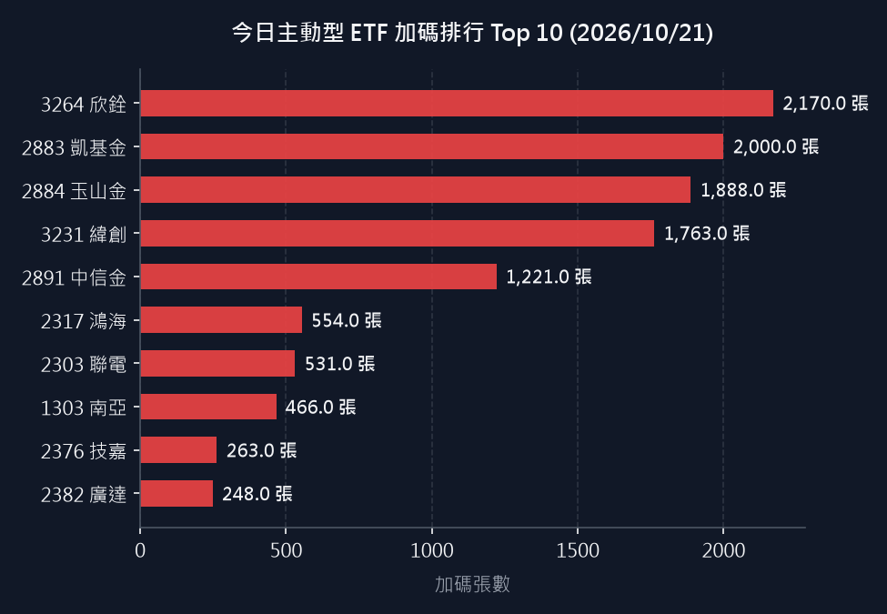
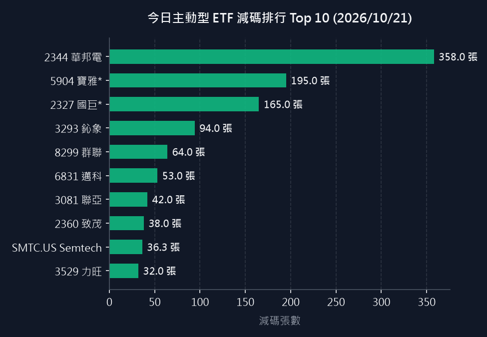

# 主動型 ETF 持股變動

資料來源：`主動型ETF持股明細.xlsx` 最近兩個日期分頁。

比較區間：`20261020` → `20261021`

## 今日加減碼視覺化排行

| 今日加碼 Top 10 | 今日減碼 Top 10 |
| :---: | :---: |
|  |  |

| ETF | 新增 | 刪除 | 比例變動 |
| :-- | --: | --: | --: |
| 00400A | 0 | 1 | 41 |
| 00401A | 0 | 1 | 52 |
| 00402A | 0 | 0 | 39 |
| 00403A | 1 | 1 | 31 |
| 00404A | 0 | 0 | 44 |
| 00405A | 0 | 0 | 22 |
| 00406A | 0 | 0 | 0 |
| 00407A | 0 | 0 | 0 |
| 00408A | 1 | 0 | 45 |
| 00980A | 0 | 0 | 47 |
| 00980D | 0 | 0 | 62 |
| 00981A | 0 | 0 | 27 |
| 00982A | 0 | 0 | 0 |
| 00983A | 0 | 0 | 31 |
| 00983D | 0 | 0 | 0 |
| 00984A | 0 | 0 | 62 |
| 00985A | 0 | 0 | 42 |
| 00986A | 0 | 0 | 35 |
| 00987A | 0 | 0 | 28 |
| 00988A | 0 | 0 | 0 |
| 00989A | 0 | 0 | 57 |
| 00990A | 2 | 1 | 37 |
| 00991A | 0 | 0 | 17 |
| 00992A | 0 | 0 | 36 |
| 00993A | 0 | 0 | 0 |
| 00994A | 0 | 0 | 30 |
| 00995A | 1 | 0 | 35 |
| 00996A | 0 | 0 | 41 |
| 00997A | 0 | 0 | 0 |
| 00998A | 0 | 0 | 0 |
| 00999A | 0 | 0 | 0 |

## 00400A

### 新增持股

- 無

### 刪除持股

- 台指選擇權 2026/10（0.00%，-0.025 張）

### 投資比例變動

- 1303 南亞：4.13% → 4.34%（+0.21）
- 1476 儒鴻：0.08% → 0.07%（-0.01）
- 2059 川湖：3.79% → 3.67%（-0.12）
- 2303 聯電：1.78% → 1.75%（-0.03）
- 2308 台達電：2.55% → 2.51%（-0.04）
- 2313 華通：0.90% → 0.87%（-0.03）
- 2327 國巨*：1.24% → 1.25%（+0.01）
- 2330 台積電：9.11% → 8.90%（-0.21）
- 2345 智邦：1.66% → 1.49%（-0.17）
- 2360 致茂：3.15% → 3.07%（-0.08）
- 2368 金像電：2.91% → 2.85%（-0.06）
- 2383 台光電：4.21% → 4.12%（-0.09）
- 2449 京元電子：0.87% → 0.90%（+0.03）
- 2454 聯發科：7.15% → 6.92%（-0.23）
- 2603 長榮：1.63% → 1.57%（-0.06）
- 2891 中信金：1.57% → 1.59%（+0.02）
- 3008 大立光：1.52% → 1.53%（+0.01）
- 3017 奇鋐：3.67% → 3.46%（-0.21）
- 3036 文曄：1.54% → 1.53%（-0.01）
- 3037 欣興：3.78% → 3.83%（+0.05）
- 3044 健鼎：2.45% → 2.44%（-0.01）
- 3081 聯亞：0.68% → 0.70%（+0.02）
- 3090 日電貿：0.31% → 0.32%（+0.01）
- 3293 鈊象：0.35% → 0.34%（-0.01）
- 3529 力旺：1.26% → 1.20%（-0.06）
- 3653 健策：3.43% → 3.27%（-0.16）
- 3661 世芯-KY：2.24% → 2.22%（-0.02）
- 3665 貿聯-KY：1.47% → 1.45%（-0.02）
- 4958 臻鼎-KY：0.47% → 0.48%（+0.01）
- 5274 信驊：1.51% → 1.53%（+0.02）
- 5434 崇越：0.38% → 0.37%（-0.01）
- 6121 新普：0.22% → 0.21%（-0.01）
- 6147 頎邦：0.88% → 0.90%（+0.02）
- 6187 萬潤：1.10% → 1.08%（-0.02）
- 6223 旺矽：2.97% → 2.95%（-0.02）
- 6271 同欣電：0.25% → 0.26%（+0.01）
- 6278 台表科：2.74% → 2.93%（+0.19）
- 6488 環球晶：2.50% → 2.53%（+0.03）
- 6669 緯穎：1.43% → 1.35%（-0.08）
- 9939 宏全：0.08% → 0.07%（-0.01）
- ＸＡＧＸ金兌(3533.HK)：0.92% → 0.90%（-0.02）

## 00401A

### 新增持股

- 無

### 刪除持股

- 臺指選擇權10/26 46800 買權（0.00%，-0.02 張）

### 投資比例變動

- 1216 統一：0.29% → 0.28%（-0.01）
- 1303 南亞：1.24% → 1.30%（+0.06）
- 1477 聚陽：0.95% → 0.94%（-0.01）
- 2059 川湖：0.85% → 0.82%（-0.03）
- 2303 聯電：2.20% → 2.16%（-0.04）
- 2308 台達電：2.26% → 2.23%（-0.03）
- 2313 華通：1.54% → 1.49%（-0.05）
- 2317 鴻海：0.57% → 0.58%（+0.01）
- 2327 國巨*：0.60% → 0.61%（+0.01）
- 2330 台積電：20.71% → 20.30%（-0.41）
- 2345 智邦：0.34% → 0.30%（-0.04）
- 2357 華碩：1.93% → 1.89%（-0.04）
- 2360 致茂：1.32% → 1.30%（-0.02）
- 2383 台光電：1.03% → 1.01%（-0.02）
- 2412 中華電：0.90% → 0.87%（-0.03）
- 2454 聯發科：6.01% → 5.84%（-0.17）
- 2455 全新：2.13% → 2.10%（-0.03）
- 2603 長榮：1.15% → 1.56%（+0.41）
- 2881 富邦金：2.09% → 2.11%（+0.02）
- 2882 國泰金：1.06% → 1.07%（+0.01）
- 2884 玉山金：2.12% → 2.11%（-0.01）
- 2886 兆豐金：1.47% → 1.44%（-0.03）
- 2887 台新新光金：1.09% → 1.08%（-0.01）
- 2890 永豐金：0.30% → 0.49%（+0.19）
- 2891 中信金：1.64% → 1.86%（+0.22）
- 2912 統一超：0.27% → 0.26%（-0.01）
- 3008 大立光：2.19% → 2.21%（+0.02）
- 3034 聯詠：0.22% → 0.23%（+0.01）
- 3037 欣興：2.23% → 2.27%（+0.04）
- 3131 弘塑：0.65% → 0.63%（-0.02）
- 3231 緯創：1.75% → 1.76%（+0.01）
- 3491 昇達科：1.57% → 1.65%（+0.08）
- 3711 日月光投控：2.57% → 2.59%（+0.02）
- 4904 遠傳：0.82% → 0.80%（-0.02）
- 4938 和碩：0.36% → 0.35%（-0.01）
- 4958 臻鼎-KY：1.44% → 1.48%（+0.04）
- 4991 環宇-KY：0.59% → 0.60%（+0.01）
- 5274 信驊：1.71% → 1.73%（+0.02）
- 5347 世界：1.27% → 1.29%（+0.02）
- 5904 寶雅*：0.57% → 0.56%（-0.01）
- 6147 頎邦：1.35% → 1.38%（+0.03）
- 6187 萬潤：0.72% → 0.70%（-0.02）
- 6223 旺矽：1.52% → 1.51%（-0.01）
- 6285 啟碁：1.45% → 1.41%（-0.04）
- 6515 穎崴：0.94% → 0.92%（-0.02）
- 6531 愛普*：1.45% → 1.47%（+0.02）
- 6669 緯穎：1.75% → 1.66%（-0.09）
- 7769 鴻勁：0.96% → 0.92%（-0.04）
- 7828 創新服務：1.45% → 1.39%（-0.06）
- 8464 億豐：0.99% → 0.98%（-0.01）
- 台股期貨11/26(FITXN*1.TF)：-0.07% → 0.00%（+0.07）
- 臺指選擇權10/26 46000 買權：-0.01% → -0.02%（-0.01）

## 00402A

### 新增持股

- 無

### 刪除持股

- 無

### 投資比例變動

- AAPL.US Apple：8.07% → 8.03%（-0.04）
- ADI.US Analog Devices：1.96% → 1.98%（+0.02）
- AMD.US AMD：5.79% → 5.77%（-0.02）
- AMZN.US Amazon：4.61% → 4.63%（+0.02）
- ANET.US Arista Networks：0.80% → 0.79%（-0.01）
- ARM.US Arm：0.82% → 0.80%（-0.02）
- ASML.US ASML Holding：1.18% → 1.17%（-0.01）
- AVGO.US Broadcom：2.18% → 2.19%（+0.01）
- AXON.US Axon Enterprise：0.55% → 0.57%（+0.02）
- BKNG.US Booking Holdings：0.54% → 0.55%（+0.01）
- CDNS.US Cadence Design Systems：1.52% → 1.50%（-0.02）
- DASH.US DoorDash：0.50% → 0.49%（-0.01）
- FSLY.US Fastly：0.34% → 0.33%（-0.01）
- GOOG.US Alphabet - Class C Capital Stock：3.48% → 3.45%（-0.03）
- GOOGL.US Alphabet - Class A Common Stock：3.50% → 3.47%（-0.03）
- IOT.US Samsara：0.54% → 0.57%（+0.03）
- KLAC.US KLA：1.52% → 1.48%（-0.04）
- LITE.US Lumentum：1.70% → 1.68%（-0.02）
- LRCX.US Lam Research：2.49% → 2.42%（-0.07）
- MCHP.US Microchip Technology：1.36% → 1.39%（+0.03）
- MDB.US MongoDB：0.38% → 0.40%（+0.02）
- META.US Meta：3.84% → 3.79%（-0.05）
- MRVL.US Marvell：1.64% → 1.67%（+0.03）
- MU.US Micron：5.68% → 5.64%（-0.04）
- NFLX.US Netflix：1.01% → 0.99%（-0.02）
- NOW.US ServiceNow：1.16% → 1.19%（+0.03）
- NVDA.US NVIDIA：8.74% → 8.81%（+0.07）
- PANW.US Palo Alto：2.74% → 2.69%（-0.05）
- SHOP.US Shopify：1.24% → 1.26%（+0.02）
- SKHY.US SK hynix：0.79% → 0.77%（-0.02）
- SNOW.US Snowflake：1.30% → 1.32%（+0.02）
- SPOT.US Spotify：0.37% → 0.38%（+0.01）
- STX.US Seagate：1.03% → 1.05%（+0.02）
- TER.US Teradyne：0.76% → 0.77%（+0.01）
- TSM.US TSMC(ADR)：1.51% → 1.53%（+0.02）
- TTWO.US Take-Two：0.60% → 0.61%（+0.01）
- TXN.US Texas Instruments：2.41% → 2.43%（+0.02）
- V.US Visa：1.25% → 1.27%（+0.02）
- WDC.US Western Digital：1.77% → 1.84%（+0.07）

## 00403A

### 新增持股

- 2883 凱基金（0.06%，2000 張）

### 刪除持股

- 2404 漢唐（0.00%，1 張）

### 投資比例變動

- 1303 南亞：2.65% → 2.95%（+0.30）
- 1560 中砂：0.27% → 0.32%（+0.05）
- 2059 川湖：0.71% → 0.70%（-0.01）
- 2303 聯電：0.99% → 0.98%（-0.01）
- 2308 台達電：3.62% → 3.61%（-0.01）
- 2313 華通：0.38% → 0.37%（-0.01）
- 2317 鴻海：0.60% → 0.61%（+0.01）
- 2327 國巨*：3.58% → 3.66%（+0.08）
- 2330 台積電：14.39% → 14.28%（-0.11）
- 2345 智邦：2.45% → 2.23%（-0.22）
- 2368 金像電：0.76% → 0.75%（-0.01）
- 2383 台光電：4.61% → 4.59%（-0.02）
- 2408 南亞科：0.92% → 0.94%（+0.02）
- 2449 京元電子：0.81% → 0.85%（+0.04）
- 2454 聯發科：4.84% → 4.76%（-0.08）
- 2882 國泰金：0.34% → 0.35%（+0.01）
- 3008 大立光：1.56% → 1.77%（+0.21）
- 3017 奇鋐：5.68% → 5.54%（-0.14）
- 3037 欣興：5.74% → 5.90%（+0.16）
- 3189 景碩：3.27% → 3.45%（+0.18）
- 3211 順達：0.53% → 0.52%（-0.01）
- 3443 創意：4.09% → 4.17%（+0.08）
- 3450 聯鈞：0.50% → 0.52%（+0.02）
- 3653 健策：5.76% → 5.59%（-0.17）
- 5274 信驊：1.80% → 1.98%（+0.18）
- 6223 旺矽：3.54% → 3.57%（+0.03）
- 6274 台燿：2.89% → 2.76%（-0.13）
- 6669 緯穎：2.77% → 2.67%（-0.10）
- 6805 富世達：0.55% → 0.57%（+0.02）
- 8046 南電：3.05% → 3.09%（+0.04）
- 8996 高力：2.26% → 2.39%（+0.13）

## 00404A

### 新增持股

- 無

### 刪除持股

- 無

### 投資比例變動

- 1303 南亞：0.80% → 0.86%（+0.06）
- 2059 川湖：0.52% → 0.51%（-0.01）
- 2303 聯電：2.57% → 2.55%（-0.02）
- 2317 鴻海：0.67% → 0.68%（+0.01）
- 2330 台積電：22.84% → 22.65%（-0.19）
- 2345 智邦：0.91% → 0.82%（-0.09）
- 2347 聯強：2.02% → 2.00%（-0.02）
- 2351 順德：0.37% → 0.38%（+0.01）
- 2357 華碩：1.26% → 1.24%（-0.02）
- 2379 瑞昱：1.17% → 1.18%（+0.01）
- 2382 廣達：0.99% → 1.00%（+0.01）
- 2383 台光電：2.79% → 2.77%（-0.02）
- 2395 研華：1.30% → 1.27%（-0.03）
- 2436 偉詮電：1.13% → 1.15%（+0.02）
- 2454 聯發科：6.53% → 6.42%（-0.11）
- 2882 國泰金：2.82% → 2.88%（+0.06）
- 2885 元大金：2.55% → 2.54%（-0.01）
- 2887 台新新光金：1.48% → 1.49%（+0.01）
- 2890 永豐金：1.47% → 1.48%（+0.01）
- 3017 奇鋐：1.36% → 1.31%（-0.05）
- 3034 聯詠：2.22% → 2.28%（+0.06）
- 3037 欣興：0.27% → 0.28%（+0.01）
- 3264 欣銓：0.66% → 0.70%（+0.04）
- 3293 鈊象：1.20% → 1.18%（-0.02）
- 3374 精材：0.11% → 0.12%（+0.01）
- 3443 創意：0.99% → 1.01%（+0.02）
- 3653 健策：0.51% → 0.49%（-0.02）
- 3680 家登：0.49% → 0.50%（+0.01）
- 3711 日月光投控：3.28% → 3.35%（+0.07）
- 5274 信驊：2.62% → 2.68%（+0.06）
- 5434 崇越：1.75% → 1.76%（+0.01）
- 5876 上海商銀：1.62% → 1.59%（-0.03）
- 6196 帆宣：1.73% → 1.77%（+0.04）
- 6257 矽格：1.68% → 1.73%（+0.05）
- 6491 晶碩：0.89% → 0.93%（+0.04）
- 6505 台塑化：0.51% → 0.52%（+0.01）
- 6669 緯穎：0.94% → 0.90%（-0.04）
- 6691 洋基工程：1.58% → 1.56%（-0.02）
- 7769 鴻勁：1.07% → 1.04%（-0.03）
- 8016 矽創：1.26% → 1.28%（+0.02）
- 8081 致新：0.89% → 0.88%（-0.01）
- 8299 群聯：1.18% → 1.22%（+0.04）
- 台指選擇權11/26 50900 買權：-0.11% → -0.09%（+0.02）
- 台股期貨11/26(FITXN*1.TF)：17.15% → 17.08%（-0.07）

## 00405A

### 新增持股

- 無

### 刪除持股

- 無

### 投資比例變動

- 2059 川湖：2.28% → 2.26%（-0.02）
- 2330 台積電：1.95% → 1.94%（-0.01）
- 2345 智邦：5.43% → 4.95%（-0.48）
- 2368 金像電：6.04% → 6.03%（-0.01）
- 2454 聯發科：5.52% → 5.45%（-0.07）
- 3017 奇鋐：4.18% → 4.03%（-0.15）
- 3037 欣興：7.30% → 7.54%（+0.24）
- 3189 景碩：0.21% → 0.23%（+0.02）
- 3443 創意：6.06% → 6.20%（+0.14）
- 3653 健策：7.82% → 7.61%（-0.21）
- 3665 貿聯-KY：5.79% → 5.81%（+0.02）
- 5274 信驊：5.70% → 5.87%（+0.17）
- 5347 世界：0.15% → 0.16%（+0.01）
- 6223 旺矽：7.16% → 7.24%（+0.08）
- 6274 台燿：2.15% → 2.06%（-0.09）
- 6515 穎崴：0.52% → 0.51%（-0.01）
- 6531 愛普*：3.73% → 3.83%（+0.10）
- 6669 緯穎：0.86% → 0.83%（-0.03）
- 6805 富世達：3.53% → 3.66%（+0.13）
- 7769 鴻勁：2.83% → 2.76%（-0.07）
- 8046 南電：7.67% → 7.80%（+0.13）
- 8996 高力：1.40% → 1.49%（+0.09）

## 00406A

### 新增持股

- 無

### 刪除持股

- 無

### 投資比例變動

- 無

## 00407A

### 新增持股

- 無

### 刪除持股

- 無

### 投資比例變動

- 無

## 00408A

### 新增持股

- 3443 創意（0.58%，1 張）

### 刪除持股

- 無

### 投資比例變動

- 1303 南亞：3.64% → 4.18%（+0.54）
- 1560 中砂：0.37% → 0.38%（+0.01）
- 2303 聯電：1.33% → 1.36%（+0.03）
- 2308 台達電：2.65% → 2.70%（+0.05）
- 2327 國巨*：0.75% → 0.79%（+0.04）
- 2330 台積電：6.41% → 6.48%（+0.07）
- 2344 華邦電：0.44% → 0.46%（+0.02）
- 2345 智邦：0.85% → 0.72%（-0.13）
- 2357 華碩：1.55% → 1.57%（+0.02）
- 2360 致茂：1.15% → 1.17%（+0.02）
- 2368 金像電：5.37% → 5.46%（+0.09）
- 2376 技嘉：1.41% → 1.43%（+0.02）
- 2382 廣達：0.23% → 0.24%（+0.01）
- 2383 台光電：4.81% → 4.89%（+0.08）
- 2395 研華：1.67% → 1.68%（+0.01）
- 2408 南亞科：1.28% → 1.33%（+0.05）
- 2449 京元電子：0.88% → 0.95%（+0.07）
- 2454 聯發科：4.18% → 4.20%（+0.02）
- 2455 全新：0.42% → 0.43%（+0.01）
- 2542 興富發：3.90% → 3.93%（+0.03）
- 2880 華南金：1.21% → 1.26%（+0.05）
- 2891 中信金：0.31% → 0.33%（+0.02）
- 3008 大立光：0.86% → 0.89%（+0.03）
- 3017 奇鋐：3.09% → 3.03%（-0.06）
- 3026 禾伸堂：0.86% → 0.89%（+0.03）
- 3037 欣興：2.28% → 3.27%（+0.99）
- 3081 聯亞：2.06% → 2.19%（+0.13）
- 3105 穩懋：0.48% → 0.52%（+0.04）
- 3189 景碩：3.33% → 3.59%（+0.26）
- 3231 緯創：0.95% → 0.99%（+0.04）
- 3264 欣銓：0.76% → 0.83%（+0.07）
- 3653 健策：3.73% → 3.70%（-0.03）
- 3665 貿聯-KY：1.09% → 1.12%（+0.03）
- 3711 日月光投控：1.52% → 1.59%（+0.07）
- 5434 崇越：2.34% → 2.41%（+0.07）
- 6187 萬潤：1.05% → 1.06%（+0.01）
- 6223 旺矽：2.04% → 2.10%（+0.06）
- 6274 台燿：3.57% → 3.48%（-0.09）
- 6488 環球晶：0.85% → 0.89%（+0.04）
- 6510 精測：0.45% → 0.47%（+0.02）
- 6669 緯穎：2.05% → 2.01%（-0.04）
- 6805 富世達：2.31% → 2.43%（+0.12）
- 8046 南電：1.60% → 1.65%（+0.05）
- 8996 高力：2.45% → 2.65%（+0.20）
- 9802 鈺齊-KY：0.91% → 0.88%（-0.03）

## 00980A

### 新增持股

- 無

### 刪除持股

- 無

### 投資比例變動

- 1303 南亞：3.89% → 3.60%（-0.29）
- 2059 川湖：4.34% → 4.23%（-0.11）
- 2303 聯電：1.02% → 1.36%（+0.34）
- 2308 台達電：3.53% → 3.48%（-0.05）
- 2317 鴻海：2.12% → 2.88%（+0.76）
- 2327 國巨*：1.38% → 0.92%（-0.46）
- 2330 台積電：9.85% → 9.67%（-0.18）
- 2344 華邦電：1.90% → 1.64%（-0.26）
- 2345 智邦：1.52% → 0.96%（-0.56）
- 2360 致茂：1.61% → 1.17%（-0.44）
- 2368 金像電：2.17% → 2.14%（-0.03）
- 2376 技嘉：0.93% → 1.42%（+0.49）
- 2382 廣達：1.25% → 1.68%（+0.43）
- 2383 台光電：4.46% → 3.81%（-0.65）
- 2408 南亞科：2.52% → 2.54%（+0.02）
- 2454 聯發科：5.62% → 5.47%（-0.15）
- 2884 玉山金：0.78% → 1.27%（+0.49）
- 2891 中信金：1.08% → 1.55%（+0.47）
- 3008 大立光：1.23% → 1.83%（+0.60）
- 3017 奇鋐：2.42% → 2.30%（-0.12）
- 3037 欣興：3.59% → 3.65%（+0.06）
- 3044 健鼎：0.60% → 1.13%（+0.53）
- 3081 聯亞：2.19% → 1.67%（-0.52）
- 3189 景碩：1.37% → 1.43%（+0.06）
- 3231 緯創：0.97% → 1.46%（+0.49）
- 3264 欣銓：0.87% → 0.91%（+0.04）
- 3293 鈊象：0.87% → 0.46%（-0.41）
- 3443 創意：2.49% → 1.91%（-0.58）
- 3529 力旺：0.64% → 0.16%（-0.48）
- 3653 健策：3.76% → 3.12%（-0.64）
- 3665 貿聯-KY：0.51% → 1.14%（+0.63）
- 3711 日月光投控：2.23% → 2.25%（+0.02）
- 5274 信驊：1.76% → 1.78%（+0.02）
- 5904 寶雅*：0.90% → 0.81%（-0.09）
- 6213 聯茂：1.03% → 1.10%（+0.07）
- 6274 台燿：1.21% → 1.40%（+0.19）
- 6515 穎崴：1.65% → 1.61%（-0.04）
- 6669 緯穎：1.62% → 1.85%（+0.23）
- 6805 富世達：0.67% → 0.69%（+0.02）
- 6831 邁科：0.41% → 0.29%（-0.12）
- 7751 竑騰：0.71% → 0.70%（-0.01）
- 7769 鴻勁：2.92% → 2.37%（-0.55）
- 8046 南電：1.78% → 1.79%（+0.01）
- 8210 勤誠：0.41% → 0.40%（-0.01）
- 8299 群聯：1.69% → 1.07%（-0.62）
- 8996 高力：0.49% → 0.51%（+0.02）
- 台灣證交所加權股價指數(FITXN*1.TF)：1.52% → 1.50%（-0.02）

## 00980D

### 新增持股

- 無

### 刪除持股

- 無

### 投資比例變動

- AHOLD FINANCE USA LLC 6.88% 01MAY2029：0.50% → 0.51%（+0.01）
- ANHEUSER-BUSCH INBEV WOR (REG) 8.2% 15JAN2039：0.53% → 0.54%（+0.01）
- APOLLO DEBT SOLUTIONS BD 6.900000 % 13APR2029：0.57% → 0.58%（+0.01）
- ASURION LLC/ASURION CO 8.375% 01FEB2034：0.43% → 0.44%（+0.01）
- ATHENE HOLDING LTD (REG) 6.25% 01APR2054：0.76% → 0.77%（+0.01）
- BAT CAPITAL CORP (REG) 7.081% 02AUG2053：0.59% → 0.60%（+0.01）
- BAT CAPITAL CORP (REG) 7.75% 19OCT2032：0.46% → 0.47%（+0.01）
- BPCE SA SER REGS VAR 14JAN2046：0.39% → 0.40%（+0.01）
- BRITISH TELECOMMUNICATIO (BR) 9.625% 15DEC2030：0.59% → 0.60%（+0.01）
- CAPITAL ONE FINANCIAL CO SER . (REG) VAR 30OCT2031：0.60% → 0.61%（+0.01）
- CHARTER COMM OPT 6.484% 23OCT2045 W/I：0.44% → 0.45%（+0.01）
- CHS/COMMUNITY HEALTH SYS SER REGS 10.875000 % 15JAN2032：0.51% → 0.52%（+0.01）
- CITIGROUP INC 8.125% 15JUL2039：0.63% → 0.64%（+0.01）
- CONCENTRIX CORP (REG) 6.85% 02AUG2033：0.73% → 0.74%（+0.01）
- CONOCOPHILLIPS COMPANY (REG) 6.95% 15APR2029：0.53% → 0.54%（+0.01）
- COREWEAVE INC SER REGS (REG S) 9.25% 01JUN2030：0.40% → 0.41%（+0.01）
- COREWEAVE INC SER REGS (REG S) 9.75% 01OCT2031：0.48% → 0.47%（-0.01）
- COREWEAVE INC SER REGS (REG) (REG S) 9.625% 15JUL2032：0.48% → 0.47%（-0.01）
- COX COMMUNICATIONS INC SER REGS 5.800000 % 15DEC2053：0.50% → 0.51%（+0.01）
- DELL INT LLC / EMC CORP (REG) 8.35% 15JUL2046：0.56% → 0.57%（+0.01）
- DEUTSCHE TELEKOM INT FIN (REG) 9.25% 01JUN2032：0.43% → 0.44%（+0.01）
- DISCOVER FINANCIAL SVS (REG) VAR 02NOV2034：0.65% → 0.66%（+0.01）
- DOW CHEMICAL CO/THE 6.9% 15MAY2053：0.62% → 0.63%（+0.01）
- DOW CHEMICAL CO/THE 7.375% 01NOV2029：0.63% → 0.64%（+0.01）
- ENEL FINANCE INTL NV SER REGS (REG S) 7.75% 14OCT2052：0.37% → 0.38%（+0.01）
- FMC CORP (REG) 6.375000 % 18MAY2053：0.31% → 0.30%（-0.01）
- GENERAL MOTORS CO (REG) 6.75% 01APR2046：0.57% → 0.58%（+0.01）
- GENERAL MOTORS CO (REG) 6.8% 01OCT2027：0.58% → 0.59%（+0.01）
- GLENCORE FINANCE CANADA SER REGS 6.900000 % 15-NOV-2037：0.40% → 0.41%（+0.01）
- GLOBAL ATLANTIC FIN CO SER REGS 6.750000 % 15MAR2054：0.62% → 0.63%（+0.01）
- GRAY TELEVISION INC SER REGS (REG) (REG S) 10.5% 15JUL2029：0.21% → 0.12%（-0.09）
- HSBC HOLDINGS PLC VAR 03NOV2028：0.34% → 0.35%（+0.01）
- ICAHN ENTERPRISES/FIN (REG) 9.75% 15JAN2029：0.33% → 0.34%（+0.01）
- INTESA SANPAOLO SPA SER REGS (REG S) 7.8% 28NOV2053：0.37% → 0.38%（+0.01）
- JBS USA HOLD/FOOD/LUX CO 7.250000 % 15NOV2053：0.48% → 0.49%（+0.01）
- JBS USA/FOOD/FINANCE (REG) 6.5% 01DEC2052：0.46% → 0.47%（+0.01）
- JETBLUE AIRWAYS/LOYALTY SER REGS (REG S) 9.875% 20SEP2031：0.33% → 0.30%（-0.03）
- META PLATFORMS INC 5.750000 % 15-NOV-2065：0.42% → 0.43%（+0.01）
- MOBIUS MERGER SUB SER REGS 9.000000 % 01JUN2030：0.27% → 0.26%（-0.01）
- MYLAN INC SER WI (REG) 5.2% 15APR2048WI：0.51% → 0.52%（+0.01）
- NATIONWIDE MUTUAL INSUR 9.375% 15AUG2039：0.53% → 0.54%（+0.01）
- ONEOK INC 6.625% 01SEP2053：0.60% → 0.61%（+0.01）
- ORACLE CORP 6.100000 % 26-SEP-2065：0.49% → 0.50%（+0.01）
- ORACLE CORP 6.125000 % 03AUG2065：0.53% → 0.54%（+0.01）
- ORACLE CORP 6.7 % 04-FEB-2056：0.19% → 0.20%（+0.01）
- ORACLE CORP 6.85 % 04-FEB-2066：0.52% → 0.53%（+0.01）
- PACIFIC GAS & ELECTRIC (REG) 6.75% 15JAN2053：0.33% → 0.34%（+0.01）
- PROGRESS ENERGY INC (REG) 7.75% 01MAR2031：0.59% → 0.60%（+0.01）
- SALESFORCE INC (REG) 6.7% 15MAR2066：0.54% → 0.55%（+0.01）
- SANTANDER HOLDINGS USA VAR 09MAR2029：0.49% → 0.50%（+0.01）
- SANTOS FINANCE LTD SER REGS (REG S) 6.875% 19SEP2033：0.29% → 0.30%（+0.01）
- SES GLOBAL AMERICAS HLDG SER REGS (REG) 5.300000 % 25MAR2044：0.30% → 0.31%（+0.01）
- SPACE EXPLORATION TECH SER 144A (REG) 6.65% 15JUL2056：0.31% → 0.32%（+0.01）
- TIME WARNER ENTERTAINMEN 8.375% 15JUL2033：0.64% → 0.65%（+0.01）
- US 10YR NOTE (CBT)DEC26 21-DEC-2026：18.43% → 18.54%（+0.11）
- US 10YR ULTRA FUT DEC26 21-DEC-2026：-1.61% → -1.62%（-0.01）
- US 5YR NOTE (CBT) DEC26 31-DEC-2026：-14.01% → -14.08%（-0.07）
- US LONG BOND(CBT) DEC26 21-DEC-2026：5.48% → 5.54%（+0.06）
- VALERO ENERGY CORP (REG) 7.5% 15APR2032：0.49% → 0.50%（+0.01）
- VIRGINIA ELEC & POWER CO (REG) 8.875% 15NOV2038：0.59% → 0.60%（+0.01）
- VISTRA OPERATIONS CO LLC SER REGS (REG S) 6.95% 15OCT2033：0.42% → 0.43%（+0.01）
- WESTLAKE CORP 6.375000 % 15-NOV-2055：0.53% → 0.54%（+0.01）

## 00981A

### 新增持股

- 無

### 刪除持股

- 無

### 投資比例變動

- 2303 聯電：3.75% → 3.71%（-0.04）
- 2308 台達電：4.51% → 4.49%（-0.02）
- 2313 華通：0.05% → 0.04%（-0.01）
- 2327 國巨*：4.56% → 4.64%（+0.08）
- 2330 台積電：11.30% → 11.16%（-0.14）
- 2345 智邦：4.57% → 4.18%（-0.39）
- 2368 金像電：3.03% → 3.00%（-0.03）
- 2383 台光電：7.93% → 7.86%（-0.07）
- 2449 京元電子：0.61% → 0.67%（+0.06）
- 2454 聯發科：7.91% → 7.75%（-0.16）
- 3017 奇鋐：7.82% → 7.60%（-0.22）
- 3037 欣興：7.63% → 7.88%（+0.25）
- 3231 緯創：0.33% → 0.43%（+0.10）
- 3264 欣銓：0.24% → 0.47%（+0.23）
- 3443 創意：2.45% → 2.48%（+0.03）
- 3653 健策：6.19% → 5.98%（-0.21）
- 3665 貿聯-KY：2.06% → 2.05%（-0.01）
- 3711 日月光投控：2.04% → 2.08%（+0.04）
- 5274 信驊：1.19% → 1.21%（+0.02）
- 6223 旺矽：4.55% → 4.56%（+0.01）
- 6274 台燿：4.15% → 3.95%（-0.20）
- 6510 精測：0.54% → 0.55%（+0.01）
- 6669 緯穎：2.34% → 2.25%（-0.09）
- 6805 富世達：0.70% → 0.80%（+0.10）
- 8046 南電：4.32% → 4.36%（+0.04）
- 8996 高力：0.56% → 0.59%（+0.03）
- 台指期貨 2026/11(FITXN*1.TF)：2.34% → 2.32%（-0.02）

## 00982A

### 新增持股

- 無

### 刪除持股

- 無

### 投資比例變動

- 無

## 00983A

### 新增持股

- 無

### 刪除持股

- 無

### 投資比例變動

- AMD.US AMD：3.35% → 3.29%（-0.06）
- AMZN.US Amazon：3.15% → 3.47%（+0.32）
- AVGO.US Broadcom：1.60% → 1.58%（-0.02）
- BEAM.US Beam Therapeutics：1.62% → 1.65%（+0.03）
- BLSH.US Bullish：1.96% → 2.03%（+0.07）
- BMNR.US BitMine：2.18% → 2.28%（+0.10）
- COIN.US Coinbase：4.61% → 4.62%（+0.01）
- CRCL.US Circle：5.24% → 5.46%（+0.22）
- CRSP.US CRISPR Therapeutics：3.82% → 3.76%（-0.06）
- CRWV.US CoreWeave：0.94% → 0.95%（+0.01）
- GOOG.US Alphabet - Class C Capital Stock：1.67% → 1.63%（-0.04）
- GOOGL.US Alphabet - Class A Common Stock：0.79% → 0.82%（+0.03）
- HOOD.US Robinhood Markets：3.86% → 3.65%（-0.21）
- ILMN.US Illumina：1.77% → 1.79%（+0.02）
- LLY.US Eli Lilly：0.82% → 0.84%（+0.02）
- NET.US Cloudflare：1.35% → 1.31%（-0.04）
- NTRA.US Natera：1.70% → 1.71%（+0.01）
- NVDA.US NVIDIA：3.45% → 3.39%（-0.06）
- PACB.US Pacific Biosciences of Californi：0.05% → 0.06%（+0.01）
- PLTR.US Palantir Technologies：3.38% → 3.31%（-0.07）
- RKLB.US Rocket Lab：1.23% → 1.20%（-0.03）
- SOFI.US SoFi Technologies：0.21% → 0.15%（-0.06）
- SPCX.US SpaceX：6.95% → 6.85%（-0.10）
- TEM.US Tempus：5.27% → 5.40%（+0.13）
- TER.US Teradyne：0.61% → 0.60%（-0.01）
- TSLA.US Tesla：9.14% → 8.95%（-0.19）
- TSM.US TSMC(ADR)：2.75% → 2.74%（-0.01）
- TWST.US Twist Bioscience：3.67% → 3.70%（+0.03）
- TXG.US 10x Genomics：3.26% → 3.29%（+0.03）
- WGS.US GeneDx：0.51% → 0.52%（+0.01）
- XYZ.US Block：1.34% → 1.33%（-0.01）

## 00983D

### 新增持股

- 無

### 刪除持股

- 無

### 投資比例變動

- 無

## 00984A

### 新增持股

- 無

### 刪除持股

- 無

### 投資比例變動

- 1216 統一：0.34% → 0.33%（-0.01）
- 1303 南亞：3.02% → 3.19%（+0.17）
- 1326 台化：1.04% → 1.05%（+0.01）
- 1409 新纖：0.66% → 0.65%（-0.01）
- 1560 中砂：1.23% → 1.22%（-0.01）
- 1709 和益：0.75% → 0.73%（-0.02）
- 2006 東和鋼鐵：0.34% → 0.35%（+0.01）
- 2059 川湖：2.18% → 2.12%（-0.06）
- 2301 光寶科：0.62% → 0.60%（-0.02）
- 2303 聯電：0.75% → 0.73%（-0.02）
- 2313 華通：0.16% → 0.15%（-0.01）
- 2330 台積電：4.36% → 4.28%（-0.08）
- 2344 華邦電：0.66% → 0.67%（+0.01）
- 2351 順德：0.61% → 0.63%（+0.02）
- 2357 華碩：0.66% → 0.65%（-0.01）
- 2383 台光電：1.31% → 1.29%（-0.02）
- 2395 研華：2.59% → 2.52%（-0.07）
- 2408 南亞科：1.89% → 1.91%（+0.02）
- 2409 友達：1.24% → 1.26%（+0.02）
- 2454 聯發科：0.81% → 0.79%（-0.02）
- 2464 盟立：1.19% → 1.15%（-0.04）
- 2603 長榮：1.94% → 1.88%（-0.06）
- 2615 萬海：1.01% → 0.98%（-0.03）
- 2618 長榮航：0.32% → 0.31%（-0.01）
- 2634 漢翔：0.31% → 0.30%（-0.01）
- 2851 中再保：0.72% → 0.71%（-0.01）
- 2880 華南金：1.67% → 1.68%（+0.01）
- 2881 富邦金：4.29% → 4.34%（+0.05）
- 2882 國泰金：3.27% → 3.31%（+0.04）
- 2884 玉山金：2.44% → 2.42%（-0.02）
- 2885 元大金：3.43% → 3.39%（-0.04）
- 2886 兆豐金：2.25% → 2.21%（-0.04）
- 2887 台新新光金：3.47% → 3.46%（-0.01）
- 2892 第一金：1.34% → 1.33%（-0.01）
- 3006 晶豪科：0.55% → 0.57%（+0.02）
- 3008 大立光：1.58% → 1.59%（+0.01）
- 3017 奇鋐：4.49% → 4.27%（-0.22）
- 3034 聯詠：0.33% → 0.34%（+0.01）
- 3037 欣興：1.62% → 1.65%（+0.03）
- 3045 台灣大：1.82% → 1.77%（-0.05）
- 3189 景碩：1.52% → 1.58%（+0.06）
- 3231 緯創：0.67% → 0.68%（+0.01）
- 3264 欣銓：1.85% → 1.93%（+0.08）
- 3443 創意：1.21% → 1.22%（+0.01）
- 3450 聯鈞：0.64% → 0.65%（+0.01）
- 3605 宏致：0.66% → 0.69%（+0.03）
- 3653 健策：1.82% → 1.75%（-0.07）
- 3661 世芯-KY：0.29% → 0.28%（-0.01）
- 3665 貿聯-KY：0.57% → 0.56%（-0.01）
- 4958 臻鼎-KY：0.63% → 0.65%（+0.02）
- 5274 信驊：1.12% → 1.14%（+0.02）
- 5351 鈺創：0.62% → 0.63%（+0.01）
- 5904 寶雅*：1.03% → 1.02%（-0.01）
- 6187 萬潤：2.15% → 2.11%（-0.04）
- 6197 佳必琪：0.65% → 0.66%（+0.01）
- 6213 聯茂：1.53% → 1.64%（+0.11）
- 6214 精誠：0.69% → 0.68%（-0.01）
- 6446 藥華藥：1.51% → 1.50%（-0.01）
- 6505 台塑化：3.43% → 3.44%（+0.01）
- 6669 緯穎：0.79% → 0.75%（-0.04）
- 6691 洋基工程：0.61% → 0.60%（-0.01）
- 8039 台虹：0.67% → 0.64%（-0.03）

## 00985A

### 新增持股

- 無

### 刪除持股

- 無

### 投資比例變動

- 1101 台泥：1.33% → 1.32%（-0.01）
- 1216 統一：2.48% → 2.46%（-0.02）
- 1301 台塑：0.44% → 0.45%（+0.01）
- 1402 遠東新：1.56% → 1.55%（-0.01）
- 1504 東元：0.51% → 0.52%（+0.01）
- 2027 大成鋼：1.86% → 1.84%（-0.02）
- 2059 川湖：2.35% → 2.33%（-0.02）
- 2308 台達電：2.54% → 2.55%（+0.01）
- 2317 鴻海：1.84% → 1.89%（+0.05）
- 2327 國巨*：1.79% → 1.84%（+0.05）
- 2330 台積電：13.85% → 13.81%（-0.04）
- 2344 華邦電：1.20% → 1.24%（+0.04）
- 2345 智邦：2.72% → 2.48%（-0.24）
- 2377 微星：0.89% → 0.88%（-0.01）
- 2408 南亞科：1.58% → 1.62%（+0.04）
- 2412 中華電：1.49% → 1.47%（-0.02）
- 2454 聯發科：1.45% → 1.43%（-0.02）
- 2603 長榮：1.40% → 1.37%（-0.03）
- 2609 陽明：1.38% → 1.37%（-0.01）
- 2610 華航：1.63% → 1.61%（-0.02）
- 3008 大立光：1.72% → 1.76%（+0.04）
- 3017 奇鋐：1.65% → 1.59%（-0.06）
- 3036 文曄：2.60% → 2.63%（+0.03）
- 3037 欣興：2.01% → 2.07%（+0.06）
- 3081 聯亞：1.94% → 2.02%（+0.08）
- 3105 穩懋：1.08% → 1.16%（+0.08）
- 3189 景碩：0.48% → 0.51%（+0.03）
- 3231 緯創：1.00% → 1.02%（+0.02）
- 3491 昇達科：0.18% → 0.19%（+0.01）
- 3653 健策：3.33% → 3.24%（-0.09）
- 3665 貿聯-KY：1.39% → 1.40%（+0.01）
- 3711 日月光投控：1.59% → 1.64%（+0.05）
- 4904 遠傳：2.76% → 2.73%（-0.03）
- 6285 啟碁：0.79% → 0.78%（-0.01）
- 6442 光聖：1.00% → 1.02%（+0.02）
- 6446 藥華藥：2.18% → 2.19%（+0.01）
- 6488 環球晶：1.42% → 1.47%（+0.05）
- 6531 愛普*：1.07% → 1.10%（+0.03）
- 6669 緯穎：3.54% → 3.43%（-0.11）
- 7750 新代：0.61% → 0.62%（+0.01）
- 7769 鴻勁：3.00% → 2.93%（-0.07）
- 台積電期貨(FICDFN*1.TF)：1.58% → 1.57%（-0.01）

## 00986A

### 新增持股

- 無

### 刪除持股

- 無

### 投資比例變動

- 2330 台積電：8.16% → 8.14%（-0.02）
- 2454 聯發科：1.58% → 1.56%（-0.02）
- AAPL.US Apple：2.61% → 2.60%（-0.01）
- AMD.US AMD：4.59% → 4.60%（+0.01）
- AMZN.US Amazon：4.48% → 4.51%（+0.03）
- AVGO.US Broadcom：3.67% → 3.69%（+0.02）
- BE.US Bloom Energy：0.97% → 1.09%（+0.12）
- CRWD.US CrowdStrike Holdings：4.17% → 4.19%（+0.02）
- DDOG.US Datadog：1.11% → 1.10%（-0.01）
- ETN.US Eaton：2.39% → 2.34%（-0.05）
- GEV.US GE Vernova：2.77% → 2.73%（-0.04）
- GOOGL.US Alphabet - Class A Common Stock：6.29% → 6.27%（-0.02）
- GS.US Goldman Sachs：1.07% → 1.09%（+0.02）
- HOOD.US Robinhood Markets：0.71% → 0.72%（+0.01）
- ILMN.US Illumina：0.64% → 0.66%（+0.02）
- JPM.US JPMorgan Chase：2.24% → 2.26%（+0.02）
- LITE.US Lumentum：3.97% → 3.94%（-0.03）
- LLY.US Eli Lilly：3.40% → 3.55%（+0.15）
- MA.US Mastercard：1.31% → 1.33%（+0.02）
- MSFT.US Microsoft：3.25% → 3.26%（+0.01）
- MU.US Micron：4.41% → 4.40%（-0.01）
- MUFG(8306.JP)：1.07% → 1.04%（-0.03）
- Murata Mfg.(6981.JP)：1.84% → 1.80%（-0.04）
- NET.US Cloudflare：2.18% → 2.15%（-0.03）
- NTRA.US Natera：0.73% → 0.75%（+0.02）
- NVDA.US NVIDIA：6.62% → 6.64%（+0.02）
- PLTR.US Palantir Technologies：0.95% → 1.06%（+0.11）
- SNOW.US Snowflake：2.11% → 2.16%（+0.05）
- Siemens Energy AG：2.00% → 1.98%（-0.02）
- TER.US Teradyne：1.02% → 1.03%（+0.01）
- TSEM.US Tower Semiconductor：1.04% → 0.96%（-0.08）
- 嘉能可公司：1.83% → 1.80%（-0.03）
- 尼比厄斯集團公眾有限公司：0.78% → 0.79%（+0.01）
- 施奈德電機公司：1.56% → 1.52%（-0.04）
- 艾司摩爾控股公司：1.23% → 1.60%（+0.37）

## 00987A

### 新增持股

- 無

### 刪除持股

- 無

### 投資比例變動

- 1815 富喬：1.13% → 1.06%（-0.07）
- 2330 台積電：9.67% → 9.58%（-0.09）
- 2368 金像電：3.18% → 3.15%（-0.03）
- 2383 台光電：6.41% → 6.37%（-0.04）
- 2454 聯發科：5.01% → 4.92%（-0.09）
- 2455 全新：2.50% → 2.48%（-0.02）
- 3017 奇鋐：7.73% → 7.40%（-0.33）
- 3037 欣興：5.47% → 5.61%（+0.14）
- 3081 聯亞：3.32% → 3.44%（+0.12）
- 3363 上詮：2.14% → 2.24%（+0.10）
- 3443 創意：4.50% → 4.58%（+0.08）
- 3455 由田：2.35% → 2.36%（+0.01）
- 3491 昇達科：3.09% → 3.27%（+0.18）
- 3529 力旺：1.90% → 1.82%（-0.08）
- 3653 健策：5.35% → 5.18%（-0.17）
- 3665 貿聯-KY：3.79% → 3.77%（-0.02）
- 4958 臻鼎-KY：2.44% → 2.54%（+0.10）
- 4991 環宇-KY：2.34% → 2.43%（+0.09）
- 5274 信驊：0.21% → 0.22%（+0.01）
- 6223 旺矽：1.09% → 1.10%（+0.01）
- 6274 台燿：5.20% → 4.95%（-0.25）
- 6510 精測：3.46% → 3.55%（+0.09）
- 6515 穎崴：1.77% → 1.75%（-0.02）
- 6805 富世達：3.68% → 3.79%（+0.11）
- 7856 漢測：0.90% → 0.91%（+0.01）
- 8046 南電：2.68% → 2.71%（+0.03）
- 8358 金居：2.81% → 2.84%（+0.03）
- 8996 高力：2.42% → 2.56%（+0.14）

## 00988A

### 新增持股

- 無

### 刪除持股

- 無

### 投資比例變動

- 無

## 00989A

### 新增持股

- 無

### 刪除持股

- 無

### 投資比例變動

- ACN.US Accenture：0.30% → 0.31%（+0.01）
- ADBE.US Adobe：1.30% → 1.34%（+0.04）
- ALAB.US Astera Labs：0.70% → 0.69%（-0.01）
- AMD.US AMD：3.10% → 3.07%（-0.03）
- AMZN.US Amazon：1.13% → 1.12%（-0.01）
- ASML.US ASML Holding：2.21% → 2.18%（-0.03）
- AVGO.US Broadcom：3.38% → 3.37%（-0.01）
- BE.US Bloom Energy：0.60% → 0.59%（-0.01）
- CDNS.US Cadence Design Systems：0.93% → 0.91%（-0.02）
- CIEN.US Ciena：0.93% → 0.92%（-0.01）
- CRDO.US Credo：0.84% → 0.83%（-0.01）
- CRM.US Salesforce：3.32% → 3.31%（-0.01）
- CRWD.US CrowdStrike Holdings：3.34% → 3.32%（-0.02）
- DDOG.US Datadog：0.82% → 0.81%（-0.01）
- DOCN.US DigitalOcean：1.22% → 1.20%（-0.02）
- ESTC.US Elastic：0.81% → 0.82%（+0.01）
- GOOG.US Alphabet - Class C Capital Stock：2.39% → 2.36%（-0.03）
- GWRE.US Guidewire Software：0.70% → 0.75%（+0.05）
- HOOD.US Robinhood Markets：1.71% → 1.73%（+0.02）
- HUBS.US HubSpot：1.90% → 2.03%（+0.13）
- ILMN.US Illumina：0.99% → 1.11%（+0.12）
- INTC.US Intel：2.24% → 2.22%（-0.02）
- LITE.US Lumentum：1.34% → 1.32%（-0.02）
- LMND.US Lemonade：0.70% → 0.73%（+0.03）
- LRCX.US Lam Research：2.21% → 2.13%（-0.08）
- MDB.US MongoDB：0.71% → 0.75%（+0.04）
- META.US Meta：4.48% → 4.39%（-0.09）
- MPWR.US Monolithic Power Systems：0.98% → 0.97%（-0.01）
- MSFT.US Microsoft：2.98% → 2.96%（-0.02）
- MTSI.US MACOM Technology Solutions：0.63% → 0.62%（-0.01）
- MU.US Micron：0.58% → 0.57%（-0.01）
- NET.US Cloudflare：2.71% → 2.65%（-0.06）
- NOW.US ServiceNow：2.03% → 2.08%（+0.05）
- NU.US Nu：0.34% → 0.35%（+0.01）
- NVDA.US NVIDIA：4.57% → 4.54%（-0.03）
- OKTA.US Okta：0.76% → 0.77%（+0.01）
- PANW.US Palo Alto：3.25% → 3.18%（-0.07）
- PLTR.US Palantir Technologies：1.37% → 1.35%（-0.02）
- SHOP.US Shopify：3.26% → 3.29%（+0.03）
- SNDK.US Sandisk：0.60% → 0.50%（-0.10）
- SNOW.US Snowflake：2.83% → 2.86%（+0.03）
- SWKS.US Skyworks Solutions：0.31% → 0.32%（+0.01）
- TEAM.US Atlassian：1.46% → 1.50%（+0.04）
- TEM.US Tempus：1.06% → 1.09%（+0.03）
- TSLA.US Tesla：2.99% → 3.03%（+0.04）
- TSM.US TSMC(ADR)：0.95% → 0.96%（+0.01）
- TTMI.US TTM Technologies：0.32% → 0.31%（-0.01）
- TTWO.US Take-Two：2.94% → 2.96%（+0.02）
- TWLO.US Twilio：2.28% → 2.29%（+0.01）
- TWST.US Twist Bioscience：0.37% → 0.38%（+0.01）
- TXG.US 10x Genomics：0.45% → 0.46%（+0.01）
- TXN.US Texas Instruments：1.49% → 1.50%（+0.01）
- U.US Unity Software：0.90% → 0.89%（-0.01）
- VICR.US Vicor Corporation：0.32% → 0.34%（+0.02）
- WDAY.US Workday：0.29% → 0.30%（+0.01）
- WRBY.US Warby Parker：0.71% → 0.73%（+0.02）
- ZM.US Zoom：1.73% → 1.72%（-0.01）

## 00990A

### 新增持股

- AMZN.US Amazon（1.00%，39.3 張）
- Recruit Holdings(6098.JP)（1.02%，88.3 張）

### 刪除持股

- Lasertec Corporation(6920.JP)（1.04%，42.9 張）

### 投資比例變動

- 2308 台達電：2.04% → 2.00%（-0.04）
- 2330 台積電：2.91% → 2.90%（-0.01）
- 2345 智邦：1.15% → 1.13%（-0.02）
- 2368 金像電：0.58% → 1.22%（+0.64）
- 2383 台光電：2.04% → 1.97%（-0.07）
- 2454 聯發科：2.06% → 2.04%（-0.02）
- 3037 欣興：2.21% → 2.09%（-0.12）
- 3443 創意：0.53% → 1.01%（+0.48）
- 8046 南電：1.42% → 1.35%（-0.07）
- AAPL.US Apple：1.48% → 1.47%（-0.01）
- Advantest(6857.JP)：1.25% → 1.23%（-0.02）
- BE.US Bloom Energy：3.95% → 3.92%（-0.03）
- CRWD.US CrowdStrike Holdings：1.63% → 1.64%（+0.01）
- DDOG.US Datadog：2.46% → 2.44%（-0.02）
- GH.US Guardant Health：0.49% → 0.50%（+0.01）
- GOOGL.US Alphabet - Class A Common Stock：0.80% → 0.79%（-0.01）
- LITE.US Lumentum：4.31% → 4.28%（-0.03）
- META.US Meta：5.53% → 5.48%（-0.05）
- MRK.US Merck：1.53% → 1.59%（+0.06）
- MRNA.US Moderna：0.98% → 1.05%（+0.07）
- MRVL.US Marvell：1.05% → 1.07%（+0.02）
- MSFT.US Microsoft：4.66% → 4.67%（+0.01）
- MU.US Micron：1.85% → 1.84%（-0.01）
- NET.US Cloudflare：2.09% → 2.06%（-0.03）
- NOW.US ServiceNow：2.64% → 3.25%（+0.61）
- NVDA.US NVIDIA：5.88% → 5.90%（+0.02）
- OKTA.US Okta：1.51% → 1.55%（+0.04）
- PANW.US Palo Alto：1.60% → 1.58%（-0.02）
- RBRK.US Rubrik：1.54% → 1.57%（+0.03）
- SHOP.US Shopify：3.37% → 3.44%（+0.07）
- SMTC.US Semtech：1.96% → 1.41%（-0.55）
- SNOW.US Snowflake：3.08% → 3.14%（+0.06）
- SPCX.US SpaceX：3.66% → 3.68%（+0.02）
- TEAM.US Atlassian：1.71% → 1.99%（+0.28）
- TWST.US Twist Bioscience：1.40% → 1.44%（+0.04）
- ZETA.US Zeta：0.58% → 0.61%（+0.03）
- ZS.US Zscaler：2.01% → 2.05%（+0.04）

## 00991A

### 新增持股

- 無

### 刪除持股

- 無

### 投資比例變動

- 1303 南亞：4.31% → 4.55%（+0.24）
- 2059 川湖：7.08% → 6.90%（-0.18）
- 2327 國巨*：4.11% → 4.16%（+0.05）
- 2330 台積電：14.69% → 14.44%（-0.25）
- 2383 台光電：9.71% → 9.57%（-0.14）
- 2408 南亞科：7.18% → 7.25%（+0.07）
- 2454 聯發科：6.34% → 6.17%（-0.17）
- 3008 大立光：1.48% → 1.49%（+0.01）
- 3017 奇鋐：6.53% → 6.20%（-0.33）
- 3037 欣興：8.21% → 8.36%（+0.15）
- 3081 聯亞：2.90% → 2.98%（+0.08）
- 3189 景碩：6.35% → 6.63%（+0.28）
- 3653 健策：3.29% → 3.16%（-0.13）
- 3711 日月光投控：1.82% → 2.04%（+0.22）
- 5274 信驊：2.56% → 2.59%（+0.03）
- 6505 台塑化：2.32% → 2.33%（+0.01）
- 8046 南電：6.45% → 6.47%（+0.02）

## 00992A

### 新增持股

- 無

### 刪除持股

- 無

### 投資比例變動

- 1303 南亞：3.43% → 3.63%（+0.20）
- 1815 富喬：4.30% → 4.00%（-0.30）
- 2059 川湖：4.09% → 3.98%（-0.11）
- 2301 光寶科：0.40% → 0.39%（-0.01）
- 2308 台達電：0.71% → 0.70%（-0.01）
- 2330 台積電：6.20% → 6.09%（-0.11）
- 2345 智邦：5.47% → 4.92%（-0.55）
- 2357 華碩：0.45% → 0.44%（-0.01）
- 2360 致茂：1.88% → 1.85%（-0.03）
- 2368 金像電：1.99% → 1.96%（-0.03）
- 2376 技嘉：0.42% → 0.41%（-0.01）
- 2383 台光電：4.59% → 4.52%（-0.07）
- 2454 聯發科：1.64% → 1.60%（-0.04）
- 3008 大立光：4.27% → 4.30%（+0.03）
- 3017 奇鋐：6.77% → 6.43%（-0.34）
- 3037 欣興：5.79% → 5.89%（+0.10）
- 3081 聯亞：0.38% → 0.39%（+0.01）
- 3189 景碩：2.79% → 2.91%（+0.12）
- 3231 緯創：1.86% → 1.87%（+0.01）
- 3264 欣銓：0.27% → 0.29%（+0.02）
- 3443 創意：3.46% → 3.49%（+0.03）
- 3653 健策：1.01% → 0.97%（-0.04）
- 3665 貿聯-KY：5.28% → 5.22%（-0.06）
- 3711 日月光投控：1.10% → 1.11%（+0.01）
- 4958 臻鼎-KY：1.45% → 1.50%（+0.05）
- 5289 宜鼎：0.37% → 0.36%（-0.01）
- 5347 世界：0.22% → 0.23%（+0.01）
- 6187 萬潤：0.81% → 0.80%（-0.01）
- 6213 聯茂：1.79% → 1.92%（+0.13）
- 6223 旺矽：3.94% → 3.93%（-0.01）
- 6274 台燿：1.83% → 1.73%（-0.10）
- 6515 穎崴：0.63% → 0.61%（-0.02）
- 6584 南俊國際：1.95% → 1.90%（-0.05）
- 6669 緯穎：1.88% → 1.79%（-0.09）
- 8021 尖點：2.90% → 2.93%（+0.03）
- 8996 高力：5.68% → 5.96%（+0.28）

## 00993A

### 新增持股

- 無

### 刪除持股

- 無

### 投資比例變動

- 無

## 00994A

### 新增持股

- 無

### 刪除持股

- 無

### 投資比例變動

- 1303 南亞：2.35% → 2.81%（+0.46）
- 2059 川湖：3.36% → 3.31%（-0.05）
- 2327 國巨*：0.28% → 0.29%（+0.01）
- 2330 台積電：16.04% → 15.97%（-0.07）
- 2345 智邦：1.56% → 1.06%（-0.50）
- 2360 致茂：1.28% → 1.27%（-0.01）
- 2383 台光電：6.45% → 6.44%（-0.01）
- 2454 聯發科：5.85% → 5.77%（-0.08）
- 2603 長榮：0.85% → 0.83%（-0.02）
- 3008 大立光：0.46% → 0.47%（+0.01）
- 3017 奇鋐：6.42% → 6.18%（-0.24）
- 3026 禾伸堂：0.69% → 0.70%（+0.01）
- 3037 欣興：5.04% → 5.79%（+0.75）
- 3081 聯亞：2.16% → 2.26%（+0.10）
- 3105 穩懋：0.49% → 0.52%（+0.03）
- 3189 景碩：2.90% → 3.07%（+0.17）
- 3264 欣銓：0.31% → 0.33%（+0.02）
- 3443 創意：2.19% → 3.04%（+0.85）
- 3653 健策：4.59% → 4.46%（-0.13）
- 3711 日月光投控：2.13% → 2.18%（+0.05）
- 5274 信驊：2.61% → 2.68%（+0.07）
- 6223 旺矽：4.00% → 4.04%（+0.04）
- 6274 台燿：5.47% → 5.24%（-0.23）
- 6488 環球晶：0.32% → 0.33%（+0.01）
- 6510 精測：0.32% → 0.33%（+0.01）
- 6669 緯穎：1.85% → 1.78%（-0.07）
- 6805 富世達：2.75% → 2.85%（+0.10）
- 7769 鴻勁：0.53% → 0.52%（-0.01）
- 8046 南電：3.17% → 3.22%（+0.05）
- 8996 高力：1.78% → 1.89%（+0.11）

## 00995A

### 新增持股

- 1303 南亞（1.62%，220 張）

### 刪除持股

- 無

### 投資比例變動

- 1326 台化：0.68% → 0.70%（+0.02）
- 2059 川湖：0.47% → 0.46%（-0.01）
- 2308 台達電：4.09% → 4.10%（+0.01）
- 2330 台積電：9.10% → 9.06%（-0.04）
- 2345 智邦：3.88% → 2.08%（-1.80）
- 2360 致茂：2.27% → 2.26%（-0.01）
- 2383 台光電：8.25% → 8.24%（-0.01）
- 2449 京元電子：1.03% → 1.09%（+0.06）
- 2454 聯發科：7.12% → 6.17%（-0.95）
- 3008 大立光：1.25% → 1.84%（+0.59）
- 3017 奇鋐：6.16% → 5.93%（-0.23）
- 3037 欣興：3.37% → 3.48%（+0.11）
- 3189 景碩：0.68% → 0.72%（+0.04）
- 3264 欣銓：0.87% → 0.92%（+0.05）
- 3443 創意：2.87% → 2.93%（+0.06）
- 3529 力旺：0.31% → 0.30%（-0.01）
- 3653 健策：5.09% → 4.94%（-0.15）
- 3661 世芯-KY：0.76% → 0.77%（+0.01）
- 3665 貿聯-KY：3.61% → 3.62%（+0.01）
- 3711 日月光投控：3.32% → 3.40%（+0.08）
- 4958 臻鼎-KY：1.65% → 2.38%（+0.73）
- 5274 信驊：3.24% → 3.33%（+0.09）
- 6147 頎邦：0.75% → 0.78%（+0.03）
- 6213 聯茂：0.87% → 0.94%（+0.07）
- 6223 旺矽：4.32% → 4.36%（+0.04）
- 6274 台燿：2.44% → 0.86%（-1.58）
- 6415 矽力*-KY：0.11% → 0.79%（+0.68）
- 6510 精測：2.94% → 3.04%（+0.10）
- 6531 愛普*：0.02% → 0.78%（+0.76）
- 6669 緯穎：3.80% → 2.17%（-1.63）
- 6715 嘉基：0.65% → 0.66%（+0.01）
- 7769 鴻勁：1.33% → 1.29%（-0.04）
- 8046 南電：5.14% → 5.22%（+0.08）
- 8150 南茂：0.69% → 0.70%（+0.01）
- 8996 高力：0.72% → 1.14%（+0.42）

## 00996A

### 新增持股

- 無

### 刪除持股

- 無

### 投資比例變動

- 1303 南亞：0.18% → 0.19%（+0.01）
- 2303 聯電：2.67% → 2.63%（-0.04）
- 2308 台達電：4.39% → 4.33%（-0.06）
- 2327 國巨*：5.68% → 5.74%（+0.06）
- 2330 台積電：8.88% → 8.72%（-0.16）
- 2344 華邦電：0.63% → 0.64%（+0.01）
- 2368 金像電：0.92% → 0.91%（-0.01）
- 2382 廣達：0.04% → 0.03%（-0.01）
- 2383 台光電：4.21% → 4.14%（-0.07）
- 2408 南亞科：0.48% → 0.49%（+0.01）
- 2449 京元電子：0.15% → 0.16%（+0.01）
- 2454 聯發科：6.54% → 6.36%（-0.18）
- 2467 志聖：0.22% → 0.21%（-0.01）
- 2472 立隆電：2.70% → 2.72%（+0.02）
- 2881 富邦金：0.19% → 0.20%（+0.01）
- 3017 奇鋐：3.49% → 3.31%（-0.18）
- 3037 欣興：2.77% → 2.82%（+0.05）
- 3042 晶技：0.96% → 0.95%（-0.01）
- 3189 景碩：3.49% → 3.64%（+0.15）
- 3363 上詮：1.10% → 1.14%（+0.04）
- 3443 創意：4.77% → 4.80%（+0.03）
- 3533 嘉澤：1.05% → 1.03%（-0.02）
- 3653 健策：3.01% → 2.89%（-0.12）
- 3693 營邦：0.36% → 0.35%（-0.01）
- 4958 臻鼎-KY：7.27% → 7.49%（+0.22）
- 5269 祥碩：0.19% → 0.18%（-0.01）
- 6213 聯茂：0.08% → 0.09%（+0.01）
- 6223 旺矽：1.95% → 1.94%（-0.01）
- 6274 台燿：1.77% → 1.67%（-0.10）
- 6278 台表科：3.92% → 4.20%（+0.28）
- 6415 矽力*-KY：0.13% → 0.14%（+0.01）
- 6510 精測：5.55% → 5.65%（+0.10）
- 6683 雍智科技：3.23% → 3.19%（-0.04）
- 6770 力積電：0.43% → 0.44%（+0.01）
- 6830 汎銓：1.31% → 1.33%（+0.02）
- 6831 邁科：1.45% → 1.46%（+0.01）
- 7751 竑騰：2.94% → 2.87%（-0.07）
- 8021 尖點：3.38% → 3.41%（+0.03）
- 8046 南電：2.10% → 2.11%（+0.01）
- 8210 勤誠：0.94% → 0.92%（-0.02）
- 8996 高力：1.29% → 1.35%（+0.06）

## 00997A

### 新增持股

- 無

### 刪除持股

- 無

### 投資比例變動

- 無

## 00998A

### 新增持股

- 無

### 刪除持股

- 無

### 投資比例變動

- 無

## 00999A

### 新增持股

- 無

### 刪除持股

- 無

### 投資比例變動

- 無
