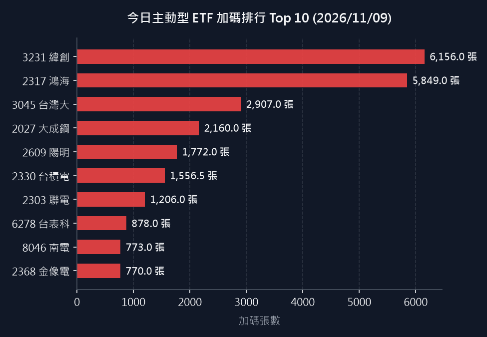
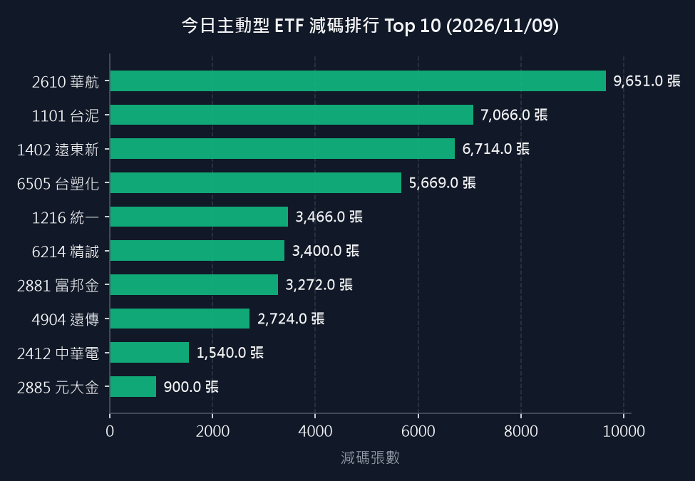

# 主動型 ETF 持股變動

資料來源：`主動型ETF持股明細.xlsx` 最近兩個日期分頁。

比較區間：`20261106` → `20261109`

## 今日加減碼視覺化排行

| 今日加碼 Top 10 | 今日減碼 Top 10 |
| :---: | :---: |
|  |  |

| ETF | 新增 | 刪除 | 比例變動 |
| :-- | --: | --: | --: |
| 00400A | 1 | 1 | 48 |
| 00401A | 2 | 0 | 55 |
| 00402A | 0 | 0 | 47 |
| 00403A | 1 | 1 | 32 |
| 00404A | 0 | 0 | 47 |
| 00405A | 0 | 0 | 26 |
| 00406A | 1 | 1 | 58 |
| 00407A | 0 | 0 | 43 |
| 00408A | 0 | 6 | 36 |
| 00980A | 0 | 0 | 48 |
| 00980D | 0 | 0 | 26 |
| 00981A | 0 | 0 | 32 |
| 00982A | 1 | 0 | 48 |
| 00983A | 0 | 2 | 32 |
| 00983D | 0 | 0 | 41 |
| 00984A | 0 | 0 | 67 |
| 00985A | 0 | 0 | 47 |
| 00986A | 0 | 2 | 29 |
| 00987A | 1 | 0 | 22 |
| 00988A | 0 | 4 | 30 |
| 00989A | 0 | 2 | 58 |
| 00990A | 0 | 0 | 35 |
| 00991A | 3 | 3 | 23 |
| 00992A | 0 | 1 | 39 |
| 00993A | 0 | 0 | 47 |
| 00994A | 0 | 4 | 32 |
| 00995A | 0 | 0 | 38 |
| 00996A | 3 | 2 | 37 |
| 00997A | 2 | 1 | 43 |
| 00998A | 1 | 2 | 51 |
| 00999A | 0 | 0 | 52 |

## 00400A

### 新增持股

- 台股期貨 2026/11(FITXN*1.TF)（4.31%，-0.15 張）

### 刪除持股

- 2881 富邦金（1.73%，3104 張）

### 投資比例變動

- 1303 南亞：3.72% → 3.80%（+0.08）
- 2059 川湖：4.18% → 4.55%（+0.37）
- 2303 聯電：1.48% → 1.41%（-0.07）
- 2308 台達電：1.92% → 1.91%（-0.01）
- 2313 華通：0.66% → 0.67%（+0.01）
- 2317 鴻海：0.81% → 1.80%（+0.99）
- 2327 國巨*：1.03% → 1.01%（-0.02）
- 2330 台積電：9.08% → 8.76%（-0.32）
- 2345 智邦：1.25% → 1.23%（-0.02）
- 2360 致茂：2.25% → 2.04%（-0.21）
- 2368 金像電：2.28% → 2.27%（-0.01）
- 2383 台光電：3.73% → 5.09%（+1.36）
- 2449 京元電子：0.82% → 0.73%（-0.09）
- 2454 聯發科：6.80% → 7.09%（+0.29）
- 2603 長榮：2.72% → 2.50%（-0.22）
- 2637 慧洋-KY：0.50% → 0.49%（-0.01）
- 2891 中信金：1.76% → 1.72%（-0.04）
- 3008 大立光：1.23% → 1.30%（+0.07）
- 3017 奇鋐：3.02% → 2.90%（-0.12）
- 3023 信邦：0.52% → 0.58%（+0.06）
- 3036 文曄：1.54% → 1.39%（-0.15）
- 3037 欣興：3.06% → 2.81%（-0.25）
- 3044 健鼎：2.02% → 1.98%（-0.04）
- 3081 聯亞：0.75% → 0.74%（-0.01）
- 3167 大量：0.32% → 0.29%（-0.03）
- 3231 緯創：0.97% → 0.94%（-0.03）
- 3293 鈊象：0.36% → 0.34%（-0.02）
- 3406 玉晶光：0.74% → 1.01%（+0.27）
- 3443 創意：2.23% → 2.25%（+0.02）
- 3529 力旺：1.03% → 0.99%（-0.04）
- 3653 健策：3.20% → 3.01%（-0.19）
- 3661 世芯-KY：2.04% → 2.07%（+0.03）
- 3665 貿聯-KY：1.20% → 1.12%（-0.08）
- 3711 日月光投控：0.95% → 0.90%（-0.05）
- 4958 臻鼎-KY：0.36% → 0.35%（-0.01）
- 5274 信驊：3.46% → 3.10%（-0.36）
- 5434 崇越：0.35% → 0.33%（-0.02）
- 6121 新普：0.23% → 0.22%（-0.01）
- 6147 頎邦：0.73% → 0.70%（-0.03）
- 6187 萬潤：0.86% → 0.82%（-0.04）
- 6223 旺矽：2.42% → 2.39%（-0.03）
- 6274 台燿：1.00% → 0.93%（-0.07）
- 6278 台表科：2.03% → 1.96%（-0.07）
- 6488 環球晶：1.27% → 1.23%（-0.04）
- 6505 台塑化：0.23% → 0.22%（-0.01）
- 7769 鴻勁：0.57% → 0.56%（-0.01）
- 9939 宏全：0.08% → 0.07%（-0.01）
- ＸＡＧＸ金兌(3533.HK)：0.90% → 1.39%（+0.49）

## 00401A

### 新增持股

- TAIWAN TAIE C 16DEC26 40000 TWSE（-0.07%，-0.02 張）
- TAIWAN TAIE C 18NOV26 40000 TWSE（-0.03%，-0.01 張）

### 刪除持股

- 無

### 投資比例變動

- 1216 統一：0.30% → 0.28%（-0.02）
- 1303 南亞：1.04% → 1.07%（+0.03）
- 1476 儒鴻：1.91% → 1.95%（+0.04）
- 1477 聚陽：0.99% → 0.97%（-0.02）
- 2059 川湖：0.67% → 1.88%（+1.21）
- 2303 聯電：2.47% → 2.36%（-0.11）
- 2313 華通：1.05% → 1.08%（+0.03）
- 2317 鴻海：0.56% → 0.55%（-0.01）
- 2327 國巨*：0.47% → 0.46%（-0.01）
- 2330 台積電：20.31% → 19.71%（-0.60）
- 2357 華碩：1.71% → 1.65%（-0.06）
- 2360 致茂：1.60% → 1.46%（-0.14）
- 2382 廣達：2.00% → 1.92%（-0.08）
- 2383 台光電：0.85% → 0.82%（-0.03）
- 2412 中華電：0.94% → 0.90%（-0.04）
- 2454 聯發科：5.01% → 5.24%（+0.23）
- 2455 全新：1.52% → 1.46%（-0.06）
- 2603 長榮：2.26% → 2.08%（-0.18）
- 2881 富邦金：2.12% → 2.03%（-0.09）
- 2882 國泰金：1.08% → 1.04%（-0.04）
- 2883 凱基金：1.54% → 1.50%（-0.04）
- 2884 玉山金：2.10% → 1.84%（-0.26）
- 2886 兆豐金：1.49% → 1.41%（-0.08）
- 2887 台新新光金：1.06% → 1.03%（-0.03）
- 2890 永豐金：1.63% → 1.55%（-0.08）
- 2891 中信金：2.47% → 2.44%（-0.03）
- 2912 統一超：0.26% → 0.25%（-0.01）
- 3008 大立光：2.08% → 2.20%（+0.12）
- 3034 聯詠：0.20% → 0.19%（-0.01）
- 3037 欣興：1.31% → 1.21%（-0.10）
- 3131 弘塑：0.48% → 0.47%（-0.01）
- 3231 緯創：2.00% → 1.95%（-0.05）
- 3443 創意：0.84% → 2.05%（+1.21）
- 3491 昇達科：1.39% → 1.37%（-0.02）
- 3711 日月光投控：4.10% → 3.91%（-0.19）
- 4904 遠傳：0.82% → 0.75%（-0.07）
- 4938 和碩：0.33% → 0.32%（-0.01）
- 4958 臻鼎-KY：1.03% → 1.02%（-0.01）
- 4991 環宇-KY：0.44% → 0.42%（-0.02）
- 5274 信驊：1.36% → 1.23%（-0.13）
- 5347 世界：1.00% → 1.02%（+0.02）
- 5871 中租-KY：0.14% → 0.13%（-0.01）
- 6147 頎邦：1.05% → 1.01%（-0.04）
- 6187 萬潤：1.08% → 1.48%（+0.40）
- 6223 旺矽：1.38% → 1.33%（-0.05）
- 6285 啟碁：1.07% → 1.03%（-0.04）
- 6515 穎崴：0.68% → 0.64%（-0.04）
- 6531 愛普*：1.17% → 1.18%（+0.01）
- 6669 緯穎：1.50% → 1.45%（-0.05）
- 7769 鴻勁：0.63% → 0.62%（-0.01）
- 7856 漢測：0.77% → 0.72%（-0.05）
- 8464 億豐：1.02% → 0.93%（-0.09）
- 台股期貨11/26(FITXN*1.TF)：-0.82% → -0.85%（-0.03）
- 臺指選擇權11/26 43300 買權：-0.03% → -0.01%（+0.02）
- 臺指選擇權11/26 46500 買權：-0.06% → -0.01%（+0.05）

## 00402A

### 新增持股

- 無

### 刪除持股

- 無

### 投資比例變動

- AAPL.US Apple：8.83% → 9.27%（+0.44）
- ADI.US Analog Devices：2.17% → 2.08%（-0.09）
- AMD.US AMD：5.65% → 5.57%（-0.08）
- AMZN.US Amazon：5.02% → 5.26%（+0.24）
- ANET.US Arista Networks：0.84% → 0.86%（+0.02）
- ARM.US Arm：0.74% → 0.72%（-0.02）
- ASML.US ASML Holding：1.15% → 1.18%（+0.03）
- AVGO.US Broadcom：2.28% → 2.21%（-0.07）
- AXON.US Axon Enterprise：0.65% → 0.52%（-0.13）
- BABA.US Alibaba Group：0.52% → 0.58%（+0.06）
- CDNS.US Cadence Design Systems：1.65% → 1.72%（+0.07）
- CIEN.US Ciena：0.96% → 0.92%（-0.04）
- CLS.US Celestica：1.03% → 0.97%（-0.06）
- COHR.US Coherent：1.03% → 1.09%（+0.06）
- CRWD.US CrowdStrike Holdings：1.87% → 1.81%（-0.06）
- FSLY.US Fastly：0.34% → 0.27%（-0.07）
- GOOG.US Alphabet - Class C Capital Stock：3.16% → 3.35%（+0.19）
- GOOGL.US Alphabet - Class A Common Stock：3.16% → 3.34%（+0.18）
- INTC.US Intel：0.98% → 1.02%（+0.04）
- IOT.US Samsara：0.62% → 0.64%（+0.02）
- KLAC.US KLA：1.35% → 1.34%（-0.01）
- LITE.US Lumentum：1.37% → 1.26%（-0.11）
- LRCX.US Lam Research：2.08% → 2.02%（-0.06）
- MCHP.US Microchip Technology：1.48% → 1.23%（-0.25）
- MDB.US MongoDB：0.38% → 0.39%（+0.01）
- META.US Meta：3.68% → 3.83%（+0.15）
- MRVL.US Marvell：1.19% → 1.13%（-0.06）
- MSFT.US Microsoft：6.21% → 6.37%（+0.16）
- MU.US Micron：5.36% → 4.99%（-0.37）
- NFLX.US Netflix：1.03% → 1.05%（+0.02）
- NOW.US ServiceNow：0.93% → 0.94%（+0.01）
- NVDA.US NVIDIA：8.70% → 8.71%（+0.01）
- PANW.US Palo Alto：2.95% → 2.86%（-0.09）
- SHOP.US Shopify：1.19% → 1.24%（+0.05）
- SIMO.US Silicon Motion：0.45% → 0.43%（-0.02）
- SKHY.US SK hynix：0.85% → 0.81%（-0.04）
- SNOW.US Snowflake：1.29% → 1.31%（+0.02）
- SPCX.US SpaceX：0.74% → 0.79%（+0.05）
- SPOT.US Spotify：0.48% → 0.50%（+0.02）
- STX.US Seagate：0.93% → 0.83%（-0.10）
- TER.US Teradyne：0.61% → 0.57%（-0.04）
- TSM.US TSMC(ADR)：1.53% → 1.55%（+0.02）
- TTWO.US Take-Two：0.66% → 0.73%（+0.07）
- TXN.US Texas Instruments：2.92% → 2.79%（-0.13）
- UBER.US Uber：0.35% → 0.36%（+0.01）
- V.US Visa：1.46% → 1.52%（+0.06）
- WDC.US Western Digital：1.75% → 1.53%（-0.22）

## 00403A

### 新增持股

- 3044 健鼎（0.12%，300 張）

### 刪除持股

- 2360 致茂（0.00%，1 張）

### 投資比例變動

- 1303 南亞：2.73% → 2.92%（+0.19）
- 1560 中砂：0.39% → 0.47%（+0.08）
- 2059 川湖：0.71% → 0.70%（-0.01）
- 2308 台達電：2.17% → 2.18%（+0.01）
- 2313 華通：0.29% → 0.30%（+0.01）
- 2327 國巨*：3.15% → 3.14%（-0.01）
- 2330 台積電：15.84% → 16.00%（+0.16）
- 2368 金像電：0.79% → 0.80%（+0.01）
- 2383 台光電：4.35% → 4.24%（-0.11）
- 2408 南亞科：0.89% → 0.90%（+0.01）
- 2449 京元電子：0.81% → 0.73%（-0.08）
- 2454 聯發科：5.11% → 5.56%（+0.45）
- 2882 國泰金：0.49% → 0.48%（-0.01）
- 3008 大立光：1.50% → 1.60%（+0.10）
- 3017 奇鋐：5.37% → 5.22%（-0.15）
- 3037 欣興：5.09% → 4.73%（-0.36）
- 3189 景碩：2.91% → 2.66%（-0.25）
- 3211 順達：0.38% → 0.29%（-0.09）
- 3443 創意：4.02% → 4.13%（+0.11）
- 3450 聯鈞：0.45% → 0.44%（-0.01）
- 3583 辛耘：0.24% → 0.23%（-0.01）
- 3653 健策：5.28% → 5.04%（-0.24）
- 3665 貿聯-KY：1.90% → 1.80%（-0.10）
- 3711 日月光投控：1.04% → 1.00%（-0.04）
- 5274 信驊：2.02% → 1.83%（-0.19）
- 6223 旺矽：3.06% → 2.99%（-0.07）
- 6274 台燿：2.13% → 1.90%（-0.23）
- 6285 啟碁：0.06% → 0.05%（-0.01）
- 6669 緯穎：2.70% → 2.64%（-0.06）
- 6805 富世達：0.51% → 0.50%（-0.01）
- 8046 南電：2.59% → 2.44%（-0.15）
- 8996 高力：2.14% → 2.09%（-0.05）

## 00404A

### 新增持股

- 無

### 刪除持股

- 無

### 投資比例變動

- 1303 南亞：0.75% → 0.79%（+0.04）
- 2301 光寶科：0.49% → 0.50%（+0.01）
- 2303 聯電：2.72% → 2.67%（-0.05）
- 2308 台達電：1.82% → 1.86%（+0.04）
- 2317 鴻海：0.72% → 0.73%（+0.01）
- 2330 台積電：23.04% → 22.94%（-0.10）
- 2345 智邦：0.86% → 0.87%（+0.01）
- 2347 聯強：1.81% → 1.68%（-0.13）
- 2351 順德：0.31% → 0.28%（-0.03）
- 2357 華碩：1.22% → 1.21%（-0.01）
- 2360 致茂：0.49% → 0.46%（-0.03）
- 2379 瑞昱：1.08% → 1.11%（+0.03）
- 2382 廣達：1.03% → 1.01%（-0.02）
- 2383 台光電：2.90% → 2.87%（-0.03）
- 2395 研華：1.25% → 1.22%（-0.03）
- 2436 偉詮電：1.04% → 0.98%（-0.06）
- 2454 聯發科：6.99% → 7.51%（+0.52）
- 2851 中再保：1.15% → 1.09%（-0.06）
- 2882 國泰金：2.73% → 2.70%（-0.03）
- 2885 元大金：2.40% → 2.41%（+0.01）
- 2887 台新新光金：1.38% → 1.37%（-0.01）
- 2890 永豐金：1.46% → 1.43%（-0.03）
- 3017 奇鋐：1.30% → 1.29%（-0.01）
- 3034 聯詠：1.99% → 1.89%（-0.10）
- 3037 欣興：0.34% → 0.32%（-0.02）
- 3293 鈊象：1.12% → 1.10%（-0.02）
- 3443 創意：1.09% → 1.13%（+0.04）
- 3653 健策：0.49% → 0.48%（-0.01）
- 3680 家登：0.44% → 0.45%（+0.01）
- 3711 日月光投控：3.14% → 3.07%（-0.07）
- 5274 信驊：2.66% → 2.45%（-0.21）
- 5434 崇越：1.67% → 1.62%（-0.05）
- 5876 上海商銀：1.47% → 1.46%（-0.01）
- 5904 寶雅*：0.45% → 0.46%（+0.01）
- 6196 帆宣：1.72% → 1.63%（-0.09）
- 6223 旺矽：1.11% → 1.10%（-0.01）
- 6257 矽格：1.72% → 1.65%（-0.07）
- 6491 晶碩：0.97% → 0.93%（-0.04）
- 6505 台塑化：0.46% → 0.47%（+0.01）
- 6669 緯穎：1.03% → 1.02%（-0.01）
- 6691 洋基工程：1.81% → 1.72%（-0.09）
- 7769 鴻勁：1.12% → 1.14%（+0.02）
- 8016 矽創：1.22% → 1.25%（+0.03）
- 8081 致新：0.83% → 0.79%（-0.04）
- 8299 群聯：1.10% → 1.16%（+0.06）
- 台指選擇權11/26 48000 買權：-0.04% → -0.01%（+0.03）
- 台股期貨11/26(FITXN*1.TF)：19.88% → 19.65%（-0.23）

## 00405A

### 新增持股

- 無

### 刪除持股

- 無

### 投資比例變動

- 2059 川湖：2.12% → 2.10%（-0.02）
- 2308 台達電：0.56% → 0.57%（+0.01）
- 2330 台積電：2.15% → 2.10%（-0.05）
- 2345 智邦：4.38% → 4.49%（+0.11）
- 2368 金像電：5.14% → 5.29%（+0.15）
- 2383 台光電：4.55% → 4.53%（-0.02）
- 2454 聯發科：6.66% → 6.84%（+0.18）
- 3017 奇鋐：1.66% → 1.71%（+0.05）
- 3037 欣興：4.20% → 4.09%（-0.11）
- 3189 景碩：0.19% → 0.18%（-0.01）
- 3443 創意：2.54% → 2.57%（+0.03）
- 3653 健策：7.63% → 7.69%（+0.06）
- 3711 日月光投控：1.49% → 1.48%（-0.01）
- 5274 信驊：5.83% → 5.60%（-0.23）
- 5347 世界：0.14% → 0.15%（+0.01）
- 6187 萬潤：0.72% → 0.74%（+0.02）
- 6223 旺矽：6.25% → 6.28%（+0.03）
- 6274 台燿：1.56% → 1.54%（-0.02）
- 6415 矽力*-KY：0.55% → 0.56%（+0.01）
- 6515 穎崴：0.43% → 0.42%（-0.01）
- 6531 愛普*：3.52% → 3.61%（+0.09）
- 6669 緯穎：0.87% → 0.86%（-0.01）
- 6805 富世達：1.62% → 1.66%（+0.04）
- 7769 鴻勁：2.48% → 2.54%（+0.06）
- 8046 南電：6.38% → 6.36%（-0.02）
- 8996 高力：1.32% → 1.34%（+0.02）

## 00406A

### 新增持股

- 臺指選擇權第二週週五到期契約（-5.82%，-5 張）

### 刪除持股

- 臺指選擇權第一週週五到期契約（-12.76%，-15.817 張）

### 投資比例變動

- 1303 南亞：2.18% → 2.17%（-0.01）
- 2059 川湖：1.67% → 1.80%（+0.13）
- 2303 聯電：1.19% → 1.11%（-0.08）
- 2308 台達電：1.64% → 1.59%（-0.05）
- 2317 鴻海：0.24% → 0.23%（-0.01）
- 2327 國巨*：1.44% → 1.38%（-0.06）
- 2330 台積電：9.49% → 9.06%（-0.43）
- 2345 智邦：1.98% → 1.90%（-0.08）
- 2360 致茂：0.64% → 0.57%（-0.07）
- 2368 金像電：2.38% → 2.32%（-0.06）
- 2383 台光電：6.05% → 6.08%（+0.03）
- 2449 京元電子：0.40% → 0.35%（-0.05）
- 2454 聯發科：6.06% → 6.16%（+0.10）
- 2481 強茂：0.30% → 0.28%（-0.02）
- 2486 一詮：0.10% → 0.09%（-0.01）
- 2881 富邦金：0.71% → 0.66%（-0.05）
- 2882 國泰金：0.70% → 0.66%（-0.04）
- 2884 玉山金：0.32% → 0.30%（-0.02）
- 2885 元大金：0.57% → 0.54%（-0.03）
- 2886 兆豐金：0.48% → 0.44%（-0.04）
- 2887 台新新光金：0.49% → 0.46%（-0.03）
- 2890 永豐金：0.32% → 0.30%（-0.02）
- 3008 大立光：0.98% → 1.01%（+0.03）
- 3017 奇鋐：5.28% → 5.30%（+0.02）
- 3037 欣興：5.51% → 5.20%（-0.31）
- 3081 聯亞：1.14% → 1.10%（-0.04）
- 3105 穩懋：0.54% → 0.50%（-0.04）
- 3167 大量：0.54% → 0.49%（-0.05）
- 3189 景碩：1.80% → 1.58%（-0.22）
- 3231 緯創：0.35% → 0.33%（-0.02）
- 3264 欣銓：0.29% → 0.28%（-0.01）
- 3443 創意：2.09% → 2.07%（-0.02）
- 3450 聯鈞：0.08% → 0.07%（-0.01）
- 3491 昇達科：0.29% → 0.27%（-0.02）
- 3529 力旺：0.11% → 0.10%（-0.01）
- 3661 世芯-KY：0.70% → 0.69%（-0.01）
- 3665 貿聯-KY：1.11% → 1.01%（-0.10）
- 3711 日月光投控：2.14% → 2.16%（+0.02）
- 4938 和碩：0.50% → 0.46%（-0.04）
- 4958 臻鼎-KY：0.86% → 0.82%（-0.04）
- 5274 信驊：1.42% → 1.24%（-0.18）
- 6147 頎邦：0.66% → 0.61%（-0.05）
- 6213 聯茂：0.41% → 0.37%（-0.04）
- 6223 旺矽：2.87% → 2.70%（-0.17）
- 6274 台燿：2.01% → 1.82%（-0.19）
- 6278 台表科：0.21% → 0.20%（-0.01）
- 6446 藥華藥：0.59% → 0.65%（+0.06）
- 6510 精測：0.50% → 0.48%（-0.02）
- 6669 緯穎：1.06% → 1.00%（-0.06）
- 6715 嘉基：0.72% → 0.73%（+0.01）
- 6805 富世達：1.01% → 0.95%（-0.06）
- 7769 鴻勁：0.12% → 0.11%（-0.01）
- 8046 南電：2.97% → 3.07%（+0.10）
- 8150 南茂：0.03% → 0.02%（-0.01）
- 8358 金居：0.06% → 0.05%（-0.01）
- 8996 高力：0.71% → 0.67%（-0.04）
- 臺指選擇權第二週週三到期契約：-4.89% → -16.74%（-11.85）
- 臺股期貨 202611(FITXN*1.TF)：22.27% → 20.85%（-1.42）

## 00407A

### 新增持股

- 無

### 刪除持股

- 無

### 投資比例變動

- 1303 南亞：3.34% → 3.40%（+0.06）
- 1560 中砂：0.95% → 0.97%（+0.02）
- 2059 川湖：1.77% → 1.74%（-0.03）
- 2301 光寶科：1.34% → 1.37%（+0.03）
- 2303 聯電：0.47% → 0.46%（-0.01）
- 2308 台達電：1.99% → 2.03%（+0.04）
- 2313 華通：0.37% → 0.38%（+0.01）
- 2327 國巨*：1.96% → 1.99%（+0.03）
- 2330 台積電：11.20% → 11.35%（+0.15）
- 2345 智邦：1.35% → 1.37%（+0.02）
- 2360 致茂：0.74% → 0.71%（-0.03）
- 2368 金像電：1.87% → 1.90%（+0.03）
- 2379 瑞昱：0.29% → 0.28%（-0.01）
- 2383 台光電：5.77% → 6.00%（+0.23）
- 2451 創見：0.36% → 0.33%（-0.03）
- 2454 聯發科：6.20% → 6.32%（+0.12）
- 2615 萬海：1.16% → 1.07%（-0.09）
- 3008 大立光：1.35% → 1.38%（+0.03）
- 3017 奇鋐：5.05% → 5.15%（+0.10）
- 3034 聯詠：0.88% → 0.80%（-0.08）
- 3037 欣興：5.25% → 5.07%（-0.18）
- 3081 聯亞：1.57% → 1.60%（+0.03）
- 3131 弘塑：0.67% → 0.68%（+0.01）
- 3231 緯創：1.12% → 1.09%（-0.03）
- 3260 威剛：0.31% → 0.29%（-0.02）
- 3293 鈊象：0.73% → 0.69%（-0.04）
- 3406 玉晶光：0.50% → 0.47%（-0.03）
- 3443 創意：4.63% → 4.64%（+0.01）
- 3491 昇達科：0.85% → 0.87%（+0.02）
- 3533 嘉澤：0.97% → 0.96%（-0.01）
- 3665 貿聯-KY：2.15% → 2.59%（+0.44）
- 3711 日月光投控：3.20% → 3.16%（-0.04）
- 4958 臻鼎-KY：0.91% → 0.90%（-0.01）
- 5274 信驊：1.55% → 1.48%（-0.07）
- 5434 崇越：0.22% → 0.21%（-0.01）
- 6187 萬潤：1.28% → 1.31%（+0.03）
- 6274 台燿：1.64% → 1.61%（-0.03）
- 6510 精測：1.27% → 1.30%（+0.03）
- 6531 愛普*：0.27% → 0.28%（+0.01）
- 6669 緯穎：2.43% → 2.39%（-0.04）
- 6805 富世達：1.11% → 1.13%（+0.02）
- 8046 南電：3.11% → 3.07%（-0.04）
- 8299 群聯：0.30% → 0.31%（+0.01）

## 00408A

### 新增持股

- 無

### 刪除持股

- 2308 台達電（1.53%，16.899 張）
- 2455 全新（0.66%，24 張）
- 3081 聯亞（0.76%，5 張）
- 3665 貿聯-KY（0.00%，0.01 張）
- 6187 萬潤（0.84%，11 張）
- 6691 洋基工程（0.33%，7 張）

### 投資比例變動

- 1216 統一：0.13% → 0.12%（-0.01）
- 1303 南亞：3.59% → 3.82%（+0.23）
- 1560 中砂：0.74% → 1.36%（+0.62）
- 2327 國巨*：0.68% → 0.70%（+0.02）
- 2330 台積電：6.45% → 7.65%（+1.20）
- 2344 華邦電：0.41% → 0.43%（+0.02）
- 2368 金像電：4.38% → 4.55%（+0.17）
- 2383 台光電：4.43% → 4.44%（+0.01）
- 2395 研華：1.62% → 1.60%（-0.02）
- 2408 南亞科：1.18% → 1.22%（+0.04）
- 2449 京元電子：0.86% → 0.79%（-0.07）
- 2454 聯發科：3.88% → 4.21%（+0.33）
- 2542 興富發：4.18% → 4.13%（-0.05）
- 2603 長榮：1.82% → 1.74%（-0.08）
- 2880 華南金：1.39% → 1.40%（+0.01）
- 2891 中信金：1.98% → 2.39%（+0.41）
- 3026 禾伸堂：1.10% → 1.05%（-0.05）
- 3037 欣興：2.63% → 2.51%（-0.12）
- 3044 健鼎：0.35% → 1.11%（+0.76）
- 3045 台灣大：0.14% → 0.67%（+0.53）
- 3189 景碩：2.90% → 2.73%（-0.17）
- 3231 緯創：0.96% → 1.51%（+0.55）
- 3264 欣銓：0.33% → 0.34%（+0.01）
- 3443 創意：0.51% → 0.54%（+0.03）
- 3653 健策：3.63% → 3.55%（-0.08）
- 3711 日月光投控：2.15% → 2.67%（+0.52）
- 4904 遠傳：0.54% → 1.03%（+0.49）
- 5434 崇越：2.25% → 2.21%（-0.04）
- 6274 台燿：2.09% → 2.02%（-0.07）
- 6510 精測：0.40% → 0.41%（+0.01）
- 6669 緯穎：1.95% → 2.49%（+0.54）
- 6805 富世達：2.10% → 2.70%（+0.60）
- 7769 鴻勁：0.80% → 0.82%（+0.02）
- 8046 南電：0.54% → 0.53%（-0.01）
- 8996 高力：2.27% → 2.89%（+0.62）
- 9802 鈺齊-KY：0.99% → 0.98%（-0.01）

## 00980A

### 新增持股

- 無

### 刪除持股

- 無

### 投資比例變動

- 1303 南亞：3.27% → 3.31%（+0.04）
- 2059 川湖：3.85% → 3.76%（-0.09）
- 2303 聯電：1.35% → 1.31%（-0.04）
- 2308 台達電：2.75% → 2.79%（+0.04）
- 2317 鴻海：3.55% → 3.48%（-0.07）
- 2327 國巨*：0.77% → 0.78%（+0.01）
- 2330 台積電：10.35% → 10.00%（-0.35）
- 2344 華邦電：1.50% → 1.52%（+0.02）
- 2345 智邦：0.82% → 0.84%（+0.02）
- 2360 致茂：0.85% → 0.82%（-0.03）
- 2368 金像電：1.76% → 1.79%（+0.03）
- 2376 技嘉：1.68% → 1.61%（-0.07）
- 2382 廣達：2.06% → 1.94%（-0.12）
- 2383 台光電：3.54% → 3.48%（-0.06）
- 2408 南亞科：2.14% → 2.13%（-0.01）
- 2454 聯發科：5.44% → 5.51%（+0.07）
- 2884 玉山金：1.47% → 1.36%（-0.11）
- 2891 中信金：1.85% → 1.76%（-0.09）
- 3008 大立光：1.88% → 1.90%（+0.02）
- 3017 奇鋐：1.99% → 2.02%（+0.03）
- 3026 禾伸堂：0.88% → 0.85%（-0.03）
- 3036 文曄：1.08% → 0.98%（-0.10）
- 3037 欣興：2.93% → 2.81%（-0.12）
- 3044 健鼎：1.20% → 1.19%（-0.01）
- 3081 聯亞：1.35% → 1.37%（+0.02）
- 3189 景碩：1.15% → 1.09%（-0.06）
- 3231 緯創：1.71% → 1.66%（-0.05）
- 3264 欣銓：0.69% → 0.70%（+0.01）
- 3293 鈊象：0.52% → 0.49%（-0.03）
- 3443 創意：1.80% → 1.79%（-0.01）
- 3529 力旺：0.15% → 0.14%（-0.01）
- 3653 健策：3.03% → 3.01%（-0.02）
- 3665 貿聯-KY：1.22% → 1.21%（-0.01）
- 3711 日月光投控：2.11% → 2.07%（-0.04）
- 5274 信驊：1.49% → 1.41%（-0.08）
- 5904 寶雅*：0.81% → 0.76%（-0.05）
- 6213 聯茂：1.14% → 1.12%（-0.02）
- 6223 旺矽：1.09% → 1.08%（-0.01）
- 6274 台燿：1.03% → 1.01%（-0.02）
- 6515 穎崴：1.29% → 1.27%（-0.02）
- 6669 緯穎：1.85% → 1.81%（-0.04）
- 6805 富世達：0.59% → 0.60%（+0.01）
- 7751 竑騰：0.59% → 0.57%（-0.02）
- 7769 鴻勁：1.68% → 1.70%（+0.02）
- 8046 南電：1.41% → 1.39%（-0.02）
- 8210 勤誠：0.33% → 0.32%（-0.01）
- 8299 群聯：1.00% → 1.02%（+0.02）
- 台灣證交所加權股價指數(FITXN*1.TF)：3.06% → 4.93%（+1.87）

## 00980D

### 新增持股

- 無

### 刪除持股

- 無

### 投資比例變動

- ANHEUSER-BUSCH INBEV WOR (REG) 8.2% 15JAN2039：0.55% → 0.54%（-0.01）
- BLUE OWL CREDIT INCOME (REG) 6.6% 15SEP2029：0.41% → 0.40%（-0.01）
- CHARTER COMM OPT LLC/CAP 6.700000 % 01-DEC-2055：0.45% → 0.46%（+0.01）
- COREWEAVE INC SER REGS (REG) (REG S) 9.625% 15JUL2032：0.45% → 0.46%（+0.01）
- DAIMLER FINANCE NA LLC REG 8.5% 18JAN2031：0.67% → 0.66%（-0.01）
- DOW CHEMICAL CO/THE (REG) 5.6% 15FEB2054：0.64% → 0.63%（-0.01）
- ENERGY TRANSFER LP (REG) 7.5% 01JUL2038：0.35% → 0.34%（-0.01）
- HERTZ CORP/THE SER REGS (REG S) 12.625% 15JUL2029：0.27% → 0.26%（-0.01）
- HESS CORP (REG) 7.3% 15AUG2031：0.56% → 0.55%（-0.01）
- JETBLUE AIRWAYS/LOYALTY SER REGS (REG S) 9.875% 20SEP2031：0.34% → 0.35%（+0.01）
- MPLX LP 6.200000 % 15SEP2055：0.35% → 0.36%（+0.01）
- ORACLE CORP (REG) 5.500000 % 27SEP2064：0.42% → 0.41%（-0.01）
- ORACLE CORP 6.125000 % 03AUG2065：0.55% → 0.54%（-0.01）
- ORACLE CORP 6.85 % 04-FEB-2066：0.55% → 0.54%（-0.01）
- ORACLE CORP 6.9% 09NOV2052：0.51% → 0.50%（-0.01）
- ORANGE SA (REG) 9% 01MAR2031：0.69% → 0.68%（-0.01）
- POLARIS INC 6.950000 % 15MAR2029：0.50% → 0.49%（-0.01）
- SABRE GLBL INC SER REGS 11.125000 % 15JUL2030：0.50% → 0.49%（-0.01）
- SES GLOBAL AMERICAS HLDG SER REGS (REG) 5.300000 % 25MAR2044：0.31% → 0.32%（+0.01）
- SPRINT CAPITAL CORP (REG) 8.75% 15MAR2032：0.43% → 0.42%（-0.01）
- US 10YR NOTE (CBT)DEC26 21-DEC-2026：18.85% → 18.62%（-0.23）
- US 10YR ULTRA FUT DEC26 21-DEC-2026：-2.21% → -2.39%（-0.18）
- US 5YR NOTE (CBT) DEC26 31-DEC-2026：-15.48% → -15.81%（-0.33）
- US ACUTE CARE SOLUTIONS SER REGS (REG S) 9.75% 15MAY2029：0.33% → 0.34%（+0.01）
- US LONG BOND(CBT) DEC26 21-DEC-2026：5.69% → 5.68%（-0.01）
- US ULTRA BOND CBT DEC26 21-DEC-2026：-0.19% → -0.56%（-0.37）

## 00981A

### 新增持股

- 無

### 刪除持股

- 無

### 投資比例變動

- 2303 聯電：3.14% → 3.03%（-0.11）
- 2308 台達電：3.43% → 3.46%（+0.03）
- 2317 鴻海：0.00% → 0.44%（+0.44）
- 2327 國巨*：3.77% → 3.80%（+0.03）
- 2330 台積電：15.17% → 15.58%（+0.41）
- 2345 智邦：3.47% → 3.50%（+0.03）
- 2368 金像電：2.69% → 2.71%（+0.02）
- 2383 台光電：7.09% → 6.93%（-0.16）
- 2449 京元電子：0.68% → 0.64%（-0.04）
- 2454 聯發科：8.30% → 8.37%（+0.07）
- 2891 中信金：0.17% → 0.16%（-0.01）
- 3017 奇鋐：6.59% → 6.65%（+0.06）
- 3037 欣興：6.15% → 5.88%（-0.27）
- 3231 緯創：0.41% → 0.79%（+0.38）
- 3264 欣銓：0.35% → 0.36%（+0.01）
- 3443 創意：2.53% → 2.51%（-0.02）
- 3653 健策：5.67% → 5.66%（-0.01）
- 3665 貿聯-KY：1.64% → 1.61%（-0.03）
- 3711 日月光投控：3.82% → 3.73%（-0.09）
- 5274 信驊：1.16% → 1.10%（-0.06）
- 6187 萬潤：0.04% → 0.05%（+0.01）
- 6223 旺矽：3.70% → 3.65%（-0.05）
- 6274 台燿：2.85% → 2.78%（-0.07）
- 6278 台表科：0.00% → 0.06%（+0.06）
- 6510 精測：0.46% → 0.47%（+0.01）
- 6515 穎崴：0.10% → 0.09%（-0.01）
- 6669 緯穎：2.19% → 2.12%（-0.07）
- 6805 富世達：1.02% → 1.06%（+0.04）
- 8046 南電：3.37% → 3.30%（-0.07）
- 8358 金居：0.08% → 0.09%（+0.01）
- 8996 高力：0.50% → 0.49%（-0.01）
- 台指期貨 2026/11(FITXN*1.TF)：2.95% → 2.83%（-0.12）

## 00982A

### 新增持股

- 3045 台灣大（0.89%，2856 張）

### 刪除持股

- 無

### 投資比例變動

- 2059 川湖：2.64% → 2.68%（+0.04）
- 2301 光寶科：1.70% → 1.71%（+0.01）
- 2303 聯電：1.27% → 1.24%（-0.03）
- 2330 台積電：8.81% → 8.53%（-0.28）
- 2360 致茂：3.18% → 2.97%（-0.21）
- 2376 技嘉：1.37% → 1.34%（-0.03）
- 2377 微星：0.38% → 0.40%（+0.02）
- 2383 台光電：3.18% → 3.14%（-0.04）
- 2395 研華：1.43% → 1.39%（-0.04）
- 2428 興勤：1.16% → 1.10%（-0.06）
- 2454 聯發科：7.54% → 8.45%（+0.91）
- 2455 全新：1.33% → 1.30%（-0.03）
- 2467 志聖：0.83% → 0.49%（-0.34）
- 2478 大毅：0.33% → 0.34%（+0.01）
- 2486 一詮：0.62% → 0.41%（-0.21）
- 2885 元大金：0.37% → 0.36%（-0.01）
- 3008 大立光：2.86% → 3.06%（+0.20）
- 3017 奇鋐：2.39% → 2.34%（-0.05）
- 3037 欣興：0.78% → 0.72%（-0.06）
- 3090 日電貿：0.34% → 0.36%（+0.02）
- 3105 穩懋：7.78% → 7.47%（-0.31）
- 3231 緯創：2.02% → 1.99%（-0.03）
- 3265 台星科：1.34% → 1.22%（-0.12）
- 3491 昇達科：3.40% → 3.33%（-0.07）
- 3583 辛耘：0.62% → 0.40%（-0.22）
- 3617 碩天：0.35% → 0.36%（+0.01）
- 3711 日月光投控：1.92% → 1.85%（-0.07）
- 4958 臻鼎-KY：3.04% → 2.98%（-0.06）
- 5274 信驊：1.14% → 1.05%（-0.09）
- 5425 台半：1.16% → 1.18%（+0.02）
- 5483 中美晶：1.27% → 1.30%（+0.03）
- 5536 聖暉*：0.94% → 0.93%（-0.01）
- 6139 亞翔：5.32% → 5.42%（+0.10）
- 6196 帆宣：0.33% → 0.32%（-0.01）
- 6213 聯茂：1.67% → 1.57%（-0.10）
- 6214 精誠：1.51% → 0.04%（-1.47）
- 6223 旺矽：2.74% → 2.64%（-0.10）
- 6239 力成：1.30% → 1.28%（-0.02）
- 6274 台燿：1.06% → 1.02%（-0.04）
- 6446 藥華藥：0.12% → 0.14%（+0.02）
- 6472 保瑞：0.98% → 1.02%（+0.04）
- 6488 環球晶：1.55% → 1.52%（-0.03）
- 6510 精測：0.91% → 0.90%（-0.01）
- 6531 愛普*：3.64% → 4.48%（+0.84）
- 6640 均華：0.27% → 0.20%（-0.07）
- 6669 緯穎：2.04% → 1.97%（-0.07）
- 6672 騰輝電子-KY：2.60% → 2.70%（+0.10）
- 8996 高力：1.20% → 1.16%（-0.04）

## 00983A

### 新增持股

- 無

### 刪除持股

- BWXT.US BWX Technologies（0.00%，0.008 張）
- KTOS.US Kratos Defense & Security（0.09%，0.682 張）

### 投資比例變動

- ACHR.US Archer：0.05% → 0.06%（+0.01）
- AMD.US AMD：2.83% → 3.05%（+0.22）
- AMZN.US Amazon：4.55% → 4.42%（-0.13）
- AVGO.US Broadcom：1.79% → 1.75%（-0.04）
- BEAM.US Beam Therapeutics：2.84% → 2.82%（-0.02）
- BMNR.US BitMine：1.43% → 1.38%（-0.05）
- COIN.US Coinbase：3.33% → 3.19%（-0.14）
- CRCL.US Circle：4.18% → 3.97%（-0.21）
- CRSP.US CRISPR Therapeutics：4.16% → 4.17%（+0.01）
- DE.US Deere：0.50% → 0.49%（-0.01）
- GOOG.US Alphabet - Class C Capital Stock：2.62% → 2.57%（-0.05）
- GOOGL.US Alphabet - Class A Common Stock：1.63% → 1.60%（-0.03）
- HOOD.US Robinhood Markets：2.52% → 2.53%（+0.01）
- LLY.US Eli Lilly：2.03% → 1.96%（-0.07）
- META.US Meta：3.37% → 3.31%（-0.06）
- MSFT.US Microsoft：1.34% → 1.29%（-0.05）
- NET.US Cloudflare：1.31% → 1.40%（+0.09）
- NTLA.US Intellia Therapeutics：1.93% → 1.92%（-0.01）
- NTRA.US Natera：1.74% → 1.44%（-0.30）
- PACB.US Pacific Biosciences of Californi：0.08% → 0.07%（-0.01）
- PLTR.US Palantir Technologies：3.03% → 3.05%（+0.02）
- RKLB.US Rocket Lab：1.23% → 1.38%（+0.15）
- RXRX.US Recursion Pharmaceuticals：1.20% → 1.18%（-0.02）
- SHOP.US Shopify：4.93% → 4.97%（+0.04）
- SPCX.US SpaceX：6.51% → 7.41%（+0.90）
- TEM.US Tempus：6.47% → 6.80%（+0.33）
- TSLA.US Tesla：8.12% → 8.26%（+0.14）
- TSM.US TSMC(ADR)：2.59% → 2.68%（+0.09）
- TWST.US Twist Bioscience：3.55% → 3.46%（-0.09）
- TXG.US 10x Genomics：3.04% → 3.02%（-0.02）
- WGS.US GeneDx：0.55% → 0.52%（-0.03）
- XYZ.US Block：1.63% → 1.61%（-0.02）

## 00983D

### 新增持股

- 無

### 刪除持股

- 無

### 投資比例變動

- ABIBB 8.2 01/15/39：1.93% → 1.94%（+0.01）
- AET 6 5/8 06/15/36：0.80% → 0.81%（+0.01）
- AMCX 10 1/2 07/15/32：1.69% → 1.71%（+0.02）
- ATH 6 5/8 05/19/55：1.07% → 0.92%（-0.15）
- BACR 7.437 11/02/33：1.38% → 1.39%（+0.01）
- BATSLN 7.081 08/02/53：1.26% → 1.27%（+0.01）
- BHCCN 11 09/30/28：2.10% → 2.11%（+0.01）
- BRITEL 9 5/8 12/15/30：1.47% → 1.48%（+0.01）
- C 8 1/8 07/15/39：1.90% → 1.91%（+0.01）
- CMCSA 6.95 08/15/37：0.73% → 0.55%（-0.18）
- CRWV 9 02/01/31：1.19% → 1.20%（+0.01）
- CYH 10 7/8 01/15/32：1.44% → 1.45%（+0.01）
- DELL 8.35 07/15/46：1.49% → 1.50%（+0.01）
- DOW 6.9 05/15/53：0.83% → 0.84%（+0.01）
- DOW 9.4 05/15/39：1.90% → 1.91%（+0.01）
- DT 9 1/4 06/01/32：1.64% → 1.65%（+0.01）
- DTV 8 7/8 02/01/30：1.75% → 1.76%（+0.01）
- DUK 7 3/4 03/01/31：1.70% → 1.71%（+0.01）
- ED 6 3/4 04/01/38：0.67% → 0.68%（+0.01）
- ENBCN 6.7 11/15/53：0.65% → 0.66%（+0.01）
- FFHCN 6.35 03/22/54：0.77% → 0.78%（+0.01）
- GE 6 3/4 03/15/32：0.63% → 0.64%（+0.01）
- GM 6 3/4 04/01/46：0.80% → 0.81%（+0.01）
- GS 6 1/4 02/01/41：0.35% → 0.36%（+0.01）
- GT 8 7/8 07/15/32：0.90% → 0.91%（+0.01）
- HAL 7.45 09/15/39：1.80% → 1.81%（+0.01）
- LQDW.US iShares LQD Premium Income+ ETF：7.30% → 7.33%（+0.03）
- MBGGR 8 1/2 01/18/31：1.43% → 1.44%（+0.01）
- MOHEGN 11 7/8 04/15/31：1.48% → 1.49%（+0.01）
- ORCL 6 1/2 04/15/38：0.41% → 0.40%（-0.01）
- ORCL 6.9 11/09/52：0.43% → 0.23%（-0.20）
- PCG 6 3/4 01/15/53：0.89% → 0.90%（+0.01）
- PCG 6.7 04/01/53：1.03% → 1.04%（+0.01）
- RAKUTN 11 1/4 02/15/27：1.97% → 1.98%（+0.01）
- S 8 3/4 03/15/32：1.61% → 1.62%（+0.01）
- SJM 6 1/2 11/15/43：0.21% → 0.22%（+0.01）
- SPCX 6.6 07/15/46：1.18% → 1.19%（+0.01）
- TELEFO 8 1/4 09/15/30：1.09% → 1.10%（+0.01）
- TELEFONICA EMISIONES SAU 7.045 06/20/36：1.49% → 1.50%（+0.01）
- TLTW.US iShares TLT Premium Income+ ETF：8.70% → 8.77%（+0.07）
- VENLNG 9 1/2 02/01/29：1.54% → 1.55%（+0.01）

## 00984A

### 新增持股

- 無

### 刪除持股

- 無

### 投資比例變動

- 1216 統一：1.14% → 1.08%（-0.06）
- 1301 台塑：0.64% → 0.68%（+0.04）
- 1303 南亞：1.68% → 1.78%（+0.10）
- 1326 台化：2.30% → 2.43%（+0.13）
- 1560 中砂：1.40% → 1.45%（+0.05）
- 1605 華新：0.65% → 0.66%（+0.01）
- 1709 和益：0.68% → 0.66%（-0.02）
- 2006 東和鋼鐵：1.08% → 1.06%（-0.02）
- 2301 光寶科：0.63% → 0.64%（+0.01）
- 2313 華通：0.45% → 0.48%（+0.03）
- 2330 台積電：2.75% → 2.74%（-0.01）
- 2351 順德：0.58% → 0.53%（-0.05）
- 2377 微星：0.64% → 0.65%（+0.01）
- 2379 瑞昱：1.01% → 1.04%（+0.03）
- 2395 研華：2.23% → 2.18%（-0.05）
- 2408 南亞科：1.22% → 1.25%（+0.03）
- 2409 友達：0.64% → 0.66%（+0.02）
- 2449 京元電子：0.37% → 0.34%（-0.03）
- 2454 聯發科：0.30% → 0.32%（+0.02）
- 2455 全新：0.93% → 0.91%（-0.02）
- 2603 長榮：2.64% → 2.50%（-0.14）
- 2615 萬海：1.74% → 1.64%（-0.10）
- 2618 長榮航：1.20% → 1.16%（-0.04）
- 2801 彰銀：1.73% → 1.69%（-0.04）
- 2851 中再保：0.70% → 0.67%（-0.03）
- 2880 華南金：1.79% → 1.78%（-0.01）
- 2881 富邦金：3.28% → 3.24%（-0.04）
- 2882 國泰金：3.21% → 3.18%（-0.03）
- 2883 凱基金：1.68% → 1.69%（+0.01）
- 2884 玉山金：1.81% → 1.78%（-0.03）
- 2885 元大金：2.91% → 2.92%（+0.01）
- 2886 兆豐金：1.12% → 1.09%（-0.03）
- 2887 台新新光金：2.99% → 2.97%（-0.02）
- 2890 永豐金：1.71% → 1.67%（-0.04）
- 2892 第一金：1.75% → 1.70%（-0.05）
- 3008 大立光：1.46% → 1.59%（+0.13）
- 3017 奇鋐：3.46% → 3.42%（-0.04）
- 3034 聯詠：1.00% → 0.95%（-0.05）
- 3037 欣興：1.21% → 1.14%（-0.07）
- 3044 健鼎：0.61% → 0.62%（+0.01）
- 3045 台灣大：1.83% → 1.81%（-0.02）
- 3189 景碩：2.04% → 1.89%（-0.15）
- 3406 玉晶光：1.08% → 1.07%（-0.01）
- 3443 創意：1.73% → 1.81%（+0.08）
- 3605 宏致：0.64% → 0.52%（-0.12）
- 3653 健策：1.13% → 1.09%（-0.04）
- 3702 大聯大：0.61% → 0.59%（-0.02）
- 3711 日月光投控：1.72% → 1.69%（-0.03）
- 4958 臻鼎-KY：0.40% → 0.41%（+0.01）
- 5274 信驊：0.44% → 0.40%（-0.04）
- 5351 鈺創：0.60% → 0.63%（+0.03）
- 5434 崇越：0.98% → 0.95%（-0.03）
- 5871 中租-KY：1.12% → 1.10%（-0.02）
- 5876 上海商銀：1.75% → 1.74%（-0.01）
- 5904 寶雅*：1.15% → 1.17%（+0.02）
- 6196 帆宣：0.58% → 0.55%（-0.03）
- 6197 佳必琪：0.57% → 0.55%（-0.02）
- 6213 聯茂：0.57% → 0.55%（-0.02）
- 6274 台燿：0.35% → 0.33%（-0.02）
- 6415 矽力*-KY：0.52% → 0.54%（+0.02）
- 6446 藥華藥：1.05% → 1.22%（+0.17）
- 6505 台塑化：3.63% → 3.69%（+0.06）
- 6669 緯穎：0.78% → 0.77%（-0.01）
- 6672 騰輝電子-KY：0.64% → 0.66%（+0.02）
- 6691 洋基工程：0.65% → 0.61%（-0.04）
- 6770 力積電：0.59% → 0.62%（+0.03）
- 6957 裕慶-KY：0.72% → 0.74%（+0.02）

## 00985A

### 新增持股

- 無

### 刪除持股

- 無

### 投資比例變動

- 1101 台泥：1.47% → 0.72%（-0.75）
- 1216 統一：2.15% → 1.01%（-1.14）
- 1301 台塑：0.43% → 0.45%（+0.02）
- 1402 遠東新：1.45% → 0.70%（-0.75）
- 1504 東元：0.53% → 0.55%（+0.02）
- 1605 華新：1.37% → 1.40%（+0.03）
- 2027 大成鋼：2.11% → 2.52%（+0.41）
- 2059 川湖：2.23% → 2.63%（+0.40）
- 2303 聯電：1.61% → 1.97%（+0.36）
- 2308 台達電：2.53% → 2.59%（+0.06）
- 2317 鴻海：2.00% → 2.03%（+0.03）
- 2327 國巨*：1.55% → 1.57%（+0.02）
- 2330 台積電：14.41% → 14.72%（+0.31）
- 2344 華邦電：1.46% → 1.51%（+0.05）
- 2345 智邦：2.24% → 2.27%（+0.03）
- 2368 金像電：1.14% → 1.17%（+0.03）
- 2376 技嘉：2.12% → 2.48%（+0.36）
- 2383 台光電：2.70% → 3.08%（+0.38）
- 2408 南亞科：1.15% → 1.18%（+0.03）
- 2412 中華電：1.90% → 0.93%（-0.97）
- 2454 聯發科：1.67% → 1.79%（+0.12）
- 2603 長榮：1.56% → 1.86%（+0.30）
- 2609 陽明：1.49% → 1.81%（+0.32）
- 2610 華航：1.60% → 0.80%（-0.80）
- 3008 大立光：1.46% → 1.58%（+0.12）
- 3017 奇鋐：1.21% → 1.19%（-0.02）
- 3036 文曄：3.09% → 3.24%（+0.15）
- 3037 欣興：1.84% → 2.14%（+0.30）
- 3081 聯亞：1.89% → 1.92%（+0.03）
- 3105 穩懋：0.34% → 0.33%（-0.01）
- 3189 景碩：0.42% → 0.79%（+0.37）
- 3653 健策：3.25% → 3.55%（+0.30）
- 3661 世芯-KY：0.58% → 0.61%（+0.03）
- 3665 貿聯-KY：1.45% → 1.40%（-0.05）
- 3711 日月光投控：1.54% → 1.51%（-0.03）
- 4904 遠傳：2.40% → 1.13%（-1.27）
- 6285 啟碁：0.65% → 0.64%（-0.01）
- 6442 光聖：0.94% → 0.97%（+0.03）
- 6446 藥華藥：3.24% → 4.13%（+0.89）
- 6488 環球晶：1.30% → 1.29%（-0.01）
- 6526 達發：0.79% → 0.80%（+0.01）
- 6531 愛普*：1.24% → 1.70%（+0.46）
- 6669 緯穎：2.93% → 3.30%（+0.37）
- 7750 新代：1.19% → 1.60%（+0.41）
- 7769 鴻勁：2.56% → 2.59%（+0.03）
- 8046 南電：0.01% → 0.42%（+0.41）
- 台積電期貨(FICDFN*1.TF)：1.63% → 1.62%（-0.01）

## 00986A

### 新增持股

- 無

### 刪除持股

- DELL.US Dell（0.69%，0.3 張）
- ILMN.US Illumina（0.61%，0.401 張）

### 投資比例變動

- 2330 台積電：8.92% → 8.46%（-0.46）
- 2454 聯發科：1.53% → 1.49%（-0.04）
- AAPL.US Apple：3.13% → 3.08%（-0.05）
- AMD.US AMD：4.12% → 4.53%（+0.41）
- AMZN.US Amazon：5.30% → 5.23%（-0.07）
- AVGO.US Broadcom：3.82% → 3.81%（-0.01）
- BE.US Bloom Energy：1.83% → 2.12%（+0.29）
- CRWD.US CrowdStrike Holdings：4.74% → 4.69%（-0.05）
- ETN.US Eaton：2.38% → 2.46%（+0.08）
- GEV.US GE Vernova：2.80% → 2.79%（-0.01）
- GOOGL.US Alphabet - Class A Common Stock：6.17% → 6.15%（-0.02）
- GS.US Goldman Sachs：1.26% → 1.25%（-0.01）
- JPM.US JPMorgan Chase：2.70% → 2.65%（-0.05）
- LITE.US Lumentum：2.89% → 3.03%（+0.14）
- LLY.US Eli Lilly：4.47% → 4.39%（-0.08）
- MA.US Mastercard：1.67% → 1.65%（-0.02）
- MSFT.US Microsoft：3.90% → 4.59%（+0.69）
- MU.US Micron：3.82% → 3.98%（+0.16）
- MUFG(8306.JP)：1.27% → 1.17%（-0.10）
- NET.US Cloudflare：2.13% → 2.32%（+0.19）
- NVDA.US NVIDIA：6.61% → 6.72%（+0.11）
- PLTR.US Palantir Technologies：1.35% → 1.62%（+0.27）
- RBRK.US Rubrik：1.00% → 0.99%（-0.01）
- SKHY.US SK hynix：0.90% → 0.92%（+0.02）
- SNOW.US Snowflake：2.16% → 2.19%（+0.03）
- 嘉能可公司：1.95% → 1.91%（-0.04）
- 施奈德電機公司：1.68% → 1.66%（-0.02）
- 艾司摩爾控股公司：2.05% → 2.07%（+0.02）
- 英飛凌科技股份有限公司：1.13% → 1.11%（-0.02）

## 00987A

### 新增持股

- 3008 大立光（0.27%，1 張）

### 刪除持股

- 無

### 投資比例變動

- 1815 富喬：2.10% → 2.24%（+0.14）
- 2368 金像電：2.80% → 2.89%（+0.09）
- 2383 台光電：6.39% → 6.36%（-0.03）
- 2454 聯發科：5.02% → 5.42%（+0.40）
- 2455 全新：2.14% → 2.12%（-0.02）
- 3017 奇鋐：7.17% → 7.12%（-0.05）
- 3037 欣興：4.99% → 4.73%（-0.26）
- 3081 聯亞：3.03% → 3.09%（+0.06）
- 3363 上詮：2.00% → 1.89%（-0.11）
- 3443 創意：4.48% → 6.14%（+1.66）
- 3491 昇達科：3.30% → 3.34%（+0.04）
- 3653 健策：5.62% → 5.47%（-0.15）
- 3665 貿聯-KY：3.48% → 3.37%（-0.11）
- 4958 臻鼎-KY：2.12% → 2.15%（+0.03）
- 4991 環宇-KY：2.80% → 2.79%（-0.01）
- 5274 信驊：0.20% → 0.19%（-0.01）
- 6274 台燿：4.05% → 3.89%（-0.16）
- 6510 精測：3.35% → 3.42%（+0.07）
- 6515 穎崴：2.33% → 2.26%（-0.07）
- 6805 富世達：3.63% → 3.60%（-0.03）
- 8046 南電：2.40% → 3.22%（+0.82）
- 8996 高力：2.98% → 2.97%（-0.01）

## 00988A

### 新增持股

- 無

### 刪除持股

- 2308 台達電（0.30%，100 張）
- LITE.US Lumentum（1.53%，34.259 張）
- Murata Mfg.(6981.JP)（0.70%，250 張）
- TDK(6762.JP)（0.44%，350 張）

### 投資比例變動

- 1303 南亞：1.87% → 1.82%（-0.05）
- 2330 台積電：1.91% → 1.84%（-0.07）
- 2383 台光電：2.73% → 2.57%（-0.16）
- 2454 聯發科：0.74% → 0.73%（-0.01）
- 3017 奇鋐：4.10% → 3.72%（-0.38）
- 3037 欣興：5.54% → 5.08%（-0.46）
- 3443 創意：3.07% → 3.00%（-0.07）
- 3711 日月光投控：1.02% → 0.95%（-0.07）
- 6223 旺矽：1.09% → 1.02%（-0.07）
- AAPL.US Apple：5.43% → 5.41%（-0.02）
- AMD.US AMD：4.43% → 5.13%（+0.70）
- AMZN.US Amazon：1.14% → 1.59%（+0.45）
- BE.US Bloom Energy：6.60% → 6.85%（+0.25）
- CRWD.US CrowdStrike Holdings：4.20% → 4.21%（+0.01）
- INFINEON TECHNOLOGIES AG：1.36% → 1.01%（-0.35）
- META.US Meta：1.32% → 1.34%（+0.02）
- MSFT.US Microsoft：7.51% → 7.46%（-0.05）
- MU.US Micron：0.87% → 0.92%（+0.05）
- NET.US Cloudflare：1.76% → 1.94%（+0.18）
- NOW.US ServiceNow：1.03% → 0.77%（-0.26）
- NTSK.US Netskope：1.33% → 1.50%（+0.17）
- NVDA.US NVIDIA：4.93% → 5.25%（+0.32）
- OKTA.US Okta：3.00% → 2.96%（-0.04）
- PANW.US Palo Alto：4.13% → 4.14%（+0.01）
- PLTR.US Palantir Technologies：4.75% → 4.93%（+0.18）
- SHIFT(3697.JP)：0.50% → 0.47%（-0.03）
- SNOW.US Snowflake：2.36% → 2.42%（+0.06）
- SPCX.US SpaceX：5.95% → 6.49%（+0.54）
- Samsung Elec Mech(009150.KS)：2.47% → 2.25%（-0.22）
- ZS.US Zscaler：1.79% → 1.74%（-0.05）

## 00989A

### 新增持股

- 無

### 刪除持股

- BE.US Bloom Energy（0.52%，0.854 張）
- DOCN.US DigitalOcean（0.99%，3.882 張）

### 投資比例變動

- ACN.US Accenture：1.53% → 1.48%（-0.05）
- ADBE.US Adobe：1.50% → 1.43%（-0.07）
- ADI.US Analog Devices：1.22% → 1.21%（-0.01）
- ALAB.US Astera Labs：0.63% → 0.65%（+0.02）
- AMD.US AMD：2.88% → 3.35%（+0.47）
- AMZN.US Amazon：1.29% → 2.24%（+0.95）
- ASML.US ASML Holding：2.11% → 2.17%（+0.06）
- AVGO.US Broadcom：3.42% → 3.38%（-0.04）
- CDNS.US Cadence Design Systems：1.03% → 1.04%（+0.01）
- CIEN.US Ciena：0.72% → 0.75%（+0.03）
- CRDO.US Credo：0.63% → 0.67%（+0.04）
- CRM.US Salesforce：3.53% → 3.33%（-0.20）
- CRWD.US CrowdStrike Holdings：3.68% → 3.61%（-0.07）
- DDOG.US Datadog：0.94% → 0.95%（+0.01）
- ENTG.US Entegris：0.48% → 0.49%（+0.01）
- GOOG.US Alphabet - Class C Capital Stock：2.30% → 2.27%（-0.03）
- GWRE.US Guidewire Software：0.80% → 0.75%（-0.05）
- HOOD.US Robinhood Markets：1.61% → 1.63%（+0.02）
- HUBS.US HubSpot：1.93% → 1.85%（-0.08）
- ILMN.US Illumina：1.10% → 1.11%（+0.01）
- INTC.US Intel：1.47% → 1.56%（+0.09）
- LITE.US Lumentum：0.95% → 0.98%（+0.03）
- LMND.US Lemonade：0.78% → 0.73%（-0.05）
- LRCX.US Lam Research：1.74% → 1.85%（+0.11）
- MDB.US MongoDB：0.72% → 0.73%（+0.01）
- META.US Meta：4.45% → 4.40%（-0.05）
- MPWR.US Monolithic Power Systems：1.42% → 1.46%（+0.04）
- MSFT.US Microsoft：3.47% → 3.81%（+0.34）
- MTSI.US MACOM Technology Solutions：0.52% → 0.57%（+0.05）
- MU.US Micron：0.49% → 0.50%（+0.01）
- NET.US Cloudflare：2.58% → 2.78%（+0.20）
- NOW.US ServiceNow：1.15% → 1.12%（-0.03）
- NVDA.US NVIDIA：4.42% → 4.46%（+0.04）
- OKTA.US Okta：0.79% → 0.77%（-0.02）
- PANW.US Palo Alto：3.41% → 3.34%（-0.07）
- PLTR.US Palantir Technologies：1.26% → 1.28%（+0.02）
- RIVN.US Rivian：1.36% → 1.37%（+0.01）
- ROK.US Rockwell Automation：0.87% → 0.84%（-0.03）
- SHOP.US Shopify：3.17% → 3.23%（+0.06）
- SNDK.US Sandisk：0.34% → 0.35%（+0.01）
- SNOW.US Snowflake：2.81% → 2.82%（+0.01）
- SPCX.US SpaceX：0.83% → 0.89%（+0.06）
- SYM.US Symbotic：0.49% → 0.50%（+0.01）
- TEAM.US Atlassian：1.45% → 1.19%（-0.26）
- TEM.US Tempus：1.34% → 1.42%（+0.08）
- TSLA.US Tesla：3.23% → 3.31%（+0.08）
- TSM.US TSMC(ADR)：0.93% → 0.97%（+0.04）
- TTWO.US Take-Two：3.55% → 3.51%（-0.04）
- TWLO.US Twilio：2.06% → 2.04%（-0.02）
- TWST.US Twist Bioscience：0.49% → 0.48%（-0.01）
- TXG.US 10x Genomics：0.71% → 0.72%（+0.01）
- TXN.US Texas Instruments：1.74% → 1.70%（-0.04）
- U.US Unity Software：1.25% → 1.66%（+0.41）
- VEEV.US Veeva Systems：1.18% → 1.13%（-0.05）
- VICR.US Vicor Corporation：0.26% → 0.28%（+0.02）
- WDAY.US Workday：0.34% → 0.32%（-0.02）
- WRBY.US Warby Parker：0.86% → 0.82%（-0.04）
- ZM.US Zoom：1.82% → 1.81%（-0.01）

## 00990A

### 新增持股

- 無

### 刪除持股

- 無

### 投資比例變動

- 2330 台積電：3.23% → 3.06%（-0.17）
- 2368 金像電：1.13% → 1.06%（-0.07）
- 2383 台光電：1.95% → 1.81%（-0.14）
- 2454 聯發科：2.03% → 1.97%（-0.06）
- 3017 奇鋐：1.44% → 1.29%（-0.15）
- 3037 欣興：1.89% → 1.71%（-0.18）
- 3443 創意：1.00% → 0.96%（-0.04）
- 8046 南電：0.49% → 0.44%（-0.05）
- AAPL.US Apple：2.24% → 2.21%（-0.03）
- AEM.US Agnico Eagle Mines：1.11% → 1.12%（+0.01）
- AMD.US AMD：4.76% → 5.24%（+0.48）
- AMZN.US Amazon：4.62% → 4.56%（-0.06）
- ANET.US Arista Networks：1.02% → 1.09%（+0.07）
- AVGO.US Broadcom：1.47% → 1.46%（-0.01）
- BE.US Bloom Energy：4.92% → 5.05%（+0.13）
- CRWD.US CrowdStrike Holdings：2.86% → 2.83%（-0.03）
- DDOG.US Datadog：1.13% → 1.15%（+0.02）
- GE.US GE Aerospace：2.79% → 2.84%（+0.05）
- HWM.US Howmet Aerospace：1.53% → 1.55%（+0.02）
- LLY.US Eli Lilly：2.58% → 2.54%（-0.04）
- MSFT.US Microsoft：7.90% → 7.75%（-0.15）
- MU.US Micron：2.02% → 2.11%（+0.09）
- NET.US Cloudflare：1.60% → 1.75%（+0.15）
- NVDA.US NVIDIA：5.96% → 6.07%（+0.11）
- PLTR.US Palantir Technologies：4.83% → 4.96%（+0.13）
- RPRX.US Royalty Pharma：1.16% → 1.15%（-0.01）
- Recruit Holdings(6098.JP)：2.32% → 2.17%（-0.15）
- SHOP.US Shopify：3.43% → 3.52%（+0.09）
- SNOW.US Snowflake：2.19% → 2.22%（+0.03）
- SPCX.US SpaceX：2.72% → 2.93%（+0.21）
- THC.US Tenet Healthcare：0.53% → 0.52%（-0.01）
- TOHO(9602.JP)：0.22% → 0.21%（-0.01）
- TSLA.US Tesla：1.30% → 1.35%（+0.05）
- TWST.US Twist Bioscience：0.76% → 0.75%（-0.01）
- ZS.US Zscaler：2.34% → 2.25%（-0.09）

## 00991A

### 新增持股

- 2368 金像電（0.51%，340 張）
- 2892 第一金（0.00%，9 張）
- 3443 創意（0.51%，45 張）

### 刪除持股

- 2449 京元電子（0.00%，1.45 張）
- 3081 聯亞（0.00%，1 張）
- 6274 台燿（0.00%，1 張）

### 投資比例變動

- 1303 南亞：4.88% → 5.10%（+0.22）
- 2059 川湖：6.74% → 6.89%（+0.15）
- 2308 台達電：0.00% → 0.49%（+0.49）
- 2327 國巨*：3.72% → 3.74%（+0.02）
- 2330 台積電：16.02% → 15.83%（-0.19）
- 2345 智邦：0.00% → 0.50%（+0.50）
- 2383 台光電：9.43% → 9.27%（-0.16）
- 2408 南亞科：7.17% → 7.30%（+0.13）
- 2454 聯發科：6.78% → 7.29%（+0.51）
- 3017 奇鋐：6.55% → 6.77%（+0.22）
- 3026 禾伸堂：2.70% → 2.53%（-0.17）
- 3037 欣興：7.37% → 6.96%（-0.41）
- 3189 景碩：5.86% → 5.47%（-0.39）
- 3231 緯創：0.49% → 0.48%（-0.01）
- 3653 健策：3.71% → 3.56%（-0.15）
- 3711 日月光投控：3.90% → 3.88%（-0.02）
- 4958 臻鼎-KY：0.46% → 0.48%（+0.02）
- 5274 信驊：2.49% → 2.58%（+0.09）
- 6223 旺矽：0.01% → 0.48%（+0.47）
- 6505 台塑化：1.31% → 0.46%（-0.85）
- 7769 鴻勁：0.01% → 0.49%（+0.48）
- 8046 南電：5.88% → 5.67%（-0.21）
- 8299 群聯：0.45% → 0.47%（+0.02）

## 00992A

### 新增持股

- 無

### 刪除持股

- 3131 弘塑（0.00%，1 張）

### 投資比例變動

- 1303 南亞：3.40% → 3.37%（-0.03）
- 1815 富喬：4.02% → 3.98%（-0.04）
- 2059 川湖：4.47% → 4.26%（-0.21）
- 2308 台達電：1.00% → 0.99%（-0.01）
- 2330 台積電：7.21% → 6.80%（-0.41）
- 2345 智邦：4.70% → 4.65%（-0.05）
- 2357 華碩：0.48% → 0.43%（-0.05）
- 2360 致茂：1.35% → 1.26%（-0.09）
- 2368 金像電：1.67% → 2.57%（+0.90）
- 2376 技嘉：0.43% → 0.40%（-0.03）
- 2383 台光電：5.79% → 6.06%（+0.27）
- 2404 漢唐：0.40% → 0.38%（-0.02）
- 2454 聯發科：2.38% → 2.36%（-0.02）
- 3008 大立光：3.92% → 3.88%（-0.04）
- 3017 奇鋐：5.76% → 5.71%（-0.05）
- 3026 禾伸堂：0.73% → 0.69%（-0.04）
- 3037 欣興：5.97% → 5.61%（-0.36）
- 3081 聯亞：1.41% → 1.40%（-0.01）
- 3189 景碩：2.42% → 2.25%（-0.17）
- 3231 緯創：1.93% → 1.83%（-0.10）
- 3443 創意：3.39% → 4.13%（+0.74）
- 3653 健策：0.98% → 0.95%（-0.03）
- 3665 貿聯-KY：5.67% → 6.00%（+0.33）
- 3711 日月光投控：1.08% → 1.03%（-0.05）
- 4958 臻鼎-KY：1.21% → 1.17%（-0.04）
- 5274 信驊：0.99% → 0.91%（-0.08）
- 5289 宜鼎：0.38% → 0.35%（-0.03）
- 6139 亞翔：0.51% → 0.50%（-0.01）
- 6187 萬潤：0.65% → 0.64%（-0.01）
- 6213 聯茂：1.45% → 1.40%（-0.05）
- 6223 旺矽：3.40% → 3.29%（-0.11）
- 6274 台燿：1.31% → 1.25%（-0.06）
- 6515 穎崴：0.51% → 0.49%（-0.02）
- 6584 南俊國際：1.06% → 0.80%（-0.26）
- 6669 緯穎：1.86% → 1.77%（-0.09）
- 8021 尖點：2.29% → 2.27%（-0.02）
- 8046 南電：2.74% → 2.64%（-0.10）
- 8150 南茂：0.39% → 0.38%（-0.01）
- 8996 高力：5.57% → 5.45%（-0.12）

## 00993A

### 新增持股

- 無

### 刪除持股

- 無

### 投資比例變動

- 1301 台塑：0.38% → 0.39%（+0.01）
- 1303 南亞：4.82% → 5.00%（+0.18）
- 1560 中砂：1.51% → 1.56%（+0.05）
- 2006 東和鋼鐵：0.55% → 0.52%（-0.03）
- 2303 聯電：0.76% → 0.75%（-0.01）
- 2308 台達電：0.56% → 0.58%（+0.02）
- 2330 台積電：13.54% → 13.38%（-0.16）
- 2344 華邦電：0.35% → 0.36%（+0.01）
- 2347 聯強：1.57% → 1.42%（-0.15）
- 2360 致茂：0.30% → 0.29%（-0.01）
- 2368 金像電：0.71% → 0.74%（+0.03）
- 2383 台光電：3.23% → 3.25%（+0.02）
- 2395 研華：2.97% → 2.96%（-0.01）
- 2404 漢唐：0.56% → 0.55%（-0.01）
- 2408 南亞科：2.96% → 3.01%（+0.05）
- 2412 中華電：1.30% → 1.20%（-0.10）
- 2454 聯發科：2.96% → 3.07%（+0.11）
- 2455 全新：0.71% → 0.72%（+0.01）
- 2603 長榮：0.90% → 0.85%（-0.05）
- 2606 裕民：0.32% → 0.31%（-0.01）
- 3008 大立光：0.73% → 0.76%（+0.03）
- 3017 奇鋐：2.77% → 2.88%（+0.11）
- 3037 欣興：3.79% → 3.72%（-0.07）
- 3045 台灣大：0.75% → 0.70%（-0.05）
- 3081 聯亞：2.15% → 2.23%（+0.08）
- 3105 穩懋：2.76% → 2.87%（+0.11）
- 3189 景碩：4.79% → 4.64%（-0.15）
- 3231 緯創：0.60% → 0.59%（-0.01）
- 3406 玉晶光：1.72% → 1.66%（-0.06）
- 3443 創意：5.25% → 5.35%（+0.10）
- 3653 健策：2.21% → 2.25%（+0.04）
- 3711 日月光投控：2.75% → 2.76%（+0.01）
- 4904 遠傳：0.57% → 0.51%（-0.06）
- 4958 臻鼎-KY：1.90% → 1.92%（+0.02）
- 5274 信驊：2.73% → 2.65%（-0.08）
- 6147 頎邦：0.39% → 0.41%（+0.02）
- 6196 帆宣：0.76% → 0.74%（-0.02）
- 6213 聯茂：2.94% → 2.97%（+0.03）
- 6223 旺矽：1.74% → 1.76%（+0.02）
- 6285 啟碁：0.23% → 0.24%（+0.01）
- 6415 矽力*-KY：0.29% → 0.30%（+0.01）
- 6669 緯穎：0.62% → 0.61%（-0.01）
- 6782 視陽：0.52% → 0.48%（-0.04）
- 6805 富世達：0.85% → 0.88%（+0.03）
- 8046 南電：3.35% → 3.37%（+0.02）
- 8996 高力：0.63% → 0.64%（+0.01）
- 台指期貨 2026/11(FITXN*1.TF)：2.47% → 2.28%（-0.19）

## 00994A

### 新增持股

- 無

### 刪除持股

- 2455 全新（0.55%，50 張）
- 3081 聯亞（1.02%，17 張）
- 6187 萬潤（0.76%，25 張）
- 6691 洋基工程（0.37%，20 張）

### 投資比例變動

- 1303 南亞：2.74% → 2.98%（+0.24）
- 1560 中砂：0.38% → 0.74%（+0.36）
- 2059 川湖：3.29% → 3.40%（+0.11）
- 2327 國巨*：0.26% → 0.27%（+0.01）
- 2330 台積電：17.31% → 18.14%（+0.83）
- 2360 致茂：1.06% → 1.02%（-0.04）
- 2368 金像電：1.98% → 2.10%（+0.12）
- 2383 台光電：6.63% → 6.77%（+0.14）
- 2454 聯發科：6.04% → 6.69%（+0.65）
- 2603 長榮：1.06% → 1.03%（-0.03）
- 2880 華南金：0.33% → 0.34%（+0.01）
- 2891 中信金：0.48% → 0.50%（+0.02）
- 3017 奇鋐：6.14% → 6.25%（+0.11）
- 3026 禾伸堂：0.99% → 0.96%（-0.03）
- 3037 欣興：5.27% → 5.88%（+0.61）
- 3044 健鼎：0.31% → 0.78%（+0.47）
- 3045 台灣大：0.02% → 0.03%（+0.01）
- 3189 景碩：2.81% → 2.70%（-0.11）
- 3231 緯創：0.43% → 0.88%（+0.45）
- 3443 創意：3.06% → 3.95%（+0.89）
- 3653 健策：4.97% → 4.96%（-0.01）
- 3711 日月光投控：2.66% → 3.24%（+0.58）
- 5274 信驊：2.57% → 2.45%（-0.12）
- 6223 旺矽：3.77% → 3.85%（+0.08）
- 6274 台燿：3.19% → 3.14%（-0.05）
- 6510 精測：0.32% → 0.33%（+0.01）
- 6526 達發：0.34% → 0.35%（+0.01）
- 6669 緯穎：1.96% → 2.55%（+0.59）
- 6805 富世達：2.79% → 3.15%（+0.36）
- 7769 鴻勁：0.63% → 0.66%（+0.03）
- 8046 南電：1.14% → 1.13%（-0.01）
- 8996 高力：1.84% → 2.17%（+0.33）

## 00995A

### 新增持股

- 無

### 刪除持股

- 無

### 投資比例變動

- 1303 南亞：2.74% → 2.80%（+0.06）
- 1326 台化：0.75% → 0.76%（+0.01）
- 1560 中砂：0.32% → 0.43%（+0.11）
- 2059 川湖：1.35% → 1.33%（-0.02）
- 2303 聯電：0.58% → 0.56%（-0.02）
- 2308 台達電：2.92% → 2.99%（+0.07）
- 2330 台積電：9.80% → 9.27%（-0.53）
- 2345 智邦：1.91% → 1.95%（+0.04）
- 2360 致茂：1.40% → 1.35%（-0.05）
- 2368 金像電：1.94% → 1.98%（+0.04）
- 2383 台光電：8.19% → 8.12%（-0.07）
- 2449 京元電子：1.05% → 0.99%（-0.06）
- 2454 聯發科：7.07% → 7.22%（+0.15）
- 2885 元大金：0.58% → 0.56%（-0.02）
- 2886 兆豐金：0.35% → 0.32%（-0.03）
- 3008 大立光：2.13% → 2.18%（+0.05）
- 3017 奇鋐：5.50% → 5.63%（+0.13）
- 3037 欣興：2.99% → 2.89%（-0.10）
- 3081 聯亞：1.35% → 1.39%（+0.04）
- 3189 景碩：0.62% → 0.59%（-0.03）
- 3264 欣銓：0.74% → 0.76%（+0.02）
- 3443 創意：2.96% → 2.97%（+0.01）
- 3653 健策：5.13% → 5.15%（+0.02）
- 3665 貿聯-KY：2.49% → 2.48%（-0.01）
- 3711 日月光投控：3.41% → 3.37%（-0.04）
- 4770 上品：0.54% → 0.55%（+0.01）
- 4958 臻鼎-KY：2.00% → 2.10%（+0.10）
- 5274 信驊：2.98% → 2.85%（-0.13）
- 6415 矽力*-KY：0.81% → 0.83%（+0.02）
- 6510 精測：2.27% → 2.32%（+0.05）
- 6526 達發：0.02% → 0.30%（+0.28）
- 6531 愛普*：0.96% → 0.98%（+0.02）
- 6669 緯穎：2.33% → 2.29%（-0.04）
- 6715 嘉基：0.30% → 0.31%（+0.01）
- 7769 鴻勁：1.20% → 1.23%（+0.03）
- 8046 南電：4.43% → 4.39%（-0.04）
- 8150 南茂：0.63% → 0.64%（+0.01）
- 8996 高力：1.05% → 1.24%（+0.19）

## 00996A

### 新增持股

- 3081 聯亞（0.19%，5 張）
- 6672 騰輝電子-KY（0.20%，20 張）
- 6805 富世達（0.26%，7 張）

### 刪除持股

- 3363 上詮（0.07%，8 張）
- 3665 貿聯-KY（0.09%，3 張）

### 投資比例變動

- 1303 南亞：0.18% → 0.39%（+0.21）
- 1802 台玻：0.11% → 0.12%（+0.01）
- 2303 聯電：2.39% → 2.27%（-0.12）
- 2308 台達電：3.57% → 3.73%（+0.16）
- 2327 國巨*：5.08% → 4.99%（-0.09）
- 2330 台積電：9.56% → 9.22%（-0.34）
- 2368 金像電：0.78% → 0.98%（+0.20）
- 2383 台光電：4.03% → 4.11%（+0.08）
- 2449 京元電子：0.15% → 0.14%（-0.01）
- 2454 聯發科：6.29% → 6.85%（+0.56）
- 2467 志聖：0.18% → 0.16%（-0.02）
- 2881 富邦金：0.23% → 0.53%（+0.30）
- 2882 國泰金：0.22% → 0.53%（+0.31）
- 3017 奇鋐：3.11% → 3.23%（+0.12）
- 3037 欣興：2.43% → 2.48%（+0.05）
- 3042 晶技：0.81% → 0.80%（-0.01）
- 3189 景碩：3.16% → 2.85%（-0.31）
- 3443 創意：4.55% → 4.74%（+0.19）
- 3533 嘉澤：1.11% → 1.31%（+0.20）
- 3711 日月光投控：0.06% → 0.36%（+0.30）
- 4958 臻鼎-KY：6.05% → 6.23%（+0.18）
- 6213 聯茂：0.07% → 0.06%（-0.01）
- 6223 旺矽：1.71% → 1.80%（+0.09）
- 6274 台燿：1.32% → 1.23%（-0.09）
- 6278 台表科：2.70% → 2.80%（+0.10）
- 6415 矽力*-KY：0.78% → 0.99%（+0.21）
- 6510 精測：5.32% → 5.23%（-0.09）
- 6526 達發：0.17% → 0.44%（+0.27）
- 6683 雍智科技：2.58% → 2.50%（-0.08）
- 6770 力積電：1.91% → 2.17%（+0.26）
- 6830 汎銓：1.45% → 1.62%（+0.17）
- 7751 竑騰：2.82% → 2.57%（-0.25）
- 8021 尖點：3.11% → 2.99%（-0.12）
- 8046 南電：1.81% → 1.87%（+0.06）
- 8210 勤誠：0.81% → 0.75%（-0.06）
- 8358 金居：0.72% → 0.69%（-0.03）
- 8996 高力：0.97% → 1.11%（+0.14）

## 00997A

### 新增持股

- ABBV.US AbbVie（0.12%，1.2 張）
- U.US Unity Software（1.22%，66.793 張）

### 刪除持股

- 2454 聯發科（0.94%，25 張）

### 投資比例變動

- 2330 台積電：3.21% → 3.06%（-0.15）
- 2383 台光電：1.83% → 1.70%（-0.13）
- 3037 欣興：3.13% → 2.85%（-0.28）
- AAPL.US Apple：5.14% → 5.09%（-0.05）
- ADI.US Analog Devices：1.13% → 0.78%（-0.35）
- AMAT.US Applied Materials：1.79% → 1.66%（-0.13）
- AMD.US AMD：2.02% → 1.57%（-0.45）
- ANET.US Arista Networks：1.69% → 1.80%（+0.11）
- APH.US Amphenol：1.34% → 1.39%（+0.05）
- ARM.US Arm：0.62% → 0.65%（+0.03）
- BE.US Bloom Energy：1.81% → 1.86%（+0.05）
- CDNS.US Cadence Design Systems：0.49% → 0.50%（+0.01）
- CRL.US Charles River：2.09% → 2.24%（+0.15）
- CRWD.US CrowdStrike Holdings：4.93% → 4.90%（-0.03）
- CSCO.US Cisco：1.09% → 1.07%（-0.02）
- DDOG.US Datadog：0.74% → 0.76%（+0.02）
- DELL.US Dell：1.92% → 1.99%（+0.07）
- DT.US Dynatrace：3.00% → 2.97%（-0.03）
- FTNT.US Fortinet：0.89% → 0.86%（-0.03）
- GE.US GE Aerospace：1.23% → 1.26%（+0.03）
- HWM.US Howmet Aerospace：1.09% → 1.11%（+0.02）
- INTC.US Intel：0.77% → 0.82%（+0.05）
- KLAC.US KLA：0.52% → 0.55%（+0.03）
- LITE.US Lumentum：1.67% → 1.23%（-0.44）
- LMT.US Lockheed Martin：1.00% → 0.98%（-0.02）
- LRCX.US Lam Research：1.46% → 1.57%（+0.11）
- MPWR.US Monolithic Power Systems：0.89% → 0.93%（+0.04）
- MRVL.US Marvell：1.06% → 1.02%（-0.04）
- MSFT.US Microsoft：4.03% → 4.78%（+0.75）
- MU.US Micron：2.67% → 2.54%（-0.13）
- NTRA.US Natera：3.00% → 2.06%（-0.94）
- NVDA.US NVIDIA：3.80% → 3.89%（+0.09）
- OKTA.US Okta：2.80% → 2.74%（-0.06）
- PANW.US Palo Alto：2.89% → 2.87%（-0.02）
- PLTR.US Palantir Technologies：1.30% → 1.34%（+0.04）
- SNDK.US Sandisk：1.73% → 1.78%（+0.05）
- SNOW.US Snowflake：0.57% → 0.59%（+0.02）
- SPCX.US SpaceX：3.22% → 3.48%（+0.26）
- STX.US Seagate：1.26% → 1.24%（-0.02）
- TXN.US Texas Instruments：1.77% → 1.75%（-0.02）
- VEEV.US Veeva Systems：1.20% → 1.17%（-0.03）
- VRT.US Vertiv：0.77% → 0.79%（+0.02）
- WDC.US Western Digital：1.12% → 1.10%（-0.02）

## 00998A

### 新增持股

- 202612 歐盟STOXX銀行指數期貨（4.81%，0.6 張）

### 刪除持股

- Samsung Fire & Marine Insurance(000810.KS)（0.83%，3.7 張）
- WFC.US Wells Fargo（0.61%，15 張）

### 投資比例變動

- 2881 富邦金：1.02% → 0.45%（-0.57）
- 2882 國泰金：1.72% → 1.78%（+0.06）
- 2885 元大金：1.65% → 0.82%（-0.83）
- ASR荷蘭公眾有限公司：3.66% → 3.02%（-0.64）
- Admiral集團公開有限公司：2.97% → 3.16%（+0.19）
- Ageas：2.84% → 3.03%（+0.19）
- Alpha Bank SA：1.33% → 1.37%（+0.04）
- BLK.US BlackRock：2.27% → 2.36%（+0.09）
- BNY.US Bank of New York Mellon：1.20% → 1.26%（+0.06）
- C.US Citigroup：1.96% → 0.95%（-1.01）
- CHYM.US Chime：0.62% → 0.71%（+0.09）
- Chiba Bank(8331.JP)：1.28% → 1.32%（+0.04）
- Daiichi Life Group(8750.JP)：0.68% → 0.70%（+0.02）
- EQH.US Equitable Holdings：2.86% → 2.90%（+0.04）
- Eurobank SA：3.35% → 3.51%（+0.16）
- GPN.US Global Payments：0.89% → 0.97%（+0.08）
- ICE.US Intercontinental Exchange：1.42% → 1.51%（+0.09）
- JPM.US JPMorgan Chase：2.44% → 2.51%（+0.07）
- M&G公開有限公司：2.04% → 2.15%（+0.11）
- MRX.US Marex：1.30% → 1.32%（+0.02）
- MS&AD Insurance Group Holdings(8725.JP)：1.52% → 1.56%（+0.04）
- Mebuki Financial Group(7167.JP)：1.40% → 0.87%（-0.53）
- Mizuho Financial(8411.JP)：2.10% → 1.60%（-0.50）
- Piraeus Bank SA：2.81% → 2.96%（+0.15）
- Resona(8308.JP)：1.43% → 1.47%（+0.04）
- Sumitomo Mitsui Trust Group(8309.JP)：0.95% → 0.99%（+0.04）
- TRV.US Travelers：1.44% → 1.50%（+0.06）
- Tokio Marine Holdings(8766.JP)：1.42% → 1.52%（+0.10）
- UBS.US UBS Group：0.82% → 0.84%（+0.02）
- Unipol保險股份公司：0.97% → 0.99%（+0.02）
- V.US Visa：2.83% → 2.75%（-0.08）
- VCTR.US Victory Capital Holdings：1.39% → 1.49%（+0.10）
- 安盛有限責任公司：0.89% → 0.95%（+0.06）
- 安聯集團：1.29% → 1.36%（+0.07）
- 希臘國家銀行：1.64% → 3.19%（+1.55）
- 德意志證交所：2.16% → 2.33%（+0.17）
- 忠意保險股份公司：0.92% → 0.98%（+0.06）
- 東方匯理資產管理有限責任公司：1.23% → 1.31%（+0.08）
- 標準人壽公開有限公司：3.83% → 3.11%（-0.72）
- 法通保險集團公開有限公司：1.36% → 1.43%（+0.07）
- 泛歐交易所：2.66% → 2.85%（+0.19）
- 渣打集團有限公司：2.40% → 2.53%（+0.13）
- 畢爾巴鄂比斯開銀行：1.09% → 1.18%（+0.09）
- 義大利西恩那銀行股份公司：1.79% → 1.89%（+0.10）
- 聯合聖保羅銀行：1.31% → 2.07%（+0.76）
- 英傑華保險：3.40% → 3.59%（+0.19）
- 荷蘭保險公司：2.70% → 2.86%（+0.16）
- 荷蘭國際集團：2.42% → 2.57%（+0.15）
- 荷蘭銀行公眾有限公司：3.67% → 3.90%（+0.23）
- 裕信銀行：2.16% → 2.79%（+0.63）
- 賽普勒斯銀行控股公開有限公司：3.46% → 3.58%（+0.12）

## 00999A

### 新增持股

- 無

### 刪除持股

- 無

### 投資比例變動

- 1303 南亞：1.89% → 2.00%（+0.11）
- 2027 大成鋼：0.93% → 0.94%（+0.01）
- 2059 川湖：3.86% → 3.87%（+0.01）
- 2308 台達電：2.24% → 2.30%（+0.06）
- 2330 台積電：6.92% → 6.91%（-0.01）
- 2345 智邦：0.95% → 0.97%（+0.02）
- 2357 華碩：2.21% → 2.20%（-0.01）
- 2368 金像電：2.18% → 2.25%（+0.07）
- 2382 廣達：3.03% → 3.00%（-0.03）
- 2383 台光電：3.65% → 3.63%（-0.02）
- 2408 南亞科：1.51% → 1.56%（+0.05）
- 2441 超豐：0.98% → 1.02%（+0.04）
- 2451 創見：1.24% → 1.16%（-0.08）
- 2454 聯發科：4.12% → 4.44%（+0.32）
- 2603 長榮：2.14% → 2.03%（-0.11）
- 2618 長榮航：1.60% → 1.56%（-0.04）
- 2884 玉山金：1.64% → 1.62%（-0.02）
- 2885 元大金：1.45% → 1.46%（+0.01）
- 2886 兆豐金：1.56% → 1.53%（-0.03）
- 2887 台新新光金：1.99% → 1.98%（-0.01）
- 2890 永豐金：1.30% → 1.28%（-0.02）
- 2892 第一金：1.65% → 1.60%（-0.05）
- 3008 大立光：2.04% → 2.22%（+0.18）
- 3017 奇鋐：1.84% → 1.83%（-0.01）
- 3026 禾伸堂：1.39% → 1.32%（-0.07）
- 3037 欣興：2.87% → 2.71%（-0.16）
- 3044 健鼎：1.04% → 1.05%（+0.01）
- 3081 聯亞：1.72% → 1.75%（+0.03）
- 3090 日電貿：0.82% → 0.86%（+0.04）
- 3293 鈊象：1.68% → 1.65%（-0.03）
- 3653 健策：4.17% → 4.05%（-0.12）
- 3665 貿聯-KY：1.31% → 1.26%（-0.05）
- 3702 大聯大：1.04% → 1.02%（-0.02）
- 3706 神達：1.00% → 1.02%（+0.02）
- 4551 智伸科：0.57% → 0.59%（+0.02）
- 4746 台耀：0.19% → 0.20%（+0.01）
- 4904 遠傳：1.22% → 1.15%（-0.07）
- 5274 信驊：1.22% → 1.13%（-0.09）
- 5434 崇越：0.83% → 0.81%（-0.02）
- 5439 高技：0.68% → 0.70%（+0.02）
- 5904 寶雅*：1.30% → 1.33%（+0.03）
- 6121 新普：1.21% → 1.18%（-0.03）
- 6138 茂達：0.81% → 0.80%（-0.01）
- 6223 旺矽：1.92% → 1.91%（-0.01）
- 6274 台燿：0.56% → 0.54%（-0.02）
- 6515 穎崴：1.20% → 1.16%（-0.04）
- 6669 緯穎：3.35% → 3.34%（-0.01）
- 7769 鴻勁：2.31% → 2.34%（+0.03）
- 8046 南電：0.62% → 0.59%（-0.03）
- 9941 裕融：0.17% → 0.16%（-0.01）
- 9958 世紀鋼：0.32% → 0.30%（-0.02）
- 台灣證交所加權股價指數(FITXN*1.TF)：2.70% → 2.67%（-0.03）
