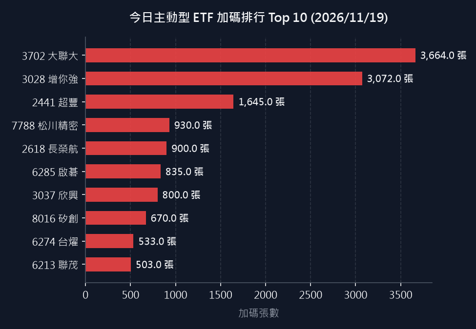
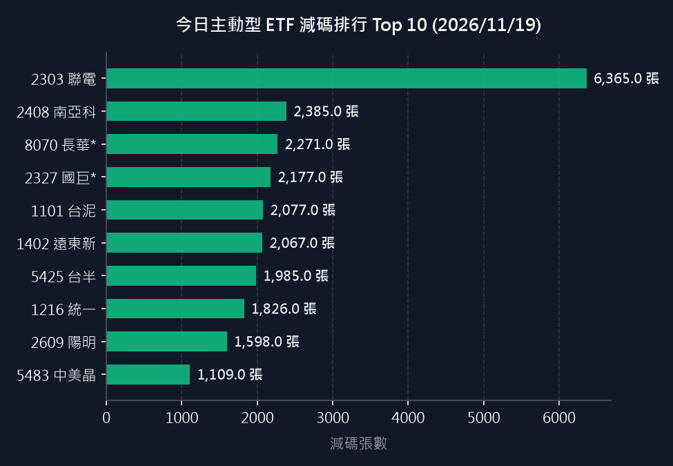

# 主動型 ETF 持股變動

資料來源：`主動型ETF持股明細.xlsx` 最近兩個日期分頁。

比較區間：`20261118` → `20261119`

## 今日加減碼視覺化排行

| 今日加碼 Top 10 | 今日減碼 Top 10 |
| :---: | :---: |
|  |  |

| ETF | 新增 | 刪除 | 比例變動 |
| :-- | --: | --: | --: |
| 00400A | 2 | 2 | 43 |
| 00401A | 1 | 1 | 52 |
| 00402A | 0 | 0 | 46 |
| 00403A | 0 | 0 | 34 |
| 00404A | 0 | 0 | 46 |
| 00405A | 0 | 0 | 26 |
| 00406A | 0 | 0 | 54 |
| 00407A | 1 | 1 | 45 |
| 00408A | 0 | 3 | 31 |
| 00980A | 0 | 0 | 48 |
| 00980D | 0 | 0 | 41 |
| 00981A | 0 | 0 | 30 |
| 00982A | 0 | 1 | 64 |
| 00983A | 0 | 0 | 31 |
| 00983D | 0 | 0 | 24 |
| 00984A | 0 | 0 | 82 |
| 00985A | 0 | 0 | 46 |
| 00986A | 0 | 0 | 28 |
| 00987A | 0 | 0 | 24 |
| 00988A | 0 | 0 | 28 |
| 00989A | 0 | 0 | 53 |
| 00990A | 1 | 1 | 33 |
| 00991A | 0 | 0 | 28 |
| 00992A | 0 | 0 | 40 |
| 00993A | 0 | 0 | 45 |
| 00994A | 0 | 4 | 26 |
| 00995A | 0 | 0 | 39 |
| 00996A | 0 | 1 | 38 |
| 00997A | 0 | 0 | 36 |
| 00998A | 0 | 3 | 36 |
| 00999A | 0 | 0 | 51 |

## 00400A

### 新增持股

- 3596 智易（0.15%，298 張）
- 3702 大聯大（0.52%，1699 張）

### 刪除持股

- 2303 聯電（1.40%，4192 張）
- 3090 日電貿（0.25%，592 張）

### 投資比例變動

- 1215 卜蜂：0.07% → 0.08%（+0.01）
- 1303 南亞：1.83% → 1.76%（-0.07）
- 2059 川湖：3.84% → 3.74%（-0.10）
- 2308 台達電：1.81% → 1.82%（+0.01）
- 2313 華通：0.74% → 0.72%（-0.02）
- 2330 台積電：12.80% → 13.23%（+0.43）
- 2345 智邦：1.28% → 1.31%（+0.03）
- 2360 致茂：0.82% → 0.79%（-0.03）
- 2368 金像電：2.31% → 2.23%（-0.08）
- 2383 台光電：5.32% → 5.13%（-0.19）
- 2454 聯發科：7.76% → 7.84%（+0.08）
- 2603 長榮：2.71% → 2.78%（+0.07）
- 2891 中信金：1.72% → 1.84%（+0.12）
- 3008 大立光：1.20% → 1.16%（-0.04）
- 3017 奇鋐：5.18% → 4.99%（-0.19）
- 3023 信邦：0.89% → 0.93%（+0.04）
- 3036 文曄：1.41% → 1.46%（+0.05）
- 3037 欣興：2.54% → 2.45%（-0.09）
- 3044 健鼎：4.30% → 4.14%（-0.16）
- 3081 聯亞：0.76% → 0.73%（-0.03）
- 3167 大量：0.26% → 0.25%（-0.01）
- 3231 緯創：0.94% → 0.97%（+0.03）
- 3293 鈊象：0.38% → 0.40%（+0.02）
- 3406 玉晶光：0.99% → 0.88%（-0.11）
- 3443 創意：3.25% → 3.13%（-0.12）
- 3529 力旺：1.14% → 1.10%（-0.04）
- 3653 健策：3.33% → 3.21%（-0.12）
- 3661 世芯-KY：2.72% → 2.65%（-0.07）
- 3665 貿聯-KY：1.27% → 1.26%（-0.01）
- 3711 日月光投控：0.91% → 0.90%（-0.01）
- 4958 臻鼎-KY：0.35% → 0.34%（-0.01）
- 5274 信驊：2.66% → 2.56%（-0.10）
- 5434 崇越：0.34% → 0.33%（-0.01）
- 6121 新普：0.18% → 0.19%（+0.01）
- 6147 頎邦：0.66% → 0.64%（-0.02）
- 6187 萬潤：0.69% → 0.77%（+0.08）
- 6223 旺矽：3.28% → 3.16%（-0.12）
- 6271 同欣電：0.24% → 0.23%（-0.01）
- 6278 台表科：2.27% → 2.19%（-0.08）
- 6488 環球晶：1.23% → 1.18%（-0.05）
- 7750 新代：0.35% → 0.33%（-0.02）
- 7769 鴻勁：0.77% → 0.74%（-0.03）
- ＸＡＧＸ金兌(3533.HK)：1.80% → 1.81%（+0.01）

## 00401A

### 新增持股

- TAIWAN TAIE C 16DEC26 38600 TWSE（-1.13%，-0.44 張）

### 刪除持股

- TAIWAN TAIE C 18NOV26 40000 TWSE（0.00%，-0.01 張）

### 投資比例變動

- 1216 統一：0.28% → 0.29%（+0.01）
- 1303 南亞：1.03% → 0.96%（-0.07）
- 1476 儒鴻：2.09% → 2.55%（+0.46）
- 1477 聚陽：1.82% → 2.27%（+0.45）
- 2059 川湖：1.52% → 1.44%（-0.08）
- 2303 聯電：2.26% → 2.22%（-0.04）
- 2308 台達電：1.45% → 1.41%（-0.04）
- 2313 華通：1.15% → 1.07%（-0.08）
- 2317 鴻海：0.51% → 0.52%（+0.01）
- 2327 國巨*：0.39% → 0.37%（-0.02）
- 2330 台積電：20.47% → 20.44%（-0.03）
- 2357 華碩：1.61% → 1.58%（-0.03）
- 2360 致茂：1.32% → 1.24%（-0.08）
- 2379 瑞昱：1.05% → 1.07%（+0.02）
- 2382 廣達：1.71% → 1.75%（+0.04）
- 2383 台光電：0.70% → 0.65%（-0.05）
- 2412 中華電：0.93% → 0.97%（+0.04）
- 2454 聯發科：5.53% → 5.76%（+0.23）
- 2455 全新：1.39% → 1.29%（-0.10）
- 2603 長榮：2.18% → 2.16%（-0.02）
- 2881 富邦金：1.97% → 2.02%（+0.05）
- 2882 國泰金：1.02% → 1.00%（-0.02）
- 2883 凱基金：1.46% → 1.43%（-0.03）
- 2884 玉山金：1.63% → 1.62%（-0.01）
- 2886 兆豐金：2.18% → 2.28%（+0.10）
- 2891 中信金：2.35% → 2.42%（+0.07）
- 3008 大立光：1.63% → 1.52%（-0.11）
- 3037 欣興：0.45% → 0.42%（-0.03）
- 3131 弘塑：0.48% → 0.45%（-0.03）
- 3231 緯創：1.87% → 1.86%（-0.01）
- 3443 創意：2.04% → 1.89%（-0.15）
- 3491 昇達科：1.73% → 1.61%（-0.12）
- 3653 健策：1.08% → 1.01%（-0.07）
- 3711 日月光投控：3.81% → 3.62%（-0.19）
- 4904 遠傳：0.77% → 0.79%（+0.02）
- 4958 臻鼎-KY：0.97% → 0.91%（-0.06）
- 5274 信驊：1.01% → 0.94%（-0.07）
- 5347 世界：0.96% → 0.93%（-0.03）
- 5904 寶雅*：0.54% → 0.56%（+0.02）
- 6147 頎邦：0.92% → 0.86%（-0.06）
- 6187 萬潤：1.20% → 1.11%（-0.09）
- 6223 旺矽：1.96% → 2.16%（+0.20）
- 6285 啟碁：1.15% → 1.12%（-0.03）
- 6515 穎崴：0.65% → 0.61%（-0.04）
- 6531 愛普*：1.04% → 0.97%（-0.07）
- 6669 緯穎：1.30% → 1.28%（-0.02）
- 7769 鴻勁：0.54% → 0.51%（-0.03）
- 7828 創新服務：1.24% → 1.16%（-0.08）
- 7856 漢測：0.62% → 0.58%（-0.04）
- 8464 億豐：0.98% → 1.00%（+0.02）
- TAIWAN TAIE C 16DEC26 40000 TWSE：-0.05% → -0.03%（+0.02）
- 台股期貨12/26(FITXN*1.TF)：-0.27% → -0.58%（-0.31）

## 00402A

### 新增持股

- 無

### 刪除持股

- 無

### 投資比例變動

- AAPL.US Apple：9.56% → 9.45%（-0.11）
- ADI.US Analog Devices：2.19% → 2.11%（-0.08）
- AMD.US AMD：6.24% → 6.35%（+0.11）
- AMZN.US Amazon：5.22% → 5.54%（+0.32）
- ARM.US Arm：0.76% → 0.73%（-0.03）
- ASML.US ASML Holding：1.14% → 1.11%（-0.03）
- AXON.US Axon Enterprise：0.49% → 0.48%（-0.01）
- BABA.US Alibaba Group：0.46% → 0.43%（-0.03）
- BKNG.US Booking Holdings：0.60% → 0.57%（-0.03）
- CDNS.US Cadence Design Systems：1.65% → 1.59%（-0.06）
- CIEN.US Ciena：1.00% → 0.98%（-0.02）
- CLS.US Celestica：1.11% → 1.10%（-0.01）
- COHR.US Coherent：1.19% → 1.16%（-0.03）
- CRWD.US CrowdStrike Holdings：1.83% → 1.91%（+0.08）
- FSLY.US Fastly：0.27% → 0.30%（+0.03）
- GOOG.US Alphabet - Class C Capital Stock：3.27% → 3.18%（-0.09）
- GOOGL.US Alphabet - Class A Common Stock：3.28% → 3.40%（+0.12）
- INTC.US Intel：1.00% → 0.95%（-0.05）
- IOT.US Samsara：0.61% → 0.60%（-0.01）
- KLAC.US KLA：1.39% → 1.35%（-0.04）
- LITE.US Lumentum：1.31% → 1.25%（-0.06）
- LRCX.US Lam Research：2.12% → 2.06%（-0.06）
- MCHP.US Microchip Technology：1.25% → 1.21%（-0.04）
- META.US Meta：3.88% → 3.94%（+0.06）
- MRVL.US Marvell：1.19% → 1.12%（-0.07）
- MSFT.US Microsoft：6.07% → 6.09%（+0.02）
- MU.US Micron：5.15% → 4.93%（-0.22）
- NFLX.US Netflix：0.99% → 0.96%（-0.03）
- NOW.US ServiceNow：0.85% → 0.80%（-0.05）
- NVDA.US NVIDIA：5.91% → 5.54%（-0.37）
- PANW.US Palo Alto：2.81% → 2.98%（+0.17）
- PLTR.US Palantir Technologies：2.05% → 1.98%（-0.07）
- SHOP.US Shopify：1.33% → 1.26%（-0.07）
- SIMO.US Silicon Motion：0.40% → 0.38%（-0.02）
- SKHY.US SK hynix：0.78% → 0.75%（-0.03）
- SNOW.US Snowflake：1.30% → 1.28%（-0.02）
- SPCX.US SpaceX：0.83% → 0.81%（-0.02）
- SPOT.US Spotify：0.50% → 0.64%（+0.14）
- STX.US Seagate：0.90% → 0.89%（-0.01）
- TER.US Teradyne：0.61% → 0.59%（-0.02）
- TSM.US TSMC(ADR)：1.49% → 1.45%（-0.04）
- TTWO.US Take-Two：1.25% → 1.28%（+0.03）
- TXN.US Texas Instruments：2.98% → 2.84%（-0.14）
- UBER.US Uber：0.37% → 0.74%（+0.37）
- V.US Visa：1.64% → 1.71%（+0.07）
- WDC.US Western Digital：1.64% → 1.61%（-0.03）

## 00403A

### 新增持股

- 無

### 刪除持股

- 無

### 投資比例變動

- 1303 南亞：3.44% → 3.30%（-0.14）
- 1560 中砂：0.45% → 0.44%（-0.01）
- 2059 川湖：0.59% → 0.57%（-0.02）
- 2313 華通：0.34% → 0.32%（-0.02）
- 2317 鴻海：0.64% → 0.67%（+0.03）
- 2327 國巨*：2.79% → 2.71%（-0.08）
- 2330 台積電：16.23% → 16.66%（+0.43）
- 2345 智邦：1.61% → 1.63%（+0.02）
- 2368 金像電：0.81% → 0.78%（-0.03）
- 2383 台光電：3.74% → 3.58%（-0.16）
- 2408 南亞科：0.82% → 0.79%（-0.03）
- 2449 京元電子：0.70% → 0.67%（-0.03）
- 2454 聯發科：6.91% → 6.93%（+0.02）
- 2481 強茂：0.03% → 0.00%（-0.03）
- 3008 大立光：1.49% → 1.43%（-0.06）
- 3017 奇鋐：6.23% → 5.96%（-0.27）
- 3037 欣興：4.29% → 4.10%（-0.19）
- 3189 景碩：2.32% → 2.22%（-0.10）
- 3443 創意：4.67% → 4.47%（-0.20）
- 3450 聯鈞：0.43% → 0.41%（-0.02）
- 3583 辛耘：0.19% → 0.18%（-0.01）
- 3653 健策：4.23% → 4.05%（-0.18）
- 3661 世芯-KY：0.25% → 0.41%（+0.16）
- 3665 貿聯-KY：2.03% → 2.01%（-0.02）
- 3711 日月光投控：1.63% → 1.59%（-0.04）
- 5274 信驊：1.57% → 1.51%（-0.06）
- 6223 旺矽：3.67% → 3.52%（-0.15）
- 6442 光聖：0.24% → 0.23%（-0.01）
- 6488 環球晶：0.15% → 0.14%（-0.01）
- 6515 穎崴：0.29% → 0.28%（-0.01）
- 6669 緯穎：2.53% → 2.58%（+0.05）
- 6805 富世達：0.59% → 0.56%（-0.03）
- 8046 南電：2.10% → 2.01%（-0.09）
- 8996 高力：1.92% → 1.84%（-0.08）

## 00404A

### 新增持股

- 無

### 刪除持股

- 無

### 投資比例變動

- 1303 南亞：0.68% → 0.64%（-0.04）
- 2006 東和鋼鐵：1.32% → 1.37%（+0.05）
- 2301 光寶科：0.49% → 0.48%（-0.01）
- 2317 鴻海：0.45% → 0.47%（+0.02）
- 2330 台積電：22.19% → 22.60%（+0.41）
- 2347 聯強：1.54% → 1.65%（+0.11）
- 2360 致茂：0.42% → 0.40%（-0.02）
- 2379 瑞昱：2.12% → 2.22%（+0.10）
- 2382 廣達：0.42% → 0.44%（+0.02）
- 2383 台光電：2.58% → 2.45%（-0.13）
- 2395 研華：1.87% → 1.86%（-0.01）
- 2454 聯發科：7.28% → 7.25%（-0.03）
- 2603 長榮：1.43% → 1.45%（+0.02）
- 2851 中再保：1.07% → 1.10%（+0.03）
- 2882 國泰金：3.12% → 3.09%（-0.03）
- 2885 元大金：3.06% → 3.15%（+0.09）
- 2887 台新新光金：1.75% → 1.77%（+0.02）
- 2890 永豐金：1.13% → 1.16%（+0.03）
- 3014 聯陽：1.14% → 1.17%（+0.03）
- 3017 奇鋐：1.24% → 1.18%（-0.06）
- 3034 聯詠：2.11% → 2.12%（+0.01）
- 3036 文曄：1.05% → 1.07%（+0.02）
- 3037 欣興：0.28% → 0.27%（-0.01）
- 3264 欣銓：0.40% → 0.38%（-0.02）
- 3293 鈊象：1.88% → 1.96%（+0.08）
- 3443 創意：1.72% → 1.63%（-0.09）
- 3653 健策：1.05% → 1.00%（-0.05）
- 3711 日月光投控：3.55% → 3.44%（-0.11）
- 5274 信驊：2.07% → 1.96%（-0.11）
- 5434 崇越：1.78% → 1.71%（-0.07）
- 5904 寶雅*：0.45% → 0.47%（+0.02）
- 6196 帆宣：1.76% → 1.69%（-0.07）
- 6206 飛捷：0.73% → 0.74%（+0.01）
- 6223 旺矽：0.82% → 0.78%（-0.04）
- 6257 矽格：0.68% → 0.65%（-0.03）
- 6491 晶碩：0.91% → 0.95%（+0.04）
- 6669 緯穎：1.01% → 1.02%（+0.01）
- 6691 洋基工程：1.27% → 1.25%（-0.02）
- 6957 裕慶-KY：0.07% → 0.06%（-0.01）
- 7769 鴻勁：1.12% → 1.07%（-0.05）
- 8016 矽創：1.84% → 1.87%（+0.03）
- 8081 致新：0.75% → 0.76%（+0.01）
- 8299 群聯：1.18% → 1.19%（+0.01）
- 台指選擇權01/27 47500 買權：-0.02% → -0.01%（+0.01）
- 台指選擇權12/26 46500 買權：-0.17% → -0.11%（+0.06）
- 台股期貨12/26(FITXN*1.TF)：19.19% → 19.38%（+0.19）

## 00405A

### 新增持股

- 無

### 刪除持股

- 無

### 投資比例變動

- 2059 川湖：1.76% → 1.73%（-0.03）
- 2308 台達電：0.54% → 0.55%（+0.01）
- 2330 台積電：6.92% → 7.21%（+0.29）
- 2345 智邦：4.67% → 4.79%（+0.12）
- 2368 金像電：5.34% → 5.19%（-0.15）
- 2383 台光電：3.97% → 3.85%（-0.12）
- 2454 聯發科：7.45% → 7.59%（+0.14）
- 3017 奇鋐：4.08% → 3.96%（-0.12）
- 3037 欣興：3.68% → 3.58%（-0.10）
- 3189 景碩：0.16% → 0.15%（-0.01）
- 3443 創意：2.63% → 2.55%（-0.08）
- 3653 健策：6.42% → 6.23%（-0.19）
- 3665 貿聯-KY：5.57% → 5.58%（+0.01）
- 3711 日月光投控：2.47% → 2.45%（-0.02）
- 5274 信驊：5.41% → 5.26%（-0.15）
- 6187 萬潤：0.62% → 0.60%（-0.02）
- 6223 旺矽：7.66% → 7.44%（-0.22）
- 6274 台燿：1.27% → 1.23%（-0.04）
- 6415 矽力*-KY：1.89% → 1.88%（-0.01）
- 6515 穎崴：0.44% → 0.43%（-0.01）
- 6531 愛普*：3.31% → 3.22%（-0.09）
- 6669 緯穎：0.79% → 0.81%（+0.02）
- 6805 富世達：1.63% → 1.58%（-0.05）
- 7769 鴻勁：2.31% → 2.24%（-0.07）
- 8046 南電：5.44% → 5.28%（-0.16）
- 8996 高力：2.45% → 2.39%（-0.06）

## 00406A

### 新增持股

- 無

### 刪除持股

- 無

### 投資比例變動

- 1303 南亞：2.43% → 2.26%（-0.17）
- 1326 台化：0.84% → 0.80%（-0.04）
- 1560 中砂：0.18% → 0.17%（-0.01）
- 1815 富喬：0.68% → 0.63%（-0.05）
- 2059 川湖：1.38% → 1.41%（+0.03）
- 2303 聯電：1.26% → 1.23%（-0.03）
- 2308 台達電：1.68% → 1.87%（+0.19）
- 2317 鴻海：0.34% → 0.35%（+0.01）
- 2327 國巨*：1.11% → 1.05%（-0.06）
- 2330 台積電：8.83% → 8.84%（+0.01）
- 2345 智邦：2.36% → 2.32%（-0.04）
- 2368 金像電：2.32% → 2.16%（-0.16）
- 2383 台光電：5.46% → 5.43%（-0.03）
- 2449 京元電子：0.31% → 0.28%（-0.03）
- 2454 聯發科：6.60% → 6.43%（-0.17）
- 2481 強茂：0.26% → 0.24%（-0.02）
- 2486 一詮：0.08% → 0.10%（+0.02）
- 2881 富邦金：0.60% → 0.62%（+0.02）
- 2882 國泰金：0.62% → 0.60%（-0.02）
- 2884 玉山金：0.47% → 0.46%（-0.01）
- 2886 兆豐金：0.59% → 0.61%（+0.02）
- 3008 大立光：0.85% → 0.79%（-0.06）
- 3017 奇鋐：5.33% → 5.32%（-0.01）
- 3037 欣興：4.28% → 4.30%（+0.02）
- 3081 聯亞：0.90% → 0.84%（-0.06）
- 3105 穩懋：0.50% → 0.46%（-0.04）
- 3167 大量：0.39% → 0.36%（-0.03）
- 3189 景碩：1.52% → 1.41%（-0.11）
- 3264 欣銓：0.24% → 0.22%（-0.02）
- 3443 創意：2.20% → 2.04%（-0.16）
- 3491 昇達科：0.33% → 0.30%（-0.03）
- 3653 健策：3.82% → 3.55%（-0.27）
- 3661 世芯-KY：0.83% → 0.78%（-0.05）
- 3665 貿聯-KY：1.35% → 1.49%（+0.14）
- 3711 日月光投控：2.41% → 2.29%（-0.12）
- 4938 和碩：0.56% → 0.55%（-0.01）
- 4958 臻鼎-KY：0.99% → 0.92%（-0.07）
- 5274 信驊：0.98% → 0.91%（-0.07）
- 6147 頎邦：0.53% → 0.51%（-0.02）
- 6187 萬潤：0.08% → 0.00%（-0.08）
- 6213 聯茂：0.29% → 0.40%（+0.11）
- 6223 旺矽：3.02% → 2.81%（-0.21）
- 6274 台燿：1.62% → 1.79%（+0.17）
- 6278 台表科：0.18% → 0.16%（-0.02）
- 6510 精測：0.52% → 0.49%（-0.03）
- 6669 緯穎：0.84% → 0.83%（-0.01）
- 6715 嘉基：0.61% → 0.57%（-0.04）
- 6805 富世達：0.85% → 0.79%（-0.06）
- 8046 南電：2.56% → 2.66%（+0.10）
- 8358 金居：0.05% → 0.04%（-0.01）
- 8996 高力：0.78% → 0.73%（-0.05）
- 臺指選擇權第三週週五到期契約：-17.73% → -7.60%（+10.13）
- 臺指選擇權第四週週三到期契約：-5.18% → -3.48%（+1.70）
- 臺股期貨 202612(FITXN*1.TF)：23.94% → 23.65%（-0.29）

## 00407A

### 新增持股

- 3044 健鼎（0.18%，70 張）

### 刪除持股

- 2344 華邦電（0.11%，187 張）

### 投資比例變動

- 1303 南亞：3.38% → 3.26%（-0.12）
- 1476 儒鴻：0.42% → 0.69%（+0.27）
- 1560 中砂：0.86% → 0.84%（-0.02）
- 2059 川湖：0.75% → 0.73%（-0.02）
- 2301 光寶科：1.35% → 1.34%（-0.01）
- 2308 台達電：1.91% → 1.93%（+0.02）
- 2313 華通：0.42% → 0.40%（-0.02）
- 2327 國巨*：1.76% → 0.41%（-1.35）
- 2330 台積電：11.41% → 12.51%（+1.10）
- 2345 智邦：1.43% → 2.24%（+0.81）
- 2360 致茂：0.67% → 0.65%（-0.02）
- 2368 金像電：1.93% → 2.04%（+0.11）
- 2379 瑞昱：0.28% → 0.30%（+0.02）
- 2383 台光電：5.28% → 5.07%（-0.21）
- 2408 南亞科：1.02% → 0.39%（-0.63）
- 2451 創見：0.31% → 0.32%（+0.01）
- 2454 聯發科：6.90% → 7.24%（+0.34）
- 2615 萬海：1.15% → 1.14%（-0.01）
- 2618 長榮航：0.37% → 0.64%（+0.27）
- 3008 大立光：1.28% → 1.23%（-0.05）
- 3017 奇鋐：5.69% → 5.66%（-0.03）
- 3034 聯詠：0.77% → 0.79%（+0.02）
- 3037 欣興：4.58% → 4.40%（-0.18）
- 3081 聯亞：1.44% → 1.39%（-0.05）
- 3231 緯創：1.09% → 1.57%（+0.48）
- 3293 鈊象：0.76% → 0.81%（+0.05）
- 3406 玉晶光：0.90% → 0.86%（-0.04）
- 3443 創意：4.76% → 4.58%（-0.18）
- 3491 昇達科：1.14% → 1.09%（-0.05）
- 3653 健策：2.97% → 2.85%（-0.12）
- 3665 貿聯-KY：3.13% → 3.29%（+0.16）
- 3711 日月光投控：3.40% → 3.34%（-0.06）
- 4958 臻鼎-KY：0.89% → 0.86%（-0.03）
- 5274 信驊：1.26% → 1.22%（-0.04）
- 6187 萬潤：1.10% → 1.06%（-0.04）
- 6223 旺矽：3.50% → 3.37%（-0.13）
- 6274 台燿：1.33% → 1.28%（-0.05）
- 6446 藥華藥：0.41% → 0.42%（+0.01）
- 6510 精測：1.54% → 1.48%（-0.06）
- 6531 愛普*：0.26% → 0.25%（-0.01）
- 6669 緯穎：1.41% → 1.44%（+0.03）
- 6805 富世達：1.10% → 1.06%（-0.04）
- 8046 南電：2.63% → 2.53%（-0.10）
- 8299 群聯：0.29% → 0.30%（+0.01）
- 8996 高力：1.41% → 1.36%（-0.05）

## 00408A

### 新增持股

- 無

### 刪除持股

- 2327 國巨*（0.62%，21 張）
- 2408 南亞科（1.12%，41 張）
- 6669 緯穎（1.21%，9.767 張）

### 投資比例變動

- 1216 統一：0.13% → 0.14%（+0.01）
- 1303 南亞：4.23% → 4.05%（-0.18）
- 2330 台積電：7.81% → 7.96%（+0.15）
- 2368 金像電：5.32% → 5.09%（-0.23）
- 2383 台光電：3.94% → 3.77%（-0.17）
- 2395 研華：1.69% → 1.68%（-0.01）
- 2454 聯發科：5.64% → 5.66%（+0.02）
- 2542 興富發：4.29% → 4.54%（+0.25）
- 2603 長榮：1.58% → 1.61%（+0.03）
- 2880 華南金：1.38% → 1.49%（+0.11）
- 2891 中信金：3.03% → 3.20%（+0.17）
- 3017 奇鋐：4.78% → 4.57%（-0.21）
- 3037 欣興：2.95% → 2.83%（-0.12）
- 3044 健鼎：1.26% → 1.20%（-0.06）
- 3081 聯亞：0.42% → 0.41%（-0.01）
- 3105 穩懋：0.63% → 0.61%（-0.02）
- 3167 大量：0.37% → 0.35%（-0.02）
- 3189 景碩：2.39% → 2.29%（-0.10）
- 3231 緯創：1.51% → 1.55%（+0.04）
- 3443 創意：1.68% → 1.61%（-0.07）
- 3653 健策：3.77% → 3.61%（-0.16）
- 3661 世芯-KY：2.66% → 2.58%（-0.08）
- 4904 遠傳：1.47% → 2.51%（+1.04）
- 5434 崇越：2.31% → 2.24%（-0.07）
- 6223 旺矽：1.48% → 1.42%（-0.06）
- 6510 精測：2.45% → 2.35%（-0.10）
- 6526 達發：0.34% → 0.33%（-0.01）
- 6805 富世達：2.67% → 2.55%（-0.12）
- 8046 南電：1.31% → 1.25%（-0.06）
- 8996 高力：2.68% → 2.57%（-0.11）
- 9802 鈺齊-KY：0.95% → 0.97%（+0.02）

## 00980A

### 新增持股

- 無

### 刪除持股

- 無

### 投資比例變動

- 1303 南亞：3.69% → 3.55%（-0.14）
- 2059 川湖：3.54% → 3.44%（-0.10）
- 2303 聯電：1.37% → 1.39%（+0.02）
- 2308 台達電：2.77% → 2.79%（+0.02）
- 2317 鴻海：3.72% → 3.97%（+0.25）
- 2327 國巨*：0.73% → 0.71%（-0.02）
- 2330 台積電：10.58% → 10.92%（+0.34）
- 2344 華邦電：1.44% → 1.39%（-0.05）
- 2345 智邦：0.92% → 0.93%（+0.01）
- 2360 致茂：0.81% → 0.78%（-0.03）
- 2368 金像電：1.91% → 1.84%（-0.07）
- 2382 廣達：2.00% → 2.12%（+0.12）
- 2383 台光電：3.43% → 3.30%（-0.13）
- 2408 南亞科：2.16% → 2.08%（-0.08）
- 2454 聯發科：6.75% → 6.81%（+0.06）
- 2884 玉山金：1.40% → 1.44%（+0.04）
- 2891 中信金：1.97% → 2.09%（+0.12）
- 3008 大立光：1.97% → 1.90%（-0.07）
- 3017 奇鋐：2.49% → 2.40%（-0.09）
- 3026 禾伸堂：0.74% → 0.71%（-0.03）
- 3036 文曄：1.04% → 1.08%（+0.04）
- 3037 欣興：2.67% → 2.57%（-0.10）
- 3044 健鼎：1.49% → 1.43%（-0.06）
- 3081 聯亞：1.30% → 1.25%（-0.05）
- 3189 景碩：1.00% → 0.96%（-0.04）
- 3231 緯創：1.85% → 1.90%（+0.05）
- 3264 欣銓：0.70% → 0.68%（-0.02）
- 3293 鈊象：0.57% → 0.60%（+0.03）
- 3443 創意：2.07% → 1.99%（-0.08）
- 3653 健策：2.83% → 2.73%（-0.10）
- 3665 貿聯-KY：1.53% → 1.51%（-0.02）
- 3711 日月光投控：2.34% → 2.30%（-0.04）
- 5274 信驊：1.33% → 1.28%（-0.05）
- 5904 寶雅*：0.80% → 0.85%（+0.05）
- 6213 聯茂：1.01% → 0.97%（-0.04）
- 6223 旺矽：1.39% → 1.34%（-0.05）
- 6274 台燿：0.93% → 0.89%（-0.04）
- 6442 光聖：0.26% → 0.25%（-0.01）
- 6515 穎崴：1.40% → 1.35%（-0.05）
- 6669 緯穎：1.88% → 1.92%（+0.04）
- 6805 富世達：0.61% → 0.59%（-0.02）
- 7751 竑騰：0.59% → 0.57%（-0.02）
- 7769 鴻勁：1.73% → 1.66%（-0.07）
- 8046 南電：1.26% → 1.21%（-0.05）
- 8210 勤誠：0.32% → 0.31%（-0.01）
- 8299 群聯：1.09% → 1.11%（+0.02）
- 8996 高力：0.43% → 0.41%（-0.02）
- 台灣證交所加權股價指數(FITXN*1.TF)：2.61% → 2.67%（+0.06）

## 00980D

### 新增持股

- 無

### 刪除持股

- 無

### 投資比例變動

- ARSENAL AIC PARENT LLC SER REGS 11.5 % 01-OCT-2031：0.35% → 0.34%（-0.01）
- ATHENE HOLDING LTD (REG) 6.25% 01APR2054：0.79% → 0.80%（+0.01）
- CHARTER COMM OPT 6.484% 23OCT2045 W/I：0.46% → 0.47%（+0.01）
- CHC GROUP LLC SER REGS 11.750000 % 01-SEP-2030：0.44% → 0.43%（-0.01）
- CHS/COMMUNITY HEALTH SYS SER REGS 10.875000 % 15JAN2032：0.42% → 0.41%（-0.01）
- CHS/COMMUNITY HEALTH SYS SER REGS 9.750000 % 15JAN2034：0.44% → 0.41%（-0.03）
- CITIGROUP INC 8.125% 15JUL2039：0.65% → 0.66%（+0.01）
- COREWEAVE INC SER REGS (REG) (REG S) 9.625% 15JUL2032：0.49% → 0.48%（-0.01）
- COX COMMUNICATIONS INC SER REGS 5.800000 % 15DEC2053：0.51% → 0.52%（+0.01）
- DEUTSCHE BANK NY VAR 10FEB2034：0.36% → 0.35%（-0.01）
- DOW CHEMICAL CO/THE (REG) 5.6% 15FEB2054：0.63% → 0.64%（+0.01）
- FMC CORP (REG) 6.375000 % 18MAY2053：0.31% → 0.29%（-0.02）
- FORD MOTOR COMPANY 5.291% 08DEC2046：0.29% → 0.30%（+0.01）
- FORD MOTOR CREDIT CO LLC (REG) 7.35% 04NOV2027：0.36% → 0.35%（-0.01）
- GLOBAL AUTO HO/AAG FH UK SER REGS (REG S) 11.5% 15AUG2029：0.37% → 0.36%（-0.01）
- GLOBAL AUTO HO/AAG FH UK SER REGS (REG S) 8.75% 15JAN2032：0.40% → 0.39%（-0.01）
- HA SUSTAINABLE INF CAP (REG) 6.375% 01JUL2034：0.36% → 0.37%（+0.01）
- INTESA SANPAOLO SPA SER REGS (REG S) 7.8% 28NOV2053：0.38% → 0.39%（+0.01）
- JBS USA/FOOD/FINANCE (REG) 6.5% 01DEC2052：0.47% → 0.48%（+0.01）
- JETBLUE AIRWAYS/LOYALTY SER REGS (REG S) 9.875% 20SEP2031：0.36% → 0.37%（+0.01）
- LBM ACQUISITION LLC SER REGS 9.500000 % 15JUN2031：0.42% → 0.41%（-0.01）
- MDC HOLDINGS INC (REG) 6% 15JAN2043：0.33% → 0.34%（+0.01）
- META PLATFORMS INC 5.750000 % 15-NOV-2065：0.43% → 0.44%（+0.01）
- MOBIUS MERGER SUB SER REGS 9.000000 % 01JUN2030：0.30% → 0.29%（-0.01）
- MPLX LP 6.200000 % 15SEP2055：0.35% → 0.36%（+0.01）
- NAVIENT CORP (REG) 11.5% 15MAR2031：0.40% → 0.39%（-0.01）
- ONEOK INC 6.625% 01SEP2053：0.61% → 0.62%（+0.01）
- ORACLE CORP (REG) 5.500000 % 27SEP2064：0.41% → 0.42%（+0.01）
- ORACLE CORP 6.125000 % 03AUG2065：0.54% → 0.55%（+0.01）
- OWENS-BROCKWAY SER REGS (REG) (REG S) 9.5% 01JUN2033：0.49% → 0.48%（-0.01）
- PHOTO HOLDINGS LLC SER REGS (REG) (REG S) 12% 01JUL2031：0.47% → 0.46%（-0.01）
- SBL HOLDINGS INC SER REGS 7.200000 % 30OCT2034：0.54% → 0.55%（+0.01）
- SES GLOBAL AMERICAS HLDG SER REGS (REG) 5.300000 % 25MAR2044：0.32% → 0.33%（+0.01）
- US 10YR NOTE (CBT)DEC26 21-DEC-2026：18.69% → 18.71%（+0.02）
- US 10YR ULTRA FUT DEC26 21-DEC-2026：-1.85% → -1.86%（-0.01）
- US 5YR NOTE (CBT) DEC26 31-DEC-2026：-16.99% → -17.00%（-0.01）
- US LONG BOND(CBT) DEC26 21-DEC-2026：5.68% → 5.71%（+0.03）
- US ULTRA BOND CBT DEC26 21-DEC-2026：-1.30% → -1.31%（-0.01）
- VIACOM INC (REG) 5.85% 01SEP2043：0.48% → 0.49%（+0.01）
- VISTRA OPERATIONS CO LLC SER REGS (REG S) 6.95% 15OCT2033：0.43% → 0.44%（+0.01）
- WESTLAKE CORP 6.375000 % 15-NOV-2055：0.54% → 0.55%（+0.01）

## 00981A

### 新增持股

- 無

### 刪除持股

- 無

### 投資比例變動

- 2303 聯電：2.57% → 2.61%（+0.04）
- 2308 台達電：3.23% → 3.27%（+0.04）
- 2317 鴻海：0.41% → 0.44%（+0.03）
- 2327 國巨*：3.33% → 3.27%（-0.06）
- 2330 台積電：16.87% → 17.47%（+0.60）
- 2345 智邦：4.05% → 4.20%（+0.15）
- 2368 金像電：2.84% → 2.74%（-0.10）
- 2383 台光電：6.03% → 5.46%（-0.57）
- 2449 京元電子：0.60% → 0.58%（-0.02）
- 2454 聯發科：9.28% → 9.39%（+0.11）
- 2891 中信金：0.28% → 0.29%（+0.01）
- 3017 奇鋐：7.72% → 7.46%（-0.26）
- 3037 欣興：5.25% → 5.07%（-0.18）
- 3231 緯創：0.78% → 0.80%（+0.02）
- 3264 欣銓：0.34% → 0.33%（-0.01）
- 3443 創意：2.82% → 2.72%（-0.10）
- 3653 健策：4.69% → 4.52%（-0.17）
- 3665 貿聯-KY：2.01% → 2.00%（-0.01）
- 3711 日月光投控：3.95% → 3.90%（-0.05）
- 4979 華星光：0.13% → 0.12%（-0.01）
- 5274 信驊：0.93% → 0.78%（-0.15）
- 6223 旺矽：4.73% → 4.57%（-0.16）
- 6271 同欣電：0.23% → 0.22%（-0.01）
- 6274 台燿：2.27% → 2.19%（-0.08）
- 6510 精測：0.55% → 0.53%（-0.02）
- 6669 緯穎：1.40% → 1.43%（+0.03）
- 6805 富世達：1.19% → 1.14%（-0.05）
- 8046 南電：2.37% → 2.10%（-0.27）
- 8996 高力：0.45% → 0.43%（-0.02）
- 台指期貨 2026/12(FITXN*1.TF)：2.81% → 2.88%（+0.07）

## 00982A

### 新增持股

- 無

### 刪除持股

- 3583 辛耘（0.07%，61 張）

### 投資比例變動

- 1785 光洋科：0.10% → 0.20%（+0.10）
- 2059 川湖：2.36% → 2.33%（-0.03）
- 2301 光寶科：1.24% → 0.71%（-0.53）
- 2303 聯電：0.90% → 0.53%（-0.37）
- 2327 國巨*：0.39% → 0.77%（+0.38）
- 2330 台積電：8.68% → 9.10%（+0.42）
- 2351 順德：0.10% → 0.20%（+0.10）
- 2360 致茂：2.04% → 1.86%（-0.18）
- 2368 金像電：0.94% → 1.83%（+0.89）
- 2376 技嘉：1.29% → 1.32%（+0.03）
- 2377 微星：0.40% → 0.41%（+0.01）
- 2383 台光電：2.91% → 2.84%（-0.07）
- 2428 興勤：0.70% → 0.40%（-0.30）
- 2441 超豐：0.41% → 0.85%（+0.44）
- 2451 創見：0.10% → 0.21%（+0.11）
- 2454 聯發科：9.35% → 9.58%（+0.23）
- 2455 全新：1.33% → 1.30%（-0.03）
- 2467 志聖：0.10% → 0.20%（+0.10）
- 2476 鉅祥：0.50% → 0.28%（-0.22）
- 2478 大毅：0.33% → 0.32%（-0.01）
- 2486 一詮：0.14% → 0.01%（-0.13）
- 2885 元大金：0.36% → 0.38%（+0.02）
- 3008 大立光：2.95% → 2.89%（-0.06）
- 3017 奇鋐：2.70% → 2.65%（-0.05）
- 3028 增你強：0.20% → 0.65%（+0.45）
- 3037 欣興：0.24% → 0.23%（-0.01）
- 3044 健鼎：0.23% → 0.64%（+0.41）
- 3045 台灣大：0.33% → 0.03%（-0.30）
- 3090 日電貿：0.24% → 0.13%（-0.11）
- 3105 穩懋：8.23% → 8.04%（-0.19）
- 3231 緯創：2.05% → 2.13%（+0.08）
- 3265 台星科：0.84% → 0.73%（-0.11）
- 3491 昇達科：4.98% → 4.87%（-0.11）
- 3617 碩天：0.43% → 0.25%（-0.18）
- 3661 世芯-KY：0.11% → 0.21%（+0.10）
- 3702 大聯大：0.40% → 0.85%（+0.45）
- 3711 日月光投控：2.62% → 2.61%（-0.01）
- 4749 新應材：0.10% → 0.21%（+0.11）
- 4958 臻鼎-KY：2.85% → 2.64%（-0.21）
- 5274 信驊：0.86% → 0.77%（-0.09）
- 5425 台半：0.82% → 0.46%（-0.36）
- 5483 中美晶：0.91% → 0.52%（-0.39）
- 6139 亞翔：5.85% → 5.94%（+0.09）
- 6196 帆宣：0.20% → 0.11%（-0.09）
- 6213 聯茂：1.50% → 1.47%（-0.03）
- 6214 精誠：0.03% → 0.02%（-0.01）
- 6223 旺矽：3.28% → 3.21%（-0.07）
- 6239 力成：1.96% → 2.23%（+0.27）
- 6274 台燿：0.28% → 0.27%（-0.01）
- 6285 啟碁：0.42% → 0.86%（+0.44）
- 6446 藥華藥：0.13% → 0.14%（+0.01）
- 6472 保瑞：0.89% → 0.88%（-0.01）
- 6488 環球晶：1.12% → 0.63%（-0.49）
- 6510 精測：1.08% → 1.06%（-0.02）
- 6531 愛普*：6.84% → 6.69%（-0.15）
- 6640 均華：0.14% → 0.10%（-0.04）
- 6669 緯穎：1.30% → 1.34%（+0.04）
- 6672 騰輝電子-KY：2.38% → 2.34%（-0.04）
- 6691 洋基工程：0.10% → 0.20%（+0.10）
- 7788 松川精密：0.06% → 0.50%（+0.44）
- 7828 創新服務：0.02% → 0.12%（+0.10）
- 8016 矽創：0.41% → 0.87%（+0.46）
- 8070 長華*：0.59% → 0.34%（-0.25）
- 8996 高力：1.08% → 1.05%（-0.03）

## 00983A

### 新增持股

- 無

### 刪除持股

- 無

### 投資比例變動

- AMD.US AMD：4.03% → 4.47%（+0.44）
- AMZN.US Amazon：4.75% → 5.05%（+0.30）
- AVGO.US Broadcom：1.28% → 1.32%（+0.04）
- BEAM.US Beam Therapeutics：1.96% → 1.98%（+0.02）
- BLSH.US Bullish：0.90% → 0.94%（+0.04）
- BMNR.US BitMine：1.11% → 0.96%（-0.15）
- COIN.US Coinbase：1.92% → 1.62%（-0.30）
- CRCL.US Circle：2.72% → 2.63%（-0.09）
- CRSP.US CRISPR Therapeutics：2.97% → 2.68%（-0.29）
- DE.US Deere：0.50% → 0.49%（-0.01）
- GOOG.US Alphabet - Class C Capital Stock：3.20% → 3.29%（+0.09）
- HOOD.US Robinhood Markets：2.16% → 2.14%（-0.02）
- ILMN.US Illumina：1.15% → 1.18%（+0.03）
- LLY.US Eli Lilly：2.16% → 2.09%（-0.07）
- META.US Meta：4.02% → 4.15%（+0.13）
- MSFT.US Microsoft：3.06% → 3.59%（+0.53）
- NET.US Cloudflare：1.56% → 1.82%（+0.26）
- NTLA.US Intellia Therapeutics：1.32% → 1.31%（-0.01）
- NVDA.US NVIDIA：2.66% → 2.56%（-0.10）
- PLTR.US Palantir Technologies：3.14% → 3.11%（-0.03）
- RKLB.US Rocket Lab：1.48% → 1.42%（-0.06）
- RXRX.US Recursion Pharmaceuticals：0.96% → 0.99%（+0.03）
- SHOP.US Shopify：4.99% → 4.86%（-0.13）
- SNOW.US Snowflake：0.55% → 0.56%（+0.01）
- SPCX.US SpaceX：9.26% → 9.37%（+0.11）
- TEM.US Tempus：4.89% → 4.87%（-0.02）
- TSLA.US Tesla：9.19% → 9.12%（-0.07）
- TWST.US Twist Bioscience：3.03% → 3.12%（+0.09）
- TXG.US 10x Genomics：2.68% → 2.69%（+0.01）
- WGS.US GeneDx：0.42% → 0.45%（+0.03）
- XYZ.US Block：2.80% → 2.76%（-0.04）

## 00983D

### 新增持股

- 無

### 刪除持股

- 無

### 投資比例變動

- BATSLN 7.079 08/02/43：1.23% → 1.24%（+0.01）
- BHCCN 11 09/30/28：2.23% → 2.22%（-0.01）
- BRITEL 9 5/8 12/15/30：1.55% → 1.54%（-0.01）
- CEG 6 1/2 10/01/53：0.51% → 0.52%（+0.01）
- CYH 10 7/8 01/15/32：1.38% → 1.35%（-0.03）
- DELL 8.1 07/15/36：1.50% → 1.51%（+0.01）
- DELL 8.35 07/15/46：1.55% → 1.56%（+0.01）
- DIS 7 3/4 12/01/45：0.68% → 0.69%（+0.01）
- DT 9 1/4 06/01/32：1.51% → 1.50%（-0.01）
- DTV 8 7/8 02/01/30：1.86% → 1.85%（-0.01）
- ENBCN 6.7 11/15/53：0.67% → 0.68%（+0.01）
- GT 8 7/8 07/15/32：0.88% → 0.86%（-0.02）
- HAL 7.45 09/15/39：1.58% → 1.59%（+0.01）
- HPE 6.35 10/15/45：0.69% → 0.70%（+0.01）
- IEP 10 11/15/29：1.44% → 1.45%（+0.01）
- MOHEGN 11 7/8 04/15/31：1.57% → 1.56%（-0.01）
- MS 7 1/4 04/01/32：1.48% → 1.47%（-0.01）
- NVDA 5.55 06/15/46：1.29% → 1.30%（+0.01）
- OKE 6 5/8 09/01/53：0.80% → 0.81%（+0.01）
- ORCL 6 1/2 04/15/38：0.41% → 0.42%（+0.01）
- ORCL 6.9 11/09/52：0.23% → 0.24%（+0.01）
- SPCX 6.6 07/15/46：1.25% → 1.24%（-0.01）
- TLTW.US iShares TLT Premium Income+ ETF：9.07% → 9.11%（+0.04）
- VENLNG 9 1/2 02/01/29：1.64% → 1.63%（-0.01）

## 00984A

### 新增持股

- 無

### 刪除持股

- 無

### 投資比例變動

- 1216 統一：0.69% → 0.73%（+0.04）
- 1303 南亞：3.24% → 3.12%（-0.12）
- 1326 台化：2.52% → 2.49%（-0.03）
- 1560 中砂：1.75% → 1.72%（-0.03）
- 1709 和益：0.98% → 0.94%（-0.04）
- 2006 東和鋼鐵：0.66% → 0.69%（+0.03）
- 2027 大成鋼：0.89% → 0.94%（+0.05）
- 2059 川湖：2.14% → 2.08%（-0.06）
- 2313 華通：0.73% → 0.70%（-0.03）
- 2330 台積電：2.29% → 2.36%（+0.07）
- 2347 聯強：0.74% → 0.79%（+0.05）
- 2351 順德：0.68% → 0.65%（-0.03）
- 2357 華碩：0.89% → 0.90%（+0.01）
- 2377 微星：0.80% → 0.81%（+0.01）
- 2379 瑞昱：0.65% → 0.69%（+0.04）
- 2383 台光電：0.16% → 0.15%（-0.01）
- 2395 研華：2.35% → 2.36%（+0.01）
- 2408 南亞科：2.24% → 2.16%（-0.08）
- 2409 友達：0.89% → 0.87%（-0.02）
- 2412 中華電：1.02% → 1.10%（+0.08）
- 2449 京元電子：0.45% → 0.43%（-0.02）
- 2454 聯發科：0.40% → 0.41%（+0.01）
- 2455 全新：1.24% → 1.19%（-0.05）
- 2464 盟立：0.84% → 0.83%（-0.01）
- 2466 冠西電：0.42% → 0.41%（-0.01）
- 2603 長榮：2.85% → 2.92%（+0.07）
- 2618 長榮航：0.71% → 0.75%（+0.04）
- 2634 漢翔：0.63% → 0.64%（+0.01）
- 2637 慧洋-KY：0.64% → 0.65%（+0.01）
- 2801 彰銀：0.65% → 0.68%（+0.03）
- 2880 華南金：0.65% → 0.70%（+0.05）
- 2881 富邦金：1.55% → 1.64%（+0.09）
- 2882 國泰金：1.53% → 1.54%（+0.01）
- 2883 凱基金：0.65% → 0.66%（+0.01）
- 2884 玉山金：0.60% → 0.61%（+0.01）
- 2885 元大金：1.30% → 1.35%（+0.05）
- 2886 兆豐金：0.67% → 0.72%（+0.05）
- 2887 台新新光金：1.39% → 1.42%（+0.03）
- 2890 永豐金：0.64% → 0.66%（+0.02）
- 2892 第一金：0.67% → 0.70%（+0.03）
- 3006 晶豪科：0.76% → 0.74%（-0.02）
- 3008 大立光：2.05% → 1.97%（-0.08）
- 3017 奇鋐：3.69% → 3.55%（-0.14）
- 3034 聯詠：0.63% → 0.64%（+0.01）
- 3037 欣興：1.40% → 1.34%（-0.06）
- 3044 健鼎：0.89% → 0.86%（-0.03）
- 3045 台灣大：1.57% → 1.68%（+0.11）
- 3189 景碩：2.21% → 2.13%（-0.08）
- 3264 欣銓：1.55% → 1.49%（-0.06）
- 3265 台星科：0.68% → 0.65%（-0.03）
- 3374 精材：0.77% → 0.74%（-0.03）
- 3406 玉晶光：1.43% → 1.38%（-0.05）
- 3443 創意：2.65% → 2.54%（-0.11）
- 3450 聯鈞：0.25% → 0.24%（-0.01）
- 3605 宏致：0.63% → 0.61%（-0.02）
- 3653 健策：1.19% → 1.15%（-0.04）
- 3702 大聯大：0.72% → 0.76%（+0.04）
- 3711 日月光投控：2.28% → 2.24%（-0.04）
- 4958 臻鼎-KY：0.56% → 0.54%（-0.02）
- 4967 十銓：0.85% → 0.86%（+0.01）
- 5274 信驊：0.35% → 0.34%（-0.01）
- 5351 鈺創：0.79% → 0.78%（-0.01）
- 5434 崇越：1.50% → 1.47%（-0.03）
- 5871 中租-KY：0.64% → 0.69%（+0.05）
- 5876 上海商銀：0.69% → 0.74%（+0.05）
- 5904 寶雅*：0.64% → 0.69%（+0.05）
- 6187 萬潤：1.43% → 1.38%（-0.05）
- 6196 帆宣：1.26% → 1.23%（-0.03）
- 6197 佳必琪：0.69% → 0.66%（-0.03）
- 6213 聯茂：0.61% → 0.59%（-0.02）
- 6214 精誠：0.88% → 0.91%（+0.03）
- 6274 台燿：0.37% → 0.35%（-0.02）
- 6415 矽力*-KY：0.60% → 0.59%（-0.01）
- 6446 藥華藥：1.50% → 1.55%（+0.05）
- 6505 台塑化：3.72% → 3.67%（-0.05）
- 6669 緯穎：0.93% → 0.95%（+0.02）
- 6670 復盛應用：0.57% → 0.60%（+0.03）
- 6672 騰輝電子-KY：0.74% → 0.71%（-0.03）
- 6770 力積電：0.75% → 0.76%（+0.01）
- 6957 裕慶-KY：0.89% → 0.85%（-0.04）
- 8039 台虹：0.68% → 0.66%（-0.02）
- 9933 中鼎：1.23% → 1.29%（+0.06）

## 00985A

### 新增持股

- 無

### 刪除持股

- 無

### 投資比例變動

- 1101 台泥：0.32% → 0.10%（-0.22）
- 1216 統一：1.51% → 0.99%（-0.52）
- 1402 遠東新：0.32% → 0.10%（-0.22）
- 1504 東元：0.52% → 0.53%（+0.01）
- 1605 華新：1.47% → 1.48%（+0.01）
- 2027 大成鋼：3.11% → 3.26%（+0.15）
- 2059 川湖：1.86% → 1.81%（-0.05）
- 2303 聯電：0.98% → 0.99%（+0.01）
- 2308 台達電：2.54% → 2.55%（+0.01）
- 2317 鴻海：1.98% → 2.10%（+0.12）
- 2327 國巨*：1.99% → 1.94%（-0.05）
- 2330 台積電：15.11% → 15.52%（+0.41）
- 2344 華邦電：1.30% → 1.25%（-0.05）
- 2345 智邦：2.52% → 2.55%（+0.03）
- 2368 金像電：1.92% → 2.18%（+0.26）
- 2383 台光電：3.03% → 2.90%（-0.13）
- 2408 南亞科：1.58% → 1.51%（-0.07）
- 2412 中華電：1.55% → 0.99%（-0.56）
- 2454 聯發科：2.00% → 2.01%（+0.01）
- 2603 長榮：0.48% → 0.10%（-0.38）
- 2609 陽明：0.49% → 0.10%（-0.39）
- 2610 華航：0.56% → 0.59%（+0.03）
- 3008 大立光：1.49% → 1.43%（-0.06）
- 3017 奇鋐：1.34% → 1.29%（-0.05）
- 3036 文曄：3.35% → 3.46%（+0.11）
- 3037 欣興：2.92% → 2.80%（-0.12）
- 3081 聯亞：2.86% → 2.74%（-0.12）
- 3105 穩懋：1.26% → 1.44%（+0.18）
- 3189 景碩：0.70% → 0.81%（+0.11）
- 3231 緯創：1.00% → 0.50%（-0.50）
- 3491 昇達科：0.23% → 0.22%（-0.01）
- 3653 健策：3.88% → 3.72%（-0.16）
- 3661 世芯-KY：1.41% → 1.37%（-0.04）
- 3665 貿聯-KY：1.67% → 1.65%（-0.02）
- 3711 日月光投控：1.55% → 1.52%（-0.03）
- 4904 遠傳：1.14% → 1.20%（+0.06）
- 6442 光聖：1.41% → 1.56%（+0.15）
- 6446 藥華藥：1.69% → 1.74%（+0.05）
- 6488 環球晶：1.40% → 1.34%（-0.06）
- 6526 達發：0.85% → 0.81%（-0.04）
- 6531 愛普*：2.18% → 2.09%（-0.09）
- 6669 緯穎：3.12% → 3.18%（+0.06）
- 7750 新代：1.50% → 1.44%（-0.06）
- 7769 鴻勁：2.58% → 2.47%（-0.11）
- 8046 南電：1.51% → 1.45%（-0.06）
- 8996 高力：1.97% → 1.90%（-0.07）

## 00986A

### 新增持股

- 無

### 刪除持股

- 無

### 投資比例變動

- 2330 台積電：8.63% → 8.54%（-0.09）
- 2454 聯發科：1.70% → 1.72%（+0.02）
- AAPL.US Apple：3.20% → 3.17%（-0.03）
- AMD.US AMD：5.12% → 5.34%（+0.22）
- AMZN.US Amazon：5.25% → 5.40%（+0.15）
- AVGO.US Broadcom：4.47% → 4.59%（+0.12）
- BE.US Bloom Energy：2.14% → 2.09%（-0.05）
- CRWD.US CrowdStrike Holdings：4.79% → 5.12%（+0.33）
- ETN.US Eaton：2.45% → 2.44%（-0.01）
- GEV.US GE Vernova：2.27% → 2.22%（-0.05）
- GOOGL.US Alphabet - Class A Common Stock：6.11% → 6.10%（-0.01）
- GS.US Goldman Sachs：1.28% → 1.26%（-0.02）
- JPM.US JPMorgan Chase：2.64% → 2.57%（-0.07）
- LITE.US Lumentum：3.18% → 3.10%（-0.08）
- LLY.US Eli Lilly：4.63% → 4.48%（-0.15）
- MA.US Mastercard：1.64% → 1.62%（-0.02）
- MSFT.US Microsoft：5.15% → 5.12%（-0.03）
- MU.US Micron：4.14% → 4.06%（-0.08）
- MUFG(8306.JP)：1.20% → 1.18%（-0.02）
- NET.US Cloudflare：2.48% → 2.60%（+0.12）
- NVDA.US NVIDIA：2.26% → 2.17%（-0.09）
- PLTR.US Palantir Technologies：1.59% → 1.58%（-0.01）
- RBRK.US Rubrik：0.95% → 1.03%（+0.08）
- SKHY.US SK hynix：0.89% → 0.88%（-0.01）
- SNOW.US Snowflake：2.18% → 2.22%（+0.04）
- 嘉能可公司：1.89% → 1.75%（-0.14）
- 施奈德電機公司：1.70% → 1.69%（-0.01）
- 艾司摩爾控股公司：1.98% → 1.99%（+0.01）

## 00987A

### 新增持股

- 無

### 刪除持股

- 無

### 投資比例變動

- 1815 富喬：3.79% → 3.74%（-0.05）
- 2330 台積電：10.47% → 11.08%（+0.61）
- 2368 金像電：2.82% → 2.78%（-0.04）
- 2383 台光電：5.38% → 5.30%（-0.08）
- 2454 聯發科：5.69% → 5.89%（+0.20）
- 2455 全新：2.01% → 1.98%（-0.03）
- 3008 大立光：3.54% → 3.50%（-0.04）
- 3017 奇鋐：7.55% → 7.45%（-0.10）
- 3037 欣興：4.11% → 4.05%（-0.06）
- 3081 聯亞：2.68% → 2.65%（-0.03）
- 3443 創意：6.06% → 5.98%（-0.08）
- 3491 昇達科：4.20% → 4.14%（-0.06）
- 3653 健策：4.40% → 4.34%（-0.06）
- 3665 貿聯-KY：3.65% → 3.71%（+0.06）
- 4958 臻鼎-KY：2.04% → 2.02%（-0.02）
- 4991 環宇-KY：2.62% → 2.59%（-0.03）
- 6223 旺矽：2.82% → 2.78%（-0.04）
- 6274 台燿：3.08% → 3.04%（-0.04）
- 6510 精測：3.90% → 3.85%（-0.05）
- 6515 穎崴：2.29% → 2.25%（-0.04）
- 6805 富世達：3.39% → 3.34%（-0.05）
- 8046 南電：2.65% → 2.62%（-0.03）
- 8358 金居：3.25% → 3.21%（-0.04）
- 8996 高力：2.61% → 2.58%（-0.03）

## 00988A

### 新增持股

- 無

### 刪除持股

- 無

### 投資比例變動

- 1303 南亞：3.42% → 3.23%（-0.19）
- 2330 台積電：2.84% → 2.77%（-0.07）
- 2383 台光電：1.93% → 1.38%（-0.55）
- 2454 聯發科：0.84% → 1.26%（+0.42）
- 3017 奇鋐：4.34% → 4.65%（+0.31）
- 3037 欣興：4.52% → 4.57%（+0.05）
- 3443 創意：4.56% → 4.25%（-0.31）
- 3711 日月光投控：1.80% → 2.18%（+0.38）
- 6223 旺矽：1.20% → 1.28%（+0.08）
- AAPL.US Apple：5.68% → 5.56%（-0.12）
- AMD.US AMD：7.22% → 7.43%（+0.21）
- AMZN.US Amazon：3.93% → 3.99%（+0.06）
- APP.US Applovin：0.47% → 0.45%（-0.02）
- BE.US Bloom Energy：7.00% → 6.74%（-0.26）
- CRWD.US CrowdStrike Holdings：4.35% → 4.58%（+0.23）
- META.US Meta：1.39% → 1.35%（-0.04）
- MRNA.US Moderna：1.11% → 1.03%（-0.08）
- MSFT.US Microsoft：7.27% → 7.12%（-0.15）
- MU.US Micron：0.48% → 0.46%（-0.02）
- NET.US Cloudflare：3.07% → 3.16%（+0.09）
- NTSK.US Netskope：1.50% → 1.65%（+0.15）
- OKTA.US Okta：3.13% → 3.43%（+0.30）
- PANW.US Palo Alto：3.47% → 3.72%（+0.25）
- PLTR.US Palantir Technologies：4.91% → 4.80%（-0.11）
- SHIFT(3697.JP)：0.48% → 0.45%（-0.03）
- SPCX.US SpaceX：8.01% → 7.92%（-0.09）
- Samsung Elec Mech(009150.KS)：1.01% → 1.06%（+0.05）
- ZS.US Zscaler：1.66% → 1.74%（+0.08）

## 00989A

### 新增持股

- 無

### 刪除持股

- 無

### 投資比例變動

- ACN.US Accenture：1.49% → 1.40%（-0.09）
- ADBE.US Adobe：1.43% → 1.36%（-0.07）
- ADI.US Analog Devices：1.30% → 1.27%（-0.03）
- ALAB.US Astera Labs：0.74% → 0.75%（+0.01）
- AMD.US AMD：3.83% → 3.98%（+0.15）
- AMZN.US Amazon：2.27% → 2.33%（+0.06）
- ASML.US ASML Holding：2.15% → 2.14%（-0.01）
- AVGO.US Broadcom：3.56% → 3.65%（+0.09）
- CDNS.US Cadence Design Systems：1.02% → 1.00%（-0.02）
- CRDO.US Credo：0.70% → 0.68%（-0.02）
- CRM.US Salesforce：3.09% → 2.98%（-0.11）
- CRWD.US CrowdStrike Holdings：3.72% → 3.97%（+0.25）
- ENTG.US Entegris：0.54% → 0.55%（+0.01）
- ESTC.US Elastic：0.80% → 0.81%（+0.01）
- GOOG.US Alphabet - Class C Capital Stock：2.26% → 2.25%（-0.01）
- GWRE.US Guidewire Software：0.69% → 0.66%（-0.03）
- HOOD.US Robinhood Markets：1.42% → 1.40%（-0.02）
- HUBS.US HubSpot：2.03% → 1.90%（-0.13）
- ILMN.US Illumina：1.07% → 1.10%（+0.03）
- INTC.US Intel：1.55% → 1.52%（-0.03）
- LITE.US Lumentum：1.04% → 1.01%（-0.03）
- LMND.US Lemonade：0.77% → 0.73%（-0.04）
- LRCX.US Lam Research：1.98% → 1.97%（-0.01）
- MDB.US MongoDB：0.71% → 0.72%（+0.01）
- META.US Meta：4.55% → 4.48%（-0.07）
- MPWR.US Monolithic Power Systems：1.65% → 1.62%（-0.03）
- MSFT.US Microsoft：3.70% → 3.67%（-0.03）
- MTSI.US MACOM Technology Solutions：0.62% → 0.60%（-0.02）
- MU.US Micron：0.53% → 0.52%（-0.01）
- NET.US Cloudflare：3.10% → 3.24%（+0.14）
- NOW.US ServiceNow：0.85% → 0.82%（-0.03）
- NU.US Nu：0.34% → 0.33%（-0.01）
- NVDA.US NVIDIA：1.67% → 1.60%（-0.07）
- OKTA.US Okta：0.81% → 0.89%（+0.08）
- PANW.US Palo Alto：3.35% → 3.64%（+0.29）
- PLTR.US Palantir Technologies：1.28% → 1.26%（-0.02）
- RIVN.US Rivian：1.21% → 1.19%（-0.02）
- SHOP.US Shopify：3.13% → 3.04%（-0.09）
- SNDK.US Sandisk：0.34% → 0.32%（-0.02）
- SNOW.US Snowflake：2.84% → 2.88%（+0.04）
- SWKS.US Skyworks Solutions：0.70% → 0.66%（-0.04）
- TEAM.US Atlassian：1.11% → 1.05%（-0.06）
- TEM.US Tempus：1.21% → 1.20%（-0.01）
- TSLA.US Tesla：3.20% → 3.19%（-0.01）
- TTWO.US Take-Two：3.39% → 3.56%（+0.17）
- TWST.US Twist Bioscience：0.67% → 0.68%（+0.01）
- TXN.US Texas Instruments：1.85% → 1.81%（-0.04）
- U.US Unity Software：1.65% → 1.59%（-0.06）
- VEEV.US Veeva Systems：1.10% → 1.04%（-0.06）
- WDAY.US Workday：0.31% → 0.30%（-0.01）
- WRBY.US Warby Parker：0.85% → 0.92%（+0.07）
- XYZ.US Block：0.62% → 0.61%（-0.01）
- ZM.US Zoom：1.87% → 1.88%（+0.01）

## 00990A

### 新增持股

- TTWO.US Take-Two（0.63%，24.8 張）

### 刪除持股

- 8046 南電（0.48%，170 張）

### 投資比例變動

- 2330 台積電：4.04% → 4.01%（-0.03）
- 2368 金像電：1.33% → 1.04%（-0.29）
- 2383 台光電：1.06% → 1.02%（-0.04）
- 2454 聯發科：2.66% → 2.71%（+0.05）
- 3017 奇鋐：1.69% → 1.84%（+0.15）
- 3037 欣興：1.02% → 1.05%（+0.03）
- 3443 創意：2.73% → 2.59%（-0.14）
- AMD.US AMD：3.48% → 3.63%（+0.15）
- AMZN.US Amazon：4.64% → 4.77%（+0.13）
- ANET.US Arista Networks：2.78% → 2.86%（+0.08）
- APP.US Applovin：2.85% → 2.86%（+0.01）
- AVGO.US Broadcom：3.42% → 3.51%（+0.09）
- BE.US Bloom Energy：5.24% → 5.12%（-0.12）
- CLS.US Celestica：1.00% → 1.02%（+0.02）
- CRWD.US CrowdStrike Holdings：3.44% → 3.68%（+0.24）
- FROG.US JFrog：1.84% → 1.99%（+0.15）
- GE.US GE Aerospace：2.93% → 2.92%（-0.01）
- GOOGL.US Alphabet - Class A Common Stock：4.33% → 4.32%（-0.01）
- HWM.US Howmet Aerospace：1.66% → 1.69%（+0.03）
- LLY.US Eli Lilly：3.25% → 3.14%（-0.11）
- META.US Meta：4.73% → 4.67%（-0.06）
- MSFT.US Microsoft：6.03% → 6.00%（-0.03）
- MU.US Micron：0.91% → 0.90%（-0.01）
- NET.US Cloudflare：2.67% → 2.80%（+0.13）
- NVDA.US NVIDIA：0.69% → 0.66%（-0.03）
- PANW.US Palo Alto：1.55% → 1.69%（+0.14）
- PLTR.US Palantir Technologies：4.95% → 4.90%（-0.05）
- Recruit Holdings(6098.JP)：2.91% → 2.79%（-0.12）
- SHOP.US Shopify：3.43% → 3.34%（-0.09）
- SNOW.US Snowflake：2.74% → 2.78%（+0.04）
- TOHO(9602.JP)：0.22% → 0.21%（-0.01）
- U.US Unity Software：1.49% → 1.72%（+0.23）
- ZS.US Zscaler：1.68% → 1.78%（+0.10）

## 00991A

### 新增持股

- 無

### 刪除持股

- 無

### 投資比例變動

- 1303 南亞：6.23% → 6.10%（-0.13）
- 2059 川湖：6.12% → 6.05%（-0.07）
- 2308 台達電：0.98% → 1.01%（+0.03）
- 2317 鴻海：0.66% → 0.72%（+0.06）
- 2327 國巨*：2.18% → 0.96%（-1.22）
- 2330 台積電：16.75% → 17.57%（+0.82）
- 2345 智邦：1.14% → 1.18%（+0.04）
- 2368 金像電：1.15% → 1.13%（-0.02）
- 2382 廣達：0.00% → 0.01%（+0.01）
- 2383 台光電：8.68% → 8.48%（-0.20）
- 2408 南亞科：2.25% → 1.05%（-1.20）
- 2454 聯發科：8.61% → 8.83%（+0.22）
- 3008 大立光：0.25% → 0.24%（-0.01）
- 3017 奇鋐：7.91% → 7.74%（-0.17）
- 3026 禾伸堂：2.18% → 2.14%（-0.04）
- 3037 欣興：6.63% → 6.48%（-0.15）
- 3105 穩懋：0.25% → 0.24%（-0.01）
- 3189 景碩：4.96% → 4.85%（-0.11）
- 3231 緯創：0.68% → 0.71%（+0.03）
- 3443 創意：0.97% → 0.95%（-0.02）
- 3653 健策：3.16% → 3.09%（-0.07）
- 4958 臻鼎-KY：1.11% → 1.09%（-0.02）
- 5274 信驊：2.48% → 2.43%（-0.05）
- 6223 旺矽：1.58% → 1.54%（-0.04）
- 6805 富世達：0.96% → 0.94%（-0.02）
- 7769 鴻勁：0.52% → 0.51%（-0.01）
- 8046 南電：5.08% → 4.97%（-0.11）
- 8299 群聯：0.54% → 0.56%（+0.02）

## 00992A

### 新增持股

- 無

### 刪除持股

- 無

### 投資比例變動

- 1303 南亞：3.35% → 3.28%（-0.07）
- 1815 富喬：3.87% → 3.79%（-0.08）
- 2059 川湖：3.58% → 3.54%（-0.04）
- 2301 光寶科：0.36% → 0.37%（+0.01）
- 2308 台達電：0.93% → 0.96%（+0.03）
- 2330 台積電：6.82% → 7.15%（+0.33）
- 2345 智邦：4.84% → 5.00%（+0.16）
- 2357 華碩：0.44% → 0.45%（+0.01）
- 2360 致茂：1.18% → 1.16%（-0.02）
- 2368 金像電：2.60% → 2.54%（-0.06）
- 2376 技嘉：0.37% → 0.38%（+0.01）
- 2383 台光電：5.32% → 5.20%（-0.12）
- 2404 漢唐：0.39% → 0.41%（+0.02）
- 2408 南亞科：1.06% → 1.04%（-0.02）
- 2454 聯發科：3.66% → 3.75%（+0.09）
- 3008 大立光：3.58% → 3.51%（-0.07）
- 3017 奇鋐：6.29% → 6.15%（-0.14）
- 3026 禾伸堂：0.57% → 0.56%（-0.01）
- 3037 欣興：5.05% → 4.94%（-0.11）
- 3081 聯亞：1.26% → 1.23%（-0.03）
- 3189 景碩：1.94% → 1.90%（-0.04）
- 3231 緯創：1.82% → 1.90%（+0.08）
- 3443 創意：4.23% → 4.13%（-0.10）
- 3653 健策：1.62% → 1.59%（-0.03）
- 3661 世芯-KY：1.29% → 1.28%（-0.01）
- 3665 貿聯-KY：6.75% → 6.81%（+0.06）
- 4958 臻鼎-KY：1.15% → 1.13%（-0.02）
- 5274 信驊：0.78% → 0.76%（-0.02）
- 6139 亞翔：0.52% → 0.53%（+0.01）
- 6187 萬潤：0.54% → 0.53%（-0.01）
- 6213 聯茂：1.19% → 1.16%（-0.03）
- 6223 旺矽：4.02% → 3.93%（-0.09）
- 6274 台燿：1.03% → 1.01%（-0.02）
- 6515 穎崴：0.51% → 0.50%（-0.01）
- 6669 緯穎：1.64% → 1.70%（+0.06）
- 8021 尖點：2.10% → 2.06%（-0.04）
- 8046 南電：2.26% → 2.21%（-0.05）
- 8150 南茂：0.38% → 0.37%（-0.01）
- 8210 勤誠：0.85% → 0.84%（-0.01）
- 8996 高力：4.98% → 4.88%（-0.10）

## 00993A

### 新增持股

- 無

### 刪除持股

- 無

### 投資比例變動

- 1303 南亞：3.25% → 3.18%（-0.07）
- 2059 川湖：0.73% → 0.72%（-0.01）
- 2301 光寶科：0.15% → 0.16%（+0.01）
- 2308 台達電：0.51% → 0.52%（+0.01）
- 2330 台積電：11.50% → 12.01%（+0.51）
- 2344 華邦電：1.02% → 1.00%（-0.02）
- 2368 金像電：1.17% → 1.14%（-0.03）
- 2383 台光電：4.42% → 4.32%（-0.10）
- 2395 研華：0.96% → 0.98%（+0.02）
- 2404 漢唐：0.44% → 0.46%（+0.02）
- 2408 南亞科：1.24% → 1.21%（-0.03）
- 2454 聯發科：2.43% → 2.49%（+0.06）
- 2455 全新：1.04% → 1.02%（-0.02）
- 2603 長榮：0.24% → 0.25%（+0.01）
- 2881 富邦金：0.37% → 0.40%（+0.03）
- 2883 凱基金：0.52% → 0.53%（+0.01）
- 2885 元大金：0.61% → 0.65%（+0.04）
- 3008 大立光：1.11% → 1.09%（-0.02）
- 3017 奇鋐：4.49% → 4.38%（-0.11）
- 3037 欣興：4.05% → 3.95%（-0.10）
- 3081 聯亞：1.67% → 1.63%（-0.04）
- 3105 穩懋：3.69% → 3.60%（-0.09）
- 3189 景碩：3.68% → 3.60%（-0.08）
- 3406 玉晶光：1.32% → 1.29%（-0.03）
- 3443 創意：5.51% → 5.38%（-0.13）
- 3491 昇達科：5.35% → 5.23%（-0.12）
- 3653 健策：4.10% → 4.00%（-0.10）
- 3661 世芯-KY：0.39% → 0.38%（-0.01）
- 3665 貿聯-KY：2.56% → 2.58%（+0.02）
- 3702 大聯大：0.19% → 0.21%（+0.02）
- 3711 日月光投控：3.24% → 3.23%（-0.01）
- 4958 臻鼎-KY：1.23% → 1.20%（-0.03）
- 5274 信驊：2.80% → 2.73%（-0.07）
- 6147 頎邦：0.22% → 0.21%（-0.01）
- 6213 聯茂：1.92% → 1.88%（-0.04）
- 6223 旺矽：3.57% → 3.49%（-0.08）
- 6274 台燿：1.29% → 1.26%（-0.03）
- 6285 啟碁：0.40% → 0.41%（+0.01）
- 6505 台塑化：0.67% → 0.68%（+0.01）
- 6510 精測：0.90% → 0.88%（-0.02）
- 6805 富世達：1.23% → 1.20%（-0.03）
- 8021 尖點：0.78% → 0.76%（-0.02）
- 8046 南電：2.44% → 2.39%（-0.05）
- 8299 群聯：0.79% → 0.82%（+0.03）
- 8996 高力：1.59% → 1.56%（-0.03）

## 00994A

### 新增持股

- 無

### 刪除持股

- 1560 中砂（0.33%，15 張）
- 2059 川湖（1.60%，7.001 張）
- 6274 台燿（1.80%，67.002 張）
- 6669 緯穎（0.65%，12.518 張）

### 投資比例變動

- 1303 南亞：3.70% → 3.58%（-0.12）
- 2330 台積電：18.96% → 19.68%（+0.72）
- 2345 智邦：0.40% → 0.41%（+0.01）
- 2368 金像電：3.44% → 3.33%（-0.11）
- 2383 台光電：4.97% → 4.81%（-0.16）
- 2454 聯發科：8.01% → 8.13%（+0.12）
- 2891 中信金：0.78% → 0.83%（+0.05）
- 3017 奇鋐：7.94% → 7.68%（-0.26）
- 3037 欣興：5.54% → 5.36%（-0.18）
- 3044 健鼎：0.91% → 0.88%（-0.03）
- 3081 聯亞：0.35% → 0.34%（-0.01）
- 3105 穩懋：0.46% → 0.45%（-0.01）
- 3167 大量：0.40% → 0.38%（-0.02）
- 3189 景碩：2.43% → 2.36%（-0.07）
- 3231 緯創：0.91% → 0.94%（+0.03）
- 3443 創意：4.56% → 4.41%（-0.15）
- 3653 健策：4.64% → 4.49%（-0.15）
- 3661 世芯-KY：1.94% → 1.90%（-0.04）
- 3711 日月光投控：2.05% → 2.03%（-0.02）
- 4904 遠傳：0.01% → 0.50%（+0.49）
- 6223 旺矽：0.77% → 0.74%（-0.03）
- 6510 精測：2.86% → 2.76%（-0.10）
- 6526 達發：0.38% → 0.36%（-0.02）
- 6805 富世達：3.20% → 3.10%（-0.10）
- 8046 南電：1.66% → 1.60%（-0.06）
- 8996 高力：2.07% → 2.00%（-0.07）

## 00995A

### 新增持股

- 無

### 刪除持股

- 無

### 投資比例變動

- 1303 南亞：2.87% → 2.80%（-0.07）
- 2303 聯電：0.72% → 0.73%（+0.01）
- 2308 台達電：2.20% → 2.24%（+0.04）
- 2317 鴻海：0.69% → 0.75%（+0.06）
- 2330 台積電：9.27% → 9.60%（+0.33）
- 2345 智邦：2.02% → 2.07%（+0.05）
- 2368 金像電：2.00% → 1.94%（-0.06）
- 2383 台光電：7.10% → 6.91%（-0.19）
- 2454 聯發科：7.85% → 8.00%（+0.15）
- 2610 華航：0.77% → 0.81%（+0.04）
- 2885 元大金：0.91% → 0.96%（+0.05）
- 2886 兆豐金：0.71% → 0.78%（+0.07）
- 3008 大立光：2.51% → 2.94%（+0.43）
- 3017 奇鋐：6.19% → 6.01%（-0.18）
- 3036 文曄：0.44% → 0.46%（+0.02）
- 3037 欣興：2.60% → 2.53%（-0.07）
- 3044 健鼎：0.14% → 0.13%（-0.01）
- 3105 穩懋：0.47% → 0.46%（-0.01）
- 3189 景碩：0.51% → 0.50%（-0.01）
- 3264 欣銓：0.73% → 0.71%（-0.02）
- 3443 創意：3.23% → 3.14%（-0.09）
- 3653 健策：4.29% → 4.17%（-0.12）
- 3665 貿聯-KY：2.78% → 2.79%（+0.01）
- 3711 日月光投控：3.39% → 3.36%（-0.03）
- 4770 上品：0.55% → 0.54%（-0.01）
- 4958 臻鼎-KY：2.61% → 2.54%（-0.07）
- 5274 信驊：2.43% → 2.36%（-0.07）
- 6213 聯茂：0.62% → 0.61%（-0.01）
- 6223 旺矽：4.75% → 4.62%（-0.13）
- 6274 台燿：0.22% → 0.21%（-0.01）
- 6446 藥華藥：1.06% → 1.11%（+0.05）
- 6510 精測：2.74% → 2.66%（-0.08）
- 6526 達發：0.61% → 0.60%（-0.01）
- 6531 愛普*：1.15% → 1.12%（-0.03）
- 6669 緯穎：2.11% → 2.18%（+0.07）
- 7769 鴻勁：1.52% → 1.48%（-0.04）
- 8046 南電：3.75% → 3.65%（-0.10）
- 8150 南茂：0.85% → 0.83%（-0.02）
- 8996 高力：1.13% → 1.10%（-0.03）

## 00996A

### 新增持股

- 無

### 刪除持股

- 3042 晶技（0.79%，294 張）

### 投資比例變動

- 1303 南亞：0.83% → 0.81%（-0.02）
- 2303 聯電：2.27% → 1.32%（-0.95）
- 2308 台達電：4.38% → 4.46%（+0.08）
- 2327 國巨*：4.43% → 4.39%（-0.04）
- 2330 台積電：8.63% → 9.00%（+0.37）
- 2368 金像電：0.99% → 0.97%（-0.02）
- 2382 廣達：0.03% → 0.04%（+0.01）
- 2383 台光電：3.64% → 3.54%（-0.10）
- 2454 聯發科：7.52% → 7.67%（+0.15）
- 2472 立隆電：2.13% → 2.07%（-0.06）
- 2881 富邦金：0.54% → 0.58%（+0.04）
- 2882 國泰金：0.55% → 0.56%（+0.01）
- 3017 奇鋐：3.59% → 3.49%（-0.10）
- 3037 欣興：2.25% → 2.19%（-0.06）
- 3081 聯亞：0.18% → 0.17%（-0.01）
- 3167 大量：0.45% → 0.43%（-0.02）
- 3189 景碩：2.48% → 2.41%（-0.07）
- 3443 創意：4.90% → 4.76%（-0.14）
- 3533 嘉澤：1.35% → 1.37%（+0.02）
- 3653 健策：1.63% → 1.59%（-0.04）
- 4749 新應材：0.07% → 0.08%（+0.01）
- 4958 臻鼎-KY：6.66% → 6.48%（-0.18）
- 5269 祥碩：0.17% → 0.19%（+0.02）
- 6213 聯茂：0.06% → 0.05%（-0.01）
- 6223 旺矽：2.21% → 2.15%（-0.06）
- 6278 台表科：3.63% → 3.53%（-0.10）
- 6510 精測：6.54% → 6.37%（-0.17）
- 6526 達發：1.05% → 1.02%（-0.03）
- 6672 騰輝電子-KY：0.17% → 0.16%（-0.01）
- 6683 雍智科技：2.49% → 2.42%（-0.07）
- 6770 力積電：2.27% → 2.31%（+0.04）
- 6805 富世達：1.15% → 1.11%（-0.04）
- 6830 汎銓：1.41% → 1.37%（-0.04）
- 7751 竑騰：2.23% → 2.17%（-0.06）
- 8021 尖點：2.79% → 2.71%（-0.08）
- 8046 南電：1.61% → 1.57%（-0.04）
- 8358 金居：0.66% → 0.64%（-0.02）
- 8996 高力：1.02% → 1.00%（-0.02）

## 00997A

### 新增持股

- 無

### 刪除持股

- 無

### 投資比例變動

- 2330 台積電：3.15% → 3.12%（-0.03）
- 2383 台光電：1.60% → 1.55%（-0.05）
- 3037 欣興：2.52% → 2.59%（+0.07）
- AAPL.US Apple：5.32% → 5.29%（-0.03）
- ABBV.US AbbVie：2.88% → 2.79%（-0.09）
- ADI.US Analog Devices：1.19% → 1.18%（-0.01）
- AMD.US AMD：5.00% → 5.23%（+0.23）
- ANET.US Arista Networks：2.39% → 2.47%（+0.08）
- APH.US Amphenol：1.45% → 1.44%（-0.01）
- ARM.US Arm：0.69% → 0.68%（-0.01）
- AVGO.US Broadcom：1.36% → 1.40%（+0.04）
- BE.US Bloom Energy：1.44% → 1.41%（-0.03）
- CDNS.US Cadence Design Systems：0.87% → 0.86%（-0.01）
- CRL.US Charles River：2.55% → 2.54%（-0.01）
- CRWD.US CrowdStrike Holdings：4.35% → 4.66%（+0.31）
- CSCO.US Cisco：1.61% → 1.63%（+0.02）
- DELL.US Dell：1.98% → 1.91%（-0.07）
- FTNT.US Fortinet：2.12% → 2.23%（+0.11）
- HWM.US Howmet Aerospace：1.18% → 1.20%（+0.02）
- INTC.US Intel：1.83% → 1.80%（-0.03）
- LMT.US Lockheed Martin：1.04% → 1.01%（-0.03）
- MPWR.US Monolithic Power Systems：1.05% → 1.04%（-0.01）
- MRVL.US Marvell：1.09% → 1.06%（-0.03）
- MSFT.US Microsoft：5.23% → 5.21%（-0.02）
- MU.US Micron：4.48% → 4.40%（-0.08）
- NVDA.US NVIDIA：3.29% → 3.18%（-0.11）
- PANW.US Palo Alto：1.77% → 1.17%（-0.60）
- SN.US SharkNinja：0.98% → 1.02%（+0.04）
- SNDK.US Sandisk：2.98% → 2.88%（-0.10）
- SPCX.US SpaceX：3.74% → 3.76%（+0.02）
- STX.US Seagate：2.88% → 2.93%（+0.05）
- TXN.US Texas Instruments：1.90% → 1.87%（-0.03）
- U.US Unity Software：1.22% → 1.17%（-0.05）
- VEEV.US Veeva Systems：1.13% → 1.08%（-0.05）
- VRT.US Vertiv：0.84% → 0.85%（+0.01）
- WDC.US Western Digital：2.83% → 2.86%（+0.03）

## 00998A

### 新增持股

- 無

### 刪除持股

- 2885 元大金（0.84%，800 張）
- GPN.US Global Payments（0.87%，20 張）
- 法通保險集團公開有限公司（0.70%，350 張）

### 投資比例變動

- 202612 歐盟STOXX銀行指數期貨：4.89% → 4.85%（-0.04）
- 2881 富邦金：0.46% → 0.47%（+0.01）
- 2882 國泰金：1.88% → 1.90%（+0.02）
- Admiral集團公開有限公司：3.15% → 3.20%（+0.05）
- Alpha Bank SA：1.42% → 1.37%（-0.05）
- BLK.US BlackRock：2.39% → 2.42%（+0.03）
- BNY.US Bank of New York Mellon：1.29% → 1.30%（+0.01）
- BPM銀行股份公司：2.05% → 3.32%（+1.27）
- Chiba Bank(8331.JP)：1.38% → 1.39%（+0.01）
- EQH.US Equitable Holdings：3.01% → 3.03%（+0.02）
- Eurobank SA：4.38% → 4.25%（-0.13）
- ICE.US Intercontinental Exchange：1.53% → 1.55%（+0.02）
- M&G公開有限公司：2.18% → 2.20%（+0.02）
- MRX.US Marex：1.35% → 1.32%（-0.03）
- MS&AD Insurance Group Holdings(8725.JP)：1.66% → 1.67%（+0.01）
- Mizuho Financial(8411.JP)：1.75% → 1.78%（+0.03）
- Piraeus Bank SA：3.10% → 3.03%（-0.07）
- Sumitomo Mitsui Trust Group(8309.JP)：1.09% → 1.10%（+0.01）
- TRV.US Travelers：1.53% → 1.54%（+0.01）
- Tokio Marine Holdings(8766.JP)：1.56% → 1.58%（+0.02）
- V.US Visa：2.75% → 2.79%（+0.04）
- VCTR.US Victory Capital Holdings：1.49% → 1.54%（+0.05）
- 安聯集團：1.40% → 1.41%（+0.01）
- 希臘國家銀行：4.29% → 4.23%（-0.06）
- 德意志證交所：2.35% → 2.39%（+0.04）
- 星展集團控股有限公司：2.66% → 2.68%（+0.02）
- 東方匯理資產管理有限責任公司：1.33% → 1.36%（+0.03）
- 泛歐交易所：2.77% → 2.82%（+0.05）
- 渣打集團有限公司：2.56% → 2.52%（-0.04）
- 義大利西恩那銀行股份公司：1.89% → 1.88%（-0.01）
- 聯合聖保羅銀行：3.10% → 3.44%（+0.34）
- 英傑華保險：3.66% → 3.69%（+0.03）
- 荷蘭保險公司：2.93% → 2.96%（+0.03）
- 荷蘭銀行公眾有限公司：3.00% → 2.97%（-0.03）
- 裕信銀行：4.57% → 4.77%（+0.20）
- 賽普勒斯銀行控股公開有限公司：3.68% → 3.66%（-0.02）

## 00999A

### 新增持股

- 無

### 刪除持股

- 無

### 投資比例變動

- 1303 南亞：2.00% → 1.90%（-0.10）
- 2027 大成鋼：0.94% → 0.98%（+0.04）
- 2059 川湖：3.27% → 3.14%（-0.13）
- 2330 台積電：6.98% → 7.12%（+0.14）
- 2345 智邦：1.01% → 1.02%（+0.01）
- 2357 華碩：2.23% → 2.24%（+0.01）
- 2368 金像電：2.29% → 2.17%（-0.12）
- 2382 廣達：2.78% → 2.91%（+0.13）
- 2383 台光電：3.20% → 3.05%（-0.15）
- 2408 南亞科：1.42% → 1.35%（-0.07）
- 2451 創見：1.10% → 1.13%（+0.03）
- 2454 聯發科：4.87% → 4.86%（-0.01）
- 2603 長榮：2.21% → 2.24%（+0.03）
- 2618 長榮航：1.72% → 1.81%（+0.09）
- 2880 華南金：1.58% → 1.69%（+0.11）
- 2884 玉山金：1.49% → 1.51%（+0.02）
- 2885 元大金：1.42% → 1.46%（+0.04）
- 2886 兆豐金：1.58% → 1.70%（+0.12）
- 2887 台新新光金：1.91% → 1.94%（+0.03）
- 2890 永豐金：1.27% → 1.30%（+0.03）
- 2892 第一金：1.67% → 1.72%（+0.05）
- 3008 大立光：2.06% → 1.97%（-0.09）
- 3017 奇鋐：2.03% → 1.93%（-0.10）
- 3026 禾伸堂：1.09% → 1.04%（-0.05）
- 3037 欣興：2.46% → 2.34%（-0.12）
- 3044 健鼎：1.19% → 1.13%（-0.06）
- 3081 聯亞：1.58% → 1.51%（-0.07）
- 3090 日電貿：0.77% → 0.74%（-0.03）
- 3293 鈊象：1.83% → 1.92%（+0.09）
- 3529 力旺：1.21% → 1.15%（-0.06）
- 3653 健策：3.41% → 3.24%（-0.17）
- 3665 貿聯-KY：1.43% → 1.41%（-0.02）
- 3702 大聯大：0.96% → 0.99%（+0.03）
- 3706 神達：0.88% → 0.89%（+0.01）
- 4551 智伸科：0.58% → 0.57%（-0.01）
- 4904 遠傳：1.22% → 1.28%（+0.06）
- 5274 信驊：0.97% → 0.92%（-0.05）
- 5434 崇越：0.84% → 0.81%（-0.03）
- 5439 高技：0.56% → 0.55%（-0.01）
- 5904 寶雅*：1.33% → 1.40%（+0.07）
- 6121 新普：1.01% → 1.04%（+0.03）
- 6138 茂達：0.79% → 0.78%（-0.01）
- 6223 旺矽：2.35% → 2.23%（-0.12）
- 6274 台燿：0.44% → 0.42%（-0.02）
- 6515 穎崴：1.23% → 1.17%（-0.06）
- 6669 緯穎：3.11% → 3.14%（+0.03）
- 6805 富世達：0.82% → 0.78%（-0.04）
- 7769 鴻勁：2.14% → 2.04%（-0.10）
- 8046 南電：0.51% → 0.48%（-0.03）
- 9958 世紀鋼：0.27% → 0.26%（-0.01）
- 台灣證交所加權股價指數(FITXN*1.TF)：2.70% → 2.73%（+0.03）
