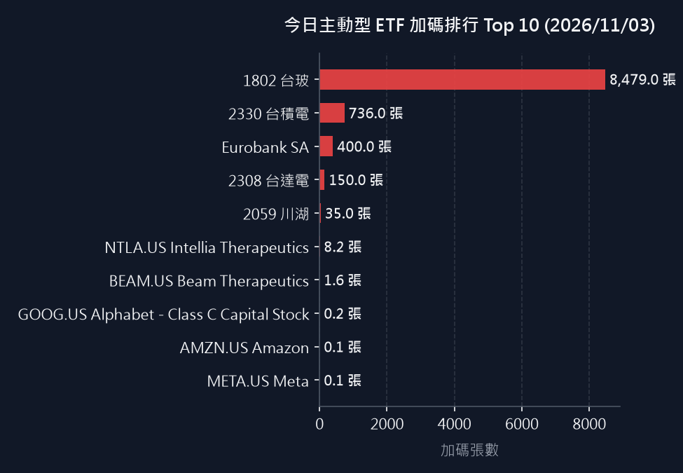
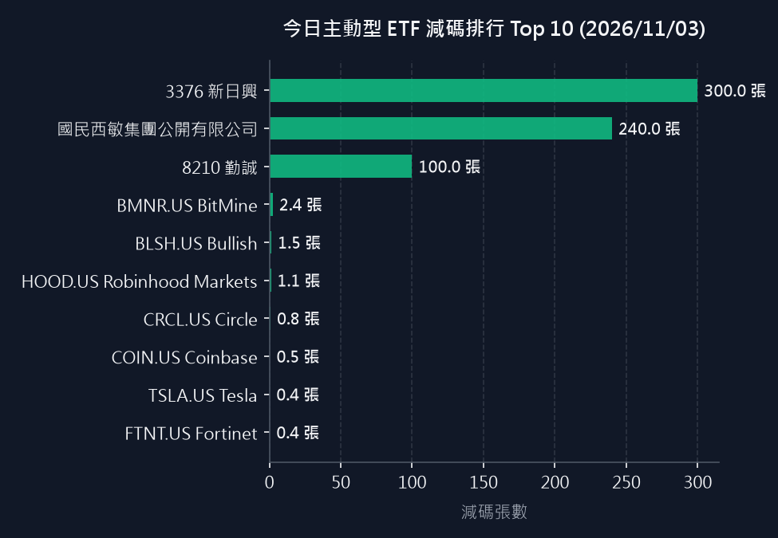

# 主動型 ETF 持股變動

資料來源：`主動型ETF持股明細.xlsx` 最近兩個日期分頁。

比較區間：`20261102` → `20261103`

## 今日加減碼視覺化排行

| 今日加碼 Top 10 | 今日減碼 Top 10 |
| :---: | :---: |
|  |  |

| ETF | 新增 | 刪除 | 比例變動 |
| :-- | --: | --: | --: |
| 00400A | 0 | 0 | 0 |
| 00401A | 0 | 0 | 0 |
| 00402A | 0 | 0 | 45 |
| 00403A | 0 | 0 | 0 |
| 00404A | 0 | 0 | 45 |
| 00405A | 0 | 0 | 0 |
| 00406A | 0 | 0 | 0 |
| 00407A | 0 | 0 | 0 |
| 00408A | 0 | 0 | 0 |
| 00980A | 0 | 0 | 0 |
| 00980D | 0 | 0 | 15 |
| 00981A | 1 | 0 | 29 |
| 00982A | 0 | 0 | 0 |
| 00983A | 0 | 0 | 36 |
| 00983D | 0 | 0 | 0 |
| 00984A | 0 | 0 | 0 |
| 00985A | 0 | 0 | 0 |
| 00986A | 0 | 0 | 34 |
| 00987A | 0 | 0 | 0 |
| 00988A | 0 | 0 | 0 |
| 00989A | 0 | 0 | 0 |
| 00990A | 0 | 0 | 0 |
| 00991A | 0 | 0 | 0 |
| 00992A | 0 | 0 | 39 |
| 00993A | 0 | 0 | 0 |
| 00994A | 0 | 0 | 0 |
| 00995A | 0 | 0 | 0 |
| 00996A | 0 | 0 | 36 |
| 00997A | 0 | 0 | 44 |
| 00998A | 0 | 0 | 45 |
| 00999A | 0 | 0 | 0 |

## 00400A

### 新增持股

- 無

### 刪除持股

- 無

### 投資比例變動

- 無

## 00401A

### 新增持股

- 無

### 刪除持股

- 無

### 投資比例變動

- 無

## 00402A

### 新增持股

- 無

### 刪除持股

- 無

### 投資比例變動

- AAPL.US Apple：8.55% → 8.65%（+0.10）
- ADI.US Analog Devices：2.18% → 2.22%（+0.04）
- AMD.US AMD：5.72% → 5.45%（-0.27）
- AMZN.US Amazon：4.45% → 4.68%（+0.23）
- ARM.US Arm：0.78% → 0.77%（-0.01）
- ASML.US ASML Holding：1.18% → 1.19%（+0.01）
- AVGO.US Broadcom：2.24% → 2.28%（+0.04）
- AXON.US Axon Enterprise：0.65% → 0.66%（+0.01）
- BABA.US Alibaba Group：0.48% → 0.51%（+0.03）
- BKNG.US Booking Holdings：0.52% → 0.56%（+0.04）
- CDNS.US Cadence Design Systems：1.61% → 1.67%（+0.06）
- CIEN.US Ciena：1.11% → 1.01%（-0.10）
- CLS.US Celestica：1.14% → 1.10%（-0.04）
- COHR.US Coherent：1.09% → 1.06%（-0.03）
- CRWD.US CrowdStrike Holdings：1.91% → 1.90%（-0.01）
- FSLY.US Fastly：0.37% → 0.34%（-0.03）
- GOOG.US Alphabet - Class C Capital Stock：2.99% → 3.08%（+0.09）
- GOOGL.US Alphabet - Class A Common Stock：2.99% → 3.08%（+0.09）
- INTC.US Intel：1.08% → 1.02%（-0.06）
- IOT.US Samsara：0.60% → 0.61%（+0.01）
- LITE.US Lumentum：1.80% → 1.51%（-0.29）
- LRCX.US Lam Research：2.20% → 2.15%（-0.05）
- MCHP.US Microchip Technology：1.48% → 1.51%（+0.03）
- MDB.US MongoDB：0.40% → 0.39%（-0.01）
- META.US Meta：3.52% → 3.58%（+0.06）
- MRVL.US Marvell：1.43% → 1.29%（-0.14）
- MU.US Micron：5.85% → 5.68%（-0.17）
- NFLX.US Netflix：0.94% → 0.97%（+0.03）
- NOW.US ServiceNow：0.88% → 0.91%（+0.03）
- NVDA.US NVIDIA：8.70% → 8.88%（+0.18）
- PANW.US Palo Alto：3.04% → 3.01%（-0.03）
- SHOP.US Shopify：1.20% → 1.23%（+0.03）
- SIMO.US Silicon Motion：0.50% → 0.46%（-0.04）
- SKHY.US SK hynix：0.86% → 0.88%（+0.02）
- SNOW.US Snowflake：1.33% → 1.30%（-0.03）
- SPCX.US SpaceX：0.72% → 0.75%（+0.03）
- SPOT.US Spotify：0.45% → 0.46%（+0.01）
- STX.US Seagate：1.05% → 1.00%（-0.05）
- TER.US Teradyne：0.66% → 0.64%（-0.02）
- TSM.US TSMC(ADR)：1.53% → 1.55%（+0.02）
- TTWO.US Take-Two：0.59% → 0.61%（+0.02）
- TXN.US Texas Instruments：2.76% → 2.86%（+0.10）
- UBER.US Uber：0.32% → 0.33%（+0.01）
- V.US Visa：1.35% → 1.44%（+0.09）
- WDC.US Western Digital：1.94% → 1.84%（-0.10）

## 00403A

### 新增持股

- 無

### 刪除持股

- 無

### 投資比例變動

- 無

## 00404A

### 新增持股

- 無

### 刪除持股

- 無

### 投資比例變動

- 1303 南亞：0.83% → 0.78%（-0.05）
- 2059 川湖：0.49% → 0.50%（+0.01）
- 2301 光寶科：0.52% → 0.51%（-0.01）
- 2303 聯電：2.26% → 2.20%（-0.06）
- 2308 台達電：1.41% → 1.37%（-0.04）
- 2317 鴻海：0.71% → 0.72%（+0.01）
- 2330 台積電：22.49% → 23.02%（+0.53）
- 2345 智邦：0.76% → 0.73%（-0.03）
- 2347 聯強：1.96% → 1.97%（+0.01）
- 2351 順德：0.34% → 0.32%（-0.02）
- 2357 華碩：1.19% → 1.20%（+0.01）
- 2360 致茂：0.40% → 0.38%（-0.02）
- 2382 廣達：1.00% → 1.02%（+0.02）
- 2383 台光電：2.69% → 2.61%（-0.08）
- 2395 研華：1.26% → 1.24%（-0.02）
- 2436 偉詮電：1.11% → 1.06%（-0.05）
- 2454 聯發科：6.35% → 6.11%（-0.24）
- 2851 中再保：1.19% → 1.24%（+0.05）
- 2882 國泰金：3.02% → 3.06%（+0.04）
- 2885 元大金：2.63% → 2.64%（+0.01）
- 2887 台新新光金：1.53% → 1.57%（+0.04）
- 2890 永豐金：1.60% → 1.61%（+0.01）
- 3034 聯詠：2.27% → 2.30%（+0.03）
- 3037 欣興：0.26% → 0.24%（-0.02）
- 3264 欣銓：0.59% → 0.55%（-0.04）
- 3293 鈊象：1.24% → 1.26%（+0.02）
- 3443 創意：0.95% → 0.92%（-0.03）
- 3680 家登：0.48% → 0.45%（-0.03）
- 3711 日月光投控：3.40% → 3.23%（-0.17）
- 5274 信驊：2.62% → 2.56%（-0.06）
- 5434 崇越：1.74% → 1.75%（+0.01）
- 5876 上海商銀：1.66% → 1.67%（+0.01）
- 5904 寶雅*：0.53% → 0.55%（+0.02）
- 6196 帆宣：1.58% → 1.50%（-0.08）
- 6223 旺矽：1.03% → 0.96%（-0.07）
- 6257 矽格：1.51% → 1.42%（-0.09）
- 6491 晶碩：0.95% → 0.94%（-0.01）
- 6505 台塑化：0.50% → 0.48%（-0.02）
- 6669 緯穎：0.90% → 0.91%（+0.01）
- 6691 洋基工程：1.53% → 1.51%（-0.02）
- 7769 鴻勁：1.02% → 0.97%（-0.05）
- 8016 矽創：1.23% → 1.24%（+0.01）
- 8299 群聯：1.22% → 1.14%（-0.08）
- 台指選擇權11/26 48000 買權：-0.13% → -0.06%（+0.07）
- 台股期貨11/26(FITXN*1.TF)：19.77% → 19.69%（-0.08）

## 00405A

### 新增持股

- 無

### 刪除持股

- 無

### 投資比例變動

- 無

## 00406A

### 新增持股

- 無

### 刪除持股

- 無

### 投資比例變動

- 無

## 00407A

### 新增持股

- 無

### 刪除持股

- 無

### 投資比例變動

- 無

## 00408A

### 新增持股

- 無

### 刪除持股

- 無

### 投資比例變動

- 無

## 00980A

### 新增持股

- 無

### 刪除持股

- 無

### 投資比例變動

- 無

## 00980D

### 新增持股

- 無

### 刪除持股

- 無

### 投資比例變動

- BLUE OWL CREDIT INCOME SER WI (REG) 7.75% 16SEP2027：0.57% → 0.58%（+0.01）
- CHARTER COMM OPT LLC/CAP (REG) 7.85% 15AUG2056：0.24% → 0.25%（+0.01）
- CHARTER COMM OPT LLC/CAP 6.700000 % 01-DEC-2055：0.44% → 0.45%（+0.01）
- CHS/COMMUNITY HEALTH SYS SER REGS 10.875000 % 15JAN2032：0.46% → 0.45%（-0.01）
- COREWEAVE INC SER REGS (REG S) 9.75% 01OCT2031：0.48% → 0.47%（-0.01）
- FMC CORP (REG) 6.375000 % 18MAY2053：0.34% → 0.35%（+0.01）
- GLOBAL AUTO HO/AAG FH UK SER REGS (REG S) 8.75% 15JAN2032：0.41% → 0.40%（-0.01）
- JETBLUE AIRWAYS/LOYALTY SER REGS (REG S) 9.875% 20SEP2031：0.30% → 0.33%（+0.03）
- ORACLE CORP 6.125000 % 03AUG2065：0.55% → 0.54%（-0.01）
- ORACLE CORP 6.9% 09NOV2052：0.51% → 0.50%（-0.01）
- SES GLOBAL AMERICAS HLDG SER REGS (REG) 5.300000 % 25MAR2044：0.31% → 0.32%（+0.01）
- SUNCOR ENERGY INC (REG) 6.8% 15MAY2038：0.43% → 0.44%（+0.01）
- US 10YR NOTE (CBT)DEC26 21-DEC-2026：18.59% → 18.63%（+0.04）
- US 5YR NOTE (CBT) DEC26 31-DEC-2026：-14.24% → -14.26%（-0.02）
- US LONG BOND(CBT) DEC26 21-DEC-2026：5.59% → 5.63%（+0.04）

## 00981A

### 新增持股

- 1802 台玻（0.23%，8479 張）

### 刪除持股

- 無

### 投資比例變動

- 2303 聯電：3.25% → 3.22%（-0.03）
- 2308 台達電：3.81% → 3.78%（-0.03）
- 2327 國巨*：4.35% → 4.19%（-0.16）
- 2330 台積電：11.86% → 13.05%（+1.19）
- 2345 智邦：3.79% → 3.72%（-0.07）
- 2368 金像電：3.03% → 2.94%（-0.09）
- 2383 台光電：7.55% → 7.48%（-0.07）
- 2449 京元電子：0.76% → 0.77%（+0.01）
- 2454 聯發科：8.06% → 7.91%（-0.15）
- 3017 奇鋐：7.50% → 7.63%（+0.13）
- 3037 欣興：7.29% → 7.00%（-0.29）
- 3231 緯創：0.40% → 0.42%（+0.02）
- 3264 欣銓：0.40% → 0.39%（-0.01）
- 3376 新日興：0.07% → 0.05%（-0.02）
- 3443 創意：2.49% → 2.47%（-0.02）
- 3653 健策：5.88% → 5.96%（+0.08）
- 3665 貿聯-KY：1.74% → 1.79%（+0.05）
- 3711 日月光投控：3.86% → 3.74%（-0.12）
- 4979 華星光：0.15% → 0.14%（-0.01）
- 6223 旺矽：4.32% → 4.12%（-0.20）
- 6271 同欣電：0.18% → 0.17%（-0.01）
- 6274 台燿：3.27% → 3.12%（-0.15）
- 6510 精測：0.50% → 0.48%（-0.02）
- 6669 緯穎：2.21% → 2.28%（+0.07）
- 6805 富世達：1.23% → 1.20%（-0.03）
- 8046 南電：3.95% → 3.78%（-0.17）
- 8210 勤誠：0.06% → 0.04%（-0.02）
- 8996 高力：0.55% → 0.52%（-0.03）
- 台指期貨 2026/11(FITXN*1.TF)：2.28% → 2.31%（+0.03）

## 00982A

### 新增持股

- 無

### 刪除持股

- 無

### 投資比例變動

- 無

## 00983A

### 新增持股

- 無

### 刪除持股

- 無

### 投資比例變動

- AMD.US AMD：3.23% → 3.05%（-0.18）
- AMZN.US Amazon：3.77% → 4.02%（+0.25）
- AVGO.US Broadcom：1.83% → 1.85%（+0.02）
- BEAM.US Beam Therapeutics：2.37% → 2.47%（+0.10）
- BLSH.US Bullish：1.44% → 1.26%（-0.18）
- BMNR.US BitMine：1.58% → 1.38%（-0.20）
- COIN.US Coinbase：3.46% → 3.14%（-0.32）
- CRCL.US Circle：4.21% → 4.06%（-0.15）
- CRSP.US CRISPR Therapeutics：4.03% → 4.00%（-0.03）
- CRWV.US CoreWeave：0.29% → 0.27%（-0.02）
- FTNT.US Fortinet：0.45% → 0.22%（-0.23）
- GOOG.US Alphabet - Class C Capital Stock：2.05% → 2.26%（+0.21）
- GOOGL.US Alphabet - Class A Common Stock：1.48% → 1.51%（+0.03）
- HOOD.US Robinhood Markets：2.86% → 2.52%（-0.34）
- ILMN.US Illumina：1.64% → 1.61%（-0.03）
- LLY.US Eli Lilly：1.93% → 1.96%（+0.03）
- META.US Meta：2.84% → 3.03%（+0.19）
- MSFT.US Microsoft：1.05% → 1.04%（-0.01）
- NET.US Cloudflare：1.31% → 1.27%（-0.04）
- NTLA.US Intellia Therapeutics：1.34% → 1.66%（+0.32）
- NTRA.US Natera：1.81% → 1.69%（-0.12）
- NVDA.US NVIDIA：3.73% → 3.76%（+0.03）
- PACB.US Pacific Biosciences of Californi：0.08% → 0.07%（-0.01）
- PLTR.US Palantir Technologies：3.30% → 3.26%（-0.04）
- RKLB.US Rocket Lab：1.34% → 1.31%（-0.03）
- RXRX.US Recursion Pharmaceuticals：1.01% → 0.98%（-0.03）
- SHOP.US Shopify：4.95% → 5.01%（+0.06）
- SNOW.US Snowflake：0.55% → 0.54%（-0.01）
- SPCX.US SpaceX：6.51% → 6.72%（+0.21）
- TEM.US Tempus：6.08% → 6.75%（+0.67）
- TER.US Teradyne：0.51% → 0.50%（-0.01）
- TSLA.US Tesla：9.61% → 9.26%（-0.35）
- TWST.US Twist Bioscience：4.12% → 3.56%（-0.56）
- TXG.US 10x Genomics：3.36% → 3.02%（-0.34）
- WGS.US GeneDx：0.54% → 0.51%（-0.03）
- XYZ.US Block：1.35% → 1.40%（+0.05）

## 00983D

### 新增持股

- 無

### 刪除持股

- 無

### 投資比例變動

- 無

## 00984A

### 新增持股

- 無

### 刪除持股

- 無

### 投資比例變動

- 無

## 00985A

### 新增持股

- 無

### 刪除持股

- 無

### 投資比例變動

- 無

## 00986A

### 新增持股

- 無

### 刪除持股

- 無

### 投資比例變動

- 2330 台積電：8.29% → 8.35%（+0.06）
- 2454 聯發科：1.52% → 1.58%（+0.06）
- AAPL.US Apple：2.73% → 2.75%（+0.02）
- AMD.US AMD：4.48% → 4.25%（-0.23）
- AMZN.US Amazon：4.27% → 4.47%（+0.20）
- AVGO.US Broadcom：3.72% → 3.77%（+0.05）
- BE.US Bloom Energy：1.93% → 1.91%（-0.02）
- CRWD.US CrowdStrike Holdings：4.76% → 4.72%（-0.04）
- DDOG.US Datadog：1.04% → 0.98%（-0.06）
- DELL.US Dell：0.81% → 0.77%（-0.04）
- ETN.US Eaton：2.34% → 2.38%（+0.04）
- GEV.US GE Vernova：2.72% → 2.80%（+0.08）
- GOOGL.US Alphabet - Class A Common Stock：5.32% → 5.44%（+0.12）
- GS.US Goldman Sachs：1.13% → 1.17%（+0.04）
- ILMN.US Illumina：0.60% → 0.59%（-0.01）
- JPM.US JPMorgan Chase：2.35% → 2.44%（+0.09）
- LITE.US Lumentum：4.16% → 3.47%（-0.69）
- LLY.US Eli Lilly：4.04% → 4.13%（+0.09）
- MA.US Mastercard：1.42% → 1.50%（+0.08）
- MSFT.US Microsoft：3.31% → 3.30%（-0.01）
- MU.US Micron：4.49% → 4.34%（-0.15）
- MUFG(8306.JP)：1.11% → 1.12%（+0.01）
- NET.US Cloudflare：2.13% → 2.07%（-0.06）
- NTRA.US Natera：1.05% → 0.99%（-0.06）
- NVDA.US NVIDIA：6.48% → 6.57%（+0.09）
- PLTR.US Palantir Technologies：1.40% → 1.39%（-0.01）
- RBRK.US Rubrik：1.02% → 0.97%（-0.05）
- SKHY.US SK hynix：0.95% → 0.96%（+0.01）
- SNOW.US Snowflake：2.13% → 2.08%（-0.05）
- TSEM.US Tower Semiconductor：0.90% → 0.86%（-0.04）
- 嘉能可公司：1.76% → 1.81%（+0.05）
- 施奈德電機公司：1.51% → 1.57%（+0.06）
- 艾司摩爾控股公司：2.00% → 2.05%（+0.05）
- 英飛凌科技股份有限公司：1.07% → 1.13%（+0.06）

## 00987A

### 新增持股

- 無

### 刪除持股

- 無

### 投資比例變動

- 無

## 00988A

### 新增持股

- 無

### 刪除持股

- 無

### 投資比例變動

- 無

## 00989A

### 新增持股

- 無

### 刪除持股

- 無

### 投資比例變動

- 無

## 00990A

### 新增持股

- 無

### 刪除持股

- 無

### 投資比例變動

- 無

## 00991A

### 新增持股

- 無

### 刪除持股

- 無

### 投資比例變動

- 無

## 00992A

### 新增持股

- 無

### 刪除持股

- 無

### 投資比例變動

- 1303 南亞：3.56% → 3.41%（-0.15）
- 1815 富喬：3.96% → 3.97%（+0.01）
- 2059 川湖：3.89% → 4.83%（+0.94）
- 2308 台達電：0.61% → 1.07%（+0.46）
- 2330 台積電：6.55% → 6.86%（+0.31）
- 2345 智邦：4.94% → 4.86%（-0.08）
- 2357 華碩：0.42% → 0.44%（+0.02）
- 2360 致茂：1.60% → 1.53%（-0.07）
- 2368 金像電：1.82% → 1.77%（-0.05）
- 2376 技嘉：0.41% → 0.42%（+0.01）
- 2383 台光電：5.36% → 5.33%（-0.03）
- 2454 聯發科：1.60% → 1.58%（-0.02）
- 3008 大立光：4.00% → 3.83%（-0.17）
- 3017 奇鋐：6.36% → 6.49%（+0.13）
- 3026 禾伸堂：0.82% → 0.78%（-0.04）
- 3037 欣興：6.04% → 5.80%（-0.24）
- 3081 聯亞：0.75% → 0.72%（-0.03）
- 3189 景碩：2.74% → 2.62%（-0.12）
- 3231 緯創：1.83% → 1.89%（+0.06）
- 3264 欣銓：0.24% → 0.23%（-0.01）
- 3443 創意：3.32% → 3.29%（-0.03）
- 3653 健策：0.98% → 1.00%（+0.02）
- 3665 貿聯-KY：4.92% → 5.07%（+0.15）
- 3711 日月光投控：1.15% → 1.12%（-0.03）
- 4958 臻鼎-KY：1.32% → 1.28%（-0.04）
- 5289 宜鼎：0.38% → 0.37%（-0.01）
- 5347 世界：0.21% → 0.20%（-0.01）
- 6139 亞翔：0.50% → 0.51%（+0.01）
- 6187 萬潤：0.75% → 0.72%（-0.03）
- 6213 聯茂：1.60% → 1.55%（-0.05）
- 6223 旺矽：3.83% → 3.66%（-0.17）
- 6274 台燿：1.46% → 1.39%（-0.07）
- 6515 穎崴：0.58% → 0.56%（-0.02）
- 6584 南俊國際：1.71% → 1.70%（-0.01）
- 6669 緯穎：1.81% → 1.87%（+0.06）
- 8021 尖點：2.63% → 2.51%（-0.12）
- 8046 南電：3.10% → 2.97%（-0.13）
- 8150 南茂：0.42% → 0.41%（-0.01）
- 8996 高力：5.94% → 5.69%（-0.25）

## 00993A

### 新增持股

- 無

### 刪除持股

- 無

### 投資比例變動

- 無

## 00994A

### 新增持股

- 無

### 刪除持股

- 無

### 投資比例變動

- 無

## 00995A

### 新增持股

- 無

### 刪除持股

- 無

### 投資比例變動

- 無

## 00996A

### 新增持股

- 無

### 刪除持股

- 無

### 投資比例變動

- 1303 南亞：0.19% → 0.18%（-0.01）
- 1802 台玻：0.11% → 0.12%（+0.01）
- 2303 聯電：2.40% → 2.38%（-0.02）
- 2308 台達電：3.84% → 3.82%（-0.02）
- 2327 國巨*：5.62% → 5.41%（-0.21）
- 2330 台積電：8.93% → 9.32%（+0.39）
- 2368 金像電：0.86% → 0.83%（-0.03）
- 2383 台光電：4.15% → 4.11%（-0.04）
- 2454 聯發科：6.49% → 6.37%（-0.12）
- 2467 志聖：0.20% → 0.19%（-0.01）
- 2472 立隆電：2.54% → 2.45%（-0.09）
- 2881 富邦金：0.21% → 0.22%（+0.01）
- 3017 奇鋐：3.33% → 3.39%（+0.06）
- 3037 欣興：2.72% → 2.61%（-0.11）
- 3042 晶技：0.90% → 0.86%（-0.04）
- 3189 景碩：3.49% → 3.33%（-0.16）
- 3443 創意：4.65% → 4.60%（-0.05）
- 3533 嘉澤：1.09% → 1.11%（+0.02）
- 3653 健策：1.90% → 1.92%（+0.02）
- 4749 新應材：0.07% → 0.06%（-0.01）
- 4958 臻鼎-KY：6.72% → 6.48%（-0.24）
- 6223 旺矽：1.92% → 1.84%（-0.08）
- 6239 力成：0.12% → 0.11%（-0.01）
- 6274 台燿：1.43% → 1.37%（-0.06）
- 6278 台表科：3.05% → 2.95%（-0.10）
- 6510 精測：5.30% → 5.17%（-0.13）
- 6683 雍智科技：2.83% → 2.70%（-0.13）
- 6770 力積電：1.85% → 1.81%（-0.04）
- 6830 汎銓：1.33% → 1.29%（-0.04）
- 6831 邁科：0.82% → 0.78%（-0.04）
- 7751 竑騰：2.65% → 2.53%（-0.12）
- 8021 尖點：3.29% → 3.14%（-0.15）
- 8046 南電：1.98% → 1.90%（-0.08）
- 8210 勤誠：0.86% → 0.84%（-0.02）
- 8358 金居：0.81% → 0.77%（-0.04）
- 8996 高力：1.02% → 0.98%（-0.04）

## 00997A

### 新增持股

- 無

### 刪除持股

- 無

### 投資比例變動

- 2330 台積電：2.95% → 3.01%（+0.06）
- 2383 台光電：1.80% → 1.89%（+0.09）
- 2454 聯發科：0.92% → 0.97%（+0.05）
- 3037 欣興：3.35% → 3.51%（+0.16）
- AAPL.US Apple：4.42% → 4.51%（+0.09）
- ADI.US Analog Devices：1.12% → 1.16%（+0.04）
- AMD.US AMD：2.16% → 2.08%（-0.08）
- ANET.US Arista Networks：1.54% → 1.55%（+0.01）
- APH.US Amphenol：1.28% → 1.34%（+0.06）
- ARM.US Arm：0.66% → 0.65%（-0.01）
- AVGO.US Broadcom：1.10% → 1.13%（+0.03）
- Advantest(6857.JP)：1.02% → 1.08%（+0.06）
- BE.US Bloom Energy：1.89% → 1.90%（+0.01）
- CDNS.US Cadence Design Systems：0.44% → 0.46%（+0.02）
- CRL.US Charles River：2.06% → 2.02%（-0.04）
- CRWD.US CrowdStrike Holdings：4.88% → 4.90%（+0.02）
- CSCO.US Cisco：1.03% → 1.04%（+0.01）
- DDOG.US Datadog：0.86% → 0.82%（-0.04）
- DELL.US Dell：2.21% → 2.13%（-0.08）
- DT.US Dynatrace：3.40% → 3.38%（-0.02）
- FTNT.US Fortinet：0.85% → 0.82%（-0.03）
- GE.US GE Aerospace：1.01% → 1.10%（+0.09）
- GOOGL.US Alphabet - Class A Common Stock：2.31% → 2.40%（+0.09）
- HWM.US Howmet Aerospace：0.93% → 1.03%（+0.10）
- INTC.US Intel：1.28% → 1.22%（-0.06）
- KLAC.US KLA：0.54% → 0.55%（+0.01）
- LITE.US Lumentum：4.13% → 3.50%（-0.63）
- LMT.US Lockheed Martin：0.95% → 1.00%（+0.05）
- LRCX.US Lam Research：1.62% → 1.60%（-0.02）
- MRVL.US Marvell：1.33% → 1.21%（-0.12）
- MSFT.US Microsoft：3.37% → 3.41%（+0.04）
- MU.US Micron：3.09% → 3.03%（-0.06）
- NTRA.US Natera：2.93% → 2.79%（-0.14）
- NVDA.US NVIDIA：3.68% → 3.78%（+0.10）
- OKTA.US Okta：2.92% → 2.70%（-0.22）
- PLTR.US Palantir Technologies：1.33% → 1.34%（+0.01）
- SNDK.US Sandisk：2.12% → 2.06%（-0.06）
- SNOW.US Snowflake：0.56% → 0.55%（-0.01）
- SPCX.US SpaceX：3.02% → 3.17%（+0.15）
- STX.US Seagate：1.50% → 1.43%（-0.07）
- Samsung Elec Mech(009150.KS)：1.27% → 1.31%（+0.04）
- TXN.US Texas Instruments：0.92% → 0.96%（+0.04）
- VEEV.US Veeva Systems：1.04% → 1.06%（+0.02）
- WDC.US Western Digital：1.32% → 1.27%（-0.05）

## 00998A

### 新增持股

- 無

### 刪除持股

- 無

### 投資比例變動

- 2881 富邦金：1.09% → 1.07%（-0.02）
- 2885 元大金：1.77% → 1.74%（-0.03）
- ASR荷蘭公眾有限公司：3.56% → 3.57%（+0.01）
- Ageas：2.76% → 2.77%（+0.01）
- Alpha Bank SA：1.27% → 1.24%（-0.03）
- BLK.US BlackRock：2.14% → 2.18%（+0.04）
- CHYM.US Chime：1.18% → 1.20%（+0.02）
- Chiba Bank(8331.JP)：1.30% → 1.29%（-0.01）
- EQH.US Equitable Holdings：2.77% → 2.78%（+0.01）
- Eurobank SA：1.65% → 2.56%（+0.91）
- GPN.US Global Payments：0.90% → 0.93%（+0.03）
- ICE.US Intercontinental Exchange：1.38% → 1.41%（+0.03）
- JPM.US JPMorgan Chase：2.36% → 2.38%（+0.02）
- KB Financial Group(105560.KS)：0.76% → 0.75%（-0.01）
- M&G公開有限公司：2.00% → 2.02%（+0.02）
- MRX.US Marex：1.20% → 1.21%（+0.01）
- MS&AD Insurance Group Holdings(8725.JP)：1.56% → 1.54%（-0.02）
- Mebuki Financial Group(7167.JP)：1.47% → 1.42%（-0.05）
- Mizuho Financial(8411.JP)：2.18% → 2.13%（-0.05）
- Piraeus Bank SA：2.82% → 2.73%（-0.09）
- Resona(8308.JP)：1.46% → 1.44%（-0.02）
- Samsung Fire & Marine Insurance(000810.KS)：0.85% → 0.84%（-0.01）
- Sumitomo Mitsui Trust Group(8309.JP)：0.98% → 0.96%（-0.02）
- Tokio Marine Holdings(8766.JP)：1.44% → 1.43%（-0.01）
- UBS.US UBS Group：0.78% → 0.79%（+0.01）
- Unipol保險股份公司：0.92% → 0.94%（+0.02）
- V.US Visa：3.28% → 3.37%（+0.09）
- VCTR.US Victory Capital Holdings：1.29% → 1.33%（+0.04）
- WFC.US Wells Fargo：0.58% → 0.60%（+0.02）
- 國民西敏集團公開有限公司：1.96% → 1.11%（-0.85）
- 希臘國家銀行：1.56% → 1.57%（+0.01）
- 德意志證交所：2.18% → 2.13%（-0.05）
- 忠意保險股份公司：0.89% → 0.90%（+0.01）
- 東方匯理資產管理有限責任公司：1.19% → 1.21%（+0.02）
- 標準人壽公開有限公司：3.77% → 3.79%（+0.02）
- 法通保險集團公開有限公司：1.33% → 1.34%（+0.01）
- 泛歐交易所：2.78% → 2.68%（-0.10）
- 渣打集團有限公司：2.32% → 2.31%（-0.01）
- 畢爾巴鄂比斯開銀行：1.02% → 1.05%（+0.03）
- 義大利西恩那銀行股份公司：1.70% → 1.72%（+0.02）
- 英傑華保險：3.35% → 3.33%（-0.02）
- 荷蘭國際集團：2.36% → 2.35%（-0.01）
- 荷蘭銀行公眾有限公司：3.52% → 3.55%（+0.03）
- 裕信銀行：2.02% → 2.06%（+0.04）
- 西班牙洲際銀行有限責任公司：0.67% → 0.68%（+0.01）

## 00999A

### 新增持股

- 無

### 刪除持股

- 無

### 投資比例變動

- 無
