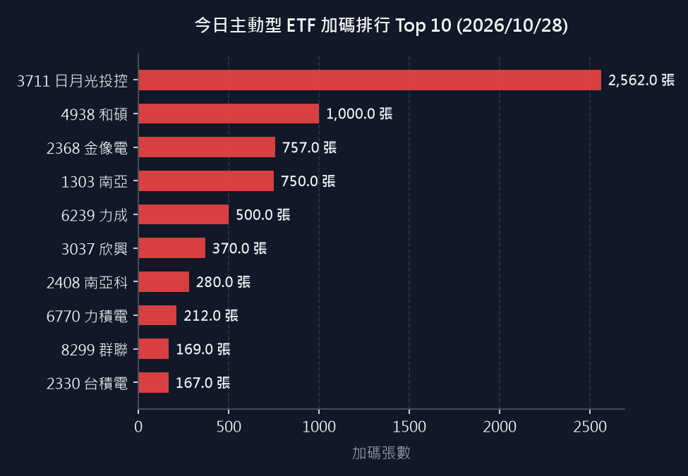
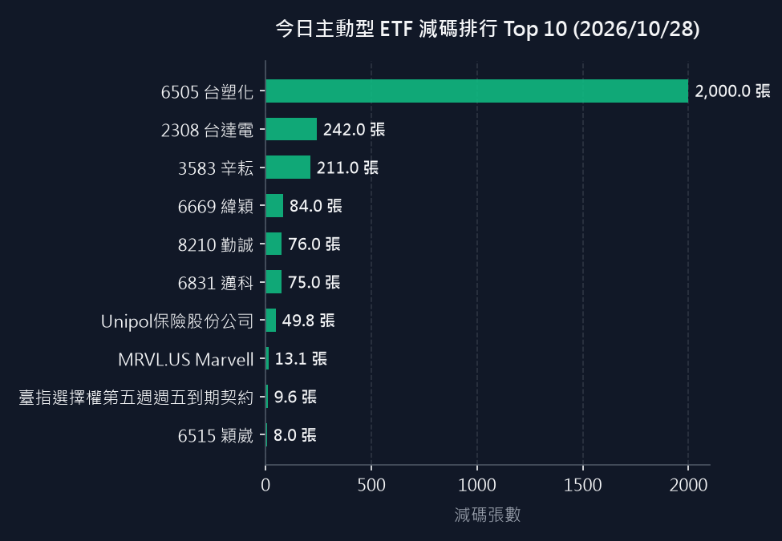

# 主動型 ETF 持股變動

資料來源：`主動型ETF持股明細.xlsx` 最近兩個日期分頁。

比較區間：`20261027` → `20261028`

## 今日加減碼視覺化排行

| 今日加碼 Top 10 | 今日減碼 Top 10 |
| :---: | :---: |
|  |  |

| ETF | 新增 | 刪除 | 比例變動 |
| :-- | --: | --: | --: |
| 00400A | 0 | 0 | 47 |
| 00401A | 0 | 0 | 49 |
| 00402A | 0 | 1 | 46 |
| 00403A | 0 | 0 | 33 |
| 00404A | 0 | 0 | 44 |
| 00405A | 0 | 0 | 24 |
| 00406A | 1 | 1 | 46 |
| 00407A | 0 | 0 | 40 |
| 00408A | 0 | 0 | 48 |
| 00980A | 0 | 0 | 45 |
| 00980D | 0 | 1 | 81 |
| 00981A | 0 | 0 | 28 |
| 00982A | 0 | 0 | 41 |
| 00983A | 1 | 0 | 39 |
| 00983D | 0 | 0 | 27 |
| 00984A | 0 | 0 | 66 |
| 00985A | 0 | 0 | 44 |
| 00986A | 0 | 1 | 34 |
| 00987A | 0 | 0 | 26 |
| 00988A | 0 | 0 | 38 |
| 00989A | 0 | 3 | 58 |
| 00990A | 0 | 0 | 35 |
| 00991A | 0 | 0 | 19 |
| 00992A | 0 | 0 | 42 |
| 00993A | 0 | 0 | 45 |
| 00994A | 0 | 0 | 38 |
| 00995A | 0 | 1 | 40 |
| 00996A | 0 | 0 | 39 |
| 00997A | 1 | 0 | 45 |
| 00998A | 0 | 0 | 44 |
| 00999A | 0 | 0 | 49 |

## 00400A

### 新增持股

- 無

### 刪除持股

- 無

### 投資比例變動

- 1303 南亞：4.13% → 4.23%（+0.10）
- 1476 儒鴻：0.08% → 0.07%（-0.01）
- 2059 川湖：3.66% → 3.61%（-0.05）
- 2308 台達電：2.39% → 2.34%（-0.05）
- 2313 華通：0.80% → 0.79%（-0.01）
- 2317 鴻海：0.79% → 0.77%（-0.02）
- 2330 台積電：9.05% → 8.72%（-0.33）
- 2345 智邦：1.48% → 1.45%（-0.03）
- 2360 致茂：3.06% → 3.04%（-0.02）
- 2368 金像電：2.64% → 2.76%（+0.12）
- 2383 台光電：4.02% → 4.06%（+0.04）
- 2449 京元電子：0.90% → 0.88%（-0.02）
- 2454 聯發科：6.79% → 6.92%（+0.13）
- 2603 長榮：1.63% → 1.56%（-0.07）
- 2637 慧洋-KY：0.48% → 0.45%（-0.03）
- 2881 富邦金：1.68% → 1.59%（-0.09）
- 2891 中信金：1.64% → 1.54%（-0.10）
- 3008 大立光：1.52% → 1.53%（+0.01）
- 3017 奇鋐：3.43% → 3.36%（-0.07）
- 3036 文曄：1.58% → 1.52%（-0.06）
- 3037 欣興：3.78% → 3.74%（-0.04）
- 3044 健鼎：2.24% → 2.23%（-0.01）
- 3081 聯亞：0.68% → 0.67%（-0.01）
- 3090 日電貿：0.30% → 0.31%（+0.01）
- 3167 大量：0.37% → 0.38%（+0.01）
- 3231 緯創：1.03% → 1.00%（-0.03）
- 3293 鈊象：0.35% → 0.34%（-0.01）
- 3406 玉晶光：0.99% → 1.04%（+0.05）
- 3443 創意：2.40% → 2.52%（+0.12）
- 3529 力旺：1.19% → 1.20%（+0.01）
- 3653 健策：3.01% → 3.12%（+0.11）
- 3661 世芯-KY：2.14% → 2.22%（+0.08）
- 3665 貿聯-KY：1.32% → 1.31%（-0.01）
- 3711 日月光投控：1.01% → 1.03%（+0.02）
- 5274 信驊：1.52% → 1.56%（+0.04）
- 6147 頎邦：0.89% → 0.91%（+0.02）
- 6187 萬潤：1.07% → 1.06%（-0.01）
- 6223 旺矽：2.89% → 2.94%（+0.05）
- 6271 同欣電：0.24% → 0.23%（-0.01）
- 6274 台燿：1.19% → 1.22%（+0.03）
- 6278 台表科：2.64% → 2.58%（-0.06）
- 6488 環球晶：2.40% → 2.39%（-0.01）
- 6505 台塑化：1.53% → 1.42%（-0.11）
- 7750 新代：0.81% → 0.78%（-0.03）
- 7769 鴻勁：0.70% → 0.71%（+0.01）
- 9939 宏全：0.08% → 0.07%（-0.01）
- ＸＡＧＸ金兌(3533.HK)：0.98% → 0.94%（-0.04）

## 00401A

### 新增持股

- 無

### 刪除持股

- 無

### 投資比例變動

- 1216 統一：0.29% → 0.28%（-0.01）
- 1303 南亞：1.23% → 1.28%（+0.05）
- 1477 聚陽：0.94% → 0.92%（-0.02）
- 2303 聯電：2.10% → 2.13%（+0.03）
- 2308 台達電：2.11% → 2.10%（-0.01）
- 2313 華通：1.36% → 1.37%（+0.01）
- 2317 鴻海：0.58% → 0.57%（-0.01）
- 2327 國巨*：0.60% → 0.61%（+0.01）
- 2330 台積電：20.50% → 20.11%（-0.39）
- 2357 華碩：1.89% → 1.88%（-0.01）
- 2360 致茂：1.54% → 1.56%（+0.02）
- 2379 瑞昱：1.16% → 1.12%（-0.04）
- 2382 廣達：2.17% → 2.12%（-0.05）
- 2383 台光電：0.98% → 1.01%（+0.03）
- 2412 中華電：0.91% → 0.88%（-0.03）
- 2454 聯發科：5.69% → 5.91%（+0.22）
- 2455 全新：2.03% → 2.16%（+0.13）
- 2603 長榮：1.80% → 1.94%（+0.14）
- 2881 富邦金：2.19% → 2.11%（-0.08）
- 2882 國泰金：1.09% → 1.07%（-0.02）
- 2883 凱基金：1.71% → 1.66%（-0.05）
- 2884 玉山金：2.15% → 2.05%（-0.10）
- 2886 兆豐金：1.50% → 1.43%（-0.07）
- 2887 台新新光金：1.11% → 1.07%（-0.04）
- 2890 永豐金：0.51% → 0.49%（-0.02）
- 2891 中信金：1.90% → 1.82%（-0.08）
- 2912 統一超：0.27% → 0.26%（-0.01）
- 3008 大立光：2.18% → 2.24%（+0.06）
- 3037 欣興：2.03% → 2.05%（+0.02）
- 3231 緯創：1.75% → 1.74%（-0.01）
- 3491 昇達科：1.49% → 1.52%（+0.03）
- 3711 日月光投控：2.51% → 3.27%（+0.76）
- 4904 遠傳：0.83% → 0.79%（-0.04）
- 4958 臻鼎-KY：1.35% → 1.39%（+0.04）
- 4991 環宇-KY：0.56% → 0.58%（+0.02）
- 5274 信驊：1.71% → 1.80%（+0.09）
- 5347 世界：1.27% → 1.28%（+0.01）
- 5904 寶雅*：0.56% → 0.54%（-0.02）
- 6147 頎邦：1.36% → 1.42%（+0.06）
- 6187 萬潤：0.89% → 0.91%（+0.02）
- 6223 旺矽：1.47% → 1.53%（+0.06）
- 6285 啟碁：1.32% → 1.33%（+0.01）
- 6531 愛普*：1.46% → 1.47%（+0.01）
- 6669 緯穎：1.76% → 1.71%（-0.05）
- 7769 鴻勁：0.81% → 0.84%（+0.03）
- 7856 漢測：0.70% → 0.72%（+0.02）
- 8464 億豐：1.02% → 0.99%（-0.03）
- 台股期貨11/26(FITXN*1.TF)：-0.13% → 0.04%（+0.17）
- 臺指選擇權11/26 46500 買權：-0.50% → -0.75%（-0.25）

## 00402A

### 新增持股

- 無

### 刪除持股

- DASH.US DoorDash（0.49%，4.3 張）

### 投資比例變動

- AAPL.US Apple：8.48% → 8.11%（-0.37）
- ADI.US Analog Devices：1.98% → 2.09%（+0.11）
- AMD.US AMD：5.65% → 5.98%（+0.33）
- AMZN.US Amazon：4.55% → 4.41%（-0.14）
- ANET.US Arista Networks：0.77% → 0.81%（+0.04）
- ARM.US Arm：0.78% → 0.81%（+0.03）
- AVGO.US Broadcom：2.18% → 2.21%（+0.03）
- BABA.US Alibaba Group：0.48% → 0.46%（-0.02）
- BKNG.US Booking Holdings：0.56% → 0.50%（-0.06）
- CDNS.US Cadence Design Systems：1.49% → 1.59%（+0.10）
- CIEN.US Ciena：1.10% → 1.15%（+0.05）
- CLS.US Celestica：1.13% → 1.12%（-0.01）
- COHR.US Coherent：1.05% → 1.15%（+0.10）
- CRWD.US CrowdStrike Holdings：1.65% → 1.92%（+0.27）
- FSLY.US Fastly：0.35% → 0.41%（+0.06）
- GOOG.US Alphabet - Class C Capital Stock：3.39% → 3.21%（-0.18）
- GOOGL.US Alphabet - Class A Common Stock：3.41% → 3.23%（-0.18）
- INTC.US Intel：1.38% → 1.46%（+0.08）
- IOT.US Samsara：0.61% → 0.58%（-0.03）
- KLAC.US KLA：1.40% → 1.28%（-0.12）
- LITE.US Lumentum：1.58% → 1.75%（+0.17）
- LRCX.US Lam Research：2.18% → 2.09%（-0.09）
- MCHP.US Microchip Technology：1.40% → 1.45%（+0.05）
- MDB.US MongoDB：0.40% → 0.42%（+0.02）
- META.US Meta：3.65% → 3.35%（-0.30）
- MRVL.US Marvell：1.60% → 1.68%（+0.08）
- MSFT.US Microsoft：5.60% → 5.48%（-0.12）
- MU.US Micron：5.56% → 5.78%（+0.22）
- NFLX.US Netflix：1.00% → 0.89%（-0.11）
- NOW.US ServiceNow：1.29% → 1.22%（-0.07）
- NVDA.US NVIDIA：8.87% → 8.73%（-0.14）
- PANW.US Palo Alto：2.89% → 3.15%（+0.26）
- PLTR.US Palantir Technologies：2.30% → 2.24%（-0.06）
- SHOP.US Shopify：1.26% → 1.19%（-0.07）
- SIMO.US Silicon Motion：0.44% → 0.46%（+0.02）
- SKHY.US SK hynix：0.75% → 0.79%（+0.04）
- SNOW.US Snowflake：1.34% → 1.38%（+0.04）
- SPCX.US SpaceX：0.76% → 0.75%（-0.01）
- SPOT.US Spotify：0.43% → 0.40%（-0.03）
- TER.US Teradyne：0.72% → 0.73%（+0.01）
- TSM.US TSMC(ADR)：1.53% → 1.55%（+0.02）
- TTWO.US Take-Two：0.63% → 0.59%（-0.04）
- TXN.US Texas Instruments：2.52% → 2.68%（+0.16）
- UBER.US Uber：0.33% → 0.30%（-0.03）
- V.US Visa：1.33% → 1.24%（-0.09）
- WDC.US Western Digital：1.84% → 1.90%（+0.06）

## 00403A

### 新增持股

- 無

### 刪除持股

- 無

### 投資比例變動

- 1303 南亞：2.83% → 2.91%（+0.08）
- 1560 中砂：0.32% → 0.38%（+0.06）
- 2059 川湖：0.70% → 0.69%（-0.01）
- 2308 台達電：3.47% → 3.13%（-0.34）
- 2317 鴻海：0.63% → 0.61%（-0.02）
- 2327 國巨*：3.63% → 3.65%（+0.02）
- 2330 台積電：14.63% → 14.17%（-0.46）
- 2345 智邦：2.23% → 2.20%（-0.03）
- 2368 金像電：0.70% → 0.74%（+0.04）
- 2383 台光電：4.51% → 4.58%（+0.07）
- 2408 南亞科：0.98% → 1.01%（+0.03）
- 2449 京元電子：0.85% → 0.84%（-0.01）
- 2454 聯發科：4.70% → 4.92%（+0.22）
- 2455 全新：0.07% → 0.08%（+0.01）
- 2882 國泰金：0.36% → 0.35%（-0.01）
- 3008 大立光：1.78% → 1.80%（+0.02）
- 3017 奇鋐：5.77% → 5.69%（-0.08）
- 3037 欣興：6.04% → 6.01%（-0.03）
- 3189 景碩：3.32% → 3.50%（+0.18）
- 3211 順達：0.52% → 0.51%（-0.01）
- 3443 創意：4.00% → 4.40%（+0.40）
- 3450 聯鈞：0.51% → 0.50%（-0.01）
- 3583 辛耘：0.37% → 0.34%（-0.03）
- 3653 健策：4.64% → 4.84%（+0.20）
- 3711 日月光投控：0.21% → 0.47%（+0.26）
- 5274 信驊：2.16% → 2.24%（+0.08）
- 6223 旺矽：3.53% → 3.61%（+0.08）
- 6274 台燿：2.43% → 2.51%（+0.08）
- 6442 光聖：0.38% → 0.37%（-0.01）
- 6669 緯穎：2.86% → 2.74%（-0.12）
- 6805 富世達：0.55% → 0.58%（+0.03）
- 8046 南電：2.99% → 2.97%（-0.02）
- 8996 高力：2.18% → 2.26%（+0.08）

## 00404A

### 新增持股

- 無

### 刪除持股

- 無

### 投資比例變動

- 1303 南亞：0.80% → 0.83%（+0.03）
- 2303 聯電：2.46% → 2.49%（+0.03）
- 2308 台達電：1.54% → 1.53%（-0.01）
- 2317 鴻海：0.68% → 0.67%（-0.01）
- 2330 台積電：22.68% → 22.19%（-0.49）
- 2347 聯強：2.07% → 2.02%（-0.05）
- 2357 華碩：1.23% → 1.22%（-0.01）
- 2379 瑞昱：1.19% → 1.15%（-0.04）
- 2382 廣達：1.01% → 0.99%（-0.02）
- 2383 台光電：2.66% → 2.73%（+0.07）
- 2395 研華：1.30% → 1.26%（-0.04）
- 2454 聯發科：6.20% → 6.43%（+0.23）
- 2637 慧洋-KY：1.16% → 1.12%（-0.04）
- 2882 國泰金：2.91% → 2.85%（-0.06）
- 2885 元大金：2.63% → 2.54%（-0.09）
- 2887 台新新光金：1.52% → 1.46%（-0.06）
- 2890 永豐金：1.53% → 1.48%（-0.05）
- 3017 奇鋐：1.28% → 1.27%（-0.01）
- 3034 聯詠：2.33% → 2.26%（-0.07）
- 3264 欣銓：0.66% → 0.62%（-0.04）
- 3293 鈊象：1.22% → 1.18%（-0.04）
- 3443 創意：0.95% → 1.01%（+0.06）
- 3653 健策：0.45% → 0.47%（+0.02）
- 3680 家登：0.49% → 0.50%（+0.01）
- 3711 日月光投控：3.22% → 3.33%（+0.11）
- 5274 信驊：2.63% → 2.75%（+0.12）
- 5434 崇越：1.70% → 1.69%（-0.01）
- 5876 上海商銀：1.66% → 1.56%（-0.10）
- 5904 寶雅*：0.51% → 0.49%（-0.02）
- 6196 帆宣：1.70% → 1.66%（-0.04）
- 6206 飛捷：0.74% → 0.73%（-0.01）
- 6223 旺矽：1.04% → 1.07%（+0.03）
- 6257 矽格：1.63% → 1.59%（-0.04）
- 6491 晶碩：0.93% → 0.91%（-0.02）
- 6505 台塑化：0.50% → 0.48%（-0.02）
- 6669 緯穎：0.94% → 0.91%（-0.03）
- 6691 洋基工程：1.52% → 1.50%（-0.02）
- 7769 鴻勁：1.06% → 1.10%（+0.04）
- 8016 矽創：1.28% → 1.25%（-0.03）
- 8299 群聯：1.22% → 1.26%（+0.04）
- iShares MSCI Japan SRI ETF(2851.JP)：1.19% → 1.13%（-0.06）
- 台指選擇權11/26 50900 買權：-0.03% → -0.06%（-0.03）
- 台指選擇權12/26 51800 買權：0.00% → -0.01%（-0.01）
- 台股期貨11/26(FITXN*1.TF)：16.91% → 17.95%（+1.04）

## 00405A

### 新增持股

- 無

### 刪除持股

- 無

### 投資比例變動

- 2059 川湖：2.31% → 2.27%（-0.04）
- 2308 台達電：0.67% → 0.65%（-0.02）
- 2330 台積電：2.02% → 1.94%（-0.08）
- 2345 智邦：5.05% → 4.95%（-0.10）
- 2368 金像電：5.73% → 5.98%（+0.25）
- 2383 台光電：4.74% → 4.77%（+0.03）
- 2454 聯發科：5.48% → 5.58%（+0.10）
- 3017 奇鋐：1.89% → 1.84%（-0.05）
- 3037 欣興：7.64% → 7.54%（-0.10）
- 3189 景碩：0.22% → 0.23%（+0.01）
- 3443 創意：2.56% → 2.67%（+0.11）
- 3653 健策：7.18% → 7.43%（+0.25）
- 3665 貿聯-KY：5.44% → 5.39%（-0.05）
- 5274 信驊：5.98% → 7.07%（+1.09）
- 6187 萬潤：0.90% → 0.89%（-0.01）
- 6223 旺矽：7.29% → 7.40%（+0.11）
- 6274 台燿：1.85% → 1.89%（+0.04）
- 6515 穎崴：0.52% → 0.51%（-0.01）
- 6531 愛普*：3.95% → 3.89%（-0.06）
- 6669 緯穎：0.91% → 0.87%（-0.04）
- 6805 富世達：2.87% → 2.99%（+0.12）
- 7769 鴻勁：2.95% → 2.99%（+0.04）
- 8046 南電：7.68% → 7.57%（-0.11）
- 8996 高力：1.38% → 1.42%（+0.04）

## 00406A

### 新增持股

- 臺指選擇權第一週週三到期契約（-4.34%，-3 張）

### 刪除持股

- 臺指選擇權第四週週三到期契約（-7.44%，-5.579 張）

### 投資比例變動

- 1303 南亞：2.14% → 2.32%（+0.18）
- 1326 台化：0.55% → 0.53%（-0.02）
- 1560 中砂：0.30% → 0.31%（+0.01）
- 1815 富喬：0.35% → 0.37%（+0.02）
- 2059 川湖：1.30% → 1.28%（-0.02）
- 2303 聯電：1.57% → 1.56%（-0.01）
- 2308 台達電：2.25% → 2.20%（-0.05）
- 2317 鴻海：0.29% → 0.28%（-0.01）
- 2330 台積電：9.50% → 9.34%（-0.16）
- 2345 智邦：2.89% → 2.84%（-0.05）
- 2360 致茂：1.08% → 1.07%（-0.01）
- 2368 金像電：1.99% → 2.12%（+0.13）
- 2383 台光電：5.99% → 6.16%（+0.17）
- 2449 京元電子：0.55% → 0.54%（-0.01）
- 2454 聯發科：5.51% → 5.61%（+0.10）
- 2885 元大金：0.53% → 0.50%（-0.03）
- 2886 兆豐金：0.12% → 0.11%（-0.01）
- 3008 大立光：1.27% → 1.28%（+0.01）
- 3017 奇鋐：5.36% → 5.44%（+0.08）
- 3037 欣興：5.93% → 6.14%（+0.21）
- 3167 大量：0.53% → 0.54%（+0.01）
- 3189 景碩：2.09% → 2.19%（+0.10）
- 3231 緯創：0.45% → 0.44%（-0.01）
- 3264 欣銓：0.46% → 0.42%（-0.04）
- 3363 上詮：0.16% → 0.17%（+0.01）
- 3443 創意：2.31% → 2.41%（+0.10）
- 3653 健策：3.97% → 4.11%（+0.14）
- 3661 世芯-KY：0.85% → 0.88%（+0.03）
- 3665 貿聯-KY：1.13% → 1.12%（-0.01）
- 3711 日月光投控：1.99% → 2.02%（+0.03）
- 4938 和碩：0.53% → 0.61%（+0.08）
- 4958 臻鼎-KY：1.18% → 1.19%（+0.01）
- 5274 信驊：1.95% → 2.01%（+0.06）
- 6147 頎邦：0.88% → 0.90%（+0.02）
- 6213 聯茂：0.63% → 0.62%（-0.01）
- 6223 旺矽：3.24% → 3.29%（+0.05）
- 6274 台燿：1.11% → 1.13%（+0.02）
- 6278 台表科：0.34% → 0.33%（-0.01）
- 6510 精測：0.67% → 0.70%（+0.03）
- 6669 緯穎：1.43% → 1.36%（-0.07）
- 6715 嘉基：0.73% → 0.78%（+0.05）
- 6805 富世達：0.52% → 0.55%（+0.03）
- 8046 南電：3.12% → 3.20%（+0.08）
- 8358 金居：0.08% → 0.09%（+0.01）
- 臺指選擇權第五週週五到期契約：-1.88% → -16.45%（-14.57）
- 臺股期貨 202611(FITXN*1.TF)：20.87% → 22.85%（+1.98）

## 00407A

### 新增持股

- 無

### 刪除持股

- 無

### 投資比例變動

- 1303 南亞：2.61% → 2.98%（+0.37）
- 1560 中砂：0.99% → 1.04%（+0.05）
- 2059 川湖：1.92% → 1.90%（-0.02）
- 2301 光寶科：1.43% → 1.42%（-0.01）
- 2308 台達電：2.39% → 2.34%（-0.05）
- 2327 國巨*：2.28% → 2.29%（+0.01）
- 2330 台積電：9.75% → 9.42%（-0.33）
- 2345 智邦：1.55% → 1.53%（-0.02）
- 2368 金像電：1.62% → 1.86%（+0.24）
- 2379 瑞昱：0.27% → 0.26%（-0.01）
- 2383 台光電：5.23% → 5.60%（+0.37）
- 2408 南亞科：0.92% → 1.58%（+0.66）
- 2454 聯發科：5.21% → 5.33%（+0.12）
- 2615 萬海：1.05% → 1.03%（-0.02）
- 3008 大立光：1.53% → 1.54%（+0.01）
- 3017 奇鋐：5.75% → 5.64%（-0.11）
- 3034 聯詠：0.89% → 0.85%（-0.04）
- 3037 欣興：6.21% → 6.16%（-0.05）
- 3081 聯亞：1.87% → 1.85%（-0.02）
- 3131 弘塑：0.79% → 0.78%（-0.01）
- 3231 緯創：1.12% → 1.09%（-0.03）
- 3260 威剛：0.29% → 0.30%（+0.01）
- 3293 鈊象：0.67% → 0.64%（-0.03）
- 3443 創意：4.66% → 4.89%（+0.23）
- 3491 昇達科：0.84% → 0.85%（+0.01）
- 3533 嘉澤：0.98% → 0.95%（-0.03）
- 3653 健策：3.33% → 3.46%（+0.13）
- 3711 日月光投控：3.03% → 3.10%（+0.07）
- 4958 臻鼎-KY：1.06% → 1.08%（+0.02）
- 5274 信驊：1.32% → 1.85%（+0.53）
- 6187 萬潤：1.60% → 1.61%（+0.01）
- 6223 旺矽：2.20% → 2.25%（+0.05）
- 6274 台燿：1.94% → 1.99%（+0.05）
- 6446 藥華藥：0.34% → 0.33%（-0.01）
- 6510 精測：1.35% → 1.42%（+0.07）
- 6531 愛普*：0.31% → 0.30%（-0.01）
- 6669 緯穎：2.55% → 2.44%（-0.11）
- 6805 富世達：1.23% → 1.29%（+0.06）
- 8046 南電：3.74% → 3.70%（-0.04）
- 8996 高力：1.28% → 1.33%（+0.05）

## 00408A

### 新增持股

- 無

### 刪除持股

- 無

### 投資比例變動

- 1216 統一：0.12% → 0.11%（-0.01）
- 1303 南亞：3.89% → 3.99%（+0.10）
- 1560 中砂：0.36% → 0.83%（+0.47）
- 2059 川湖：1.00% → 0.99%（-0.01）
- 2308 台達電：2.51% → 2.47%（-0.04）
- 2330 台積電：6.42% → 6.07%（-0.35）
- 2344 華邦電：0.47% → 0.48%（+0.01）
- 2345 智邦：0.70% → 0.69%（-0.01）
- 2357 華碩：1.19% → 1.17%（-0.02）
- 2360 致茂：1.14% → 1.13%（-0.01）
- 2368 金像電：4.94% → 5.19%（+0.25）
- 2376 技嘉：1.43% → 1.39%（-0.04）
- 2382 廣達：0.24% → 0.23%（-0.01）
- 2383 台光電：4.65% → 4.71%（+0.06）
- 2395 研華：1.70% → 1.63%（-0.07）
- 2408 南亞科：1.95% → 2.02%（+0.07）
- 2449 京元電子：0.92% → 0.91%（-0.01）
- 2454 聯發科：4.02% → 4.12%（+0.10）
- 2455 全新：0.41% → 0.85%（+0.44）
- 2542 興富發：3.93% → 3.65%（-0.28）
- 2603 長榮：1.33% → 1.28%（-0.05）
- 2880 華南金：1.27% → 1.20%（-0.07）
- 2891 中信金：0.82% → 0.77%（-0.05）
- 3008 大立光：0.87% → 0.88%（+0.01）
- 3017 奇鋐：2.93% → 2.88%（-0.05）
- 3026 禾伸堂：0.77% → 0.78%（+0.01）
- 3037 欣興：3.15% → 3.13%（-0.02）
- 3081 聯亞：2.09% → 2.06%（-0.03）
- 3105 穩懋：0.50% → 0.53%（+0.03）
- 3189 景碩：3.35% → 3.52%（+0.17）
- 3231 緯創：0.97% → 0.95%（-0.02）
- 3264 欣銓：0.77% → 0.71%（-0.06）
- 3443 創意：0.54% → 0.57%（+0.03）
- 3653 健策：3.32% → 3.46%（+0.14）
- 3665 貿聯-KY：0.37% → 0.36%（-0.01）
- 3711 日月光投控：1.51% → 1.88%（+0.37）
- 5434 崇越：2.30% → 2.26%（-0.04）
- 6223 旺矽：2.01% → 2.06%（+0.05）
- 6274 台燿：2.69% → 2.77%（+0.08）
- 6510 精測：0.42% → 0.44%（+0.02）
- 6526 達發：0.32% → 0.33%（+0.01）
- 6669 緯穎：2.09% → 2.00%（-0.09）
- 6691 洋基工程：0.33% → 0.32%（-0.01）
- 6805 富世達：2.29% → 2.39%（+0.10）
- 7769 鴻勁：0.57% → 0.97%（+0.40）
- 8046 南電：1.55% → 1.54%（-0.01）
- 8996 高力：2.34% → 2.42%（+0.08）
- 9802 鈺齊-KY：0.87% → 0.82%（-0.05）

## 00980A

### 新增持股

- 無

### 刪除持股

- 無

### 投資比例變動

- 1303 南亞：3.46% → 3.56%（+0.10）
- 2059 川湖：4.26% → 4.23%（-0.03）
- 2303 聯電：1.53% → 1.54%（+0.01）
- 2308 台達電：3.35% → 3.30%（-0.05）
- 2317 鴻海：3.33% → 3.25%（-0.08）
- 2330 台積電：9.93% → 9.63%（-0.30）
- 2344 華邦電：1.73% → 1.75%（+0.02）
- 2345 智邦：0.97% → 0.96%（-0.01）
- 2368 金像電：2.00% → 2.11%（+0.11）
- 2376 技嘉：1.72% → 1.68%（-0.04）
- 2382 廣達：1.98% → 1.91%（-0.07）
- 2383 台光電：3.76% → 3.82%（+0.06）
- 2408 南亞科：2.34% → 2.43%（+0.09）
- 2454 聯發科：5.42% → 5.56%（+0.14）
- 2884 玉山金：1.32% → 1.24%（-0.08）
- 2891 中信金：1.61% → 1.53%（-0.08）
- 3008 大立光：2.14% → 2.17%（+0.03）
- 3017 奇鋐：2.30% → 2.27%（-0.03）
- 3026 禾伸堂：1.11% → 1.13%（+0.02）
- 3036 文曄：1.07% → 1.04%（-0.03）
- 3037 欣興：3.64% → 3.63%（-0.01）
- 3081 聯亞：1.64% → 1.63%（-0.01）
- 3189 景碩：1.37% → 1.45%（+0.08）
- 3231 緯創：1.73% → 1.70%（-0.03）
- 3264 欣銓：0.89% → 0.81%（-0.08）
- 3293 鈊象：0.48% → 0.46%（-0.02）
- 3443 創意：1.84% → 1.94%（+0.10）
- 3653 健策：2.90% → 3.03%（+0.13）
- 3711 日月光投控：2.22% → 2.28%（+0.06）
- 5274 信驊：1.79% → 1.85%（+0.06）
- 5904 寶雅*：0.68% → 0.65%（-0.03）
- 6223 旺矽：1.29% → 1.32%（+0.03）
- 6274 台燿：1.24% → 1.28%（+0.04）
- 6442 光聖：0.29% → 0.28%（-0.01）
- 6515 穎崴：1.60% → 1.59%（-0.01）
- 6669 緯穎：1.98% → 1.90%（-0.08）
- 6805 富世達：0.67% → 0.70%（+0.03）
- 6831 邁科：0.28% → 0.27%（-0.01）
- 7751 竑騰：0.67% → 0.69%（+0.02）
- 7769 鴻勁：2.03% → 2.08%（+0.05）
- 8046 南電：1.73% → 1.72%（-0.01）
- 8210 勤誠：0.40% → 0.39%（-0.01）
- 8299 群聯：1.09% → 1.12%（+0.03）
- 8996 高力：0.47% → 0.48%（+0.01）
- 台灣證交所加權股價指數(FITXN*1.TF)：1.52% → 1.49%（-0.03）

## 00980D

### 新增持股

- 無

### 刪除持股

- PBF HOLDING CO LLC SER REGS 9.875000 % 15MAR2030（0.38%，N/A 張）

### 投資比例變動

- ALLY FINANCIAL INC (REG) 7.1% 15NOV2027：0.46% → 0.45%（-0.01）
- ALLY FINANCIAL INC (REG) 8% 01/11/2031：0.60% → 0.59%（-0.01）
- ALLY FINANCIAL INC (REG) VAR 03JAN2030：0.66% → 0.65%（-0.01）
- AMC GLOBAL MEDIA INC SER REGS (REG) (REG S) 10.5% 15JUL2032：0.71% → 0.70%（-0.01）
- ARSENAL AIC PARENT LLC SER REGS 11.5 % 01-OCT-2031：0.34% → 0.33%（-0.01）
- BAT CAPITAL CORP (REG) 7.75% 19OCT2032：0.47% → 0.46%（-0.01）
- BLUE OWL CREDIT INCOME 7.750000 % 15JAN2029：0.56% → 0.55%（-0.01）
- BLUE OWL CREDIT INCOME SER WI (REG) 7.75% 16SEP2027：0.58% → 0.57%（-0.01）
- BPCE SA SER REGS VAR 14JAN2046：0.40% → 0.39%（-0.01）
- CAPITAL ONE FINANCIAL CO SER . (REG) VAR 30OCT2031：0.61% → 0.60%（-0.01）
- CHARTER COMM OPT 6.484% 23OCT2045 W/I：0.45% → 0.44%（-0.01）
- CHARTER COMM OPT LLC/CAP (REG) 5.5% 01APR2063：0.48% → 0.47%（-0.01）
- CHC GROUP LLC SER REGS 11.750000 % 01-SEP-2030：0.45% → 0.46%（+0.01）
- COREWEAVE INC SER REGS (REG S) 9.25% 01JUN2030：0.40% → 0.41%（+0.01）
- COREWEAVE INC SER REGS (REG S) 9.75% 01OCT2031：0.47% → 0.48%（+0.01）
- COREWEAVE INC SER REGS (REG) (REG S) 9.625% 15JUL2032：0.47% → 0.48%（+0.01）
- COX COMMUNICATIONS INC SER REGS 5.800000 % 15DEC2053：0.51% → 0.50%（-0.01）
- COX COMMUNICATIONS INC SER REGS 5.950000 % 01SEP2054：0.53% → 0.52%（-0.01）
- DEUTSCHE BANK NY VAR 10FEB2034：0.35% → 0.34%（-0.01）
- DEUTSCHE BANK NY VAR 20NOV2029：0.49% → 0.48%（-0.01）
- DEUTSCHE TELEKOM INT FIN (REG) 8.75% 15JUN2030：0.43% → 0.42%（-0.01）
- DEUTSCHE TELEKOM INT FIN (REG) 9.25% 01JUN2032：0.44% → 0.43%（-0.01）
- DISCOVER FINANCIAL SVS (REG) VAR 02NOV2034：0.66% → 0.65%（-0.01）
- DOW CHEMICAL CO/THE 6.9% 15MAY2053：0.63% → 0.64%（+0.01）
- ENEL FINANCE INTL NV SER REGS (REG S) 7.75% 14OCT2052：0.38% → 0.37%（-0.01）
- FMC CORP (REG) 6.375000 % 18MAY2053：0.31% → 0.32%（+0.01）
- FORD MOTOR COMPANY (REG) 7.45% 16JUL2031：0.49% → 0.48%（-0.01）
- FORD MOTOR CREDIT CO LLC (REG) 7.2% 10JUN2030：0.35% → 0.34%（-0.01）
- FORD MOTOR CREDIT CO LLC (REG) 7.35% 04NOV2027：0.35% → 0.34%（-0.01）
- FORD MOTOR CREDIT CO LLC 6.798% 07NOV2028：0.35% → 0.34%（-0.01）
- GEORGIA-PACIFIC LLC (REG) 7.75% 15NOV2029：0.60% → 0.59%（-0.01）
- GLENCORE FINANCE CANADA SER REGS 6.900000 % 15-NOV-2037：0.41% → 0.40%（-0.01）
- GLOBAL AUTO HO/AAG FH UK SER REGS (REG S) 8.75% 15JAN2032：0.39% → 0.40%（+0.01）
- HA SUSTAINABLE INF CAP (REG) 6.375% 01JUL2034：0.36% → 0.35%（-0.01）
- HAH GROUP HOLDING CO LLC SER REGS (REG S) 9.75% 01OCT2031：0.30% → 0.31%（+0.01）
- HISCOX LTD VAR 11JUN2036：0.44% → 0.43%（-0.01）
- HPS CORPORATE LENDING FU 6.750000 % 30JAN2029：0.56% → 0.55%（-0.01）
- HSBC HOLDINGS PLC (REG) VAR 13NOV2034：0.36% → 0.35%（-0.01）
- ICAHN ENTERPRISES/FIN (REG) 9.75% 15JAN2029：0.33% → 0.32%（-0.01）
- ICAHN ENTERPRISES/FIN SER REGS 10.000000 % 15NOV2029：0.32% → 0.31%（-0.01）
- INTESA SANPAOLO SPA SER REGS (REG S) 7.8% 28NOV2053：0.38% → 0.37%（-0.01）
- JBS USA HOLD/FOOD/LUX CO 7.250000 % 15NOV2053：0.49% → 0.48%（-0.01）
- JETBLUE AIRWAYS/LOYALTY SER REGS (REG S) 9.875% 20SEP2031：0.24% → 0.34%（+0.10）
- KELLANOVA SER B (REG) 7.450000 % 01APR2031：0.59% → 0.58%（-0.01）
- KYNDRYL HOLDINGS INC 7.8 % 28-SEP-2029：0.43% → 0.42%（-0.01）
- LBM ACQUISITION LLC SER REGS 9.500000 % 15JUN2031：0.41% → 0.42%（+0.01）
- MACQUARIE BANK LTD SER REGS (REG S) 6.798% 18JAN2033：0.35% → 0.34%（-0.01）
- METLIFE INC (REG) 10.75% 01AUG2039：0.47% → 0.46%（-0.01）
- NAVIENT CORP (REG) 11.5% 15MAR2031：0.43% → 0.42%（-0.01）
- NISSAN MOTOR CO SER REGS 8.125000 % 17JUL2035：0.52% → 0.51%（-0.01）
- ORACLE CORP (REG) 5.500000 % 27SEP2064：0.41% → 0.42%（+0.01）
- ORACLE CORP 6.000000 % 03AUG2055：0.29% → 0.30%（+0.01）
- ORACLE CORP 6.100000 % 26-SEP-2065：0.50% → 0.51%（+0.01）
- ORACLE CORP 6.125000 % 03AUG2065：0.54% → 0.55%（+0.01）
- ORACLE CORP 6.85 % 04-FEB-2066：0.53% → 0.54%（+0.01）
- ORACLE CORP 6.9% 09NOV2052：0.50% → 0.51%（+0.01）
- PHOTO HOLDINGS LLC SER REGS (REG) (REG S) 12% 01JUL2031：0.49% → 0.48%（-0.01）
- SABRE GLBL INC SER REGS 10.75 % 15-MAR-2030：0.16% → 0.17%（+0.01）
- SANTANDER HOLDINGS USA VAR 12JUN2029：0.61% → 0.60%（-0.01）
- SANTOS FINANCE LTD SER REGS (REG S) 6.875% 19SEP2033：0.30% → 0.29%（-0.01）
- SBL HOLDINGS INC SER REGS 7.200000 % 30OCT2034：0.53% → 0.52%（-0.01）
- SPACE EXPLORATION TECH SER 144A (REG) 6.65% 15JUL2056：0.31% → 0.32%（+0.01）
- STELLANTIS FIN US INC SER REGS 6.450000 % 18MAR2035：0.32% → 0.31%（-0.01）
- SUNCOR ENERGY INC (REG) 6.85% 01JUN2039：0.35% → 0.34%（-0.01）
- TELEFONICA EUROPE BV (REG) 8.25% 15SEP2030：0.43% → 0.42%（-0.01）
- TIME WARNER ENTERTAINMEN 8.375% 15JUL2033：0.65% → 0.64%（-0.01）
- TOUCAN FINCO LTD/CAN/US SER REGS 9.500000 % 15MAY2030：0.25% → 0.26%（+0.01）
- UNISYS CORP SER REGS 10.625000 % 15JAN2031：0.60% → 0.62%（+0.02）
- US 10YR NOTE (CBT)DEC26 21-DEC-2026：18.59% → 18.46%（-0.13）
- US 10YR ULTRA FUT DEC26 21-DEC-2026：-1.63% → -2.34%（-0.71）
- US 2YR NOTE (CBT) DEC26 31-DEC-2026：1.72% → 1.71%（-0.01）
- US 5YR NOTE (CBT) DEC26 31-DEC-2026：-14.07% → -13.98%（+0.09）
- US ACUTE CARE SOLUTIONS SER REGS (REG S) 9.75% 15MAY2029：0.34% → 0.33%（-0.01）
- US LONG BOND(CBT) DEC26 21-DEC-2026：5.61% → 5.58%（-0.03）
- US ULTRA BOND CBT DEC26 21-DEC-2026：-0.55% → -0.18%（+0.37）
- VALERO ENERGY CORP (REG) 7.5% 15APR2032：0.50% → 0.49%（-0.01）
- VERIZON COMMUNICAT 7.750000 % 01DEC2030：0.46% → 0.45%（-0.01）
- VIACOM INC (REG) 5.85% 01SEP2043：0.48% → 0.50%（+0.02）
- VIACOMCBS INC (REG) 4.95% 19MAY2050：0.44% → 0.45%（+0.01）
- VIACOMCBS INC 6.875% 30APR2036：0.24% → 0.25%（+0.01）
- VISTRA OPERATIONS CO LLC SER REGS (REG S) 6.95% 15OCT2033：0.43% → 0.42%（-0.01）

## 00981A

### 新增持股

- 無

### 刪除持股

- 無

### 投資比例變動

- 2303 聯電：3.66% → 3.64%（-0.02）
- 2308 台達電：4.30% → 4.20%（-0.10）
- 2330 台積電：11.75% → 11.31%（-0.44）
- 2345 智邦：4.18% → 4.11%（-0.07）
- 2368 金像電：2.83% → 3.24%（+0.41）
- 2383 台光電：7.72% → 7.78%（+0.06）
- 2449 京元電子：0.76% → 0.75%（-0.01）
- 2454 聯發科：7.78% → 8.03%（+0.25）
- 3017 奇鋐：7.68% → 7.51%（-0.17）
- 3037 欣興：7.83% → 7.76%（-0.07）
- 3231 緯創：0.43% → 0.42%（-0.01）
- 3264 欣銓：0.45% → 0.41%（-0.04）
- 3443 創意：2.38% → 2.70%（+0.32）
- 3653 健策：5.52% → 5.73%（+0.21）
- 3665 貿聯-KY：1.88% → 1.87%（-0.01）
- 3711 日月光投控：2.44% → 2.97%（+0.53）
- 5274 信驊：1.21% → 1.38%（+0.17）
- 6223 旺矽：4.50% → 4.58%（+0.08）
- 6274 台燿：3.47% → 3.55%（+0.08）
- 6510 精測：0.51% → 0.54%（+0.03）
- 6515 穎崴：0.15% → 0.14%（-0.01）
- 6669 緯穎：2.40% → 2.29%（-0.11）
- 6805 富世達：0.82% → 0.99%（+0.17）
- 8046 南電：4.21% → 4.15%（-0.06）
- 8210 勤誠：0.11% → 0.08%（-0.03）
- 8358 金居：0.10% → 0.11%（+0.01）
- 8996 高力：0.54% → 0.56%（+0.02）
- 台指期貨 2026/11(FITXN*1.TF)：2.35% → 2.29%（-0.06）

## 00982A

### 新增持股

- 無

### 刪除持股

- 無

### 投資比例變動

- 2059 川湖：2.76% → 2.73%（-0.03）
- 2301 光寶科：1.78% → 1.77%（-0.01）
- 2303 聯電：1.37% → 1.38%（+0.01）
- 2330 台積電：8.07% → 8.14%（+0.07）
- 2360 致茂：4.05% → 4.04%（-0.01）
- 2376 技嘉：1.36% → 1.32%（-0.04）
- 2377 微星：0.37% → 0.36%（-0.01）
- 2383 台光電：3.20% → 3.24%（+0.04）
- 2395 研華：1.44% → 1.39%（-0.05）
- 2428 興勤：1.21% → 1.18%（-0.03）
- 2454 聯發科：6.78% → 6.95%（+0.17）
- 2455 全新：1.56% → 1.64%（+0.08）
- 2467 志聖：0.99% → 1.00%（+0.01）
- 2486 一詮：0.70% → 0.69%（-0.01）
- 2885 元大金：0.35% → 0.34%（-0.01）
- 3008 大立光：3.31% → 3.35%（+0.04）
- 3017 奇鋐：2.55% → 2.51%（-0.04）
- 3090 日電貿：0.33% → 0.34%（+0.01）
- 3105 穩懋：6.10% → 6.43%（+0.33）
- 3231 緯創：2.01% → 1.96%（-0.05）
- 3265 台星科：1.60% → 1.55%（-0.05）
- 3491 昇達科：3.28% → 3.30%（+0.02）
- 3583 辛耘：0.88% → 0.70%（-0.18）
- 3617 碩天：0.34% → 0.33%（-0.01）
- 3711 日月光投控：1.32% → 1.38%（+0.06）
- 4958 臻鼎-KY：3.58% → 3.63%（+0.05）
- 5274 信驊：1.25% → 1.30%（+0.05）
- 5425 台半：1.25% → 1.23%（-0.02）
- 5483 中美晶：1.38% → 1.35%（-0.03）
- 6139 亞翔：5.32% → 5.26%（-0.06）
- 6196 帆宣：0.39% → 0.38%（-0.01）
- 6214 精誠：1.52% → 1.44%（-0.08）
- 6223 旺矽：3.14% → 3.21%（+0.07）
- 6239 力成：1.06% → 1.37%（+0.31）
- 6274 台燿：1.17% → 1.21%（+0.04）
- 6472 保瑞：0.90% → 0.85%（-0.05）
- 6510 精測：0.95% → 1.00%（+0.05）
- 6531 愛普*：4.08% → 4.05%（-0.03）
- 6669 緯穎：2.87% → 2.41%（-0.46）
- 6672 騰輝電子-KY：1.36% → 1.38%（+0.02）
- 8996 高力：1.22% → 1.26%（+0.04）

## 00983A

### 新增持股

- MSFT.US Microsoft（0.78%，0.411 張）

### 刪除持股

- 無

### 投資比例變動

- AMD.US AMD：3.13% → 3.35%（+0.22）
- AMZN.US Amazon：3.42% → 3.35%（-0.07）
- AVGO.US Broadcom：1.53% → 1.57%（+0.04）
- BEAM.US Beam Therapeutics：1.63% → 1.60%（-0.03）
- BLSH.US Bullish：2.07% → 1.99%（-0.08）
- BMNR.US BitMine：2.25% → 2.10%（-0.15）
- BWXT.US BWX Technologies：0.05% → 0.00%（-0.05）
- COIN.US Coinbase：4.58% → 4.03%（-0.55）
- CRCL.US Circle：5.52% → 4.52%（-1.00）
- CRSP.US CRISPR Therapeutics：3.78% → 3.77%（-0.01）
- CRWV.US CoreWeave：0.85% → 0.88%（+0.03）
- DE.US Deere：0.43% → 0.41%（-0.02）
- FTNT.US Fortinet：0.45% → 0.57%（+0.12）
- GOOG.US Alphabet - Class C Capital Stock：1.55% → 1.49%（-0.06）
- GOOGL.US Alphabet - Class A Common Stock：1.65% → 1.58%（-0.07）
- HOOD.US Robinhood Markets：3.59% → 2.97%（-0.62）
- ILMN.US Illumina：1.80% → 1.81%（+0.01）
- LLY.US Eli Lilly：1.71% → 1.63%（-0.08）
- META.US Meta：2.23% → 2.35%（+0.12）
- NET.US Cloudflare：1.37% → 1.43%（+0.06）
- NTLA.US Intellia Therapeutics：0.59% → 0.63%（+0.04）
- NTRA.US Natera：1.69% → 1.68%（-0.01）
- NVDA.US NVIDIA：3.56% → 3.54%（-0.02）
- PACB.US Pacific Biosciences of Californi：0.06% → 0.07%（+0.01）
- PLTR.US Palantir Technologies：3.38% → 3.32%（-0.06）
- RKLB.US Rocket Lab：1.21% → 1.34%（+0.13）
- RXRX.US Recursion Pharmaceuticals：0.86% → 0.95%（+0.09）
- SHOP.US Shopify：5.10% → 4.86%（-0.24）
- SNOW.US Snowflake：0.55% → 0.57%（+0.02）
- SOFI.US SoFi Technologies：0.15% → 0.16%（+0.01）
- SPCX.US SpaceX：6.73% → 6.69%（-0.04）
- TEM.US Tempus：5.17% → 5.67%（+0.50）
- TSLA.US Tesla：9.02% → 9.41%（+0.39）
- TSM.US TSMC(ADR)：2.67% → 2.74%（+0.07）
- TWST.US Twist Bioscience：3.52% → 4.02%（+0.50）
- TXG.US 10x Genomics：3.22% → 3.49%（+0.27）
- VCYT.US Veracyte：0.14% → 0.15%（+0.01）
- WGS.US GeneDx：0.51% → 0.46%（-0.05）
- XYZ.US Block：1.35% → 1.24%（-0.11）

## 00983D

### 新增持股

- 無

### 刪除持股

- 無

### 投資比例變動

- ABIBB 8.2 01/15/39：2.04% → 2.03%（-0.01）
- ALLY 8 11/01/31：1.25% → 1.24%（-0.01）
- AMCX 10 1/2 07/15/32：1.64% → 1.62%（-0.02）
- BACR 7.437 11/02/33：1.32% → 1.31%（-0.01）
- BATSLN 7.079 08/02/43：1.14% → 1.13%（-0.01）
- BHCCN 11 09/30/28：1.96% → 1.97%（+0.01）
- BNCN 7 3/8 03/01/33：1.15% → 1.14%（-0.01）
- CRWV 9 02/01/31：1.18% → 1.21%（+0.03）
- CYH 10 7/8 01/15/32：1.53% → 1.52%（-0.01）
- DELL 8.1 07/15/36：1.58% → 1.57%（-0.01）
- DOW 6.9 05/15/53：0.79% → 0.80%（+0.01）
- DT 9 1/4 06/01/32：1.56% → 1.55%（-0.01）
- DTV 8 7/8 02/01/30：1.66% → 1.67%（+0.01）
- GM 6 3/4 04/01/46：0.90% → 0.89%（-0.01）
- IEP 10 11/15/29：1.56% → 1.52%（-0.04）
- LOW 6.65 09/15/37：0.88% → 0.87%（-0.01）
- LQDW.US iShares LQD Premium Income+ ETF：7.03% → 7.05%（+0.02）
- MBGGR 8 1/2 01/18/31：1.37% → 1.36%（-0.01）
- MOHEGN 11 7/8 04/15/31：1.41% → 1.42%（+0.01）
- ORCL 6 1/2 04/15/38：0.38% → 0.39%（+0.01）
- ORCL 6.9 11/09/52：0.41% → 0.42%（+0.01）
- PFE 7.2 03/15/39：1.12% → 1.11%（-0.01）
- S 8 3/4 03/15/32：1.54% → 1.53%（-0.01）
- SJM 6 1/2 11/15/43：0.21% → 0.20%（-0.01）
- TELEFO 8 1/4 09/15/30：1.05% → 1.04%（-0.01）
- TLTW.US iShares TLT Premium Income+ ETF：8.35% → 8.37%（+0.02）
- VZ 7 3/4 12/01/30：1.19% → 1.18%（-0.01）

## 00984A

### 新增持股

- 無

### 刪除持股

- 無

### 投資比例變動

- 1216 統一：0.35% → 0.33%（-0.02）
- 1303 南亞：3.00% → 3.16%（+0.16）
- 1326 台化：1.04% → 1.03%（-0.01）
- 1560 中砂：1.18% → 1.27%（+0.09）
- 1709 和益：0.68% → 0.69%（+0.01）
- 2006 東和鋼鐵：0.35% → 0.34%（-0.01）
- 2059 川湖：2.09% → 2.12%（+0.03）
- 2301 光寶科：0.59% → 0.60%（+0.01）
- 2303 聯電：0.71% → 0.73%（+0.02）
- 2330 台積電：4.30% → 4.26%（-0.04）
- 2344 華邦電：0.70% → 0.72%（+0.02）
- 2351 順德：0.62% → 0.63%（+0.01）
- 2379 瑞昱：0.33% → 0.32%（-0.01）
- 2383 台光電：1.24% → 1.29%（+0.05）
- 2395 研華：2.57% → 2.52%（-0.05）
- 2408 南亞科：1.95% → 2.07%（+0.12）
- 2409 友達：1.15% → 1.20%（+0.05）
- 2454 聯發科：0.77% → 0.80%（+0.03）
- 2464 盟立：1.22% → 1.21%（-0.01）
- 2603 長榮：1.93% → 1.91%（-0.02）
- 2618 長榮航：0.32% → 0.31%（-0.01）
- 2634 漢翔：0.31% → 0.30%（-0.01）
- 2801 彰銀：0.35% → 0.34%（-0.01）
- 2851 中再保：0.71% → 0.69%（-0.02）
- 2880 華南金：1.72% → 1.65%（-0.07）
- 2881 富邦金：4.44% → 4.33%（-0.11）
- 2882 國泰金：3.35% → 3.33%（-0.02）
- 2883 凱基金：2.53% → 2.48%（-0.05）
- 2884 玉山金：2.47% → 2.36%（-0.11）
- 2885 元大金：3.52% → 3.44%（-0.08）
- 2886 兆豐金：2.30% → 2.21%（-0.09）
- 2887 台新新光金：3.53% → 3.44%（-0.09）
- 2890 永豐金：2.51% → 2.46%（-0.05）
- 2892 第一金：1.40% → 1.36%（-0.04）
- 3006 晶豪科：0.59% → 0.63%（+0.04）
- 3008 大立光：1.57% → 1.62%（+0.05）
- 3017 奇鋐：4.18% → 4.21%（+0.03）
- 3034 聯詠：0.35% → 0.34%（-0.01）
- 3037 欣興：1.61% → 1.64%（+0.03）
- 3045 台灣大：1.85% → 1.79%（-0.06）
- 3189 景碩：1.49% → 1.61%（+0.12）
- 3264 欣銓：1.83% → 1.72%（-0.11）
- 3443 創意：1.15% → 1.24%（+0.09）
- 3605 宏致：0.61% → 0.66%（+0.05）
- 3653 健策：1.59% → 1.69%（+0.10）
- 3661 世芯-KY：0.27% → 0.29%（+0.02）
- 3665 貿聯-KY：0.50% → 0.52%（+0.02）
- 3711 日月光投控：0.59% → 0.62%（+0.03）
- 3714 富采：0.58% → 0.59%（+0.01）
- 4958 臻鼎-KY：0.59% → 0.62%（+0.03）
- 5274 信驊：1.12% → 1.18%（+0.06）
- 5351 鈺創：0.65% → 0.68%（+0.03）
- 5871 中租-KY：0.32% → 0.31%（-0.01）
- 5876 上海商銀：0.36% → 0.34%（-0.02）
- 5904 寶雅*：1.01% → 0.98%（-0.03）
- 6187 萬潤：2.06% → 2.12%（+0.06）
- 6197 佳必琪：0.62% → 0.63%（+0.01）
- 6213 聯茂：1.51% → 1.54%（+0.03）
- 6214 精誠：0.70% → 0.68%（-0.02）
- 6223 旺矽：0.14% → 0.15%（+0.01）
- 6274 台燿：0.07% → 0.08%（+0.01）
- 6446 藥華藥：1.54% → 1.52%（-0.02）
- 6505 台塑化：3.38% → 3.22%（-0.16）
- 6669 緯穎：0.79% → 0.77%（-0.02）
- 6670 復盛應用：0.31% → 0.30%（-0.01）
- 8039 台虹：0.57% → 0.59%（+0.02）

## 00985A

### 新增持股

- 無

### 刪除持股

- 無

### 投資比例變動

- 1101 台泥：1.83% → 1.78%（-0.05）
- 1216 統一：2.56% → 2.45%（-0.11）
- 1402 遠東新：1.78% → 1.70%（-0.08）
- 1504 東元：0.52% → 0.51%（-0.01）
- 1605 華新：1.41% → 1.39%（-0.02）
- 2027 大成鋼：2.03% → 1.99%（-0.04）
- 2059 川湖：2.30% → 2.32%（+0.02）
- 2303 聯電：1.31% → 1.34%（+0.03）
- 2317 鴻海：1.90% → 1.88%（-0.02）
- 2327 國巨*：1.80% → 1.84%（+0.04）
- 2330 台積電：13.91% → 13.72%（-0.19）
- 2344 華邦電：1.52% → 1.56%（+0.04）
- 2345 智邦：2.45% → 2.46%（+0.01）
- 2368 金像電：1.16% → 1.24%（+0.08）
- 2376 技嘉：2.18% → 2.16%（-0.02）
- 2377 微星：0.90% → 0.89%（-0.01）
- 2383 台光電：2.70% → 2.79%（+0.09）
- 2408 南亞科：1.27% → 1.34%（+0.07）
- 2412 中華電：2.24% → 2.16%（-0.08）
- 2454 聯發科：1.39% → 1.45%（+0.06）
- 2603 長榮：1.42% → 1.39%（-0.03）
- 2609 陽明：1.41% → 1.37%（-0.04）
- 2610 華航：1.82% → 1.75%（-0.07）
- 3008 大立光：1.74% → 1.79%（+0.05）
- 3036 文曄：3.07% → 3.02%（-0.05）
- 3037 欣興：2.03% → 2.06%（+0.03）
- 3081 聯亞：1.96% → 1.97%（+0.01）
- 3105 穩懋：1.13% → 1.21%（+0.08）
- 3189 景碩：0.48% → 0.52%（+0.04）
- 3653 健策：2.95% → 3.13%（+0.18）
- 3661 世芯-KY：0.61% → 0.65%（+0.04）
- 3665 貿聯-KY：1.26% → 1.29%（+0.03）
- 3711 日月光投控：1.58% → 1.65%（+0.07）
- 4904 遠傳：2.92% → 2.80%（-0.12）
- 6285 啟碁：0.73% → 0.74%（+0.01）
- 6442 光聖：0.96% → 0.95%（-0.01）
- 6446 藥華藥：2.48% → 2.44%（-0.04）
- 6488 環球晶：1.38% → 1.41%（+0.03）
- 6526 達發：0.80% → 0.85%（+0.05）
- 6531 愛普*：1.28% → 1.30%（+0.02）
- 6669 緯穎：3.87% → 3.78%（-0.09）
- 7750 新代：0.91% → 0.89%（-0.02）
- 7769 鴻勁：3.02% → 3.15%（+0.13）
- 台積電期貨(FICDFN*1.TF)：1.57% → 1.56%（-0.01）

## 00986A

### 新增持股

- 無

### 刪除持股

- Siemens Energy AG（1.90%，2.2 張）

### 投資比例變動

- 2330 台積電：8.26% → 8.05%（-0.21）
- 2454 聯發科：1.54% → 1.48%（-0.06）
- AAPL.US Apple：2.73% → 2.63%（-0.10）
- AMD.US AMD：4.46% → 4.75%（+0.29）
- AMZN.US Amazon：4.40% → 4.29%（-0.11）
- AVGO.US Broadcom：3.65% → 3.73%（+0.08）
- BE.US Bloom Energy：1.37% → 1.32%（-0.05）
- CRWD.US CrowdStrike Holdings：4.48% → 4.87%（+0.39）
- DDOG.US Datadog：1.13% → 1.19%（+0.06）
- ETN.US Eaton：2.31% → 2.33%（+0.02）
- GEV.US GE Vernova：2.59% → 2.71%（+0.12）
- GOOGL.US Alphabet - Class A Common Stock：6.10% → 5.82%（-0.28）
- GS.US Goldman Sachs：1.12% → 1.10%（-0.02）
- HOOD.US Robinhood Markets：0.73% → 0.69%（-0.04）
- JPM.US JPMorgan Chase：2.32% → 2.24%（-0.08）
- LITE.US Lumentum：3.68% → 4.09%（+0.41）
- LLY.US Eli Lilly：3.69% → 3.49%（-0.20）
- MA.US Mastercard：1.39% → 1.29%（-0.10）
- MSFT.US Microsoft：3.27% → 3.22%（-0.05）
- MU.US Micron：4.30% → 4.50%（+0.20）
- MUFG(8306.JP)：1.08% → 1.03%（-0.05）
- NET.US Cloudflare：2.28% → 2.38%（+0.10）
- NTRA.US Natera：0.76% → 0.75%（-0.01）
- NVDA.US NVIDIA：6.65% → 6.60%（-0.05）
- PLTR.US Palantir Technologies：1.48% → 1.44%（-0.04）
- RBRK.US Rubrik：0.45% → 0.99%（+0.54）
- SNOW.US Snowflake：2.17% → 2.25%（+0.08）
- TER.US Teradyne：0.97% → 0.98%（+0.01）
- TSEM.US Tower Semiconductor：0.89% → 0.97%（+0.08）
- 嘉能可公司：1.80% → 1.75%（-0.05）
- 尼比厄斯集團公眾有限公司：0.75% → 0.77%（+0.02）
- 施奈德電機公司：1.50% → 1.48%（-0.02）
- 艾司摩爾控股公司：1.60% → 1.59%（-0.01）
- 英飛凌科技股份有限公司：1.06% → 1.07%（+0.01）

## 00987A

### 新增持股

- 無

### 刪除持股

- 無

### 投資比例變動

- 1815 富喬：1.00% → 1.04%（+0.04）
- 2330 台積電：10.07% → 9.64%（-0.43）
- 2368 金像電：3.02% → 3.14%（+0.12）
- 2383 台光電：6.42% → 6.43%（+0.01）
- 2454 聯發科：4.98% → 5.05%（+0.07）
- 2455 全新：2.50% → 2.60%（+0.10）
- 3017 奇鋐：7.59% → 7.38%（-0.21）
- 3037 欣興：5.73% → 5.63%（-0.10）
- 3081 聯亞：3.47% → 3.39%（-0.08）
- 3363 上詮：2.16% → 2.18%（+0.02）
- 3443 創意：4.50% → 4.69%（+0.19）
- 3455 由田：2.35% → 2.44%（+0.09）
- 3491 昇達科：3.09% → 3.08%（-0.01）
- 3653 健策：4.92% → 5.07%（+0.15）
- 3665 貿聯-KY：3.56% → 3.52%（-0.04）
- 4958 臻鼎-KY：2.42% → 2.43%（+0.01）
- 4991 環宇-KY：2.37% → 2.38%（+0.01）
- 5274 信驊：0.22% → 0.23%（+0.01）
- 6223 旺矽：1.12% → 1.13%（+0.01）
- 6274 台燿：4.47% → 4.55%（+0.08）
- 6510 精測：3.39% → 3.53%（+0.14）
- 6515 穎崴：1.78% → 1.74%（-0.04）
- 6805 富世達：3.78% → 3.91%（+0.13）
- 8046 南電：2.69% → 2.64%（-0.05）
- 8358 金居：1.65% → 1.71%（+0.06）
- 8996 高力：2.39% → 3.01%（+0.62）

## 00988A

### 新增持股

- 無

### 刪除持股

- 無

### 投資比例變動

- 1303 南亞：1.49% → 1.44%（-0.05）
- 2308 台達電：0.69% → 0.65%（-0.04）
- 2330 台積電：1.68% → 1.65%（-0.03）
- 2383 台光電：2.80% → 2.55%（-0.25）
- 2454 聯發科：0.71% → 0.68%（-0.03）
- 3017 奇鋐：4.16% → 4.03%（-0.13）
- 3037 欣興：6.22% → 5.91%（-0.31）
- 3443 創意：1.34% → 1.27%（-0.07）
- 6223 旺矽：1.19% → 1.13%（-0.06）
- AAPL.US Apple：3.13% → 3.02%（-0.11）
- AMD.US AMD：3.65% → 3.90%（+0.25）
- BE.US Bloom Energy：7.05% → 6.85%（-0.20）
- CRWD.US CrowdStrike Holdings：3.78% → 4.12%（+0.34）
- HOOD.US Robinhood Markets：1.94% → 1.84%（-0.10）
- INFINEON TECHNOLOGIES AG：1.21% → 1.23%（+0.02）
- INTC.US Intel：2.46% → 2.61%（+0.15）
- LENOVO GROUP LTD：0.63% → 0.59%（-0.04）
- LITE.US Lumentum：3.95% → 4.41%（+0.46）
- META.US Meta：1.17% → 1.08%（-0.09）
- MRVL.US Marvell：2.41% → 2.54%（+0.13）
- MSFT.US Microsoft：2.92% → 2.89%（-0.03）
- MU.US Micron：0.99% → 1.04%（+0.05）
- Meiko Electronics(6787.JP)：2.16% → 2.15%（-0.01）
- Murata Mfg.(6981.JP)：1.47% → 1.41%（-0.06）
- NET.US Cloudflare：1.79% → 1.87%（+0.08）
- NOW.US ServiceNow：2.60% → 2.48%（-0.12）
- NVDA.US NVIDIA：4.43% → 4.40%（-0.03）
- OKTA.US Okta：2.90% → 3.15%（+0.25）
- PANW.US Palo Alto：4.21% → 4.62%（+0.41）
- PLTR.US Palantir Technologies：4.94% → 4.85%（-0.09）
- ROBOTECHNIK INTELLIGENT TE-A：0.39% → 0.33%（-0.06）
- SNOW.US Snowflake：2.26% → 2.35%（+0.09）
- SPCX.US SpaceX：5.72% → 5.69%（-0.03）
- Samsung Elec Mech(009150.KS)：2.49% → 2.53%（+0.04）
- Shengyi Technology Co Ltd-A.600183 ch：0.78% → 0.67%（-0.11）
- TDK(6762.JP)：0.89% → 0.82%（-0.07）
- TWLO.US Twilio：2.19% → 2.13%（-0.06）
- ZS.US Zscaler：1.71% → 1.81%（+0.10）

## 00989A

### 新增持股

- 無

### 刪除持股

- ALGM.US Allegro MicroSystems（0.30%，2.968 張）
- CBRS.US Cerebras（0.10%，0.296 張）
- TTMI.US TTM Technologies（0.25%，1.05 張）

### 投資比例變動

- ACN.US Accenture：0.34% → 0.91%（+0.57）
- ADBE.US Adobe：1.44% → 1.28%（-0.16）
- ADI.US Analog Devices：1.14% → 1.21%（+0.07）
- ALAB.US Astera Labs：0.63% → 0.84%（+0.21）
- AMD.US AMD：2.96% → 3.16%（+0.20）
- AMZN.US Amazon：1.09% → 1.06%（-0.03）
- ASML.US ASML Holding：2.12% → 2.15%（+0.03）
- AVGO.US Broadcom：3.31% → 3.39%（+0.08）
- BE.US Bloom Energy：0.59% → 0.57%（-0.02）
- CDNS.US Cadence Design Systems：0.90% → 0.96%（+0.06）
- CIEN.US Ciena：0.89% → 0.93%（+0.04）
- CRM.US Salesforce：3.48% → 3.23%（-0.25）
- CRWD.US CrowdStrike Holdings：3.53% → 3.84%（+0.31）
- DDOG.US Datadog：0.83% → 0.87%（+0.04）
- DOCN.US DigitalOcean：1.13% → 1.26%（+0.13）
- ENTG.US Entegris：0.43% → 0.49%（+0.06）
- ESTC.US Elastic：0.85% → 0.88%（+0.03）
- GLW.US Corning：0.58% → 0.57%（-0.01）
- GOOG.US Alphabet - Class C Capital Stock：2.29% → 2.18%（-0.11）
- GWRE.US Guidewire Software：0.79% → 0.68%（-0.11）
- HOOD.US Robinhood Markets：1.73% → 1.64%（-0.09）
- HUBS.US HubSpot：2.20% → 1.99%（-0.21）
- INTC.US Intel：2.11% → 2.23%（+0.12）
- LITE.US Lumentum：1.23% → 1.36%（+0.13）
- LMND.US Lemonade：0.75% → 0.73%（-0.02）
- LRCX.US Lam Research：1.89% → 1.91%（+0.02）
- MDB.US MongoDB：0.75% → 0.78%（+0.03）
- META.US Meta：4.17% → 3.85%（-0.32）
- MSFT.US Microsoft：2.95% → 2.90%（-0.05）
- MTSI.US MACOM Technology Solutions：0.55% → 0.59%（+0.04）
- MU.US Micron：0.56% → 0.58%（+0.02）
- NET.US Cloudflare：2.80% → 2.92%（+0.12）
- NOW.US ServiceNow：2.22% → 2.11%（-0.11）
- NU.US Nu：0.35% → 0.29%（-0.06）
- NVDA.US NVIDIA：4.52% → 4.48%（-0.04）
- OKTA.US Okta：0.82% → 0.88%（+0.06）
- PANW.US Palo Alto：3.37% → 3.68%（+0.31）
- PLTR.US Palantir Technologies：1.40% → 1.37%（-0.03）
- RIVN.US Rivian：1.08% → 1.02%（-0.06）
- SHOP.US Shopify：3.26% → 3.09%（-0.17）
- SNOW.US Snowflake：2.86% → 2.97%（+0.11）
- SYM.US Symbotic：0.49% → 0.46%（-0.03）
- TEAM.US Atlassian：1.54% → 1.46%（-0.08）
- TEM.US Tempus：1.06% → 1.16%（+0.10）
- TSLA.US Tesla：3.08% → 3.24%（+0.16）
- TSM.US TSMC(ADR)：0.95% → 0.97%（+0.02）
- TTWO.US Take-Two：3.02% → 2.83%（-0.19）
- TWLO.US Twilio：2.28% → 2.21%（-0.07）
- TWST.US Twist Bioscience：0.37% → 0.42%（+0.05）
- TXG.US 10x Genomics：0.46% → 0.71%（+0.25）
- TXN.US Texas Instruments：1.53% → 1.63%（+0.10）
- U.US Unity Software：0.91% → 0.87%（-0.04）
- VEEV.US Veeva Systems：1.07% → 1.01%（-0.06）
- VICR.US Vicor Corporation：0.30% → 0.34%（+0.04）
- WDAY.US Workday：0.31% → 0.30%（-0.01）
- WRBY.US Warby Parker：0.74% → 0.70%（-0.04）
- XYZ.US Block：0.54% → 0.49%（-0.05）
- ZM.US Zoom：1.72% → 1.69%（-0.03）

## 00990A

### 新增持股

- 無

### 刪除持股

- 無

### 投資比例變動

- 2308 台達電：1.99% → 1.88%（-0.11）
- 2330 台積電：2.94% → 2.88%（-0.06）
- 2345 智邦：1.04% → 1.01%（-0.03）
- 2368 金像電：1.17% → 1.11%（-0.06）
- 2383 台光電：2.06% → 1.88%（-0.18）
- 2454 聯發科：2.01% → 1.93%（-0.08）
- 3017 奇鋐：1.51% → 1.46%（-0.05）
- 3037 欣興：2.19% → 2.09%（-0.10）
- 3443 創意：1.01% → 0.97%（-0.04）
- 8046 南電：1.33% → 1.29%（-0.04）
- AMD.US AMD：4.08% → 4.38%（+0.30）
- AMZN.US Amazon：1.46% → 1.44%（-0.02）
- BE.US Bloom Energy：4.89% → 4.78%（-0.11）
- CRWD.US CrowdStrike Holdings：1.74% → 1.91%（+0.17）
- DDOG.US Datadog：2.49% → 2.65%（+0.16）
- GH.US Guardant Health：0.51% → 0.55%（+0.04）
- GOOGL.US Alphabet - Class A Common Stock：1.26% → 1.21%（-0.05）
- LITE.US Lumentum：3.06% → 3.43%（+0.37）
- META.US Meta：5.21% → 4.85%（-0.36）
- MRK.US Merck：1.60% → 1.50%（-0.10）
- MSFT.US Microsoft：5.17% → 5.13%（-0.04）
- MU.US Micron：1.79% → 1.89%（+0.10）
- NET.US Cloudflare：2.69% → 2.83%（+0.14）
- NOW.US ServiceNow：3.55% → 3.41%（-0.14）
- OKTA.US Okta：1.64% → 1.80%（+0.16）
- PANW.US Palo Alto：1.68% → 1.85%（+0.17）
- PLTR.US Palantir Technologies：4.15% → 4.10%（-0.05）
- RBRK.US Rubrik：1.68% → 1.84%（+0.16）
- Recruit Holdings(6098.JP)：2.10% → 1.99%（-0.11）
- SHOP.US Shopify：3.40% → 3.25%（-0.15）
- SNOW.US Snowflake：3.14% → 3.28%（+0.14）
- TEAM.US Atlassian：2.04% → 1.95%（-0.09）
- TWST.US Twist Bioscience：1.39% → 1.60%（+0.21）
- ZETA.US Zeta：0.62% → 0.60%（-0.02）
- ZS.US Zscaler：2.31% → 2.46%（+0.15）

## 00991A

### 新增持股

- 無

### 刪除持股

- 無

### 投資比例變動

- 1303 南亞：4.45% → 4.55%（+0.10）
- 2059 川湖：6.93% → 6.84%（-0.09）
- 2327 國巨*：4.12% → 4.13%（+0.01）
- 2330 台積電：14.77% → 14.25%（-0.52）
- 2383 台光電：9.40% → 9.49%（+0.09）
- 2408 南亞科：7.56% → 7.81%（+0.25）
- 2454 聯發科：6.09% → 6.22%（+0.13）
- 3008 大立光：1.50% → 1.51%（+0.01）
- 3017 奇鋐：6.19% → 6.30%（+0.11）
- 3026 禾伸堂：3.10% → 3.15%（+0.05）
- 3037 欣興：8.31% → 8.23%（-0.08）
- 3081 聯亞：2.93% → 2.89%（-0.04）
- 3189 景碩：6.37% → 6.69%（+0.32）
- 3653 健策：2.92% → 3.12%（+0.20）
- 3711 日月光投控：2.29% → 2.33%（+0.04）
- 5274 信驊：2.59% → 2.67%（+0.08）
- 6505 台塑化：2.33% → 1.87%（-0.46）
- 8046 南電：6.25% → 6.18%（-0.07）
- 8299 群聯：0.00% → 0.49%（+0.49）

## 00992A

### 新增持股

- 無

### 刪除持股

- 無

### 投資比例變動

- 1303 南亞：3.48% → 3.54%（+0.06）
- 1815 富喬：3.68% → 3.85%（+0.17）
- 2059 川湖：4.00% → 3.93%（-0.07）
- 2301 光寶科：0.39% → 0.38%（-0.01）
- 2308 台達電：0.67% → 0.66%（-0.01）
- 2330 台積電：6.66% → 6.40%（-0.26）
- 2345 智邦：5.31% → 5.21%（-0.10）
- 2357 華碩：0.44% → 0.43%（-0.01）
- 2360 致茂：1.86% → 1.84%（-0.02）
- 2368 金像電：1.83% → 1.91%（+0.08）
- 2376 技嘉：0.43% → 0.41%（-0.02）
- 2383 台光電：4.45% → 4.47%（+0.02）
- 2404 漢唐：0.40% → 0.39%（-0.01）
- 2454 聯發科：1.58% → 1.61%（+0.03）
- 3008 大立光：4.32% → 4.33%（+0.01）
- 3017 奇鋐：6.42% → 6.27%（-0.15）
- 3026 禾伸堂：0.89% → 0.90%（+0.01）
- 3037 欣興：6.34% → 6.25%（-0.09）
- 3081 聯亞：0.77% → 0.75%（-0.02）
- 3189 景碩：2.80% → 2.92%（+0.12）
- 3231 緯創：1.89% → 1.83%（-0.06）
- 3264 欣銓：0.28% → 0.25%（-0.03）
- 3443 創意：3.34% → 3.50%（+0.16）
- 3653 健策：0.90% → 0.93%（+0.03）
- 3665 貿聯-KY：5.19% → 5.14%（-0.05）
- 3711 日月光投控：1.10% → 1.11%（+0.01）
- 4958 臻鼎-KY：1.39% → 1.40%（+0.01）
- 5274 信驊：1.14% → 1.17%（+0.03）
- 5289 宜鼎：0.37% → 0.38%（+0.01）
- 5347 世界：0.23% → 0.22%（-0.01）
- 6139 亞翔：0.51% → 0.50%（-0.01）
- 6187 萬潤：0.80% → 0.79%（-0.01）
- 6213 聯茂：1.79% → 1.78%（-0.01）
- 6223 旺矽：3.89% → 3.94%（+0.05）
- 6274 台燿：1.52% → 1.55%（+0.03）
- 6515 穎崴：0.61% → 0.60%（-0.01）
- 6584 南俊國際：1.80% → 1.76%（-0.04）
- 6669 緯穎：1.92% → 1.82%（-0.10）
- 8021 尖點：2.64% → 2.55%（-0.09）
- 8046 南電：3.24% → 3.19%（-0.05）
- 8150 南茂：0.44% → 0.43%（-0.01）
- 8996 高力：5.69% → 5.85%（+0.16）

## 00993A

### 新增持股

- 無

### 刪除持股

- 無

### 投資比例變動

- 1303 南亞：5.16% → 5.24%（+0.08）
- 1560 中砂：1.91% → 1.99%（+0.08）
- 2006 東和鋼鐵：0.41% → 0.39%（-0.02）
- 2027 大成鋼：0.47% → 0.45%（-0.02）
- 2059 川湖：2.55% → 2.51%（-0.04）
- 2303 聯電：2.33% → 2.31%（-0.02）
- 2308 台達電：0.92% → 0.89%（-0.03）
- 2327 國巨*：1.62% → 1.61%（-0.01）
- 2330 台積電：8.91% → 8.53%（-0.38）
- 2345 智邦：0.57% → 0.56%（-0.01）
- 2347 聯強：1.69% → 1.61%（-0.08）
- 2360 致茂：0.51% → 0.50%（-0.01）
- 2368 金像電：1.27% → 1.32%（+0.05）
- 2383 台光電：4.43% → 4.44%（+0.01）
- 2395 研華：0.94% → 0.89%（-0.05）
- 2408 南亞科：1.74% → 1.78%（+0.04）
- 2454 聯發科：2.96% → 3.01%（+0.05）
- 2455 全新：1.27% → 1.33%（+0.06）
- 2603 長榮：0.55% → 0.52%（-0.03）
- 2606 裕民：0.24% → 0.23%（-0.01）
- 3017 奇鋐：3.90% → 3.80%（-0.10）
- 3037 欣興：4.93% → 4.85%（-0.08）
- 3042 晶技：0.25% → 0.24%（-0.01）
- 3044 健鼎：0.35% → 0.34%（-0.01）
- 3081 聯亞：3.25% → 3.18%（-0.07）
- 3105 穩懋：1.21% → 1.27%（+0.06）
- 3189 景碩：5.76% → 6.00%（+0.24）
- 3406 玉晶光：2.44% → 2.54%（+0.10）
- 3443 創意：5.96% → 6.22%（+0.26）
- 3653 健策：1.59% → 1.64%（+0.05）
- 3711 日月光投控：1.82% → 1.84%（+0.02）
- 4904 遠傳：0.29% → 0.27%（-0.02）
- 4958 臻鼎-KY：1.85% → 1.86%（+0.01）
- 5274 信驊：4.79% → 4.91%（+0.12）
- 6147 頎邦：0.45% → 0.46%（+0.01）
- 6196 帆宣：1.03% → 0.99%（-0.04）
- 6213 聯茂：2.93% → 2.90%（-0.03）
- 6223 旺矽：2.65% → 2.68%（+0.03）
- 6274 台燿：1.76% → 1.80%（+0.04）
- 6505 台塑化：0.56% → 0.51%（-0.05）
- 6669 緯穎：1.12% → 1.06%（-0.06）
- 6782 視陽：0.20% → 0.19%（-0.01）
- 6805 富世達：1.17% → 1.21%（+0.04）
- 8046 南電：2.79% → 2.74%（-0.05）
- 8996 高力：0.70% → 0.72%（+0.02）

## 00994A

### 新增持股

- 無

### 刪除持股

- 無

### 投資比例變動

- 1303 南亞：2.75% → 2.82%（+0.07）
- 1560 中砂：0.36% → 0.40%（+0.04）
- 2059 川湖：3.40% → 3.36%（-0.04）
- 2308 台達電：0.83% → 0.81%（-0.02）
- 2330 台積電：16.73% → 15.05%（-1.68）
- 2345 智邦：1.08% → 1.06%（-0.02）
- 2360 致茂：1.30% → 1.29%（-0.01）
- 2368 金像電：2.07% → 2.17%（+0.10）
- 2383 台光電：6.46% → 6.52%（+0.06）
- 2408 南亞科：0.29% → 0.30%（+0.01）
- 2454 聯發科：5.82% → 5.94%（+0.12）
- 2455 全新：0.31% → 0.65%（+0.34）
- 2603 長榮：0.89% → 0.86%（-0.03）
- 2880 華南金：0.28% → 0.26%（-0.02）
- 2891 中信金：0.20% → 0.19%（-0.01）
- 3017 奇鋐：6.30% → 6.18%（-0.12）
- 3026 禾伸堂：0.64% → 0.65%（+0.01）
- 3037 欣興：5.88% → 5.82%（-0.06）
- 3081 聯亞：2.27% → 2.23%（-0.04）
- 3105 穩懋：0.52% → 0.55%（+0.03）
- 3189 景碩：3.01% → 3.16%（+0.15）
- 3231 緯創：0.41% → 0.40%（-0.01）
- 3264 欣銓：0.32% → 0.30%（-0.02）
- 3443 創意：2.98% → 3.13%（+0.15）
- 3653 健策：4.22% → 4.38%（+0.16）
- 3711 日月光投控：2.19% → 2.58%（+0.39）
- 5274 信驊：2.74% → 2.83%（+0.09）
- 6223 旺矽：4.08% → 4.15%（+0.07）
- 6274 台燿：4.03% → 4.13%（+0.10）
- 6488 環球晶：0.33% → 0.32%（-0.01）
- 6510 精測：0.31% → 0.33%（+0.02）
- 6526 達發：0.32% → 0.33%（+0.01）
- 6669 緯穎：1.95% → 1.86%（-0.09）
- 6691 洋基工程：0.35% → 0.34%（-0.01）
- 6805 富世達：2.82% → 2.94%（+0.12）
- 7769 鴻勁：0.56% → 0.71%（+0.15）
- 8046 南電：3.18% → 3.14%（-0.04）
- 8996 高力：1.76% → 1.82%（+0.06）

## 00995A

### 新增持股

- 無

### 刪除持股

- 3023 信邦（0.01%，1 張）

### 投資比例變動

- 1303 南亞：2.60% → 2.63%（+0.03）
- 1326 台化：0.71% → 0.68%（-0.03）
- 1560 中砂：0.04% → 0.33%（+0.29）
- 2059 川湖：0.47% → 0.46%（-0.01）
- 2303 聯電：0.97% → 0.96%（-0.01）
- 2308 台達電：3.98% → 3.87%（-0.11）
- 2330 台積電：9.43% → 8.97%（-0.46）
- 2345 智邦：2.11% → 2.06%（-0.05）
- 2360 致茂：2.30% → 2.26%（-0.04）
- 2368 金像電：0.98% → 1.67%（+0.69）
- 2449 京元電子：1.10% → 1.07%（-0.03）
- 2454 聯發科：6.17% → 6.24%（+0.07）
- 2455 全新：0.45% → 0.46%（+0.01）
- 2885 元大金：0.20% → 0.19%（-0.01）
- 3017 奇鋐：6.00% → 5.83%（-0.17）
- 3037 欣興：3.51% → 3.44%（-0.07）
- 3044 健鼎：0.13% → 0.12%（-0.01）
- 3081 聯亞：0.72% → 0.70%（-0.02）
- 3189 景碩：0.70% → 0.73%（+0.03）
- 3264 欣銓：0.90% → 0.82%（-0.08）
- 3443 創意：2.85% → 2.96%（+0.11）
- 3653 健策：4.64% → 4.77%（+0.13）
- 3661 世芯-KY：0.75% → 0.78%（+0.03）
- 3665 貿聯-KY：2.62% → 2.59%（-0.03）
- 3711 日月光投控：3.39% → 3.42%（+0.03）
- 5274 信驊：3.38% → 3.45%（+0.07）
- 6147 頎邦：0.79% → 0.81%（+0.02）
- 6213 聯茂：0.89% → 0.88%（-0.01）
- 6223 旺矽：4.36% → 4.41%（+0.05）
- 6415 矽力*-KY：0.80% → 0.83%（+0.03）
- 6510 精測：2.86% → 2.97%（+0.11）
- 6531 愛普*：1.03% → 1.01%（-0.02）
- 6669 緯穎：2.35% → 2.22%（-0.13）
- 6715 嘉基：0.31% → 0.33%（+0.02）
- 6805 富世達：0.05% → 0.06%（+0.01）
- 7769 鴻勁：1.37% → 1.39%（+0.02）
- 8046 南電：5.12% → 5.01%（-0.11）
- 8150 南茂：0.70% → 0.68%（-0.02）
- 8358 金居：0.20% → 0.21%（+0.01）
- 8996 高力：1.05% → 1.08%（+0.03）

## 00996A

### 新增持股

- 無

### 刪除持股

- 無

### 投資比例變動

- 1802 台玻：0.11% → 0.10%（-0.01）
- 2303 聯電：2.65% → 2.63%（-0.02）
- 2308 台達電：4.24% → 4.14%（-0.10）
- 2327 國巨*：5.81% → 5.80%（-0.01）
- 2330 台積電：9.10% → 8.75%（-0.35）
- 2368 金像電：0.86% → 0.90%（+0.04）
- 2382 廣達：0.04% → 0.03%（-0.01）
- 2383 台光電：4.15% → 4.17%（+0.02）
- 2454 聯發科：6.40% → 6.51%（+0.11）
- 2472 立隆電：2.62% → 2.58%（-0.04）
- 2881 富邦金：0.21% → 0.20%（-0.01）
- 2882 國泰金：0.20% → 0.19%（-0.01）
- 3017 奇鋐：3.37% → 3.30%（-0.07）
- 3037 欣興：2.86% → 2.82%（-0.04）
- 3189 景碩：3.57% → 3.73%（+0.16）
- 3363 上詮：0.07% → 0.08%（+0.01）
- 3443 創意：4.70% → 4.91%（+0.21）
- 3533 嘉澤：1.15% → 1.11%（-0.04）
- 3653 健策：1.74% → 1.80%（+0.06）
- 3693 營邦：0.10% → 0.09%（-0.01）
- 4749 新應材：0.07% → 0.06%（-0.01）
- 4958 臻鼎-KY：7.10% → 7.14%（+0.04）
- 6223 旺矽：1.96% → 1.99%（+0.03）
- 6239 力成：0.11% → 0.12%（+0.01）
- 6274 台燿：1.50% → 1.53%（+0.03）
- 6278 台表科：3.35% → 3.27%（-0.08）
- 6415 矽力*-KY：0.42% → 0.66%（+0.24）
- 6510 精測：5.36% → 5.60%（+0.24）
- 6531 愛普*：0.08% → 0.07%（-0.01）
- 6683 雍智科技：3.10% → 3.09%（-0.01）
- 6770 力積電：1.48% → 1.72%（+0.24）
- 6830 汎銓：1.33% → 1.37%（+0.04）
- 6831 邁科：1.44% → 0.84%（-0.60）
- 7751 竑騰：2.80% → 2.86%（+0.06）
- 8021 尖點：3.12% → 3.02%（-0.10）
- 8046 南電：2.08% → 2.05%（-0.03）
- 8210 勤誠：0.94% → 0.90%（-0.04）
- 8358 金居：0.81% → 0.84%（+0.03）
- 8996 高力：1.25% → 1.01%（-0.24）

## 00997A

### 新增持股

- CRL.US Charles River（0.97%，9.436 張）

### 刪除持股

- 無

### 投資比例變動

- 2330 台積電：2.91% → 2.80%（-0.11）
- 2383 台光電：1.92% → 1.72%（-0.20）
- 2454 聯發科：0.93% → 0.87%（-0.06）
- 3037 欣興：3.61% → 3.37%（-0.24）
- AAPL.US Apple：4.39% → 4.16%（-0.23）
- ADI.US Analog Devices：1.02% → 1.07%（+0.05）
- AMAT.US Applied Materials：2.38% → 1.78%（-0.60）
- AMD.US AMD：3.24% → 2.24%（-1.00）
- ANET.US Arista Networks：1.53% → 1.59%（+0.06）
- APH.US Amphenol：1.16% → 1.18%（+0.02）
- ARM.US Arm：0.66% → 0.68%（+0.02）
- AVGO.US Broadcom：1.07% → 1.08%（+0.01）
- Advantest(6857.JP)：0.93% → 0.92%（-0.01）
- BE.US Bloom Energy：1.99% → 1.90%（-0.09）
- CDNS.US Cadence Design Systems：0.41% → 0.43%（+0.02）
- CRWD.US CrowdStrike Holdings：4.56% → 4.89%（+0.33）
- CSCO.US Cisco：1.01% → 1.02%（+0.01）
- DDOG.US Datadog：0.92% → 0.96%（+0.04）
- DELL.US Dell：2.32% → 2.45%（+0.13）
- DT.US Dynatrace：3.67% → 3.51%（-0.16）
- FTNT.US Fortinet：2.54% → 2.58%（+0.04）
- GE.US GE Aerospace：0.97% → 0.93%（-0.04）
- GOOGL.US Alphabet - Class A Common Stock：2.63% → 2.47%（-0.16）
- HWM.US Howmet Aerospace：0.88% → 0.83%（-0.05）
- IBIDEN(4062.JP)：1.91% → 1.88%（-0.03）
- INTC.US Intel：1.64% → 1.71%（+0.07）
- LITE.US Lumentum：3.63% → 3.98%（+0.35）
- LMT.US Lockheed Martin：0.86% → 0.87%（+0.01）
- LRCX.US Lam Research：1.53% → 1.52%（-0.01）
- MRVL.US Marvell：3.80% → 3.02%（-0.78）
- MSFT.US Microsoft：3.31% → 3.21%（-0.10）
- MU.US Micron：3.47% → 3.58%（+0.11）
- NTRA.US Natera：2.30% → 2.24%（-0.06）
- NVDA.US NVIDIA：3.75% → 3.66%（-0.09）
- OKTA.US Okta：2.78% → 2.97%（+0.19）
- PANW.US Palo Alto：2.75% → 2.96%（+0.21）
- PLTR.US Palantir Technologies：1.39% → 1.34%（-0.05）
- SNDK.US Sandisk：2.28% → 2.25%（-0.03）
- SNOW.US Snowflake：0.56% → 0.58%（+0.02）
- SPCX.US SpaceX：3.18% → 3.11%（-0.07）
- STX.US Seagate：1.46% → 1.45%（-0.01）
- TXN.US Texas Instruments：0.84% → 0.88%（+0.04）
- VEEV.US Veeva Systems：1.05% → 0.97%（-0.08）
- VRT.US Vertiv：0.72% → 0.73%（+0.01）
- WDC.US Western Digital：1.25% → 1.28%（+0.03）

## 00998A

### 新增持股

- 無

### 刪除持股

- 無

### 投資比例變動

- 2881 富邦金：1.05% → 1.08%（+0.03）
- 2882 國泰金：1.76% → 1.77%（+0.01）
- 2885 元大金：1.74% → 1.76%（+0.02）
- ASR荷蘭公眾有限公司：3.84% → 3.87%（+0.03）
- Admiral集團公開有限公司：2.87% → 2.79%（-0.08）
- Ageas：2.68% → 2.70%（+0.02）
- BNY.US Bank of New York Mellon：1.14% → 1.15%（+0.01）
- CHYM.US Chime：1.25% → 1.18%（-0.07）
- EQH.US Equitable Holdings：2.78% → 2.76%（-0.02）
- Eurobank SA：1.00% → 1.01%（+0.01）
- GPN.US Global Payments：0.79% → 0.75%（-0.04）
- JPM.US JPMorgan Chase：2.32% → 2.31%（-0.01）
- KB Financial Group(105560.KS)：0.77% → 0.72%（-0.05）
- M&G公開有限公司：1.93% → 1.95%（+0.02）
- MRX.US Marex：1.89% → 1.92%（+0.03）
- MS&AD Insurance Group Holdings(8725.JP)：1.52% → 1.54%（+0.02）
- Mizuho Financial(8411.JP)：2.13% → 2.10%（-0.03）
- Piraeus Bank SA：2.73% → 2.76%（+0.03）
- Samsung Fire & Marine Insurance(000810.KS)：0.78% → 0.77%（-0.01）
- Sumitomo Mitsui Trust Group(8309.JP)：0.95% → 0.96%（+0.01）
- TRV.US Travelers：1.42% → 1.39%（-0.03）
- Tokio Marine Holdings(8766.JP)：1.40% → 1.41%（+0.01）
- Unipol保險股份公司：0.03% → 0.90%（+0.87）
- V.US Visa：3.24% → 3.14%（-0.10）
- VCTR.US Victory Capital Holdings：1.23% → 1.27%（+0.04）
- 凱克薩銀行有限責任公司：1.15% → 1.18%（+0.03）
- 勞埃德銀行集團：1.86% → 1.88%（+0.02）
- 匯豐控股有限公司：0.93% → 0.87%（-0.06）
- 希臘國家銀行：1.56% → 1.52%（-0.04）
- 德意志證交所：2.13% → 2.08%（-0.05）
- 忠意保險股份公司：0.87% → 0.88%（+0.01）
- 東方匯理資產管理有限責任公司：1.13% → 1.15%（+0.02）
- 標準人壽公開有限公司：3.64% → 3.67%（+0.03）
- 法通保險集團公開有限公司：1.29% → 1.30%（+0.01）
- 泛歐交易所：2.76% → 2.72%（-0.04）
- 渣打集團有限公司：2.20% → 2.22%（+0.02）
- 畢爾巴鄂比斯開銀行：1.07% → 1.08%（+0.01）
- 義大利西恩那銀行股份公司：1.64% → 1.68%（+0.04）
- 英傑華保險：3.22% → 3.21%（-0.01）
- 荷蘭保險公司：2.58% → 2.59%（+0.01）
- 荷蘭國際集團：2.38% → 2.40%（+0.02）
- 荷蘭銀行公眾有限公司：3.41% → 3.50%（+0.09）
- 裕信銀行：1.96% → 2.02%（+0.06）
- 西班牙洲際銀行有限責任公司：0.67% → 0.68%（+0.01）

## 00999A

### 新增持股

- 無

### 刪除持股

- 無

### 投資比例變動

- 1303 南亞：2.01% → 2.09%（+0.08）
- 2027 大成鋼：0.88% → 0.86%（-0.02）
- 2059 川湖：4.22% → 4.23%（+0.01）
- 2308 台達電：2.67% → 2.66%（-0.01）
- 2330 台積電：6.61% → 6.47%（-0.14）
- 2357 華碩：2.20% → 2.18%（-0.02）
- 2368 金像電：2.42% → 2.57%（+0.15）
- 2382 廣達：2.95% → 2.88%（-0.07）
- 2383 台光電：3.77% → 3.86%（+0.09）
- 2408 南亞科：1.65% → 1.73%（+0.08）
- 2451 創見：1.22% → 1.23%（+0.01）
- 2454 聯發科：4.21% → 4.35%（+0.14）
- 2603 長榮：1.93% → 1.88%（-0.05）
- 2618 長榮航：1.36% → 1.30%（-0.06）
- 2880 華南金：1.41% → 1.34%（-0.07）
- 2884 玉山金：1.51% → 1.43%（-0.08）
- 2885 元大金：1.37% → 1.32%（-0.05）
- 2886 兆豐金：1.42% → 1.35%（-0.07）
- 2887 台新新光金：1.87% → 1.80%（-0.07）
- 2890 永豐金：1.21% → 1.17%（-0.04）
- 2892 第一金：1.51% → 1.45%（-0.06）
- 3008 大立光：2.41% → 2.46%（+0.05）
- 3017 奇鋐：2.01% → 2.00%（-0.01）
- 3026 禾伸堂：1.66% → 1.71%（+0.05）
- 3037 欣興：3.39% → 3.40%（+0.01）
- 3044 健鼎：1.10% → 1.11%（+0.01）
- 3081 聯亞：2.03% → 2.02%（-0.01）
- 3090 日電貿：0.88% → 0.90%（+0.02）
- 3293 鈊象：1.57% → 1.53%（-0.04）
- 3529 力旺：1.18% → 1.21%（+0.03）
- 3653 健策：3.76% → 3.96%（+0.20）
- 3665 貿聯-KY：1.38% → 1.39%（+0.01）
- 3702 大聯大：1.17% → 1.13%（-0.04）
- 3706 神達：1.02% → 0.99%（-0.03）
- 4551 智伸科：0.60% → 0.61%（+0.01）
- 4904 遠傳：1.10% → 1.05%（-0.05）
- 5274 信驊：1.38% → 1.44%（+0.06）
- 5434 崇越：0.84% → 0.83%（-0.01）
- 5439 高技：0.75% → 0.74%（-0.01）
- 5904 寶雅*：1.15% → 1.09%（-0.06）
- 6121 新普：1.13% → 1.12%（-0.01）
- 6138 茂達：0.83% → 0.84%（+0.01）
- 6223 旺矽：2.20% → 2.27%（+0.07）
- 6274 台燿：0.64% → 0.66%（+0.02）
- 6669 緯穎：3.53% → 3.42%（-0.11）
- 6805 富世達：0.90% → 0.96%（+0.06）
- 7769 鴻勁：2.69% → 2.78%（+0.09）
- 9958 世紀鋼：0.31% → 0.30%（-0.01）
- 台灣證交所加權股價指數(FITXN*1.TF)：2.65% → 2.63%（-0.02）
