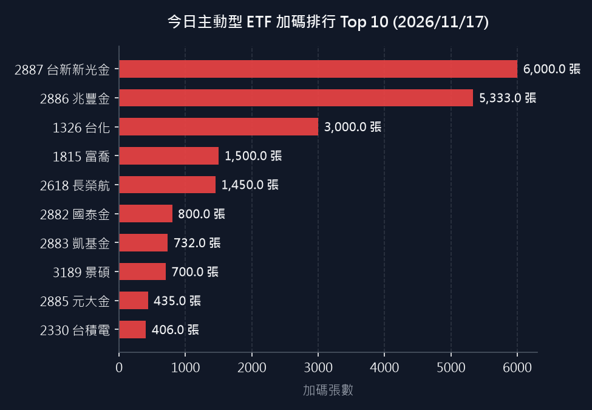
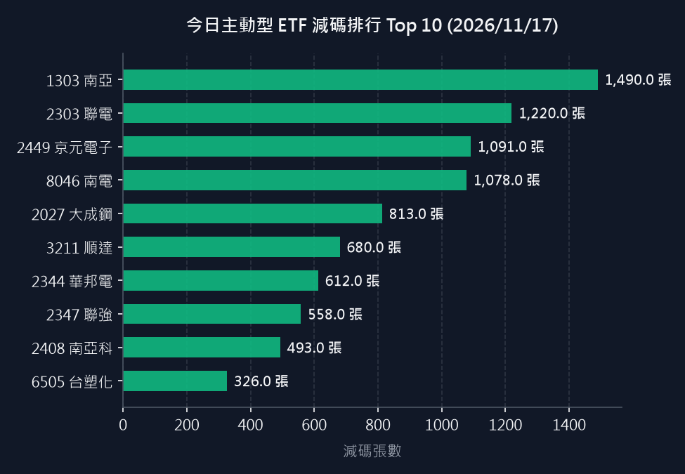

# 主動型 ETF 持股變動

資料來源：`主動型ETF持股明細.xlsx` 最近兩個日期分頁。

比較區間：`20261116` → `20261117`

## 今日加減碼視覺化排行

| 今日加碼 Top 10 | 今日減碼 Top 10 |
| :---: | :---: |
|  |  |

| ETF | 新增 | 刪除 | 比例變動 |
| :-- | --: | --: | --: |
| 00400A | 0 | 1 | 42 |
| 00401A | 0 | 0 | 53 |
| 00402A | 0 | 0 | 41 |
| 00403A | 1 | 0 | 37 |
| 00404A | 0 | 0 | 48 |
| 00405A | 0 | 0 | 26 |
| 00406A | 0 | 2 | 50 |
| 00407A | 2 | 2 | 43 |
| 00408A | 0 | 4 | 31 |
| 00980A | 0 | 0 | 45 |
| 00980D | 0 | 0 | 40 |
| 00981A | 0 | 0 | 27 |
| 00982A | 1 | 1 | 46 |
| 00983A | 0 | 0 | 30 |
| 00983D | 0 | 0 | 16 |
| 00984A | 0 | 0 | 77 |
| 00985A | 0 | 0 | 49 |
| 00986A | 0 | 0 | 28 |
| 00987A | 0 | 0 | 25 |
| 00988A | 0 | 0 | 30 |
| 00989A | 0 | 0 | 54 |
| 00990A | 0 | 0 | 0 |
| 00991A | 0 | 0 | 25 |
| 00992A | 0 | 0 | 40 |
| 00993A | 10 | 10 | 41 |
| 00994A | 0 | 1 | 28 |
| 00995A | 0 | 2 | 41 |
| 00996A | 0 | 0 | 38 |
| 00997A | 0 | 1 | 42 |
| 00998A | 0 | 0 | 39 |
| 00999A | 0 | 0 | 50 |

## 00400A

### 新增持股

- 無

### 刪除持股

- 2449 京元電子（0.67%，999 張）

### 投資比例變動

- 1215 卜蜂：0.07% → 0.08%（+0.01）
- 1303 南亞：3.49% → 1.92%（-1.57）
- 1476 儒鴻：0.09% → 0.10%（+0.01）
- 2059 川湖：4.06% → 3.93%（-0.13）
- 2303 聯電：1.39% → 1.42%（+0.03）
- 2308 台達電：1.85% → 1.83%（-0.02）
- 2313 華通：0.74% → 0.75%（+0.01）
- 2327 國巨*：0.92% → 0.93%（+0.01）
- 2330 台積電：9.19% → 11.04%（+1.85）
- 2345 智邦：1.21% → 1.22%（+0.01）
- 2360 致茂：2.06% → 1.95%（-0.11）
- 2368 金像電：2.37% → 2.24%（-0.13）
- 2383 台光電：5.65% → 5.54%（-0.11）
- 2454 聯發科：7.25% → 7.70%（+0.45）
- 2603 長榮：2.62% → 2.75%（+0.13）
- 2891 中信金：1.75% → 1.85%（+0.10）
- 3008 大立光：1.26% → 1.25%（-0.01）
- 3017 奇鋐：5.07% → 4.80%（-0.27）
- 3023 信邦：0.80% → 0.88%（+0.08）
- 3036 文曄：1.37% → 1.44%（+0.07）
- 3037 欣興：2.63% → 2.49%（-0.14）
- 3044 健鼎：4.00% → 3.84%（-0.16）
- 3081 聯亞：0.73% → 0.69%（-0.04）
- 3090 日電貿：0.25% → 0.26%（+0.01）
- 3167 大量：0.30% → 0.28%（-0.02）
- 3231 緯創：0.89% → 0.93%（+0.04）
- 3293 鈊象：0.36% → 0.38%（+0.02）
- 3406 玉晶光：1.07% → 1.03%（-0.04）
- 3443 創意：3.67% → 3.47%（-0.20）
- 3529 力旺：1.08% → 1.15%（+0.07）
- 3653 健策：3.40% → 3.22%（-0.18）
- 3661 世芯-KY：2.44% → 2.52%（+0.08）
- 3711 日月光投控：0.89% → 0.88%（-0.01）
- 5274 信驊：2.87% → 2.76%（-0.11）
- 5434 崇越：0.33% → 0.35%（+0.02）
- 6147 頎邦：0.69% → 0.67%（-0.02）
- 6187 萬潤：0.74% → 0.70%（-0.04）
- 6223 旺矽：3.11% → 3.04%（-0.07）
- 6274 台燿：0.85% → 0.81%（-0.04）
- 6278 台表科：2.44% → 2.34%（-0.10）
- 6488 環球晶：1.26% → 1.25%（-0.01）
- ＸＡＧＸ金兌(3533.HK)：1.78% → 1.82%（+0.04）

## 00401A

### 新增持股

- 無

### 刪除持股

- 無

### 投資比例變動

- 1216 統一：0.28% → 0.29%（+0.01）
- 1303 南亞：1.12% → 1.08%（-0.04）
- 1476 儒鴻：2.12% → 2.13%（+0.01）
- 1477 聚陽：1.01% → 1.50%（+0.49）
- 2059 川湖：1.68% → 1.56%（-0.12）
- 2303 聯電：2.34% → 2.29%（-0.05）
- 2308 台達電：1.54% → 1.46%（-0.08）
- 2313 華通：1.20% → 1.15%（-0.05）
- 2327 國巨*：0.42% → 0.41%（-0.01）
- 2330 台積電：21.06% → 20.79%（-0.27）
- 2357 華碩：1.61% → 1.60%（-0.01）
- 2360 致茂：1.48% → 1.34%（-0.14）
- 2379 瑞昱：1.03% → 1.04%（+0.01）
- 2383 台光電：0.77% → 0.73%（-0.04）
- 2412 中華電：0.93% → 0.94%（+0.01）
- 2454 聯發科：5.38% → 5.48%（+0.10）
- 2455 全新：1.52% → 1.40%（-0.12）
- 2603 長榮：2.19% → 2.21%（+0.02）
- 2881 富邦金：2.03% → 2.02%（-0.01）
- 2882 國泰金：1.04% → 1.05%（+0.01）
- 2884 玉山金：1.89% → 1.84%（-0.05）
- 2886 兆豐金：1.81% → 2.30%（+0.49）
- 2887 台新新光金：1.00% → 1.03%（+0.03）
- 2890 永豐金：1.58% → 1.56%（-0.02）
- 2891 中信金：2.48% → 2.52%（+0.04）
- 3008 大立光：1.78% → 1.70%（-0.08）
- 3034 聯詠：0.17% → 0.18%（+0.01）
- 3037 欣興：0.48% → 0.44%（-0.04）
- 3131 弘塑：0.47% → 0.45%（-0.02）
- 3231 緯創：1.85% → 1.84%（-0.01）
- 3443 創意：2.39% → 2.17%（-0.22）
- 3491 昇達科：1.62% → 1.68%（+0.06）
- 3653 健策：0.74% → 0.67%（-0.07）
- 3711 日月光投控：3.86% → 3.68%（-0.18）
- 4938 和碩：0.29% → 0.28%（-0.01）
- 4958 臻鼎-KY：1.02% → 0.96%（-0.06）
- 5274 信驊：1.14% → 1.05%（-0.09）
- 5347 世界：0.97% → 0.98%（+0.01）
- 5904 寶雅*：0.56% → 0.57%（+0.01）
- 6147 頎邦：1.01% → 0.93%（-0.08）
- 6187 萬潤：1.35% → 1.22%（-0.13）
- 6223 旺矽：1.56% → 1.81%（+0.25）
- 6285 啟碁：1.03% → 1.06%（+0.03）
- 6515 穎崴：0.69% → 0.64%（-0.05）
- 6531 愛普*：1.14% → 1.07%（-0.07）
- 6669 緯穎：1.35% → 1.30%（-0.05）
- 7769 鴻勁：0.57% → 0.54%（-0.03）
- 7828 創新服務：1.22% → 1.15%（-0.07）
- 7856 漢測：0.70% → 0.63%（-0.07）
- 8464 億豐：0.99% → 1.01%（+0.02）
- TAIEX FUTURES 16DEC26 FTZ6：-0.17% → -0.31%（-0.14）
- TAIWAN TAIE C 16DEC26 40000 TWSE：-0.06% → -0.05%（+0.01）
- TAIWAN TAIE C 18NOV26 40000 TWSE：-0.02% → -0.01%（+0.01）

## 00402A

### 新增持股

- 無

### 刪除持股

- 無

### 投資比例變動

- AAPL.US Apple：9.23% → 9.53%（+0.30）
- AMD.US AMD：6.33% → 6.21%（-0.12）
- AMZN.US Amazon：5.16% → 5.18%（+0.02）
- ANET.US Arista Networks：0.95% → 0.93%（-0.02）
- ARM.US Arm：0.75% → 0.72%（-0.03）
- ASML.US ASML Holding：1.18% → 1.16%（-0.02）
- BKNG.US Booking Holdings：0.59% → 0.60%（+0.01）
- CDNS.US Cadence Design Systems：1.66% → 1.65%（-0.01）
- CIEN.US Ciena：1.02% → 0.97%（-0.05）
- CLS.US Celestica：1.08% → 1.11%（+0.03）
- COHR.US Coherent：1.18% → 1.14%（-0.04）
- CRWD.US CrowdStrike Holdings：1.81% → 1.85%（+0.04）
- GOOGL.US Alphabet - Class A Common Stock：3.31% → 3.30%（-0.01）
- INTC.US Intel：1.03% → 0.99%（-0.04）
- IOT.US Samsara：0.62% → 0.63%（+0.01）
- KLAC.US KLA：1.40% → 1.38%（-0.02）
- LITE.US Lumentum：1.34% → 1.27%（-0.07）
- LRCX.US Lam Research：2.17% → 2.11%（-0.06）
- MCHP.US Microchip Technology：1.24% → 1.22%（-0.02）
- MDB.US MongoDB：0.40% → 0.39%（-0.01）
- META.US Meta：3.85% → 3.90%（+0.05）
- MRVL.US Marvell：1.20% → 1.15%（-0.05）
- MSFT.US Microsoft：6.00% → 6.17%（+0.17）
- MU.US Micron：5.38% → 5.17%（-0.21）
- NFLX.US Netflix：0.99% → 1.00%（+0.01）
- NVDA.US NVIDIA：5.92% → 5.90%（-0.02）
- PANW.US Palo Alto：2.80% → 2.85%（+0.05）
- PLTR.US Palantir Technologies：2.10% → 2.09%（-0.01）
- SHOP.US Shopify：1.32% → 1.38%（+0.06）
- SIMO.US Silicon Motion：0.42% → 0.41%（-0.01）
- SKHY.US SK hynix：0.80% → 0.77%（-0.03）
- SPCX.US SpaceX：0.78% → 0.80%（+0.02）
- SPOT.US Spotify：0.48% → 0.50%（+0.02）
- STX.US Seagate：0.90% → 0.89%（-0.01）
- TER.US Teradyne：0.62% → 0.60%（-0.02）
- TSM.US TSMC(ADR)：1.58% → 1.53%（-0.05）
- TTWO.US Take-Two：1.34% → 1.30%（-0.04）
- TXN.US Texas Instruments：2.92% → 2.94%（+0.02）
- UBER.US Uber：0.35% → 0.37%（+0.02）
- V.US Visa：1.60% → 1.66%（+0.06）
- WDC.US Western Digital：1.64% → 1.61%（-0.03）

## 00403A

### 新增持股

- 3661 世芯-KY（0.16%，50 張）

### 刪除持股

- 無

### 投資比例變動

- 1303 南亞：3.49% → 3.61%（+0.12）
- 1560 中砂：0.46% → 0.45%（-0.01）
- 1717 長興：0.04% → 0.05%（+0.01）
- 2059 川湖：0.62% → 0.60%（-0.02）
- 2308 台達電：2.12% → 2.10%（-0.02）
- 2317 鴻海：0.61% → 0.64%（+0.03）
- 2327 國巨*：2.87% → 2.91%（+0.04）
- 2330 台積電：15.94% → 16.48%（+0.54）
- 2345 智邦：1.52% → 1.53%（+0.01）
- 2368 金像電：0.83% → 0.79%（-0.04）
- 2383 台光電：3.97% → 3.89%（-0.08）
- 2408 南亞科：0.83% → 0.84%（+0.01）
- 2449 京元電子：0.67% → 0.65%（-0.02）
- 2454 聯發科：6.32% → 6.85%（+0.53）
- 2882 國泰金：0.58% → 0.69%（+0.11）
- 2883 凱基金：0.12% → 0.13%（+0.01）
- 3008 大立光：1.56% → 1.55%（-0.01）
- 3017 奇鋐：6.09% → 5.76%（-0.33）
- 3037 欣興：4.44% → 4.20%（-0.24）
- 3044 健鼎：0.19% → 0.18%（-0.01）
- 3189 景碩：2.34% → 2.21%（-0.13）
- 3211 順達：0.21% → 0.07%（-0.14）
- 3443 創意：5.27% → 4.98%（-0.29）
- 3450 聯鈞：0.43% → 0.42%（-0.01）
- 3583 辛耘：0.23% → 0.19%（-0.04）
- 3653 健策：4.32% → 4.09%（-0.23）
- 3665 貿聯-KY：1.87% → 1.88%（+0.01）
- 3711 日月光投控：1.37% → 1.36%（-0.01）
- 5274 信驊：1.70% → 1.63%（-0.07）
- 6223 旺矽：3.49% → 3.40%（-0.09）
- 6274 台燿：0.57% → 0.36%（-0.21）
- 6285 啟碁：0.05% → 0.06%（+0.01）
- 6515 穎崴：0.29% → 0.28%（-0.01）
- 6669 緯穎：2.52% → 2.54%（+0.02）
- 6805 富世達：0.58% → 0.56%（-0.02）
- 8046 南電：2.31% → 2.18%（-0.13）
- 8996 高力：2.13% → 2.01%（-0.12）

## 00404A

### 新增持股

- 無

### 刪除持股

- 無

### 投資比例變動

- 1303 南亞：0.72% → 0.70%（-0.02）
- 2006 東和鋼鐵：1.31% → 1.32%（+0.01）
- 2301 光寶科：0.50% → 0.49%（-0.01）
- 2303 聯電：1.20% → 1.19%（-0.01）
- 2317 鴻海：0.44% → 0.45%（+0.01）
- 2330 台積電：22.41% → 22.38%（-0.03）
- 2347 聯強：1.55% → 1.54%（-0.01）
- 2357 華碩：1.19% → 1.20%（+0.01）
- 2360 致茂：0.47% → 0.43%（-0.04）
- 2379 瑞昱：2.06% → 2.10%（+0.04）
- 2382 廣達：0.41% → 0.42%（+0.01）
- 2383 台光電：2.80% → 2.67%（-0.13）
- 2395 研華：1.83% → 1.81%（-0.02）
- 2454 聯發科：6.96% → 7.18%（+0.22）
- 2603 長榮：1.42% → 1.44%（+0.02）
- 2851 中再保：1.10% → 1.12%（+0.02）
- 2882 國泰金：3.09% → 3.18%（+0.09）
- 2885 元大金：3.21% → 3.24%（+0.03）
- 2887 台新新光金：1.80% → 1.87%（+0.07）
- 3014 聯陽：1.16% → 1.15%（-0.01）
- 3017 奇鋐：1.25% → 1.15%（-0.10）
- 3034 聯詠：2.06% → 2.13%（+0.07）
- 3036 文曄：1.04% → 1.06%（+0.02）
- 3037 欣興：0.30% → 0.28%（-0.02）
- 3264 欣銓：0.42% → 0.40%（-0.02）
- 3293 鈊象：1.81% → 1.88%（+0.07）
- 3374 精材：0.13% → 0.12%（-0.01）
- 3443 創意：1.98% → 1.82%（-0.16）
- 3653 健策：1.09% → 1.00%（-0.09）
- 3711 日月光投控：3.53% → 3.41%（-0.12）
- 4961 天鈺：0.57% → 0.59%（+0.02）
- 5274 信驊：2.28% → 2.13%（-0.15）
- 5434 崇越：1.78% → 1.81%（+0.03）
- 5904 寶雅*：0.46% → 0.47%（+0.01）
- 6196 帆宣：1.80% → 1.78%（-0.02）
- 6206 飛捷：0.70% → 0.72%（+0.02）
- 6223 旺矽：0.80% → 0.75%（-0.05）
- 6257 矽格：0.70% → 0.67%（-0.03）
- 6491 晶碩：0.91% → 0.93%（+0.02）
- 6505 台塑化：0.48% → 0.49%（+0.01）
- 6669 緯穎：1.03% → 1.01%（-0.02）
- 6691 洋基工程：1.26% → 1.29%（+0.03）
- 7769 鴻勁：1.16% → 1.12%（-0.04）
- 8016 矽創：1.75% → 1.79%（+0.04）
- 8081 致新：0.74% → 0.75%（+0.01）
- 8299 群聯：1.16% → 1.20%（+0.04）
- 台指選擇權12/26 46500 買權：-0.23% → -0.21%（+0.02）
- 台股期貨12/26(FITXN*1.TF)：19.28% → 19.29%（+0.01）

## 00405A

### 新增持股

- 無

### 刪除持股

- 無

### 投資比例變動

- 2059 川湖：1.89% → 1.82%（-0.07）
- 2308 台達電：0.56% → 0.55%（-0.01）
- 2330 台積電：5.76% → 5.89%（+0.13）
- 2345 智邦：4.47% → 4.50%（+0.03）
- 2368 金像電：5.55% → 5.22%（-0.33）
- 2383 台光電：4.28% → 4.17%（-0.11）
- 2454 聯發科：7.06% → 7.46%（+0.40）
- 3017 奇鋐：1.86% → 1.76%（-0.10）
- 3037 欣興：3.87% → 3.64%（-0.23）
- 3189 景碩：0.16% → 0.15%（-0.01）
- 3443 創意：3.01% → 2.83%（-0.18）
- 3653 健策：6.65% → 6.26%（-0.39）
- 3665 貿聯-KY：5.20% → 5.21%（+0.01）
- 3711 日月光投控：1.47% → 1.45%（-0.02）
- 5274 信驊：5.24% → 5.66%（+0.42）
- 5347 世界：0.14% → 0.15%（+0.01）
- 6187 萬潤：0.67% → 0.64%（-0.03）
- 6223 旺矽：7.39% → 7.16%（-0.23）
- 6274 台燿：1.43% → 1.34%（-0.09）
- 6415 矽力*-KY：0.52% → 1.28%（+0.76）
- 6515 穎崴：0.45% → 0.44%（-0.01）
- 6531 愛普*：3.53% → 3.44%（-0.09）
- 6805 富世達：1.64% → 1.58%（-0.06）
- 7769 鴻勁：2.36% → 2.34%（-0.02）
- 8046 南電：6.08% → 5.71%（-0.37）
- 8996 高力：1.38% → 1.95%（+0.57）

## 00406A

### 新增持股

- 無

### 刪除持股

- 2344 華邦電（0.02%，208 張）
- 臺股期貨 202611(FITXN*1.TF)（12.55%，2.24 張）

### 投資比例變動

- 1303 南亞：2.58% → 2.48%（-0.10）
- 1326 台化：0.52% → 0.68%（+0.16）
- 1560 中砂：0.19% → 0.18%（-0.01）
- 1815 富喬：0.63% → 0.70%（+0.07）
- 2059 川湖：1.58% → 1.47%（-0.11）
- 2303 聯電：1.21% → 1.18%（-0.03）
- 2308 台達電：1.52% → 1.59%（+0.07）
- 2327 國巨*：1.24% → 1.21%（-0.03）
- 2330 台積電：9.53% → 9.36%（-0.17）
- 2345 智邦：1.89% → 2.07%（+0.18）
- 2368 金像電：2.38% → 2.17%（-0.21）
- 2383 台光電：5.76% → 5.62%（-0.14）
- 2449 京元電子：0.32% → 0.30%（-0.02）
- 2454 聯發科：6.37% → 6.67%（+0.30）
- 2481 強茂：0.29% → 0.28%（-0.01）
- 2486 一詮：0.09% → 0.08%（-0.01）
- 2882 國泰金：0.65% → 0.66%（+0.01）
- 2884 玉山金：0.57% → 0.55%（-0.02）
- 2886 兆豐金：0.45% → 0.65%（+0.20）
- 2887 台新新光金：0.44% → 0.62%（+0.18）
- 3008 大立光：0.97% → 0.92%（-0.05）
- 3017 奇鋐：5.66% → 5.15%（-0.51）
- 3037 欣興：4.80% → 4.37%（-0.43）
- 3081 聯亞：1.07% → 0.97%（-0.10）
- 3105 穩懋：0.57% → 0.54%（-0.03）
- 3167 大量：0.48% → 0.44%（-0.04）
- 3189 景碩：1.37% → 1.51%（+0.14）
- 3231 緯創：0.31% → 0.30%（-0.01）
- 3264 欣銓：0.26% → 0.25%（-0.01）
- 3443 創意：2.36% → 2.15%（-0.21）
- 3491 昇達科：0.32% → 0.33%（+0.01）
- 3653 健策：4.22% → 3.84%（-0.38）
- 3665 貿聯-KY：1.14% → 1.30%（+0.16）
- 3711 日月光投控：2.24% → 2.14%（-0.10）
- 4958 臻鼎-KY：0.81% → 0.77%（-0.04）
- 5274 信驊：1.15% → 1.06%（-0.09）
- 6147 頎邦：0.60% → 0.56%（-0.04）
- 6213 聯茂：0.33% → 0.30%（-0.03）
- 6223 旺矽：3.11% → 2.92%（-0.19）
- 6274 台燿：1.65% → 1.77%（+0.12）
- 6278 台表科：0.20% → 0.19%（-0.01）
- 6510 精測：0.57% → 0.52%（-0.05）
- 6669 緯穎：0.91% → 0.88%（-0.03）
- 6715 嘉基：0.77% → 0.70%（-0.07）
- 6805 富世達：0.91% → 0.85%（-0.06）
- 8046 南電：2.87% → 2.77%（-0.10）
- 8996 高力：0.67% → 0.61%（-0.06）
- 臺指選擇權：-1.86% → -16.89%（-15.03）
- 臺指選擇權第三週週五到期契約：-2.06% → -7.23%（-5.17）
- 臺股期貨 202612(FITXN*1.TF)：10.67% → 24.15%（+13.48）

## 00407A

### 新增持股

- 1476 儒鴻（0.43%，200 張）
- 2618 長榮航（0.39%，1450 張）

### 刪除持股

- 1590 亞德客-KY（0.07%，13 張）
- 3131 弘塑（0.68%，82 張）

### 投資比例變動

- 1560 中砂：0.87% → 0.85%（-0.02）
- 2059 川湖：0.80% → 0.77%（-0.03）
- 2301 光寶科：1.35% → 1.37%（+0.02）
- 2308 台達電：1.97% → 1.94%（-0.03）
- 2327 國巨*：1.82% → 1.84%（+0.02）
- 2330 台積電：11.31% → 11.60%（+0.29）
- 2345 智邦：1.36% → 1.37%（+0.01）
- 2360 致茂：0.72% → 0.68%（-0.04）
- 2368 金像電：1.99% → 1.87%（-0.12）
- 2379 瑞昱：0.27% → 0.28%（+0.01）
- 2383 台光電：5.63% → 5.50%（-0.13）
- 2408 南亞科：1.31% → 1.33%（+0.02）
- 2451 創見：0.29% → 0.30%（+0.01）
- 2454 聯發科：6.47% → 6.86%（+0.39）
- 2615 萬海：1.10% → 1.12%（+0.02）
- 3008 大立光：1.35% → 1.33%（-0.02）
- 3017 奇鋐：5.59% → 5.28%（-0.31）
- 3034 聯詠：0.74% → 0.79%（+0.05）
- 3037 欣興：4.76% → 4.49%（-0.27）
- 3081 聯亞：1.59% → 1.49%（-0.10）
- 3231 緯創：1.04% → 1.07%（+0.03）
- 3260 威剛：0.27% → 0.28%（+0.01）
- 3293 鈊象：0.72% → 0.77%（+0.05）
- 3406 玉晶光：0.97% → 0.94%（-0.03）
- 3443 創意：5.40% → 5.08%（-0.32）
- 3491 昇達科：1.03% → 1.11%（+0.08）
- 3533 嘉澤：0.98% → 1.00%（+0.02）
- 3653 健策：3.04% → 2.87%（-0.17）
- 3665 貿聯-KY：2.89% → 2.90%（+0.01）
- 3711 日月光投控：3.32% → 3.29%（-0.03）
- 4958 臻鼎-KY：0.90% → 0.88%（-0.02）
- 5274 信驊：1.37% → 1.31%（-0.06）
- 5434 崇越：0.21% → 0.22%（+0.01）
- 6187 萬潤：1.19% → 1.12%（-0.07）
- 6223 旺矽：2.88% → 3.25%（+0.37）
- 6274 台燿：1.48% → 1.39%（-0.09）
- 6446 藥華藥：0.41% → 0.43%（+0.02）
- 6510 精測：1.55% → 1.47%（-0.08）
- 6531 愛普*：0.27% → 0.26%（-0.01）
- 6805 富世達：1.10% → 1.06%（-0.04）
- 8046 南電：2.91% → 2.75%（-0.16）
- 8299 群聯：0.28% → 0.30%（+0.02）
- 8996 高力：1.57% → 1.48%（-0.09）

## 00408A

### 新增持股

- 無

### 刪除持股

- 2059 川湖（0.82%，1.399 張）
- 2449 京元電子（0.75%，47 張）
- 3711 日月光投控（1.86%，40.999 張）
- 8021 尖點（0.57%，20 張）

### 投資比例變動

- 1216 統一：0.13% → 0.14%（+0.01）
- 1303 南亞：4.48% → 4.41%（-0.07）
- 2301 光寶科：0.47% → 0.48%（+0.01）
- 2330 台積電：7.78% → 7.84%（+0.06）
- 2368 金像電：5.51% → 5.12%（-0.39）
- 2383 台光電：4.23% → 4.07%（-0.16）
- 2454 聯發科：5.33% → 5.56%（+0.23）
- 2542 興富發：4.22% → 4.38%（+0.16）
- 2603 長榮：1.55% → 1.60%（+0.05）
- 2880 華南金：1.42% → 1.47%（+0.05）
- 2891 中信金：2.47% → 3.24%（+0.77）
- 3017 奇鋐：3.82% → 3.56%（-0.26）
- 3026 禾伸堂：1.29% → 1.20%（-0.09）
- 3037 欣興：3.09% → 2.88%（-0.21）
- 3044 健鼎：1.23% → 1.16%（-0.07）
- 3081 聯亞：0.47% → 0.44%（-0.03）
- 3105 穩懋：0.68% → 0.66%（-0.02）
- 3167 大量：0.43% → 0.40%（-0.03）
- 3189 景碩：2.44% → 2.26%（-0.18）
- 3231 緯創：1.46% → 1.49%（+0.03）
- 3443 創意：1.92% → 1.78%（-0.14）
- 3653 健策：3.90% → 3.62%（-0.28）
- 3661 世芯-KY：1.81% → 1.84%（+0.03）
- 4904 遠傳：1.44% → 1.48%（+0.04）
- 5434 崇越：2.29% → 2.36%（+0.07）
- 6510 精測：1.98% → 1.86%（-0.12）
- 6669 緯穎：1.22% → 1.21%（-0.01）
- 6805 富世達：2.68% → 2.55%（-0.13）
- 8046 南電：1.45% → 1.35%（-0.10）
- 8996 高力：3.00% → 2.79%（-0.21）
- 9802 鈺齊-KY：0.97% → 0.98%（+0.01）

## 00980A

### 新增持股

- 無

### 刪除持股

- 無

### 投資比例變動

- 1303 南亞：3.77% → 3.87%（+0.10）
- 2059 川湖：3.66% → 3.63%（-0.03）
- 2303 聯電：1.33% → 1.38%（+0.05）
- 2308 台達電：2.77% → 2.80%（+0.03）
- 2317 鴻海：3.48% → 3.76%（+0.28）
- 2327 國巨*：0.73% → 0.76%（+0.03）
- 2330 台積電：10.20% → 10.74%（+0.54）
- 2344 華邦電：1.42% → 1.49%（+0.07）
- 2345 智邦：0.84% → 0.87%（+0.03）
- 2360 致茂：0.85% → 0.82%（-0.03）
- 2368 金像電：1.91% → 1.85%（-0.06）
- 2376 技嘉：1.58% → 1.68%（+0.10）
- 2382 廣達：1.89% → 2.02%（+0.13）
- 2383 台光電：3.55% → 3.56%（+0.01）
- 2408 南亞科：2.14% → 2.22%（+0.08）
- 2454 聯發科：6.15% → 6.69%（+0.54）
- 2884 玉山金：1.52% → 1.58%（+0.06）
- 2891 中信金：1.95% → 2.12%（+0.17）
- 3008 大立光：2.02% → 2.05%（+0.03）
- 3017 奇鋐：2.38% → 2.31%（-0.07）
- 3026 禾伸堂：0.81% → 0.78%（-0.03）
- 3036 文曄：0.99% → 1.06%（+0.07）
- 3037 欣興：2.70% → 2.62%（-0.08）
- 3044 健鼎：1.41% → 1.38%（-0.03）
- 3081 聯亞：1.39% → 1.34%（-0.05）
- 3189 景碩：0.98% → 0.95%（-0.03）
- 3231 緯創：1.71% → 1.82%（+0.11）
- 3264 欣銓：0.69% → 0.71%（+0.02）
- 3293 鈊象：0.52% → 0.57%（+0.05）
- 3443 創意：2.27% → 2.20%（-0.07）
- 3529 力旺：0.16% → 0.17%（+0.01）
- 3653 健策：2.83% → 2.74%（-0.09）
- 3665 貿聯-KY：1.37% → 1.41%（+0.04）
- 3711 日月光投控：2.22% → 2.26%（+0.04）
- 5274 信驊：1.41% → 1.38%（-0.03）
- 5904 寶雅*：0.77% → 0.84%（+0.07）
- 6213 聯茂：1.04% → 1.01%（-0.03）
- 6274 台燿：1.00% → 0.97%（-0.03）
- 6669 緯穎：1.83% → 1.88%（+0.05）
- 6805 富世達：0.60% → 0.59%（-0.01）
- 7769 鴻勁：1.69% → 1.73%（+0.04）
- 8046 南電：1.35% → 1.31%（-0.04）
- 8299 群聯：1.03% → 1.12%（+0.09）
- 8996 高力：0.46% → 0.45%（-0.01）
- 台灣證交所加權股價指數(FITXN*1.TF)：2.50% → 2.64%（+0.14）

## 00980D

### 新增持股

- 無

### 刪除持股

- 無

### 投資比例變動

- ALLY FINANCIAL INC (REG) 7.1% 15NOV2027：0.46% → 0.47%（+0.01）
- ANHEUSER-BUSCH INBEV WOR (REG) 8.2% 15JAN2039：0.54% → 0.55%（+0.01）
- ASURION LLC/ASURION CO 8.375% 01FEB2034：0.44% → 0.43%（-0.01）
- BAYER US FINANCE LLC SER REGS 6.875000 % 21NOV2053：0.36% → 0.37%（+0.01）
- CANTOR FITZGERALD LP SER REGS 7.200000 % 12DEC2028：0.34% → 0.35%（+0.01）
- CHS/COMMUNITY HEALTH SYS SER REGS 10.875000 % 15JAN2032：0.45% → 0.44%（-0.01）
- CHS/COMMUNITY HEALTH SYS SER REGS 9.750000 % 15JAN2034：0.47% → 0.45%（-0.02）
- COREWEAVE INC SER REGS (REG S) 9.25% 01JUN2030：0.42% → 0.41%（-0.01）
- COREWEAVE INC SER REGS (REG S) 9.75% 01OCT2031：0.50% → 0.48%（-0.02）
- COREWEAVE INC SER REGS (REG) (REG S) 9.625% 15JUL2032：0.49% → 0.48%（-0.01）
- COREWEAVE INC SER REGS 9.000000 % 01FEB2031：0.24% → 0.23%（-0.01）
- DEUTSCHE TELEKOM INT FIN (REG) 8.75% 15JUN2030：0.43% → 0.44%（+0.01）
- DOW CHEMICAL CO/THE 7.375% 01NOV2029：0.64% → 0.65%（+0.01）
- ENBRIDGE ENERGY PARTNERS (REG) 7.375% 15OCT2045：0.53% → 0.54%（+0.01）
- FORD MOTOR COMPANY (REG) 7.45% 16JUL2031：0.49% → 0.50%（+0.01）
- FORD MOTOR CREDIT CO LLC 7.122% 07NOV2033：0.35% → 0.36%（+0.01）
- GLOBAL ATLANTIC FIN CO SER REGS 7.950000 % 15JUN2033：0.69% → 0.70%（+0.01）
- GLOBAL AUTO HO/AAG FH UK SER REGS (REG S) 11.5% 15AUG2029：0.38% → 0.37%（-0.01）
- GLOBAL AUTO HO/AAG FH UK SER REGS (REG S) 8.75% 15JAN2032：0.41% → 0.40%（-0.01）
- HAH GROUP HOLDING CO LLC SER REGS (REG S) 9.75% 01OCT2031：0.53% → 0.54%（+0.01）
- HUTCHISON WHAM INT 03/33 SER REGS (REG S) 7.45% 24NOV2033：0.42% → 0.43%（+0.01）
- ICAHN ENTERPRISES/FIN (REG) 9.75% 15JAN2029：0.29% → 0.26%（-0.03）
- KYNDRYL HOLDINGS INC 7.8 % 28-SEP-2029：0.43% → 0.44%（+0.01）
- ORACLE CORP 6.000000 % 03AUG2055：0.30% → 0.29%（-0.01）
- ORACLE CORP 6.125000 % 03AUG2065：0.55% → 0.54%（-0.01）
- OWENS-BROCKWAY SER REGS (REG) (REG S) 9.5% 01JUN2033：0.51% → 0.50%（-0.01）
- PLANET FINANCIAL GROUP SER REGS 10.500000 % 15DEC2029：0.47% → 0.46%（-0.01）
- PROGRESS ENERGY INC (REG) 7.75% 01MAR2031：0.60% → 0.61%（+0.01）
- RR DONNELLEY & SONS CO SER REGS (REG S) 9.5% 01AUG2029：0.44% → 0.45%（+0.01）
- SPACE EXPLORATION TECH SER 144A (REG) 6.65% 15JUL2056：0.32% → 0.31%（-0.01）
- SPRINT CAPITAL CORP (REG) 6.875% 15NOV2028：0.33% → 0.34%（+0.01）
- TELEFONICA EUROPE BV (REG) 8.25% 15SEP2030：0.43% → 0.44%（+0.01）
- UNISYS CORP SER REGS 10.625000 % 15JAN2031：0.65% → 0.64%（-0.01）
- US 10YR NOTE (CBT)DEC26 21-DEC-2026：18.45% → 18.53%（+0.08）
- US 10YR ULTRA FUT DEC26 21-DEC-2026：-2.56% → -2.57%（-0.01）
- US 5YR NOTE (CBT) DEC26 31-DEC-2026：-15.89% → -15.95%（-0.06）
- US LONG BOND(CBT) DEC26 21-DEC-2026：5.61% → 5.64%（+0.03）
- VAR ENERGI ASA SER REGS (REG S) 8% 15NOV2032：0.37% → 0.38%（+0.01）
- VERIZON COMMUNICAT 7.750000 % 01DEC2030：0.46% → 0.47%（+0.01）
- VIACOM INC (REG) 5.85% 01SEP2043：0.50% → 0.49%（-0.01）

## 00981A

### 新增持股

- 無

### 刪除持股

- 無

### 投資比例變動

- 2303 聯電：2.58% → 2.64%（+0.06）
- 2308 台達電：3.35% → 3.33%（-0.02）
- 2317 鴻海：0.40% → 0.42%（+0.02）
- 2327 國巨*：3.47% → 3.53%（+0.06）
- 2330 台積電：16.77% → 17.44%（+0.67）
- 2345 智邦：3.86% → 3.93%（+0.07）
- 2368 金像電：2.95% → 2.80%（-0.15）
- 2383 台光電：6.48% → 6.38%（-0.10）
- 2449 京元電子：0.59% → 0.57%（-0.02）
- 2454 聯發科：8.56% → 9.33%（+0.77）
- 2891 中信金：0.28% → 0.30%（+0.02）
- 3017 奇鋐：7.53% → 7.16%（-0.37）
- 3037 欣興：5.51% → 5.23%（-0.28）
- 3231 緯創：0.75% → 0.78%（+0.03）
- 3443 創意：3.11% → 2.95%（-0.16）
- 3653 健策：4.85% → 4.61%（-0.24）
- 3665 貿聯-KY：1.78% → 1.80%（+0.02）
- 3711 日月光投控：3.80% → 3.79%（-0.01）
- 5274 信驊：1.02% → 0.98%（-0.04）
- 6223 旺矽：4.52% → 4.42%（-0.10）
- 6274 台燿：2.54% → 2.41%（-0.13）
- 6510 精測：0.56% → 0.53%（-0.03）
- 6669 緯穎：1.41% → 1.43%（+0.02）
- 6805 富世達：1.19% → 1.16%（-0.03）
- 8046 南電：3.12% → 2.51%（-0.61）
- 8996 高力：0.50% → 0.48%（-0.02）
- 台指期貨 2026/12(FITXN*1.TF)：2.80% → 2.90%（+0.10）

## 00982A

### 新增持股

- 7722 LINEPAY（0.04%，58 張）

### 刪除持股

- 2467 志聖（0.07%，110 張）

### 投資比例變動

- 2059 川湖：2.39% → 2.41%（+0.02）
- 2301 光寶科：1.68% → 1.78%（+0.10）
- 2303 聯電：1.22% → 1.29%（+0.07）
- 2330 台積電：8.20% → 8.77%（+0.57）
- 2360 致茂：2.99% → 2.94%（-0.05）
- 2376 技嘉：1.21% → 1.30%（+0.09）
- 2377 微星：0.38% → 0.41%（+0.03）
- 2383 台光電：2.95% → 3.01%（+0.06）
- 2395 研華：1.38% → 1.47%（+0.09）
- 2428 興勤：0.95% → 1.01%（+0.06）
- 2454 聯發科：8.36% → 9.24%（+0.88）
- 2455 全新：1.34% → 1.35%（+0.01）
- 2476 鉅祥：0.69% → 0.75%（+0.06）
- 2478 大毅：0.32% → 0.34%（+0.02）
- 2885 元大金：0.35% → 0.38%（+0.03）
- 3008 大立光：2.97% → 3.06%（+0.09）
- 3017 奇鋐：2.52% → 2.48%（-0.04）
- 3037 欣興：0.65% → 0.64%（-0.01）
- 3045 台灣大：0.85% → 0.92%（+0.07）
- 3090 日電貿：0.33% → 0.35%（+0.02）
- 3105 穩懋：8.32% → 8.53%（+0.21）
- 3231 緯創：1.87% → 2.01%（+0.14）
- 3491 昇達科：4.25% → 4.83%（+0.58）
- 3529 力旺：0.00% → 0.01%（+0.01）
- 3583 辛耘：0.19% → 0.13%（-0.06）
- 3617 碩天：0.59% → 0.61%（+0.02）
- 3711 日月光投控：2.45% → 2.52%（+0.07）
- 4958 臻鼎-KY：2.88% → 2.94%（+0.06）
- 5425 台半：1.13% → 1.20%（+0.07）
- 5483 中美晶：1.28% → 1.34%（+0.06）
- 5536 聖暉*：0.89% → 0.96%（+0.07）
- 6139 亞翔：5.37% → 5.68%（+0.31）
- 6196 帆宣：0.27% → 0.29%（+0.02）
- 6213 聯茂：1.52% → 1.49%（-0.03）
- 6223 旺矽：2.98% → 3.02%（+0.04）
- 6239 力成：1.88% → 1.95%（+0.07）
- 6446 藥華藥：0.13% → 0.14%（+0.01）
- 6472 保瑞：0.88% → 0.94%（+0.06）
- 6488 環球晶：1.58% → 1.63%（+0.05）
- 6510 精測：1.04% → 1.03%（-0.01）
- 6531 愛普*：6.88% → 7.00%（+0.12）
- 6640 均華：0.19% → 0.20%（+0.01）
- 6669 緯穎：1.76% → 1.84%（+0.08）
- 6672 騰輝電子-KY：2.50% → 2.46%（-0.04）
- 8070 長華*：0.80% → 0.85%（+0.05）
- 8996 高力：1.14% → 1.12%（-0.02）

## 00983A

### 新增持股

- 無

### 刪除持股

- 無

### 投資比例變動

- AMD.US AMD：3.64% → 3.58%（-0.06）
- AMZN.US Amazon：4.55% → 4.58%（+0.03）
- BEAM.US Beam Therapeutics：2.33% → 2.09%（-0.24）
- BLSH.US Bullish：1.17% → 0.91%（-0.26）
- BMNR.US BitMine：1.17% → 1.13%（-0.04）
- COIN.US Coinbase：2.40% → 2.22%（-0.18）
- CRCL.US Circle：3.18% → 2.96%（-0.22）
- CRSP.US CRISPR Therapeutics：3.36% → 3.23%（-0.13）
- DE.US Deere：0.49% → 0.50%（+0.01）
- GOOG.US Alphabet - Class C Capital Stock：2.92% → 3.06%（+0.14）
- HOOD.US Robinhood Markets：2.44% → 2.23%（-0.21）
- ILMN.US Illumina：1.26% → 1.25%（-0.01）
- LLY.US Eli Lilly：2.09% → 2.16%（+0.07）
- META.US Meta：3.58% → 3.80%（+0.22）
- MSFT.US Microsoft：2.25% → 2.47%（+0.22）
- NTLA.US Intellia Therapeutics：1.50% → 1.44%（-0.06）
- NTRA.US Natera：1.49% → 1.40%（-0.09）
- NVDA.US NVIDIA：3.16% → 2.90%（-0.26）
- PLTR.US Palantir Technologies：3.20% → 3.18%（-0.02）
- RKLB.US Rocket Lab：1.57% → 1.53%（-0.04）
- RXRX.US Recursion Pharmaceuticals：1.07% → 1.02%（-0.05）
- SHOP.US Shopify：4.92% → 5.15%（+0.23）
- SPCX.US SpaceX：8.52% → 8.95%（+0.43）
- TEM.US Tempus：5.54% → 5.16%（-0.38）
- TER.US Teradyne：0.07% → 0.06%（-0.01）
- TSLA.US Tesla：9.16% → 9.26%（+0.10）
- TSM.US TSMC(ADR)：2.85% → 2.78%（-0.07）
- TWST.US Twist Bioscience：3.08% → 3.02%（-0.06）
- TXG.US 10x Genomics：2.97% → 2.92%（-0.05）
- XYZ.US Block：2.22% → 2.61%（+0.39）

## 00983D

### 新增持股

- 無

### 刪除持股

- 無

### 投資比例變動

- BHCCN 11 09/30/28：2.22% → 2.21%（-0.01）
- C 8 1/8 07/15/39：1.66% → 1.67%（+0.01）
- CRWV 9 02/01/31：0.90% → 0.89%（-0.01）
- CYH 10 7/8 01/15/32：1.46% → 1.44%（-0.02）
- DOW 6.9 05/15/53：0.86% → 0.85%（-0.01）
- DOW 9.4 05/15/39：1.64% → 1.65%（+0.01）
- DT 9 1/4 06/01/32：1.49% → 1.50%（+0.01）
- DUK 7 3/4 03/01/31：1.57% → 1.58%（+0.01）
- FFHCN 6.35 03/22/54：0.80% → 0.79%（-0.01）
- IEP 10 11/15/29：1.40% → 1.38%（-0.02）
- LQDW.US iShares LQD Premium Income+ ETF：7.65% → 7.64%（-0.01）
- MS 7 1/4 04/01/32：1.46% → 1.47%（+0.01）
- ORCL 6.9 11/09/52：0.24% → 0.23%（-0.01）
- RAKUTN 11 1/4 02/15/27：2.08% → 2.07%（-0.01）
- RIOLN 7 1/4 03/15/31：0.58% → 0.59%（+0.01）
- TELEFO 8 1/4 09/15/30：1.14% → 1.15%（+0.01）

## 00984A

### 新增持股

- 無

### 刪除持股

- 無

### 投資比例變動

- 1216 統一：0.66% → 0.68%（+0.02）
- 1301 台塑：0.86% → 0.89%（+0.03）
- 1303 南亞：3.37% → 3.30%（-0.07）
- 1326 台化：2.53% → 2.62%（+0.09）
- 1560 中砂：1.75% → 1.69%（-0.06）
- 1605 華新：0.80% → 0.82%（+0.02）
- 1709 和益：1.02% → 0.99%（-0.03）
- 2006 東和鋼鐵：0.64% → 0.65%（+0.01）
- 2027 大成鋼：0.83% → 0.86%（+0.03）
- 2059 川湖：2.28% → 2.16%（-0.12）
- 2313 華通：0.72% → 0.71%（-0.01）
- 2330 台積電：2.28% → 2.29%（+0.01）
- 2351 順德：0.69% → 0.66%（-0.03）
- 2357 華碩：0.85% → 0.86%（+0.01）
- 2377 微星：0.78% → 0.79%（+0.01）
- 2379 瑞昱：0.62% → 0.64%（+0.02）
- 2383 台光電：0.17% → 0.16%（-0.01）
- 2408 南亞科：2.25% → 2.24%（-0.01）
- 2409 友達：0.87% → 0.90%（+0.03）
- 2412 中華電：0.98% → 1.01%（+0.03）
- 2449 京元電子：0.43% → 0.40%（-0.03）
- 2454 聯發科：0.38% → 0.39%（+0.01）
- 2455 全新：1.07% → 1.01%（-0.06）
- 2464 盟立：0.83% → 0.81%（-0.02）
- 2466 冠西電：0.37% → 0.42%（+0.05）
- 2603 長榮：2.74% → 2.81%（+0.07）
- 2618 長榮航：0.69% → 0.72%（+0.03）
- 2801 彰銀：0.65% → 0.66%（+0.01）
- 2880 華南金：0.66% → 0.68%（+0.02）
- 2881 富邦金：1.53% → 1.55%（+0.02）
- 2882 國泰金：1.48% → 1.53%（+0.05）
- 2883 凱基金：0.64% → 0.65%（+0.01）
- 2884 玉山金：0.66% → 0.65%（-0.01）
- 2885 元大金：1.32% → 1.35%（+0.03）
- 2886 兆豐金：0.66% → 0.69%（+0.03）
- 2887 台新新光金：1.39% → 1.45%（+0.06）
- 2890 永豐金：0.65% → 0.66%（+0.01）
- 2892 第一金：0.67% → 0.68%（+0.01）
- 3006 晶豪科：0.75% → 0.76%（+0.01）
- 3008 大立光：2.11% → 2.05%（-0.06）
- 3017 奇鋐：3.60% → 3.37%（-0.23）
- 3034 聯詠：0.60% → 0.62%（+0.02）
- 3037 欣興：1.43% → 1.32%（-0.11）
- 3044 健鼎：0.86% → 0.81%（-0.05）
- 3045 台灣大：1.53% → 1.56%（+0.03）
- 3189 景碩：1.70% → 1.57%（-0.13）
- 3264 欣銓：1.55% → 1.52%（-0.03）
- 3265 台星科：0.72% → 0.68%（-0.04）
- 3406 玉晶光：1.53% → 1.45%（-0.08）
- 3443 創意：3.00% → 2.77%（-0.23）
- 3450 聯鈞：0.25% → 0.24%（-0.01）
- 3605 宏致：0.68% → 0.63%（-0.05）
- 3653 健策：1.22% → 1.13%（-0.09）
- 3711 日月光投控：2.20% → 2.14%（-0.06）
- 4958 臻鼎-KY：0.56% → 0.53%（-0.03）
- 4967 十銓：0.82% → 0.86%（+0.04）
- 5274 信驊：0.38% → 0.36%（-0.02）
- 5351 鈺創：0.79% → 0.78%（-0.01）
- 5434 崇越：1.47% → 1.50%（+0.03）
- 5876 上海商銀：0.67% → 0.69%（+0.02）
- 5904 寶雅*：0.63% → 0.66%（+0.03）
- 6187 萬潤：1.54% → 1.42%（-0.12）
- 6197 佳必琪：0.66% → 0.65%（-0.01）
- 6213 聯茂：0.51% → 0.47%（-0.04）
- 6214 精誠：0.90% → 0.89%（-0.01）
- 6274 台燿：0.41% → 0.38%（-0.03）
- 6415 矽力*-KY：0.69% → 0.64%（-0.05）
- 6446 藥華藥：1.51% → 1.53%（+0.02）
- 6505 台塑化：3.55% → 3.68%（+0.13）
- 6669 緯穎：0.92% → 0.90%（-0.02）
- 6670 復盛應用：0.56% → 0.58%（+0.02）
- 6672 騰輝電子-KY：0.81% → 0.75%（-0.06）
- 6691 洋基工程：0.75% → 0.77%（+0.02）
- 6770 力積電：0.75% → 0.74%（-0.01）
- 6957 裕慶-KY：0.88% → 0.87%（-0.01）
- 8039 台虹：0.75% → 0.70%（-0.05）
- 9933 中鼎：1.06% → 1.19%（+0.13）

## 00985A

### 新增持股

- 無

### 刪除持股

- 無

### 投資比例變動

- 1101 台泥：0.31% → 0.32%（+0.01）
- 1216 統一：1.47% → 1.54%（+0.07）
- 1301 台塑：0.45% → 0.47%（+0.02）
- 1402 遠東新：0.31% → 0.32%（+0.01）
- 1504 東元：0.52% → 0.53%（+0.01）
- 1605 華新：1.45% → 1.50%（+0.05）
- 2027 大成鋼：2.94% → 3.07%（+0.13）
- 2059 川湖：1.99% → 1.90%（-0.09）
- 2303 聯電：0.98% → 0.99%（+0.01）
- 2308 台達電：2.62% → 2.56%（-0.06）
- 2317 鴻海：1.91% → 1.99%（+0.08）
- 2330 台積電：15.06% → 15.28%（+0.22）
- 2344 華邦電：1.33% → 1.34%（+0.01）
- 2345 智邦：2.40% → 2.39%（-0.01）
- 2368 金像電：1.98% → 1.85%（-0.13）
- 2376 技嘉：2.29% → 2.34%（+0.05）
- 2377 微星：0.40% → 0.41%（+0.01）
- 2383 台光電：2.93% → 3.13%（+0.20）
- 2408 南亞科：1.61% → 1.62%（+0.01）
- 2412 中華電：1.51% → 1.57%（+0.06）
- 2454 聯發科：1.88% → 1.97%（+0.09）
- 2603 長榮：1.01% → 1.04%（+0.03）
- 2609 陽明：1.02% → 1.05%（+0.03）
- 2610 華航：0.55% → 0.58%（+0.03）
- 3008 大立光：1.58% → 1.55%（-0.03）
- 3017 奇鋐：1.33% → 1.24%（-0.09）
- 3036 文曄：3.29% → 3.40%（+0.11）
- 3037 欣興：2.56% → 2.85%（+0.29）
- 3081 聯亞：2.56% → 2.95%（+0.39）
- 3105 穩懋：0.54% → 0.52%（-0.02）
- 3189 景碩：0.71% → 0.66%（-0.05）
- 3231 緯創：0.96% → 0.98%（+0.02）
- 3491 昇達科：0.21% → 0.22%（+0.01）
- 3653 健策：2.86% → 3.73%（+0.87）
- 3661 世芯-KY：1.28% → 1.30%（+0.02）
- 3665 貿聯-KY：1.55% → 1.54%（-0.01）
- 3711 日月光投控：1.52% → 1.49%（-0.03）
- 4904 遠傳：1.12% → 1.15%（+0.03）
- 6285 啟碁：1.26% → 1.34%（+0.08）
- 6442 光聖：1.35% → 1.30%（-0.05）
- 6446 藥華藥：2.35% → 2.40%（+0.05）
- 6488 環球晶：1.46% → 1.43%（-0.03）
- 6531 愛普*：1.53% → 2.24%（+0.71）
- 6669 緯穎：3.14% → 3.11%（-0.03）
- 7750 新代：1.51% → 1.50%（-0.01）
- 7769 鴻勁：2.62% → 2.57%（-0.05）
- 8046 南電：1.46% → 1.36%（-0.10）
- 8996 高力：0.92% → 1.60%（+0.68）
- 台積電期貨(FICDFN*1.TF)：1.65% → 1.69%（+0.04）

## 00986A

### 新增持股

- 無

### 刪除持股

- 無

### 投資比例變動

- 2330 台積電：8.62% → 8.82%（+0.20）
- 2454 聯發科：1.58% → 1.72%（+0.14）
- AAPL.US Apple：2.99% → 3.05%（+0.06）
- AMD.US AMD：5.53% → 5.12%（-0.41）
- AMZN.US Amazon：5.05% → 5.11%（+0.06）
- AVGO.US Broadcom：4.43% → 4.28%（-0.15）
- BE.US Bloom Energy：2.32% → 2.24%（-0.08）
- CRWD.US CrowdStrike Holdings：4.65% → 4.66%（+0.01）
- GEV.US GE Vernova：2.76% → 2.75%（-0.01）
- GOOGL.US Alphabet - Class A Common Stock：6.05% → 6.08%（+0.03）
- GS.US Goldman Sachs：1.23% → 1.26%（+0.03）
- JPM.US JPMorgan Chase：2.54% → 2.61%（+0.07）
- LITE.US Lumentum：3.29% → 3.19%（-0.10）
- LLY.US Eli Lilly：4.33% → 4.45%（+0.12）
- MA.US Mastercard：1.54% → 1.59%（+0.05）
- MSFT.US Microsoft：4.23% → 4.31%（+0.08）
- MU.US Micron：4.31% → 4.27%（-0.04）
- MUFG(8306.JP)：1.18% → 1.19%（+0.01）
- NET.US Cloudflare：2.58% → 2.51%（-0.07）
- NVDA.US NVIDIA：5.61% → 5.58%（-0.03）
- PLTR.US Palantir Technologies：1.62% → 1.61%（-0.01）
- RBRK.US Rubrik：0.97% → 0.98%（+0.01）
- SKHY.US SK hynix：0.93% → 0.90%（-0.03）
- SNOW.US Snowflake：2.22% → 2.19%（-0.03）
- 嘉能可公司：1.84% → 1.85%（+0.01）
- 施奈德電機公司：1.65% → 1.66%（+0.01）
- 艾司摩爾控股公司：2.06% → 2.03%（-0.03）
- 英飛凌科技股份有限公司：1.17% → 1.13%（-0.04）

## 00987A

### 新增持股

- 無

### 刪除持股

- 無

### 投資比例變動

- 1815 富喬：3.80% → 3.92%（+0.12）
- 2330 台積電：9.77% → 10.27%（+0.50）
- 2368 金像電：2.85% → 2.87%（+0.02）
- 2383 台光電：5.65% → 5.67%（+0.02）
- 2454 聯發科：5.14% → 5.28%（+0.14）
- 2455 全新：2.08% → 2.09%（+0.01）
- 3008 大立光：3.68% → 3.70%（+0.02）
- 3017 奇鋐：7.30% → 7.34%（+0.04）
- 3037 欣興：4.21% → 4.23%（+0.02）
- 3081 聯亞：2.90% → 2.92%（+0.02）
- 3363 上詮：1.61% → 1.62%（+0.01）
- 3443 創意：6.76% → 6.79%（+0.03）
- 3491 昇達科：3.43% → 3.77%（+0.34）
- 3653 健策：4.44% → 4.47%（+0.03）
- 3665 貿聯-KY：3.09% → 3.33%（+0.24）
- 4958 臻鼎-KY：2.03% → 2.04%（+0.01）
- 4991 環宇-KY：2.72% → 2.74%（+0.02）
- 6223 旺矽：1.08% → 2.22%（+1.14）
- 6274 台燿：3.37% → 3.39%（+0.02）
- 6510 精測：3.85% → 3.87%（+0.02）
- 6515 穎崴：2.28% → 2.29%（+0.01）
- 6805 富世達：3.28% → 3.35%（+0.07）
- 8046 南電：2.89% → 2.90%（+0.01）
- 8358 金居：3.48% → 3.49%（+0.01）
- 8996 高力：2.86% → 2.88%（+0.02）

## 00988A

### 新增持股

- 無

### 刪除持股

- 無

### 投資比例變動

- 1303 南亞：3.64% → 3.47%（-0.17）
- 2330 台積電：2.82% → 2.81%（-0.01）
- 2383 台光電：2.63% → 2.51%（-0.12）
- 2454 聯發科：0.82% → 0.80%（-0.02）
- 3017 奇鋐：4.90% → 4.67%（-0.23）
- 3037 欣興：5.10% → 4.86%（-0.24）
- 3443 創意：5.16% → 4.91%（-0.25）
- 3711 日月光投控：1.90% → 1.84%（-0.06）
- 6223 旺矽：1.28% → 1.25%（-0.03）
- AAPL.US Apple：5.26% → 5.53%（+0.27）
- AMD.US AMD：7.01% → 7.02%（+0.01）
- AMZN.US Amazon：3.28% → 3.81%（+0.53）
- BE.US Bloom Energy：7.09% → 6.94%（-0.15）
- CRWD.US CrowdStrike Holdings：4.10% → 4.29%（+0.19）
- INFINEON TECHNOLOGIES AG：0.45% → 0.24%（-0.21）
- META.US Meta：1.32% → 1.36%（+0.04）
- MRNA.US Moderna：1.10% → 1.12%（+0.02）
- MSFT.US Microsoft：6.88% → 7.21%（+0.33）
- MU.US Micron：0.97% → 0.47%（-0.50）
- NET.US Cloudflare：3.01% → 3.07%（+0.06）
- NTSK.US Netskope：1.43% → 1.52%（+0.09）
- OKTA.US Okta：3.00% → 3.10%（+0.10）
- PANW.US Palo Alto：3.97% → 3.44%（-0.53）
- PLTR.US Palantir Technologies：4.82% → 4.88%（+0.06）
- SHIFT(3697.JP)：0.46% → 0.48%（+0.02）
- SNOW.US Snowflake：2.39% → 2.44%（+0.05）
- SPCX.US SpaceX：6.62% → 7.53%（+0.91）
- Samsung Elec Mech(009150.KS)：2.10% → 1.59%（-0.51）
- TWLO.US Twilio：0.52% → 0.26%（-0.26）
- ZS.US Zscaler：1.58% → 1.66%（+0.08）

## 00989A

### 新增持股

- 無

### 刪除持股

- 無

### 投資比例變動

- ACN.US Accenture：1.46% → 1.51%（+0.05）
- ADBE.US Adobe：1.39% → 1.47%（+0.08）
- ADI.US Analog Devices：1.26% → 1.27%（+0.01）
- ALAB.US Astera Labs：0.73% → 0.69%（-0.04）
- AMD.US AMD：3.82% → 3.76%（-0.06）
- AMZN.US Amazon：2.21% → 2.23%（+0.02）
- ASML.US ASML Holding：2.18% → 2.14%（-0.04）
- AVGO.US Broadcom：3.40% → 3.41%（+0.01）
- CIEN.US Ciena：0.83% → 0.79%（-0.04）
- CRDO.US Credo：0.70% → 0.67%（-0.03）
- CRM.US Salesforce：3.25% → 3.34%（+0.09）
- CRWD.US CrowdStrike Holdings：3.61% → 3.71%（+0.10）
- DDOG.US Datadog：0.93% → 0.91%（-0.02）
- ENTG.US Entegris：0.54% → 0.53%（-0.01）
- ESTC.US Elastic：0.82% → 0.83%（+0.01）
- GENB.US Generate Biomedicines：0.09% → 0.08%（-0.01）
- GOOG.US Alphabet - Class C Capital Stock：2.24% → 2.25%（+0.01）
- GWRE.US Guidewire Software：0.71% → 0.72%（+0.01）
- HOOD.US Robinhood Markets：1.50% → 1.45%（-0.05）
- HUBS.US HubSpot：1.92% → 2.14%（+0.22）
- INTC.US Intel：1.58% → 1.53%（-0.05）
- LITE.US Lumentum：1.04% → 1.00%（-0.04）
- LMND.US Lemonade：0.78% → 0.82%（+0.04）
- LRCX.US Lam Research：2.00% → 1.94%（-0.06）
- MDB.US MongoDB：0.75% → 0.74%（-0.01）
- META.US Meta：4.43% → 4.51%（+0.08）
- MPWR.US Monolithic Power Systems：1.63% → 1.61%（-0.02）
- MSFT.US Microsoft：3.60% → 3.71%（+0.11）
- MTSI.US MACOM Technology Solutions：0.60% → 0.59%（-0.01）
- MU.US Micron：0.54% → 0.52%（-0.02）
- NOW.US ServiceNow：0.88% → 0.89%（+0.01）
- OKTA.US Okta：0.80% → 0.81%（+0.01）
- PANW.US Palo Alto：3.28% → 3.36%（+0.08）
- PLTR.US Palantir Technologies：1.29% → 1.28%（-0.01）
- RIVN.US Rivian：1.17% → 1.21%（+0.04）
- SHOP.US Shopify：3.05% → 3.20%（+0.15）
- SNDK.US Sandisk：0.35% → 0.34%（-0.01）
- SNOW.US Snowflake：2.85% → 2.86%（+0.01）
- SPCX.US SpaceX：0.88% → 0.91%（+0.03）
- SYM.US Symbotic：0.45% → 0.47%（+0.02）
- TEAM.US Atlassian：1.11% → 1.16%（+0.05）
- TEM.US Tempus：1.28% → 1.21%（-0.07）
- TSLA.US Tesla：3.09% → 3.14%（+0.05）
- TSM.US TSMC(ADR)：0.98% → 0.96%（-0.02）
- TTWO.US Take-Two：3.56% → 3.48%（-0.08）
- TWLO.US Twilio：2.04% → 2.01%（-0.03）
- TWST.US Twist Bioscience：0.62% → 0.61%（-0.01）
- TXG.US 10x Genomics：0.67% → 0.66%（-0.01）
- TXN.US Texas Instruments：1.79% → 1.80%（+0.01）
- U.US Unity Software：1.63% → 1.67%（+0.04）
- VEEV.US Veeva Systems：1.08% → 1.11%（+0.03）
- WDAY.US Workday：0.31% → 0.32%（+0.01）
- XYZ.US Block：0.62% → 0.63%（+0.01）
- ZM.US Zoom：1.92% → 1.93%（+0.01）

## 00990A

### 新增持股

- 無

### 刪除持股

- 無

### 投資比例變動

- 無

## 00991A

### 新增持股

- 無

### 刪除持股

- 無

### 投資比例變動

- 1303 南亞：6.45% → 6.53%（+0.08）
- 2059 川湖：6.40% → 6.26%（-0.14）
- 2317 鴻海：0.63% → 0.67%（+0.04）
- 2327 國巨*：2.54% → 2.61%（+0.07）
- 2330 台積電：16.33% → 16.98%（+0.65）
- 2345 智邦：1.06% → 1.08%（+0.02）
- 2368 金像電：1.05% → 1.07%（+0.02）
- 2383 台光電：9.09% → 9.01%（-0.08）
- 2408 南亞科：2.49% → 2.56%（+0.07）
- 2454 聯發科：7.94% → 8.53%（+0.59）
- 3017 奇鋐：7.64% → 7.31%（-0.33）
- 3026 禾伸堂：2.41% → 2.30%（-0.11）
- 3037 欣興：6.78% → 6.48%（-0.30）
- 3189 景碩：4.93% → 4.71%（-0.22）
- 3231 緯創：0.64% → 0.67%（+0.03）
- 3443 創意：1.08% → 1.03%（-0.05）
- 3653 健策：3.19% → 3.05%（-0.14）
- 3665 貿聯-KY：0.54% → 0.65%（+0.11）
- 3711 日月光投控：4.03% → 4.04%（+0.01）
- 4958 臻鼎-KY：1.04% → 1.10%（+0.06）
- 5274 信驊：2.65% → 2.57%（-0.08）
- 6223 旺矽：1.20% → 1.26%（+0.06）
- 6805 富世達：0.94% → 0.92%（-0.02）
- 8046 南電：5.52% → 5.28%（-0.24）
- 8299 群聯：0.52% → 0.55%（+0.03）

## 00992A

### 新增持股

- 無

### 刪除持股

- 無

### 投資比例變動

- 1303 南亞：3.46% → 3.54%（+0.08）
- 1815 富喬：3.98% → 3.84%（-0.14）
- 2059 川湖：3.74% → 3.69%（-0.05）
- 2301 光寶科：0.36% → 0.37%（+0.01）
- 2308 台達電：0.94% → 0.95%（+0.01）
- 2330 台積電：6.65% → 6.97%（+0.32）
- 2345 智邦：4.51% → 4.65%（+0.14）
- 2357 華碩：0.42% → 0.44%（+0.02）
- 2360 致茂：1.25% → 1.21%（-0.04）
- 2368 金像電：2.63% → 2.54%（-0.09）
- 2376 技嘉：0.36% → 0.38%（+0.02）
- 2383 台光電：5.58% → 5.57%（-0.01）
- 2404 漢唐：0.38% → 0.40%（+0.02）
- 2408 南亞科：1.06% → 1.10%（+0.04）
- 2454 聯發科：3.38% → 3.66%（+0.28）
- 3008 大立光：3.72% → 3.76%（+0.04）
- 3017 奇鋐：6.08% → 5.87%（-0.21）
- 3026 禾伸堂：0.63% → 0.61%（-0.02）
- 3037 欣興：5.17% → 4.98%（-0.19）
- 3081 聯亞：1.36% → 1.31%（-0.05）
- 3189 景碩：1.94% → 1.87%（-0.07）
- 3231 緯創：1.71% → 1.80%（+0.09）
- 3443 創意：4.71% → 4.53%（-0.18）
- 3653 健策：1.64% → 1.58%（-0.06）
- 3661 世芯-KY：1.15% → 1.21%（+0.06）
- 3665 貿聯-KY：6.13% → 6.30%（+0.17）
- 3711 日月光投控：1.00% → 1.01%（+0.01）
- 5274 信驊：0.83% → 0.82%（-0.01）
- 5289 宜鼎：0.32% → 0.33%（+0.01）
- 6139 亞翔：0.49% → 0.51%（+0.02）
- 6187 萬潤：0.57% → 0.55%（-0.02）
- 6213 聯茂：1.25% → 1.20%（-0.05）
- 6223 旺矽：3.78% → 3.75%（-0.03）
- 6274 台燿：1.13% → 1.09%（-0.04）
- 6415 矽力*-KY：0.56% → 0.54%（-0.02）
- 6669 緯穎：1.61% → 1.65%（+0.04）
- 8021 尖點：2.29% → 2.22%（-0.07）
- 8046 南電：2.45% → 2.36%（-0.09）
- 8150 南茂：0.37% → 0.38%（+0.01）
- 8996 高力：5.46% → 5.26%（-0.20）

## 00993A

### 新增持股

- 2301 光寶科（0.11%，36 張）
- 2881 富邦金（0.26%，120 張）
- 2883 凱基金（0.36%，732 張）
- 2885 元大金（0.42%，435 張）
- 3661 世芯-KY（0.26%，5 張）
- 3665 貿聯-KY（2.36%，118 張）
- 3702 大聯大（0.14%，118 張）
- 7750 新代（0.11%，6 張）
- 8021 尖點（0.59%，132 張）
- 8299 群聯（0.55%，25 張）

### 刪除持股

- 2027 大成鋼（0.51%，857 張）
- 2303 聯電（1.54%，1220 張）
- 2345 智邦（0.15%，8 張）
- 2347 聯強（0.55%，558 張）
- 2360 致茂（0.30%，18 張）
- 2606 裕民（0.25%，262 張）
- 3231 緯創（0.62%，293 張）
- 6196 帆宣（0.43%，90 張）
- 6515 穎崴（0.20%，4 張）
- 6669 緯穎（0.58%，29 張）

### 投資比例變動

- 1303 南亞：4.55% → 3.40%（-1.15）
- 1560 中砂：0.38% → 0.28%（-0.10）
- 2049 上銀：0.38% → 0.24%（-0.14）
- 2059 川湖：2.27% → 0.75%（-1.52）
- 2308 台達電：0.60% → 0.51%（-0.09）
- 2330 台積電：8.67% → 10.47%（+1.80）
- 2344 華邦電：1.62% → 1.06%（-0.56）
- 2368 金像電：1.36% → 1.20%（-0.16）
- 2383 台光電：3.99% → 4.33%（+0.34）
- 2395 研華：0.45% → 0.79%（+0.34）
- 2404 漢唐：0.62% → 0.45%（-0.17）
- 2408 南亞科：3.46% → 1.27%（-2.19）
- 2454 聯發科：2.07% → 2.24%（+0.17）
- 2455 全新：0.77% → 0.75%（-0.02）
- 2603 長榮：0.17% → 0.21%（+0.04）
- 3008 大立光：0.76% → 1.03%（+0.27）
- 3017 奇鋐：5.06% → 4.60%（-0.46）
- 3037 欣興：6.71% → 4.19%（-2.52）
- 3044 健鼎：0.20% → 0.28%（+0.08）
- 3081 聯亞：3.66% → 2.62%（-1.04）
- 3105 穩懋：2.63% → 3.39%（+0.76）
- 3189 景碩：4.19% → 4.03%（-0.16）
- 3406 玉晶光：1.76% → 1.37%（-0.39）
- 3443 創意：5.77% → 5.75%（-0.02）
- 3491 昇達科：0.95% → 3.96%（+3.01）
- 3653 健策：0.96% → 3.26%（+2.30）
- 3711 日月光投控：2.63% → 3.07%（+0.44）
- 4958 臻鼎-KY：1.94% → 1.26%（-0.68）
- 5274 信驊：4.25% → 2.89%（-1.36）
- 6147 頎邦：0.21% → 0.22%（+0.01）
- 6213 聯茂：2.80% → 2.46%（-0.34）
- 6223 旺矽：3.26% → 3.29%（+0.03）
- 6274 台燿：2.15% → 2.07%（-0.08）
- 6285 啟碁：0.72% → 0.37%（-0.35）
- 6415 矽力*-KY：0.33% → 0.32%（-0.01）
- 6505 台塑化：1.02% → 0.68%（-0.34）
- 6510 精測：0.28% → 0.70%（+0.42）
- 6805 富世達：1.82% → 1.25%（-0.57）
- 8046 南電：4.93% → 4.74%（-0.19）
- 8996 高力：0.69% → 1.38%（+0.69）
- 台指期貨 2026/12(FITXN*1.TF)：2.28% → 2.43%（+0.15）

## 00994A

### 新增持股

- 無

### 刪除持股

- 8021 尖點（0.31%，27 張）

### 投資比例變動

- 1303 南亞：3.83% → 3.88%（+0.05）
- 2059 川湖：3.11% → 1.64%（-1.47）
- 2301 光寶科：0.36% → 0.37%（+0.01）
- 2330 台積電：18.52% → 19.20%（+0.68）
- 2345 智邦：0.37% → 0.38%（+0.01）
- 2368 金像電：3.48% → 3.33%（-0.15）
- 2383 台光電：5.22% → 5.17%（-0.05）
- 2454 聯發科：7.40% → 7.94%（+0.54）
- 2891 中信金：0.52% → 0.83%（+0.31）
- 3017 奇鋐：7.31% → 6.99%（-0.32）
- 3026 禾伸堂：1.16% → 1.11%（-0.05）
- 3037 欣興：5.67% → 5.42%（-0.25）
- 3044 健鼎：0.87% → 0.84%（-0.03）
- 3081 聯亞：0.38% → 0.37%（-0.01）
- 3167 大量：0.45% → 0.43%（-0.02）
- 3189 景碩：2.42% → 2.31%（-0.11）
- 3231 緯創：0.86% → 0.90%（+0.04）
- 3443 創意：5.08% → 4.85%（-0.23）
- 3653 健策：4.69% → 4.47%（-0.22）
- 3661 世芯-KY：1.23% → 1.28%（+0.05）
- 3711 日月光投控：2.53% → 1.98%（-0.55）
- 6274 台燿：2.94% → 2.81%（-0.13）
- 6510 精測：2.42% → 2.33%（-0.09）
- 6526 達發：0.37% → 0.38%（+0.01）
- 6669 緯穎：0.64% → 0.65%（+0.01）
- 6805 富世達：3.15% → 3.07%（-0.08）
- 8046 南電：1.80% → 1.72%（-0.08）
- 8996 高力：2.27% → 2.17%（-0.10）

## 00995A

### 新增持股

- 無

### 刪除持股

- 2449 京元電子（0.24%，45 張）
- 6187 萬潤（0.12%，5 張）

### 投資比例變動

- 1303 南亞：3.00% → 3.04%（+0.04）
- 1326 台化：0.77% → 0.82%（+0.05）
- 2059 川湖：1.18% → 1.15%（-0.03）
- 2303 聯電：0.55% → 0.57%（+0.02）
- 2317 鴻海：0.18% → 0.38%（+0.20）
- 2330 台積電：9.04% → 9.41%（+0.37）
- 2345 智邦：1.90% → 1.94%（+0.04）
- 2360 致茂：1.35% → 1.29%（-0.06）
- 2368 金像電：2.04% → 1.95%（-0.09）
- 2383 台光電：7.51% → 7.44%（-0.07）
- 2454 聯發科：7.30% → 7.84%（+0.54）
- 2610 華航：0.74% → 0.79%（+0.05）
- 2885 元大金：0.93% → 0.98%（+0.05）
- 2886 兆豐金：0.53% → 0.56%（+0.03）
- 3008 大立光：2.10% → 2.11%（+0.01）
- 3017 奇鋐：6.03% → 5.77%（-0.26）
- 3026 禾伸堂：0.32% → 0.30%（-0.02）
- 3037 欣興：2.68% → 2.56%（-0.12）
- 3081 聯亞：1.36% → 1.30%（-0.06）
- 3189 景碩：0.51% → 0.49%（-0.02）
- 3443 創意：3.62% → 3.46%（-0.16）
- 3653 健策：4.37% → 4.17%（-0.20）
- 3661 世芯-KY：0.20% → 0.21%（+0.01）
- 3665 貿聯-KY：2.55% → 2.59%（+0.04）
- 3711 日月光投控：3.28% → 3.29%（+0.01）
- 4770 上品：0.57% → 0.56%（-0.01）
- 4958 臻鼎-KY：2.07% → 2.05%（-0.02）
- 5274 信驊：2.61% → 2.54%（-0.07）
- 6213 聯茂：0.66% → 0.63%（-0.03）
- 6223 旺矽：4.50% → 4.43%（-0.07）
- 6274 台燿：0.24% → 0.23%（-0.01）
- 6415 矽力*-KY：0.76% → 0.73%（-0.03）
- 6446 藥華藥：1.07% → 1.12%（+0.05）
- 6510 精測：2.73% → 2.63%（-0.10）
- 6526 達發：0.30% → 0.31%（+0.01）
- 6531 愛普*：0.94% → 0.93%（-0.01）
- 6669 緯穎：2.09% → 2.13%（+0.04）
- 6715 嘉基：0.33% → 0.32%（-0.01）
- 8046 南電：4.11% → 3.93%（-0.18）
- 8150 南茂：0.63% → 0.64%（+0.01）
- 8996 高力：1.25% → 1.19%（-0.06）

## 00996A

### 新增持股

- 無

### 刪除持股

- 無

### 投資比例變動

- 1802 台玻：0.14% → 0.13%（-0.01）
- 2303 聯電：2.23% → 2.29%（+0.06）
- 2308 台達電：4.45% → 4.43%（-0.02）
- 2327 國巨*：4.53% → 4.62%（+0.09）
- 2330 台積電：9.11% → 8.75%（-0.36）
- 2368 金像電：1.01% → 0.96%（-0.05）
- 2383 台光電：3.83% → 3.78%（-0.05）
- 2454 聯發科：6.97% → 7.46%（+0.49）
- 2472 立隆電：2.16% → 2.18%（+0.02）
- 2881 富邦金：0.53% → 0.55%（+0.02）
- 2882 國泰金：0.52% → 0.56%（+0.04）
- 3017 奇鋐：3.48% → 3.32%（-0.16）
- 3037 欣興：2.31% → 2.20%（-0.11）
- 3042 晶技：0.77% → 0.79%（+0.02）
- 3081 聯亞：0.19% → 0.18%（-0.01）
- 3167 大量：0.51% → 0.49%（-0.02）
- 3189 景碩：2.48% → 2.36%（-0.12）
- 3443 創意：5.47% → 5.21%（-0.26）
- 3533 嘉澤：1.33% → 1.36%（+0.03）
- 3653 健策：1.65% → 1.57%（-0.08）
- 3693 營邦：0.11% → 0.10%（-0.01）
- 3711 日月光投控：0.35% → 0.36%（+0.01）
- 4958 臻鼎-KY：6.64% → 6.57%（-0.07）
- 5269 祥碩：0.15% → 0.17%（+0.02）
- 6223 旺矽：2.08% → 2.05%（-0.03）
- 6278 台表科：3.86% → 3.72%（-0.14）
- 6415 矽力*-KY：1.59% → 1.52%（-0.07）
- 6510 精測：6.49% → 6.23%（-0.26）
- 6526 達發：1.03% → 1.04%（+0.01）
- 6683 雍智科技：2.52% → 2.46%（-0.06）
- 6770 力積電：2.26% → 2.29%（+0.03）
- 6805 富世達：1.13% → 1.10%（-0.03）
- 6830 汎銓：1.50% → 1.44%（-0.06）
- 7751 竑騰：2.31% → 2.25%（-0.06）
- 8021 尖點：3.05% → 2.92%（-0.13）
- 8046 南電：1.76% → 1.67%（-0.09）
- 8358 金居：0.71% → 0.70%（-0.01）
- 8996 高力：1.13% → 1.07%（-0.06）

## 00997A

### 新增持股

- 無

### 刪除持股

- NTRA.US Natera（0.49%，4.53 張）

### 投資比例變動

- 2330 台積電：3.23% → 3.18%（-0.05）
- 2383 台光電：1.80% → 1.69%（-0.11）
- 3037 欣興：2.94% → 2.77%（-0.17）
- AAPL.US Apple：5.09% → 5.28%（+0.19）
- ABBV.US AbbVie：2.74% → 2.87%（+0.13）
- ADI.US Analog Devices：1.17% → 1.18%（+0.01）
- AMAT.US Applied Materials：2.32% → 2.30%（-0.02）
- AMD.US AMD：5.02% → 4.97%（-0.05）
- ANET.US Arista Networks：2.39% → 2.37%（-0.02）
- APH.US Amphenol：1.40% → 1.42%（+0.02）
- ARM.US Arm：0.68% → 0.65%（-0.03）
- AVGO.US Broadcom：1.31% → 1.32%（+0.01）
- BE.US Bloom Energy：1.99% → 1.92%（-0.07）
- CRL.US Charles River：2.45% → 2.55%（+0.10）
- CRWD.US CrowdStrike Holdings：4.92% → 5.08%（+0.16）
- CSCO.US Cisco：1.53% → 1.58%（+0.05）
- DDOG.US Datadog：0.75% → 0.74%（-0.01）
- DELL.US Dell：2.00% → 1.95%（-0.05）
- FTNT.US Fortinet：2.04% → 2.08%（+0.04）
- GE.US GE Aerospace：1.24% → 1.27%（+0.03）
- GOOGL.US Alphabet - Class A Common Stock：2.72% → 2.73%（+0.01）
- HWM.US Howmet Aerospace：1.14% → 1.15%（+0.01）
- INTC.US Intel：1.87% → 1.82%（-0.05）
- KLAC.US KLA：1.28% → 1.27%（-0.01）
- LITE.US Lumentum：0.87% → 0.42%（-0.45）
- LMT.US Lockheed Martin：0.99% → 1.02%（+0.03）
- LRCX.US Lam Research：2.01% → 1.96%（-0.05）
- MPWR.US Monolithic Power Systems：1.05% → 1.04%（-0.01）
- MRVL.US Marvell：1.09% → 1.06%（-0.03）
- MSFT.US Microsoft：5.11% → 5.30%（+0.19）
- MU.US Micron：5.22% → 5.06%（-0.16）
- NVDA.US NVIDIA：3.26% → 3.28%（+0.02）
- PANW.US Palo Alto：1.74% → 1.79%（+0.05）
- SN.US SharkNinja：0.96% → 0.99%（+0.03）
- SNDK.US Sandisk：3.12% → 2.99%（-0.13）
- SPCX.US SpaceX：3.47% → 3.59%（+0.12）
- STX.US Seagate：2.85% → 2.83%（-0.02）
- TXN.US Texas Instruments：1.84% → 1.87%（+0.03）
- U.US Unity Software：1.21% → 1.24%（+0.03）
- VEEV.US Veeva Systems：1.11% → 1.16%（+0.05）
- VRT.US Vertiv：0.84% → 0.82%（-0.02）
- WDC.US Western Digital：2.79% → 2.78%（-0.01）

## 00998A

### 新增持股

- 無

### 刪除持股

- 無

### 投資比例變動

- 2881 富邦金：0.49% → 0.46%（-0.03）
- 2882 國泰金：1.89% → 1.82%（-0.07）
- 2885 元大金：0.87% → 0.83%（-0.04）
- ASR荷蘭公眾有限公司：2.19% → 2.18%（-0.01）
- Admiral集團公開有限公司：3.11% → 3.13%（+0.02）
- Alpha Bank SA：1.40% → 1.43%（+0.03）
- BLK.US BlackRock：2.42% → 2.38%（-0.04）
- BNY.US Bank of New York Mellon：1.29% → 1.28%（-0.01）
- CHYM.US Chime：0.75% → 0.77%（+0.02）
- Chiba Bank(8331.JP)：1.41% → 1.39%（-0.02）
- Daiichi Life Group(8750.JP)：0.73% → 0.75%（+0.02）
- EQH.US Equitable Holdings：3.05% → 3.02%（-0.03）
- Eurobank SA：4.21% → 4.31%（+0.10）
- GPN.US Global Payments：0.91% → 0.89%（-0.02）
- ICE.US Intercontinental Exchange：1.54% → 1.55%（+0.01）
- JPM.US JPMorgan Chase：2.57% → 2.52%（-0.05）
- MS&AD Insurance Group Holdings(8725.JP)：1.64% → 1.66%（+0.02）
- Mebuki Financial Group(7167.JP)：0.94% → 0.93%（-0.01）
- Mizuho Financial(8411.JP)：1.74% → 1.80%（+0.06）
- Piraeus Bank SA：3.00% → 3.09%（+0.09）
- Resona(8308.JP)：1.53% → 1.54%（+0.01）
- Sumitomo Mitsui Trust Group(8309.JP)：1.10% → 1.11%（+0.01）
- TRV.US Travelers：1.51% → 1.52%（+0.01）
- Tokio Marine Holdings(8766.JP)：1.55% → 1.56%（+0.01）
- UBS.US UBS Group：0.84% → 0.83%（-0.01）
- V.US Visa：2.74% → 2.76%（+0.02）
- VCTR.US Victory Capital Holdings：1.55% → 1.49%（-0.06）
- 安盛有限責任公司：0.98% → 0.97%（-0.01）
- 希臘國家銀行：4.29% → 4.26%（-0.03）
- 忠意保險股份公司：0.97% → 0.98%（+0.01）
- 星展集團控股有限公司：2.68% → 2.67%（-0.01）
- 東方匯理資產管理有限責任公司：1.32% → 1.31%（-0.01）
- 法通保險集團公開有限公司：1.44% → 1.40%（-0.04）
- 泛歐交易所：2.77% → 2.76%（-0.01）
- 義大利西恩那銀行股份公司：1.87% → 1.88%（+0.01）
- 聯合聖保羅銀行：2.05% → 2.06%（+0.01）
- 荷蘭保險公司：2.92% → 2.91%（-0.01）
- 荷蘭銀行公眾有限公司：3.91% → 3.92%（+0.01）
- 裕信銀行：4.12% → 4.11%（-0.01）

## 00999A

### 新增持股

- 無

### 刪除持股

- 無

### 投資比例變動

- 1303 南亞：2.11% → 2.08%（-0.03）
- 2027 大成鋼：0.89% → 0.92%（+0.03）
- 2059 川湖：3.49% → 3.32%（-0.17）
- 2308 台達電：2.26% → 2.20%（-0.06）
- 2330 台積電：6.95% → 7.03%（+0.08）
- 2357 華碩：2.17% → 2.21%（+0.04）
- 2368 金像電：2.36% → 2.20%（-0.16）
- 2382 廣達：2.72% → 2.78%（+0.06）
- 2383 台光電：3.43% → 3.31%（-0.12）
- 2441 超豐：0.97% → 0.96%（-0.01）
- 2451 創見：1.05% → 1.08%（+0.03）
- 2454 聯發科：4.59% → 4.80%（+0.21）
- 2603 長榮：2.16% → 2.22%（+0.06）
- 2618 長榮航：1.71% → 1.79%（+0.08）
- 2880 華南金：1.62% → 1.68%（+0.06）
- 2884 玉山金：1.68% → 1.67%（-0.01）
- 2885 元大金：1.47% → 1.50%（+0.03）
- 2886 兆豐金：1.60% → 1.66%（+0.06）
- 2887 台新新光金：1.95% → 2.05%（+0.10）
- 2890 永豐金：1.31% → 1.33%（+0.02）
- 2892 第一金：1.68% → 1.73%（+0.05）
- 3008 大立光：2.19% → 2.13%（-0.06）
- 3017 奇鋐：2.00% → 1.86%（-0.14）
- 3026 禾伸堂：1.24% → 1.15%（-0.09）
- 3037 欣興：2.57% → 2.39%（-0.18）
- 3044 健鼎：1.16% → 1.09%（-0.07）
- 3081 聯亞：1.75% → 1.63%（-0.12）
- 3293 鈊象：1.74% → 1.83%（+0.09）
- 3529 力旺：1.15% → 1.20%（+0.05）
- 3653 健策：3.51% → 3.27%（-0.24）
- 3665 貿聯-KY：1.33% → 1.32%（-0.01）
- 3702 大聯大：0.95% → 0.96%（+0.01）
- 3706 神達：0.91% → 0.92%（+0.01）
- 4551 智伸科：0.57% → 0.58%（+0.01）
- 4746 台耀：0.20% → 0.21%（+0.01）
- 4904 遠傳：1.20% → 1.23%（+0.03）
- 5274 信驊：1.06% → 1.00%（-0.06）
- 5434 崇越：0.83% → 0.86%（+0.03）
- 5439 高技：0.59% → 0.58%（-0.01）
- 5904 寶雅*：1.32% → 1.39%（+0.07）
- 6121 新普：1.00% → 1.01%（+0.01）
- 6138 茂達：0.77% → 0.78%（+0.01）
- 6223 旺矽：2.25% → 2.16%（-0.09）
- 6274 台燿：0.50% → 0.46%（-0.04）
- 6515 穎崴：1.25% → 1.20%（-0.05）
- 6669 緯穎：3.12% → 3.09%（-0.03）
- 6805 富世達：0.83% → 0.78%（-0.05）
- 7769 鴻勁：2.17% → 2.13%（-0.04）
- 8046 南電：0.57% → 0.53%（-0.04）
- 台灣證交所加權股價指數(FITXN*1.TF)：2.67% → 2.71%（+0.04）
