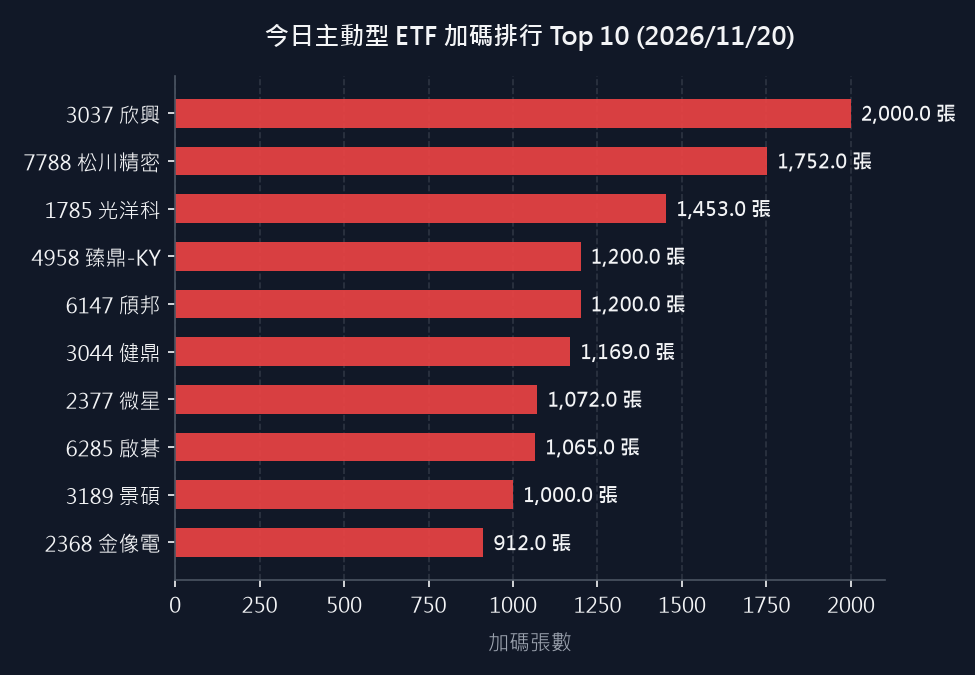
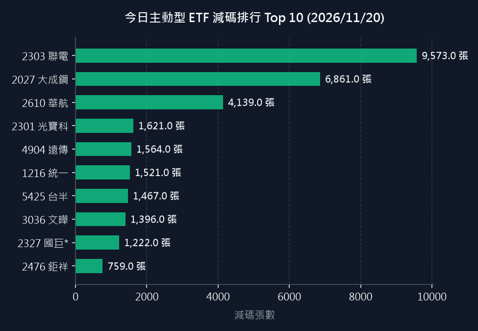

# 主動型 ETF 持股變動

資料來源：`主動型ETF持股明細.xlsx` 最近兩個日期分頁。

比較區間：`20261119` → `20261120`

## 今日加減碼視覺化排行

| 今日加碼 Top 10 | 今日減碼 Top 10 |
| :---: | :---: |
|  |  |

| ETF | 新增 | 刪除 | 比例變動 |
| :-- | --: | --: | --: |
| 00400A | 5 | 1 | 42 |
| 00401A | 2 | 2 | 51 |
| 00402A | 0 | 0 | 36 |
| 00403A | 0 | 0 | 36 |
| 00404A | 0 | 0 | 49 |
| 00405A | 0 | 0 | 24 |
| 00406A | 1 | 1 | 51 |
| 00407A | 0 | 0 | 42 |
| 00408A | 0 | 0 | 32 |
| 00980A | 0 | 0 | 48 |
| 00980D | 0 | 0 | 28 |
| 00981A | 0 | 0 | 28 |
| 00982A | 0 | 11 | 52 |
| 00983A | 1 | 0 | 33 |
| 00983D | 0 | 0 | 14 |
| 00984A | 0 | 0 | 74 |
| 00985A | 0 | 0 | 48 |
| 00986A | 0 | 0 | 24 |
| 00987A | 0 | 0 | 24 |
| 00988A | 0 | 0 | 27 |
| 00989A | 1 | 0 | 50 |
| 00990A | 1 | 2 | 31 |
| 00991A | 0 | 0 | 25 |
| 00992A | 0 | 0 | 39 |
| 00993A | 0 | 0 | 36 |
| 00994A | 0 | 0 | 21 |
| 00995A | 1 | 1 | 30 |
| 00996A | 1 | 1 | 35 |
| 00997A | 1 | 0 | 38 |
| 00998A | 0 | 2 | 38 |
| 00999A | 0 | 0 | 53 |

## 00400A

### 新增持股

- 1477 聚陽（0.32%，347 張）
- 2395 研華（0.04%，18 張）
- 3264 欣銓（0.11%，191 張）
- 6285 啟碁（0.10%，146 張）
- 6669 緯穎（0.10%，19 張）

### 刪除持股

- 3008 大立光（1.16%，76 張）

### 投資比例變動

- 1303 南亞：1.76% → 1.72%（-0.04）
- 1476 儒鴻：0.10% → 0.11%（+0.01）
- 2059 川湖：3.74% → 3.64%（-0.10）
- 2308 台達電：1.82% → 1.77%（-0.05）
- 2313 華通：0.72% → 0.70%（-0.02）
- 2330 台積電：13.23% → 13.60%（+0.37）
- 2345 智邦：1.31% → 1.28%（-0.03）
- 2360 致茂：0.79% → 0.77%（-0.02）
- 2368 金像電：2.23% → 2.16%（-0.07）
- 2383 台光電：5.13% → 4.99%（-0.14）
- 2454 聯發科：7.84% → 7.62%（-0.22）
- 2603 長榮：2.78% → 2.84%（+0.06）
- 2891 中信金：1.84% → 1.85%（+0.01）
- 3017 奇鋐：4.99% → 4.86%（-0.13）
- 3023 信邦：0.93% → 0.99%（+0.06）
- 3036 文曄：1.46% → 1.49%（+0.03）
- 3037 欣興：2.45% → 2.38%（-0.07）
- 3044 健鼎：4.14% → 4.15%（+0.01）
- 3081 聯亞：0.73% → 0.71%（-0.02）
- 3167 大量：0.25% → 0.24%（-0.01）
- 3231 緯創：0.97% → 0.98%（+0.01）
- 3293 鈊象：0.40% → 0.42%（+0.02）
- 3406 玉晶光：0.88% → 0.85%（-0.03）
- 3443 創意：3.13% → 3.04%（-0.09）
- 3529 力旺：1.10% → 1.07%（-0.03）
- 3596 智易：0.15% → 0.16%（+0.01）
- 3653 健策：3.21% → 3.12%（-0.09）
- 3661 世芯-KY：2.65% → 2.58%（-0.07）
- 3665 貿聯-KY：1.26% → 1.23%（-0.03）
- 3702 大聯大：0.52% → 0.55%（+0.03）
- 3711 日月光投控：0.90% → 0.88%（-0.02）
- 4958 臻鼎-KY：0.34% → 0.33%（-0.01）
- 5274 信驊：2.56% → 2.49%（-0.07）
- 5434 崇越：0.33% → 0.32%（-0.01）
- 6121 新普：0.19% → 0.20%（+0.01）
- 6147 頎邦：0.64% → 0.62%（-0.02）
- 6187 萬潤：0.77% → 0.85%（+0.08）
- 6223 旺矽：3.16% → 3.07%（-0.09）
- 6278 台表科：2.19% → 2.14%（-0.05）
- 6488 環球晶：1.18% → 1.15%（-0.03）
- 7769 鴻勁：0.74% → 0.72%（-0.02）
- ＸＡＧＸ金兌(3533.HK)：1.81% → 1.77%（-0.04）

## 00401A

### 新增持股

- 臺指選擇權12/26 38600 買權（-0.55%，-0.44 張）
- 臺指選擇權12/26 40000 買權（-0.02%，-0.02 張）

### 刪除持股

- TAIWAN TAIE C 16DEC26 38600 TWSE（-1.13%，-0.44 張）
- TAIWAN TAIE C 16DEC26 40000 TWSE（-0.03%，-0.02 張）

### 投資比例變動

- 1216 統一：0.29% → 0.30%（+0.01）
- 1303 南亞：0.96% → 0.92%（-0.04）
- 1476 儒鴻：2.55% → 2.57%（+0.02）
- 1477 聚陽：2.27% → 2.37%（+0.10）
- 2059 川湖：1.44% → 1.38%（-0.06）
- 2303 聯電：2.22% → 2.15%（-0.07）
- 2308 台達電：1.41% → 1.35%（-0.06）
- 2313 華通：1.07% → 1.03%（-0.04）
- 2317 鴻海：0.52% → 0.53%（+0.01）
- 2327 國巨*：0.37% → 0.36%（-0.01）
- 2330 台積電：20.44% → 20.72%（+0.28）
- 2357 華碩：1.58% → 1.59%（+0.01）
- 2360 致茂：1.24% → 1.18%（-0.06）
- 2379 瑞昱：1.07% → 1.05%（-0.02）
- 2382 廣達：1.75% → 1.79%（+0.04）
- 2383 台光電：0.65% → 0.62%（-0.03）
- 2412 中華電：0.97% → 1.01%（+0.04）
- 2454 聯發科：5.76% → 5.52%（-0.24）
- 2455 全新：1.29% → 1.24%（-0.05）
- 2603 長榮：2.16% → 2.17%（+0.01）
- 2881 富邦金：2.02% → 1.98%（-0.04）
- 2882 國泰金：1.00% → 0.99%（-0.01）
- 2884 玉山金：1.62% → 1.69%（+0.07）
- 2886 兆豐金：2.28% → 2.36%（+0.08）
- 2887 台新新光金：0.95% → 0.96%（+0.01）
- 2890 永豐金：1.48% → 1.46%（-0.02）
- 2891 中信金：2.42% → 2.39%（-0.03）
- 2912 統一超：0.25% → 0.26%（+0.01）
- 3008 大立光：1.52% → 1.49%（-0.03）
- 3037 欣興：0.42% → 0.40%（-0.02）
- 3131 弘塑：0.45% → 0.43%（-0.02）
- 3231 緯創：1.86% → 1.87%（+0.01）
- 3443 創意：1.89% → 1.82%（-0.07）
- 3491 昇達科：1.61% → 1.54%（-0.07）
- 3653 健策：1.01% → 0.97%（-0.04）
- 3711 日月光投控：3.62% → 3.49%（-0.13）
- 4904 遠傳：0.79% → 0.80%（+0.01）
- 4958 臻鼎-KY：0.91% → 0.87%（-0.04）
- 5274 信驊：0.94% → 0.90%（-0.04）
- 5347 世界：0.93% → 0.90%（-0.03）
- 6147 頎邦：0.86% → 0.82%（-0.04）
- 6187 萬潤：1.11% → 1.07%（-0.04）
- 6223 旺矽：2.16% → 2.07%（-0.09）
- 6285 啟碁：1.12% → 1.07%（-0.05）
- 6515 穎崴：0.61% → 0.58%（-0.03）
- 6531 愛普*：0.97% → 0.93%（-0.04）
- 7769 鴻勁：0.51% → 0.49%（-0.02）
- 7828 創新服務：1.16% → 1.35%（+0.19）
- 7856 漢測：0.58% → 0.55%（-0.03）
- 8464 億豐：1.00% → 1.02%（+0.02）
- 台股期貨12/26(FITXN*1.TF)：-0.58% → -1.16%（-0.58）

## 00402A

### 新增持股

- 無

### 刪除持股

- 無

### 投資比例變動

- AAPL.US Apple：9.45% → 9.60%（+0.15）
- ADI.US Analog Devices：2.11% → 2.13%（+0.02）
- AMD.US AMD：6.35% → 5.99%（-0.36）
- AMZN.US Amazon：5.54% → 5.44%（-0.10）
- ARM.US Arm：0.73% → 0.72%（-0.01）
- AXON.US Axon Enterprise：0.48% → 0.50%（+0.02）
- BABA.US Alibaba Group：0.43% → 0.44%（+0.01）
- BKNG.US Booking Holdings：0.57% → 0.56%（-0.01）
- CDNS.US Cadence Design Systems：1.59% → 1.62%（+0.03）
- CLS.US Celestica：1.10% → 1.11%（+0.01）
- COHR.US Coherent：1.16% → 1.20%（+0.04）
- CRWD.US CrowdStrike Holdings：1.91% → 2.00%（+0.09）
- FSLY.US Fastly：0.30% → 0.29%（-0.01）
- GOOG.US Alphabet - Class C Capital Stock：3.18% → 3.15%（-0.03）
- GOOGL.US Alphabet - Class A Common Stock：3.40% → 3.36%（-0.04）
- INTC.US Intel：0.95% → 0.99%（+0.04）
- IOT.US Samsara：0.60% → 0.59%（-0.01）
- LITE.US Lumentum：1.25% → 1.24%（-0.01）
- LRCX.US Lam Research：2.06% → 2.02%（-0.04）
- MDB.US MongoDB：0.37% → 0.36%（-0.01）
- META.US Meta：3.94% → 3.89%（-0.05）
- MRVL.US Marvell：1.12% → 1.09%（-0.03）
- MSFT.US Microsoft：6.09% → 6.37%（+0.28）
- NVDA.US NVIDIA：5.54% → 5.48%（-0.06）
- PANW.US Palo Alto：2.98% → 3.25%（+0.27）
- PLTR.US Palantir Technologies：1.98% → 1.99%（+0.01）
- SHOP.US Shopify：1.26% → 1.22%（-0.04）
- SIMO.US Silicon Motion：0.38% → 0.37%（-0.01）
- SNOW.US Snowflake：1.28% → 1.26%（-0.02）
- SPCX.US SpaceX：0.81% → 0.80%（-0.01）
- STX.US Seagate：0.89% → 0.92%（+0.03）
- TSM.US TSMC(ADR)：1.45% → 1.44%（-0.01）
- TTWO.US Take-Two：1.28% → 1.26%（-0.02）
- UBER.US Uber：0.74% → 0.72%（-0.02）
- V.US Visa：1.71% → 1.70%（-0.01）
- WDC.US Western Digital：1.61% → 1.70%（+0.09）

## 00403A

### 新增持股

- 無

### 刪除持股

- 無

### 投資比例變動

- 1303 南亞：3.30% → 3.20%（-0.10）
- 1560 中砂：0.44% → 0.43%（-0.01）
- 1717 長興：0.05% → 0.04%（-0.01）
- 2059 川湖：0.57% → 0.41%（-0.16）
- 2301 光寶科：0.05% → 0.00%（-0.05）
- 2308 台達電：2.07% → 2.01%（-0.06）
- 2313 華通：0.32% → 0.31%（-0.01）
- 2317 鴻海：0.67% → 0.69%（+0.02）
- 2327 國巨*：2.71% → 2.68%（-0.03）
- 2330 台積電：16.66% → 17.05%（+0.39）
- 2345 智邦：1.63% → 1.59%（-0.04）
- 2368 金像電：0.78% → 0.75%（-0.03）
- 2383 台光電：3.58% → 3.46%（-0.12）
- 2408 南亞科：0.79% → 0.76%（-0.03）
- 2449 京元電子：0.67% → 0.65%（-0.02）
- 2454 聯發科：6.93% → 6.71%（-0.22）
- 2455 全新：0.06% → 0.05%（-0.01）
- 2882 國泰金：0.67% → 0.68%（+0.01）
- 3008 大立光：1.43% → 1.41%（-0.02）
- 3017 奇鋐：5.96% → 5.78%（-0.18）
- 3037 欣興：4.10% → 3.97%（-0.13）
- 3189 景碩：2.22% → 2.15%（-0.07）
- 3443 創意：4.47% → 4.33%（-0.14）
- 3450 聯鈞：0.41% → 0.40%（-0.01）
- 3583 辛耘：0.18% → 0.12%（-0.06）
- 3653 健策：4.05% → 3.92%（-0.13）
- 3661 世芯-KY：0.41% → 0.40%（-0.01）
- 3665 貿聯-KY：2.01% → 1.95%（-0.06）
- 3711 日月光投控：1.59% → 1.55%（-0.04）
- 5274 信驊：1.51% → 1.46%（-0.05）
- 6223 旺矽：3.52% → 3.40%（-0.12）
- 6515 穎崴：0.28% → 0.27%（-0.01）
- 6669 緯穎：2.58% → 2.60%（+0.02）
- 6805 富世達：0.56% → 0.54%（-0.02）
- 8046 南電：2.01% → 1.95%（-0.06）
- 8996 高力：1.84% → 1.78%（-0.06）

## 00404A

### 新增持股

- 無

### 刪除持股

- 無

### 投資比例變動

- 1303 南亞：0.64% → 0.63%（-0.01）
- 2006 東和鋼鐵：1.37% → 1.41%（+0.04）
- 2301 光寶科：0.48% → 0.47%（-0.01）
- 2303 聯電：1.18% → 1.16%（-0.02）
- 2317 鴻海：0.47% → 0.49%（+0.02）
- 2330 台積電：22.60% → 23.30%（+0.70）
- 2347 聯強：1.65% → 1.67%（+0.02）
- 2357 華碩：1.21% → 1.24%（+0.03）
- 2360 致茂：0.40% → 0.39%（-0.01）
- 2379 瑞昱：2.22% → 2.21%（-0.01）
- 2382 廣達：0.44% → 0.45%（+0.01）
- 2383 台光電：2.45% → 2.39%（-0.06）
- 2395 研華：1.86% → 1.89%（+0.03）
- 2454 聯發科：7.25% → 7.07%（-0.18）
- 2603 長榮：1.45% → 1.48%（+0.03）
- 2851 中再保：1.10% → 1.09%（-0.01）
- 2882 國泰金：3.09% → 3.14%（+0.05）
- 2885 元大金：3.15% → 3.19%（+0.04）
- 2887 台新新光金：1.77% → 1.83%（+0.06）
- 2890 永豐金：1.16% → 1.15%（-0.01）
- 3014 聯陽：1.17% → 1.18%（+0.01）
- 3017 奇鋐：1.18% → 1.15%（-0.03）
- 3034 聯詠：2.12% → 2.19%（+0.07）
- 3036 文曄：1.07% → 1.10%（+0.03）
- 3037 欣興：0.27% → 0.26%（-0.01）
- 3264 欣銓：0.38% → 0.37%（-0.01）
- 3293 鈊象：1.96% → 2.02%（+0.06）
- 3374 精材：0.11% → 0.10%（-0.01）
- 3443 創意：1.63% → 1.59%（-0.04）
- 3653 健策：1.00% → 0.97%（-0.03）
- 3711 日月光投控：3.44% → 3.38%（-0.06）
- 4961 天鈺：0.59% → 0.61%（+0.02）
- 5274 信驊：1.96% → 1.91%（-0.05）
- 5434 崇越：1.71% → 1.67%（-0.04）
- 5904 寶雅*：0.47% → 0.48%（+0.01）
- 6206 飛捷：0.74% → 0.75%（+0.01）
- 6223 旺矽：0.78% → 0.76%（-0.02）
- 6257 矽格：0.65% → 0.63%（-0.02）
- 6491 晶碩：0.95% → 0.97%（+0.02）
- 6505 台塑化：0.48% → 0.49%（+0.01）
- 6669 緯穎：1.02% → 1.04%（+0.02）
- 6691 洋基工程：1.25% → 1.31%（+0.06）
- 6957 裕慶-KY：0.06% → 0.07%（+0.01）
- 7769 鴻勁：1.07% → 1.04%（-0.03）
- 8016 矽創：1.87% → 2.01%（+0.14）
- 8081 致新：0.76% → 0.78%（+0.02）
- 8299 群聯：1.19% → 1.17%（-0.02）
- 台指選擇權12/26 46500 買權：-0.11% → -0.07%（+0.04）
- 台股期貨12/26(FITXN*1.TF)：19.38% → 19.45%（+0.07）

## 00405A

### 新增持股

- 無

### 刪除持股

- 無

### 投資比例變動

- 2059 川湖：1.73% → 1.69%（-0.04）
- 2308 台達電：0.55% → 0.54%（-0.01）
- 2330 台積電：7.21% → 7.45%（+0.24）
- 2345 智邦：4.79% → 4.74%（-0.05）
- 2368 金像電：5.19% → 5.07%（-0.12）
- 2383 台光電：3.85% → 3.77%（-0.08）
- 2454 聯發科：7.59% → 7.42%（-0.17）
- 3017 奇鋐：3.96% → 3.88%（-0.08）
- 3037 欣興：3.58% → 3.50%（-0.08）
- 3443 創意：2.55% → 2.49%（-0.06）
- 3653 健策：6.23% → 6.10%（-0.13）
- 3665 貿聯-KY：5.58% → 5.47%（-0.11）
- 3711 日月光投控：2.45% → 2.41%（-0.04）
- 5274 信驊：5.26% → 5.14%（-0.12）
- 6187 萬潤：0.60% → 0.59%（-0.01）
- 6223 旺矽：7.44% → 7.28%（-0.16）
- 6274 台燿：1.23% → 1.21%（-0.02）
- 6515 穎崴：0.43% → 0.42%（-0.01）
- 6531 愛普*：3.22% → 3.15%（-0.07）
- 6669 緯穎：0.81% → 0.83%（+0.02）
- 6805 富世達：1.58% → 1.55%（-0.03）
- 7769 鴻勁：2.24% → 2.19%（-0.05）
- 8046 南電：5.28% → 5.17%（-0.11）
- 8996 高力：2.39% → 2.34%（-0.05）

## 00406A

### 新增持股

- 臺指選擇權第四週週五到期契約（-6.90%，-9.3 張）

### 刪除持股

- 臺指選擇權第三週週五到期契約（-7.60%，-25.3 張）

### 投資比例變動

- 1303 南亞：2.26% → 2.17%（-0.09）
- 1326 台化：0.80% → 0.78%（-0.02）
- 1560 中砂：0.17% → 0.16%（-0.01）
- 1815 富喬：0.63% → 0.60%（-0.03）
- 2059 川湖：1.41% → 1.59%（+0.18）
- 2303 聯電：1.23% → 1.28%（+0.05）
- 2308 台達電：1.87% → 2.02%（+0.15）
- 2327 國巨*：1.05% → 1.03%（-0.02）
- 2330 台積電：8.84% → 8.98%（+0.14）
- 2345 智邦：2.32% → 2.69%（+0.37）
- 2368 金像電：2.16% → 2.47%（+0.31）
- 2383 台光電：5.43% → 5.61%（+0.18）
- 2449 京元電子：0.28% → 0.27%（-0.01）
- 2454 聯發科：6.43% → 6.16%（-0.27）
- 2481 強茂：0.24% → 0.23%（-0.01）
- 2486 一詮：0.10% → 0.09%（-0.01）
- 2881 富邦金：0.62% → 0.61%（-0.01）
- 2884 玉山金：0.46% → 0.48%（+0.02）
- 2886 兆豐金：0.61% → 0.63%（+0.02）
- 3008 大立光：0.79% → 0.91%（+0.12）
- 3017 奇鋐：5.32% → 5.10%（-0.22）
- 3037 欣興：4.30% → 4.89%（+0.59）
- 3081 聯亞：0.84% → 0.80%（-0.04）
- 3105 穩懋：0.46% → 0.44%（-0.02）
- 3167 大量：0.36% → 0.49%（+0.13）
- 3189 景碩：1.41% → 1.69%（+0.28）
- 3264 欣銓：0.22% → 0.21%（-0.01）
- 3443 創意：2.04% → 1.95%（-0.09）
- 3491 昇達科：0.30% → 0.29%（-0.01）
- 3653 健策：3.55% → 3.40%（-0.15）
- 3661 世芯-KY：0.78% → 0.74%（-0.04）
- 3665 貿聯-KY：1.49% → 1.52%（+0.03）
- 3711 日月光投控：2.29% → 2.21%（-0.08）
- 4770 上品：0.05% → 0.04%（-0.01）
- 4938 和碩：0.55% → 0.56%（+0.01）
- 4958 臻鼎-KY：0.92% → 1.15%（+0.23）
- 5274 信驊：0.91% → 0.87%（-0.04）
- 6147 頎邦：0.51% → 0.59%（+0.08）
- 6213 聯茂：0.40% → 0.46%（+0.06）
- 6223 旺矽：2.81% → 2.69%（-0.12）
- 6274 台燿：1.79% → 1.71%（-0.08）
- 6446 藥華藥：0.83% → 0.80%（-0.03）
- 6510 精測：0.49% → 0.47%（-0.02）
- 6669 緯穎：0.83% → 1.02%（+0.19）
- 6715 嘉基：0.57% → 0.64%（+0.07）
- 6805 富世達：0.79% → 0.76%（-0.03）
- 8046 南電：2.66% → 2.84%（+0.18）
- 8358 金居：0.04% → 0.17%（+0.13）
- 8996 高力：0.73% → 0.70%（-0.03）
- 臺指選擇權第四週週三到期契約：-3.48% → -11.11%（-7.63）
- 臺股期貨 202612(FITXN*1.TF)：23.65% → 23.34%（-0.31）

## 00407A

### 新增持股

- 無

### 刪除持股

- 無

### 投資比例變動

- 1303 南亞：3.26% → 3.18%（-0.08）
- 1476 儒鴻：0.69% → 0.71%（+0.02）
- 1560 中砂：0.84% → 0.82%（-0.02）
- 2059 川湖：0.73% → 0.71%（-0.02）
- 2301 光寶科：1.34% → 1.32%（-0.02）
- 2308 台達電：1.93% → 1.88%（-0.05）
- 2313 華通：0.40% → 0.39%（-0.01）
- 2330 台積電：12.51% → 12.91%（+0.40）
- 2345 智邦：2.24% → 2.21%（-0.03）
- 2360 致茂：0.65% → 0.63%（-0.02）
- 2368 金像電：2.04% → 1.99%（-0.05）
- 2383 台光電：5.07% → 4.95%（-0.12）
- 2408 南亞科：0.39% → 0.38%（-0.01）
- 2451 創見：0.32% → 0.34%（+0.02）
- 2454 聯發科：7.24% → 7.07%（-0.17）
- 2618 長榮航：0.64% → 0.66%（+0.02）
- 3017 奇鋐：5.66% → 5.53%（-0.13）
- 3034 聯詠：0.79% → 0.82%（+0.03）
- 3037 欣興：4.40% → 4.30%（-0.10）
- 3081 聯亞：1.39% → 1.35%（-0.04）
- 3231 緯創：1.57% → 1.60%（+0.03）
- 3293 鈊象：0.81% → 0.83%（+0.02）
- 3406 玉晶光：0.86% → 0.84%（-0.02）
- 3443 創意：4.58% → 4.47%（-0.11）
- 3491 昇達科：1.09% → 1.07%（-0.02）
- 3533 嘉澤：0.99% → 0.97%（-0.02）
- 3653 健策：2.85% → 2.78%（-0.07）
- 3665 貿聯-KY：3.29% → 3.22%（-0.07）
- 3711 日月光投控：3.34% → 3.28%（-0.06）
- 4958 臻鼎-KY：0.86% → 0.84%（-0.02）
- 5274 信驊：1.22% → 1.19%（-0.03）
- 5434 崇越：0.21% → 0.20%（-0.01）
- 6187 萬潤：1.06% → 1.03%（-0.03）
- 6223 旺矽：3.37% → 3.28%（-0.09）
- 6274 台燿：1.28% → 1.25%（-0.03）
- 6510 精測：1.48% → 1.45%（-0.03）
- 6531 愛普*：0.25% → 0.24%（-0.01）
- 6669 緯穎：1.44% → 1.46%（+0.02）
- 6805 富世達：1.06% → 1.04%（-0.02）
- 8046 南電：2.53% → 2.47%（-0.06）
- 8299 群聯：0.30% → 0.29%（-0.01）
- 8996 高力：1.36% → 1.32%（-0.04）

## 00408A

### 新增持股

- 無

### 刪除持股

- 無

### 投資比例變動

- 1303 南亞：4.05% → 3.90%（-0.15）
- 2301 光寶科：0.47% → 0.45%（-0.02）
- 2330 台積電：7.96% → 8.13%（+0.17）
- 2345 智邦：0.60% → 0.59%（-0.01）
- 2368 金像電：5.09% → 4.89%（-0.20）
- 2383 台光電：3.77% → 3.63%（-0.14）
- 2395 研華：1.68% → 1.69%（+0.01）
- 2454 聯發科：5.66% → 5.45%（-0.21）
- 2542 興富發：4.54% → 4.66%（+0.12）
- 2603 長榮：1.61% → 1.63%（+0.02）
- 2880 華南金：1.49% → 1.53%（+0.04）
- 2891 中信金：3.20% → 3.19%（-0.01）
- 3017 奇鋐：4.57% → 4.41%（-0.16）
- 3037 欣興：2.83% → 2.72%（-0.11）
- 3044 健鼎：1.20% → 1.19%（-0.01）
- 3081 聯亞：0.41% → 0.39%（-0.02）
- 3105 穩懋：0.61% → 0.58%（-0.03）
- 3167 大量：0.35% → 0.34%（-0.01）
- 3189 景碩：2.29% → 2.20%（-0.09）
- 3231 緯創：1.55% → 1.56%（+0.01）
- 3443 創意：1.61% → 1.55%（-0.06）
- 3653 健策：3.61% → 3.47%（-0.14）
- 3661 世芯-KY：2.58% → 2.48%（-0.10）
- 4904 遠傳：2.51% → 2.56%（+0.05）
- 5434 崇越：2.24% → 2.16%（-0.08）
- 6223 旺矽：1.42% → 1.36%（-0.06）
- 6510 精測：2.35% → 2.26%（-0.09）
- 6526 達發：0.33% → 0.32%（-0.01）
- 6805 富世達：2.55% → 2.46%（-0.09）
- 8046 南電：1.25% → 1.20%（-0.05）
- 8996 高力：2.57% → 2.47%（-0.10）
- 9802 鈺齊-KY：0.97% → 0.98%（+0.01）

## 00980A

### 新增持股

- 無

### 刪除持股

- 無

### 投資比例變動

- 1303 南亞：3.55% → 3.48%（-0.07）
- 2059 川湖：3.44% → 3.37%（-0.07）
- 2303 聯電：1.39% → 1.37%（-0.02）
- 2308 台達電：2.79% → 2.73%（-0.06）
- 2317 鴻海：3.97% → 4.11%（+0.14）
- 2330 台積電：10.92% → 11.30%（+0.38）
- 2344 華邦電：1.39% → 1.38%（-0.01）
- 2345 智邦：0.93% → 0.92%（-0.01）
- 2360 致茂：0.78% → 0.76%（-0.02）
- 2368 金像電：1.84% → 1.80%（-0.04）
- 2376 技嘉：1.67% → 1.73%（+0.06）
- 2382 廣達：2.12% → 2.21%（+0.09）
- 2383 台光電：3.30% → 3.23%（-0.07）
- 2408 南亞科：2.08% → 2.04%（-0.04）
- 2454 聯發科：6.81% → 6.66%（-0.15）
- 2884 玉山金：1.44% → 1.53%（+0.09）
- 2891 中信金：2.09% → 2.12%（+0.03）
- 3017 奇鋐：2.40% → 2.35%（-0.05）
- 3026 禾伸堂：0.71% → 0.70%（-0.01）
- 3036 文曄：1.08% → 1.10%（+0.02）
- 3037 欣興：2.57% → 2.52%（-0.05）
- 3044 健鼎：1.43% → 1.45%（+0.02）
- 3081 聯亞：1.25% → 1.22%（-0.03）
- 3189 景碩：0.96% → 0.94%（-0.02）
- 3231 緯創：1.90% → 1.94%（+0.04）
- 3264 欣銓：0.68% → 0.66%（-0.02）
- 3293 鈊象：0.60% → 0.62%（+0.02）
- 3443 創意：1.99% → 1.94%（-0.05）
- 3529 力旺：0.17% → 0.16%（-0.01）
- 3653 健策：2.73% → 2.67%（-0.06）
- 3665 貿聯-KY：1.51% → 1.49%（-0.02）
- 3711 日月光投控：2.30% → 2.26%（-0.04）
- 5274 信驊：1.28% → 1.26%（-0.02）
- 5904 寶雅*：0.85% → 0.87%（+0.02）
- 6213 聯茂：0.97% → 0.95%（-0.02）
- 6223 旺矽：1.34% → 1.31%（-0.03）
- 6274 台燿：0.89% → 0.87%（-0.02）
- 6515 穎崴：1.35% → 1.32%（-0.03）
- 6669 緯穎：1.92% → 1.96%（+0.04）
- 6805 富世達：0.59% → 0.58%（-0.01）
- 6831 邁科：0.23% → 0.22%（-0.01）
- 7751 竑騰：0.57% → 0.56%（-0.01）
- 7769 鴻勁：1.66% → 1.63%（-0.03）
- 8046 南電：1.21% → 1.18%（-0.03）
- 8210 勤誠：0.31% → 0.30%（-0.01）
- 8299 群聯：1.11% → 1.10%（-0.01）
- 8996 高力：0.41% → 0.40%（-0.01）
- 台灣證交所加權股價指數(FITXN*1.TF)：2.67% → 2.69%（+0.02）

## 00980D

### 新增持股

- 無

### 刪除持股

- 無

### 投資比例變動

- AMC GLOBAL MEDIA INC SER REGS (REG) (REG S) 10.5% 15JUL2032：0.73% → 0.72%（-0.01）
- ARSENAL AIC PARENT LLC SER REGS 11.5 % 01-OCT-2031：0.34% → 0.35%（+0.01）
- BAT CAPITAL CORP (REG) 7.081% 02AUG2053：0.60% → 0.61%（+0.01）
- CIMIC FINANCE USA PTY LT SER REGS (REG S) 7% 25MAR2034：0.34% → 0.35%（+0.01）
- DIRECTV FIN LLC/COINC SER REGS 10.000000 % 15FEB2031：0.43% → 0.44%（+0.01）
- DISCOVER FINANCIAL SVS (REG) VAR 02NOV2034：0.67% → 0.68%（+0.01）
- F&G ANNUITIES & LIFE INC 6.250000 % 04OCT2034：0.52% → 0.53%（+0.01）
- FMC CORP (REG) 6.375000 % 18MAY2053：0.29% → 0.28%（-0.01）
- FORD MOTOR CREDIT CO LLC (REG) 7.35% 04NOV2027：0.35% → 0.36%（+0.01）
- HERTZ CORP/THE SER REGS (REG S) 12.625% 15JUL2029：0.24% → 0.23%（-0.01）
- ICAHN ENTERPRISES/FIN (REG) 9.75% 15JAN2029：0.27% → 0.26%（-0.01）
- ICAHN ENTERPRISES/FIN SER REGS 10.000000 % 15NOV2029：0.28% → 0.27%（-0.01）
- JETBLUE AIRWAYS/LOYALTY SER REGS (REG S) 9.875% 20SEP2031：0.37% → 0.36%（-0.01）
- KINDER MORGAN INC/DELAWA SER GMTN (REG) 7.8% 01AUG2031：0.33% → 0.34%（+0.01）
- LBM ACQUISITION LLC SER REGS 9.500000 % 15JUN2031：0.41% → 0.37%（-0.04）
- MDC HOLDINGS INC (REG) 6% 15JAN2043：0.34% → 0.33%（-0.01）
- NRG ENERGY INC SER REGS (REG S) 7% 15MAR2033：0.33% → 0.34%（+0.01）
- OCCIDENTAL PETROLEUM COR 8.875% 15JUL2030：0.59% → 0.60%（+0.01）
- OWENS-BROCKWAY SER REGS (REG) (REG S) 9.5% 01JUN2033：0.48% → 0.46%（-0.02）
- PHOTO HOLDINGS LLC SER REGS (REG) (REG S) 12% 01JUL2031：0.46% → 0.48%（+0.02）
- PLANET FINANCIAL GROUP SER REGS 10.500000 % 15DEC2029：0.46% → 0.45%（-0.01）
- UNISYS CORP SER REGS 10.625000 % 15JAN2031：0.64% → 0.65%（+0.01）
- US 10YR NOTE (CBT)DEC26 21-DEC-2026：18.71% → 18.75%（+0.04）
- US 5YR NOTE (CBT) DEC26 31-DEC-2026：-17.00% → -17.02%（-0.02）
- US ACUTE CARE SOLUTIONS SER REGS (REG S) 9.75% 15MAY2029：0.34% → 0.35%（+0.01）
- US LONG BOND(CBT) DEC26 21-DEC-2026：5.71% → 5.72%（+0.01）
- VIACOM INC (REG) 5.85% 01SEP2043：0.49% → 0.48%（-0.01）
- VIRGINIA ELEC & POWER CO (REG) 8.875% 15NOV2038：0.61% → 0.62%（+0.01）

## 00981A

### 新增持股

- 無

### 刪除持股

- 無

### 投資比例變動

- 2303 聯電：2.61% → 2.29%（-0.32）
- 2308 台達電：3.27% → 3.22%（-0.05）
- 2317 鴻海：0.44% → 0.46%（+0.02）
- 2327 國巨*：3.27% → 3.29%（+0.02）
- 2330 台積電：17.47% → 18.22%（+0.75）
- 2345 智邦：4.20% → 4.19%（-0.01）
- 2368 金像電：2.74% → 2.70%（-0.04）
- 2383 台光電：5.46% → 5.38%（-0.08）
- 2449 京元電子：0.58% → 0.56%（-0.02）
- 2454 聯發科：9.39% → 9.27%（-0.12）
- 2891 中信金：0.29% → 0.30%（+0.01）
- 3017 奇鋐：7.46% → 7.37%（-0.09）
- 3037 欣興：5.07% → 5.00%（-0.07）
- 3231 緯創：0.80% → 0.83%（+0.03）
- 3264 欣銓：0.33% → 0.32%（-0.01）
- 3443 創意：2.72% → 2.68%（-0.04）
- 3653 健策：4.52% → 4.46%（-0.06）
- 3665 貿聯-KY：2.00% → 1.98%（-0.02）
- 3711 日月光投控：3.90% → 3.87%（-0.03）
- 5274 信驊：0.78% → 0.77%（-0.01）
- 6223 旺矽：4.57% → 4.51%（-0.06）
- 6274 台燿：2.19% → 2.16%（-0.03）
- 6510 精測：0.53% → 0.52%（-0.01）
- 6515 穎崴：0.10% → 0.09%（-0.01）
- 6669 緯穎：1.43% → 1.48%（+0.05）
- 6805 富世達：1.14% → 1.13%（-0.01）
- 8046 南電：2.10% → 2.08%（-0.02）
- 台指期貨 2026/12(FITXN*1.TF)：2.88% → 2.93%（+0.05）

## 00982A

### 新增持股

- 無

### 刪除持股

- 2301 光寶科（0.71%，1372 張）
- 2303 聯電（0.53%，2229 張）
- 2428 興勤（0.40%，998 張）
- 3045 台灣大（0.03%，95 張）
- 3090 日電貿（0.13%，471 張）
- 3617 碩天（0.25%，381 張）
- 5483 中美晶（0.52%，1480 張）
- 6196 帆宣（0.11%，133 張）
- 6214 精誠（0.02%，41 張）
- 6488 環球晶（0.63%，476 張）
- 8070 長華*（0.34%，3028 張）

### 投資比例變動

- 1785 光洋科：0.20% → 0.50%（+0.30）
- 2059 川湖：2.33% → 2.39%（+0.06）
- 2327 國巨*：0.77% → 0.32%（-0.45）
- 2330 台積電：9.10% → 9.51%（+0.41）
- 2351 順德：0.20% → 0.36%（+0.16）
- 2360 致茂：1.86% → 1.83%（-0.03）
- 2368 金像電：1.83% → 2.04%（+0.21）
- 2376 技嘉：1.32% → 1.31%（-0.01）
- 2377 微星：0.41% → 0.78%（+0.37）
- 2383 台光電：2.84% → 3.06%（+0.22）
- 2395 研華：1.48% → 1.41%（-0.07）
- 2441 超豐：0.85% → 0.87%（+0.02）
- 2451 創見：0.21% → 0.36%（+0.15）
- 2454 聯發科：9.58% → 9.47%（-0.11）
- 2455 全新：1.30% → 1.36%（+0.06）
- 2467 志聖：0.20% → 0.51%（+0.31）
- 2476 鉅祥：0.28% → 0.10%（-0.18）
- 2478 大毅：0.32% → 0.34%（+0.02）
- 2885 元大金：0.38% → 0.39%（+0.01）
- 3008 大立光：2.89% → 2.93%（+0.04）
- 3017 奇鋐：2.65% → 3.06%（+0.41）
- 3028 增你強：0.65% → 0.74%（+0.09）
- 3044 健鼎：0.64% → 1.99%（+1.35）
- 3105 穩懋：8.04% → 7.95%（-0.09）
- 3231 緯創：2.13% → 2.21%（+0.08）
- 3265 台星科：0.73% → 0.72%（-0.01）
- 3491 昇達科：4.87% → 4.81%（-0.06）
- 3661 世芯-KY：0.21% → 0.32%（+0.11）
- 3702 大聯大：0.85% → 0.81%（-0.04）
- 3711 日月光投控：2.61% → 2.55%（-0.06）
- 4749 新應材：0.21% → 0.33%（+0.12）
- 4958 臻鼎-KY：2.64% → 2.61%（-0.03）
- 5274 信驊：0.77% → 0.04%（-0.73）
- 5425 台半：0.46% → 0.20%（-0.26）
- 5536 聖暉*：0.95% → 0.98%（+0.03）
- 6139 亞翔：5.94% → 5.95%（+0.01）
- 6213 聯茂：1.47% → 1.53%（+0.06）
- 6223 旺矽：3.21% → 3.17%（-0.04）
- 6239 力成：2.23% → 2.21%（-0.02）
- 6274 台燿：0.27% → 0.34%（+0.07）
- 6285 啟碁：0.86% → 1.32%（+0.46）
- 6472 保瑞：0.88% → 0.87%（-0.01）
- 6510 精測：1.06% → 1.05%（-0.01）
- 6531 愛普*：6.69% → 6.61%（-0.08）
- 6669 緯穎：1.34% → 1.39%（+0.05）
- 6672 騰輝電子-KY：2.34% → 2.53%（+0.19）
- 6691 洋基工程：0.20% → 0.34%（+0.14）
- 7722 LINEPAY：0.05% → 0.07%（+0.02）
- 7788 松川精密：0.50% → 1.50%（+1.00）
- 7828 創新服務：0.12% → 1.60%（+1.48）
- 8016 矽創：0.87% → 1.38%（+0.51）
- 8996 高力：1.05% → 1.04%（-0.01）

## 00983A

### 新增持股

- ESLT.US Elbit Systems（0.47%，0.159 張）

### 刪除持股

- 無

### 投資比例變動

- AMD.US AMD：4.47% → 4.25%（-0.22）
- AMZN.US Amazon：5.05% → 5.11%（+0.06）
- AVGO.US Broadcom：1.32% → 1.33%（+0.01）
- BEAM.US Beam Therapeutics：1.98% → 1.85%（-0.13）
- BLSH.US Bullish：0.94% → 0.81%（-0.13）
- BMNR.US BitMine：0.96% → 0.83%（-0.13）
- COIN.US Coinbase：1.62% → 1.38%（-0.24）
- CRCL.US Circle：2.63% → 2.35%（-0.28）
- CRSP.US CRISPR Therapeutics：2.68% → 2.45%（-0.23）
- GOOG.US Alphabet - Class C Capital Stock：3.29% → 3.42%（+0.13）
- GOOGL.US Alphabet - Class A Common Stock：1.66% → 1.65%（-0.01）
- HOOD.US Robinhood Markets：2.14% → 2.19%（+0.05）
- ILMN.US Illumina：1.18% → 1.16%（-0.02）
- LLY.US Eli Lilly：2.09% → 2.11%（+0.02）
- META.US Meta：4.15% → 4.29%（+0.14）
- MSFT.US Microsoft：3.59% → 4.05%（+0.46）
- NET.US Cloudflare：1.82% → 2.08%（+0.26）
- NTLA.US Intellia Therapeutics：1.31% → 1.05%（-0.26）
- NTRA.US Natera：1.20% → 1.23%（+0.03）
- NVDA.US NVIDIA：2.56% → 2.30%（-0.26）
- PLTR.US Palantir Technologies：3.11% → 3.15%（+0.04）
- RKLB.US Rocket Lab：1.42% → 1.40%（-0.02）
- RXRX.US Recursion Pharmaceuticals：0.99% → 0.98%（-0.01）
- SHOP.US Shopify：4.86% → 4.75%（-0.11）
- SOFI.US SoFi Technologies：0.17% → 0.16%（-0.01）
- SPCX.US SpaceX：9.37% → 9.33%（-0.04）
- TEM.US Tempus：4.87% → 4.70%（-0.17）
- TSLA.US Tesla：9.12% → 9.11%（-0.01）
- TSM.US TSMC(ADR)：2.70% → 2.71%（+0.01）
- TWST.US Twist Bioscience：3.12% → 3.09%（-0.03）
- TXG.US 10x Genomics：2.69% → 2.79%（+0.10）
- WGS.US GeneDx：0.45% → 0.44%（-0.01）
- XYZ.US Block：2.76% → 2.68%（-0.08）

## 00983D

### 新增持股

- 無

### 刪除持股

- 無

### 投資比例變動

- AMCX 10 1/2 07/15/32：1.80% → 1.78%（-0.02）
- BHCCN 11 09/30/28：2.22% → 2.23%（+0.01）
- CYH 10 7/8 01/15/32：1.35% → 1.34%（-0.01）
- DOW 9.4 05/15/39：1.65% → 1.66%（+0.01）
- DT 9 1/4 06/01/32：1.50% → 1.51%（+0.01）
- IEP 10 11/15/29：1.45% → 1.38%（-0.07）
- KHC 6 7/8 01/26/39：1.15% → 1.16%（+0.01）
- LQDW.US iShares LQD Premium Income+ ETF：7.69% → 7.70%（+0.01）
- OKE 6 5/8 09/01/53：0.81% → 0.80%（-0.01）
- SPCX 6.6 07/15/46：1.24% → 1.25%（+0.01）
- TELEFONICA EMISIONES SAU 7.045 06/20/36：1.56% → 1.57%（+0.01）
- TLTW.US iShares TLT Premium Income+ ETF：9.11% → 9.13%（+0.02）
- TRPCN 7 5/8 01/15/39：1.50% → 1.51%（+0.01）
- UNITEDHEALTH GROUP INC 6.875 02/15/38：0.99% → 0.98%（-0.01）

## 00984A

### 新增持股

- 無

### 刪除持股

- 無

### 投資比例變動

- 1216 統一：0.73% → 0.75%（+0.02）
- 1303 南亞：3.12% → 3.04%（-0.08）
- 1326 台化：2.49% → 2.46%（-0.03）
- 1560 中砂：1.72% → 1.68%（-0.04）
- 1709 和益：0.94% → 0.91%（-0.03）
- 2006 東和鋼鐵：0.69% → 0.71%（+0.02）
- 2059 川湖：2.08% → 2.03%（-0.05）
- 2301 光寶科：0.83% → 0.81%（-0.02）
- 2313 華通：0.70% → 0.68%（-0.02）
- 2330 台積電：2.36% → 2.43%（+0.07）
- 2347 聯強：0.79% → 0.80%（+0.01）
- 2351 順德：0.65% → 0.64%（-0.01）
- 2357 華碩：0.90% → 0.92%（+0.02）
- 2377 微星：0.81% → 0.82%（+0.01）
- 2379 瑞昱：0.69% → 0.68%（-0.01）
- 2395 研華：2.36% → 2.40%（+0.04）
- 2408 南亞科：2.16% → 2.10%（-0.06）
- 2412 中華電：1.10% → 1.17%（+0.07）
- 2449 京元電子：0.43% → 0.42%（-0.01）
- 2454 聯發科：0.41% → 0.39%（-0.02）
- 2455 全新：1.19% → 1.16%（-0.03）
- 2464 盟立：0.83% → 0.81%（-0.02）
- 2466 冠西電：0.41% → 0.43%（+0.02）
- 2603 長榮：2.92% → 2.98%（+0.06）
- 2615 萬海：1.58% → 1.57%（-0.01）
- 2618 長榮航：0.75% → 0.78%（+0.03）
- 2634 漢翔：0.64% → 0.65%（+0.01）
- 2801 彰銀：0.68% → 0.70%（+0.02）
- 2880 華南金：0.70% → 0.73%（+0.03）
- 2882 國泰金：1.54% → 1.56%（+0.02）
- 2883 凱基金：0.66% → 0.67%（+0.01）
- 2884 玉山金：0.61% → 0.65%（+0.04）
- 2885 元大金：1.35% → 1.37%（+0.02）
- 2886 兆豐金：0.72% → 0.76%（+0.04）
- 2887 台新新光金：1.42% → 1.46%（+0.04）
- 2892 第一金：0.70% → 0.71%（+0.01）
- 3006 晶豪科：0.74% → 0.72%（-0.02）
- 3017 奇鋐：3.55% → 3.46%（-0.09）
- 3034 聯詠：0.64% → 0.66%（+0.02）
- 3037 欣興：1.34% → 1.31%（-0.03）
- 3045 台灣大：1.68% → 1.75%（+0.07）
- 3189 景碩：2.13% → 2.07%（-0.06）
- 3264 欣銓：1.49% → 1.45%（-0.04）
- 3265 台星科：0.65% → 0.64%（-0.01）
- 3374 精材：0.74% → 0.72%（-0.02）
- 3406 玉晶光：1.38% → 1.34%（-0.04）
- 3443 創意：2.54% → 2.47%（-0.07）
- 3450 聯鈞：0.24% → 0.23%（-0.01）
- 3605 宏致：0.61% → 0.59%（-0.02）
- 3653 健策：1.15% → 1.12%（-0.03）
- 3702 大聯大：0.76% → 0.80%（+0.04）
- 3711 日月光投控：2.24% → 2.20%（-0.04）
- 4958 臻鼎-KY：0.54% → 0.52%（-0.02）
- 4967 十銓：0.86% → 0.89%（+0.03）
- 5274 信驊：0.34% → 0.33%（-0.01）
- 5351 鈺創：0.78% → 0.77%（-0.01）
- 5434 崇越：1.47% → 1.43%（-0.04）
- 5871 中租-KY：0.69% → 0.70%（+0.01）
- 6187 萬潤：1.38% → 1.34%（-0.04）
- 6196 帆宣：1.23% → 1.22%（-0.01）
- 6197 佳必琪：0.66% → 0.64%（-0.02）
- 6213 聯茂：0.59% → 0.57%（-0.02）
- 6214 精誠：0.91% → 0.96%（+0.05）
- 6274 台燿：0.35% → 0.34%（-0.01）
- 6446 藥華藥：1.55% → 1.53%（-0.02）
- 6505 台塑化：3.67% → 3.83%（+0.16）
- 6669 緯穎：0.95% → 0.97%（+0.02）
- 6670 復盛應用：0.60% → 0.62%（+0.02）
- 6672 騰輝電子-KY：0.71% → 0.73%（+0.02）
- 6691 洋基工程：0.77% → 0.81%（+0.04）
- 6770 力積電：0.76% → 0.74%（-0.02）
- 6957 裕慶-KY：0.85% → 0.89%（+0.04）
- 8039 台虹：0.66% → 0.64%（-0.02）
- 9933 中鼎：1.29% → 1.27%（-0.02）

## 00985A

### 新增持股

- 無

### 刪除持股

- 無

### 投資比例變動

- 1101 台泥：0.10% → 0.02%（-0.08）
- 1216 統一：0.99% → 0.49%（-0.50）
- 1402 遠東新：0.10% → 0.02%（-0.08）
- 1504 東元：0.53% → 0.52%（-0.01）
- 2027 大成鋼：3.26% → 1.92%（-1.34）
- 2059 川湖：1.81% → 1.75%（-0.06）
- 2303 聯電：0.99% → 0.97%（-0.02）
- 2308 台達電：2.55% → 2.60%（+0.05）
- 2317 鴻海：2.10% → 2.16%（+0.06）
- 2327 國巨*：1.94% → 1.92%（-0.02）
- 2330 台積電：15.52% → 15.94%（+0.42）
- 2344 華邦電：1.25% → 1.35%（+0.10）
- 2345 智邦：2.55% → 2.50%（-0.05）
- 2368 金像電：2.18% → 2.11%（-0.07）
- 2376 技嘉：2.33% → 2.39%（+0.06）
- 2377 微星：0.41% → 0.42%（+0.01）
- 2383 台光電：2.90% → 2.82%（-0.08）
- 2408 南亞科：1.51% → 1.47%（-0.04）
- 2412 中華電：0.99% → 0.50%（-0.49）
- 2454 聯發科：2.01% → 1.95%（-0.06）
- 2603 長榮：0.10% → 0.02%（-0.08）
- 2609 陽明：0.10% → 0.02%（-0.08）
- 2610 華航：0.59% → 0.19%（-0.40）
- 3008 大立光：1.43% → 1.54%（+0.11）
- 3017 奇鋐：1.29% → 1.39%（+0.10）
- 3036 文曄：3.46% → 2.47%（-0.99）
- 3037 欣興：2.80% → 2.72%（-0.08）
- 3081 聯亞：2.74% → 2.67%（-0.07）
- 3105 穩懋：1.44% → 1.55%（+0.11）
- 3189 景碩：0.81% → 0.78%（-0.03）
- 3231 緯創：0.50% → 0.51%（+0.01）
- 3491 昇達科：0.22% → 0.21%（-0.01）
- 3653 健策：3.72% → 3.61%（-0.11）
- 3661 世芯-KY：1.37% → 1.33%（-0.04）
- 3665 貿聯-KY：1.65% → 1.60%（-0.05）
- 3711 日月光投控：1.52% → 1.49%（-0.03）
- 4904 遠傳：1.20% → 0.49%（-0.71）
- 6285 啟碁：1.46% → 1.42%（-0.04）
- 6442 光聖：1.56% → 1.61%（+0.05）
- 6446 藥華藥：1.74% → 1.71%（-0.03）
- 6488 環球晶：1.34% → 1.31%（-0.03）
- 6526 達發：0.81% → 0.80%（-0.01）
- 6531 愛普*：2.09% → 2.03%（-0.06）
- 6669 緯穎：3.18% → 3.22%（+0.04）
- 7750 新代：1.44% → 1.55%（+0.11）
- 7769 鴻勁：2.47% → 2.40%（-0.07）
- 8046 南電：1.45% → 1.41%（-0.04）
- 8996 高力：1.90% → 1.84%（-0.06）

## 00986A

### 新增持股

- 無

### 刪除持股

- 無

### 投資比例變動

- 2330 台積電：8.54% → 8.42%（-0.12）
- 2454 聯發科：1.72% → 1.66%（-0.06）
- AAPL.US Apple：3.17% → 3.21%（+0.04）
- AMD.US AMD：5.34% → 5.03%（-0.31）
- AMZN.US Amazon：5.40% → 5.29%（-0.11）
- AVGO.US Broadcom：4.59% → 4.58%（-0.01）
- BE.US Bloom Energy：2.09% → 2.10%（+0.01）
- CRWD.US CrowdStrike Holdings：5.12% → 5.37%（+0.25）
- ETN.US Eaton：2.44% → 2.43%（-0.01）
- GOOGL.US Alphabet - Class A Common Stock：6.10% → 6.01%（-0.09）
- GS.US Goldman Sachs：1.26% → 1.25%（-0.01）
- JPM.US JPMorgan Chase：2.57% → 2.59%（+0.02）
- LITE.US Lumentum：3.10% → 3.07%（-0.03）
- LLY.US Eli Lilly：4.48% → 4.47%（-0.01）
- MA.US Mastercard：1.62% → 1.61%（-0.01）
- MSFT.US Microsoft：5.12% → 5.13%（+0.01）
- NET.US Cloudflare：2.60% → 2.68%（+0.08）
- NVDA.US NVIDIA：2.17% → 2.14%（-0.03）
- RBRK.US Rubrik：1.03% → 1.09%（+0.06）
- SNOW.US Snowflake：2.22% → 2.17%（-0.05）
- 嘉能可公司：1.75% → 1.79%（+0.04）
- 施奈德電機公司：1.69% → 1.71%（+0.02）
- 艾司摩爾控股公司：1.99% → 2.08%（+0.09）
- 英飛凌科技股份有限公司：0.97% → 0.99%（+0.02）

## 00987A

### 新增持股

- 無

### 刪除持股

- 無

### 投資比例變動

- 1815 富喬：3.74% → 3.85%（+0.11）
- 2330 台積電：11.08% → 9.40%（-1.68）
- 2368 金像電：2.78% → 2.86%（+0.08）
- 2383 台光電：5.30% → 5.47%（+0.17）
- 2454 聯發科：5.89% → 6.07%（+0.18）
- 2455 全新：1.98% → 2.05%（+0.07）
- 3008 大立光：3.50% → 3.70%（+0.20）
- 3017 奇鋐：7.45% → 7.70%（+0.25）
- 3037 欣興：4.05% → 4.18%（+0.13）
- 3081 聯亞：2.65% → 2.73%（+0.08）
- 3443 創意：5.98% → 6.16%（+0.18）
- 3491 昇達科：4.14% → 4.28%（+0.14）
- 3653 健策：4.34% → 4.48%（+0.14）
- 3665 貿聯-KY：3.71% → 3.84%（+0.13）
- 4958 臻鼎-KY：2.02% → 2.08%（+0.06）
- 4991 環宇-KY：2.59% → 2.67%（+0.08）
- 6223 旺矽：2.78% → 2.87%（+0.09）
- 6274 台燿：3.04% → 3.14%（+0.10）
- 6510 精測：3.85% → 3.97%（+0.12）
- 6515 穎崴：2.25% → 2.32%（+0.07）
- 6805 富世達：3.34% → 3.46%（+0.12）
- 8046 南電：2.62% → 2.70%（+0.08）
- 8358 金居：3.21% → 3.32%（+0.11）
- 8996 高力：2.58% → 2.66%（+0.08）

## 00988A

### 新增持股

- 無

### 刪除持股

- 無

### 投資比例變動

- 1303 南亞：3.23% → 3.01%（-0.22）
- 2330 台積電：2.77% → 2.76%（-0.01）
- 2383 台光電：1.38% → 1.19%（-0.19）
- 2454 聯發科：1.26% → 1.22%（-0.04）
- 3017 奇鋐：4.65% → 4.33%（-0.32）
- 3037 欣興：4.57% → 4.25%（-0.32）
- 3443 創意：4.25% → 3.95%（-0.30）
- 3711 日月光投控：2.18% → 2.07%（-0.11）
- 6223 旺矽：1.28% → 1.19%（-0.09）
- AAPL.US Apple：5.56% → 5.69%（+0.13）
- AMD.US AMD：7.43% → 7.08%（-0.35）
- AMZN.US Amazon：3.99% → 4.42%（+0.43）
- BE.US Bloom Energy：6.74% → 5.48%（-1.26）
- CRWD.US CrowdStrike Holdings：4.58% → 4.86%（+0.28）
- MRNA.US Moderna：1.03% → 1.08%（+0.05）
- MSFT.US Microsoft：7.12% → 7.21%（+0.09）
- MU.US Micron：0.46% → 0.47%（+0.01）
- NET.US Cloudflare：3.16% → 3.30%（+0.14）
- NTSK.US Netskope：1.65% → 1.79%（+0.14）
- OKTA.US Okta：3.43% → 3.74%（+0.31）
- PANW.US Palo Alto：3.72% → 4.09%（+0.37）
- PLTR.US Palantir Technologies：4.80% → 4.87%（+0.07）
- SHIFT(3697.JP)：0.45% → 0.48%（+0.03）
- SNOW.US Snowflake：2.45% → 2.43%（-0.02）
- SPCX.US SpaceX：7.92% → 7.89%（-0.03）
- Samsung Elec Mech(009150.KS)：1.06% → 1.20%（+0.14）
- ZS.US Zscaler：1.74% → 1.86%（+0.12）

## 00989A

### 新增持股

- ANT.US Anthropic（2.01%，5.567 張）

### 刪除持股

- 無

### 投資比例變動

- ADBE.US Adobe：1.36% → 1.39%（+0.03）
- ADI.US Analog Devices：1.27% → 1.31%（+0.04）
- ALAB.US Astera Labs：0.75% → 0.76%（+0.01）
- AMD.US AMD：3.98% → 3.83%（-0.15）
- ASML.US ASML Holding：2.14% → 2.17%（+0.03）
- AVGO.US Broadcom：3.65% → 3.72%（+0.07）
- CDNS.US Cadence Design Systems：1.00% → 1.04%（+0.04）
- CIEN.US Ciena：0.83% → 0.85%（+0.02）
- CRM.US Salesforce：2.98% → 2.99%（+0.01）
- CRWD.US CrowdStrike Holdings：3.97% → 4.25%（+0.28）
- DDOG.US Datadog：0.89% → 0.92%（+0.03）
- ESTC.US Elastic：0.81% → 0.78%（-0.03）
- GENB.US Generate Biomedicines：0.08% → 0.09%（+0.01）
- GOOG.US Alphabet - Class C Capital Stock：2.25% → 2.27%（+0.02）
- GWRE.US Guidewire Software：0.66% → 0.65%（-0.01）
- HOOD.US Robinhood Markets：1.40% → 1.45%（+0.05）
- HUBS.US HubSpot：1.90% → 1.86%（-0.04）
- ILMN.US Illumina：1.10% → 1.09%（-0.01）
- INTC.US Intel：1.52% → 1.62%（+0.10）
- LITE.US Lumentum：1.01% → 1.03%（+0.02）
- LMND.US Lemonade：0.73% → 0.74%（+0.01）
- MDB.US MongoDB：0.72% → 0.73%（+0.01）
- META.US Meta：4.48% → 4.51%（+0.03）
- MPWR.US Monolithic Power Systems：1.62% → 1.67%（+0.05）
- MSFT.US Microsoft：3.67% → 3.75%（+0.08）
- MTSI.US MACOM Technology Solutions：0.60% → 0.62%（+0.02）
- MU.US Micron：0.52% → 0.53%（+0.01）
- NET.US Cloudflare：3.24% → 3.40%（+0.16）
- NOW.US ServiceNow：0.82% → 0.83%（+0.01）
- NVDA.US NVIDIA：1.60% → 1.61%（+0.01）
- OKTA.US Okta：0.89% → 0.99%（+0.10）
- PANW.US Palo Alto：3.64% → 4.04%（+0.40）
- PLTR.US Palantir Technologies：1.26% → 1.29%（+0.03）
- ROK.US Rockwell Automation：0.89% → 0.90%（+0.01）
- SHOP.US Shopify：3.04% → 3.00%（-0.04）
- SNDK.US Sandisk：0.32% → 0.33%（+0.01）
- SYM.US Symbotic：0.46% → 0.47%（+0.01）
- TEAM.US Atlassian：1.05% → 1.08%（+0.03）
- TEM.US Tempus：1.20% → 1.17%（-0.03）
- TSLA.US Tesla：3.19% → 3.25%（+0.06）
- TSM.US TSMC(ADR)：0.94% → 0.95%（+0.01）
- TTWO.US Take-Two：3.56% → 3.57%（+0.01）
- TWLO.US Twilio：1.99% → 1.89%（-0.10）
- TXG.US 10x Genomics：0.69% → 0.73%（+0.04）
- TXN.US Texas Instruments：1.81% → 1.84%（+0.03）
- U.US Unity Software：1.59% → 1.58%（-0.01）
- VEEV.US Veeva Systems：1.04% → 1.03%（-0.01）
- WRBY.US Warby Parker：0.92% → 0.82%（-0.10）
- XYZ.US Block：0.61% → 0.59%（-0.02）
- ZM.US Zoom：1.88% → 1.77%（-0.11）

## 00990A

### 新增持股

- Nintendo(7974.JP)（0.57%，80.4 張）

### 刪除持股

- 2308 台達電（0.91%，240 張）
- NVDA.US NVIDIA（0.66%，37.4 張）

### 投資比例變動

- 2330 台積電：4.01% → 4.00%（-0.01）
- 2368 金像電：1.04% → 0.96%（-0.08）
- 2383 台光電：1.02% → 0.95%（-0.07）
- 2454 聯發科：2.71% → 2.64%（-0.07）
- 3017 奇鋐：1.84% → 1.71%（-0.13）
- 3037 欣興：1.05% → 0.97%（-0.08）
- 3443 創意：2.59% → 2.40%（-0.19）
- AMD.US AMD：3.63% → 3.46%（-0.17）
- AMZN.US Amazon：4.77% → 4.73%（-0.04）
- ANET.US Arista Networks：2.86% → 2.89%（+0.03）
- AVGO.US Broadcom：3.51% → 3.55%（+0.04）
- BE.US Bloom Energy：5.12% → 5.19%（+0.07）
- CLS.US Celestica：1.02% → 1.04%（+0.02）
- CRWD.US CrowdStrike Holdings：3.68% → 3.90%（+0.22）
- FROG.US JFrog：1.99% → 2.25%（+0.26）
- GE.US GE Aerospace：2.92% → 2.93%（+0.01）
- GOOGL.US Alphabet - Class A Common Stock：4.32% → 4.31%（-0.01）
- HWM.US Howmet Aerospace：1.69% → 1.72%（+0.03）
- LLY.US Eli Lilly：3.14% → 3.17%（+0.03）
- META.US Meta：4.67% → 4.66%（-0.01）
- MSFT.US Microsoft：6.00% → 6.07%（+0.07）
- NET.US Cloudflare：2.80% → 2.91%（+0.11）
- PANW.US Palo Alto：1.69% → 1.85%（+0.16）
- PLTR.US Palantir Technologies：4.90% → 4.96%（+0.06）
- Recruit Holdings(6098.JP)：2.79% → 2.91%（+0.12）
- SHOP.US Shopify：3.34% → 3.26%（-0.08）
- SNOW.US Snowflake：2.78% → 2.76%（-0.02）
- TOHO(9602.JP)：0.21% → 0.43%（+0.22）
- TTWO.US Take-Two：0.63% → 1.52%（+0.89）
- U.US Unity Software：1.72% → 1.70%（-0.02）
- ZS.US Zscaler：1.78% → 1.91%（+0.13）

## 00991A

### 新增持股

- 無

### 刪除持股

- 無

### 投資比例變動

- 1303 南亞：6.10% → 6.08%（-0.02）
- 2059 川湖：6.05% → 6.02%（-0.03）
- 2308 台達電：1.01% → 1.00%（-0.01）
- 2317 鴻海：0.72% → 0.76%（+0.04）
- 2327 國巨*：0.96% → 0.52%（-0.44）
- 2330 台積電：17.57% → 18.49%（+0.92）
- 2368 金像電：1.13% → 1.12%（-0.01）
- 2383 台光電：8.48% → 8.45%（-0.03）
- 2408 南亞科：1.05% → 0.75%（-0.30）
- 2454 聯發科：8.83% → 8.79%（-0.04）
- 2603 長榮：0.00% → 0.01%（+0.01）
- 3008 大立光：0.24% → 0.25%（+0.01）
- 3017 奇鋐：7.74% → 7.71%（-0.03）
- 3026 禾伸堂：2.14% → 2.13%（-0.01）
- 3037 欣興：6.48% → 6.46%（-0.02）
- 3189 景碩：4.85% → 4.83%（-0.02）
- 3231 緯創：0.71% → 0.74%（+0.03）
- 3443 創意：0.95% → 0.94%（-0.01）
- 3653 健策：3.09% → 3.08%（-0.01）
- 3711 日月光投控：4.19% → 4.20%（+0.01）
- 4958 臻鼎-KY：1.09% → 1.08%（-0.01）
- 5274 信驊：2.43% → 2.41%（-0.02）
- 6223 旺矽：1.54% → 1.53%（-0.01）
- 8046 南電：4.97% → 4.95%（-0.02）
- 8299 群聯：0.56% → 0.51%（-0.05）

## 00992A

### 新增持股

- 無

### 刪除持股

- 無

### 投資比例變動

- 1303 南亞：3.28% → 3.24%（-0.04）
- 1815 富喬：3.79% → 3.75%（-0.04）
- 2059 川湖：3.54% → 3.50%（-0.04）
- 2301 光寶科：0.37% → 0.36%（-0.01）
- 2308 台達電：0.96% → 0.94%（-0.02）
- 2330 台積電：7.15% → 7.47%（+0.32）
- 2357 華碩：0.45% → 0.47%（+0.02）
- 2360 致茂：1.16% → 1.15%（-0.01）
- 2368 金像電：2.54% → 2.51%（-0.03）
- 2376 技嘉：0.38% → 0.40%（+0.02）
- 2383 台光電：5.20% → 5.14%（-0.06）
- 2408 南亞科：1.04% → 1.03%（-0.01）
- 2454 聯發科：3.75% → 3.71%（-0.04）
- 3008 大立光：3.51% → 3.56%（+0.05）
- 3017 奇鋐：6.15% → 6.09%（-0.06）
- 3026 禾伸堂：0.56% → 0.55%（-0.01）
- 3037 欣興：4.94% → 4.88%（-0.06）
- 3081 聯亞：1.23% → 1.22%（-0.01）
- 3189 景碩：1.90% → 1.88%（-0.02）
- 3231 緯創：1.90% → 1.96%（+0.06）
- 3264 欣銓：0.21% → 0.19%（-0.02）
- 3443 創意：4.13% → 4.08%（-0.05）
- 3653 健策：1.59% → 1.57%（-0.02）
- 3661 世芯-KY：1.28% → 1.26%（-0.02）
- 3665 貿聯-KY：6.81% → 6.75%（-0.06）
- 3711 日月光投控：1.04% → 1.03%（-0.01）
- 4958 臻鼎-KY：1.13% → 1.12%（-0.01）
- 5274 信驊：0.76% → 0.75%（-0.01）
- 6187 萬潤：0.53% → 0.52%（-0.01）
- 6213 聯茂：1.16% → 1.15%（-0.01）
- 6223 旺矽：3.93% → 3.89%（-0.04）
- 6274 台燿：1.01% → 1.00%（-0.01）
- 6415 矽力*-KY：0.50% → 0.33%（-0.17）
- 6515 穎崴：0.50% → 0.49%（-0.01）
- 6669 緯穎：1.70% → 1.75%（+0.05）
- 8021 尖點：2.06% → 2.03%（-0.03）
- 8046 南電：2.21% → 2.18%（-0.03）
- 8210 勤誠：0.84% → 0.83%（-0.01）
- 8996 高力：4.88% → 4.83%（-0.05）

## 00993A

### 新增持股

- 無

### 刪除持股

- 無

### 投資比例變動

- 1303 南亞：3.18% → 3.16%（-0.02）
- 2049 上銀：0.23% → 0.24%（+0.01）
- 2308 台達電：0.52% → 0.51%（-0.01）
- 2330 台積電：12.01% → 12.62%（+0.61）
- 2344 華邦電：1.00% → 1.01%（+0.01）
- 2368 金像電：1.14% → 1.13%（-0.01）
- 2383 台光電：4.32% → 4.28%（-0.04）
- 2395 研華：0.98% → 1.01%（+0.03）
- 2404 漢唐：0.46% → 0.47%（+0.01）
- 2454 聯發科：2.49% → 2.47%（-0.02）
- 2455 全新：1.02% → 1.01%（-0.01）
- 2603 長榮：0.25% → 0.26%（+0.01）
- 2883 凱基金：0.53% → 0.55%（+0.02）
- 2885 元大金：0.65% → 0.67%（+0.02）
- 3008 大立光：1.09% → 1.11%（+0.02）
- 3017 奇鋐：4.38% → 4.36%（-0.02）
- 3037 欣興：3.95% → 3.92%（-0.03）
- 3081 聯亞：1.63% → 1.62%（-0.01）
- 3105 穩懋：3.60% → 3.57%（-0.03）
- 3189 景碩：3.60% → 3.58%（-0.02）
- 3406 玉晶光：1.29% → 1.28%（-0.01）
- 3443 創意：5.38% → 5.34%（-0.04）
- 3491 昇達科：5.23% → 5.19%（-0.04）
- 3653 健策：4.00% → 3.97%（-0.03）
- 3665 貿聯-KY：2.58% → 2.57%（-0.01）
- 3702 大聯大：0.21% → 0.22%（+0.01）
- 4958 臻鼎-KY：1.20% → 1.19%（-0.01）
- 5274 信驊：2.73% → 2.71%（-0.02）
- 6213 聯茂：1.88% → 1.86%（-0.02）
- 6223 旺矽：3.49% → 3.46%（-0.03）
- 6274 台燿：1.26% → 1.25%（-0.01）
- 6505 台塑化：0.68% → 0.72%（+0.04）
- 6510 精測：0.88% → 0.87%（-0.01）
- 7750 新代：0.17% → 0.16%（-0.01）
- 8046 南電：2.39% → 2.37%（-0.02）
- 8996 高力：1.56% → 1.55%（-0.01）

## 00994A

### 新增持股

- 無

### 刪除持股

- 無

### 投資比例變動

- 1303 南亞：3.58% → 3.55%（-0.03）
- 2330 台積電：19.68% → 20.57%（+0.89）
- 2368 金像電：3.33% → 3.29%（-0.04）
- 2383 台光電：4.81% → 4.76%（-0.05）
- 2454 聯發科：8.13% → 8.04%（-0.09）
- 2891 中信金：0.83% → 0.85%（+0.02）
- 3017 奇鋐：7.68% → 7.60%（-0.08）
- 3037 欣興：5.36% → 5.30%（-0.06）
- 3044 健鼎：0.88% → 0.90%（+0.02）
- 3105 穩懋：0.45% → 0.44%（-0.01）
- 3189 景碩：2.36% → 2.33%（-0.03）
- 3231 緯創：0.94% → 0.98%（+0.04）
- 3443 創意：4.41% → 4.36%（-0.05）
- 3653 健策：4.49% → 4.44%（-0.05）
- 3661 世芯-KY：1.90% → 1.87%（-0.03）
- 3711 日月光投控：2.03% → 2.02%（-0.01）
- 4904 遠傳：0.50% → 0.52%（+0.02）
- 6510 精測：2.76% → 2.73%（-0.03）
- 6805 富世達：3.10% → 3.07%（-0.03）
- 8046 南電：1.60% → 1.58%（-0.02）
- 8996 高力：2.00% → 1.98%（-0.02）

## 00995A

### 新增持股

- 3702 大聯大（0.11%，41 張）

### 刪除持股

- 2344 華邦電（0.00%，1 張）

### 投資比例變動

- 1303 南亞：2.80% → 2.79%（-0.01）
- 1326 台化：0.77% → 0.78%（+0.01）
- 1560 中砂：0.50% → 0.62%（+0.12）
- 2303 聯電：0.73% → 0.89%（+0.16）
- 2317 鴻海：0.75% → 0.79%（+0.04）
- 2330 台積電：9.60% → 9.65%（+0.05）
- 2345 智邦：2.07% → 2.09%（+0.02）
- 2383 台光電：6.91% → 6.89%（-0.02）
- 2454 聯發科：8.00% → 7.98%（-0.02）
- 2610 華航：0.81% → 0.85%（+0.04）
- 2885 元大金：0.96% → 0.99%（+0.03）
- 2886 兆豐金：0.78% → 0.84%（+0.06）
- 3008 大立光：2.94% → 3.00%（+0.06）
- 3017 奇鋐：6.01% → 6.00%（-0.01）
- 3036 文曄：0.46% → 0.48%（+0.02）
- 3037 欣興：2.53% → 2.52%（-0.01）
- 3044 健鼎：0.13% → 0.14%（+0.01）
- 3105 穩懋：0.46% → 0.45%（-0.01）
- 3264 欣銓：0.71% → 0.70%（-0.01）
- 3443 創意：3.14% → 3.12%（-0.02）
- 3653 健策：4.17% → 4.16%（-0.01）
- 3711 日月光投控：3.36% → 3.38%（+0.02）
- 4958 臻鼎-KY：2.54% → 2.53%（-0.01）
- 5274 信驊：2.36% → 2.35%（-0.01）
- 6223 旺矽：4.62% → 4.60%（-0.02）
- 6446 藥華藥：1.11% → 1.12%（+0.01）
- 6669 緯穎：2.18% → 2.27%（+0.09）
- 6715 嘉基：0.28% → 0.44%（+0.16）
- 8046 南電：3.65% → 3.64%（-0.01）
- 8150 南茂：0.83% → 0.86%（+0.03）

## 00996A

### 新增持股

- 3044 健鼎（0.46%，46 張）

### 刪除持股

- 2303 聯電（1.32%，662 張）

### 投資比例變動

- 1303 南亞：0.81% → 0.79%（-0.02）
- 2308 台達電：4.46% → 4.38%（-0.08）
- 2317 鴻海：0.04% → 0.05%（+0.01）
- 2330 台積電：9.00% → 9.34%（+0.34）
- 2368 金像電：0.97% → 0.95%（-0.02）
- 2383 台光電：3.54% → 3.47%（-0.07）
- 2454 聯發科：7.67% → 7.53%（-0.14）
- 2472 立隆電：2.07% → 2.04%（-0.03）
- 2882 國泰金：0.56% → 0.57%（+0.01）
- 3017 奇鋐：3.49% → 3.43%（-0.06）
- 3037 欣興：2.19% → 2.15%（-0.04）
- 3189 景碩：2.41% → 2.37%（-0.04）
- 3443 創意：4.76% → 4.67%（-0.09）
- 3533 嘉澤：1.37% → 1.35%（-0.02）
- 3653 健策：1.59% → 1.56%（-0.03）
- 3661 世芯-KY：0.41% → 0.48%（+0.07）
- 3711 日月光投控：0.37% → 0.42%（+0.05）
- 4749 新應材：0.08% → 0.07%（-0.01）
- 4958 臻鼎-KY：6.48% → 6.37%（-0.11）
- 5269 祥碩：0.19% → 0.18%（-0.01）
- 6223 旺矽：2.15% → 2.11%（-0.04）
- 6239 力成：0.11% → 0.22%（+0.11）
- 6278 台表科：3.53% → 3.47%（-0.06）
- 6510 精測：6.37% → 6.25%（-0.12）
- 6526 達發：1.02% → 1.01%（-0.01）
- 6672 騰輝電子-KY：0.16% → 0.17%（+0.01）
- 6683 雍智科技：2.42% → 2.37%（-0.05）
- 6770 力積電：2.31% → 2.27%（-0.04）
- 6805 富世達：1.11% → 1.10%（-0.01）
- 6830 汎銓：1.37% → 1.35%（-0.02）
- 7751 竑騰：2.17% → 2.14%（-0.03）
- 8021 尖點：2.71% → 2.67%（-0.04）
- 8046 南電：1.57% → 1.54%（-0.03）
- 8358 金居：0.64% → 0.63%（-0.01）
- 8996 高力：1.00% → 0.98%（-0.02）

## 00997A

### 新增持股

- FROG.US JFrog（1.05%，26 張）

### 刪除持股

- 無

### 投資比例變動

- 2330 台積電：3.12% → 3.09%（-0.03）
- 2383 台光電：1.55% → 1.43%（-0.12）
- 3037 欣興：2.59% → 2.39%（-0.20）
- AAPL.US Apple：5.29% → 5.37%（+0.08）
- ABBV.US AbbVie：2.79% → 2.83%（+0.04）
- ADI.US Analog Devices：1.18% → 1.20%（+0.02）
- AMAT.US Applied Materials：2.32% → 2.29%（-0.03）
- AMD.US AMD：5.23% → 5.40%（+0.17）
- ANET.US Arista Networks：2.47% → 2.92%（+0.45）
- APH.US Amphenol：1.44% → 1.46%（+0.02）
- AVGO.US Broadcom：1.40% → 1.41%（+0.01）
- BE.US Bloom Energy：1.41% → 1.42%（+0.01）
- CDNS.US Cadence Design Systems：0.86% → 0.88%（+0.02）
- CRL.US Charles River：2.54% → 2.56%（+0.02）
- CRWD.US CrowdStrike Holdings：4.66% → 4.90%（+0.24）
- DDOG.US Datadog：0.71% → 0.73%（+0.02）
- DELL.US Dell：1.91% → 1.96%（+0.05）
- FTNT.US Fortinet：2.23% → 2.27%（+0.04）
- GE.US GE Aerospace：1.29% → 1.28%（-0.01）
- GOOGL.US Alphabet - Class A Common Stock：2.73% → 2.70%（-0.03）
- HWM.US Howmet Aerospace：1.20% → 1.22%（+0.02）
- INTC.US Intel：1.80% → 1.88%（+0.08）
- LMT.US Lockheed Martin：1.01% → 1.02%（+0.01）
- LRCX.US Lam Research：1.98% → 1.95%（-0.03）
- MPWR.US Monolithic Power Systems：1.04% → 1.05%（+0.01）
- MRVL.US Marvell：1.06% → 1.04%（-0.02）
- MSFT.US Microsoft：5.21% → 5.24%（+0.03）
- MU.US Micron：4.40% → 4.41%（+0.01）
- NVDA.US NVIDIA：3.18% → 3.15%（-0.03）
- PANW.US Palo Alto：1.17% → 1.28%（+0.11）
- SN.US SharkNinja：1.02% → 0.99%（-0.03）
- SNDK.US Sandisk：2.88% → 2.87%（-0.01）
- SPCX.US SpaceX：3.76% → 3.72%（-0.04）
- STX.US Seagate：2.93% → 3.03%（+0.10）
- U.US Unity Software：1.17% → 1.15%（-0.02）
- VEEV.US Veeva Systems：1.08% → 1.04%（-0.04）
- VRT.US Vertiv：0.85% → 0.83%（-0.02）
- WDC.US Western Digital：2.86% → 3.02%（+0.16）

## 00998A

### 新增持股

- 無

### 刪除持股

- 畢爾巴鄂比斯開銀行（1.20%，93 張）
- 義大利西恩那銀行股份公司（1.88%，300 張）

### 投資比例變動

- 202612 歐盟STOXX銀行指數期貨：4.85% → 4.89%（+0.04）
- 2882 國泰金：1.90% → 1.80%（-0.10）
- ASR荷蘭公眾有限公司：2.21% → 2.22%（+0.01）
- Admiral集團公開有限公司：3.20% → 3.18%（-0.02）
- Alpha Bank SA：1.37% → 1.40%（+0.03）
- BLK.US BlackRock：2.42% → 2.37%（-0.05）
- BNY.US Bank of New York Mellon：1.30% → 1.28%（-0.02）
- BPM銀行股份公司：3.32% → 4.17%（+0.85）
- CHYM.US Chime：0.75% → 0.72%（-0.03）
- Daiichi Life Group(8750.JP)：0.75% → 0.74%（-0.01）
- EQH.US Equitable Holdings：3.03% → 2.97%（-0.06）
- Eurobank SA：4.25% → 4.39%（+0.14）
- ICE.US Intercontinental Exchange：1.55% → 1.56%（+0.01）
- JPM.US JPMorgan Chase：2.51% → 2.50%（-0.01）
- M&G公開有限公司：2.20% → 2.16%（-0.04）
- MRX.US Marex：1.32% → 1.28%（-0.04）
- MS&AD Insurance Group Holdings(8725.JP)：1.67% → 1.65%（-0.02）
- Mizuho Financial(8411.JP)：1.78% → 1.75%（-0.03）
- Piraeus Bank SA：3.03% → 3.09%（+0.06）
- Resona(8308.JP)：1.52% → 1.49%（-0.03）
- Sumitomo Mitsui Trust Group(8309.JP)：1.10% → 1.12%（+0.02）
- TRV.US Travelers：1.54% → 1.55%（+0.01）
- Tokio Marine Holdings(8766.JP)：1.58% → 1.55%（-0.03）
- Unipol保險股份公司：1.00% → 0.99%（-0.01）
- V.US Visa：2.79% → 2.09%（-0.70）
- VCTR.US Victory Capital Holdings：1.54% → 1.49%（-0.05）
- 安盛有限責任公司：0.98% → 0.99%（+0.01）
- 希臘國家銀行：4.23% → 4.32%（+0.09）
- 星展集團控股有限公司：2.68% → 2.72%（+0.04）
- 東方匯理資產管理有限責任公司：1.36% → 1.35%（-0.01）
- 標準人壽公開有限公司：2.17% → 2.14%（-0.03）
- 泛歐交易所：2.82% → 2.84%（+0.02）
- 渣打集團有限公司：2.52% → 2.50%（-0.02）
- 聯合聖保羅銀行：3.44% → 4.15%（+0.71）
- 荷蘭保險公司：2.96% → 2.97%（+0.01）
- 荷蘭銀行公眾有限公司：2.97% → 2.98%（+0.01）
- 裕信銀行：4.77% → 6.89%（+2.12）
- 賽普勒斯銀行控股公開有限公司：3.66% → 3.77%（+0.11）

## 00999A

### 新增持股

- 無

### 刪除持股

- 無

### 投資比例變動

- 1303 南亞：1.90% → 1.84%（-0.06）
- 2027 大成鋼：0.98% → 0.97%（-0.01）
- 2059 川湖：3.14% → 3.04%（-0.10）
- 2308 台達電：2.18% → 2.10%（-0.08）
- 2330 台積電：7.12% → 7.27%（+0.15）
- 2345 智邦：1.02% → 0.99%（-0.03）
- 2357 華碩：2.24% → 2.27%（+0.03）
- 2368 金像電：2.17% → 2.10%（-0.07）
- 2382 廣達：2.91% → 3.00%（+0.09）
- 2383 台光電：3.05% → 2.94%（-0.11）
- 2408 南亞科：1.35% → 1.31%（-0.04）
- 2441 超豐：1.01% → 0.98%（-0.03）
- 2451 創見：1.13% → 1.21%（+0.08）
- 2454 聯發科：4.86% → 4.69%（-0.17）
- 2603 長榮：2.24% → 2.26%（+0.02）
- 2618 長榮航：1.81% → 1.87%（+0.06）
- 2880 華南金：1.69% → 1.74%（+0.05）
- 2884 玉山金：1.51% → 1.59%（+0.08）
- 2885 元大金：1.46% → 1.47%（+0.01）
- 2886 兆豐金：1.70% → 1.77%（+0.07）
- 2887 台新新光金：1.94% → 1.98%（+0.04）
- 2890 永豐金：1.30% → 1.29%（-0.01）
- 2892 第一金：1.72% → 1.73%（+0.01）
- 3008 大立光：1.97% → 1.95%（-0.02）
- 3017 奇鋐：1.93% → 1.86%（-0.07）
- 3026 禾伸堂：1.04% → 1.01%（-0.03）
- 3037 欣興：2.34% → 2.26%（-0.08）
- 3044 健鼎：1.13% → 1.12%（-0.01）
- 3081 聯亞：1.51% → 1.46%（-0.05）
- 3090 日電貿：0.74% → 0.72%（-0.02）
- 3293 鈊象：1.92% → 1.96%（+0.04）
- 3529 力旺：1.15% → 1.11%（-0.04）
- 3653 健策：3.24% → 3.13%（-0.11）
- 3665 貿聯-KY：1.41% → 1.36%（-0.05）
- 3702 大聯大：0.99% → 1.03%（+0.04）
- 3706 神達：0.89% → 0.88%（-0.01）
- 4551 智伸科：0.57% → 0.55%（-0.02）
- 4904 遠傳：1.28% → 1.31%（+0.03）
- 5274 信驊：0.92% → 0.89%（-0.03）
- 5434 崇越：0.81% → 0.79%（-0.02）
- 5439 高技：0.55% → 0.54%（-0.01）
- 6121 新普：1.04% → 1.09%（+0.05）
- 6138 茂達：0.78% → 0.80%（+0.02）
- 6223 旺矽：2.23% → 2.16%（-0.07）
- 6274 台燿：0.42% → 0.41%（-0.01）
- 6515 穎崴：1.17% → 1.13%（-0.04）
- 6669 緯穎：3.14% → 3.16%（+0.02）
- 6805 富世達：0.78% → 0.76%（-0.02）
- 7769 鴻勁：2.04% → 1.97%（-0.07）
- 8046 南電：0.48% → 0.47%（-0.01）
- 9941 裕融：0.17% → 0.18%（+0.01）
- 9958 世紀鋼：0.26% → 0.25%（-0.01）
- 台灣證交所加權股價指數(FITXN*1.TF)：2.73% → 2.71%（-0.02）
