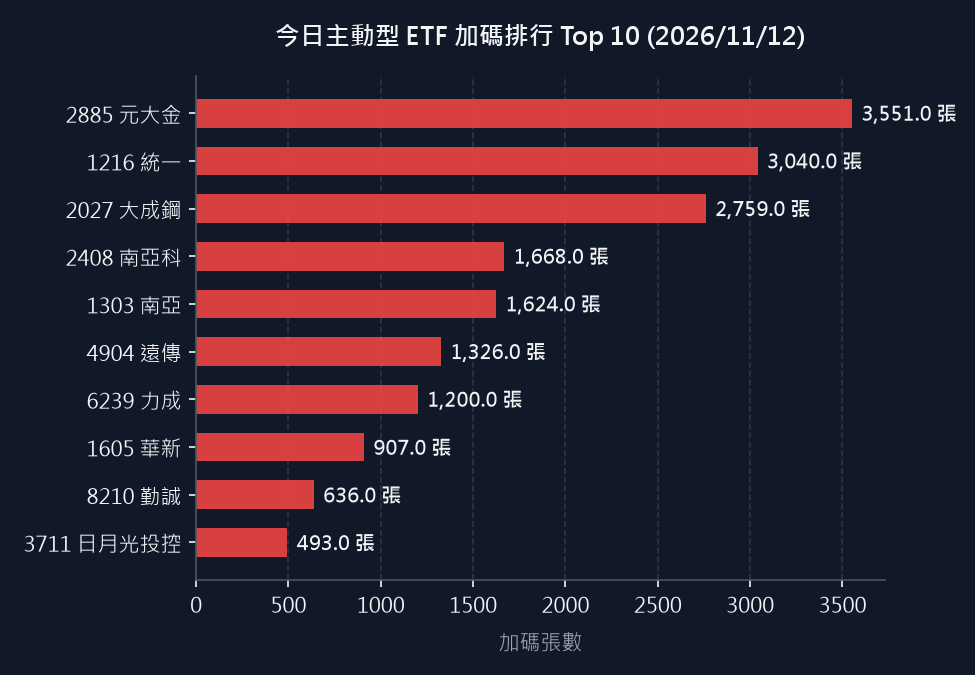
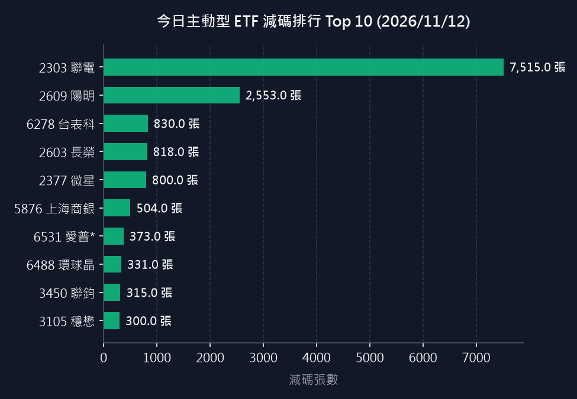

# 主動型 ETF 持股變動

資料來源：`主動型ETF持股明細.xlsx` 最近兩個日期分頁。

比較區間：`20261111` → `20261112`

## 今日加減碼視覺化排行

| 今日加碼 Top 10 | 今日減碼 Top 10 |
| :---: | :---: |
|  |  |

| ETF | 新增 | 刪除 | 比例變動 |
| :-- | --: | --: | --: |
| 00400A | 0 | 0 | 0 |
| 00401A | 0 | 0 | 56 |
| 00402A | 0 | 0 | 46 |
| 00403A | 1 | 1 | 33 |
| 00404A | 1 | 4 | 44 |
| 00405A | 0 | 0 | 26 |
| 00406A | 0 | 4 | 49 |
| 00407A | 0 | 0 | 40 |
| 00408A | 3 | 4 | 36 |
| 00980A | 0 | 0 | 45 |
| 00980D | 0 | 0 | 41 |
| 00981A | 0 | 0 | 31 |
| 00982A | 0 | 0 | 43 |
| 00983A | 0 | 1 | 34 |
| 00983D | 0 | 0 | 0 |
| 00984A | 0 | 0 | 76 |
| 00985A | 0 | 0 | 47 |
| 00986A | 0 | 0 | 27 |
| 00987A | 0 | 0 | 25 |
| 00988A | 0 | 0 | 31 |
| 00989A | 0 | 1 | 52 |
| 00990A | 3 | 4 | 32 |
| 00991A | 0 | 0 | 0 |
| 00992A | 2 | 0 | 38 |
| 00993A | 1 | 0 | 42 |
| 00994A | 3 | 3 | 24 |
| 00995A | 1 | 0 | 44 |
| 00996A | 1 | 2 | 37 |
| 00997A | 0 | 0 | 45 |
| 00998A | 1 | 2 | 43 |
| 00999A | 0 | 0 | 50 |

## 00400A

### 新增持股

- 無

### 刪除持股

- 無

### 投資比例變動

- 無

## 00401A

### 新增持股

- 無

### 刪除持股

- 無

### 投資比例變動

- 1216 統一：0.26% → 0.27%（+0.01）
- 1303 南亞：1.19% → 1.14%（-0.05）
- 1476 儒鴻：1.80% → 1.93%（+0.13）
- 1477 聚陽：0.89% → 0.92%（+0.03）
- 2059 川湖：1.92% → 1.83%（-0.09）
- 2303 聯電：2.37% → 2.36%（-0.01）
- 2308 台達電：1.66% → 1.62%（-0.04）
- 2313 華通：1.11% → 1.16%（+0.05）
- 2317 鴻海：0.52% → 0.53%（+0.01）
- 2327 國巨*：0.45% → 0.44%（-0.01）
- 2330 台積電：20.50% → 21.15%（+0.65）
- 2357 華碩：1.62% → 1.63%（+0.01）
- 2360 致茂：1.49% → 1.58%（+0.09）
- 2379 瑞昱：1.02% → 1.01%（-0.01）
- 2382 廣達：1.81% → 1.73%（-0.08）
- 2383 台光電：0.85% → 0.79%（-0.06）
- 2412 中華電：0.85% → 0.88%（+0.03）
- 2454 聯發科：5.25% → 5.19%（-0.06）
- 2455 全新：1.53% → 1.54%（+0.01）
- 2881 富邦金：1.98% → 2.02%（+0.04）
- 2882 國泰金：0.99% → 1.00%（+0.01）
- 2883 凱基金：1.46% → 1.47%（+0.01）
- 2884 玉山金：1.73% → 1.76%（+0.03）
- 2886 兆豐金：1.36% → 1.39%（+0.03）
- 2887 台新新光金：0.97% → 0.98%（+0.01）
- 2890 永豐金：1.47% → 1.53%（+0.06）
- 2891 中信金：2.24% → 2.32%（+0.08）
- 2912 統一超：0.23% → 0.24%（+0.01）
- 3008 大立光：2.23% → 1.79%（-0.44）
- 3037 欣興：0.92% → 0.52%（-0.40）
- 3131 弘塑：0.49% → 0.48%（-0.01）
- 3231 緯創：1.89% → 1.88%（-0.01）
- 3443 創意：2.26% → 2.31%（+0.05）
- 3491 昇達科：1.54% → 1.60%（+0.06）
- 3653 健策：0.89% → 0.82%（-0.07）
- 3711 日月光投控：4.02% → 3.91%（-0.11）
- 4904 遠傳：0.72% → 0.73%（+0.01）
- 4938 和碩：0.30% → 0.29%（-0.01）
- 4958 臻鼎-KY：1.10% → 1.05%（-0.05）
- 5274 信驊：1.23% → 1.20%（-0.03）
- 5347 世界：1.00% → 0.98%（-0.02）
- 5871 中租-KY：0.13% → 0.12%（-0.01）
- 6187 萬潤：1.48% → 1.42%（-0.06）
- 6223 旺矽：1.51% → 1.60%（+0.09）
- 6285 啟碁：1.04% → 1.02%（-0.02）
- 6531 愛普*：1.21% → 1.14%（-0.07）
- 6669 緯穎：1.39% → 1.33%（-0.06）
- 7769 鴻勁：0.62% → 0.60%（-0.02）
- 7828 創新服務：1.24% → 1.30%（+0.06）
- 7856 漢測：0.77% → 0.79%（+0.02）
- 8464 億豐：0.87% → 0.90%（+0.03）
- TAIWAN TAIE C 16DEC26 40000 TWSE：-0.11% → -0.10%（+0.01）
- TAIWAN TAIE C 18NOV26 40000 TWSE：-0.05% → -0.04%（+0.01）
- 台股期貨11/26(FITXN*1.TF)：-0.36% → -0.54%（-0.18）
- 臺指選擇權11/26 43300 買權：-0.05% → -0.03%（+0.02）
- 臺指選擇權11/26 46500 買權：-0.06% → -0.02%（+0.04）

## 00402A

### 新增持股

- 無

### 刪除持股

- 無

### 投資比例變動

- AAPL.US Apple：9.16% → 9.06%（-0.10）
- ADI.US Analog Devices：2.17% → 2.19%（+0.02）
- AMD.US AMD：6.17% → 6.41%（+0.24）
- AMZN.US Amazon：5.30% → 5.04%（-0.26）
- ANET.US Arista Networks：0.90% → 0.92%（+0.02）
- ARM.US Arm：0.72% → 0.79%（+0.07）
- ASML.US ASML Holding：1.20% → 1.19%（-0.01）
- AVGO.US Broadcom：2.41% → 2.42%（+0.01）
- AXON.US Axon Enterprise：0.48% → 0.49%（+0.01）
- BABA.US Alibaba Group：0.53% → 0.50%（-0.03）
- BKNG.US Booking Holdings：0.59% → 0.58%（-0.01）
- CDNS.US Cadence Design Systems：1.72% → 1.65%（-0.07）
- CIEN.US Ciena：1.00% → 1.05%（+0.05）
- CLS.US Celestica：1.01% → 1.06%（+0.05）
- COHR.US Coherent：1.17% → 1.24%（+0.07）
- CRWD.US CrowdStrike Holdings：1.82% → 1.78%（-0.04）
- FSLY.US Fastly：0.27% → 0.28%（+0.01）
- GOOG.US Alphabet - Class C Capital Stock：3.24% → 3.20%（-0.04）
- GOOGL.US Alphabet - Class A Common Stock：3.25% → 3.21%（-0.04）
- INTC.US Intel：1.01% → 1.05%（+0.04）
- IOT.US Samsara：0.62% → 0.61%（-0.01）
- KLAC.US KLA：1.43% → 1.45%（+0.02）
- LITE.US Lumentum：1.32% → 1.42%（+0.10）
- LRCX.US Lam Research：2.16% → 2.22%（+0.06）
- MDB.US MongoDB：0.40% → 0.39%（-0.01）
- META.US Meta：3.88% → 3.68%（-0.20）
- MRVL.US Marvell：1.19% → 1.26%（+0.07）
- MSFT.US Microsoft：6.17% → 5.84%（-0.33）
- MU.US Micron：5.07% → 5.49%（+0.42）
- NFLX.US Netflix：1.01% → 1.00%（-0.01）
- NVDA.US NVIDIA：7.61% → 7.57%（-0.04）
- PANW.US Palo Alto：2.87% → 2.84%（-0.03）
- PLTR.US Palantir Technologies：2.13% → 2.11%（-0.02）
- SHOP.US Shopify：1.18% → 1.16%（-0.02）
- SIMO.US Silicon Motion：0.43% → 0.45%（+0.02）
- SKHY.US SK hynix：0.79% → 0.84%（+0.05）
- SNOW.US Snowflake：1.36% → 1.34%（-0.02）
- SPCX.US SpaceX：0.81% → 0.76%（-0.05）
- SPOT.US Spotify：0.48% → 0.47%（-0.01）
- STX.US Seagate：0.87% → 0.92%（+0.05）
- TER.US Teradyne：0.62% → 0.65%（+0.03）
- TSM.US TSMC(ADR)：1.58% → 1.60%（+0.02）
- TXN.US Texas Instruments：2.92% → 2.91%（-0.01）
- UBER.US Uber：0.36% → 0.35%（-0.01）
- V.US Visa：1.46% → 1.42%（-0.04）
- WDC.US Western Digital：1.62% → 1.69%（+0.07）

## 00403A

### 新增持股

- 6515 穎崴（0.10%，30 張）

### 刪除持股

- 2344 華邦電（0.00%，1 張）

### 投資比例變動

- 1303 南亞：3.61% → 3.53%（-0.08）
- 1560 中砂：0.47% → 0.46%（-0.01）
- 1717 長興：0.04% → 0.05%（+0.01）
- 2059 川湖：0.69% → 0.67%（-0.02）
- 2313 華通：0.30% → 0.32%（+0.02）
- 2317 鴻海：0.61% → 0.63%（+0.02）
- 2327 國巨*：2.95% → 2.96%（+0.01）
- 2330 台積電：15.61% → 15.93%（+0.32）
- 2345 智邦：1.57% → 1.59%（+0.02）
- 2368 金像電：0.85% → 0.83%（-0.02）
- 2383 台光電：4.27% → 4.07%（-0.20）
- 2408 南亞科：0.87% → 0.88%（+0.01）
- 2449 京元電子：0.73% → 0.71%（-0.02）
- 2454 聯發科：5.77% → 5.97%（+0.20）
- 2882 國泰金：0.45% → 0.46%（+0.01）
- 2883 凱基金：0.11% → 0.12%（+0.01）
- 3008 大立光：1.58% → 1.56%（-0.02）
- 3017 奇鋐：6.01% → 5.73%（-0.28）
- 3037 欣興：4.92% → 4.71%（-0.21）
- 3044 健鼎：0.18% → 0.20%（+0.02）
- 3189 景碩：2.61% → 2.45%（-0.16）
- 3443 創意：4.53% → 4.86%（+0.33）
- 3583 辛耘：0.23% → 0.24%（+0.01）
- 3653 健策：5.07% → 4.76%（-0.31）
- 3665 貿聯-KY：1.82% → 1.83%（+0.01）
- 3711 日月光投控：1.23% → 1.22%（-0.01）
- 5274 信驊：1.79% → 1.78%（-0.01）
- 6223 旺矽：3.29% → 3.57%（+0.28）
- 6274 台燿：1.47% → 1.26%（-0.21）
- 6442 光聖：0.24% → 0.23%（-0.01）
- 6669 緯穎：2.54% → 2.48%（-0.06）
- 8046 南電：2.57% → 2.41%（-0.16）
- 8996 高力：2.17% → 2.21%（+0.04）

## 00404A

### 新增持股

- 台股期貨11/26（19.51%，0.084 張）

### 刪除持股

- 2436 偉詮電（0.48%，324 張）
- 3680 家登（0.29%，25 張）
- 5876 上海商銀（0.70%，504 張）
- 台股期貨11/26(FITXN*1.TF)（19.55%，0.084 張）

### 投資比例變動

- 1303 南亞：0.84% → 0.77%（-0.07）
- 2006 東和鋼鐵：0.66% → 1.10%（+0.44）
- 2303 聯電：1.22% → 1.21%（-0.01）
- 2317 鴻海：0.47% → 0.45%（-0.02）
- 2330 台積電：22.58% → 22.24%（-0.34）
- 2347 聯強：1.58% → 1.53%（-0.05）
- 2357 華碩：1.21% → 1.19%（-0.02）
- 2360 致茂：0.46% → 0.47%（+0.01）
- 2377 微星：0.41% → 0.40%（-0.01）
- 2379 瑞昱：2.05% → 2.03%（-0.02）
- 2382 廣達：0.45% → 0.43%（-0.02）
- 2383 台光電：2.62% → 2.60%（-0.02）
- 2395 研華：1.80% → 1.79%（-0.01）
- 2454 聯發科：6.64% → 6.98%（+0.34）
- 2603 長榮：1.35% → 1.31%（-0.04）
- 2637 慧洋-KY：1.09% → 1.03%（-0.06）
- 2851 中再保：1.02% → 1.01%（-0.01）
- 2882 國泰金：3.07% → 3.16%（+0.09）
- 2885 元大金：3.10% → 3.08%（-0.02）
- 2887 台新新光金：1.77% → 1.75%（-0.02）
- 2890 永豐金：1.12% → 1.10%（-0.02）
- 3014 聯陽：0.56% → 1.16%（+0.60）
- 3017 奇鋐：1.37% → 1.28%（-0.09）
- 3034 聯詠：1.98% → 2.04%（+0.06）
- 3036 文曄：0.53% → 1.05%（+0.52）
- 3293 鈊象：1.83% → 1.77%（-0.06）
- 3443 創意：1.76% → 1.87%（+0.11）
- 3653 健策：0.95% → 0.98%（+0.03）
- 3711 日月光投控：3.43% → 3.38%（-0.05）
- 4961 天鈺：0.19% → 0.56%（+0.37）
- 5274 信驊：2.10% → 2.13%（+0.03）
- 5434 崇越：1.80% → 1.79%（-0.01）
- 5904 寶雅*：0.45% → 0.44%（-0.01）
- 6196 帆宣：1.74% → 1.79%（+0.05）
- 6206 飛捷：0.69% → 0.68%（-0.01）
- 6223 旺矽：0.72% → 0.77%（+0.05）
- 6257 矽格：0.74% → 0.73%（-0.01）
- 6491 晶碩：0.94% → 0.89%（-0.05）
- 6505 台塑化：0.46% → 0.45%（-0.01）
- 6669 緯穎：1.01% → 0.97%（-0.04）
- 6691 洋基工程：1.50% → 1.33%（-0.17）
- 7769 鴻勁：1.15% → 1.14%（-0.01）
- 8016 矽創：1.46% → 1.62%（+0.16）
- 8081 致新：0.73% → 0.72%（-0.01）

## 00405A

### 新增持股

- 無

### 刪除持股

- 無

### 投資比例變動

- 2059 川湖：2.08% → 2.03%（-0.05）
- 2330 台積電：5.57% → 5.70%（+0.13）
- 2345 智邦：4.56% → 4.63%（+0.07）
- 2368 金像電：5.63% → 5.48%（-0.15）
- 2383 台光電：4.54% → 4.34%（-0.20）
- 2395 研華：0.01% → 0.02%（+0.01）
- 2454 聯發科：6.64% → 6.72%（+0.08）
- 3017 奇鋐：1.85% → 1.77%（-0.08）
- 3037 欣興：4.23% → 4.07%（-0.16）
- 3189 景碩：0.18% → 0.17%（-0.01）
- 3443 創意：2.74% → 2.86%（+0.12）
- 3653 健策：7.70% → 7.26%（-0.44）
- 3665 貿聯-KY：5.00% → 5.02%（+0.02）
- 3711 日月光投控：1.48% → 1.47%（-0.01）
- 5274 信驊：5.45% → 5.44%（-0.01）
- 6187 萬潤：0.71% → 0.70%（-0.01）
- 6223 旺矽：6.89% → 7.49%（+0.60）
- 6274 台燿：1.54% → 1.46%（-0.08）
- 6415 矽力*-KY：0.56% → 0.54%（-0.02）
- 6515 穎崴：0.45% → 0.46%（+0.01）
- 6531 愛普*：3.59% → 3.48%（-0.11）
- 6669 緯穎：0.79% → 0.78%（-0.01）
- 6805 富世達：1.67% → 1.69%（+0.02）
- 7769 鴻勁：2.48% → 2.46%（-0.02）
- 8046 南電：6.68% → 6.29%（-0.39）
- 8996 高力：1.39% → 1.42%（+0.03）

## 00406A

### 新增持股

- 無

### 刪除持股

- 3450 聯鈞（0.07%，315 張）
- 3529 力旺（0.11%，75 張）
- 6488 環球晶（0.15%，372 張）
- 7769 鴻勁（0.11%，41 張）

### 投資比例變動

- 1303 南亞：2.35% → 2.49%（+0.14）
- 1815 富喬：0.62% → 0.63%（+0.01）
- 2059 川湖：1.78% → 1.73%（-0.05）
- 2303 聯電：1.21% → 1.23%（+0.02）
- 2317 鴻海：0.21% → 0.22%（+0.01）
- 2330 台積電：9.40% → 9.58%（+0.18）
- 2345 智邦：1.98% → 2.00%（+0.02）
- 2360 致茂：0.57% → 0.58%（+0.01）
- 2368 金像電：2.48% → 2.40%（-0.08）
- 2383 台光電：6.28% → 5.97%（-0.31）
- 2449 京元電子：0.35% → 0.34%（-0.01）
- 2454 聯發科：6.15% → 6.19%（+0.04）
- 2881 富邦金：0.62% → 0.65%（+0.03）
- 2882 國泰金：0.61% → 0.63%（+0.02）
- 2884 玉山金：0.27% → 0.28%（+0.01）
- 2885 元大金：0.50% → 0.69%（+0.19）
- 2886 兆豐金：0.41% → 0.43%（+0.02）
- 2887 台新新光金：0.43% → 0.44%（+0.01）
- 2890 永豐金：0.28% → 0.29%（+0.01）
- 3008 大立光：0.99% → 0.98%（-0.01）
- 3017 奇鋐：5.76% → 5.48%（-0.28）
- 3037 欣興：5.39% → 5.15%（-0.24）
- 3081 聯亞：1.15% → 1.13%（-0.02）
- 3105 穩懋：0.53% → 0.55%（+0.02）
- 3167 大量：0.53% → 0.55%（+0.02）
- 3189 景碩：1.55% → 1.45%（-0.10）
- 3264 欣銓：0.28% → 0.27%（-0.01）
- 3443 創意：2.21% → 2.30%（+0.09）
- 3491 昇達科：0.30% → 0.32%（+0.02）
- 3653 健策：5.02% → 4.71%（-0.31）
- 3661 世芯-KY：0.74% → 0.77%（+0.03）
- 3711 日月光投控：2.16% → 2.14%（-0.02）
- 4958 臻鼎-KY：0.87% → 0.84%（-0.03）
- 5274 信驊：1.21% → 1.22%（+0.01）
- 6147 頎邦：0.62% → 0.63%（+0.01）
- 6213 聯茂：0.37% → 0.34%（-0.03）
- 6223 旺矽：2.97% → 3.22%（+0.25）
- 6274 台燿：1.82% → 1.72%（-0.10）
- 6446 藥華藥：0.57% → 0.61%（+0.04）
- 6510 精測：0.53% → 0.58%（+0.05）
- 6531 愛普*：0.08% → 0.07%（-0.01）
- 6669 緯穎：0.92% → 0.90%（-0.02）
- 6715 嘉基：0.80% → 0.85%（+0.05）
- 6805 富世達：0.95% → 0.96%（+0.01）
- 8046 南電：3.23% → 3.03%（-0.20）
- 8996 高力：0.69% → 0.70%（+0.01）
- 臺指選擇權第二週週五到期契約：-9.33% → -8.96%（+0.37）
- 臺股期貨 202611(FITXN*1.TF)：20.83% → 21.22%（+0.39）
- 臺股期貨 202612(FITXN*1.TF)：2.23% → 2.27%（+0.04）

## 00407A

### 新增持股

- 無

### 刪除持股

- 無

### 投資比例變動

- 1303 南亞：3.65% → 3.58%（-0.07）
- 1560 中砂：0.88% → 0.87%（-0.01）
- 2059 川湖：1.71% → 1.67%（-0.04）
- 2313 華通：0.38% → 0.40%（+0.02）
- 2327 國巨*：1.86% → 1.87%（+0.01）
- 2330 台積電：10.98% → 11.25%（+0.27）
- 2345 智邦：1.39% → 1.41%（+0.02）
- 2360 致茂：0.71% → 0.77%（+0.06）
- 2368 金像電：2.02% → 1.97%（-0.05）
- 2383 台光電：5.99% → 5.73%（-0.26）
- 2408 南亞科：1.36% → 1.37%（+0.01）
- 2451 創見：0.29% → 0.30%（+0.01）
- 2454 聯發科：6.11% → 6.18%（+0.07）
- 2615 萬海：1.00% → 1.02%（+0.02）
- 3008 大立光：1.35% → 1.34%（-0.01）
- 3017 奇鋐：5.57% → 5.33%（-0.24）
- 3034 聯詠：0.71% → 0.72%（+0.01）
- 3037 欣興：5.22% → 5.02%（-0.20）
- 3081 聯亞：1.66% → 1.65%（-0.01）
- 3131 弘塑：0.69% → 0.70%（+0.01）
- 3231 緯創：1.02% → 1.04%（+0.02）
- 3260 威剛：0.26% → 0.27%（+0.01）
- 3293 鈊象：0.65% → 0.67%（+0.02）
- 3406 玉晶光：0.74% → 1.01%（+0.27）
- 3443 創意：4.93% → 5.15%（+0.22）
- 3491 昇達科：0.94% → 1.00%（+0.06）
- 3653 健策：3.53% → 3.34%（-0.19）
- 3665 貿聯-KY：2.79% → 2.80%（+0.01）
- 3711 日月光投控：3.34% → 3.33%（-0.01）
- 4958 臻鼎-KY：0.94% → 0.92%（-0.02）
- 6187 萬潤：1.26% → 1.24%（-0.02）
- 6223 旺矽：2.05% → 2.24%（+0.19）
- 6274 台燿：1.60% → 1.52%（-0.08）
- 6446 藥華藥：0.38% → 0.41%（+0.03）
- 6510 精測：1.42% → 1.55%（+0.13）
- 6531 愛普*：0.28% → 0.27%（-0.01）
- 6669 緯穎：2.20% → 1.37%（-0.83）
- 6805 富世達：1.12% → 1.14%（+0.02）
- 8046 南電：3.21% → 3.03%（-0.18）
- 8996 高力：1.28% → 1.62%（+0.34）

## 00408A

### 新增持股

- 2345 智邦（0.60%，5 張）
- 3105 穩懋（0.65%，16 張）
- 8021 尖點（0.61%，20 張）

### 刪除持股

- 2382 廣達（0.22%，10 張）
- 3045 台灣大（0.61%，63 張）
- 3264 欣銓（0.34%，23 張）
- 7769 鴻勁（0.49%，1.5 張）

### 投資比例變動

- 1303 南亞：4.66% → 4.55%（-0.11）
- 2059 川湖：0.92% → 0.90%（-0.02）
- 2330 台積電：7.67% → 7.80%（+0.13）
- 2344 華邦電：0.41% → 0.40%（-0.01）
- 2368 金像電：5.68% → 5.51%（-0.17）
- 2383 台光電：4.56% → 4.35%（-0.21）
- 2395 研華：1.56% → 1.61%（+0.05）
- 2408 南亞科：1.21% → 1.22%（+0.01）
- 2449 京元電子：0.82% → 0.79%（-0.03）
- 2454 聯發科：5.09% → 5.14%（+0.05）
- 2542 興富發：3.80% → 4.02%（+0.22）
- 2603 長榮：1.70% → 1.44%（-0.26）
- 2880 華南金：1.29% → 1.35%（+0.06）
- 2891 中信金：2.19% → 2.31%（+0.12）
- 3017 奇鋐：3.86% → 3.68%（-0.18）
- 3026 禾伸堂：1.43% → 1.35%（-0.08）
- 3037 欣興：2.66% → 3.29%（+0.63）
- 3044 健鼎：1.21% → 1.30%（+0.09）
- 3081 聯亞：0.50% → 0.49%（-0.01）
- 3189 景碩：2.73% → 2.57%（-0.16）
- 3231 緯創：1.46% → 1.48%（+0.02）
- 3443 創意：0.59% → 1.85%（+1.26）
- 3653 健策：4.58% → 4.31%（-0.27）
- 3661 世芯-KY：0.82% → 1.73%（+0.91）
- 3711 日月光投控：2.73% → 2.71%（-0.02）
- 4904 遠傳：0.97% → 1.02%（+0.05）
- 5434 崇越：2.27% → 2.30%（+0.03）
- 6223 旺矽：1.95% → 2.12%（+0.17）
- 6274 台燿：2.07% → 1.20%（-0.87）
- 6510 精測：1.15% → 1.25%（+0.10）
- 6526 達發：0.33% → 0.32%（-0.01）
- 6669 緯穎：2.37% → 1.20%（-1.17）
- 6805 富世達：2.77% → 2.80%（+0.03）
- 8046 南電：1.62% → 1.53%（-0.09）
- 8996 高力：3.07% → 3.13%（+0.06）
- 9802 鈺齊-KY：0.88% → 0.92%（+0.04）

## 00980A

### 新增持股

- 無

### 刪除持股

- 無

### 投資比例變動

- 1303 南亞：3.87% → 3.79%（-0.08）
- 2059 川湖：4.03% → 3.94%（-0.09）
- 2303 聯電：1.30% → 1.32%（+0.02）
- 2308 台達電：2.87% → 2.88%（+0.01）
- 2317 鴻海：3.46% → 3.59%（+0.13）
- 2330 台積電：9.90% → 10.11%（+0.21）
- 2344 華邦電：1.54% → 1.51%（-0.03）
- 2345 智邦：0.86% → 0.88%（+0.02）
- 2360 致茂：0.83% → 0.90%（+0.07）
- 2368 金像電：1.94% → 1.89%（-0.05）
- 2376 技嘉：1.56% → 1.55%（-0.01）
- 2382 廣達：1.91% → 1.87%（-0.04）
- 2383 台光電：3.78% → 3.60%（-0.18）
- 2408 南亞科：2.22% → 2.24%（+0.02）
- 2454 聯發科：5.80% → 5.86%（+0.06）
- 2884 玉山金：1.35% → 1.40%（+0.05）
- 2891 中信金：1.70% → 1.80%（+0.10）
- 3008 大立光：2.02% → 2.00%（-0.02）
- 3017 奇鋐：2.37% → 2.26%（-0.11）
- 3026 禾伸堂：0.88% → 0.83%（-0.05）
- 3036 文曄：0.96% → 0.95%（-0.01）
- 3037 欣興：2.96% → 2.84%（-0.12）
- 3044 健鼎：1.37% → 1.47%（+0.10）
- 3081 聯亞：1.45% → 1.44%（-0.01）
- 3189 景碩：1.08% → 1.02%（-0.06）
- 3231 緯創：1.69% → 1.72%（+0.03）
- 3264 欣銓：0.71% → 0.69%（-0.02）
- 3293 鈊象：0.47% → 0.48%（+0.01）
- 3443 創意：2.08% → 2.17%（+0.09）
- 3653 健策：3.28% → 3.09%（-0.19）
- 3711 日月光投控：2.24% → 2.22%（-0.02）
- 5274 信驊：1.47% → 1.46%（-0.01）
- 5904 寶雅*：0.72% → 0.73%（+0.01）
- 6213 聯茂：1.13% → 1.07%（-0.06）
- 6223 旺矽：1.20% → 1.31%（+0.11）
- 6274 台燿：1.09% → 1.03%（-0.06）
- 6515 穎崴：1.37% → 1.39%（+0.02）
- 6669 緯穎：1.82% → 1.78%（-0.04）
- 7751 竑騰：0.60% → 0.61%（+0.01）
- 7769 鴻勁：1.78% → 1.77%（-0.01）
- 8046 南電：1.49% → 1.40%（-0.09）
- 8210 勤誠：0.32% → 0.33%（+0.01）
- 8299 群聯：1.05% → 1.04%（-0.01）
- 8996 高力：0.46% → 0.47%（+0.01）
- 台灣證交所加權股價指數(FITXN*1.TF)：4.85% → 4.95%（+0.10）

## 00980D

### 新增持股

- 無

### 刪除持股

- 無

### 投資比例變動

- ASURION LLC/ASURION CO 8.375% 01FEB2034：0.45% → 0.46%（+0.01）
- BAT CAPITAL CORP (REG) 7.079% 02AUG2043：0.34% → 0.33%（-0.01）
- BLACKSTONE PRIVATE CRE 7.300000 % 27NOV2028：0.49% → 0.50%（+0.01）
- CHARTER COMM OPT LLC/CAP (REG) 7.85% 15AUG2056：0.25% → 0.26%（+0.01）
- CHS/COMMUNITY HEALTH SYS SER REGS 10.875000 % 15JAN2032：0.46% → 0.45%（-0.01）
- CHS/COMMUNITY HEALTH SYS SER REGS 9.750000 % 15JAN2034：0.48% → 0.46%（-0.02）
- CONCENTRIX CORP (REG) 6.6% 02AUG2028：0.54% → 0.55%（+0.01）
- CONCENTRIX CORP (REG) 6.85% 02AUG2033：0.75% → 0.76%（+0.01）
- COREWEAVE INC SER REGS (REG S) 9.25% 01JUN2030：0.40% → 0.41%（+0.01）
- COREWEAVE INC SER REGS (REG) (REG S) 9.625% 15JUL2032：0.47% → 0.48%（+0.01）
- COX COMMUNICATIONS INC SER REGS 5.950000 % 01SEP2054：0.53% → 0.54%（+0.01）
- DOW CHEMICAL CO/THE (REG) 5.6% 15FEB2054：0.64% → 0.63%（-0.01）
- ENERGY TRANSFER LP (REG) 7.5% 01JUL2038：0.35% → 0.34%（-0.01）
- GLOBAL AUTO HO/AAG FH UK SER REGS (REG S) 11.5% 15AUG2029：0.38% → 0.39%（+0.01）
- HAH GROUP HOLDING CO LLC SER REGS (REG S) 9.75% 01OCT2031：0.52% → 0.53%（+0.01）
- HERTZ CORP/THE SER REGS (REG S) 12.625% 15JUL2029：0.26% → 0.25%（-0.01）
- ICAHN ENTERPRISES/FIN (REG) 9.75% 15JAN2029：0.32% → 0.31%（-0.01）
- ICAHN ENTERPRISES/FIN SER REGS 10.000000 % 15NOV2029：0.31% → 0.30%（-0.01）
- JBS USA/FOOD/FINANCE (REG) 6.5% 01DEC2052：0.48% → 0.47%（-0.01）
- JETBLUE AIRWAYS/LOYALTY SER REGS (REG S) 9.875% 20SEP2031：0.38% → 0.39%（+0.01）
- KELLANOVA SER B (REG) 7.450000 % 01APR2031：0.59% → 0.60%（+0.01）
- MOBIUS MERGER SUB SER REGS 9.000000 % 01JUN2030：0.27% → 0.28%（+0.01）
- MPLX LP 6.200000 % 15SEP2055：0.36% → 0.35%（-0.01）
- MYLAN INC (REG) 5.4% 29/11/2043：0.36% → 0.35%（-0.01）
- NATIONWIDE MUTUAL INSUR 9.375% 15AUG2039：0.55% → 0.54%（-0.01）
- NAVIENT CORP (REG) 11.5% 15MAR2031：0.42% → 0.41%（-0.01）
- NISSAN MOTOR CO SER REGS 8.125000 % 17JUL2035：0.52% → 0.53%（+0.01）
- OCCIDENTAL PETROLEUM COR 8.875% 15JUL2030：0.58% → 0.59%（+0.01）
- ORACLE CORP 6.85 % 04-FEB-2066：0.55% → 0.54%（-0.01）
- RIO TINTO FIN USA LTD (REG) 7.125% 15JUL2028：0.59% → 0.60%（+0.01）
- SALESFORCE INC (REG) 6.55% 15MAR2056：0.57% → 0.56%（-0.01）
- SALESFORCE INC (REG) 6.7% 15MAR2066：0.56% → 0.55%（-0.01）
- TOUCAN FINCO LTD/CAN/US SER REGS 9.500000 % 15MAY2030：0.26% → 0.27%（+0.01）
- TRANSCANADA PIPELINES LTD 7.625PCT 15/01/2039：0.56% → 0.55%（-0.01）
- US 10YR NOTE (CBT)DEC26 21-DEC-2026：18.67% → 18.47%（-0.20）
- US 10YR ULTRA FUT DEC26 21-DEC-2026：-2.39% → -2.57%（-0.18）
- US 2YR NOTE (CBT) DEC26 31-DEC-2026：1.73% → 1.74%（+0.01）
- US 5YR NOTE (CBT) DEC26 31-DEC-2026：-15.85% → -15.86%（-0.01）
- US ACUTE CARE SOLUTIONS SER REGS (REG S) 9.75% 15MAY2029：0.34% → 0.33%（-0.01）
- US LONG BOND(CBT) DEC26 21-DEC-2026：5.70% → 5.67%（-0.03）
- WESTLAKE CORP 6.375000 % 15-NOV-2055：0.55% → 0.54%（-0.01）

## 00981A

### 新增持股

- 無

### 刪除持股

- 無

### 投資比例變動

- 1802 台玻：0.26% → 0.29%（+0.03）
- 2002 中鋼：0.03% → 0.04%（+0.01）
- 2303 聯電：2.93% → 2.80%（-0.13）
- 2308 台達電：3.47% → 3.49%（+0.02）
- 2313 華通：0.03% → 0.04%（+0.01）
- 2317 鴻海：0.40% → 0.41%（+0.01）
- 2327 國巨*：3.53% → 3.55%（+0.02）
- 2330 台積電：15.78% → 16.18%（+0.40）
- 2345 智邦：3.95% → 4.01%（+0.06）
- 2368 金像電：2.99% → 2.91%（-0.08）
- 2383 台光電：6.88% → 6.59%（-0.29）
- 2449 京元電子：0.63% → 0.62%（-0.01）
- 2454 聯發科：8.06% → 8.16%（+0.10）
- 2891 中信金：0.14% → 0.15%（+0.01）
- 3017 奇鋐：7.48% → 7.17%（-0.31）
- 3037 欣興：6.03% → 5.80%（-0.23）
- 3231 緯創：0.74% → 0.75%（+0.01）
- 3443 創意：2.83% → 2.96%（+0.13）
- 3653 健策：5.62% → 5.31%（-0.31）
- 3665 貿聯-KY：1.61% → 1.72%（+0.11）
- 3711 日月光投控：3.82% → 3.81%（-0.01）
- 6223 旺矽：3.97% → 4.59%（+0.62）
- 6271 同欣電：0.20% → 0.23%（+0.03）
- 6274 台燿：2.75% → 2.60%（-0.15）
- 6278 台表科：0.07% → 0.00%（-0.07）
- 6510 精測：0.51% → 0.56%（+0.05）
- 6669 緯穎：1.40% → 1.38%（-0.02）
- 6805 富世達：1.21% → 1.23%（+0.02）
- 8046 南電：3.43% → 3.24%（-0.19）
- 8996 高力：0.51% → 0.52%（+0.01）
- 台指期貨 2026/11(FITXN*1.TF)：2.71% → 2.78%（+0.07）

## 00982A

### 新增持股

- 無

### 刪除持股

- 無

### 投資比例變動

- 2059 川湖：2.69% → 2.60%（-0.09）
- 2301 光寶科：1.72% → 1.70%（-0.02）
- 2303 聯電：1.22% → 1.23%（+0.01）
- 2330 台積電：8.29% → 8.40%（+0.11）
- 2360 致茂：2.98% → 3.20%（+0.22）
- 2376 技嘉：1.21% → 1.19%（-0.02）
- 2383 台光電：3.18% → 3.00%（-0.18）
- 2395 研華：1.33% → 1.36%（+0.03）
- 2428 興勤：1.00% → 0.98%（-0.02）
- 2455 全新：1.34% → 1.36%（+0.02）
- 2476 鉅祥：0.31% → 0.32%（+0.01）
- 2486 一詮：0.41% → 0.40%（-0.01）
- 2885 元大金：0.34% → 0.35%（+0.01）
- 3008 大立光：3.03% → 2.98%（-0.05）
- 3017 奇鋐：2.55% → 2.41%（-0.14）
- 3037 欣興：0.74% → 0.71%（-0.03）
- 3045 台灣大：0.79% → 0.83%（+0.04）
- 3090 日電貿：0.36% → 0.35%（-0.01）
- 3105 穩懋：7.92% → 8.14%（+0.22）
- 3231 緯創：1.88% → 1.90%（+0.02）
- 3265 台星科：1.27% → 1.22%（-0.05）
- 3491 昇達科：3.64% → 3.83%（+0.19）
- 3617 碩天：0.38% → 0.39%（+0.01）
- 3711 日月光投控：1.86% → 2.48%（+0.62）
- 4958 臻鼎-KY：3.13% → 3.03%（-0.10）
- 5274 信驊：1.35% → 1.33%（-0.02）
- 5483 中美晶：1.25% → 1.30%（+0.05）
- 5536 聖暉*：0.90% → 0.92%（+0.02）
- 6139 亞翔：5.32% → 5.29%（-0.03）
- 6196 帆宣：0.30% → 0.28%（-0.02）
- 6213 聯茂：1.56% → 1.46%（-0.10）
- 6223 旺矽：2.90% → 3.12%（+0.22）
- 6239 力成：1.26% → 1.94%（+0.68）
- 6274 台燿：1.03% → 0.96%（-0.07）
- 6446 藥華藥：0.12% → 0.13%（+0.01）
- 6472 保瑞：0.92% → 0.94%（+0.02）
- 6488 環球晶：1.58% → 1.60%（+0.02）
- 6510 精測：0.99% → 1.07%（+0.08）
- 6531 愛普*：7.32% → 7.00%（-0.32）
- 6669 緯穎：1.83% → 1.77%（-0.06）
- 6672 騰輝電子-KY：2.61% → 2.56%（-0.05）
- 8070 長華*：0.68% → 0.69%（+0.01）
- 8996 高力：1.20% → 1.21%（+0.01）

## 00983A

### 新增持股

- 無

### 刪除持股

- CERS.US Cerus（0.01%，1.209 張）

### 投資比例變動

- AMD.US AMD：3.41% → 3.63%（+0.22）
- AMZN.US Amazon：4.50% → 4.37%（-0.13）
- AVGO.US Broadcom：1.15% → 1.18%（+0.03）
- BEAM.US Beam Therapeutics：2.62% → 2.66%（+0.04）
- BLSH.US Bullish：1.12% → 1.18%（+0.06）
- BMNR.US BitMine：1.17% → 1.23%（+0.06）
- COIN.US Coinbase：2.79% → 2.66%（-0.13）
- CRCL.US Circle：3.41% → 3.37%（-0.04）
- CRSP.US CRISPR Therapeutics：3.66% → 3.68%（+0.02）
- GOOG.US Alphabet - Class C Capital Stock：2.77% → 2.80%（+0.03）
- GOOGL.US Alphabet - Class A Common Stock：1.57% → 1.59%（+0.02）
- HOOD.US Robinhood Markets：2.48% → 2.55%（+0.07）
- ILMN.US Illumina：1.54% → 1.51%（-0.03）
- LLY.US Eli Lilly：2.02% → 2.01%（-0.01）
- META.US Meta：3.39% → 3.29%（-0.10）
- MSFT.US Microsoft：1.73% → 1.83%（+0.10）
- NET.US Cloudflare：1.55% → 1.58%（+0.03）
- NTLA.US Intellia Therapeutics：1.84% → 1.86%（+0.02）
- NTRA.US Natera：1.41% → 1.43%（+0.02）
- NVDA.US NVIDIA：3.18% → 3.24%（+0.06）
- PACB.US Pacific Biosciences of Californi：0.07% → 0.06%（-0.01）
- PLTR.US Palantir Technologies：3.13% → 3.16%（+0.03）
- RKLB.US Rocket Lab：1.56% → 1.63%（+0.07）
- SHOP.US Shopify：4.77% → 4.80%（+0.03）
- SNOW.US Snowflake：0.55% → 0.56%（+0.01）
- SPCX.US SpaceX：7.83% → 7.72%（-0.11）
- TEM.US Tempus：7.02% → 6.85%（-0.17）
- TER.US Teradyne：0.06% → 0.07%（+0.01）
- TSLA.US Tesla：8.68% → 8.85%（+0.17）
- TSM.US TSMC(ADR)：2.76% → 2.84%（+0.08）
- TWST.US Twist Bioscience：3.69% → 3.39%（-0.30）
- TXG.US 10x Genomics：3.12% → 3.05%（-0.07）
- WGS.US GeneDx：0.45% → 0.44%（-0.01）
- XYZ.US Block：2.19% → 2.17%（-0.02）

## 00983D

### 新增持股

- 無

### 刪除持股

- 無

### 投資比例變動

- 無

## 00984A

### 新增持股

- 無

### 刪除持股

- 無

### 投資比例變動

- 1216 統一：0.60% → 0.63%（+0.03）
- 1301 台塑：0.83% → 0.84%（+0.01）
- 1303 南亞：3.56% → 3.45%（-0.11）
- 1326 台化：2.46% → 2.47%（+0.01）
- 1560 中砂：1.82% → 1.79%（-0.03）
- 1709 和益：0.93% → 1.00%（+0.07）
- 2006 東和鋼鐵：0.61% → 0.63%（+0.02）
- 2027 大成鋼：0.86% → 0.87%（+0.01）
- 2059 川湖：2.59% → 2.50%（-0.09）
- 2301 光寶科：0.85% → 0.84%（-0.01）
- 2313 華通：0.66% → 0.70%（+0.04）
- 2317 鴻海：0.05% → 0.06%（+0.01）
- 2330 台積電：2.28% → 2.30%（+0.02）
- 2351 順德：0.74% → 0.72%（-0.02）
- 2357 華碩：0.85% → 0.87%（+0.02）
- 2383 台光電：0.18% → 0.17%（-0.01）
- 2395 研華：2.18% → 2.23%（+0.05）
- 2408 南亞科：2.42% → 2.41%（-0.01）
- 2409 友達：0.83% → 0.88%（+0.05）
- 2412 中華電：0.89% → 0.93%（+0.04）
- 2449 京元電子：0.47% → 0.45%（-0.02）
- 2455 全新：1.08% → 1.10%（+0.02）
- 2464 盟立：0.87% → 0.85%（-0.02）
- 2466 冠西電：0.34% → 0.39%（+0.05）
- 2603 長榮：2.54% → 2.57%（+0.03）
- 2618 長榮航：0.64% → 0.66%（+0.02）
- 2634 漢翔：0.60% → 0.62%（+0.02）
- 2637 慧洋-KY：0.59% → 0.60%（+0.01）
- 2801 彰銀：0.60% → 0.62%（+0.02）
- 2880 華南金：0.61% → 0.63%（+0.02）
- 2881 富邦金：1.48% → 1.53%（+0.05）
- 2882 國泰金：1.40% → 1.44%（+0.04）
- 2883 凱基金：0.62% → 0.63%（+0.01）
- 2884 玉山金：0.60% → 0.62%（+0.02）
- 2885 元大金：1.27% → 1.32%（+0.05）
- 2886 兆豐金：0.61% → 0.64%（+0.03）
- 2887 台新新光金：1.35% → 1.37%（+0.02）
- 2890 永豐金：0.61% → 0.63%（+0.02）
- 2892 第一金：0.61% → 0.64%（+0.03）
- 3008 大立光：2.18% → 2.14%（-0.04）
- 3017 奇鋐：3.68% → 3.47%（-0.21）
- 3037 欣興：1.62% → 1.53%（-0.09）
- 3044 健鼎：0.87% → 0.92%（+0.05）
- 3045 台灣大：1.42% → 1.48%（+0.06）
- 3189 景碩：1.93% → 1.80%（-0.13）
- 3264 欣銓：1.64% → 1.59%（-0.05）
- 3265 台星科：0.75% → 0.72%（-0.03）
- 3406 玉晶光：1.59% → 1.62%（+0.03）
- 3443 創意：2.82% → 2.91%（+0.09）
- 3450 聯鈞：0.26% → 0.25%（-0.01）
- 3605 宏致：0.75% → 0.73%（-0.02）
- 3653 健策：1.46% → 1.36%（-0.10）
- 3702 大聯大：0.73% → 0.71%（-0.02）
- 3711 日月光投控：2.28% → 2.24%（-0.04）
- 4958 臻鼎-KY：0.60% → 0.58%（-0.02）
- 4967 十銓：0.83% → 0.84%（+0.01）
- 5274 信驊：0.41% → 0.40%（-0.01）
- 5351 鈺創：0.80% → 0.79%（-0.01）
- 5434 崇越：1.47% → 1.48%（+0.01）
- 5876 上海商銀：0.60% → 0.63%（+0.03）
- 6187 萬潤：1.68% → 1.63%（-0.05）
- 6196 帆宣：1.38% → 1.32%（-0.06）
- 6197 佳必琪：0.71% → 0.69%（-0.02）
- 6213 聯茂：0.57% → 0.53%（-0.04）
- 6214 精誠：0.85% → 0.87%（+0.02）
- 6274 台燿：0.46% → 0.42%（-0.04）
- 6415 矽力*-KY：0.76% → 0.73%（-0.03）
- 6446 藥華藥：1.44% → 1.52%（+0.08）
- 6505 台塑化：3.34% → 3.42%（+0.08）
- 6669 緯穎：0.94% → 0.91%（-0.03）
- 6670 復盛應用：0.51% → 0.53%（+0.02）
- 6672 騰輝電子-KY：0.85% → 0.84%（-0.01）
- 6691 洋基工程：0.79% → 0.78%（-0.01）
- 6770 力積電：0.76% → 0.75%（-0.01）
- 6957 裕慶-KY：0.89% → 0.87%（-0.02）
- 8039 台虹：0.82% → 0.81%（-0.01）

## 00985A

### 新增持股

- 無

### 刪除持股

- 無

### 投資比例變動

- 1216 統一：0.47% → 1.38%（+0.91）
- 1301 台塑：0.43% → 0.44%（+0.01）
- 1402 遠東新：0.29% → 0.30%（+0.01）
- 1605 華新：1.34% → 1.47%（+0.13）
- 2027 大成鋼：2.46% → 3.02%（+0.56）
- 2059 川湖：2.97% → 2.16%（-0.81）
- 2303 聯電：1.99% → 0.99%（-1.00）
- 2308 台達電：2.76% → 2.75%（-0.01）
- 2317 鴻海：1.93% → 1.99%（+0.06）
- 2327 國巨*：1.80% → 1.79%（-0.01）
- 2330 台積電：14.80% → 15.04%（+0.24）
- 2344 華邦電：1.46% → 1.42%（-0.04）
- 2345 智邦：2.39% → 2.50%（+0.11）
- 2368 金像電：2.04% → 1.97%（-0.07）
- 2376 技嘉：2.29% → 2.26%（-0.03）
- 2377 微星：0.82% → 0.41%（-0.41）
- 2383 台光電：3.53% → 2.68%（-0.85）
- 2408 南亞科：1.17% → 1.70%（+0.53）
- 2412 中華電：0.48% → 0.50%（+0.02）
- 2454 聯發科：1.80% → 1.81%（+0.01）
- 2603 長榮：1.83% → 1.23%（-0.60）
- 2609 陽明：1.75% → 1.24%（-0.51）
- 2610 華航：0.51% → 0.52%（+0.01）
- 3008 大立光：1.60% → 1.58%（-0.02）
- 3017 奇鋐：1.34% → 1.27%（-0.07）
- 3036 文曄：3.25% → 3.19%（-0.06）
- 3037 欣興：2.29% → 2.18%（-0.11）
- 3081 聯亞：2.07% → 2.04%（-0.03）
- 3105 穩懋：1.12% → 0.51%（-0.61）
- 3189 景碩：0.80% → 0.75%（-0.05）
- 3231 緯創：0.96% → 0.97%（+0.01）
- 3491 昇達科：1.07% → 0.21%（-0.86）
- 3653 健策：3.74% → 2.67%（-1.07）
- 3661 世芯-KY：1.02% → 1.22%（+0.20）
- 3665 貿聯-KY：1.46% → 1.51%（+0.05）
- 3711 日月光投控：1.55% → 1.54%（-0.01）
- 4904 遠傳：0.49% → 1.04%（+0.55）
- 6442 光聖：1.38% → 1.35%（-0.03）
- 6446 藥華藥：2.20% → 2.34%（+0.14）
- 6488 環球晶：1.36% → 1.48%（+0.12）
- 6526 達發：0.82% → 0.80%（-0.02）
- 6531 愛普*：1.75% → 0.75%（-1.00）
- 6669 緯穎：3.16% → 3.08%（-0.08）
- 7750 新代：1.56% → 1.51%（-0.05）
- 7769 鴻勁：2.79% → 2.75%（-0.04）
- 8046 南電：1.63% → 1.52%（-0.11）
- 台積電期貨(FICDFN*1.TF)：1.62% → 1.65%（+0.03）

## 00986A

### 新增持股

- 無

### 刪除持股

- 無

### 投資比例變動

- 2330 台積電：8.64% → 8.82%（+0.18）
- 2454 聯發科：1.61% → 1.63%（+0.02）
- AAPL.US Apple：3.02% → 2.99%（-0.03）
- AMD.US AMD：5.00% → 5.21%（+0.21）
- AMZN.US Amazon：5.25% → 5.02%（-0.23）
- AVGO.US Broadcom：4.14% → 4.18%（+0.04）
- BE.US Bloom Energy：2.18% → 2.40%（+0.22）
- CRWD.US CrowdStrike Holdings：4.69% → 4.62%（-0.07）
- ETN.US Eaton：2.45% → 2.43%（-0.02）
- GEV.US GE Vernova：2.76% → 2.72%（-0.04）
- GOOGL.US Alphabet - Class A Common Stock：5.97% → 5.92%（-0.05）
- GS.US Goldman Sachs：1.26% → 1.25%（-0.01）
- JPM.US JPMorgan Chase：2.61% → 2.54%（-0.07）
- LITE.US Lumentum：3.16% → 3.40%（+0.24）
- LLY.US Eli Lilly：4.46% → 4.35%（-0.11）
- MA.US Mastercard：1.60% → 1.56%（-0.04）
- MSFT.US Microsoft：4.43% → 4.21%（-0.22）
- MU.US Micron：4.02% → 4.37%（+0.35）
- MUFG(8306.JP)：1.20% → 1.19%（-0.01）
- PLTR.US Palantir Technologies：1.64% → 1.62%（-0.02）
- RBRK.US Rubrik：0.98% → 0.96%（-0.02）
- SKHY.US SK hynix：0.90% → 0.96%（+0.06）
- SNOW.US Snowflake：2.25% → 2.23%（-0.02）
- 嘉能可公司：1.88% → 1.85%（-0.03）
- 施奈德電機公司：1.65% → 1.64%（-0.01）
- 艾司摩爾控股公司：2.12% → 2.11%（-0.01）
- 英飛凌科技股份有限公司：1.14% → 1.17%（+0.03）

## 00987A

### 新增持股

- 無

### 刪除持股

- 無

### 投資比例變動

- 1815 富喬：3.65% → 3.78%（+0.13）
- 2330 台積電：9.65% → 10.01%（+0.36）
- 2368 金像電：2.82% → 2.78%（-0.04）
- 2383 台光電：5.84% → 5.66%（-0.18）
- 2454 聯發科：4.82% → 4.94%（+0.12）
- 2455 全新：1.98% → 2.06%（+0.08）
- 3008 大立光：3.57% → 3.61%（+0.04）
- 3017 奇鋐：7.07% → 6.86%（-0.21）
- 3037 欣興：4.48% → 4.37%（-0.11）
- 3081 聯亞：2.95% → 2.98%（+0.03）
- 3363 上詮：1.70% → 1.69%（-0.01）
- 3443 創意：6.00% → 6.35%（+0.35）
- 3491 昇達科：3.34% → 3.60%（+0.26）
- 3653 健策：5.01% → 4.80%（-0.21）
- 3665 貿聯-KY：3.11% → 3.17%（+0.06）
- 4958 臻鼎-KY：2.06% → 2.04%（-0.02）
- 4991 環宇-KY：2.59% → 2.67%（+0.08）
- 6223 旺矽：1.00% → 1.11%（+0.11）
- 6274 台燿：3.56% → 3.41%（-0.15）
- 6510 精測：3.42% → 3.80%（+0.38）
- 6515 穎崴：2.20% → 2.27%（+0.07）
- 6805 富世達：3.30% → 3.39%（+0.09）
- 8046 南電：3.09% → 2.96%（-0.13）
- 8358 金居：3.13% → 3.15%（+0.02）
- 8996 高力：2.81% → 2.91%（+0.10）

## 00988A

### 新增持股

- 無

### 刪除持股

- 無

### 投資比例變動

- 1303 南亞：2.06% → 2.63%（+0.57）
- 2330 台積電：2.76% → 2.80%（+0.04）
- 2383 台光電：2.75% → 2.74%（-0.01）
- 2454 聯發科：0.77% → 0.78%（+0.01）
- 3017 奇鋐：4.22% → 4.45%（+0.23）
- 3037 欣興：5.42% → 5.47%（+0.05）
- 3443 創意：4.14% → 4.40%（+0.26）
- 3711 日月光投控：1.94% → 1.91%（-0.03）
- 6223 旺矽：1.13% → 1.20%（+0.07）
- AAPL.US Apple：5.21% → 5.13%（-0.08）
- AMD.US AMD：5.99% → 6.65%（+0.66）
- AMZN.US Amazon：2.92% → 3.20%（+0.28）
- BE.US Bloom Energy：6.93% → 7.56%（+0.63）
- CRWD.US CrowdStrike Holdings：4.14% → 4.05%（-0.09）
- INFINEON TECHNOLOGIES AG：1.03% → 0.47%（-0.56）
- META.US Meta：1.33% → 1.26%（-0.07）
- MRNA.US Moderna：0.62% → 0.60%（-0.02）
- MSFT.US Microsoft：7.08% → 6.68%（-0.40）
- MU.US Micron：0.91% → 0.98%（+0.07）
- NET.US Cloudflare：2.08% → 2.53%（+0.45）
- NTSK.US Netskope：1.42% → 1.43%（+0.01）
- NVDA.US NVIDIA：4.26% → 2.79%（-1.47）
- OKTA.US Okta：2.96% → 2.92%（-0.04）
- PANW.US Palo Alto：4.07% → 4.02%（-0.05）
- PLTR.US Palantir Technologies：4.91% → 4.84%（-0.07）
- SHIFT(3697.JP)：0.48% → 0.45%（-0.03）
- SNOW.US Snowflake：2.46% → 2.41%（-0.05）
- SPCX.US SpaceX：6.54% → 6.50%（-0.04）
- Samsung Elec Mech(009150.KS)：2.19% → 2.22%（+0.03）
- TWLO.US Twilio：1.07% → 1.06%（-0.01）
- ZS.US Zscaler：1.62% → 1.56%（-0.06）

## 00989A

### 新增持股

- 無

### 刪除持股

- VICR.US Vicor Corporation（0.29%，0.532 張）

### 投資比例變動

- ACN.US Accenture：1.41% → 1.35%（-0.06）
- ADBE.US Adobe：1.36% → 1.33%（-0.03）
- ADI.US Analog Devices：1.25% → 1.27%（+0.02）
- ALAB.US Astera Labs：0.71% → 0.74%（+0.03）
- AMD.US AMD：3.70% → 3.88%（+0.18）
- AMZN.US Amazon：2.25% → 2.16%（-0.09）
- ASML.US ASML Holding：2.21% → 2.20%（-0.01）
- AVGO.US Broadcom：3.67% → 3.32%（-0.35）
- CDNS.US Cadence Design Systems：1.04% → 1.00%（-0.04）
- CIEN.US Ciena：0.81% → 0.86%（+0.05）
- CRDO.US Credo：0.69% → 0.73%（+0.04）
- CRM.US Salesforce：3.20% → 3.19%（-0.01）
- CRWD.US CrowdStrike Holdings：3.61% → 3.58%（-0.03）
- DDOG.US Datadog：0.91% → 0.92%（+0.01）
- ENTG.US Entegris：0.51% → 0.55%（+0.04）
- ESTC.US Elastic：0.82% → 0.80%（-0.02）
- GENB.US Generate Biomedicines：0.11% → 0.10%（-0.01）
- GOOG.US Alphabet - Class C Capital Stock：2.19% → 2.18%（-0.01）
- GWRE.US Guidewire Software：0.70% → 0.69%（-0.01）
- HOOD.US Robinhood Markets：1.57% → 1.60%（+0.03）
- HUBS.US HubSpot：1.75% → 1.76%（+0.01）
- ILMN.US Illumina：1.07% → 1.04%（-0.03）
- INTC.US Intel：1.55% → 1.62%（+0.07）
- LITE.US Lumentum：1.03% → 1.11%（+0.08）
- LRCX.US Lam Research：1.98% → 2.05%（+0.07）
- META.US Meta：4.45% → 4.26%（-0.19）
- MPWR.US Monolithic Power Systems：1.60% → 1.70%（+0.10）
- MSFT.US Microsoft：3.68% → 3.51%（-0.17）
- MTSI.US MACOM Technology Solutions：0.59% → 0.63%（+0.04）
- MU.US Micron：0.51% → 0.56%（+0.05）
- NET.US Cloudflare：3.05% → 3.06%（+0.01）
- NVDA.US NVIDIA：3.88% → 3.90%（+0.02）
- RIVN.US Rivian：1.32% → 1.28%（-0.04）
- ROK.US Rockwell Automation：0.86% → 0.85%（-0.01）
- SHOP.US Shopify：3.05% → 3.04%（-0.01）
- SNDK.US Sandisk：0.34% → 0.38%（+0.04）
- SNOW.US Snowflake：2.91% → 2.89%（-0.02）
- SPCX.US SpaceX：0.91% → 0.87%（-0.04）
- SWKS.US Skyworks Solutions：0.35% → 0.37%（+0.02）
- SYM.US Symbotic：0.49% → 0.48%（-0.01）
- TEM.US Tempus：1.45% → 1.39%（-0.06）
- TSLA.US Tesla：3.02% → 3.04%（+0.02）
- TSM.US TSMC(ADR)：0.98% → 1.00%（+0.02）
- TTWO.US Take-Two：3.53% → 3.55%（+0.02）
- TWST.US Twist Bioscience：0.51% → 0.46%（-0.05）
- TXG.US 10x Genomics：0.73% → 0.70%（-0.03）
- TXN.US Texas Instruments：1.78% → 1.79%（+0.01）
- U.US Unity Software：1.56% → 1.50%（-0.06）
- VEEV.US Veeva Systems：1.10% → 1.07%（-0.03）
- WRBY.US Warby Parker：0.93% → 0.92%（-0.01）
- XYZ.US Block：0.63% → 0.61%（-0.02）
- ZM.US Zoom：1.76% → 1.85%（+0.09）

## 00990A

### 新增持股

- 2308 台達電（0.73%，171 張）
- HPE.US HP Enterprise（0.51%，94.2 張）
- SMTC.US Semtech（0.92%，68.308 張）

### 刪除持股

- AAPL.US Apple（2.15%，55.64 張）
- AEM.US Agnico Eagle Mines（1.06%，50.4 張）
- RPRX.US Royalty Pharma（1.13%，147.4 張）
- THC.US Tenet Healthcare（0.51%，15.8 張）

### 投資比例變動

- 2330 台積電：3.12% → 3.68%（+0.56）
- 2368 金像電：1.22% → 1.33%（+0.11）
- 2383 台光電：1.97% → 1.98%（+0.01）
- 2454 聯發科：2.13% → 2.24%（+0.11）
- 3017 奇鋐：1.48% → 1.61%（+0.13）
- 3037 欣興：1.86% → 1.89%（+0.03）
- 3443 創意：2.63% → 2.82%（+0.19）
- 8046 南電：0.58% → 0.60%（+0.02）
- AMD.US AMD：5.74% → 6.01%（+0.27）
- AMZN.US Amazon：4.55% → 4.36%（-0.19）
- ANET.US Arista Networks：1.13% → 2.20%（+1.07）
- AVGO.US Broadcom：1.58% → 3.63%（+2.05）
- BE.US Bloom Energy：5.15% → 5.77%（+0.62）
- CRWD.US CrowdStrike Holdings：2.81% → 2.78%（-0.03）
- FROG.US JFrog：0.67% → 0.69%（+0.02）
- GE.US GE Aerospace：2.83% → 2.80%（-0.03）
- GOOGL.US Alphabet - Class A Common Stock：4.18% → 3.17%（-1.01）
- HWM.US Howmet Aerospace：1.58% → 1.57%（-0.01）
- LLY.US Eli Lilly：2.56% → 2.51%（-0.05）
- META.US Meta：4.58% → 4.38%（-0.20）
- MSFT.US Microsoft：7.44% → 5.66%（-1.78）
- MU.US Micron：1.80% → 1.96%（+0.16）
- NET.US Cloudflare：2.18% → 2.69%（+0.51）
- NVDA.US NVIDIA：5.25% → 5.26%（+0.01）
- PLTR.US Palantir Technologies：4.98% → 4.96%（-0.02）
- Recruit Holdings(6098.JP)：2.19% → 2.09%（-0.10）
- SHOP.US Shopify：3.31% → 3.29%（-0.02）
- SNOW.US Snowflake：2.78% → 2.76%（-0.02）
- SPCX.US SpaceX：3.49% → 3.79%（+0.30）
- TOHO(9602.JP)：0.20% → 0.19%（-0.01）
- TSLA.US Tesla：1.36% → 1.37%（+0.01）
- ZS.US Zscaler：1.14% → 1.11%（-0.03）

## 00991A

### 新增持股

- 無

### 刪除持股

- 無

### 投資比例變動

- 無

## 00992A

### 新增持股

- 2408 南亞科（1.11%，1296 張）
- 8210 勤誠（0.88%，650 張）

### 刪除持股

- 無

### 投資比例變動

- 1303 南亞：3.51% → 3.46%（-0.05）
- 1815 富喬：3.79% → 3.89%（+0.10）
- 2059 川湖：4.07% → 4.00%（-0.07）
- 2301 光寶科：0.35% → 0.36%（+0.01）
- 2308 台達電：0.97% → 0.98%（+0.01）
- 2330 台積電：6.38% → 6.56%（+0.18）
- 2345 智邦：4.56% → 4.65%（+0.09）
- 2357 華碩：0.40% → 0.41%（+0.01）
- 2360 致茂：1.21% → 1.32%（+0.11）
- 2368 金像電：2.64% → 2.58%（-0.06）
- 2383 台光電：5.87% → 5.63%（-0.24）
- 2404 漢唐：0.35% → 0.36%（+0.01）
- 2454 聯發科：3.15% → 3.19%（+0.04）
- 3008 大立光：3.68% → 3.67%（-0.01）
- 3017 奇鋐：5.98% → 5.75%（-0.23）
- 3026 禾伸堂：0.68% → 0.64%（-0.04）
- 3037 欣興：5.60% → 5.40%（-0.20）
- 3189 景碩：2.11% → 2.00%（-0.11）
- 3231 緯創：1.66% → 1.70%（+0.04）
- 3443 創意：4.25% → 4.45%（+0.20）
- 3653 健策：1.88% → 1.78%（-0.10）
- 3661 世芯-KY：1.01% → 1.07%（+0.06）
- 3665 貿聯-KY：5.85% → 5.90%（+0.05）
- 3711 日月光投控：1.00% → 0.99%（-0.01）
- 4958 臻鼎-KY：1.18% → 1.16%（-0.02）
- 5289 宜鼎：0.32% → 0.33%（+0.01）
- 6139 亞翔：0.47% → 0.48%（+0.01）
- 6187 萬潤：0.60% → 0.59%（-0.01）
- 6213 聯茂：1.34% → 1.27%（-0.07）
- 6223 旺矽：3.49% → 3.81%（+0.32）
- 6274 台燿：1.21% → 1.15%（-0.06）
- 6415 矽力*-KY：0.59% → 0.58%（-0.01）
- 6515 穎崴：0.50% → 0.51%（+0.01）
- 6584 南俊國際：0.39% → 0.24%（-0.15）
- 6669 緯穎：1.58% → 1.56%（-0.02）
- 8021 尖點：2.31% → 2.38%（+0.07）
- 8046 南電：2.67% → 2.53%（-0.14）
- 8996 高力：5.44% → 5.59%（+0.15）

## 00993A

### 新增持股

- 6515 穎崴（0.20%，4 張）

### 刪除持股

- 無

### 投資比例變動

- 1303 南亞：4.59% → 4.53%（-0.06）
- 1560 中砂：0.41% → 0.38%（-0.03）
- 2027 大成鋼：0.53% → 0.52%（-0.01）
- 2049 上銀：0.33% → 0.38%（+0.05）
- 2059 川湖：2.56% → 2.43%（-0.13）
- 2303 聯電：1.46% → 1.53%（+0.07）
- 2330 台積電：8.87% → 8.51%（-0.36）
- 2344 華邦電：1.69% → 1.70%（+0.01）
- 2347 聯強：0.54% → 0.53%（-0.01）
- 2360 致茂：0.29% → 0.32%（+0.03）
- 2368 金像電：1.26% → 1.33%（+0.07）
- 2404 漢唐：0.57% → 0.59%（+0.02）
- 2408 南亞科：3.54% → 3.59%（+0.05）
- 2454 聯發科：1.92% → 1.95%（+0.03）
- 2455 全新：0.74% → 0.76%（+0.02）
- 3017 奇鋐：4.68% → 4.78%（+0.10）
- 3037 欣興：6.99% → 7.00%（+0.01）
- 3044 健鼎：0.19% → 0.20%（+0.01）
- 3081 聯亞：3.75% → 3.77%（+0.02）
- 3105 穩懋：2.44% → 2.47%（+0.03）
- 3189 景碩：4.55% → 4.32%（-0.23）
- 3231 緯創：0.60% → 0.62%（+0.02）
- 3406 玉晶光：1.74% → 1.81%（+0.07）
- 3443 創意：5.37% → 5.45%（+0.08）
- 3491 昇達科：0.79% → 0.92%（+0.13）
- 3653 健策：1.02% → 1.04%（+0.02）
- 3711 日月光投控：2.66% → 2.61%（-0.05）
- 4958 臻鼎-KY：2.00% → 1.96%（-0.04）
- 5274 信驊：4.37% → 4.38%（+0.01）
- 6147 頎邦：0.22% → 0.21%（-0.01）
- 6196 帆宣：0.46% → 0.44%（-0.02）
- 6213 聯茂：2.96% → 2.84%（-0.12）
- 6223 旺矽：2.11% → 3.29%（+1.18）
- 6274 台燿：2.11% → 2.18%（+0.07）
- 6285 啟碁：0.69% → 0.71%（+0.02）
- 6505 台塑化：0.89% → 0.96%（+0.07）
- 6510 精測：0.25% → 0.28%（+0.03）
- 6669 緯穎：0.57% → 0.56%（-0.01）
- 6805 富世達：1.76% → 1.86%（+0.10）
- 8046 南電：5.06% → 5.07%（+0.01）
- 8996 高力：0.69% → 0.71%（+0.02）
- 台指期貨 2026/11(FITXN*1.TF)：2.09% → 2.28%（+0.19）

## 00994A

### 新增持股

- 2345 智邦（0.38%，8 張）
- 3105 穩懋（0.45%，28 張）
- 8021 尖點（0.32%，27 張）

### 刪除持股

- 2603 長榮（0.98%，129 張）
- 3045 台灣大（0.02%，6 張）
- 7769 鴻勁（0.13%，1 張）

### 投資比例變動

- 1303 南亞：3.86% → 3.81%（-0.05）
- 2059 川湖：3.36% → 3.31%（-0.05）
- 2301 光寶科：0.35% → 0.36%（+0.01）
- 2330 台積電：17.67% → 18.17%（+0.50）
- 2368 金像電：3.48% → 3.40%（-0.08）
- 2383 台光電：6.79% → 6.52%（-0.27）
- 2454 聯發科：6.86% → 6.97%（+0.11）
- 2891 中信金：0.45% → 0.47%（+0.02）
- 3017 奇鋐：7.15% → 6.87%（-0.28）
- 3026 禾伸堂：1.25% → 1.18%（-0.07）
- 3037 欣興：6.09% → 5.90%（-0.19）
- 3044 健鼎：0.83% → 0.90%（+0.07）
- 3189 景碩：2.63% → 2.49%（-0.14）
- 3231 緯創：0.83% → 0.85%（+0.02）
- 3443 創意：4.21% → 4.79%（+0.58）
- 3653 健策：5.34% → 5.06%（-0.28）
- 3661 世芯-KY：0.65% → 1.14%（+0.49）
- 6223 旺矽：4.23% → 4.63%（+0.40）
- 6274 台燿：3.14% → 2.98%（-0.16）
- 6510 精測：1.09% → 1.19%（+0.10）
- 6669 緯穎：2.36% → 0.61%（-1.75）
- 6805 富世達：3.16% → 3.21%（+0.05）
- 8046 南電：1.95% → 1.85%（-0.10）
- 8996 高力：2.25% → 2.31%（+0.06）

## 00995A

### 新增持股

- 3661 世芯-KY（0.19%，2 張）

### 刪除持股

- 無

### 投資比例變動

- 1303 南亞：3.06% → 3.01%（-0.05）
- 1326 台化：0.72% → 0.73%（+0.01）
- 2059 川湖：1.29% → 1.26%（-0.03）
- 2303 聯電：0.54% → 0.55%（+0.01）
- 2308 台達電：2.32% → 2.34%（+0.02）
- 2313 華通：0.00% → 0.01%（+0.01）
- 2317 鴻海：0.18% → 0.19%（+0.01）
- 2330 台積電：8.80% → 8.99%（+0.19）
- 2345 智邦：1.94% → 1.97%（+0.03）
- 2360 致茂：1.31% → 1.43%（+0.12）
- 2368 金像電：2.07% → 2.01%（-0.06）
- 2383 台光電：7.97% → 7.62%（-0.35）
- 2449 京元電子：0.97% → 0.94%（-0.03）
- 2454 聯發科：6.87% → 6.95%（+0.08）
- 2885 元大金：0.51% → 0.91%（+0.40）
- 2886 兆豐金：0.29% → 0.31%（+0.02）
- 3008 大立光：2.10% → 2.09%（-0.01）
- 3017 奇鋐：5.98% → 5.73%（-0.25）
- 3026 禾伸堂：0.34% → 0.33%（-0.01）
- 3037 欣興：2.93% → 2.82%（-0.11）
- 3044 健鼎：0.13% → 0.14%（+0.01）
- 3081 聯亞：1.42% → 1.41%（-0.01）
- 3105 穩懋：0.40% → 0.41%（+0.01）
- 3189 景碩：0.56% → 0.53%（-0.03）
- 3264 欣銓：0.74% → 0.73%（-0.01）
- 3443 創意：3.30% → 3.45%（+0.15）
- 3653 健策：5.05% → 4.77%（-0.28）
- 3665 貿聯-KY：2.45% → 2.46%（+0.01）
- 3711 日月光投控：3.29% → 3.28%（-0.01）
- 4770 上品：0.53% → 0.52%（-0.01）
- 4958 臻鼎-KY：2.15% → 2.11%（-0.04）
- 5274 信驊：2.72% → 2.71%（-0.01）
- 6213 聯茂：0.71% → 0.67%（-0.04）
- 6223 旺矽：4.19% → 4.56%（+0.37）
- 6274 台燿：0.26% → 0.25%（-0.01）
- 6415 矽力*-KY：0.80% → 0.79%（-0.01）
- 6446 藥華藥：0.43% → 1.06%（+0.63）
- 6510 精測：2.48% → 2.72%（+0.24）
- 6526 達發：0.29% → 0.28%（-0.01）
- 6531 愛普*：0.96% → 0.93%（-0.03）
- 6669 緯穎：2.08% → 2.04%（-0.04）
- 6715 嘉基：0.33% → 0.35%（+0.02）
- 8046 南電：4.51% → 4.26%（-0.25）
- 8996 高力：1.26% → 1.29%（+0.03）

## 00996A

### 新增持股

- 3167 大量（0.57%，34 張）

### 刪除持股

- 6274 台燿（0.64%，33 張）
- 8210 勤誠（0.15%，14 張）

### 投資比例變動

- 1303 南亞：0.42% → 0.41%（-0.01）
- 1802 台玻：0.13% → 0.14%（+0.01）
- 2303 聯電：2.20% → 2.22%（+0.02）
- 2308 台達電：4.65% → 4.63%（-0.02）
- 2327 國巨*：4.65% → 4.63%（-0.02）
- 2330 台積電：8.91% → 9.05%（+0.14）
- 2368 金像電：1.03% → 1.00%（-0.03）
- 2383 台光電：4.10% → 3.89%（-0.21）
- 2449 京元電子：0.14% → 0.13%（-0.01）
- 2454 聯發科：6.62% → 6.64%（+0.02）
- 2467 志聖：0.15% → 0.14%（-0.01）
- 2472 立隆電：2.25% → 2.19%（-0.06）
- 2881 富邦金：0.50% → 0.52%（+0.02）
- 2882 國泰金：0.49% → 0.50%（+0.01）
- 3017 奇鋐：3.49% → 3.31%（-0.18）
- 3037 欣興：2.55% → 2.43%（-0.12）
- 3042 晶技：0.78% → 0.79%（+0.01）
- 3189 景碩：2.76% → 2.58%（-0.18）
- 3443 創意：5.03% → 5.21%（+0.18）
- 3533 嘉澤：1.26% → 1.25%（-0.01）
- 3653 健策：1.93% → 1.81%（-0.12）
- 4749 新應材：0.07% → 0.06%（-0.01）
- 4958 臻鼎-KY：6.99% → 6.77%（-0.22）
- 6223 旺矽：1.96% → 2.12%（+0.16）
- 6278 台表科：4.00% → 4.01%（+0.01）
- 6415 矽力*-KY：1.71% → 1.66%（-0.05）
- 6510 精測：5.97% → 6.48%（+0.51）
- 6526 達發：0.44% → 0.97%（+0.53）
- 6531 愛普*：0.07% → 0.06%（-0.01）
- 6683 雍智科技：2.55% → 2.61%（+0.06）
- 6770 力積電：2.23% → 2.22%（-0.01）
- 6805 富世達：0.97% → 1.16%（+0.19）
- 6830 汎銓：1.50% → 1.51%（+0.01）
- 8021 尖點：3.14% → 3.19%（+0.05）
- 8046 南電：1.95% → 1.82%（-0.13）
- 8358 金居：0.73% → 0.72%（-0.01）
- 8996 高力：1.15% → 1.16%（+0.01）

## 00997A

### 新增持股

- 無

### 刪除持股

- 無

### 投資比例變動

- 2330 台積電：3.13% → 3.16%（+0.03）
- 2383 台光電：1.86% → 1.85%（-0.01）
- 3037 欣興：3.10% → 3.11%（+0.01）
- AAPL.US Apple：4.99% → 4.89%（-0.10）
- ABBV.US AbbVie：2.73% → 2.64%（-0.09）
- ADI.US Analog Devices：0.81% → 1.16%（+0.35）
- AMAT.US Applied Materials：1.79% → 2.38%（+0.59）
- AMD.US AMD：2.80% → 2.89%（+0.09）
- ANET.US Arista Networks：1.88% → 1.92%（+0.04）
- APH.US Amphenol：1.44% → 1.37%（-0.07）
- ARM.US Arm：0.65% → 0.70%（+0.05）
- BE.US Bloom Energy：1.92% → 2.09%（+0.17）
- CDNS.US Cadence Design Systems：0.50% → 0.85%（+0.35）
- CRL.US Charles River：2.51% → 2.39%（-0.12）
- CRWD.US CrowdStrike Holdings：4.91% → 4.79%（-0.12）
- CSCO.US Cisco：1.57% → 1.55%（-0.02）
- DDOG.US Datadog：0.73% → 0.72%（-0.01）
- DELL.US Dell：1.95% → 2.09%（+0.14）
- FTNT.US Fortinet：1.99% → 1.98%（-0.01）
- GE.US GE Aerospace：1.27% → 1.23%（-0.04）
- GOOGL.US Alphabet - Class A Common Stock：2.65% → 2.60%（-0.05）
- HWM.US Howmet Aerospace：1.14% → 1.12%（-0.02）
- INTC.US Intel：1.16% → 1.89%（+0.73）
- KLAC.US KLA：0.59% → 1.30%（+0.71）
- LITE.US Lumentum：0.85% → 0.91%（+0.06）
- LMT.US Lockheed Martin：1.00% → 0.98%（-0.02）
- LRCX.US Lam Research：1.98% → 2.02%（+0.04）
- MPWR.US Monolithic Power Systems：1.02% → 1.07%（+0.05）
- MRVL.US Marvell：1.08% → 1.13%（+0.05）
- MSFT.US Microsoft：5.21% → 4.90%（-0.31）
- MU.US Micron：4.88% → 5.24%（+0.36）
- NTRA.US Natera：1.99% → 0.97%（-1.02）
- NVDA.US NVIDIA：3.39% → 3.35%（-0.04）
- OKTA.US Okta：1.98% → 1.95%（-0.03）
- PANW.US Palo Alto：2.87% → 1.74%（-1.13）
- PLTR.US Palantir Technologies：1.36% → 1.34%（-0.02）
- SN.US SharkNinja：0.96% → 0.92%（-0.04）
- SNDK.US Sandisk：2.98% → 3.32%（+0.34）
- SPCX.US SpaceX：3.57% → 3.36%（-0.21）
- STX.US Seagate：2.72% → 2.87%（+0.15）
- TXN.US Texas Instruments：1.83% → 1.81%（-0.02）
- U.US Unity Software：1.15% → 1.09%（-0.06）
- VEEV.US Veeva Systems：1.13% → 1.08%（-0.05）
- VRT.US Vertiv：0.81% → 0.83%（+0.02）
- WDC.US Western Digital：2.74% → 2.85%（+0.11）

## 00998A

### 新增持股

- 星展集團控股有限公司（1.50%，56 張）

### 刪除持股

- C.US Citigroup（0.94%，16 張）
- 荷蘭國際集團（1.61%，100 張）

### 投資比例變動

- 2881 富邦金：0.45% → 0.47%（+0.02）
- 2882 國泰金：1.77% → 1.83%（+0.06）
- 2885 元大金：0.81% → 0.84%（+0.03）
- ASR荷蘭公眾有限公司：2.13% → 2.14%（+0.01）
- Admiral集團公開有限公司：3.02% → 3.01%（-0.01）
- Ageas：2.15% → 2.14%（-0.01）
- Alpha Bank SA：1.40% → 1.42%（+0.02）
- BLK.US BlackRock：2.35% → 2.38%（+0.03）
- BNY.US Bank of New York Mellon：1.24% → 1.26%（+0.02）
- BPM銀行股份公司：1.04% → 1.03%（-0.01）
- CHYM.US Chime：0.71% → 0.72%（+0.01）
- Chiba Bank(8331.JP)：1.39% → 1.42%（+0.03）
- Daiichi Life Group(8750.JP)：0.71% → 0.73%（+0.02）
- EQH.US Equitable Holdings：2.94% → 2.98%（+0.04）
- Eurobank SA：4.18% → 4.21%（+0.03）
- GPN.US Global Payments：0.98% → 0.97%（-0.01）
- ICE.US Intercontinental Exchange：1.49% → 1.53%（+0.04）
- JPM.US JPMorgan Chase：2.47% → 2.50%（+0.03）
- M&G公開有限公司：2.13% → 2.14%（+0.01）
- MRX.US Marex：1.33% → 1.43%（+0.10）
- MS&AD Insurance Group Holdings(8725.JP)：1.57% → 1.59%（+0.02）
- Mebuki Financial Group(7167.JP)：0.90% → 0.93%（+0.03）
- Mizuho Financial(8411.JP)：1.69% → 1.74%（+0.05）
- Piraeus Bank SA：2.98% → 3.04%（+0.06）
- Resona(8308.JP)：1.54% → 1.55%（+0.01）
- Sumitomo Mitsui Trust Group(8309.JP)：1.01% → 1.03%（+0.02）
- Tokio Marine Holdings(8766.JP)：1.50% → 1.52%（+0.02）
- UBS.US UBS Group：0.83% → 0.84%（+0.01）
- Unipol保險股份公司：1.00% → 1.01%（+0.01）
- V.US Visa：2.65% → 2.68%（+0.03）
- 安聯集團：1.36% → 1.35%（-0.01）
- 希臘國家銀行：4.21% → 4.22%（+0.01）
- 德意志證交所：2.26% → 2.30%（+0.04）
- 東方匯理資產管理有限責任公司：1.31% → 1.32%（+0.01）
- 泛歐交易所：2.65% → 2.72%（+0.07）
- 渣打集團有限公司：2.54% → 2.58%（+0.04）
- 義大利西恩那銀行股份公司：1.88% → 1.86%（-0.02）
- 聯合聖保羅銀行：2.08% → 2.05%（-0.03）
- 英傑華保險：3.43% → 3.47%（+0.04）
- 荷蘭保險公司：2.86% → 2.89%（+0.03）
- 荷蘭銀行公眾有限公司：3.97% → 3.93%（-0.04）
- 裕信銀行：4.07% → 4.10%（+0.03）
- 賽普勒斯銀行控股公開有限公司：3.57% → 3.61%（+0.04）

## 00999A

### 新增持股

- 無

### 刪除持股

- 無

### 投資比例變動

- 1303 南亞：2.19% → 2.14%（-0.05）
- 2027 大成鋼：0.90% → 0.92%（+0.02）
- 2059 川湖：3.89% → 3.79%（-0.10）
- 2330 台積電：6.84% → 6.95%（+0.11）
- 2345 智邦：1.00% → 1.01%（+0.01）
- 2357 華碩：2.13% → 2.18%（+0.05）
- 2368 金像電：2.44% → 2.35%（-0.09）
- 2382 廣達：2.78% → 2.71%（-0.07）
- 2383 台光電：3.70% → 3.51%（-0.19）
- 2451 創見：1.06% → 1.08%（+0.02）
- 2454 聯發科：4.39% → 4.41%（+0.02）
- 2603 長榮：1.97% → 2.00%（+0.03）
- 2618 長榮航：1.56% → 1.60%（+0.04）
- 2880 華南金：1.47% → 1.53%（+0.06）
- 2884 玉山金：1.50% → 1.55%（+0.05）
- 2885 元大金：1.38% → 1.45%（+0.07）
- 2886 兆豐金：1.45% → 1.51%（+0.06）
- 2887 台新新光金：1.86% → 1.90%（+0.04）
- 2890 永豐金：1.20% → 1.26%（+0.06）
- 2892 第一金：1.53% → 1.61%（+0.08）
- 3008 大立光：2.22% → 2.19%（-0.03）
- 3017 奇鋐：2.02% → 1.92%（-0.10）
- 3026 禾伸堂：1.37% → 1.28%（-0.09）
- 3037 欣興：2.86% → 2.73%（-0.13）
- 3044 健鼎：1.14% → 1.22%（+0.08）
- 3081 聯亞：1.86% → 1.83%（-0.03）
- 3090 日電貿：0.83% → 0.82%（-0.01）
- 3293 鈊象：1.58% → 1.61%（+0.03）
- 3529 力旺：1.10% → 1.11%（+0.01）
- 3653 健策：4.13% → 3.87%（-0.26）
- 3702 大聯大：0.96% → 0.94%（-0.02）
- 3706 神達：0.91% → 0.89%（-0.02）
- 4551 智伸科：0.58% → 0.56%（-0.02）
- 4746 台耀：0.18% → 0.19%（+0.01）
- 4904 遠傳：1.08% → 1.12%（+0.04）
- 5274 信驊：1.12% → 1.11%（-0.01）
- 5434 崇越：0.82% → 0.83%（+0.01）
- 5439 高技：0.61% → 0.62%（+0.01）
- 5904 寶雅*：1.25% → 1.27%（+0.02）
- 6121 新普：0.98% → 1.00%（+0.02）
- 6138 茂達：0.77% → 0.76%（-0.01）
- 6223 旺矽：2.13% → 2.30%（+0.17）
- 6274 台燿：0.55% → 0.51%（-0.04）
- 6515 穎崴：1.26% → 1.27%（+0.01）
- 6669 緯穎：3.15% → 3.06%（-0.09）
- 6805 富世達：0.85% → 0.86%（+0.01）
- 7769 鴻勁：2.32% → 2.29%（-0.03）
- 8046 南電：0.63% → 0.59%（-0.04）
- 9941 裕融：0.15% → 0.16%（+0.01）
- 台灣證交所加權股價指數(FITXN*1.TF)：3.94% → 4.00%（+0.06）
