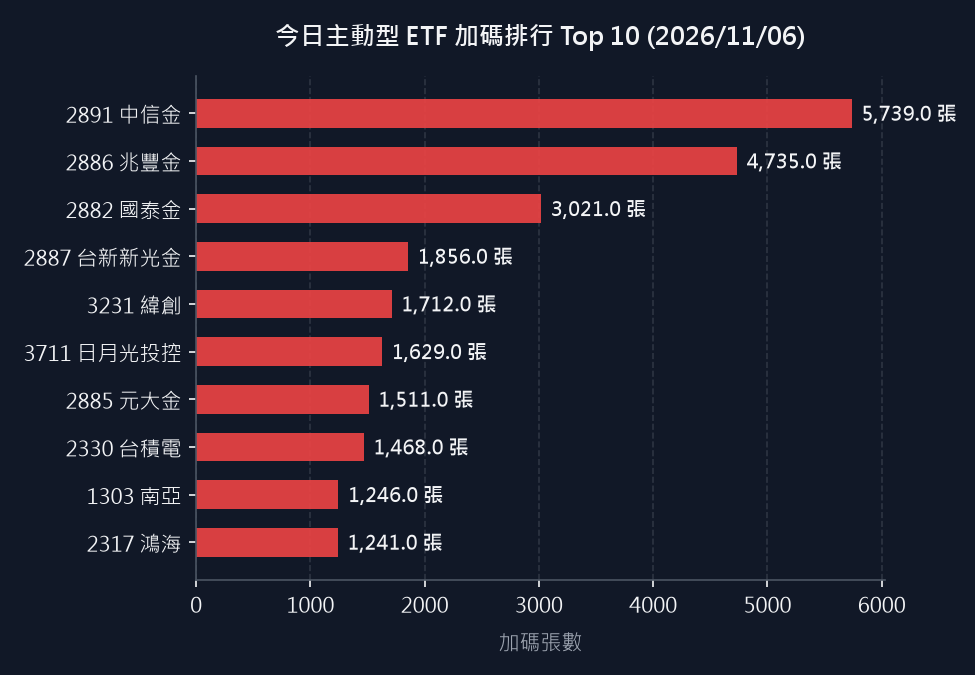
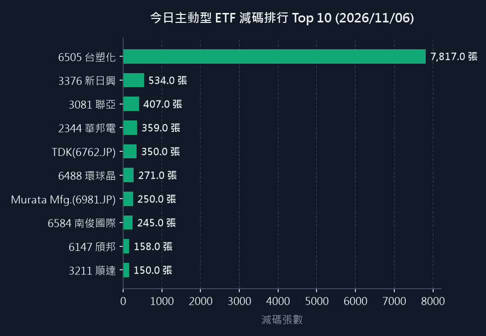

# 主動型 ETF 持股變動

資料來源：`主動型ETF持股明細.xlsx` 最近兩個日期分頁。

比較區間：`20261104` → `20261106`

## 今日加減碼視覺化排行

| 今日加碼 Top 10 | 今日減碼 Top 10 |
| :---: | :---: |
|  |  |

| ETF | 新增 | 刪除 | 比例變動 |
| :-- | --: | --: | --: |
| 00400A | 1 | 0 | 49 |
| 00401A | 2 | 1 | 56 |
| 00402A | 0 | 0 | 46 |
| 00403A | 0 | 0 | 34 |
| 00404A | 0 | 0 | 49 |
| 00405A | 0 | 0 | 27 |
| 00406A | 0 | 0 | 57 |
| 00407A | 0 | 0 | 48 |
| 00408A | 1 | 2 | 45 |
| 00980A | 0 | 0 | 49 |
| 00980D | 0 | 0 | 69 |
| 00981A | 1 | 2 | 33 |
| 00982A | 0 | 0 | 43 |
| 00983A | 0 | 2 | 37 |
| 00983D | 0 | 1 | 80 |
| 00984A | 0 | 0 | 72 |
| 00985A | 0 | 0 | 47 |
| 00986A | 0 | 2 | 31 |
| 00987A | 0 | 0 | 25 |
| 00988A | 3 | 1 | 30 |
| 00989A | 0 | 1 | 64 |
| 00990A | 4 | 5 | 32 |
| 00991A | 1 | 1 | 21 |
| 00992A | 0 | 0 | 39 |
| 00993A | 0 | 0 | 45 |
| 00994A | 2 | 2 | 30 |
| 00995A | 1 | 2 | 41 |
| 00996A | 0 | 0 | 34 |
| 00997A | 1 | 2 | 44 |
| 00998A | 1 | 2 | 51 |
| 00999A | 0 | 0 | 54 |

## 00400A

### 新增持股

- 3023 信邦（0.52%，560 張）

### 刪除持股

- 無

### 投資比例變動

- 1303 南亞：3.95% → 3.72%（-0.23）
- 1476 儒鴻：0.08% → 0.09%（+0.01）
- 2059 川湖：3.30% → 4.18%（+0.88）
- 2303 聯電：1.52% → 1.48%（-0.04）
- 2308 台達電：1.99% → 1.92%（-0.07）
- 2313 華通：0.69% → 0.66%（-0.03）
- 2317 鴻海：0.79% → 0.81%（+0.02）
- 2327 國巨*：1.09% → 1.03%（-0.06）
- 2330 台積電：8.77% → 9.08%（+0.31）
- 2345 智邦：1.28% → 1.25%（-0.03）
- 2360 致茂：2.37% → 2.25%（-0.12）
- 2368 金像電：2.43% → 2.28%（-0.15）
- 2383 台光電：3.97% → 3.73%（-0.24）
- 2449 京元電子：0.85% → 0.82%（-0.03）
- 2454 聯發科：7.00% → 6.80%（-0.20）
- 2603 長榮：2.70% → 2.72%（+0.02）
- 2637 慧洋-KY：0.48% → 0.50%（+0.02）
- 2881 富邦金：1.64% → 1.73%（+0.09）
- 2891 中信金：1.64% → 1.76%（+0.12）
- 3008 大立光：1.31% → 1.23%（-0.08）
- 3017 奇鋐：3.18% → 3.02%（-0.16）
- 3036 文曄：1.55% → 1.54%（-0.01）
- 3037 欣興：3.26% → 3.06%（-0.20）
- 3044 健鼎：2.14% → 2.02%（-0.12）
- 3081 聯亞：0.59% → 0.75%（+0.16）
- 3090 日電貿：0.28% → 0.27%（-0.01）
- 3167 大量：0.34% → 0.32%（-0.02）
- 3293 鈊象：0.35% → 0.36%（+0.01）
- 3406 玉晶光：0.79% → 0.74%（-0.05）
- 3443 創意：2.37% → 2.23%（-0.14）
- 3529 力旺：1.05% → 1.03%（-0.02）
- 3653 健策：3.41% → 3.20%（-0.21）
- 3661 世芯-KY：2.09% → 2.04%（-0.05）
- 3665 貿聯-KY：1.23% → 1.20%（-0.03）
- 3711 日月光投控：1.00% → 0.95%（-0.05）
- 4958 臻鼎-KY：0.38% → 0.36%（-0.02）
- 5274 信驊：2.62% → 3.46%（+0.84）
- 6121 新普：0.22% → 0.23%（+0.01）
- 6147 頎邦：0.78% → 0.73%（-0.05）
- 6187 萬潤：0.91% → 0.86%（-0.05）
- 6223 旺矽：2.57% → 2.42%（-0.15）
- 6271 同欣電：0.23% → 0.22%（-0.01）
- 6274 台燿：1.07% → 1.00%（-0.07）
- 6278 台表科：2.14% → 2.03%（-0.11）
- 6488 環球晶：1.88% → 1.27%（-0.61）
- 6505 台塑化：1.45% → 0.23%（-1.22）
- 7750 新代：0.62% → 0.38%（-0.24）
- 7769 鴻勁：0.60% → 0.57%（-0.03）
- ＸＡＧＸ金兌(3533.HK)：0.95% → 0.90%（-0.05）

## 00401A

### 新增持股

- 3443 創意（0.84%，5 張）
- 臺指選擇權11/26 43300 買權（-0.03%，-0.03 張）

### 刪除持股

- TAIWAN TAIE C 18NOV26 43300 TWSE（-0.04%，-0.03 張）

### 投資比例變動

- 1216 統一：0.29% → 0.30%（+0.01）
- 1303 南亞：1.12% → 1.04%（-0.08）
- 1476 儒鴻：1.71% → 1.91%（+0.20）
- 1477 聚陽：0.91% → 0.99%（+0.08）
- 2059 川湖：0.70% → 0.67%（-0.03）
- 2303 聯電：2.21% → 2.47%（+0.26）
- 2308 台達電：1.67% → 1.59%（-0.08）
- 2313 華通：1.13% → 1.05%（-0.08）
- 2317 鴻海：0.55% → 0.56%（+0.01）
- 2327 國巨*：0.51% → 0.47%（-0.04）
- 2330 台積電：19.21% → 20.31%（+1.10）
- 2345 智邦：0.10% → 0.09%（-0.01）
- 2357 華碩：1.68% → 1.71%（+0.03）
- 2360 致茂：1.71% → 1.60%（-0.11）
- 2379 瑞昱：1.07% → 1.06%（-0.01）
- 2382 廣達：1.97% → 2.00%（+0.03）
- 2383 台光電：0.92% → 0.85%（-0.07）
- 2412 中華電：0.91% → 0.94%（+0.03）
- 2454 聯發科：5.24% → 5.01%（-0.23）
- 2455 全新：1.64% → 1.52%（-0.12）
- 2603 長榮：2.28% → 2.26%（-0.02）
- 2881 富邦金：2.05% → 2.12%（+0.07）
- 2882 國泰金：1.04% → 1.08%（+0.04）
- 2883 凱基金：1.52% → 1.54%（+0.02）
- 2884 玉山金：2.04% → 2.10%（+0.06）
- 2886 兆豐金：1.44% → 1.49%（+0.05）
- 2887 台新新光金：1.04% → 1.06%（+0.02）
- 2890 永豐金：1.59% → 1.63%（+0.04）
- 2891 中信金：2.35% → 2.47%（+0.12）
- 3008 大立光：2.24% → 2.08%（-0.16）
- 3037 欣興：1.42% → 1.31%（-0.11）
- 3131 弘塑：0.51% → 0.48%（-0.03）
- 3231 緯創：2.04% → 2.00%（-0.04）
- 3491 昇達科：1.41% → 1.39%（-0.02）
- 3711 日月光投控：4.38% → 4.10%（-0.28）
- 4904 遠傳：0.81% → 0.82%（+0.01）
- 4938 和碩：0.34% → 0.33%（-0.01）
- 4958 臻鼎-KY：1.11% → 1.03%（-0.08）
- 4991 環宇-KY：0.47% → 0.44%（-0.03）
- 5274 信驊：1.47% → 1.36%（-0.11）
- 5347 世界：1.06% → 1.00%（-0.06）
- 5871 中租-KY：0.13% → 0.14%（+0.01）
- 5904 寶雅*：0.55% → 0.57%（+0.02）
- 6147 頎邦：1.13% → 1.05%（-0.08）
- 6187 萬潤：1.17% → 1.08%（-0.09）
- 6223 旺矽：1.49% → 1.38%（-0.11）
- 6285 啟碁：1.15% → 1.07%（-0.08）
- 6515 穎崴：0.74% → 0.68%（-0.06）
- 6531 愛普*：1.27% → 1.17%（-0.10）
- 6669 緯穎：1.58% → 1.50%（-0.08）
- 7769 鴻勁：0.67% → 0.63%（-0.04）
- 7828 創新服務：1.16% → 1.10%（-0.06）
- 7856 漢測：0.84% → 0.77%（-0.07）
- 8464 億豐：0.97% → 1.02%（+0.05）
- 台股期貨11/26(FITXN*1.TF)：-0.58% → -0.82%（-0.24）
- 臺指選擇權11/26 46500 買權：-0.08% → -0.06%（+0.02）

## 00402A

### 新增持股

- 無

### 刪除持股

- 無

### 投資比例變動

- AAPL.US Apple：8.35% → 8.83%（+0.48）
- ADI.US Analog Devices：2.22% → 2.17%（-0.05）
- AMD.US AMD：5.56% → 5.65%（+0.09）
- AMZN.US Amazon：4.71% → 5.02%（+0.31）
- ANET.US Arista Networks：0.79% → 0.84%（+0.05）
- ARM.US Arm：0.78% → 0.74%（-0.04）
- ASML.US ASML Holding：1.19% → 1.15%（-0.04）
- AVGO.US Broadcom：2.31% → 2.28%（-0.03）
- AXON.US Axon Enterprise：0.64% → 0.65%（+0.01）
- BABA.US Alibaba Group：0.49% → 0.52%（+0.03）
- BKNG.US Booking Holdings：0.56% → 0.62%（+0.06）
- CDNS.US Cadence Design Systems：1.61% → 1.65%（+0.04）
- CIEN.US Ciena：1.05% → 0.96%（-0.09）
- CLS.US Celestica：1.13% → 1.03%（-0.10）
- COHR.US Coherent：1.09% → 1.03%（-0.06）
- CRWD.US CrowdStrike Holdings：1.89% → 1.87%（-0.02）
- GOOG.US Alphabet - Class C Capital Stock：3.04% → 3.16%（+0.12）
- GOOGL.US Alphabet - Class A Common Stock：3.04% → 3.16%（+0.12）
- INTC.US Intel：1.01% → 0.98%（-0.03）
- IOT.US Samsara：0.59% → 0.62%（+0.03）
- KLAC.US KLA：1.40% → 1.35%（-0.05）
- LITE.US Lumentum：1.48% → 1.37%（-0.11）
- LRCX.US Lam Research：2.15% → 2.08%（-0.07）
- MCHP.US Microchip Technology：1.52% → 1.48%（-0.04）
- MDB.US MongoDB：0.39% → 0.38%（-0.01）
- META.US Meta：3.61% → 3.68%（+0.07）
- MRVL.US Marvell：1.27% → 1.19%（-0.08）
- MSFT.US Microsoft：5.79% → 6.21%（+0.42）
- MU.US Micron：5.73% → 5.36%（-0.37）
- NFLX.US Netflix：0.98% → 1.03%（+0.05）
- NVDA.US NVIDIA：8.89% → 8.70%（-0.19）
- PLTR.US Palantir Technologies：2.13% → 2.10%（-0.03）
- SHOP.US Shopify：1.10% → 1.19%（+0.09）
- SIMO.US Silicon Motion：0.49% → 0.45%（-0.04）
- SKHY.US SK hynix：0.89% → 0.85%（-0.04）
- SNOW.US Snowflake：1.30% → 1.29%（-0.01）
- SPCX.US SpaceX：0.77% → 0.74%（-0.03）
- SPOT.US Spotify：0.46% → 0.48%（+0.02）
- STX.US Seagate：1.01% → 0.93%（-0.08）
- TER.US Teradyne：0.65% → 0.61%（-0.04）
- TSM.US TSMC(ADR)：1.55% → 1.53%（-0.02）
- TTWO.US Take-Two：0.61% → 0.66%（+0.05）
- TXN.US Texas Instruments：2.91% → 2.92%（+0.01）
- UBER.US Uber：0.33% → 0.35%（+0.02）
- V.US Visa：1.40% → 1.46%（+0.06）
- WDC.US Western Digital：1.86% → 1.75%（-0.11）

## 00403A

### 新增持股

- 無

### 刪除持股

- 無

### 投資比例變動

- 1303 南亞：2.79% → 2.73%（-0.06）
- 1560 中砂：0.41% → 0.39%（-0.02）
- 2059 川湖：0.72% → 0.71%（-0.01）
- 2308 台達電：2.22% → 2.17%（-0.05）
- 2313 華通：0.31% → 0.29%（-0.02）
- 2317 鴻海：0.64% → 0.66%（+0.02）
- 2327 國巨*：3.32% → 3.15%（-0.17）
- 2330 台積電：14.99% → 15.84%（+0.85）
- 2345 智邦：1.57% → 1.54%（-0.03）
- 2368 金像電：0.83% → 0.79%（-0.04）
- 2383 台光電：4.59% → 4.35%（-0.24）
- 2408 南亞科：0.94% → 0.89%（-0.05）
- 2449 京元電子：0.83% → 0.81%（-0.02）
- 2454 聯發科：5.05% → 5.11%（+0.06）
- 2882 國泰金：0.37% → 0.49%（+0.12）
- 3008 大立光：1.58% → 1.50%（-0.08）
- 3017 奇鋐：5.61% → 5.37%（-0.24）
- 3037 欣興：5.37% → 5.09%（-0.28）
- 3189 景碩：3.07% → 2.91%（-0.16）
- 3211 順達：0.42% → 0.38%（-0.04）
- 3443 創意：4.24% → 4.02%（-0.22）
- 3450 聯鈞：0.48% → 0.45%（-0.03）
- 3583 辛耘：0.25% → 0.24%（-0.01）
- 3653 健策：5.58% → 5.28%（-0.30）
- 3665 貿聯-KY：1.93% → 1.90%（-0.03）
- 3711 日月光投控：1.00% → 1.04%（+0.04）
- 5274 信驊：2.13% → 2.02%（-0.11）
- 6223 旺矽：3.23% → 3.06%（-0.17）
- 6274 台燿：2.25% → 2.13%（-0.12）
- 6488 環球晶：0.16% → 0.15%（-0.01）
- 6669 緯穎：2.77% → 2.70%（-0.07）
- 6805 富世達：0.54% → 0.51%（-0.03）
- 8046 南電：2.73% → 2.59%（-0.14）
- 8996 高力：2.26% → 2.14%（-0.12）

## 00404A

### 新增持股

- 無

### 刪除持股

- 無

### 投資比例變動

- 1303 南亞：0.79% → 0.75%（-0.04）
- 2059 川湖：0.70% → 0.68%（-0.02）
- 2301 光寶科：0.50% → 0.49%（-0.01）
- 2303 聯電：2.79% → 2.72%（-0.07）
- 2308 台達電：1.88% → 1.82%（-0.06）
- 2317 鴻海：0.70% → 0.72%（+0.02）
- 2330 台積電：22.22% → 23.04%（+0.82）
- 2345 智邦：0.88% → 0.86%（-0.02）
- 2347 聯強：1.79% → 1.81%（+0.02）
- 2351 順德：0.32% → 0.31%（-0.01）
- 2357 華碩：1.18% → 1.22%（+0.04）
- 2360 致茂：0.52% → 0.49%（-0.03）
- 2379 瑞昱：1.07% → 1.08%（+0.01）
- 2382 廣達：0.99% → 1.03%（+0.04）
- 2383 台光電：3.08% → 2.90%（-0.18）
- 2395 研華：1.26% → 1.25%（-0.01）
- 2436 偉詮電：1.07% → 1.04%（-0.03）
- 2454 聯發科：7.17% → 6.99%（-0.18）
- 2637 慧洋-KY：1.08% → 1.12%（+0.04）
- 2851 中再保：1.09% → 1.15%（+0.06）
- 2882 國泰金：2.59% → 2.73%（+0.14）
- 2885 元大金：2.29% → 2.40%（+0.11）
- 2887 台新新光金：1.32% → 1.38%（+0.06）
- 2890 永豐金：1.40% → 1.46%（+0.06）
- 3017 奇鋐：1.37% → 1.30%（-0.07）
- 3037 欣興：0.36% → 0.34%（-0.02）
- 3264 欣銓：0.56% → 0.53%（-0.03）
- 3293 鈊象：1.09% → 1.12%（+0.03）
- 3374 精材：0.12% → 0.11%（-0.01）
- 3443 創意：1.15% → 1.09%（-0.06）
- 3653 健策：0.52% → 0.49%（-0.03）
- 3680 家登：0.45% → 0.44%（-0.01）
- 3711 日月光投控：3.29% → 3.14%（-0.15）
- 5274 信驊：2.82% → 2.66%（-0.16）
- 5434 崇越：1.70% → 1.67%（-0.03）
- 5876 上海商銀：1.41% → 1.47%（+0.06）
- 5904 寶雅*：0.43% → 0.45%（+0.02）
- 6196 帆宣：1.81% → 1.72%（-0.09）
- 6223 旺矽：1.17% → 1.11%（-0.06）
- 6257 矽格：1.81% → 1.72%（-0.09）
- 6491 晶碩：0.93% → 0.97%（+0.04）
- 6505 台塑化：0.49% → 0.46%（-0.03）
- 6669 緯穎：1.06% → 1.03%（-0.03）
- 7769 鴻勁：1.18% → 1.12%（-0.06）
- 8016 矽創：1.21% → 1.22%（+0.01）
- 8081 致新：0.81% → 0.83%（+0.02）
- 8299 群聯：1.15% → 1.10%（-0.05）
- 台指選擇權11/26 48000 買權：-0.05% → -0.04%（+0.01）
- 台股期貨11/26(FITXN*1.TF)：19.60% → 19.88%（+0.28）

## 00405A

### 新增持股

- 無

### 刪除持股

- 無

### 投資比例變動

- 2059 川湖：2.15% → 2.12%（-0.03）
- 2308 台達電：0.57% → 0.56%（-0.01）
- 2330 台積電：2.03% → 2.15%（+0.12）
- 2345 智邦：4.52% → 4.38%（-0.14）
- 2368 金像電：5.44% → 5.14%（-0.30）
- 2383 台光電：4.84% → 4.55%（-0.29）
- 2454 聯發科：5.47% → 6.66%（+1.19）
- 3017 奇鋐：1.81% → 1.66%（-0.15）
- 3037 欣興：4.58% → 4.20%（-0.38）
- 3189 景碩：0.21% → 0.19%（-0.02）
- 3443 創意：2.60% → 2.54%（-0.06）
- 3653 健策：8.40% → 7.63%（-0.77）
- 3665 貿聯-KY：5.23% → 4.95%（-0.28）
- 3711 日月光投控：0.01% → 1.49%（+1.48）
- 5274 信驊：6.42% → 5.83%（-0.59）
- 6187 萬潤：0.79% → 0.72%（-0.07）
- 6223 旺矽：6.69% → 6.25%（-0.44）
- 6274 台燿：1.71% → 1.56%（-0.15）
- 6285 啟碁：0.10% → 0.09%（-0.01）
- 6415 矽力*-KY：0.57% → 0.55%（-0.02）
- 6515 穎崴：0.46% → 0.43%（-0.03）
- 6531 愛普*：3.71% → 3.52%（-0.19）
- 6669 緯穎：0.89% → 0.87%（-0.02）
- 6805 富世達：1.78% → 1.62%（-0.16）
- 7769 鴻勁：2.62% → 2.48%（-0.14）
- 8046 南電：7.03% → 6.38%（-0.65）
- 8996 高力：1.43% → 1.32%（-0.11）

## 00406A

### 新增持股

- 無

### 刪除持股

- 無

### 投資比例變動

- 1303 南亞：2.20% → 2.18%（-0.02）
- 1326 台化：0.53% → 0.52%（-0.01）
- 1560 中砂：0.24% → 0.22%（-0.02）
- 1815 富喬：0.54% → 0.51%（-0.03）
- 2059 川湖：1.73% → 1.67%（-0.06）
- 2303 聯電：1.23% → 1.19%（-0.04）
- 2308 台達電：1.53% → 1.64%（+0.11）
- 2327 國巨*：1.53% → 1.44%（-0.09）
- 2330 台積電：9.17% → 9.49%（+0.32）
- 2344 華邦電：0.06% → 0.02%（-0.04）
- 2345 智邦：2.04% → 1.98%（-0.06）
- 2360 致茂：0.68% → 0.64%（-0.04）
- 2368 金像電：2.54% → 2.38%（-0.16）
- 2383 台光電：6.14% → 6.05%（-0.09）
- 2449 京元電子：0.42% → 0.40%（-0.02）
- 2454 聯發科：5.93% → 6.06%（+0.13）
- 2481 強茂：0.32% → 0.30%（-0.02）
- 2881 富邦金：0.68% → 0.71%（+0.03）
- 2882 國泰金：0.51% → 0.70%（+0.19）
- 2884 玉山金：0.30% → 0.32%（+0.02）
- 2885 元大金：0.48% → 0.57%（+0.09）
- 2886 兆豐金：0.28% → 0.48%（+0.20）
- 2887 台新新光金：0.42% → 0.49%（+0.07）
- 2890 永豐金：0.31% → 0.32%（+0.01）
- 3008 大立光：1.04% → 0.98%（-0.06）
- 3037 欣興：5.50% → 5.51%（+0.01）
- 3081 聯亞：1.22% → 1.14%（-0.08）
- 3105 穩懋：0.57% → 0.54%（-0.03）
- 3167 大量：0.58% → 0.54%（-0.04）
- 3189 景碩：1.92% → 1.80%（-0.12）
- 3264 欣銓：0.31% → 0.29%（-0.02）
- 3443 創意：2.03% → 2.09%（+0.06）
- 3653 健策：4.72% → 4.76%（+0.04）
- 3661 世芯-KY：0.72% → 0.70%（-0.02）
- 3665 貿聯-KY：0.85% → 1.11%（+0.26）
- 3711 日月光投控：2.09% → 2.14%（+0.05）
- 4958 臻鼎-KY：0.91% → 0.86%（-0.05）
- 5274 信驊：1.44% → 1.42%（-0.02）
- 6147 頎邦：0.70% → 0.66%（-0.04）
- 6187 萬潤：0.12% → 0.11%（-0.01）
- 6213 聯茂：0.43% → 0.41%（-0.02）
- 6223 旺矽：3.06% → 2.87%（-0.19）
- 6274 台燿：2.15% → 2.01%（-0.14）
- 6278 台表科：0.22% → 0.21%（-0.01）
- 6285 啟碁：0.05% → 0.04%（-0.01）
- 6446 藥華藥：0.60% → 0.59%（-0.01）
- 6488 環球晶：0.16% → 0.15%（-0.01）
- 6510 精測：0.54% → 0.50%（-0.04）
- 6669 緯穎：1.10% → 1.06%（-0.04）
- 6715 嘉基：0.64% → 0.72%（+0.08）
- 6805 富世達：1.08% → 1.01%（-0.07）
- 7769 鴻勁：0.13% → 0.12%（-0.01）
- 8046 南電：3.02% → 2.97%（-0.05）
- 8996 高力：0.76% → 0.71%（-0.05）
- 臺指選擇權第一週週五到期契約：-14.32% → -12.76%（+1.56）
- 臺指選擇權第二週週三到期契約：-6.01% → -4.89%（+1.12）
- 臺股期貨 202611(FITXN*1.TF)：22.07% → 22.27%（+0.20）

## 00407A

### 新增持股

- 無

### 刪除持股

- 無

### 投資比例變動

- 1303 南亞：3.19% → 3.34%（+0.15）
- 1560 中砂：1.01% → 0.95%（-0.06）
- 2059 川湖：1.81% → 1.77%（-0.04）
- 2301 光寶科：1.38% → 1.34%（-0.04）
- 2303 聯電：0.49% → 0.47%（-0.02）
- 2308 台達電：2.07% → 1.99%（-0.08）
- 2313 華通：0.38% → 0.37%（-0.01）
- 2327 國巨*：2.12% → 1.96%（-0.16）
- 2330 台積電：10.33% → 11.20%（+0.87）
- 2344 華邦電：0.14% → 0.13%（-0.01）
- 2345 智邦：1.41% → 1.35%（-0.06）
- 2360 致茂：0.81% → 0.74%（-0.07）
- 2368 金像電：1.99% → 1.87%（-0.12）
- 2379 瑞昱：0.27% → 0.29%（+0.02）
- 2383 台光電：6.01% → 5.77%（-0.24）
- 2408 南亞科：1.48% → 1.42%（-0.06）
- 2451 創見：0.35% → 0.36%（+0.01）
- 2454 聯發科：5.74% → 6.20%（+0.46）
- 2615 萬海：1.12% → 1.16%（+0.04）
- 3008 大立光：1.36% → 1.35%（-0.01）
- 3017 奇鋐：5.56% → 5.05%（-0.51）
- 3034 聯詠：0.85% → 0.88%（+0.03）
- 3037 欣興：5.59% → 5.25%（-0.34）
- 3081 聯亞：1.69% → 1.57%（-0.12）
- 3131 弘塑：0.72% → 0.67%（-0.05）
- 3231 緯創：1.11% → 1.12%（+0.01）
- 3260 威剛：0.30% → 0.31%（+0.01）
- 3293 鈊象：0.70% → 0.73%（+0.03）
- 3406 玉晶光：0.22% → 0.50%（+0.28）
- 3443 創意：4.78% → 4.63%（-0.15）
- 3491 昇達科：0.87% → 0.85%（-0.02）
- 3533 嘉澤：1.00% → 0.97%（-0.03）
- 3653 健策：3.94% → 3.54%（-0.40）
- 3665 貿聯-KY：2.30% → 2.15%（-0.15）
- 3711 日月光投控：3.43% → 3.20%（-0.23）
- 4958 臻鼎-KY：0.95% → 0.91%（-0.04）
- 5274 信驊：1.72% → 1.55%（-0.17）
- 6187 萬潤：1.43% → 1.28%（-0.15）
- 6223 旺矽：2.04% → 1.88%（-0.16）
- 6274 台燿：1.81% → 1.64%（-0.17）
- 6446 藥華藥：0.38% → 0.43%（+0.05）
- 6510 精測：1.38% → 1.27%（-0.11）
- 6531 愛普*：0.29% → 0.27%（-0.02）
- 6669 緯穎：2.52% → 2.43%（-0.09）
- 6805 富世達：1.23% → 1.11%（-0.12）
- 8046 南電：3.45% → 3.11%（-0.34）
- 8299 群聯：0.31% → 0.30%（-0.01）
- 8996 高力：1.35% → 1.24%（-0.11）

## 00408A

### 新增持股

- 4904 遠傳（0.54%，60 張）

### 刪除持股

- 2345 智邦（0.62%，5.5 張）
- 2360 致茂（0.89%，8 張）

### 投資比例變動

- 1216 統一：0.12% → 0.13%（+0.01）
- 1303 南亞：3.77% → 3.59%（-0.18）
- 1560 中砂：0.78% → 0.74%（-0.04）
- 2059 川湖：0.91% → 0.90%（-0.01）
- 2308 台達電：1.56% → 1.53%（-0.03）
- 2327 國巨*：0.48% → 0.68%（+0.20）
- 2330 台積電：6.17% → 6.45%（+0.28）
- 2344 華邦電：0.43% → 0.41%（-0.02）
- 2368 金像電：4.60% → 4.38%（-0.22）
- 2382 廣達：0.23% → 0.24%（+0.01）
- 2383 台光電：4.66% → 4.43%（-0.23）
- 2408 南亞科：1.85% → 1.18%（-0.67）
- 2449 京元電子：0.89% → 0.86%（-0.03）
- 2454 聯發科：3.94% → 3.88%（-0.06）
- 2455 全新：0.70% → 0.66%（-0.04）
- 2542 興富發：3.91% → 4.18%（+0.27）
- 2603 長榮：1.79% → 1.82%（+0.03）
- 2880 華南金：1.30% → 1.39%（+0.09）
- 2891 中信金：0.83% → 1.98%（+1.15）
- 3017 奇鋐：2.76% → 2.65%（-0.11）
- 3026 禾伸堂：0.67% → 1.10%（+0.43）
- 3037 欣興：2.76% → 2.63%（-0.13）
- 3044 健鼎：0.37% → 0.35%（-0.02）
- 3045 台灣大：0.13% → 0.14%（+0.01）
- 3081 聯亞：0.80% → 0.76%（-0.04）
- 3189 景碩：3.05% → 2.90%（-0.15）
- 3231 緯創：0.95% → 0.96%（+0.01）
- 3264 欣銓：0.34% → 0.33%（-0.01）
- 3443 創意：0.54% → 0.51%（-0.03）
- 3653 健策：3.81% → 3.63%（-0.18）
- 3665 貿聯-KY：0.35% → 0.00%（-0.35）
- 3711 日月光投控：2.23% → 2.15%（-0.08）
- 5434 崇越：2.27% → 2.25%（-0.02）
- 6187 萬潤：0.89% → 0.84%（-0.05）
- 6223 旺矽：1.81% → 1.73%（-0.08）
- 6274 台燿：2.20% → 2.09%（-0.11）
- 6510 精測：0.42% → 0.40%（-0.02）
- 6526 達發：0.33% → 0.32%（-0.01）
- 6669 緯穎：2.00% → 1.95%（-0.05）
- 6691 洋基工程：0.32% → 0.33%（+0.01）
- 6805 富世達：2.21% → 2.10%（-0.11）
- 7769 鴻勁：0.83% → 0.80%（-0.03）
- 8046 南電：1.15% → 0.54%（-0.61）
- 8996 高力：2.38% → 2.27%（-0.11）
- 9802 鈺齊-KY：0.90% → 0.99%（+0.09）

## 00980A

### 新增持股

- 無

### 刪除持股

- 無

### 投資比例變動

- 1303 南亞：3.39% → 3.27%（-0.12）
- 2059 川湖：3.94% → 3.85%（-0.09）
- 2303 聯電：1.39% → 1.35%（-0.04）
- 2308 台達電：2.86% → 2.75%（-0.11）
- 2317 鴻海：3.41% → 3.55%（+0.14）
- 2327 國巨*：0.83% → 0.77%（-0.06）
- 2330 台積電：9.87% → 10.35%（+0.48）
- 2344 華邦電：1.59% → 1.50%（-0.09）
- 2345 智邦：0.86% → 0.82%（-0.04）
- 2360 致茂：0.94% → 0.85%（-0.09）
- 2368 金像電：1.88% → 1.76%（-0.12）
- 2376 技嘉：1.65% → 1.68%（+0.03）
- 2382 廣達：1.93% → 2.06%（+0.13）
- 2383 台光電：3.80% → 3.54%（-0.26）
- 2408 南亞科：2.24% → 2.14%（-0.10）
- 2454 聯發科：5.36% → 5.44%（+0.08）
- 2884 玉山金：1.34% → 1.47%（+0.13）
- 2891 中信金：1.66% → 1.85%（+0.19）
- 3008 大立光：1.89% → 1.88%（-0.01）
- 3017 奇鋐：2.19% → 1.99%（-0.20）
- 3026 禾伸堂：0.97% → 0.88%（-0.09）
- 3036 文曄：1.07% → 1.08%（+0.01）
- 3037 欣興：3.22% → 2.93%（-0.29）
- 3044 健鼎：1.26% → 1.20%（-0.06）
- 3081 聯亞：1.46% → 1.35%（-0.11）
- 3189 景碩：1.27% → 1.15%（-0.12）
- 3231 緯創：1.69% → 1.71%（+0.02）
- 3264 欣銓：0.74% → 0.69%（-0.05）
- 3293 鈊象：0.50% → 0.52%（+0.02）
- 3443 創意：1.86% → 1.80%（-0.06）
- 3653 健策：3.37% → 3.03%（-0.34）
- 3665 貿聯-KY：1.30% → 1.22%（-0.08）
- 3711 日月光投控：2.26% → 2.11%（-0.15）
- 5274 信驊：1.65% → 1.49%（-0.16）
- 5904 寶雅*：0.73% → 0.81%（+0.08）
- 6213 聯茂：1.26% → 1.14%（-0.12）
- 6223 旺矽：1.17% → 1.09%（-0.08）
- 6274 台燿：1.14% → 1.03%（-0.11）
- 6515 穎崴：1.42% → 1.29%（-0.13）
- 6669 緯穎：1.92% → 1.85%（-0.07）
- 6805 富世達：0.65% → 0.59%（-0.06）
- 6831 邁科：0.25% → 0.23%（-0.02）
- 7751 竑騰：0.65% → 0.59%（-0.06）
- 7769 鴻勁：1.80% → 1.68%（-0.12）
- 8046 南電：1.57% → 1.41%（-0.16）
- 8210 勤誠：0.35% → 0.33%（-0.02）
- 8299 群聯：1.03% → 1.00%（-0.03）
- 8996 高力：0.48% → 0.44%（-0.04）
- 台灣證交所加權股價指數(FITXN*1.TF)：3.01% → 3.06%（+0.05）

## 00980D

### 新增持股

- 無

### 刪除持股

- 無

### 投資比例變動

- AMC GLOBAL MEDIA INC SER REGS (REG) (REG S) 10.5% 15JUL2032：0.69% → 0.71%（+0.02）
- ANHEUSER-BUSCH INBEV WOR (REG) 8.2% 15JAN2039：0.54% → 0.55%（+0.01）
- ASURION LLC/ASURION CO 8.375% 01FEB2034：0.43% → 0.44%（+0.01）
- BARCLAYS PLC (REG) VAR 27JUN2034：0.35% → 0.36%（+0.01）
- BAYER US FINANCE LLC SER REGS 6.875000 % 21NOV2053：0.36% → 0.37%（+0.01）
- BLUE OWL CREDIT INCOME (REG) 6.6% 15SEP2029：0.40% → 0.41%（+0.01）
- BPCE SA SER REGS VAR 14JAN2046：0.39% → 0.40%（+0.01）
- BRIGHTHOUSE FINANCIAL IN (REG) 4.7% 22JUN2047：0.48% → 0.49%（+0.01）
- CHARTER COMM OPT LLC/CAP (REG) 6.834000 % 23OCT2055：0.44% → 0.45%（+0.01）
- CHC GROUP LLC SER REGS 11.750000 % 01-SEP-2030：0.46% → 0.45%（-0.01）
- CHS/COMMUNITY HEALTH SYS SER REGS 10.875000 % 15JAN2032：0.45% → 0.46%（+0.01）
- CHS/COMMUNITY HEALTH SYS SER REGS 9.750000 % 15JAN2034：0.47% → 0.48%（+0.01）
- CONCENTRIX CORP (REG) 6.85% 02AUG2033：0.74% → 0.75%（+0.01）
- COREWEAVE INC SER REGS (REG S) 9.25% 01JUN2030：0.40% → 0.39%（-0.01）
- COREWEAVE INC SER REGS (REG S) 9.75% 01OCT2031：0.48% → 0.46%（-0.02）
- COREWEAVE INC SER REGS (REG) (REG S) 9.625% 15JUL2032：0.47% → 0.45%（-0.02）
- COREWEAVE INC SER REGS 9.000000 % 01FEB2031：0.23% → 0.22%（-0.01）
- COX COMMUNICATIONS INC SER REGS 5.800000 % 15DEC2053：0.50% → 0.51%（+0.01）
- COX COMMUNICATIONS INC SER REGS 5.950000 % 01SEP2054：0.52% → 0.53%（+0.01）
- DAIMLER FINANCE NA LLC REG 8.5% 18JAN2031：0.66% → 0.67%（+0.01）
- DIRECTV FIN LLC/COINC SER REGS 10.000000 % 15FEB2031：0.42% → 0.43%（+0.01）
- DOW CHEMICAL CO/THE (REG) 5.6% 15FEB2054：0.63% → 0.64%（+0.01）
- EDISON INTERNATIONAL (REG) 6.95% 15NOV2029：0.60% → 0.61%（+0.01）
- ENEL FINANCE INTL NV SER REGS (REG S) 7.5% 14OCT2032：0.36% → 0.37%（+0.01）
- ENERGY TRANSFER LP (REG) 7.5% 01JUL2038：0.34% → 0.35%（+0.01）
- F&G ANNUITIES & LIFE INC 6.250000 % 04OCT2034：0.51% → 0.52%（+0.01）
- FORD MOTOR CREDIT CO LLC 6.500000 % 07FEB2035：0.33% → 0.34%（+0.01）
- GENERAL MOTORS CO (REG) 6.75% 01APR2046：0.58% → 0.59%（+0.01）
- GLOBAL AUTO HO/AAG FH UK SER REGS (REG S) 11.5% 15AUG2029：0.37% → 0.38%（+0.01）
- GLOBAL AUTO HO/AAG FH UK SER REGS (REG S) 8.75% 15JAN2032：0.41% → 0.42%（+0.01）
- HAH GROUP HOLDING CO LLC SER REGS (REG S) 9.75% 01OCT2031：0.50% → 0.51%（+0.01）
- HERTZ CORP/THE SER REGS (REG S) 12.625% 15JUL2029：0.29% → 0.27%（-0.02）
- HESS CORP (REG) 7.3% 15AUG2031：0.55% → 0.56%（+0.01）
- ICAHN ENTERPRISES/FIN (REG) 9.75% 15JAN2029：0.33% → 0.32%（-0.01）
- ICAHN ENTERPRISES/FIN SER REGS 10.000000 % 15NOV2029：0.32% → 0.31%（-0.01）
- JBS USA/FOOD/FINANCE (REG) 6.5% 01DEC2052：0.47% → 0.48%（+0.01）
- JETBLUE AIRWAYS/LOYALTY SER REGS (REG S) 9.875% 20SEP2031：0.32% → 0.34%（+0.02）
- LBM ACQUISITION LLC SER REGS 9.500000 % 15JUN2031：0.43% → 0.44%（+0.01）
- M&T BANK CORPORATION (REG) VAR 30OCT2029：0.56% → 0.57%（+0.01）
- MOBIUS MERGER SUB SER REGS 9.000000 % 01JUN2030：0.26% → 0.27%（+0.01）
- MOHEGAN TRIBAL / MS DIG SER REGS 11.875000 % 15APR2031：0.71% → 0.70%（-0.01）
- MYLAN INC SER WI (REG) 5.2% 15APR2048WI：0.52% → 0.53%（+0.01）
- MYLAN NV 5.25% 15JUN2046 WI：0.56% → 0.57%（+0.01）
- ONEOK INC 6.625% 01SEP2053：0.61% → 0.62%（+0.01）
- ORACLE CORP 6.9% 09NOV2052：0.50% → 0.51%（+0.01）
- ORANGE SA (REG) 9% 01MAR2031：0.68% → 0.69%（+0.01）
- PACIFIC GAS & ELECTRIC (REG) 6.7% 01APR2053：0.34% → 0.35%（+0.01）
- PACIFIC GAS & ELECTRIC (REG) 6.75% 15JAN2053：0.34% → 0.35%（+0.01）
- PACIFIC GAS & ELECTRIC 6.95% 15MAR2034：0.34% → 0.35%（+0.01）
- PHOTO HOLDINGS LLC SER REGS (REG) (REG S) 12% 01JUL2031：0.48% → 0.47%（-0.01）
- POLARIS INC 6.950000 % 15MAR2029：0.49% → 0.50%（+0.01）
- SABRE GLBL INC SER REGS 10.75 % 15-MAR-2030：0.17% → 0.18%（+0.01）
- SABRE GLBL INC SER REGS 11.125000 % 15JUL2030：0.48% → 0.50%（+0.02）
- SALESFORCE INC (REG) 6.7% 15MAR2066：0.54% → 0.55%（+0.01）
- SBL HOLDINGS INC SER REGS 7.200000 % 30OCT2034：0.53% → 0.54%（+0.01）
- SES GLOBAL AMERICAS HLDG SER REGS (REG) 5.300000 % 25MAR2044：0.32% → 0.31%（-0.01）
- SPRINT CAPITAL CORP (REG) 8.75% 15MAR2032：0.42% → 0.43%（+0.01）
- SYMETRA LIFE INSURANCE SER REGS 6.550000 % 01OCT2055：0.32% → 0.33%（+0.01）
- TIME WARNER CABLE INC REG 7.3% 01JUL2038：0.30% → 0.31%（+0.01）
- UNISYS CORP SER REGS 10.625000 % 15JAN2031：0.64% → 0.65%（+0.01）
- US 10YR NOTE (CBT)DEC26 21-DEC-2026：18.72% → 18.85%（+0.13）
- US 10YR ULTRA FUT DEC26 21-DEC-2026：-2.19% → -2.21%（-0.02）
- US 5YR NOTE (CBT) DEC26 31-DEC-2026：-15.41% → -15.48%（-0.07）
- US ACUTE CARE SOLUTIONS SER REGS (REG S) 9.75% 15MAY2029：0.32% → 0.33%（+0.01）
- US LONG BOND(CBT) DEC26 21-DEC-2026：5.63% → 5.69%（+0.06）
- US ULTRA BOND CBT DEC26 21-DEC-2026：-0.18% → -0.19%（-0.01）
- VIRGINIA ELEC & POWER CO (REG) 8.875% 15NOV2038：0.60% → 0.61%（+0.01）
- WESTLAKE CORP 6.375000 % 15-NOV-2055：0.54% → 0.55%（+0.01）
- ZIONS BANCORP NA VAR 19NOV2035：0.42% → 0.43%（+0.01）

## 00981A

### 新增持股

- 2891 中信金（0.17%，5455 張）

### 刪除持股

- 6488 環球晶（0.00%，1 張）
- 8210 勤誠（0.03%，141 張）

### 投資比例變動

- 1802 台玻：0.22% → 0.21%（-0.01）
- 2303 聯電：3.25% → 3.14%（-0.11）
- 2308 台達電：3.58% → 3.43%（-0.15）
- 2313 華通：0.04% → 0.03%（-0.01）
- 2327 國巨*：4.09% → 3.77%（-0.32）
- 2330 台積電：13.36% → 15.17%（+1.81）
- 2345 智邦：3.63% → 3.47%（-0.16）
- 2368 金像電：2.88% → 2.69%（-0.19）
- 2383 台光電：7.63% → 7.09%（-0.54）
- 2449 京元電子：0.75% → 0.68%（-0.07）
- 2454 聯發科：8.07% → 8.30%（+0.23）
- 3017 奇鋐：7.26% → 6.59%（-0.67）
- 3037 欣興：6.78% → 6.15%（-0.63）
- 3264 欣銓：0.38% → 0.35%（-0.03）
- 3376 新日興：0.05% → 0.02%（-0.03）
- 3443 創意：2.62% → 2.53%（-0.09）
- 3653 健策：6.27% → 5.67%（-0.60）
- 3665 貿聯-KY：1.75% → 1.64%（-0.11）
- 3711 日月光投控：4.10% → 3.82%（-0.28）
- 4979 華星光：0.14% → 0.13%（-0.01）
- 5274 信驊：1.30% → 1.16%（-0.14）
- 6187 萬潤：0.05% → 0.04%（-0.01）
- 6223 旺矽：4.01% → 3.70%（-0.31）
- 6271 同欣電：0.18% → 0.17%（-0.01）
- 6274 台燿：3.17% → 2.85%（-0.32）
- 6510 精測：0.50% → 0.46%（-0.04）
- 6515 穎崴：0.11% → 0.10%（-0.01）
- 6669 緯穎：2.27% → 2.19%（-0.08）
- 6805 富世達：1.14% → 1.02%（-0.12）
- 8046 南電：3.76% → 3.37%（-0.39）
- 8358 金居：0.09% → 0.08%（-0.01）
- 8996 高力：0.54% → 0.50%（-0.04）
- 台指期貨 2026/11(FITXN*1.TF)：2.27% → 2.95%（+0.68）

## 00982A

### 新增持股

- 無

### 刪除持股

- 無

### 投資比例變動

- 2059 川湖：2.65% → 2.64%（-0.01）
- 2330 台積電：8.31% → 8.81%（+0.50）
- 2360 致茂：3.27% → 3.18%（-0.09）
- 2376 技嘉：1.33% → 1.37%（+0.04）
- 2383 台光電：3.30% → 3.18%（-0.12）
- 2395 研華：1.41% → 1.43%（+0.02）
- 2428 興勤：1.15% → 1.16%（+0.01）
- 2454 聯發科：7.57% → 7.54%（-0.03）
- 2455 全新：1.38% → 1.33%（-0.05）
- 2467 志聖：0.86% → 0.83%（-0.03）
- 2478 大毅：0.34% → 0.33%（-0.01）
- 2486 一詮：0.65% → 0.62%（-0.03）
- 2885 元大金：0.35% → 0.37%（+0.02）
- 3008 大立光：2.96% → 2.86%（-0.10）
- 3017 奇鋐：2.46% → 2.39%（-0.07）
- 3037 欣興：0.81% → 0.78%（-0.03）
- 3105 穩懋：8.08% → 7.78%（-0.30）
- 3231 緯創：1.97% → 2.02%（+0.05）
- 3265 台星科：1.39% → 1.34%（-0.05）
- 3491 昇達科：3.30% → 3.40%（+0.10）
- 3583 辛耘：0.64% → 0.62%（-0.02）
- 3617 碩天：0.34% → 0.35%（+0.01）
- 3711 日月光投控：1.97% → 1.92%（-0.05）
- 4958 臻鼎-KY：3.12% → 3.04%（-0.08）
- 5274 信驊：1.18% → 1.14%（-0.04）
- 5425 台半：1.18% → 1.16%（-0.02）
- 5483 中美晶：1.29% → 1.27%（-0.02）
- 5536 聖暉*：0.75% → 0.94%（+0.19）
- 6139 亞翔：5.34% → 5.32%（-0.02）
- 6196 帆宣：0.34% → 0.33%（-0.01）
- 6213 聯茂：1.74% → 1.67%（-0.07）
- 6214 精誠：1.46% → 1.51%（+0.05）
- 6223 旺矽：2.84% → 2.74%（-0.10）
- 6239 力成：1.32% → 1.30%（-0.02）
- 6274 台燿：1.10% → 1.06%（-0.04）
- 6472 保瑞：0.87% → 0.98%（+0.11）
- 6488 環球晶：1.59% → 1.55%（-0.04）
- 6510 精測：0.95% → 0.91%（-0.04）
- 6531 愛普*：3.78% → 3.64%（-0.14）
- 6669 緯穎：2.06% → 2.04%（-0.02）
- 6672 騰輝電子-KY：2.70% → 2.60%（-0.10）
- 8070 長華*：0.69% → 0.72%（+0.03）
- 8996 高力：1.25% → 1.20%（-0.05）

## 00983A

### 新增持股

- 無

### 刪除持股

- CRWV.US CoreWeave（0.13%，0.622 張）
- FTNT.US Fortinet（0.11%，0.223 張）

### 投資比例變動

- AMD.US AMD：3.12% → 2.83%（-0.29）
- AMZN.US Amazon：4.05% → 4.55%（+0.50）
- AVGO.US Broadcom：1.88% → 1.79%（-0.09）
- BEAM.US Beam Therapeutics：2.48% → 2.84%（+0.36）
- BLSH.US Bullish：1.26% → 1.23%（-0.03）
- COIN.US Coinbase：3.26% → 3.33%（+0.07）
- CRCL.US Circle：4.17% → 4.18%（+0.01）
- CRSP.US CRISPR Therapeutics：3.95% → 4.16%（+0.21）
- DE.US Deere：0.46% → 0.50%（+0.04）
- GOOG.US Alphabet - Class C Capital Stock：2.39% → 2.62%（+0.23）
- GOOGL.US Alphabet - Class A Common Stock：1.49% → 1.63%（+0.14）
- HOOD.US Robinhood Markets：2.54% → 2.52%（-0.02）
- ILMN.US Illumina：1.66% → 1.57%（-0.09）
- KTOS.US Kratos Defense & Security：0.11% → 0.09%（-0.02）
- LLY.US Eli Lilly：1.93% → 2.03%（+0.10）
- META.US Meta：3.05% → 3.37%（+0.32）
- MSFT.US Microsoft：1.06% → 1.34%（+0.28）
- NET.US Cloudflare：1.29% → 1.31%（+0.02）
- NTLA.US Intellia Therapeutics：1.66% → 1.93%（+0.27）
- NTRA.US Natera：1.71% → 1.74%（+0.03）
- NVDA.US NVIDIA：3.79% → 3.61%（-0.18）
- PACB.US Pacific Biosciences of Californi：0.07% → 0.08%（+0.01）
- PLTR.US Palantir Technologies：3.16% → 3.03%（-0.13）
- RKLB.US Rocket Lab：1.35% → 1.23%（-0.12）
- RXRX.US Recursion Pharmaceuticals：0.93% → 1.20%（+0.27）
- SHOP.US Shopify：4.51% → 4.93%（+0.42）
- SNOW.US Snowflake：0.54% → 0.53%（-0.01）
- SPCX.US SpaceX：6.87% → 6.51%（-0.36）
- TEM.US Tempus：6.60% → 6.47%（-0.13）
- TER.US Teradyne：0.51% → 0.43%（-0.08）
- TSLA.US Tesla：8.73% → 8.12%（-0.61）
- TSM.US TSMC(ADR)：2.74% → 2.59%（-0.15）
- TWST.US Twist Bioscience：3.81% → 3.55%（-0.26）
- TXG.US 10x Genomics：3.15% → 3.04%（-0.11）
- VCYT.US Veracyte：0.52% → 0.27%（-0.25）
- WGS.US GeneDx：0.54% → 0.55%（+0.01）
- XYZ.US Block：1.36% → 1.63%（+0.27）

## 00983D

### 新增持股

- 無

### 刪除持股

- HSBC 6.332 03/09/44（1.11%，N/A 張）

### 投資比例變動

- ABIBB 8.2 01/15/39：2.04% → 1.93%（-0.11）
- ABXCN 7 1/2 09/15/38：0.56% → 0.59%（+0.03）
- AET 6 5/8 06/15/36：0.76% → 0.80%（+0.04）
- ALLY 8 11/01/31：1.26% → 1.31%（+0.05）
- AMCX 10 1/2 07/15/32：1.60% → 1.69%（+0.09）
- ATH 6 5/8 05/19/55：1.02% → 1.07%（+0.05）
- AWK 6.593 10/15/37：0.74% → 0.78%（+0.04）
- BACR 7.437 11/02/33：1.33% → 1.38%（+0.05）
- BATSLN 7.079 08/02/43：1.14% → 1.19%（+0.05）
- BATSLN 7.081 08/02/53：1.21% → 1.26%（+0.05）
- BHCCN 11 09/30/28：2.02% → 2.10%（+0.08）
- BNCN 7 3/8 03/01/33：1.16% → 1.21%（+0.05）
- BRITEL 9 5/8 12/15/30：1.41% → 1.47%（+0.06）
- BRKHEC 6 3/4 07/01/37：0.85% → 0.52%（-0.33）
- C 8 1/8 07/15/39：2.02% → 1.90%（-0.12）
- CEG 6 1/2 10/01/53：0.82% → 0.50%（-0.32）
- CMCSA 6.95 08/15/37：0.70% → 0.73%（+0.03）
- CP 7 1/8 10/15/31：0.86% → 0.90%（+0.04）
- CYH 10 7/8 01/15/32：1.37% → 1.44%（+0.07）
- DELL 8.1 07/15/36：1.57% → 1.64%（+0.07）
- DELL 8.35 07/15/46：1.43% → 1.49%（+0.06）
- DIS 7 3/4 12/01/45：0.63% → 0.66%（+0.03）
- DOW 6.9 05/15/53：0.80% → 0.83%（+0.03）
- DOW 9.4 05/15/39：2.04% → 1.90%（-0.14）
- DT 9 1/4 06/01/32：1.57% → 1.64%（+0.07）
- DTV 8 7/8 02/01/30：1.68% → 1.75%（+0.07）
- DUK 7 3/4 03/01/31：1.63% → 1.70%（+0.07）
- ED 6 3/4 04/01/38：0.65% → 0.67%（+0.02）
- ENBCN 6.7 11/15/53：0.63% → 0.65%（+0.02）
- ET 6 1/2 02/01/42：0.17% → 0.18%（+0.01）
- FFHCN 6.35 03/22/54：0.74% → 0.77%（+0.03）
- GE 6 3/4 03/15/32：0.61% → 0.63%（+0.02）
- GE 6 7/8 01/10/39：0.88% → 0.92%（+0.04）
- GM 6 3/4 04/01/46：0.77% → 0.80%（+0.03）
- GM 6.6 04/01/36：0.41% → 0.43%（+0.02）
- GS 6 1/4 02/01/41：0.34% → 0.35%（+0.01）
- GT 8 7/8 07/15/32：0.87% → 0.90%（+0.03）
- GTN 10 1/2 07/15/29：0.35% → 0.37%（+0.02）
- HAL 7.45 09/15/39：1.91% → 1.80%（-0.11）
- HPE 6.35 10/15/45：1.03% → 0.67%（-0.36）
- IEP 10 11/15/29：1.54% → 1.58%（+0.04）
- KHC 6 7/8 01/26/39：1.06% → 1.11%（+0.05）
- KMI 6.95 01/15/38：1.11% → 1.16%（+0.05）
- LOW 6.65 09/15/37：0.88% → 0.55%（-0.33）
- LQDW.US iShares LQD Premium Income+ ETF：7.01% → 7.30%（+0.29）
- MBGGR 8 1/2 01/18/31：1.38% → 1.43%（+0.05）
- MCD 6.3 03/01/38：0.42% → 0.44%（+0.02）
- MINAU 9 1/4 10/01/28：0.94% → 0.97%（+0.03）
- MOHEGN 11 7/8 04/15/31：1.43% → 1.48%（+0.05）
- MPC 6 1/2 03/01/41：0.17% → 0.18%（+0.01）
- MS 7 1/4 04/01/32：1.72% → 1.60%（-0.12）
- NTRCN 7 1/8 05/23/36：0.58% → 0.60%（+0.02）
- NVDA 5.55 06/15/46：1.18% → 1.24%（+0.06）
- OKE 6 5/8 09/01/53：0.75% → 0.78%（+0.03）
- ORCL 6 1/2 04/15/38：0.39% → 0.41%（+0.02）
- ORCL 6.9 11/09/52：0.41% → 0.43%（+0.02）
- OXY 6.6 03/15/46：0.78% → 0.82%（+0.04）
- PCG 6 3/4 01/15/53：0.85% → 0.89%（+0.04）
- PCG 6.7 04/01/53：0.98% → 1.03%（+0.05）
- PFE 7.2 03/15/39：0.94% → 0.98%（+0.04）
- RAKUTN 11 1/4 02/15/27：1.90% → 1.97%（+0.07）
- RIOLN 7 1/4 03/15/31：0.54% → 0.56%（+0.02）
- S 8 3/4 03/15/32：1.54% → 1.61%（+0.07）
- SABHLD 10 3/4 11/15/29：0.10% → 0.11%（+0.01）
- SJM 6 1/2 11/15/53：0.21% → 0.22%（+0.01）
- SPCX 6.6 07/15/46：1.13% → 1.18%（+0.05）
- SUCN 6.85 06/01/39：0.89% → 0.93%（+0.04）
- SVC 8 7/8 06/15/32：0.50% → 0.52%（+0.02）
- SYY 6.6 04/01/50：0.20% → 0.21%（+0.01）
- T 6.55 02/15/39：0.20% → 0.21%（+0.01）
- TELEFO 8 1/4 09/15/30：1.05% → 1.09%（+0.04）
- TELEFONICA EMISIONES SAU 7.045 06/20/36：1.42% → 1.49%（+0.07）
- TIME WARNER CABLE INC 7.300 07/01/38：0.50% → 0.52%（+0.02）
- TLTW.US iShares TLT Premium Income+ ETF：8.34% → 8.70%（+0.36）
- TRGP 6 1/2 02/15/53：0.17% → 0.18%（+0.01）
- TRPCN 7 5/8 01/15/39：1.76% → 1.65%（-0.11）
- UNITEDHEALTH GROUP INC 6.875 02/15/38：0.90% → 0.95%（+0.05）
- VENLNG 9 1/2 02/01/29：1.49% → 1.54%（+0.05）
- VLO 6 5/8 06/15/37：0.78% → 0.81%（+0.03）
- VZ 7 3/4 12/01/30：1.20% → 1.25%（+0.05）

## 00984A

### 新增持股

- 無

### 刪除持股

- 無

### 投資比例變動

- 1216 統一：1.09% → 1.14%（+0.05）
- 1301 台塑：0.65% → 0.64%（-0.01）
- 1303 南亞：1.78% → 1.68%（-0.10）
- 1326 台化：2.33% → 2.30%（-0.03）
- 1560 中砂：1.48% → 1.40%（-0.08）
- 2027 大成鋼：0.66% → 0.68%（+0.02）
- 2059 川湖：1.95% → 1.90%（-0.05）
- 2301 光寶科：0.64% → 0.63%（-0.01）
- 2313 華通：0.47% → 0.45%（-0.02）
- 2330 台積電：2.66% → 2.75%（+0.09）
- 2351 順德：0.61% → 0.58%（-0.03）
- 2357 華碩：0.65% → 0.68%（+0.03）
- 2377 微星：0.65% → 0.64%（-0.01）
- 2379 瑞昱：1.00% → 1.01%（+0.01）
- 2383 台光電：0.19% → 0.18%（-0.01）
- 2395 研華：2.24% → 2.23%（-0.01）
- 2408 南亞科：1.29% → 1.22%（-0.07）
- 2449 京元電子：0.38% → 0.37%（-0.01）
- 2454 聯發科：0.31% → 0.30%（-0.01）
- 2455 全新：0.98% → 0.93%（-0.05）
- 2603 長榮：2.60% → 2.64%（+0.04）
- 2615 萬海：1.69% → 1.74%（+0.05）
- 2618 長榮航：1.11% → 1.20%（+0.09）
- 2637 慧洋-KY：1.06% → 1.11%（+0.05）
- 2801 彰銀：1.68% → 1.73%（+0.05）
- 2851 中再保：0.66% → 0.70%（+0.04）
- 2855 統一證：0.65% → 0.66%（+0.01）
- 2880 華南金：1.69% → 1.79%（+0.10）
- 2881 富邦金：3.10% → 3.28%（+0.18）
- 2882 國泰金：3.02% → 3.21%（+0.19）
- 2883 凱基金：1.61% → 1.68%（+0.07）
- 2884 玉山金：1.70% → 1.81%（+0.11）
- 2885 元大金：2.76% → 2.91%（+0.15）
- 2886 兆豐金：1.05% → 1.12%（+0.07）
- 2887 台新新光金：2.84% → 2.99%（+0.15）
- 2890 永豐金：1.63% → 1.71%（+0.08）
- 2891 中信金：0.66% → 0.71%（+0.05）
- 2892 第一金：1.68% → 1.75%（+0.07）
- 3008 大立光：1.55% → 1.46%（-0.09）
- 3017 奇鋐：3.61% → 3.46%（-0.15）
- 3037 欣興：1.27% → 1.21%（-0.06）
- 3044 健鼎：0.64% → 0.61%（-0.03）
- 3045 台灣大：1.77% → 1.83%（+0.06）
- 3189 景碩：2.15% → 2.04%（-0.11）
- 3264 欣銓：0.63% → 0.60%（-0.03）
- 3406 玉晶光：1.13% → 1.08%（-0.05）
- 3443 創意：1.83% → 1.73%（-0.10）
- 3450 聯鈞：0.20% → 0.19%（-0.01）
- 3605 宏致：0.67% → 0.64%（-0.03）
- 3653 健策：1.20% → 1.13%（-0.07）
- 3702 大聯大：0.62% → 0.61%（-0.01）
- 3711 日月光投控：1.80% → 1.72%（-0.08）
- 4958 臻鼎-KY：0.42% → 0.40%（-0.02）
- 5274 信驊：0.46% → 0.44%（-0.02）
- 5351 鈺創：0.61% → 0.60%（-0.01）
- 5434 崇越：0.99% → 0.98%（-0.01）
- 5871 中租-KY：1.06% → 1.12%（+0.06）
- 5876 上海商銀：1.67% → 1.75%（+0.08）
- 5904 寶雅*：1.09% → 1.15%（+0.06）
- 6187 萬潤：0.75% → 0.70%（-0.05）
- 6196 帆宣：0.61% → 0.58%（-0.03）
- 6197 佳必琪：0.60% → 0.57%（-0.03）
- 6213 聯茂：0.61% → 0.57%（-0.04）
- 6274 台燿：0.37% → 0.35%（-0.02）
- 6415 矽力*-KY：0.56% → 0.52%（-0.04）
- 6446 藥華藥：1.06% → 1.05%（-0.01）
- 6505 台塑化：3.83% → 3.63%（-0.20）
- 6669 緯穎：0.81% → 0.78%（-0.03）
- 6670 復盛應用：0.59% → 0.62%（+0.03）
- 6672 騰輝電子-KY：0.68% → 0.64%（-0.04）
- 6770 力積電：0.61% → 0.59%（-0.02）
- 6957 裕慶-KY：0.68% → 0.72%（+0.04）

## 00985A

### 新增持股

- 無

### 刪除持股

- 無

### 投資比例變動

- 1101 台泥：1.41% → 1.47%（+0.06）
- 1216 統一：2.05% → 2.15%（+0.10）
- 1301 台塑：0.44% → 0.43%（-0.01）
- 1402 遠東新：1.38% → 1.45%（+0.07）
- 1504 東元：0.52% → 0.53%（+0.01）
- 1605 華新：1.39% → 1.37%（-0.02）
- 2027 大成鋼：2.06% → 2.11%（+0.05）
- 2059 川湖：2.30% → 2.23%（-0.07）
- 2303 聯電：1.65% → 1.61%（-0.04）
- 2308 台達電：2.61% → 2.53%（-0.08）
- 2317 鴻海：1.95% → 2.00%（+0.05）
- 2327 國巨*：1.64% → 1.55%（-0.09）
- 2330 台積電：13.88% → 14.41%（+0.53）
- 2344 華邦電：1.54% → 1.46%（-0.08）
- 2345 智邦：2.29% → 2.24%（-0.05）
- 2368 金像電：1.21% → 1.14%（-0.07）
- 2376 技嘉：2.10% → 2.12%（+0.02）
- 2377 微星：0.87% → 0.86%（-0.01）
- 2383 台光電：2.86% → 2.70%（-0.16）
- 2408 南亞科：1.22% → 1.15%（-0.07）
- 2412 中華電：1.82% → 1.90%（+0.08）
- 2454 聯發科：1.71% → 1.67%（-0.04）
- 2603 長榮：1.54% → 1.56%（+0.02）
- 2609 陽明：1.48% → 1.49%（+0.01）
- 2610 華航：1.45% → 1.60%（+0.15）
- 3008 大立光：1.54% → 1.46%（-0.08）
- 3017 奇鋐：1.27% → 1.21%（-0.06）
- 3037 欣興：1.95% → 1.84%（-0.11）
- 3081 聯亞：2.00% → 1.89%（-0.11）
- 3105 穩懋：0.36% → 0.34%（-0.02）
- 3189 景碩：0.45% → 0.42%（-0.03）
- 3653 健策：3.44% → 3.25%（-0.19）
- 3661 世芯-KY：0.59% → 0.58%（-0.01）
- 3665 貿聯-KY：1.48% → 1.45%（-0.03）
- 3711 日月光投控：1.61% → 1.54%（-0.07）
- 4904 遠傳：2.32% → 2.40%（+0.08）
- 6285 啟碁：0.69% → 0.65%（-0.04）
- 6442 光聖：0.95% → 0.94%（-0.01）
- 6446 藥華藥：3.26% → 3.24%（-0.02）
- 6488 環球晶：1.36% → 1.30%（-0.06）
- 6526 達發：0.82% → 0.79%（-0.03）
- 6531 愛普*：1.32% → 1.24%（-0.08）
- 6669 緯穎：3.02% → 2.93%（-0.09）
- 7750 新代：1.14% → 1.19%（+0.05）
- 7769 鴻勁：2.68% → 2.56%（-0.12）
- 8996 高力：0.13% → 0.12%（-0.01）
- 台積電期貨(FICDFN*1.TF)：1.59% → 1.63%（+0.04）

## 00986A

### 新增持股

- 無

### 刪除持股

- DDOG.US Datadog（1.03%，0.7 張）
- TSEM.US Tower Semiconductor（0.93%，0.85 張）

### 投資比例變動

- 2330 台積電：8.43% → 8.92%（+0.49）
- 2454 聯發科：1.50% → 1.53%（+0.03）
- AAPL.US Apple：2.78% → 3.13%（+0.35）
- AMD.US AMD：4.54% → 4.12%（-0.42）
- AMZN.US Amazon：4.70% → 5.30%（+0.60）
- AVGO.US Broadcom：4.01% → 3.82%（-0.19）
- BE.US Bloom Energy：2.15% → 1.83%（-0.32）
- CRWD.US CrowdStrike Holdings：4.92% → 4.74%（-0.18）
- DELL.US Dell：0.82% → 0.69%（-0.13）
- ETN.US Eaton：2.62% → 2.38%（-0.24）
- GEV.US GE Vernova：3.08% → 2.80%（-0.28）
- GOOGL.US Alphabet - Class A Common Stock：5.63% → 6.17%（+0.54）
- GS.US Goldman Sachs：1.20% → 1.26%（+0.06）
- ILMN.US Illumina：0.64% → 0.61%（-0.03）
- JPM.US JPMorgan Chase：2.49% → 2.70%（+0.21）
- LITE.US Lumentum：3.55% → 2.89%（-0.66）
- LLY.US Eli Lilly：4.25% → 4.47%（+0.22）
- MA.US Mastercard：1.52% → 1.67%（+0.15）
- MSFT.US Microsoft：3.49% → 3.90%（+0.41）
- MU.US Micron：4.58% → 3.82%（-0.76）
- MUFG(8306.JP)：1.15% → 1.27%（+0.12）
- NET.US Cloudflare：2.20% → 2.13%（-0.07）
- NVDA.US NVIDIA：6.92% → 6.61%（-0.31）
- PLTR.US Palantir Technologies：1.41% → 1.35%（-0.06）
- RBRK.US Rubrik：1.01% → 1.00%（-0.01）
- SKHY.US SK hynix：1.01% → 0.90%（-0.11）
- SNOW.US Snowflake：2.17% → 2.16%（-0.01）
- 嘉能可公司：1.81% → 1.95%（+0.14）
- 施奈德電機公司：1.62% → 1.68%（+0.06）
- 艾司摩爾控股公司：2.08% → 2.05%（-0.03）
- 英飛凌科技股份有限公司：1.18% → 1.13%（-0.05）

## 00987A

### 新增持股

- 無

### 刪除持股

- 無

### 投資比例變動

- 1815 富喬：2.20% → 2.10%（-0.10）
- 2330 台積電：10.29% → 10.84%（+0.55）
- 2368 金像電：2.93% → 2.80%（-0.13）
- 2383 台光電：6.68% → 6.39%（-0.29）
- 2454 聯發科：5.07% → 5.02%（-0.05）
- 2455 全新：2.23% → 2.14%（-0.09）
- 3017 奇鋐：7.42% → 7.17%（-0.25）
- 3037 欣興：5.21% → 4.99%（-0.22）
- 3081 聯亞：3.17% → 3.03%（-0.14）
- 3363 上詮：1.97% → 2.00%（+0.03）
- 3443 創意：4.68% → 4.48%（-0.20）
- 3491 昇達科：3.22% → 3.30%（+0.08）
- 3653 健策：5.87% → 5.62%（-0.25）
- 3665 貿聯-KY：3.49% → 3.48%（-0.01）
- 4958 臻鼎-KY：2.19% → 2.12%（-0.07）
- 4991 環宇-KY：2.93% → 2.80%（-0.13）
- 5274 信驊：0.21% → 0.20%（-0.01）
- 6223 旺矽：1.05% → 1.00%（-0.05）
- 6274 台燿：4.23% → 4.05%（-0.18）
- 6510 精測：3.50% → 3.35%（-0.15）
- 6515 穎崴：2.44% → 2.33%（-0.11）
- 6805 富世達：3.79% → 3.63%（-0.16）
- 8046 南電：2.51% → 2.40%（-0.11）
- 8358 金居：1.56% → 1.51%（-0.05）
- 8996 高力：3.11% → 2.98%（-0.13）

## 00988A

### 新增持股

- AMZN.US Amazon（1.14%，50 張）
- NTSK.US Netskope（1.33%，700 張）
- SHIFT(3697.JP)（0.50%，800 張）

### 刪除持股

- Meiko Electronics(6787.JP)（2.06%，500 張）

### 投資比例變動

- 1303 南亞：1.83% → 1.87%（+0.04）
- 2330 台積電：1.75% → 1.91%（+0.16）
- 2383 台光電：2.62% → 2.73%（+0.11）
- 2454 聯發科：0.70% → 0.74%（+0.04）
- 3017 奇鋐：4.21% → 4.10%（-0.11）
- 3037 欣興：5.60% → 5.54%（-0.06）
- 3443 創意：2.43% → 3.07%（+0.64）
- 3711 日月光投控：0.69% → 1.02%（+0.33）
- 6223 旺矽：1.10% → 1.09%（-0.01）
- AAPL.US Apple：4.69% → 5.43%（+0.74）
- AMD.US AMD：3.80% → 4.43%（+0.63）
- BE.US Bloom Energy：7.55% → 6.60%（-0.95）
- CRWD.US CrowdStrike Holdings：4.24% → 4.20%（-0.04）
- INFINEON TECHNOLOGIES AG：1.38% → 1.36%（-0.02）
- LITE.US Lumentum：2.99% → 1.53%（-1.46）
- META.US Meta：1.22% → 1.32%（+0.10）
- MSFT.US Microsoft：5.72% → 7.51%（+1.79）
- MU.US Micron：1.07% → 0.87%（-0.20）
- Murata Mfg.(6981.JP)：1.58% → 0.70%（-0.88）
- NOW.US ServiceNow：0.98% → 1.03%（+0.05）
- NVDA.US NVIDIA：4.70% → 4.93%（+0.23）
- OKTA.US Okta：2.98% → 3.00%（+0.02）
- PANW.US Palo Alto：4.12% → 4.13%（+0.01）
- PLTR.US Palantir Technologies：4.81% → 4.75%（-0.06）
- SNOW.US Snowflake：2.31% → 2.36%（+0.05）
- SPCX.US SpaceX：6.10% → 5.95%（-0.15）
- Samsung Elec Mech(009150.KS)：2.59% → 2.47%（-0.12）
- TDK(6762.JP)：0.87% → 0.44%（-0.43）
- TWLO.US Twilio：1.01% → 1.06%（+0.05）
- ZS.US Zscaler：1.77% → 1.79%（+0.02）

## 00989A

### 新增持股

- 無

### 刪除持股

- GLW.US Corning（0.62%，1.479 張）

### 投資比例變動

- ACN.US Accenture：1.07% → 1.53%（+0.46）
- ADBE.US Adobe：1.38% → 1.50%（+0.12）
- ADI.US Analog Devices：1.31% → 1.22%（-0.09）
- ALAB.US Astera Labs：0.75% → 0.63%（-0.12）
- AMD.US AMD：2.98% → 2.88%（-0.10）
- AMZN.US Amazon：1.15% → 1.29%（+0.14）
- ASML.US ASML Holding：2.22% → 2.11%（-0.11）
- AVGO.US Broadcom：3.58% → 3.42%（-0.16）
- BE.US Bloom Energy：0.61% → 0.52%（-0.09）
- CDNS.US Cadence Design Systems：0.99% → 1.03%（+0.04）
- CIEN.US Ciena：0.87% → 0.72%（-0.15）
- CRDO.US Credo：0.78% → 0.63%（-0.15）
- CRM.US Salesforce：3.25% → 3.53%（+0.28）
- CRWD.US CrowdStrike Holdings：3.82% → 3.68%（-0.14）
- DDOG.US Datadog：0.75% → 0.94%（+0.19）
- DOCN.US DigitalOcean：1.17% → 0.99%（-0.18）
- ENTG.US Entegris：0.54% → 0.48%（-0.06）
- ESTC.US Elastic：0.83% → 0.84%（+0.01）
- GOOG.US Alphabet - Class C Capital Stock：2.09% → 2.30%（+0.21）
- GWRE.US Guidewire Software：0.71% → 0.80%（+0.09）
- HOOD.US Robinhood Markets：1.62% → 1.61%（-0.01）
- HUBS.US HubSpot：1.96% → 1.93%（-0.03）
- ILMN.US Illumina：1.16% → 1.10%（-0.06）
- INTC.US Intel：1.57% → 1.47%（-0.10）
- LITE.US Lumentum：1.17% → 0.95%（-0.22）
- LMND.US Lemonade：0.72% → 0.78%（+0.06）
- LRCX.US Lam Research：2.00% → 1.74%（-0.26）
- MDB.US MongoDB：0.73% → 0.72%（-0.01）
- META.US Meta：4.21% → 4.45%（+0.24）
- MPWR.US Monolithic Power Systems：1.22% → 1.42%（+0.20）
- MSFT.US Microsoft：3.11% → 3.47%（+0.36）
- MTSI.US MACOM Technology Solutions：0.59% → 0.52%（-0.07）
- MU.US Micron：0.59% → 0.49%（-0.10）
- NET.US Cloudflare：2.66% → 2.58%（-0.08）
- NOW.US ServiceNow：1.63% → 1.15%（-0.48）
- NU.US Nu：0.29% → 0.32%（+0.03）
- NVDA.US NVIDIA：4.64% → 4.42%（-0.22）
- OKTA.US Okta：0.81% → 0.79%（-0.02）
- PANW.US Palo Alto：3.50% → 3.41%（-0.09）
- PLTR.US Palantir Technologies：1.32% → 1.26%（-0.06）
- RIVN.US Rivian：1.25% → 1.36%（+0.11）
- ROK.US Rockwell Automation：0.94% → 0.87%（-0.07）
- SHOP.US Shopify：2.90% → 3.17%（+0.27）
- SNDK.US Sandisk：0.44% → 0.34%（-0.10）
- SNOW.US Snowflake：2.83% → 2.81%（-0.02）
- SPCX.US SpaceX：0.88% → 0.83%（-0.05）
- SWKS.US Skyworks Solutions：0.36% → 0.37%（+0.01）
- SYM.US Symbotic：0.48% → 0.49%（+0.01）
- TEAM.US Atlassian：1.39% → 1.45%（+0.06）
- TEM.US Tempus：1.36% → 1.34%（-0.02）
- TSLA.US Tesla：3.45% → 3.23%（-0.22）
- TSM.US TSMC(ADR)：0.98% → 0.93%（-0.05）
- TTWO.US Take-Two：2.99% → 3.55%（+0.56）
- TWLO.US Twilio：2.02% → 2.06%（+0.04）
- TWST.US Twist Bioscience：0.53% → 0.49%（-0.04）
- TXG.US 10x Genomics：0.74% → 0.71%（-0.03）
- TXN.US Texas Instruments：1.80% → 1.74%（-0.06）
- U.US Unity Software：0.96% → 1.25%（+0.29）
- VEEV.US Veeva Systems：1.06% → 1.18%（+0.12）
- VICR.US Vicor Corporation：0.32% → 0.26%（-0.06）
- WDAY.US Workday：0.31% → 0.34%（+0.03）
- WRBY.US Warby Parker：0.67% → 0.86%（+0.19）
- XYZ.US Block：0.54% → 0.65%（+0.11）
- ZM.US Zoom：1.73% → 1.82%（+0.09）

## 00990A

### 新增持股

- AEM.US Agnico Eagle Mines（1.11%，50.4 張）
- ANET.US Arista Networks（1.02%，55 張）
- THC.US Tenet Healthcare（0.53%，15.8 張）
- TOHO(9602.JP)（0.22%，159.5 張）

### 刪除持股

- 2308 台達電（0.44%，106 張）
- GH.US Guardant Health（1.11%，59.3 張）
- LITE.US Lumentum（1.68%，23.079 張）
- NOW.US ServiceNow（1.05%，89.981 張）
- SEI.US Solaris Energy Infrastructure（0.81%，109.4 張）

### 投資比例變動

- 2330 台積電：3.04% → 3.23%（+0.19）
- 2368 金像電：1.16% → 1.13%（-0.03）
- 2383 台光電：1.92% → 1.95%（+0.03）
- 2454 聯發科：1.98% → 2.03%（+0.05）
- 3017 奇鋐：1.51% → 1.44%（-0.07）
- 3037 欣興：1.96% → 1.89%（-0.07）
- 3443 創意：0.97% → 1.00%（+0.03）
- AAPL.US Apple：1.04% → 2.24%（+1.20）
- AMD.US AMD：4.21% → 4.76%（+0.55）
- AMZN.US Amazon：3.14% → 4.62%（+1.48）
- AVGO.US Broadcom：1.53% → 1.47%（-0.06）
- BE.US Bloom Energy：5.75% → 4.92%（-0.83）
- CRWD.US CrowdStrike Holdings：1.94% → 2.86%（+0.92）
- DDOG.US Datadog：1.30% → 1.13%（-0.17）
- GE.US GE Aerospace：2.12% → 2.79%（+0.67）
- GOOGL.US Alphabet - Class A Common Stock：2.98% → 4.34%（+1.36）
- HWM.US Howmet Aerospace：1.55% → 1.53%（-0.02）
- LLY.US Eli Lilly：2.43% → 2.58%（+0.15）
- META.US Meta：4.29% → 4.57%（+0.28）
- MSFT.US Microsoft：7.02% → 7.90%（+0.88）
- MU.US Micron：3.47% → 2.02%（-1.45）
- NET.US Cloudflare：1.64% → 1.60%（-0.04）
- NVDA.US NVIDIA：6.20% → 5.96%（-0.24）
- PLTR.US Palantir Technologies：5.00% → 4.83%（-0.17）
- RPRX.US Royalty Pharma：0.66% → 1.16%（+0.50）
- Recruit Holdings(6098.JP)：2.12% → 2.32%（+0.20）
- SHOP.US Shopify：3.11% → 3.43%（+0.32）
- SNOW.US Snowflake：3.19% → 2.19%（-1.00）
- SPCX.US SpaceX：3.88% → 2.72%（-1.16）
- TSLA.US Tesla：1.89% → 1.30%（-0.59）
- TWST.US Twist Bioscience：0.81% → 0.76%（-0.05）
- ZS.US Zscaler：2.37% → 2.34%（-0.03）

## 00991A

### 新增持股

- 4958 臻鼎-KY（0.46%，690 張）

### 刪除持股

- 2313 華通（0.00%，1.253 張）

### 投資比例變動

- 1303 南亞：5.06% → 4.88%（-0.18）
- 2059 川湖：6.78% → 6.74%（-0.04）
- 2317 鴻海：0.00% → 0.50%（+0.50）
- 2327 國巨*：3.86% → 3.72%（-0.14）
- 2330 台積電：15.12% → 16.02%（+0.90）
- 2382 廣達：0.00% → 0.01%（+0.01）
- 2383 台光電：9.79% → 9.43%（-0.36）
- 2408 南亞科：7.44% → 7.17%（-0.27）
- 2454 聯發科：6.39% → 6.78%（+0.39）
- 3017 奇鋐：6.74% → 6.55%（-0.19）
- 3026 禾伸堂：2.80% → 2.70%（-0.10）
- 3037 欣興：7.65% → 7.37%（-0.28）
- 3081 聯亞：2.01% → 0.00%（-2.01）
- 3189 景碩：6.09% → 5.86%（-0.23）
- 3231 緯創：0.00% → 0.49%（+0.49）
- 3653 健策：3.85% → 3.71%（-0.14）
- 3711 日月光投控：3.60% → 3.90%（+0.30）
- 5274 信驊：2.58% → 2.49%（-0.09）
- 6505 台塑化：2.02% → 1.31%（-0.71）
- 8046 南電：6.11% → 5.88%（-0.23）
- 8299 群聯：0.46% → 0.45%（-0.01）

## 00992A

### 新增持股

- 無

### 刪除持股

- 無

### 投資比例變動

- 1303 南亞：3.44% → 3.40%（-0.04）
- 1815 富喬：4.04% → 4.02%（-0.02）
- 2059 川湖：4.44% → 4.47%（+0.03）
- 2308 台達電：1.01% → 1.00%（-0.01）
- 2330 台積電：6.67% → 7.21%（+0.54）
- 2345 智邦：4.75% → 4.70%（-0.05）
- 2357 華碩：0.43% → 0.48%（+0.05）
- 2360 致茂：1.44% → 1.35%（-0.09）
- 2368 金像電：1.73% → 1.67%（-0.06）
- 2376 技嘉：0.41% → 0.43%（+0.02）
- 2383 台光電：5.45% → 5.79%（+0.34）
- 2404 漢唐：0.39% → 0.40%（+0.01）
- 2454 聯發科：1.58% → 2.38%（+0.80）
- 3008 大立光：3.83% → 3.92%（+0.09）
- 3017 奇鋐：6.15% → 5.76%（-0.39）
- 3026 禾伸堂：0.79% → 0.73%（-0.06）
- 3037 欣興：5.64% → 5.97%（+0.33）
- 3081 聯亞：0.69% → 1.41%（+0.72）
- 3189 景碩：2.60% → 2.42%（-0.18）
- 3231 緯創：1.86% → 1.93%（+0.07）
- 3264 欣銓：0.23% → 0.22%（-0.01）
- 3443 創意：3.40% → 3.39%（-0.01）
- 3653 健策：1.05% → 0.98%（-0.07）
- 3665 貿聯-KY：5.88% → 5.67%（-0.21）
- 3711 日月光投控：1.12% → 1.08%（-0.04）
- 4958 臻鼎-KY：1.23% → 1.21%（-0.02）
- 5274 信驊：1.06% → 0.99%（-0.07）
- 5289 宜鼎：0.37% → 0.38%（+0.01）
- 6187 萬潤：0.70% → 0.65%（-0.05）
- 6213 聯茂：1.56% → 1.45%（-0.11）
- 6223 旺矽：3.57% → 3.40%（-0.17）
- 6274 台燿：1.41% → 1.31%（-0.10）
- 6415 矽力*-KY：0.64% → 0.62%（-0.02）
- 6515 穎崴：0.54% → 0.51%（-0.03）
- 6584 南俊國際：1.36% → 1.06%（-0.30）
- 8021 尖點：2.45% → 2.29%（-0.16）
- 8046 南電：2.96% → 2.74%（-0.22）
- 8150 南茂：0.40% → 0.39%（-0.01）
- 8996 高力：5.90% → 5.57%（-0.33）

## 00993A

### 新增持股

- 無

### 刪除持股

- 無

### 投資比例變動

- 1301 台塑：0.33% → 0.38%（+0.05）
- 1303 南亞：4.76% → 4.82%（+0.06）
- 1560 中砂：1.53% → 1.51%（-0.02）
- 2006 東和鋼鐵：0.50% → 0.55%（+0.05）
- 2027 大成鋼：0.56% → 0.59%（+0.03）
- 2303 聯電：0.77% → 0.76%（-0.01）
- 2308 台達電：0.59% → 0.56%（-0.03）
- 2330 台積電：12.44% → 13.54%（+1.10）
- 2347 聯強：1.48% → 1.57%（+0.09）
- 2360 致茂：0.32% → 0.30%（-0.02）
- 2368 金像電：0.74% → 0.71%（-0.03）
- 2395 研華：2.79% → 2.97%（+0.18）
- 2404 漢唐：0.51% → 0.56%（+0.05）
- 2408 南亞科：2.91% → 2.96%（+0.05）
- 2412 中華電：1.04% → 1.30%（+0.26）
- 2454 聯發科：2.86% → 2.96%（+0.10）
- 2455 全新：0.75% → 0.71%（-0.04）
- 2603 長榮：0.84% → 0.90%（+0.06）
- 2606 裕民：0.30% → 0.32%（+0.02）
- 3008 大立光：0.72% → 0.73%（+0.01）
- 3017 奇鋐：2.98% → 2.77%（-0.21）
- 3037 欣興：4.07% → 3.79%（-0.28）
- 3045 台灣大：0.61% → 0.75%（+0.14）
- 3081 聯亞：2.30% → 2.15%（-0.15）
- 3105 穩懋：2.90% → 2.76%（-0.14）
- 3189 景碩：5.16% → 4.79%（-0.37）
- 3231 緯創：0.53% → 0.60%（+0.07）
- 3406 玉晶光：1.76% → 1.72%（-0.04）
- 3443 創意：5.30% → 5.25%（-0.05）
- 3653 健策：2.32% → 2.21%（-0.11）
- 3711 日月光投控：2.74% → 2.75%（+0.01）
- 4904 遠傳：0.49% → 0.57%（+0.08）
- 4958 臻鼎-KY：1.94% → 1.90%（-0.04）
- 5274 信驊：3.14% → 2.73%（-0.41）
- 6147 頎邦：0.42% → 0.39%（-0.03）
- 6196 帆宣：0.80% → 0.76%（-0.04）
- 6213 聯茂：3.20% → 2.94%（-0.26）
- 6223 旺矽：1.84% → 1.74%（-0.10）
- 6274 台燿：1.31% → 1.21%（-0.10）
- 6415 矽力*-KY：0.27% → 0.29%（+0.02）
- 6782 視陽：0.42% → 0.52%（+0.10）
- 6805 富世達：0.92% → 0.85%（-0.07）
- 8046 南電：3.54% → 3.35%（-0.19）
- 8996 高力：0.67% → 0.63%（-0.04）
- 台指期貨 2026/11(FITXN*1.TF)：2.09% → 2.47%（+0.38）

## 00994A

### 新增持股

- 2327 國巨*（0.26%，20 張）
- 4904 遠傳（0.00%，1 張）

### 刪除持股

- 2408 南亞科（0.29%，25 張）
- 6488 環球晶（0.27%，15 張）

### 投資比例變動

- 1303 南亞：2.81% → 2.74%（-0.07）
- 1560 中砂：0.39% → 0.38%（-0.01）
- 2059 川湖：3.28% → 3.29%（+0.01）
- 2330 台積電：16.18% → 17.31%（+1.13）
- 2360 致茂：1.08% → 1.06%（-0.02）
- 2368 金像電：2.04% → 1.98%（-0.06）
- 2383 台光電：6.81% → 6.63%（-0.18）
- 2454 聯發科：6.00% → 6.04%（+0.04）
- 2455 全新：0.56% → 0.55%（-0.01）
- 2603 長榮：1.01% → 1.06%（+0.05）
- 2880 華南金：0.30% → 0.33%（+0.03）
- 2891 中信金：0.22% → 0.48%（+0.26）
- 3017 奇鋐：6.24% → 6.14%（-0.10）
- 3026 禾伸堂：0.58% → 0.99%（+0.41）
- 3037 欣興：5.42% → 5.27%（-0.15）
- 3081 聯亞：1.05% → 1.02%（-0.03）
- 3189 景碩：2.89% → 2.81%（-0.08）
- 3231 緯創：0.42% → 0.43%（+0.01）
- 3443 創意：3.14% → 3.06%（-0.08）
- 3653 健策：5.11% → 4.97%（-0.14）
- 3711 日月光投控：2.70% → 2.66%（-0.04）
- 5274 信驊：2.64% → 2.57%（-0.07）
- 6187 萬潤：0.78% → 0.76%（-0.02）
- 6223 旺矽：3.87% → 3.77%（-0.10）
- 6274 台燿：3.27% → 3.19%（-0.08）
- 6691 洋基工程：0.36% → 0.37%（+0.01）
- 6805 富世達：2.87% → 2.79%（-0.08）
- 7769 鴻勁：0.64% → 0.63%（-0.01）
- 8046 南電：2.31% → 1.14%（-1.17）
- 8996 高力：1.89% → 1.84%（-0.05）

## 00995A

### 新增持股

- 2886 兆豐金（0.35%，220 張）

### 刪除持股

- 3661 世芯-KY（0.33%，4 張）
- 6147 頎邦（0.72%，160 張）

### 投資比例變動

- 1326 台化：0.71% → 0.75%（+0.04）
- 1560 中砂：0.33% → 0.32%（-0.01）
- 2059 川湖：0.89% → 1.35%（+0.46）
- 2303 聯電：0.57% → 0.58%（+0.01）
- 2308 台達電：2.93% → 2.92%（-0.01）
- 2330 台積電：9.53% → 9.80%（+0.27）
- 2360 致茂：1.48% → 1.40%（-0.08）
- 2368 金像電：1.99% → 1.94%（-0.05）
- 2383 台光電：8.47% → 8.19%（-0.28）
- 2449 京元電子：1.10% → 1.05%（-0.05）
- 2454 聯發科：6.72% → 7.07%（+0.35）
- 2885 元大金：0.20% → 0.58%（+0.38）
- 3008 大立光：2.07% → 2.13%（+0.06）
- 3017 奇鋐：5.83% → 5.50%（-0.33）
- 3037 欣興：3.17% → 2.99%（-0.18）
- 3044 健鼎：0.13% → 0.12%（-0.01）
- 3081 聯亞：1.19% → 1.35%（+0.16）
- 3189 景碩：0.66% → 0.62%（-0.04）
- 3264 欣銓：0.77% → 0.74%（-0.03）
- 3443 創意：2.94% → 2.96%（+0.02）
- 3653 健策：5.50% → 5.13%（-0.37）
- 3665 貿聯-KY：2.55% → 2.49%（-0.06）
- 3711 日月光投控：3.51% → 3.41%（-0.10）
- 4770 上品：0.53% → 0.54%（+0.01）
- 4958 臻鼎-KY：2.01% → 2.00%（-0.01）
- 5274 信驊：3.19% → 2.98%（-0.21）
- 6187 萬潤：0.14% → 0.13%（-0.01）
- 6213 聯茂：0.79% → 0.74%（-0.05）
- 6223 旺矽：4.06% → 3.90%（-0.16）
- 6274 台燿：0.29% → 0.27%（-0.02）
- 6415 矽力*-KY：0.83% → 0.81%（-0.02）
- 6510 精測：2.15% → 2.27%（+0.12）
- 6531 愛普*：0.98% → 0.96%（-0.02）
- 6669 緯穎：2.32% → 2.33%（+0.01）
- 6715 嘉基：0.31% → 0.30%（-0.01）
- 6805 富世達：0.11% → 0.10%（-0.01）
- 7769 鴻勁：1.24% → 1.20%（-0.04）
- 8046 南電：4.74% → 4.43%（-0.31）
- 8150 南茂：0.65% → 0.63%（-0.02）
- 8358 金居：0.19% → 0.18%（-0.01）
- 8996 高力：1.11% → 1.05%（-0.06）

## 00996A

### 新增持股

- 無

### 刪除持股

- 無

### 投資比例變動

- 1802 台玻：0.12% → 0.11%（-0.01）
- 2303 聯電：2.40% → 2.39%（-0.01）
- 2308 台達電：3.61% → 3.57%（-0.04）
- 2327 國巨*：5.28% → 5.08%（-0.20）
- 2330 台積電：9.03% → 9.56%（+0.53）
- 2368 金像電：0.81% → 0.78%（-0.03）
- 2383 台光電：4.20% → 4.03%（-0.17）
- 2449 京元電子：0.16% → 0.15%（-0.01）
- 2454 聯發科：6.33% → 6.29%（-0.04）
- 2472 立隆電：2.43% → 2.35%（-0.08）
- 2881 富邦金：0.21% → 0.23%（+0.02）
- 2882 國泰金：0.21% → 0.22%（+0.01）
- 3017 奇鋐：3.21% → 3.11%（-0.10）
- 3037 欣興：2.52% → 2.43%（-0.09）
- 3042 晶技：0.83% → 0.81%（-0.02）
- 3189 景碩：3.29% → 3.16%（-0.13）
- 3443 創意：4.74% → 4.55%（-0.19）
- 3533 嘉澤：1.14% → 1.11%（-0.03）
- 3653 健策：2.02% → 1.94%（-0.08）
- 4749 新應材：0.06% → 0.07%（+0.01）
- 4958 臻鼎-KY：6.23% → 6.05%（-0.18）
- 6223 旺矽：1.78% → 1.71%（-0.07）
- 6274 台燿：1.38% → 1.32%（-0.06）
- 6278 台表科：2.78% → 2.70%（-0.08）
- 6415 矽力*-KY：0.82% → 0.78%（-0.04）
- 6510 精測：5.54% → 5.32%（-0.22）
- 6683 雍智科技：2.66% → 2.58%（-0.08）
- 6770 力積電：1.94% → 1.91%（-0.03）
- 6830 汎銓：1.39% → 1.45%（+0.06）
- 7751 竑騰：2.93% → 2.82%（-0.11）
- 8021 尖點：3.23% → 3.11%（-0.12）
- 8046 南電：1.88% → 1.81%（-0.07）
- 8358 金居：0.74% → 0.72%（-0.02）
- 8996 高力：1.01% → 0.97%（-0.04）

## 00997A

### 新增持股

- MPWR.US Monolithic Power Systems（0.89%，2.2 張）

### 刪除持股

- Advantest(6857.JP)（1.08%，15 張）
- IBIDEN(4062.JP)（1.88%，115.828 張）

### 投資比例變動

- 2330 台積電：2.94% → 3.21%（+0.27）
- 2383 台光電：1.75% → 1.83%（+0.08）
- 2454 聯發科：0.89% → 0.94%（+0.05）
- 3037 欣興：3.15% → 3.13%（-0.02）
- AAPL.US Apple：4.41% → 5.14%（+0.73）
- ADI.US Analog Devices：1.17% → 1.13%（-0.04）
- AMAT.US Applied Materials：1.90% → 1.79%（-0.11）
- AMD.US AMD：2.15% → 2.02%（-0.13）
- ANET.US Arista Networks：1.61% → 1.69%（+0.08）
- APH.US Amphenol：1.41% → 1.34%（-0.07）
- ARM.US Arm：0.67% → 0.62%（-0.05）
- AVGO.US Broadcom：1.16% → 1.15%（-0.01）
- BE.US Bloom Energy：2.06% → 1.81%（-0.25）
- CDNS.US Cadence Design Systems：0.45% → 0.49%（+0.04）
- CRWD.US CrowdStrike Holdings：4.95% → 4.93%（-0.02）
- CSCO.US Cisco：1.05% → 1.09%（+0.04）
- DDOG.US Datadog：0.83% → 0.74%（-0.09）
- DELL.US Dell：2.21% → 1.92%（-0.29）
- DT.US Dynatrace：2.87% → 3.00%（+0.13）
- FTNT.US Fortinet：0.83% → 0.89%（+0.06）
- GE.US GE Aerospace：1.12% → 1.23%（+0.11）
- GOOGL.US Alphabet - Class A Common Stock：2.40% → 2.72%（+0.32）
- HWM.US Howmet Aerospace：1.08% → 1.09%（+0.01）
- INTC.US Intel：1.23% → 0.77%（-0.46）
- KLAC.US KLA：0.56% → 0.52%（-0.04）
- LITE.US Lumentum：1.98% → 1.67%（-0.31）
- LMT.US Lockheed Martin：0.99% → 1.00%（+0.01）
- LRCX.US Lam Research：1.62% → 1.46%（-0.16）
- MRVL.US Marvell：1.21% → 1.06%（-0.15）
- MSFT.US Microsoft：3.49% → 4.03%（+0.54）
- MU.US Micron：3.10% → 2.67%（-0.43）
- NTRA.US Natera：2.85% → 3.00%（+0.15）
- NVDA.US NVIDIA：3.85% → 3.80%（-0.05）
- OKTA.US Okta：2.76% → 2.80%（+0.04）
- PANW.US Palo Alto：2.86% → 2.89%（+0.03）
- PLTR.US Palantir Technologies：1.32% → 1.30%（-0.02）
- SNDK.US Sandisk：2.15% → 1.73%（-0.42）
- SNOW.US Snowflake：0.56% → 0.57%（+0.01）
- SPCX.US SpaceX：3.28% → 3.22%（-0.06）
- STX.US Seagate：1.46% → 1.26%（-0.20）
- TXN.US Texas Instruments：0.99% → 1.77%（+0.78）
- VEEV.US Veeva Systems：1.04% → 1.20%（+0.16）
- VRT.US Vertiv：0.91% → 0.77%（-0.14）
- WDC.US Western Digital：1.30% → 1.12%（-0.18）

## 00998A

### 新增持股

- 聯合聖保羅銀行（1.31%，400 張）

### 刪除持股

- 國民西敏集團公開有限公司（1.09%，300 張）
- 西班牙洲際銀行有限責任公司（0.67%，92 張）

### 投資比例變動

- 2881 富邦金：1.03% → 1.02%（-0.01）
- 2882 國泰金：1.77% → 1.72%（-0.05）
- 2885 元大金：1.68% → 1.65%（-0.03）
- ASR荷蘭公眾有限公司：3.59% → 3.66%（+0.07）
- Admiral集團公開有限公司：2.92% → 2.97%（+0.05）
- Ageas：2.78% → 2.84%（+0.06）
- Alpha Bank SA：1.28% → 1.33%（+0.05）
- BLK.US BlackRock：2.17% → 2.27%（+0.10）
- BNY.US Bank of New York Mellon：1.19% → 1.20%（+0.01）
- C.US Citigroup：1.95% → 1.96%（+0.01）
- CHYM.US Chime：0.59% → 0.62%（+0.03）
- Chiba Bank(8331.JP)：1.29% → 1.28%（-0.01）
- Daiichi Life Group(8750.JP)：0.69% → 0.68%（-0.01）
- EQH.US Equitable Holdings：2.84% → 2.86%（+0.02）
- Eurobank SA：3.33% → 3.35%（+0.02）
- GPN.US Global Payments：0.92% → 0.89%（-0.03）
- ICE.US Intercontinental Exchange：1.40% → 1.42%（+0.02）
- JPM.US JPMorgan Chase：2.37% → 2.44%（+0.07）
- M&G公開有限公司：2.03% → 2.04%（+0.01）
- MRX.US Marex：1.28% → 1.30%（+0.02）
- MS&AD Insurance Group Holdings(8725.JP)：1.54% → 1.52%（-0.02）
- Mebuki Financial Group(7167.JP)：1.42% → 1.40%（-0.02）
- Mizuho Financial(8411.JP)：2.14% → 2.10%（-0.04）
- Piraeus Bank SA：2.80% → 2.81%（+0.01）
- Resona(8308.JP)：1.45% → 1.43%（-0.02）
- Samsung Fire & Marine Insurance(000810.KS)：0.84% → 0.83%（-0.01）
- Sumitomo Mitsui Trust Group(8309.JP)：0.96% → 0.95%（-0.01）
- TRV.US Travelers：1.41% → 1.44%（+0.03）
- Tokio Marine Holdings(8766.JP)：1.43% → 1.42%（-0.01）
- UBS.US UBS Group：0.79% → 0.82%（+0.03）
- Unipol保險股份公司：0.94% → 0.97%（+0.03）
- V.US Visa：3.34% → 2.83%（-0.51）
- VCTR.US Victory Capital Holdings：1.35% → 1.39%（+0.04）
- WFC.US Wells Fargo：0.60% → 0.61%（+0.01）
- 安盛有限責任公司：0.86% → 0.89%（+0.03）
- 安聯集團：1.25% → 1.29%（+0.04）
- 希臘國家銀行：1.58% → 1.64%（+0.06）
- 德意志證交所：2.14% → 2.16%（+0.02）
- 忠意保險股份公司：0.90% → 0.92%（+0.02）
- 東方匯理資產管理有限責任公司：1.21% → 1.23%（+0.02）
- 標準人壽公開有限公司：3.79% → 3.83%（+0.04）
- 法通保險集團公開有限公司：1.35% → 1.36%（+0.01）
- 渣打集團有限公司：2.32% → 2.40%（+0.08）
- 畢爾巴鄂比斯開銀行：1.05% → 1.09%（+0.04）
- 義大利西恩那銀行股份公司：1.72% → 1.79%（+0.07）
- 英傑華保險：3.34% → 3.40%（+0.06）
- 荷蘭保險公司：2.64% → 2.70%（+0.06）
- 荷蘭國際集團：2.32% → 2.42%（+0.10）
- 荷蘭銀行公眾有限公司：3.54% → 3.67%（+0.13）
- 裕信銀行：2.06% → 2.16%（+0.10）
- 賽普勒斯銀行控股公開有限公司：3.42% → 3.46%（+0.04）

## 00999A

### 新增持股

- 無

### 刪除持股

- 無

### 投資比例變動

- 1303 南亞：1.99% → 1.89%（-0.10）
- 2027 大成鋼：0.90% → 0.93%（+0.03）
- 2059 川湖：3.95% → 3.86%（-0.09）
- 2308 台達電：2.30% → 2.24%（-0.06）
- 2330 台積電：6.64% → 6.92%（+0.28）
- 2345 智邦：0.97% → 0.95%（-0.02）
- 2357 華碩：2.13% → 2.21%（+0.08）
- 2368 金像電：2.30% → 2.18%（-0.12）
- 2382 廣達：2.91% → 3.03%（+0.12）
- 2383 台光電：3.86% → 3.65%（-0.21）
- 2408 南亞科：1.60% → 1.51%（-0.09）
- 2441 超豐：1.01% → 0.98%（-0.03）
- 2451 創見：1.22% → 1.24%（+0.02）
- 2454 聯發科：4.20% → 4.12%（-0.08）
- 2603 長榮：2.10% → 2.14%（+0.04）
- 2618 長榮航：1.48% → 1.60%（+0.12）
- 2880 華南金：1.47% → 1.56%（+0.09）
- 2884 玉山金：1.55% → 1.64%（+0.09）
- 2885 元大金：1.38% → 1.45%（+0.07）
- 2886 兆豐金：1.47% → 1.56%（+0.09）
- 2887 台新新光金：1.90% → 1.99%（+0.09）
- 2890 永豐金：1.24% → 1.30%（+0.06）
- 2892 第一金：1.58% → 1.65%（+0.07）
- 3008 大立光：2.15% → 2.04%（-0.11）
- 3017 奇鋐：1.93% → 1.84%（-0.09）
- 3026 禾伸堂：1.47% → 1.39%（-0.08）
- 3037 欣興：3.02% → 2.87%（-0.15）
- 3044 健鼎：1.09% → 1.04%（-0.05）
- 3081 聯亞：1.81% → 1.72%（-0.09）
- 3090 日電貿：0.84% → 0.82%（-0.02）
- 3293 鈊象：1.63% → 1.68%（+0.05）
- 3529 力旺：1.08% → 1.06%（-0.02）
- 3653 健策：4.41% → 4.17%（-0.24）
- 3665 貿聯-KY：1.33% → 1.31%（-0.02）
- 3702 大聯大：1.07% → 1.04%（-0.03）
- 3706 神達：0.98% → 1.00%（+0.02）
- 4551 智伸科：0.58% → 0.57%（-0.01）
- 4746 台耀：0.18% → 0.19%（+0.01）
- 4904 遠傳：1.17% → 1.22%（+0.05）
- 5274 信驊：1.29% → 1.22%（-0.07）
- 5434 崇越：0.84% → 0.83%（-0.01）
- 5439 高技：0.71% → 0.68%（-0.03）
- 5904 寶雅*：1.23% → 1.30%（+0.07）
- 6121 新普：1.18% → 1.21%（+0.03）
- 6223 旺矽：2.02% → 1.92%（-0.10）
- 6274 台燿：0.59% → 0.56%（-0.03）
- 6515 穎崴：1.27% → 1.20%（-0.07）
- 6669 緯穎：3.44% → 3.35%（-0.09）
- 6805 富世達：0.89% → 0.84%（-0.05）
- 7769 鴻勁：2.40% → 2.31%（-0.09）
- 8046 南電：0.65% → 0.62%（-0.03）
- 9941 裕融：0.16% → 0.17%（+0.01）
- 9958 世紀鋼：0.31% → 0.32%（+0.01）
- 台灣證交所加權股價指數(FITXN*1.TF)：2.64% → 2.70%（+0.06）
