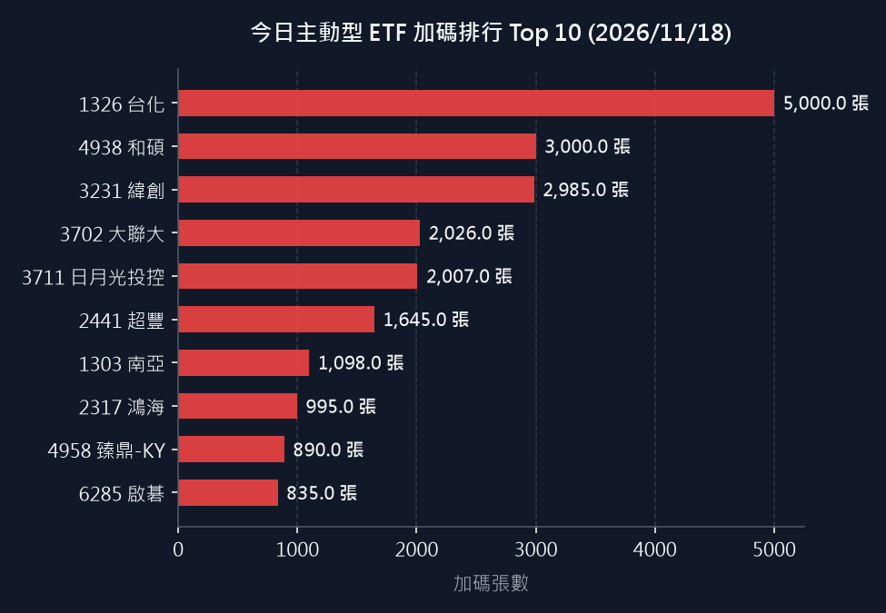
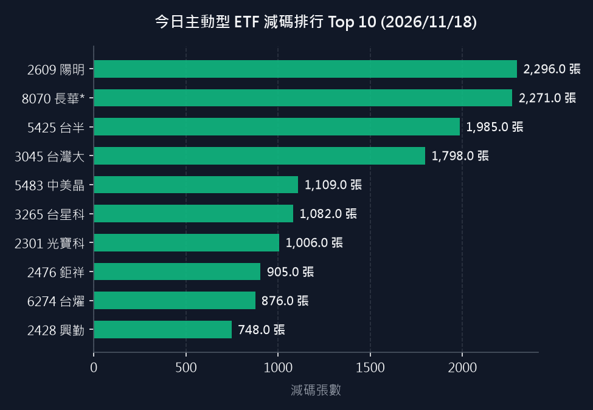

# 主動型 ETF 持股變動

資料來源：`主動型ETF持股明細.xlsx` 最近兩個日期分頁。

比較區間：`20261117` → `20261118`

## 今日加減碼視覺化排行

| 今日加碼 Top 10 | 今日減碼 Top 10 |
| :---: | :---: |
|  |  |

| ETF | 新增 | 刪除 | 比例變動 |
| :-- | --: | --: | --: |
| 00400A | 0 | 2 | 39 |
| 00401A | 1 | 3 | 50 |
| 00402A | 0 | 0 | 43 |
| 00403A | 1 | 2 | 32 |
| 00404A | 0 | 0 | 37 |
| 00405A | 0 | 0 | 28 |
| 00406A | 1 | 1 | 54 |
| 00407A | 0 | 0 | 44 |
| 00408A | 1 | 1 | 33 |
| 00980A | 0 | 0 | 44 |
| 00980D | 0 | 0 | 77 |
| 00981A | 0 | 0 | 29 |
| 00982A | 17 | 0 | 51 |
| 00983A | 0 | 2 | 32 |
| 00983D | 0 | 0 | 44 |
| 00984A | 1 | 0 | 73 |
| 00985A | 0 | 1 | 45 |
| 00986A | 0 | 0 | 28 |
| 00987A | 0 | 2 | 22 |
| 00988A | 1 | 1 | 25 |
| 00989A | 0 | 0 | 54 |
| 00990A | 1 | 1 | 33 |
| 00991A | 1 | 1 | 27 |
| 00992A | 0 | 0 | 37 |
| 00993A | 0 | 1 | 47 |
| 00994A | 1 | 1 | 26 |
| 00995A | 1 | 5 | 42 |
| 00996A | 1 | 2 | 37 |
| 00997A | 0 | 1 | 40 |
| 00998A | 0 | 1 | 39 |
| 00999A | 0 | 0 | 48 |

## 00400A

### 新增持股

- 無

### 刪除持股

- 2327 國巨*（0.93%，708 張）
- 6274 台燿（0.81%，279 張）

### 投資比例變動

- 1215 卜蜂：0.08% → 0.07%（-0.01）
- 1303 南亞：1.92% → 1.83%（-0.09）
- 2059 川湖：3.93% → 3.84%（-0.09）
- 2303 聯電：1.42% → 1.40%（-0.02）
- 2308 台達電：1.83% → 1.81%（-0.02）
- 2313 華通：0.75% → 0.74%（-0.01）
- 2330 台積電：11.04% → 12.80%（+1.76）
- 2345 智邦：1.22% → 1.28%（+0.06）
- 2360 致茂：1.95% → 0.82%（-1.13）
- 2368 金像電：2.24% → 2.31%（+0.07）
- 2383 台光電：5.54% → 5.32%（-0.22）
- 2454 聯發科：7.70% → 7.76%（+0.06）
- 2603 長榮：2.75% → 2.71%（-0.04）
- 2891 中信金：1.85% → 1.72%（-0.13）
- 3008 大立光：1.25% → 1.20%（-0.05）
- 3017 奇鋐：4.80% → 5.18%（+0.38）
- 3023 信邦：0.88% → 0.89%（+0.01）
- 3036 文曄：1.44% → 1.41%（-0.03）
- 3037 欣興：2.49% → 2.54%（+0.05）
- 3044 健鼎：3.84% → 4.30%（+0.46）
- 3081 聯亞：0.69% → 0.76%（+0.07）
- 3090 日電貿：0.26% → 0.25%（-0.01）
- 3167 大量：0.28% → 0.26%（-0.02）
- 3231 緯創：0.93% → 0.94%（+0.01）
- 3406 玉晶光：1.03% → 0.99%（-0.04）
- 3443 創意：3.47% → 3.25%（-0.22）
- 3529 力旺：1.15% → 1.14%（-0.01）
- 3653 健策：3.22% → 3.33%（+0.11）
- 3661 世芯-KY：2.52% → 2.72%（+0.20）
- 3665 貿聯-KY：1.17% → 1.27%（+0.10）
- 3711 日月光投控：0.88% → 0.91%（+0.03）
- 5274 信驊：2.76% → 2.66%（-0.10）
- 5434 崇越：0.35% → 0.34%（-0.01）
- 6147 頎邦：0.67% → 0.66%（-0.01）
- 6187 萬潤：0.70% → 0.69%（-0.01）
- 6223 旺矽：3.04% → 3.28%（+0.24）
- 6278 台表科：2.34% → 2.27%（-0.07）
- 6488 環球晶：1.25% → 1.23%（-0.02）
- ＸＡＧＸ金兌(3533.HK)：1.82% → 1.80%（-0.02）

## 00401A

### 新增持股

- 台股期貨12/26(FITXN*1.TF)（-0.27%，0.034 張）

### 刪除持股

- TAIEX FUTURES 16DEC26 FTZ6（-0.31%，0.034 張）
- 臺指選擇權11/26 43300 買權（0.00%，-0.03 張）
- 臺指選擇權11/26 46500 買權（0.00%，-0.38 張）

### 投資比例變動

- 1216 統一：0.29% → 0.28%（-0.01）
- 1303 南亞：1.08% → 1.03%（-0.05）
- 1476 儒鴻：2.13% → 2.09%（-0.04）
- 1477 聚陽：1.50% → 1.82%（+0.32）
- 2059 川湖：1.56% → 1.52%（-0.04）
- 2303 聯電：2.29% → 2.26%（-0.03）
- 2308 台達電：1.46% → 1.45%（-0.01）
- 2327 國巨*：0.41% → 0.39%（-0.02）
- 2330 台積電：20.79% → 20.47%（-0.32）
- 2357 華碩：1.60% → 1.61%（+0.01）
- 2360 致茂：1.34% → 1.32%（-0.02）
- 2379 瑞昱：1.04% → 1.05%（+0.01）
- 2382 廣達：1.73% → 1.71%（-0.02）
- 2383 台光電：0.73% → 0.70%（-0.03）
- 2412 中華電：0.94% → 0.93%（-0.01）
- 2454 聯發科：5.48% → 5.53%（+0.05）
- 2455 全新：1.40% → 1.39%（-0.01）
- 2603 長榮：2.21% → 2.18%（-0.03）
- 2881 富邦金：2.02% → 1.97%（-0.05）
- 2882 國泰金：1.05% → 1.02%（-0.03）
- 2883 凱基金：1.51% → 1.46%（-0.05）
- 2884 玉山金：1.84% → 1.63%（-0.21）
- 2886 兆豐金：2.30% → 2.18%（-0.12）
- 2887 台新新光金：1.03% → 0.95%（-0.08）
- 2890 永豐金：1.56% → 1.48%（-0.08）
- 2891 中信金：2.52% → 2.35%（-0.17）
- 3008 大立光：1.70% → 1.63%（-0.07）
- 3034 聯詠：0.18% → 0.17%（-0.01）
- 3037 欣興：0.44% → 0.45%（+0.01）
- 3131 弘塑：0.45% → 0.48%（+0.03）
- 3231 緯創：1.84% → 1.87%（+0.03）
- 3443 創意：2.17% → 2.04%（-0.13）
- 3491 昇達科：1.68% → 1.73%（+0.05）
- 3653 健策：0.67% → 1.08%（+0.41）
- 3711 日月光投控：3.68% → 3.81%（+0.13）
- 4904 遠傳：0.78% → 0.77%（-0.01）
- 4958 臻鼎-KY：0.96% → 0.97%（+0.01）
- 5274 信驊：1.05% → 1.01%（-0.04）
- 5347 世界：0.98% → 0.96%（-0.02）
- 5904 寶雅*：0.57% → 0.54%（-0.03）
- 6147 頎邦：0.93% → 0.92%（-0.01）
- 6187 萬潤：1.22% → 1.20%（-0.02）
- 6223 旺矽：1.81% → 1.96%（+0.15）
- 6285 啟碁：1.06% → 1.15%（+0.09）
- 6515 穎崴：0.64% → 0.65%（+0.01）
- 6531 愛普*：1.07% → 1.04%（-0.03）
- 7828 創新服務：1.15% → 1.24%（+0.09）
- 7856 漢測：0.63% → 0.62%（-0.01）
- 8464 億豐：1.01% → 0.98%（-0.03）
- TAIWAN TAIE C 18NOV26 40000 TWSE：-0.01% → 0.00%（+0.01）

## 00402A

### 新增持股

- 無

### 刪除持股

- 無

### 投資比例變動

- AAPL.US Apple：9.53% → 9.56%（+0.03）
- ADI.US Analog Devices：2.18% → 2.19%（+0.01）
- AMD.US AMD：6.21% → 6.24%（+0.03）
- AMZN.US Amazon：5.18% → 5.22%（+0.04）
- ANET.US Arista Networks：0.93% → 0.94%（+0.01）
- ARM.US Arm：0.72% → 0.76%（+0.04）
- ASML.US ASML Holding：1.16% → 1.14%（-0.02）
- AVGO.US Broadcom：2.49% → 2.57%（+0.08）
- AXON.US Axon Enterprise：0.50% → 0.49%（-0.01）
- BABA.US Alibaba Group：0.48% → 0.46%（-0.02）
- CIEN.US Ciena：0.97% → 1.00%（+0.03）
- COHR.US Coherent：1.14% → 1.19%（+0.05）
- CRWD.US CrowdStrike Holdings：1.85% → 1.83%（-0.02）
- GOOG.US Alphabet - Class C Capital Stock：3.29% → 3.27%（-0.02）
- GOOGL.US Alphabet - Class A Common Stock：3.30% → 3.28%（-0.02）
- INTC.US Intel：0.99% → 1.00%（+0.01）
- IOT.US Samsara：0.63% → 0.61%（-0.02）
- KLAC.US KLA：1.38% → 1.39%（+0.01）
- LITE.US Lumentum：1.27% → 1.31%（+0.04）
- LRCX.US Lam Research：2.11% → 2.12%（+0.01）
- MCHP.US Microchip Technology：1.22% → 1.25%（+0.03）
- MDB.US MongoDB：0.39% → 0.37%（-0.02）
- META.US Meta：3.90% → 3.88%（-0.02）
- MRVL.US Marvell：1.15% → 1.19%（+0.04）
- MSFT.US Microsoft：6.17% → 6.07%（-0.10）
- MU.US Micron：5.17% → 5.15%（-0.02）
- NFLX.US Netflix：1.00% → 0.99%（-0.01）
- NOW.US ServiceNow：0.90% → 0.85%（-0.05）
- NVDA.US NVIDIA：5.90% → 5.91%（+0.01）
- PANW.US Palo Alto：2.85% → 2.81%（-0.04）
- PLTR.US Palantir Technologies：2.09% → 2.05%（-0.04）
- SHOP.US Shopify：1.38% → 1.33%（-0.05）
- SIMO.US Silicon Motion：0.41% → 0.40%（-0.01）
- SKHY.US SK hynix：0.77% → 0.78%（+0.01）
- SNOW.US Snowflake：1.32% → 1.30%（-0.02）
- SPCX.US SpaceX：0.80% → 0.83%（+0.03）
- STX.US Seagate：0.89% → 0.90%（+0.01）
- TER.US Teradyne：0.60% → 0.61%（+0.01）
- TSM.US TSMC(ADR)：1.53% → 1.49%（-0.04）
- TTWO.US Take-Two：1.30% → 1.25%（-0.05）
- TXN.US Texas Instruments：2.94% → 2.98%（+0.04）
- V.US Visa：1.66% → 1.64%（-0.02）
- WDC.US Western Digital：1.61% → 1.64%（+0.03）

## 00403A

### 新增持股

- 2379 瑞昱（0.07%，100 張）

### 刪除持股

- 3211 順達（0.07%，350 張）
- 6274 台燿（0.36%，500 張）

### 投資比例變動

- 1303 南亞：3.61% → 3.44%（-0.17）
- 2059 川湖：0.60% → 0.59%（-0.01）
- 2308 台達電：2.10% → 2.07%（-0.03）
- 2327 國巨*：2.91% → 2.79%（-0.12）
- 2330 台積電：16.48% → 16.23%（-0.25）
- 2345 智邦：1.53% → 1.61%（+0.08）
- 2368 金像電：0.79% → 0.81%（+0.02）
- 2383 台光電：3.89% → 3.74%（-0.15）
- 2408 南亞科：0.84% → 0.82%（-0.02）
- 2449 京元電子：0.65% → 0.70%（+0.05）
- 2454 聯發科：6.85% → 6.91%（+0.06）
- 2882 國泰金：0.69% → 0.67%（-0.02）
- 2883 凱基金：0.13% → 0.12%（-0.01）
- 3008 大立光：1.55% → 1.49%（-0.06）
- 3017 奇鋐：5.76% → 6.23%（+0.47）
- 3037 欣興：4.20% → 4.29%（+0.09）
- 3044 健鼎：0.18% → 0.19%（+0.01）
- 3189 景碩：2.21% → 2.32%（+0.11）
- 3443 創意：4.98% → 4.67%（-0.31）
- 3450 聯鈞：0.42% → 0.43%（+0.01）
- 3653 健策：4.09% → 4.23%（+0.14）
- 3661 世芯-KY：0.16% → 0.25%（+0.09）
- 3665 貿聯-KY：1.88% → 2.03%（+0.15）
- 3711 日月光投控：1.36% → 1.63%（+0.27）
- 5274 信驊：1.63% → 1.57%（-0.06）
- 6223 旺矽：3.40% → 3.67%（+0.27）
- 6442 光聖：0.23% → 0.24%（+0.01）
- 6515 穎崴：0.28% → 0.29%（+0.01）
- 6669 緯穎：2.54% → 2.53%（-0.01）
- 6805 富世達：0.56% → 0.59%（+0.03）
- 8046 南電：2.18% → 2.10%（-0.08）
- 8996 高力：2.01% → 1.92%（-0.09）

## 00404A

### 新增持股

- 無

### 刪除持股

- 無

### 投資比例變動

- 1303 南亞：0.70% → 0.68%（-0.02）
- 2303 聯電：1.19% → 1.18%（-0.01）
- 2330 台積電：22.38% → 22.19%（-0.19）
- 2357 華碩：1.20% → 1.21%（+0.01）
- 2360 致茂：0.43% → 0.42%（-0.01）
- 2379 瑞昱：2.10% → 2.12%（+0.02）
- 2383 台光電：2.67% → 2.58%（-0.09）
- 2395 研華：1.81% → 1.87%（+0.06）
- 2454 聯發科：7.18% → 7.28%（+0.10）
- 2603 長榮：1.44% → 1.43%（-0.01）
- 2851 中再保：1.12% → 1.07%（-0.05）
- 2882 國泰金：3.18% → 3.12%（-0.06）
- 2885 元大金：3.24% → 3.06%（-0.18）
- 2887 台新新光金：1.87% → 1.75%（-0.12）
- 2890 永豐金：1.18% → 1.13%（-0.05）
- 3014 聯陽：1.15% → 1.14%（-0.01）
- 3017 奇鋐：1.15% → 1.24%（+0.09）
- 3034 聯詠：2.13% → 2.11%（-0.02）
- 3036 文曄：1.06% → 1.05%（-0.01）
- 3374 精材：0.12% → 0.11%（-0.01）
- 3443 創意：1.82% → 1.72%（-0.10）
- 3653 健策：1.00% → 1.05%（+0.05）
- 3711 日月光投控：3.41% → 3.55%（+0.14）
- 5274 信驊：2.13% → 2.07%（-0.06）
- 5434 崇越：1.81% → 1.78%（-0.03）
- 5904 寶雅*：0.47% → 0.45%（-0.02）
- 6196 帆宣：1.78% → 1.76%（-0.02）
- 6206 飛捷：0.72% → 0.73%（+0.01）
- 6223 旺矽：0.75% → 0.82%（+0.07）
- 6257 矽格：0.67% → 0.68%（+0.01）
- 6491 晶碩：0.93% → 0.91%（-0.02）
- 6505 台塑化：0.49% → 0.48%（-0.01）
- 6691 洋基工程：1.29% → 1.27%（-0.02）
- 8016 矽創：1.79% → 1.84%（+0.05）
- 8299 群聯：1.20% → 1.18%（-0.02）
- 台指選擇權12/26 46500 買權：-0.21% → -0.17%（+0.04）
- 台股期貨12/26(FITXN*1.TF)：19.29% → 19.19%（-0.10）

## 00405A

### 新增持股

- 無

### 刪除持股

- 無

### 投資比例變動

- 2059 川湖：1.82% → 1.76%（-0.06）
- 2308 台達電：0.55% → 0.54%（-0.01）
- 2330 台積電：5.89% → 6.92%（+1.03）
- 2345 智邦：4.50% → 4.67%（+0.17）
- 2368 金像電：5.22% → 5.34%（+0.12）
- 2383 台光電：4.17% → 3.97%（-0.20）
- 2454 聯發科：7.46% → 7.45%（-0.01）
- 3008 大立光：0.03% → 0.02%（-0.01）
- 3017 奇鋐：1.76% → 4.08%（+2.32）
- 3037 欣興：3.64% → 3.68%（+0.04）
- 3189 景碩：0.15% → 0.16%（+0.01）
- 3443 創意：2.83% → 2.63%（-0.20）
- 3653 健策：6.26% → 6.42%（+0.16）
- 3665 貿聯-KY：5.21% → 5.57%（+0.36）
- 3711 日月光投控：1.45% → 2.47%（+1.02）
- 5274 信驊：5.66% → 5.41%（-0.25）
- 5347 世界：0.15% → 0.14%（-0.01）
- 6187 萬潤：0.64% → 0.62%（-0.02）
- 6223 旺矽：7.16% → 7.66%（+0.50）
- 6274 台燿：1.34% → 1.27%（-0.07）
- 6285 啟碁：0.10% → 0.11%（+0.01）
- 6415 矽力*-KY：1.28% → 1.89%（+0.61）
- 6531 愛普*：3.44% → 3.31%（-0.13）
- 6669 緯穎：0.80% → 0.79%（-0.01）
- 6805 富世達：1.58% → 1.63%（+0.05）
- 7769 鴻勁：2.34% → 2.31%（-0.03）
- 8046 南電：5.71% → 5.44%（-0.27）
- 8996 高力：1.95% → 2.45%（+0.50）

## 00406A

### 新增持股

- 臺指選擇權第四週週三到期契約（-5.18%，-6 張）

### 刪除持股

- 臺指選擇權（-16.89%，-15.476 張）

### 投資比例變動

- 1303 南亞：2.48% → 2.43%（-0.05）
- 1326 台化：0.68% → 0.84%（+0.16）
- 1727 中華化：0.04% → 0.03%（-0.01）
- 1815 富喬：0.70% → 0.68%（-0.02）
- 2059 川湖：1.47% → 1.38%（-0.09）
- 2303 聯電：1.18% → 1.26%（+0.08）
- 2308 台達電：1.59% → 1.68%（+0.09）
- 2317 鴻海：0.21% → 0.34%（+0.13）
- 2327 國巨*：1.21% → 1.11%（-0.10）
- 2330 台積電：9.36% → 8.83%（-0.53）
- 2345 智邦：2.07% → 2.36%（+0.29）
- 2368 金像電：2.17% → 2.32%（+0.15）
- 2383 台光電：5.62% → 5.46%（-0.16）
- 2449 京元電子：0.30% → 0.31%（+0.01）
- 2454 聯發科：6.67% → 6.60%（-0.07）
- 2481 強茂：0.28% → 0.26%（-0.02）
- 2881 富邦金：0.65% → 0.60%（-0.05）
- 2882 國泰金：0.66% → 0.62%（-0.04）
- 2884 玉山金：0.55% → 0.47%（-0.08）
- 2885 元大金：0.79% → 0.71%（-0.08）
- 2886 兆豐金：0.65% → 0.59%（-0.06）
- 2887 台新新光金：0.62% → 0.55%（-0.07）
- 2890 永豐金：0.30% → 0.27%（-0.03）
- 3008 大立光：0.92% → 0.85%（-0.07）
- 3017 奇鋐：5.15% → 5.33%（+0.18）
- 3037 欣興：4.37% → 4.28%（-0.09）
- 3081 聯亞：0.97% → 0.90%（-0.07）
- 3105 穩懋：0.54% → 0.50%（-0.04）
- 3167 大量：0.44% → 0.39%（-0.05）
- 3189 景碩：1.51% → 1.52%（+0.01）
- 3231 緯創：0.30% → 0.61%（+0.31）
- 3264 欣銓：0.25% → 0.24%（-0.01）
- 3443 創意：2.15% → 2.20%（+0.05）
- 3653 健策：3.84% → 3.82%（-0.02）
- 3661 世芯-KY：0.80% → 0.83%（+0.03）
- 3665 貿聯-KY：1.30% → 1.35%（+0.05）
- 3711 日月光投控：2.14% → 2.41%（+0.27）
- 4938 和碩：0.41% → 0.56%（+0.15）
- 4958 臻鼎-KY：0.77% → 0.99%（+0.22）
- 5274 信驊：1.06% → 0.98%（-0.08）
- 6147 頎邦：0.56% → 0.53%（-0.03）
- 6187 萬潤：0.09% → 0.08%（-0.01）
- 6213 聯茂：0.30% → 0.29%（-0.01）
- 6223 旺矽：2.92% → 3.02%（+0.10）
- 6274 台燿：1.77% → 1.62%（-0.15）
- 6278 台表科：0.19% → 0.18%（-0.01）
- 6446 藥華藥：0.90% → 0.83%（-0.07）
- 6531 愛普*：0.07% → 0.06%（-0.01）
- 6669 緯穎：0.88% → 0.84%（-0.04）
- 6715 嘉基：0.70% → 0.61%（-0.09）
- 8046 南電：2.77% → 2.56%（-0.21）
- 8996 高力：0.61% → 0.78%（+0.17）
- 臺指選擇權第三週週五到期契約：-7.23% → -17.73%（-10.50）
- 臺股期貨 202612(FITXN*1.TF)：24.15% → 23.94%（-0.21）

## 00407A

### 新增持股

- 無

### 刪除持股

- 無

### 投資比例變動

- 1303 南亞：3.56% → 3.38%（-0.18）
- 1476 儒鴻：0.43% → 0.42%（-0.01）
- 1560 中砂：0.85% → 0.86%（+0.01）
- 2059 川湖：0.77% → 0.75%（-0.02）
- 2301 光寶科：1.37% → 1.35%（-0.02）
- 2308 台達電：1.94% → 1.91%（-0.03）
- 2327 國巨*：1.84% → 1.76%（-0.08）
- 2330 台積電：11.60% → 11.41%（-0.19）
- 2345 智邦：1.37% → 1.43%（+0.06）
- 2360 致茂：0.68% → 0.67%（-0.01）
- 2368 金像電：1.87% → 1.93%（+0.06）
- 2383 台光電：5.50% → 5.28%（-0.22）
- 2408 南亞科：1.33% → 1.02%（-0.31）
- 2451 創見：0.30% → 0.31%（+0.01）
- 2454 聯發科：6.86% → 6.90%（+0.04）
- 2615 萬海：1.12% → 1.15%（+0.03）
- 2618 長榮航：0.39% → 0.37%（-0.02）
- 3008 大立光：1.33% → 1.28%（-0.05）
- 3017 奇鋐：5.28% → 5.69%（+0.41）
- 3034 聯詠：0.79% → 0.77%（-0.02）
- 3037 欣興：4.49% → 4.58%（+0.09）
- 3081 聯亞：1.49% → 1.44%（-0.05）
- 3231 緯創：1.07% → 1.09%（+0.02）
- 3260 威剛：0.28% → 0.27%（-0.01）
- 3293 鈊象：0.77% → 0.76%（-0.01）
- 3406 玉晶光：0.94% → 0.90%（-0.04）
- 3443 創意：5.08% → 4.76%（-0.32）
- 3491 昇達科：1.11% → 1.14%（+0.03）
- 3533 嘉澤：1.00% → 0.99%（-0.01）
- 3653 健策：2.87% → 2.97%（+0.10）
- 3665 貿聯-KY：2.90% → 3.13%（+0.23）
- 3711 日月光投控：3.29% → 3.40%（+0.11）
- 4958 臻鼎-KY：0.88% → 0.89%（+0.01）
- 5274 信驊：1.31% → 1.26%（-0.05）
- 5434 崇越：0.22% → 0.21%（-0.01）
- 6187 萬潤：1.12% → 1.10%（-0.02）
- 6223 旺矽：3.25% → 3.50%（+0.25）
- 6274 台燿：1.39% → 1.33%（-0.06）
- 6446 藥華藥：0.43% → 0.41%（-0.02）
- 6510 精測：1.47% → 1.54%（+0.07）
- 6805 富世達：1.06% → 1.10%（+0.04）
- 8046 南電：2.75% → 2.63%（-0.12）
- 8299 群聯：0.30% → 0.29%（-0.01）
- 8996 高力：1.48% → 1.41%（-0.07）

## 00408A

### 新增持股

- 6223 旺矽（1.48%，4 張）

### 刪除持股

- 3026 禾伸堂（1.20%，34 張）

### 投資比例變動

- 1216 統一：0.14% → 0.13%（-0.01）
- 1303 南亞：4.41% → 4.23%（-0.18）
- 2301 光寶科：0.48% → 0.47%（-0.01）
- 2327 國巨*：0.65% → 0.62%（-0.03）
- 2330 台積電：7.84% → 7.81%（-0.03）
- 2345 智邦：0.57% → 0.60%（+0.03）
- 2368 金像電：5.12% → 5.32%（+0.20）
- 2383 台光電：4.07% → 3.94%（-0.13）
- 2395 研華：1.63% → 1.69%（+0.06）
- 2408 南亞科：1.15% → 1.12%（-0.03）
- 2454 聯發科：5.56% → 5.64%（+0.08）
- 2542 興富發：4.38% → 4.29%（-0.09）
- 2603 長榮：1.60% → 1.58%（-0.02）
- 2880 華南金：1.47% → 1.38%（-0.09）
- 2891 中信金：3.24% → 3.03%（-0.21）
- 3017 奇鋐：3.56% → 4.78%（+1.22）
- 3037 欣興：2.88% → 2.95%（+0.07）
- 3044 健鼎：1.16% → 1.26%（+0.10）
- 3081 聯亞：0.44% → 0.42%（-0.02）
- 3105 穩懋：0.66% → 0.63%（-0.03）
- 3167 大量：0.40% → 0.37%（-0.03）
- 3189 景碩：2.26% → 2.39%（+0.13）
- 3231 緯創：1.49% → 1.51%（+0.02）
- 3443 創意：1.78% → 1.68%（-0.10）
- 3653 健策：3.62% → 3.77%（+0.15）
- 3661 世芯-KY：1.84% → 2.66%（+0.82）
- 4904 遠傳：1.48% → 1.47%（-0.01）
- 5434 崇越：2.36% → 2.31%（-0.05）
- 6510 精測：1.86% → 2.45%（+0.59）
- 6805 富世達：2.55% → 2.67%（+0.12）
- 8046 南電：1.35% → 1.31%（-0.04）
- 8996 高力：2.79% → 2.68%（-0.11）
- 9802 鈺齊-KY：0.98% → 0.95%（-0.03）

## 00980A

### 新增持股

- 無

### 刪除持股

- 無

### 投資比例變動

- 1303 南亞：3.87% → 3.69%（-0.18）
- 2059 川湖：3.63% → 3.54%（-0.09）
- 2303 聯電：1.38% → 1.37%（-0.01）
- 2308 台達電：2.80% → 2.77%（-0.03）
- 2317 鴻海：3.76% → 3.72%（-0.04）
- 2327 國巨*：0.76% → 0.73%（-0.03）
- 2330 台積電：10.74% → 10.58%（-0.16）
- 2344 華邦電：1.49% → 1.44%（-0.05）
- 2345 智邦：0.87% → 0.92%（+0.05）
- 2360 致茂：0.82% → 0.81%（-0.01）
- 2368 金像電：1.85% → 1.91%（+0.06）
- 2376 技嘉：1.68% → 1.67%（-0.01）
- 2382 廣達：2.02% → 2.00%（-0.02）
- 2383 台光電：3.56% → 3.43%（-0.13）
- 2408 南亞科：2.22% → 2.16%（-0.06）
- 2454 聯發科：6.69% → 6.75%（+0.06）
- 2884 玉山金：1.58% → 1.40%（-0.18）
- 2891 中信金：2.12% → 1.97%（-0.15）
- 3008 大立光：2.05% → 1.97%（-0.08）
- 3017 奇鋐：2.31% → 2.49%（+0.18）
- 3026 禾伸堂：0.78% → 0.74%（-0.04）
- 3036 文曄：1.06% → 1.04%（-0.02）
- 3037 欣興：2.62% → 2.67%（+0.05）
- 3044 健鼎：1.38% → 1.49%（+0.11）
- 3081 聯亞：1.34% → 1.30%（-0.04）
- 3189 景碩：0.95% → 1.00%（+0.05）
- 3231 緯創：1.82% → 1.85%（+0.03）
- 3264 欣銓：0.71% → 0.70%（-0.01）
- 3443 創意：2.20% → 2.07%（-0.13）
- 3653 健策：2.74% → 2.83%（+0.09）
- 3665 貿聯-KY：1.41% → 1.53%（+0.12）
- 3711 日月光投控：2.26% → 2.34%（+0.08）
- 5274 信驊：1.38% → 1.33%（-0.05）
- 5904 寶雅*：0.84% → 0.80%（-0.04）
- 6223 旺矽：1.29% → 1.39%（+0.10）
- 6274 台燿：0.97% → 0.93%（-0.04）
- 6442 光聖：0.24% → 0.26%（+0.02）
- 6515 穎崴：1.38% → 1.40%（+0.02）
- 6805 富世達：0.59% → 0.61%（+0.02）
- 7751 竑騰：0.60% → 0.59%（-0.01）
- 8046 南電：1.31% → 1.26%（-0.05）
- 8299 群聯：1.12% → 1.09%（-0.03）
- 8996 高力：0.45% → 0.43%（-0.02）
- 台灣證交所加權股價指數(FITXN*1.TF)：2.64% → 2.61%（-0.03）

## 00980D

### 新增持股

- 無

### 刪除持股

- 無

### 投資比例變動

- AHOLD FINANCE USA LLC 6.88% 01MAY2029：0.51% → 0.52%（+0.01）
- ALLY FINANCIAL INC (REG) 8% 01NOV2031：0.55% → 0.56%（+0.01）
- ARCELORMITTAL SA 6.55% 29NOV2027：0.58% → 0.59%（+0.01）
- ARSENAL AIC PARENT LLC SER REGS 11.5 % 01-OCT-2031：0.34% → 0.35%（+0.01）
- ASURION LLC/ASURION CO 8.375% 01FEB2034：0.43% → 0.44%（+0.01）
- ATHENE HOLDING LTD 6.625000 % 19MAY2055：0.58% → 0.59%（+0.01）
- BANCO SANTANDER SA (REG) 6.607% 07NOV2028：0.70% → 0.71%（+0.01）
- BANCO SANTANDER SA 6.921% 08AUG2033：0.35% → 0.36%（+0.01）
- BANK OF AMERICA CORP (REG) 7.75% 14MAY2038：0.54% → 0.55%（+0.01）
- BAT CAPITAL CORP (REG) 7.079% 02AUG2043：0.33% → 0.34%（+0.01）
- BAT CAPITAL CORP (REG) 7.75% 19OCT2032：0.47% → 0.48%（+0.01）
- BLUE OWL TECHNOLOGY FIN CORP II 6.75 % 04APR2029：0.59% → 0.60%（+0.01）
- BOSTON PROPERTIES LP (REG) 6.750000 % 01-DEC-2027：0.49% → 0.50%（+0.01）
- BRITISH TELECOMMUNICATIO (BR) 9.625% 15DEC2030：0.60% → 0.61%（+0.01）
- CHARTER COMM OPT LLC/CAP (REG) 5.5% 01APR2063：0.49% → 0.50%（+0.01）
- CHARTER COMM OPT LLC/CAP (REG) 6.834000 % 23OCT2055：0.46% → 0.47%（+0.01）
- CHC GROUP LLC SER REGS 11.750000 % 01-SEP-2030：0.43% → 0.44%（+0.01）
- CHS/COMMUNITY HEALTH SYS SER REGS 10.875000 % 15JAN2032：0.44% → 0.42%（-0.02）
- CHS/COMMUNITY HEALTH SYS SER REGS 9.750000 % 15JAN2034：0.45% → 0.44%（-0.01）
- CONCENTRIX CORP (REG) 6.6% 02AUG2028：0.55% → 0.56%（+0.01）
- CONOCOPHILLIPS COMPANY (REG) 6.95% 15APR2029：0.54% → 0.55%（+0.01）
- CONSOLIDATED ENERGY FIN SER REGS 12.000000 % 15FEB2031：0.59% → 0.60%（+0.01）
- COREWEAVE INC SER REGS (REG S) 9.75% 01OCT2031：0.48% → 0.49%（+0.01）
- COREWEAVE INC SER REGS (REG) (REG S) 9.625% 15JUL2032：0.48% → 0.49%（+0.01）
- COREWEAVE INC SER REGS 9.000000 % 01FEB2031：0.23% → 0.24%（+0.01）
- DAIMLER FINANCE NA LLC REG 8.5% 18JAN2031：0.67% → 0.68%（+0.01）
- DELL INT LLC / EMC CORP (REG) 8.1% 15JUL2036：0.60% → 0.61%（+0.01）
- DELL INT LLC / EMC CORP (REG) 8.35% 15JUL2046：0.56% → 0.57%（+0.01）
- DEUTSCHE BANK NY VAR 10FEB2034：0.35% → 0.36%（+0.01）
- DEUTSCHE TELEKOM INT FIN (REG) 9.25% 01JUN2032：0.44% → 0.45%（+0.01）
- DEVON ENERGY CORPORATION (REG) 7.875% 30SEP2031：0.49% → 0.50%（+0.01）
- EDISON INTERNATIONAL (REG) 6.95% 15NOV2029：0.61% → 0.62%（+0.01）
- ENERGY TRANSFER LP (REG) 7.5% 01JUL2038：0.34% → 0.35%（+0.01）
- FIFTH THIRD BANCORP (REG) 8.25% 01MAR2038：0.67% → 0.68%（+0.01）
- FMC CORP (REG) 6.375000 % 18MAY2053：0.30% → 0.31%（+0.01）
- FORD MOTOR CREDIT CO LLC (REG) 7.2% 10JUN2030：0.35% → 0.36%（+0.01）
- FORD MOTOR CREDIT CO LLC (REG) 7.35% 04NOV2027：0.35% → 0.36%（+0.01）
- FORD MOTOR CREDIT CO LLC (REG) 7.35% 06MAR2030：0.35% → 0.36%（+0.01）
- FORD MOTOR CREDIT CO LLC 6.798% 07NOV2028：0.35% → 0.36%（+0.01）
- HERTZ CORP/THE SER REGS (REG S) 12.625% 15JUL2029：0.25% → 0.24%（-0.01）
- HSBC HOLDINGS PLC (REG) VAR 13NOV2034：0.36% → 0.37%（+0.01）
- ICAHN ENTERPRISES/FIN (REG) 9.75% 15JAN2029：0.26% → 0.27%（+0.01）
- ICAHN ENTERPRISES/FIN SER REGS 10.000000 % 15NOV2029：0.27% → 0.28%（+0.01）
- JBS USA HOLD/FOOD/LUX CO 7.250000 % 15NOV2053：0.48% → 0.49%（+0.01）
- JETBLUE AIRWAYS/LOYALTY SER REGS (REG S) 9.875% 20SEP2031：0.37% → 0.36%（-0.01）
- KINDER MORGAN INC/DELAWA SER GMTN (REG) 7.75% 15JAN2032：0.34% → 0.35%（+0.01）
- LBM ACQUISITION LLC SER REGS 9.500000 % 15JUN2031：0.45% → 0.42%（-0.03）
- LINCOLN NATIONAL CORP (REG) 7.000000 % 15JUN2040：0.48% → 0.49%（+0.01）
- M&T BANK CORPORATION (REG) VAR 30OCT2029：0.57% → 0.58%（+0.01）
- MACQUARIE BANK LTD SER REGS (REG S) 6.798% 18JAN2033：0.35% → 0.36%（+0.01）
- MOBIUS MERGER SUB SER REGS 9.000000 % 01JUN2030：0.29% → 0.30%（+0.01）
- MYLAN INC (REG) 5.4% 29/11/2043：0.35% → 0.36%（+0.01）
- NATIONWIDE MUTUAL INSUR 9.375% 15AUG2039：0.54% → 0.55%（+0.01）
- NAVIENT CORP (REG) 11.5% 15MAR2031：0.41% → 0.40%（-0.01）
- ORACLE CORP 6.000000 % 03AUG2055：0.29% → 0.30%（+0.01）
- ORANGE SA (REG) 9% 01MAR2031：0.69% → 0.70%（+0.01）
- OWENS-BROCKWAY SER REGS (REG) (REG S) 9.5% 01JUN2033：0.50% → 0.49%（-0.01）
- PEPSICO INC (REG) 7.000000 % 01MAR2029：0.33% → 0.34%（+0.01）
- POLARIS INC 6.950000 % 15MAR2029：0.50% → 0.51%（+0.01）
- RIO TINTO FIN USA LTD (REG) 7.125% 15JUL2028：0.60% → 0.61%（+0.01）
- SANTANDER HOLDINGS USA VAR 09MAR2029：0.50% → 0.51%（+0.01）
- SANTANDER HOLDINGS USA VAR 09NOV2031：0.62% → 0.63%（+0.01）
- SPACE EXPLORATION TECH SER 144A (REG) 6.65% 15JUL2056：0.31% → 0.32%（+0.01）
- SUNCOR ENERGY INC (REG) 7.15% 01FEB2032：0.33% → 0.34%（+0.01）
- SYMETRA LIFE INSURANCE SER REGS 6.550000 % 01OCT2055：0.32% → 0.33%（+0.01）
- TIME WARNER CABLE INC REG 7.3% 01JUL2038：0.31% → 0.32%（+0.01）
- TIME WARNER ENTERTAINMEN 8.375% 15JUL2033：0.66% → 0.67%（+0.01）
- TRANSCANADA PIPELINES LTD 7.625PCT 15/01/2039：0.55% → 0.56%（+0.01）
- TRUIST FINANCIAL CORP SER MTN VAR 30OCT2029：0.68% → 0.69%（+0.01）
- US 10YR NOTE (CBT)DEC26 21-DEC-2026：18.53% → 18.69%（+0.16）
- US 10YR ULTRA FUT DEC26 21-DEC-2026：-2.57% → -1.85%（+0.72）
- US 2YR NOTE (CBT) DEC26 31-DEC-2026：1.75% → 1.77%（+0.02）
- US 5YR NOTE (CBT) DEC26 31-DEC-2026：-15.95% → -16.99%（-1.04）
- US LONG BOND(CBT) DEC26 21-DEC-2026：5.64% → 5.68%（+0.04）
- US ULTRA BOND CBT DEC26 21-DEC-2026：-0.55% → -1.30%（-0.75）
- VALERO ENERGY CORP (REG) 7.5% 15APR2032：0.50% → 0.51%（+0.01）
- VIACOM INC (REG) 5.85% 01SEP2043：0.49% → 0.48%（-0.01）

## 00981A

### 新增持股

- 無

### 刪除持股

- 無

### 投資比例變動

- 2303 聯電：2.64% → 2.57%（-0.07）
- 2308 台達電：3.33% → 3.23%（-0.10）
- 2317 鴻海：0.42% → 0.41%（-0.01）
- 2327 國巨*：3.53% → 3.33%（-0.20）
- 2330 台積電：17.44% → 16.87%（-0.57）
- 2345 智邦：3.93% → 4.05%（+0.12）
- 2368 金像電：2.80% → 2.84%（+0.04）
- 2383 台光電：6.38% → 6.03%（-0.35）
- 2449 京元電子：0.57% → 0.60%（+0.03）
- 2454 聯發科：9.33% → 9.28%（-0.05）
- 2891 中信金：0.30% → 0.28%（-0.02）
- 3017 奇鋐：7.16% → 7.72%（+0.56）
- 3037 欣興：5.23% → 5.25%（+0.02）
- 3264 欣銓：0.35% → 0.34%（-0.01）
- 3443 創意：2.95% → 2.82%（-0.13）
- 3653 健策：4.61% → 4.69%（+0.08）
- 3665 貿聯-KY：1.80% → 2.01%（+0.21）
- 3711 日月光投控：3.79% → 3.95%（+0.16）
- 5274 信驊：0.98% → 0.93%（-0.05）
- 6223 旺矽：4.42% → 4.73%（+0.31）
- 6271 同欣電：0.24% → 0.23%（-0.01）
- 6274 台燿：2.41% → 2.27%（-0.14）
- 6510 精測：0.53% → 0.55%（+0.02）
- 6669 緯穎：1.43% → 1.40%（-0.03）
- 6805 富世達：1.16% → 1.19%（+0.03）
- 8046 南電：2.51% → 2.37%（-0.14）
- 8358 金居：0.09% → 0.08%（-0.01）
- 8996 高力：0.48% → 0.45%（-0.03）
- 台指期貨 2026/12(FITXN*1.TF)：2.90% → 2.81%（-0.09）

## 00982A

### 新增持股

- 1785 光洋科（0.10%，488 張）
- 2327 國巨*（0.39%，444 張）
- 2351 順德（0.10%，314 張）
- 2368 金像電（0.94%，430 張）
- 2441 超豐（0.41%，1645 張）
- 2451 創見（0.10%，185 張）
- 2467 志聖（0.10%，154 張）
- 3028 增你強（0.20%，1374 張）
- 3044 健鼎（0.23%，191 張）
- 3661 世芯-KY（0.11%，11 張）
- 3702 大聯大（0.40%，1965 張）
- 4749 新應材（0.10%，59 張）
- 6285 啟碁（0.42%，835 張）
- 6691 洋基工程（0.10%，77 張）
- 7788 松川精密（0.06%，128 張）
- 7828 創新服務（0.02%，6 張）
- 8016 矽創（0.41%，670 張）

### 刪除持股

- 無

### 投資比例變動

- 2059 川湖：2.41% → 2.36%（-0.05）
- 2301 光寶科：1.78% → 1.24%（-0.54）
- 2303 聯電：1.29% → 0.90%（-0.39）
- 2330 台積電：8.77% → 8.68%（-0.09）
- 2360 致茂：2.94% → 2.04%（-0.90）
- 2376 技嘉：1.30% → 1.29%（-0.01）
- 2377 微星：0.41% → 0.40%（-0.01）
- 2383 台光電：3.01% → 2.91%（-0.10）
- 2395 研華：1.47% → 1.48%（+0.01）
- 2428 興勤：1.01% → 0.70%（-0.31）
- 2454 聯發科：9.24% → 9.35%（+0.11）
- 2455 全新：1.35% → 1.33%（-0.02）
- 2476 鉅祥：0.75% → 0.50%（-0.25）
- 2478 大毅：0.34% → 0.33%（-0.01）
- 2486 一詮：0.38% → 0.14%（-0.24）
- 2885 元大金：0.38% → 0.36%（-0.02）
- 3008 大立光：3.06% → 2.95%（-0.11）
- 3017 奇鋐：2.48% → 2.70%（+0.22）
- 3037 欣興：0.64% → 0.24%（-0.40）
- 3045 台灣大：0.92% → 0.33%（-0.59）
- 3090 日電貿：0.35% → 0.24%（-0.11）
- 3105 穩懋：8.53% → 8.23%（-0.30）
- 3231 緯創：2.01% → 2.05%（+0.04）
- 3265 台星科：1.23% → 0.84%（-0.39）
- 3491 昇達科：4.83% → 4.98%（+0.15）
- 3583 辛耘：0.13% → 0.07%（-0.06）
- 3617 碩天：0.61% → 0.43%（-0.18）
- 3711 日月光投控：2.52% → 2.62%（+0.10）
- 4958 臻鼎-KY：2.94% → 2.85%（-0.09）
- 5274 信驊：1.26% → 0.86%（-0.40）
- 5425 台半：1.20% → 0.82%（-0.38）
- 5483 中美晶：1.34% → 0.91%（-0.43）
- 5536 聖暉*：0.96% → 0.95%（-0.01）
- 6139 亞翔：5.68% → 5.85%（+0.17）
- 6196 帆宣：0.29% → 0.20%（-0.09）
- 6213 聯茂：1.49% → 1.50%（+0.01）
- 6214 精誠：0.05% → 0.03%（-0.02）
- 6223 旺矽：3.02% → 3.28%（+0.26）
- 6239 力成：1.95% → 1.96%（+0.01）
- 6274 台燿：0.29% → 0.28%（-0.01）
- 6446 藥華藥：0.14% → 0.13%（-0.01）
- 6472 保瑞：0.94% → 0.89%（-0.05）
- 6488 環球晶：1.63% → 1.12%（-0.51）
- 6510 精測：1.03% → 1.08%（+0.05）
- 6531 愛普*：7.00% → 6.84%（-0.16）
- 6640 均華：0.20% → 0.14%（-0.06）
- 6669 緯穎：1.84% → 1.30%（-0.54）
- 6672 騰輝電子-KY：2.46% → 2.38%（-0.08）
- 7722 LINEPAY：0.04% → 0.05%（+0.01）
- 8070 長華*：0.85% → 0.59%（-0.26）
- 8996 高力：1.12% → 1.08%（-0.04）

## 00983A

### 新增持股

- 無

### 刪除持股

- ACHR.US Archer（0.05%，3.283 張）
- PACB.US Pacific Biosciences of Californi（0.06%，7.908 張）

### 投資比例變動

- AMD.US AMD：3.58% → 4.03%（+0.45）
- AMZN.US Amazon：4.58% → 4.75%（+0.17）
- AVGO.US Broadcom：1.24% → 1.28%（+0.04）
- BEAM.US Beam Therapeutics：2.09% → 1.96%（-0.13）
- BLSH.US Bullish：0.91% → 0.90%（-0.01）
- BMNR.US BitMine：1.13% → 1.11%（-0.02）
- COIN.US Coinbase：2.22% → 1.92%（-0.30）
- CRCL.US Circle：2.96% → 2.72%（-0.24）
- CRSP.US CRISPR Therapeutics：3.23% → 2.97%（-0.26）
- GOOG.US Alphabet - Class C Capital Stock：3.06% → 3.20%（+0.14）
- HOOD.US Robinhood Markets：2.23% → 2.16%（-0.07）
- ILMN.US Illumina：1.25% → 1.15%（-0.10）
- META.US Meta：3.80% → 4.02%（+0.22）
- MSFT.US Microsoft：2.47% → 3.06%（+0.59）
- NET.US Cloudflare：1.59% → 1.56%（-0.03）
- NTLA.US Intellia Therapeutics：1.44% → 1.32%（-0.12）
- NTRA.US Natera：1.40% → 1.20%（-0.20）
- NVDA.US NVIDIA：2.90% → 2.66%（-0.24）
- PLTR.US Palantir Technologies：3.18% → 3.14%（-0.04）
- RKLB.US Rocket Lab：1.53% → 1.48%（-0.05）
- RXRX.US Recursion Pharmaceuticals：1.02% → 0.96%（-0.06）
- SHOP.US Shopify：5.15% → 4.99%（-0.16）
- SNOW.US Snowflake：0.56% → 0.55%（-0.01）
- SPCX.US SpaceX：8.95% → 9.26%（+0.31）
- TEM.US Tempus：5.16% → 4.89%（-0.27）
- TER.US Teradyne：0.06% → 0.07%（+0.01）
- TSLA.US Tesla：9.26% → 9.19%（-0.07）
- TSM.US TSMC(ADR)：2.78% → 2.70%（-0.08）
- TWST.US Twist Bioscience：3.02% → 3.03%（+0.01）
- TXG.US 10x Genomics：2.92% → 2.68%（-0.24）
- WGS.US GeneDx：0.44% → 0.42%（-0.02）
- XYZ.US Block：2.61% → 2.80%（+0.19）

## 00983D

### 新增持股

- 無

### 刪除持股

- 無

### 投資比例變動

- ABIBB 8.2 01/15/39：1.69% → 1.70%（+0.01）
- ABXCN 7 1/2 09/15/38：0.60% → 0.61%（+0.01）
- AET 6 5/8 06/15/36：0.83% → 0.84%（+0.01）
- ALLY 8 11/01/31：1.36% → 1.37%（+0.01）
- ATH 6 5/8 05/19/55：0.95% → 0.96%（+0.01）
- AWK 6.593 10/15/37：0.80% → 0.81%（+0.01）
- BACR 7.437 11/02/33：1.44% → 1.45%（+0.01）
- BATSLN 7.081 08/02/53：1.30% → 1.31%（+0.01）
- BHCCN 11 09/30/28：2.21% → 2.23%（+0.02）
- BNCN 7 3/8 03/01/33：1.25% → 1.26%（+0.01）
- BRITEL 9 5/8 12/15/30：1.53% → 1.55%（+0.02）
- C 8 1/8 07/15/39：1.67% → 1.68%（+0.01）
- CMCSA 6.95 08/15/37：0.56% → 0.57%（+0.01）
- CP 7 1/8 10/15/31：0.93% → 0.94%（+0.01）
- CYH 10 7/8 01/15/32：1.44% → 1.38%（-0.06）
- DOW 6.9 05/15/53：0.85% → 0.86%（+0.01）
- DT 9 1/4 06/01/32：1.50% → 1.51%（+0.01）
- DTV 8 7/8 02/01/30：1.85% → 1.86%（+0.01）
- DUK 7 3/4 03/01/31：1.58% → 1.59%（+0.01）
- FFHCN 6.35 03/22/54：0.79% → 0.80%（+0.01）
- GE 6 7/8 01/10/39：0.95% → 0.96%（+0.01）
- GS 6 1/4 02/01/41：0.36% → 0.37%（+0.01）
- HAL 7.45 09/15/39：1.57% → 1.58%（+0.01）
- IEP 10 11/15/29：1.38% → 1.44%（+0.06）
- KMI 6.95 01/15/38：1.19% → 1.20%（+0.01）
- LQDW.US iShares LQD Premium Income+ ETF：7.64% → 7.69%（+0.05）
- MBGGR 8 1/2 01/18/31：1.49% → 1.50%（+0.01）
- MINAU 9 1/4 10/01/28：1.02% → 1.03%（+0.01）
- MOHEGN 11 7/8 04/15/31：1.56% → 1.57%（+0.01）
- MPC 6 1/2 03/01/41：0.18% → 0.19%（+0.01）
- MS 7 1/4 04/01/32：1.47% → 1.48%（+0.01）
- NVDA 5.55 06/15/46：1.28% → 1.29%（+0.01）
- OXY 6.6 03/15/46：0.84% → 0.85%（+0.01）
- PFE 7.2 03/15/39：1.01% → 1.02%（+0.01）
- S 8 3/4 03/15/32：1.47% → 1.48%（+0.01）
- SPCX 6.6 07/15/46：1.24% → 1.25%（+0.01）
- SUCN 6.85 06/01/39：0.95% → 0.96%（+0.01）
- SVC 8 7/8 06/15/32：0.55% → 0.56%（+0.01）
- TELEFONICA EMISIONES SAU 7.045 06/20/36：1.55% → 1.56%（+0.01）
- TLTW.US iShares TLT Premium Income+ ETF：8.97% → 9.07%（+0.10）
- UNITEDHEALTH GROUP INC 6.875 02/15/38：0.98% → 0.99%（+0.01）
- VENLNG 9 1/2 02/01/29：1.63% → 1.64%（+0.01）
- VLO 6 5/8 06/15/37：0.83% → 0.84%（+0.01）
- VZ 7 3/4 12/01/30：1.30% → 1.31%（+0.01）

## 00984A

### 新增持股

- 3374 精材（0.77%，172 張）

### 刪除持股

- 無

### 投資比例變動

- 1216 統一：0.68% → 0.69%（+0.01）
- 1301 台塑：0.89% → 0.86%（-0.03）
- 1303 南亞：3.30% → 3.24%（-0.06）
- 1326 台化：2.62% → 2.52%（-0.10）
- 1560 中砂：1.69% → 1.75%（+0.06）
- 1605 華新：0.82% → 0.83%（+0.01）
- 1709 和益：0.99% → 0.98%（-0.01）
- 2006 東和鋼鐵：0.65% → 0.66%（+0.01）
- 2027 大成鋼：0.86% → 0.89%（+0.03）
- 2059 川湖：2.16% → 2.14%（-0.02）
- 2301 光寶科：0.82% → 0.83%（+0.01）
- 2313 華通：0.71% → 0.73%（+0.02）
- 2317 鴻海：0.05% → 0.06%（+0.01）
- 2347 聯強：0.72% → 0.74%（+0.02）
- 2351 順德：0.66% → 0.68%（+0.02）
- 2357 華碩：0.86% → 0.89%（+0.03）
- 2377 微星：0.79% → 0.80%（+0.01）
- 2379 瑞昱：0.64% → 0.65%（+0.01）
- 2395 研華：2.24% → 2.35%（+0.11）
- 2409 友達：0.90% → 0.89%（-0.01）
- 2412 中華電：1.01% → 1.02%（+0.01）
- 2449 京元電子：0.40% → 0.45%（+0.05）
- 2454 聯發科：0.39% → 0.40%（+0.01）
- 2455 全新：1.01% → 1.24%（+0.23）
- 2464 盟立：0.81% → 0.84%（+0.03）
- 2603 長榮：2.81% → 2.85%（+0.04）
- 2615 萬海：1.50% → 1.58%（+0.08）
- 2618 長榮航：0.72% → 0.71%（-0.01）
- 2634 漢翔：0.62% → 0.63%（+0.01）
- 2637 慧洋-KY：0.63% → 0.64%（+0.01）
- 2801 彰銀：0.66% → 0.65%（-0.01）
- 2880 華南金：0.68% → 0.65%（-0.03）
- 2884 玉山金：0.65% → 0.60%（-0.05）
- 2885 元大金：1.35% → 1.30%（-0.05）
- 2886 兆豐金：0.69% → 0.67%（-0.02）
- 2887 台新新光金：1.45% → 1.39%（-0.06）
- 2890 永豐金：0.66% → 0.64%（-0.02）
- 2892 第一金：0.68% → 0.67%（-0.01）
- 3017 奇鋐：3.37% → 3.69%（+0.32）
- 3034 聯詠：0.62% → 0.63%（+0.01）
- 3037 欣興：1.32% → 1.40%（+0.08）
- 3044 健鼎：0.81% → 0.89%（+0.08）
- 3045 台灣大：1.56% → 1.57%（+0.01）
- 3189 景碩：1.57% → 2.21%（+0.64）
- 3264 欣銓：1.52% → 1.55%（+0.03）
- 3406 玉晶光：1.45% → 1.43%（-0.02）
- 3443 創意：2.77% → 2.65%（-0.12）
- 3450 聯鈞：0.24% → 0.25%（+0.01）
- 3653 健策：1.13% → 1.19%（+0.06）
- 3702 大聯大：0.71% → 0.72%（+0.01）
- 3711 日月光投控：2.14% → 2.28%（+0.14）
- 4958 臻鼎-KY：0.53% → 0.56%（+0.03）
- 4967 十銓：0.86% → 0.85%（-0.01）
- 5274 信驊：0.36% → 0.35%（-0.01）
- 5351 鈺創：0.78% → 0.79%（+0.01）
- 5871 中租-KY：0.63% → 0.64%（+0.01）
- 5904 寶雅*：0.66% → 0.64%（-0.02）
- 6187 萬潤：1.42% → 1.43%（+0.01）
- 6196 帆宣：1.25% → 1.26%（+0.01）
- 6197 佳必琪：0.65% → 0.69%（+0.04）
- 6213 聯茂：0.47% → 0.61%（+0.14）
- 6214 精誠：0.89% → 0.88%（-0.01）
- 6274 台燿：0.38% → 0.37%（-0.01）
- 6415 矽力*-KY：0.64% → 0.60%（-0.04）
- 6446 藥華藥：1.53% → 1.50%（-0.03）
- 6505 台塑化：3.68% → 3.72%（+0.04）
- 6669 緯穎：0.90% → 0.93%（+0.03）
- 6670 復盛應用：0.58% → 0.57%（-0.01）
- 6672 騰輝電子-KY：0.75% → 0.74%（-0.01）
- 6770 力積電：0.74% → 0.75%（+0.01）
- 6957 裕慶-KY：0.87% → 0.89%（+0.02）
- 8039 台虹：0.70% → 0.68%（-0.02）
- 9933 中鼎：1.19% → 1.23%（+0.04）

## 00985A

### 新增持股

- 無

### 刪除持股

- 台積電期貨(FICDFN*1.TF)（1.69%，0.095 張）

### 投資比例變動

- 1216 統一：1.54% → 1.51%（-0.03）
- 1301 台塑：0.47% → 0.45%（-0.02）
- 1504 東元：0.53% → 0.52%（-0.01）
- 1605 華新：1.50% → 1.47%（-0.03）
- 2027 大成鋼：3.07% → 3.11%（+0.04）
- 2059 川湖：1.90% → 1.86%（-0.04）
- 2303 聯電：0.99% → 0.98%（-0.01）
- 2308 台達電：2.56% → 2.54%（-0.02）
- 2317 鴻海：1.99% → 1.98%（-0.01）
- 2327 國巨*：1.74% → 1.99%（+0.25）
- 2330 台積電：15.28% → 15.11%（-0.17）
- 2344 華邦電：1.34% → 1.30%（-0.04）
- 2345 智邦：2.39% → 2.52%（+0.13）
- 2368 金像電：1.85% → 1.92%（+0.07）
- 2376 技嘉：2.34% → 2.33%（-0.01）
- 2383 台光電：3.13% → 3.03%（-0.10）
- 2408 南亞科：1.62% → 1.58%（-0.04）
- 2412 中華電：1.57% → 1.55%（-0.02）
- 2454 聯發科：1.97% → 2.00%（+0.03）
- 2603 長榮：1.04% → 0.48%（-0.56）
- 2609 陽明：1.05% → 0.49%（-0.56）
- 2610 華航：0.58% → 0.56%（-0.02）
- 3008 大立光：1.55% → 1.49%（-0.06）
- 3017 奇鋐：1.24% → 1.34%（+0.10）
- 3036 文曄：3.40% → 3.35%（-0.05）
- 3037 欣興：2.85% → 2.92%（+0.07）
- 3081 聯亞：2.95% → 2.86%（-0.09）
- 3105 穩懋：0.52% → 1.26%（+0.74）
- 3189 景碩：0.66% → 0.70%（+0.04）
- 3231 緯創：0.98% → 1.00%（+0.02）
- 3491 昇達科：0.22% → 0.23%（+0.01）
- 3653 健策：3.73% → 3.88%（+0.15）
- 3661 世芯-KY：1.30% → 1.41%（+0.11）
- 3665 貿聯-KY：1.54% → 1.67%（+0.13）
- 3711 日月光投控：1.49% → 1.55%（+0.06）
- 4904 遠傳：1.15% → 1.14%（-0.01）
- 6285 啟碁：1.34% → 1.46%（+0.12）
- 6442 光聖：1.30% → 1.41%（+0.11）
- 6446 藥華藥：2.40% → 1.69%（-0.71）
- 6488 環球晶：1.43% → 1.40%（-0.03）
- 6531 愛普*：2.24% → 2.18%（-0.06）
- 6669 緯穎：3.11% → 3.12%（+0.01）
- 7769 鴻勁：2.57% → 2.58%（+0.01）
- 8046 南電：1.36% → 1.51%（+0.15）
- 8996 高力：1.60% → 1.97%（+0.37）

## 00986A

### 新增持股

- 無

### 刪除持股

- 無

### 投資比例變動

- 2330 台積電：8.82% → 8.63%（-0.19）
- 2454 聯發科：1.72% → 1.70%（-0.02）
- AAPL.US Apple：3.05% → 3.20%（+0.15）
- AMZN.US Amazon：5.11% → 5.25%（+0.14）
- AVGO.US Broadcom：4.28% → 4.47%（+0.19）
- BE.US Bloom Energy：2.24% → 2.14%（-0.10）
- CRWD.US CrowdStrike Holdings：4.66% → 4.79%（+0.13）
- ETN.US Eaton：2.42% → 2.45%（+0.03）
- GEV.US GE Vernova：2.75% → 2.27%（-0.48）
- GOOGL.US Alphabet - Class A Common Stock：6.08% → 6.11%（+0.03）
- GS.US Goldman Sachs：1.26% → 1.28%（+0.02）
- JPM.US JPMorgan Chase：2.61% → 2.64%（+0.03）
- LITE.US Lumentum：3.19% → 3.18%（-0.01）
- LLY.US Eli Lilly：4.45% → 4.63%（+0.18）
- MA.US Mastercard：1.59% → 1.64%（+0.05）
- MSFT.US Microsoft：4.31% → 5.15%（+0.84）
- MU.US Micron：4.27% → 4.14%（-0.13）
- MUFG(8306.JP)：1.19% → 1.20%（+0.01）
- NET.US Cloudflare：2.51% → 2.48%（-0.03）
- NVDA.US NVIDIA：5.58% → 2.26%（-3.32）
- PLTR.US Palantir Technologies：1.61% → 1.59%（-0.02）
- RBRK.US Rubrik：0.98% → 0.95%（-0.03）
- SKHY.US SK hynix：0.90% → 0.89%（-0.01）
- SNOW.US Snowflake：2.19% → 2.18%（-0.01）
- 嘉能可公司：1.85% → 1.89%（+0.04）
- 施奈德電機公司：1.66% → 1.70%（+0.04）
- 艾司摩爾控股公司：2.03% → 1.98%（-0.05）
- 英飛凌科技股份有限公司：1.13% → 0.97%（-0.16）

## 00987A

### 新增持股

- 無

### 刪除持股

- 3363 上詮（1.62%，92.729 張）
- 5274 信驊（0.17%，0.3 張）

### 投資比例變動

- 1815 富喬：3.92% → 3.79%（-0.13）
- 2330 台積電：10.27% → 10.47%（+0.20）
- 2368 金像電：2.87% → 2.82%（-0.05）
- 2383 台光電：5.67% → 5.38%（-0.29）
- 2454 聯發科：5.28% → 5.69%（+0.41）
- 2455 全新：2.09% → 2.01%（-0.08）
- 3008 大立光：3.70% → 3.54%（-0.16）
- 3017 奇鋐：7.34% → 7.55%（+0.21）
- 3037 欣興：4.23% → 4.11%（-0.12）
- 3081 聯亞：2.92% → 2.68%（-0.24）
- 3443 創意：6.79% → 6.06%（-0.73）
- 3491 昇達科：3.77% → 4.20%（+0.43）
- 3653 健策：4.47% → 4.40%（-0.07）
- 3665 貿聯-KY：3.33% → 3.65%（+0.32）
- 4991 環宇-KY：2.74% → 2.62%（-0.12）
- 6223 旺矽：2.22% → 2.82%（+0.60）
- 6274 台燿：3.39% → 3.08%（-0.31）
- 6510 精測：3.87% → 3.90%（+0.03）
- 6805 富世達：3.35% → 3.39%（+0.04）
- 8046 南電：2.90% → 2.65%（-0.25）
- 8358 金居：3.49% → 3.25%（-0.24）
- 8996 高力：2.88% → 2.61%（-0.27）

## 00988A

### 新增持股

- APP.US Applovin（0.47%，13 張）

### 刪除持股

- TWLO.US Twilio（0.26%，15.036 張）

### 投資比例變動

- 1303 南亞：3.47% → 3.42%（-0.05）
- 2330 台積電：2.81% → 2.84%（+0.03）
- 2383 台光電：2.51% → 1.93%（-0.58）
- 2454 聯發科：0.80% → 0.84%（+0.04）
- 3017 奇鋐：4.67% → 4.34%（-0.33）
- 3037 欣興：4.86% → 4.52%（-0.34）
- 3443 創意：4.91% → 4.56%（-0.35）
- 3711 日月光投控：1.84% → 1.80%（-0.04）
- 6223 旺矽：1.25% → 1.20%（-0.05）
- AAPL.US Apple：5.53% → 5.68%（+0.15）
- AMD.US AMD：7.02% → 7.22%（+0.20）
- AMZN.US Amazon：3.81% → 3.93%（+0.12）
- BE.US Bloom Energy：6.94% → 7.00%（+0.06）
- CRWD.US CrowdStrike Holdings：4.29% → 4.35%（+0.06）
- META.US Meta：1.36% → 1.39%（+0.03）
- MRNA.US Moderna：1.12% → 1.11%（-0.01）
- MSFT.US Microsoft：7.21% → 7.27%（+0.06）
- MU.US Micron：0.47% → 0.48%（+0.01）
- NTSK.US Netskope：1.52% → 1.50%（-0.02）
- OKTA.US Okta：3.10% → 3.13%（+0.03）
- PANW.US Palo Alto：3.44% → 3.47%（+0.03）
- PLTR.US Palantir Technologies：4.88% → 4.91%（+0.03）
- SNOW.US Snowflake：2.44% → 2.45%（+0.01）
- SPCX.US SpaceX：7.53% → 8.01%（+0.48）
- Samsung Elec Mech(009150.KS)：1.59% → 1.01%（-0.58）

## 00989A

### 新增持股

- 無

### 刪除持股

- 無

### 投資比例變動

- ACN.US Accenture：1.51% → 1.49%（-0.02）
- ADBE.US Adobe：1.47% → 1.43%（-0.04）
- ADI.US Analog Devices：1.27% → 1.30%（+0.03）
- ALAB.US Astera Labs：0.69% → 0.74%（+0.05）
- AMD.US AMD：3.76% → 3.83%（+0.07）
- AMZN.US Amazon：2.23% → 2.27%（+0.04）
- ASML.US ASML Holding：2.14% → 2.15%（+0.01）
- AVGO.US Broadcom：3.41% → 3.56%（+0.15）
- CDNS.US Cadence Design Systems：1.00% → 1.02%（+0.02）
- CIEN.US Ciena：0.79% → 0.83%（+0.04）
- CRDO.US Credo：0.67% → 0.70%（+0.03）
- CRM.US Salesforce：3.34% → 3.09%（-0.25）
- CRWD.US CrowdStrike Holdings：3.71% → 3.72%（+0.01）
- DDOG.US Datadog：0.91% → 0.89%（-0.02）
- ENTG.US Entegris：0.53% → 0.54%（+0.01）
- ESTC.US Elastic：0.83% → 0.80%（-0.03）
- GOOG.US Alphabet - Class C Capital Stock：2.25% → 2.26%（+0.01）
- GWRE.US Guidewire Software：0.72% → 0.69%（-0.03）
- HOOD.US Robinhood Markets：1.45% → 1.42%（-0.03）
- HUBS.US HubSpot：2.14% → 2.03%（-0.11）
- ILMN.US Illumina：1.03% → 1.07%（+0.04）
- INTC.US Intel：1.53% → 1.55%（+0.02）
- LITE.US Lumentum：1.00% → 1.04%（+0.04）
- LMND.US Lemonade：0.82% → 0.77%（-0.05）
- LRCX.US Lam Research：1.94% → 1.98%（+0.04）
- MDB.US MongoDB：0.74% → 0.71%（-0.03）
- META.US Meta：4.51% → 4.55%（+0.04）
- MPWR.US Monolithic Power Systems：1.61% → 1.65%（+0.04）
- MSFT.US Microsoft：3.71% → 3.70%（-0.01）
- MTSI.US MACOM Technology Solutions：0.59% → 0.62%（+0.03）
- MU.US Micron：0.52% → 0.53%（+0.01）
- NET.US Cloudflare：3.13% → 3.10%（-0.03）
- NOW.US ServiceNow：0.89% → 0.85%（-0.04）
- NVDA.US NVIDIA：1.64% → 1.67%（+0.03）
- PANW.US Palo Alto：3.36% → 3.35%（-0.01）
- ROK.US Rockwell Automation：0.86% → 0.89%（+0.03）
- SHOP.US Shopify：3.20% → 3.13%（-0.07）
- SNOW.US Snowflake：2.86% → 2.84%（-0.02）
- SPCX.US SpaceX：0.91% → 0.96%（+0.05）
- SWKS.US Skyworks Solutions：0.69% → 0.70%（+0.01）
- SYM.US Symbotic：0.47% → 0.46%（-0.01）
- TEAM.US Atlassian：1.16% → 1.11%（-0.05）
- TSLA.US Tesla：3.14% → 3.20%（+0.06）
- TSM.US TSMC(ADR)：0.96% → 0.94%（-0.02）
- TTWO.US Take-Two：3.48% → 3.39%（-0.09）
- TWLO.US Twilio：2.01% → 1.99%（-0.02）
- TWST.US Twist Bioscience：0.61% → 0.67%（+0.06）
- TXG.US 10x Genomics：0.66% → 0.69%（+0.03）
- TXN.US Texas Instruments：1.80% → 1.85%（+0.05）
- U.US Unity Software：1.67% → 1.65%（-0.02）
- VEEV.US Veeva Systems：1.11% → 1.10%（-0.01）
- WDAY.US Workday：0.32% → 0.31%（-0.01）
- XYZ.US Block：0.63% → 0.62%（-0.01）
- ZM.US Zoom：1.93% → 1.87%（-0.06）

## 00990A

### 新增持股

- U.US Unity Software（1.49%，249.7 張）

### 刪除持股

- HPE.US HP Enterprise（0.50%，94.2 張）

### 投資比例變動

- 2308 台達電：1.00% → 0.91%（-0.09）
- 2330 台積電：4.10% → 4.04%（-0.06）
- 2368 金像電：1.53% → 1.33%（-0.20）
- 2383 台光電：1.90% → 1.06%（-0.84）
- 2454 聯發科：2.68% → 2.66%（-0.02）
- 3017 奇鋐：1.95% → 1.69%（-0.26）
- 3037 欣興：1.76% → 1.02%（-0.74）
- 3443 創意：3.16% → 2.73%（-0.43）
- 8046 南電：0.56% → 0.48%（-0.08）
- AMD.US AMD：5.95% → 3.48%（-2.47）
- AMZN.US Amazon：4.48% → 4.64%（+0.16）
- ANET.US Arista Networks：2.75% → 2.78%（+0.03）
- APP.US Applovin：0.80% → 2.85%（+2.05）
- AVGO.US Broadcom：3.75% → 3.42%（-0.33）
- BE.US Bloom Energy：5.43% → 5.24%（-0.19）
- CLS.US Celestica：0.95% → 1.00%（+0.05）
- CRWD.US CrowdStrike Holdings：3.32% → 3.44%（+0.12）
- FROG.US JFrog：1.86% → 1.84%（-0.02）
- GE.US GE Aerospace：2.78% → 2.93%（+0.15）
- GOOGL.US Alphabet - Class A Common Stock：4.27% → 4.33%（+0.06）
- HWM.US Howmet Aerospace：1.59% → 1.66%（+0.07）
- LLY.US Eli Lilly：3.10% → 3.25%（+0.15）
- META.US Meta：4.59% → 4.73%（+0.14）
- MSFT.US Microsoft：5.84% → 6.03%（+0.19）
- MU.US Micron：1.93% → 0.91%（-1.02）
- NET.US Cloudflare：2.68% → 2.67%（-0.01）
- NVDA.US NVIDIA：1.22% → 0.69%（-0.53）
- PANW.US Palo Alto：1.51% → 1.55%（+0.04）
- PLTR.US Palantir Technologies：4.96% → 4.95%（-0.01）
- Recruit Holdings(6098.JP)：2.62% → 2.91%（+0.29）
- SHOP.US Shopify：3.32% → 3.43%（+0.11）
- TOHO(9602.JP)：0.20% → 0.22%（+0.02）
- ZS.US Zscaler：1.63% → 1.68%（+0.05）

## 00991A

### 新增持股

- 3105 穩懋（0.25%，290 張）

### 刪除持股

- 2357 華碩（0.00%，1 張）

### 投資比例變動

- 1303 南亞：6.53% → 6.23%（-0.30）
- 2059 川湖：6.26% → 6.12%（-0.14）
- 2308 台達電：1.00% → 0.98%（-0.02）
- 2317 鴻海：0.67% → 0.66%（-0.01）
- 2327 國巨*：2.61% → 2.18%（-0.43）
- 2330 台積電：16.98% → 16.75%（-0.23）
- 2345 智邦：1.08% → 1.14%（+0.06）
- 2368 金像電：1.07% → 1.15%（+0.08）
- 2383 台光電：9.01% → 8.68%（-0.33）
- 2408 南亞科：2.56% → 2.25%（-0.31）
- 2454 聯發科：8.53% → 8.61%（+0.08）
- 3008 大立光：0.01% → 0.25%（+0.24）
- 3017 奇鋐：7.31% → 7.91%（+0.60）
- 3026 禾伸堂：2.30% → 2.18%（-0.12）
- 3037 欣興：6.48% → 6.63%（+0.15）
- 3189 景碩：4.71% → 4.96%（+0.25）
- 3231 緯創：0.67% → 0.68%（+0.01）
- 3443 創意：1.03% → 0.97%（-0.06）
- 3653 健策：3.05% → 3.16%（+0.11）
- 3665 貿聯-KY：0.65% → 0.71%（+0.06）
- 3711 日月光投控：4.04% → 4.19%（+0.15）
- 4958 臻鼎-KY：1.10% → 1.11%（+0.01）
- 5274 信驊：2.57% → 2.48%（-0.09）
- 6223 旺矽：1.26% → 1.58%（+0.32）
- 6805 富世達：0.92% → 0.96%（+0.04）
- 8046 南電：5.28% → 5.08%（-0.20）
- 8299 群聯：0.55% → 0.54%（-0.01）

## 00992A

### 新增持股

- 無

### 刪除持股

- 無

### 投資比例變動

- 1303 南亞：3.54% → 3.35%（-0.19）
- 1815 富喬：3.84% → 3.87%（+0.03）
- 2059 川湖：3.69% → 3.58%（-0.11）
- 2301 光寶科：0.37% → 0.36%（-0.01）
- 2308 台達電：0.95% → 0.93%（-0.02）
- 2330 台積電：6.97% → 6.82%（-0.15）
- 2345 智邦：4.65% → 4.84%（+0.19）
- 2360 致茂：1.21% → 1.18%（-0.03）
- 2368 金像電：2.54% → 2.60%（+0.06）
- 2376 技嘉：0.38% → 0.37%（-0.01）
- 2383 台光電：5.57% → 5.32%（-0.25）
- 2404 漢唐：0.40% → 0.39%（-0.01）
- 2408 南亞科：1.10% → 1.06%（-0.04）
- 3008 大立光：3.76% → 3.58%（-0.18）
- 3017 奇鋐：5.87% → 6.29%（+0.42）
- 3026 禾伸堂：0.61% → 0.57%（-0.04）
- 3037 欣興：4.98% → 5.05%（+0.07）
- 3081 聯亞：1.31% → 1.26%（-0.05）
- 3189 景碩：1.87% → 1.94%（+0.07）
- 3231 緯創：1.80% → 1.82%（+0.02）
- 3443 創意：4.53% → 4.23%（-0.30）
- 3653 健策：1.58% → 1.62%（+0.04）
- 3661 世芯-KY：1.21% → 1.29%（+0.08）
- 3665 貿聯-KY：6.30% → 6.75%（+0.45）
- 3711 日月光投控：1.01% → 1.04%（+0.03）
- 5274 信驊：0.82% → 0.78%（-0.04）
- 5289 宜鼎：0.33% → 0.32%（-0.01）
- 6139 亞翔：0.51% → 0.52%（+0.01）
- 6187 萬潤：0.55% → 0.54%（-0.01）
- 6213 聯茂：1.20% → 1.19%（-0.01）
- 6223 旺矽：3.75% → 4.02%（+0.27）
- 6274 台燿：1.09% → 1.03%（-0.06）
- 6415 矽力*-KY：0.54% → 0.50%（-0.04）
- 6669 緯穎：1.65% → 1.64%（-0.01）
- 8021 尖點：2.22% → 2.10%（-0.12）
- 8046 南電：2.36% → 2.26%（-0.10）
- 8996 高力：5.26% → 4.98%（-0.28）

## 00993A

### 新增持股

- 無

### 刪除持股

- 台指期貨 2026/12(FITXN*1.TF)（2.43%，0.019 張）

### 投資比例變動

- 1303 南亞：3.40% → 3.25%（-0.15）
- 2049 上銀：0.24% → 0.23%（-0.01）
- 2059 川湖：0.75% → 0.73%（-0.02）
- 2301 光寶科：0.11% → 0.15%（+0.04）
- 2330 台積電：10.47% → 11.50%（+1.03）
- 2344 華邦電：1.06% → 1.02%（-0.04）
- 2368 金像電：1.20% → 1.17%（-0.03）
- 2383 台光電：4.33% → 4.42%（+0.09）
- 2395 研華：0.79% → 0.96%（+0.17）
- 2404 漢唐：0.45% → 0.44%（-0.01）
- 2408 南亞科：1.27% → 1.24%（-0.03）
- 2454 聯發科：2.24% → 2.43%（+0.19）
- 2455 全新：0.75% → 1.04%（+0.29）
- 2603 長榮：0.21% → 0.24%（+0.03）
- 2881 富邦金：0.26% → 0.37%（+0.11）
- 2883 凱基金：0.36% → 0.52%（+0.16）
- 2885 元大金：0.42% → 0.61%（+0.19）
- 3008 大立光：1.03% → 1.11%（+0.08）
- 3017 奇鋐：4.60% → 4.49%（-0.11）
- 3037 欣興：4.19% → 4.05%（-0.14）
- 3044 健鼎：0.28% → 0.30%（+0.02）
- 3081 聯亞：2.62% → 1.67%（-0.95）
- 3105 穩懋：3.39% → 3.69%（+0.30）
- 3189 景碩：4.03% → 3.68%（-0.35）
- 3406 玉晶光：1.37% → 1.32%（-0.05）
- 3443 創意：5.75% → 5.51%（-0.24）
- 3491 昇達科：3.96% → 5.35%（+1.39）
- 3653 健策：3.26% → 4.10%（+0.84）
- 3661 世芯-KY：0.26% → 0.39%（+0.13）
- 3665 貿聯-KY：2.36% → 2.56%（+0.20）
- 3702 大聯大：0.14% → 0.19%（+0.05）
- 3711 日月光投控：3.07% → 3.24%（+0.17）
- 4958 臻鼎-KY：1.26% → 1.23%（-0.03）
- 5274 信驊：2.89% → 2.80%（-0.09）
- 6213 聯茂：2.46% → 1.92%（-0.54）
- 6223 旺矽：3.29% → 3.57%（+0.28）
- 6274 台燿：2.07% → 1.29%（-0.78）
- 6285 啟碁：0.37% → 0.40%（+0.03）
- 6415 矽力*-KY：0.32% → 0.25%（-0.07）
- 6505 台塑化：0.68% → 0.67%（-0.01）
- 6510 精測：0.70% → 0.90%（+0.20）
- 6805 富世達：1.25% → 1.23%（-0.02）
- 7750 新代：0.11% → 0.17%（+0.06）
- 8021 尖點：0.59% → 0.78%（+0.19）
- 8046 南電：4.74% → 2.44%（-2.30）
- 8299 群聯：0.55% → 0.79%（+0.24）
- 8996 高力：1.38% → 1.59%（+0.21）

## 00994A

### 新增持股

- 6223 旺矽（0.77%，5 張）

### 刪除持股

- 3026 禾伸堂（1.11%，75 張）

### 投資比例變動

- 1303 南亞：3.88% → 3.70%（-0.18）
- 2059 川湖：1.64% → 1.60%（-0.04）
- 2301 光寶科：0.37% → 0.36%（-0.01）
- 2330 台積電：19.20% → 18.96%（-0.24）
- 2345 智邦：0.38% → 0.40%（+0.02）
- 2368 金像電：3.33% → 3.44%（+0.11）
- 2383 台光電：5.17% → 4.97%（-0.20）
- 2454 聯發科：7.94% → 8.01%（+0.07）
- 2891 中信金：0.83% → 0.78%（-0.05）
- 3017 奇鋐：6.99% → 7.94%（+0.95）
- 3037 欣興：5.42% → 5.54%（+0.12）
- 3044 健鼎：0.84% → 0.91%（+0.07）
- 3081 聯亞：0.37% → 0.35%（-0.02）
- 3105 穩懋：0.48% → 0.46%（-0.02）
- 3167 大量：0.43% → 0.40%（-0.03）
- 3189 景碩：2.31% → 2.43%（+0.12）
- 3231 緯創：0.90% → 0.91%（+0.01）
- 3443 創意：4.85% → 4.56%（-0.29）
- 3653 健策：4.47% → 4.64%（+0.17）
- 3661 世芯-KY：1.28% → 1.94%（+0.66）
- 3711 日月光投控：1.98% → 2.05%（+0.07）
- 6274 台燿：2.81% → 1.80%（-1.01）
- 6510 精測：2.33% → 2.86%（+0.53）
- 6805 富世達：3.07% → 3.20%（+0.13）
- 8046 南電：1.72% → 1.66%（-0.06）
- 8996 高力：2.17% → 2.07%（-0.10）

## 00995A

### 新增持股

- 3036 文曄（0.44%，87 張）

### 刪除持股

- 2059 川湖（1.15%，6 張）
- 2360 致茂（1.29%，39 張）
- 3026 禾伸堂（0.30%，25 張）
- 3081 聯亞（1.30%，26 張）
- 6415 矽力*-KY（0.73%，70 張）

### 投資比例變動

- 1303 南亞：3.04% → 2.87%（-0.17）
- 1326 台化：0.82% → 0.77%（-0.05）
- 1560 中砂：0.38% → 0.50%（+0.12）
- 2303 聯電：0.57% → 0.72%（+0.15）
- 2308 台達電：2.25% → 2.20%（-0.05）
- 2317 鴻海：0.38% → 0.69%（+0.31）
- 2330 台積電：9.41% → 9.27%（-0.14）
- 2345 智邦：1.94% → 2.02%（+0.08）
- 2368 金像電：1.95% → 2.00%（+0.05）
- 2383 台光電：7.44% → 7.10%（-0.34）
- 2454 聯發科：7.84% → 7.85%（+0.01）
- 2610 華航：0.79% → 0.77%（-0.02）
- 2885 元大金：0.98% → 0.91%（-0.07）
- 2886 兆豐金：0.56% → 0.71%（+0.15）
- 3008 大立光：2.11% → 2.51%（+0.40）
- 3017 奇鋐：5.77% → 6.19%（+0.42）
- 3037 欣興：2.56% → 2.60%（+0.04）
- 3044 健鼎：0.13% → 0.14%（+0.01）
- 3105 穩懋：0.44% → 0.47%（+0.03）
- 3189 景碩：0.49% → 0.51%（+0.02）
- 3443 創意：3.46% → 3.23%（-0.23）
- 3653 健策：4.17% → 4.29%（+0.12）
- 3661 世芯-KY：0.21% → 0.22%（+0.01）
- 3665 貿聯-KY：2.59% → 2.78%（+0.19）
- 3711 日月光投控：3.29% → 3.39%（+0.10）
- 4770 上品：0.56% → 0.55%（-0.01）
- 4958 臻鼎-KY：2.05% → 2.61%（+0.56）
- 5274 信驊：2.54% → 2.43%（-0.11）
- 6213 聯茂：0.63% → 0.62%（-0.01）
- 6223 旺矽：4.43% → 4.75%（+0.32）
- 6274 台燿：0.23% → 0.22%（-0.01）
- 6446 藥華藥：1.12% → 1.06%（-0.06）
- 6510 精測：2.63% → 2.74%（+0.11）
- 6526 達發：0.31% → 0.61%（+0.30）
- 6531 愛普*：0.93% → 1.15%（+0.22）
- 6669 緯穎：2.13% → 2.11%（-0.02）
- 6715 嘉基：0.32% → 0.28%（-0.04）
- 7769 鴻勁：1.12% → 1.52%（+0.40）
- 8046 南電：3.93% → 3.75%（-0.18）
- 8150 南茂：0.64% → 0.85%（+0.21）
- 8358 金居：0.13% → 0.12%（-0.01）
- 8996 高力：1.19% → 1.13%（-0.06）

## 00996A

### 新增持股

- 3661 世芯-KY（0.41%，5 張）

### 刪除持股

- 2449 京元電子（0.12%，32.3 張）
- 2467 志聖（0.14%，25 張）

### 投資比例變動

- 1303 南亞：0.41% → 0.83%（+0.42）
- 1802 台玻：0.13% → 0.12%（-0.01）
- 2303 聯電：2.29% → 2.27%（-0.02）
- 2308 台達電：4.43% → 4.38%（-0.05）
- 2327 國巨*：4.62% → 4.43%（-0.19）
- 2330 台積電：8.75% → 8.63%（-0.12）
- 2368 金像電：0.96% → 0.99%（+0.03）
- 2383 台光電：3.78% → 3.64%（-0.14）
- 2454 聯發科：7.46% → 7.52%（+0.06）
- 2472 立隆電：2.18% → 2.13%（-0.05）
- 2881 富邦金：0.55% → 0.54%（-0.01）
- 2882 國泰金：0.56% → 0.55%（-0.01）
- 3017 奇鋐：3.32% → 3.59%（+0.27）
- 3037 欣興：2.20% → 2.25%（+0.05）
- 3167 大量：0.49% → 0.45%（-0.04）
- 3189 景碩：2.36% → 2.48%（+0.12）
- 3443 創意：5.21% → 4.90%（-0.31）
- 3533 嘉澤：1.36% → 1.35%（-0.01）
- 3653 健策：1.57% → 1.63%（+0.06）
- 3693 營邦：0.10% → 0.09%（-0.01）
- 3711 日月光投控：0.36% → 0.37%（+0.01）
- 4958 臻鼎-KY：6.57% → 6.66%（+0.09）
- 6223 旺矽：2.05% → 2.21%（+0.16）
- 6278 台表科：3.72% → 3.63%（-0.09）
- 6415 矽力*-KY：1.52% → 1.40%（-0.12）
- 6510 精測：6.23% → 6.54%（+0.31）
- 6526 達發：1.04% → 1.05%（+0.01）
- 6672 騰輝電子-KY：0.18% → 0.17%（-0.01）
- 6683 雍智科技：2.46% → 2.49%（+0.03）
- 6770 力積電：2.29% → 2.27%（-0.02）
- 6805 富世達：1.10% → 1.15%（+0.05）
- 6830 汎銓：1.44% → 1.41%（-0.03）
- 7751 竑騰：2.25% → 2.23%（-0.02）
- 8021 尖點：2.92% → 2.79%（-0.13）
- 8046 南電：1.67% → 1.61%（-0.06）
- 8358 金居：0.70% → 0.66%（-0.04）
- 8996 高力：1.07% → 1.02%（-0.05）

## 00997A

### 新增持股

- 無

### 刪除持股

- LITE.US Lumentum（0.42%，2.138 張）

### 投資比例變動

- 2330 台積電：3.18% → 3.15%（-0.03）
- 2383 台光電：1.69% → 1.60%（-0.09）
- 3037 欣興：2.77% → 2.52%（-0.25）
- AAPL.US Apple：5.28% → 5.32%（+0.04）
- ABBV.US AbbVie：2.87% → 2.88%（+0.01）
- ADI.US Analog Devices：1.18% → 1.19%（+0.01）
- AMAT.US Applied Materials：2.30% → 2.32%（+0.02）
- AMD.US AMD：4.97% → 5.00%（+0.03）
- ANET.US Arista Networks：2.37% → 2.39%（+0.02）
- APH.US Amphenol：1.42% → 1.45%（+0.03）
- ARM.US Arm：0.65% → 0.69%（+0.04）
- AVGO.US Broadcom：1.32% → 1.36%（+0.04）
- BE.US Bloom Energy：1.92% → 1.44%（-0.48）
- CRWD.US CrowdStrike Holdings：5.08% → 4.35%（-0.73）
- CSCO.US Cisco：1.58% → 1.61%（+0.03）
- DDOG.US Datadog：0.74% → 0.71%（-0.03）
- DELL.US Dell：1.95% → 1.98%（+0.03）
- FTNT.US Fortinet：2.08% → 2.12%（+0.04）
- GE.US GE Aerospace：1.27% → 1.29%（+0.02）
- HWM.US Howmet Aerospace：1.15% → 1.18%（+0.03）
- INTC.US Intel：1.82% → 1.83%（+0.01）
- KLAC.US KLA：1.27% → 1.28%（+0.01）
- LMT.US Lockheed Martin：1.02% → 1.04%（+0.02）
- LRCX.US Lam Research：1.96% → 1.98%（+0.02）
- MPWR.US Monolithic Power Systems：1.04% → 1.05%（+0.01）
- MRVL.US Marvell：1.06% → 1.09%（+0.03）
- MSFT.US Microsoft：5.30% → 5.23%（-0.07）
- MU.US Micron：5.06% → 4.48%（-0.58）
- NVDA.US NVIDIA：3.28% → 3.29%（+0.01）
- PANW.US Palo Alto：1.79% → 1.77%（-0.02）
- PLTR.US Palantir Technologies：1.35% → 1.33%（-0.02）
- SN.US SharkNinja：0.99% → 0.98%（-0.01）
- SNDK.US Sandisk：2.99% → 2.98%（-0.01）
- SPCX.US SpaceX：3.59% → 3.74%（+0.15）
- STX.US Seagate：2.83% → 2.88%（+0.05）
- TXN.US Texas Instruments：1.87% → 1.90%（+0.03）
- U.US Unity Software：1.24% → 1.22%（-0.02）
- VEEV.US Veeva Systems：1.16% → 1.13%（-0.03）
- VRT.US Vertiv：0.82% → 0.84%（+0.02）
- WDC.US Western Digital：2.78% → 2.83%（+0.05）

## 00998A

### 新增持股

- 無

### 刪除持股

- UBS.US UBS Group（0.83%，35 張）

### 投資比例變動

- 2882 國泰金：1.82% → 1.88%（+0.06）
- 2885 元大金：0.83% → 0.84%（+0.01）
- ASR荷蘭公眾有限公司：2.18% → 2.21%（+0.03）
- Admiral集團公開有限公司：3.13% → 3.15%（+0.02）
- Alpha Bank SA：1.43% → 1.42%（-0.01）
- BLK.US BlackRock：2.38% → 2.39%（+0.01）
- BNY.US Bank of New York Mellon：1.28% → 1.29%（+0.01）
- BPM銀行股份公司：1.06% → 2.05%（+0.99）
- CHYM.US Chime：0.77% → 0.75%（-0.02）
- Chiba Bank(8331.JP)：1.39% → 1.38%（-0.01）
- EQH.US Equitable Holdings：3.02% → 3.01%（-0.01）
- Eurobank SA：4.31% → 4.38%（+0.07）
- GPN.US Global Payments：0.89% → 0.87%（-0.02）
- ICE.US Intercontinental Exchange：1.55% → 1.53%（-0.02）
- JPM.US JPMorgan Chase：2.52% → 2.51%（-0.01）
- MRX.US Marex：1.40% → 1.35%（-0.05）
- Mizuho Financial(8411.JP)：1.80% → 1.75%（-0.05）
- Piraeus Bank SA：3.09% → 3.10%（+0.01）
- Resona(8308.JP)：1.54% → 1.52%（-0.02）
- Sumitomo Mitsui Trust Group(8309.JP)：1.11% → 1.09%（-0.02）
- TRV.US Travelers：1.52% → 1.53%（+0.01）
- Unipol保險股份公司：0.99% → 1.00%（+0.01）
- V.US Visa：2.76% → 2.75%（-0.01）
- 安盛有限責任公司：0.97% → 0.98%（+0.01）
- 安聯集團：1.41% → 1.40%（-0.01）
- 希臘國家銀行：4.26% → 4.29%（+0.03）
- 忠意保險股份公司：0.98% → 0.99%（+0.01）
- 星展集團控股有限公司：2.67% → 2.66%（-0.01）
- 東方匯理資產管理有限責任公司：1.31% → 1.33%（+0.02）
- 法通保險集團公開有限公司：1.40% → 0.70%（-0.70）
- 泛歐交易所：2.76% → 2.77%（+0.01）
- 渣打集團有限公司：2.60% → 2.56%（-0.04）
- 義大利西恩那銀行股份公司：1.88% → 1.89%（+0.01）
- 聯合聖保羅銀行：2.06% → 3.10%（+1.04）
- 英傑華保險：3.65% → 3.66%（+0.01）
- 荷蘭保險公司：2.91% → 2.93%（+0.02）
- 荷蘭銀行公眾有限公司：3.92% → 3.00%（-0.92）
- 裕信銀行：4.11% → 4.57%（+0.46）
- 賽普勒斯銀行控股公開有限公司：3.64% → 3.68%（+0.04）

## 00999A

### 新增持股

- 無

### 刪除持股

- 無

### 投資比例變動

- 1303 南亞：2.08% → 2.00%（-0.08）
- 2027 大成鋼：0.92% → 0.94%（+0.02）
- 2059 川湖：3.32% → 3.27%（-0.05）
- 2308 台達電：2.20% → 2.18%（-0.02）
- 2330 台積電：7.03% → 6.98%（-0.05）
- 2345 智邦：0.96% → 1.01%（+0.05）
- 2357 華碩：2.21% → 2.23%（+0.02）
- 2368 金像電：2.20% → 2.29%（+0.09）
- 2383 台光電：3.31% → 3.20%（-0.11）
- 2408 南亞科：1.45% → 1.42%（-0.03）
- 2441 超豐：0.96% → 1.01%（+0.05）
- 2451 創見：1.08% → 1.10%（+0.02）
- 2454 聯發科：4.80% → 4.87%（+0.07）
- 2603 長榮：2.22% → 2.21%（-0.01）
- 2618 長榮航：1.79% → 1.72%（-0.07）
- 2880 華南金：1.68% → 1.58%（-0.10）
- 2884 玉山金：1.67% → 1.49%（-0.18）
- 2885 元大金：1.50% → 1.42%（-0.08）
- 2886 兆豐金：1.66% → 1.58%（-0.08）
- 2887 台新新光金：2.05% → 1.91%（-0.14）
- 2890 永豐金：1.33% → 1.27%（-0.06）
- 2892 第一金：1.73% → 1.67%（-0.06）
- 3008 大立光：2.13% → 2.06%（-0.07）
- 3017 奇鋐：1.86% → 2.03%（+0.17）
- 3026 禾伸堂：1.15% → 1.09%（-0.06）
- 3037 欣興：2.39% → 2.46%（+0.07）
- 3044 健鼎：1.09% → 1.19%（+0.10）
- 3081 聯亞：1.63% → 1.58%（-0.05）
- 3090 日電貿：0.80% → 0.77%（-0.03）
- 3529 力旺：1.20% → 1.21%（+0.01）
- 3653 健策：3.27% → 3.41%（+0.14）
- 3665 貿聯-KY：1.32% → 1.43%（+0.11）
- 3706 神達：0.92% → 0.88%（-0.04）
- 4746 台耀：0.21% → 0.20%（-0.01）
- 4904 遠傳：1.23% → 1.22%（-0.01）
- 5274 信驊：1.00% → 0.97%（-0.03）
- 5434 崇越：0.86% → 0.84%（-0.02）
- 5439 高技：0.58% → 0.56%（-0.02）
- 5904 寶雅*：1.39% → 1.33%（-0.06）
- 6138 茂達：0.78% → 0.79%（+0.01）
- 6223 旺矽：2.16% → 2.35%（+0.19）
- 6274 台燿：0.46% → 0.44%（-0.02）
- 6515 穎崴：1.20% → 1.23%（+0.03）
- 6669 緯穎：3.09% → 3.11%（+0.02）
- 6805 富世達：0.78% → 0.82%（+0.04）
- 7769 鴻勁：2.13% → 2.14%（+0.01）
- 8046 南電：0.53% → 0.51%（-0.02）
- 台灣證交所加權股價指數(FITXN*1.TF)：2.71% → 2.70%（-0.01）
