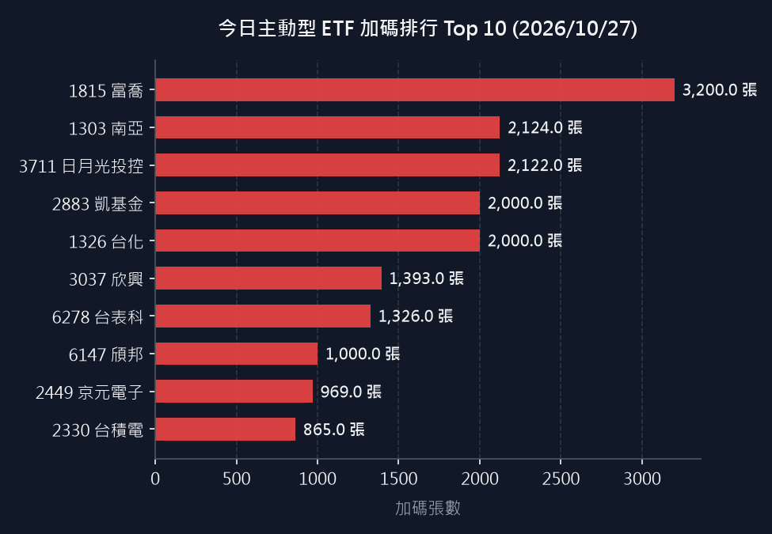
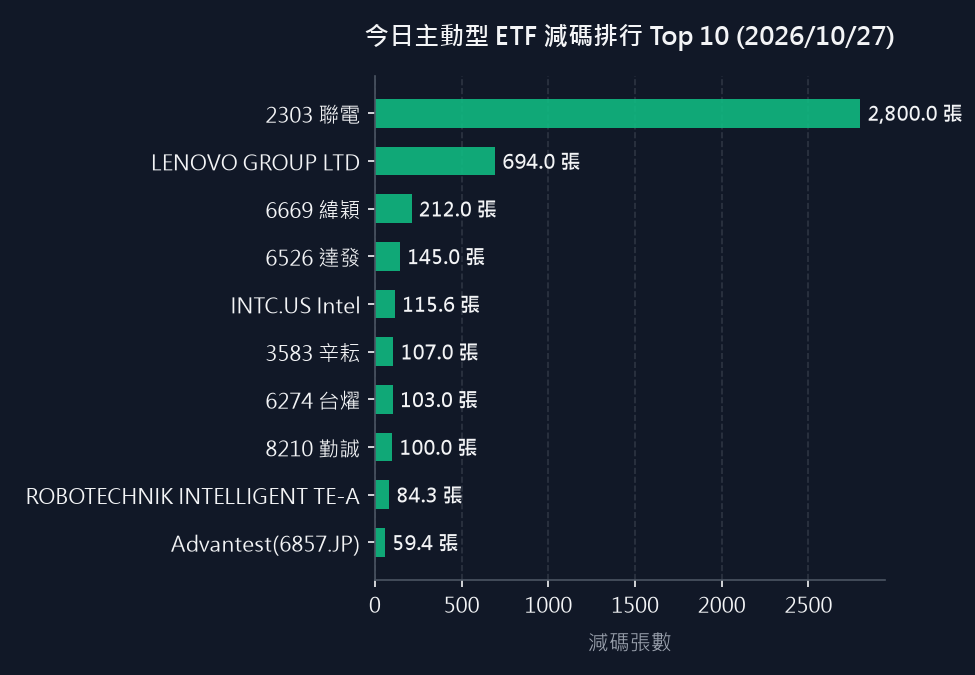

# 主動型 ETF 持股變動

資料來源：`主動型ETF持股明細.xlsx` 最近兩個日期分頁。

比較區間：`20261022` → `20261027`

## 今日加減碼視覺化排行

| 今日加碼 Top 10 | 今日減碼 Top 10 |
| :---: | :---: |
|  |  |

| ETF | 新增 | 刪除 | 比例變動 |
| :-- | --: | --: | --: |
| 00400A | 0 | 0 | 40 |
| 00401A | 1 | 1 | 40 |
| 00402A | 0 | 0 | 45 |
| 00403A | 0 | 0 | 35 |
| 00404A | 0 | 1 | 47 |
| 00405A | 0 | 0 | 25 |
| 00406A | 3 | 2 | 59 |
| 00407A | 0 | 0 | 44 |
| 00408A | 1 | 0 | 45 |
| 00980A | 0 | 0 | 42 |
| 00980D | 0 | 0 | 53 |
| 00981A | 0 | 0 | 29 |
| 00982A | 1 | 0 | 41 |
| 00983A | 0 | 0 | 38 |
| 00983D | 0 | 0 | 53 |
| 00984A | 0 | 0 | 58 |
| 00985A | 0 | 0 | 41 |
| 00986A | 1 | 1 | 33 |
| 00987A | 0 | 1 | 25 |
| 00988A | 0 | 0 | 35 |
| 00989A | 0 | 0 | 64 |
| 00990A | 0 | 4 | 36 |
| 00991A | 0 | 0 | 18 |
| 00992A | 0 | 0 | 37 |
| 00993A | 0 | 0 | 44 |
| 00994A | 2 | 1 | 31 |
| 00995A | 1 | 0 | 42 |
| 00996A | 0 | 2 | 32 |
| 00997A | 0 | 0 | 44 |
| 00998A | 0 | 3 | 50 |
| 00999A | 0 | 0 | 41 |

## 00400A

### 新增持股

- 無

### 刪除持股

- 無

### 投資比例變動

- 1303 南亞：4.19% → 4.13%（-0.06）
- 2059 川湖：3.65% → 3.66%（+0.01）
- 2303 聯電：1.76% → 1.71%（-0.05）
- 2308 台達電：2.48% → 2.39%（-0.09）
- 2313 華通：0.83% → 0.80%（-0.03）
- 2327 國巨*：1.20% → 1.23%（+0.03）
- 2330 台積電：9.01% → 9.05%（+0.04）
- 2345 智邦：1.49% → 1.48%（-0.01）
- 2360 致茂：3.11% → 3.06%（-0.05）
- 2368 金像電：2.73% → 2.64%（-0.09）
- 2383 台光電：4.30% → 4.02%（-0.28）
- 2449 京元電子：0.88% → 0.90%（+0.02）
- 2454 聯發科：6.89% → 6.79%（-0.10）
- 2881 富邦金：1.64% → 1.68%（+0.04）
- 3008 大立光：1.57% → 1.52%（-0.05）
- 3017 奇鋐：3.46% → 3.43%（-0.03）
- 3036 文曄：1.57% → 1.58%（+0.01）
- 3037 欣興：3.88% → 3.78%（-0.10）
- 3044 健鼎：2.39% → 2.24%（-0.15）
- 3081 聯亞：0.65% → 0.68%（+0.03）
- 3090 日電貿：0.31% → 0.30%（-0.01）
- 3167 大量：0.36% → 0.37%（+0.01）
- 3231 緯創：1.02% → 1.03%（+0.01）
- 3406 玉晶光：0.95% → 0.99%（+0.04）
- 3443 創意：2.46% → 2.40%（-0.06）
- 3529 力旺：1.18% → 1.19%（+0.01）
- 3653 健策：3.12% → 3.01%（-0.11）
- 3661 世芯-KY：2.15% → 2.14%（-0.01）
- 3665 貿聯-KY：1.43% → 1.32%（-0.11）
- 4958 臻鼎-KY：0.49% → 0.45%（-0.04）
- 5434 崇越：0.37% → 0.36%（-0.01）
- 6147 頎邦：0.88% → 0.89%（+0.01）
- 6187 萬潤：1.05% → 1.07%（+0.02）
- 6223 旺矽：2.96% → 2.89%（-0.07）
- 6274 台燿：1.32% → 1.19%（-0.13）
- 6278 台表科：2.76% → 2.64%（-0.12）
- 6488 環球晶：2.44% → 2.40%（-0.04）
- 6505 台塑化：1.54% → 1.53%（-0.01）
- 7750 新代：0.74% → 0.81%（+0.07）
- ＸＡＧＸ金兌(3533.HK)：0.91% → 0.98%（+0.07）

## 00401A

### 新增持股

- 臺指選擇權11/26 46500 買權（-0.50%，-0.38 張）

### 刪除持股

- TAIWAN TAIE C 18NOV26 46500 TWSE（-0.63%，-0.38 張）

### 投資比例變動

- 1303 南亞：1.25% → 1.23%（-0.02）
- 1477 聚陽：0.95% → 0.94%（-0.01）
- 2059 川湖：0.81% → 0.82%（+0.01）
- 2303 聯電：2.16% → 2.10%（-0.06）
- 2308 台達電：2.18% → 2.11%（-0.07）
- 2313 華通：1.41% → 1.36%（-0.05）
- 2327 國巨*：0.58% → 0.60%（+0.02）
- 2330 台積電：20.39% → 20.50%（+0.11）
- 2345 智邦：0.30% → 0.12%（-0.18）
- 2357 華碩：1.85% → 1.89%（+0.04）
- 2360 致茂：1.30% → 1.54%（+0.24）
- 2379 瑞昱：1.13% → 1.16%（+0.03）
- 2382 廣達：2.13% → 2.17%（+0.04）
- 2383 台光電：1.05% → 0.98%（-0.07）
- 2454 聯發科：5.76% → 5.69%（-0.07）
- 2603 長榮：1.61% → 1.80%（+0.19）
- 2881 富邦金：2.15% → 2.19%（+0.04）
- 2882 國泰金：1.08% → 1.09%（+0.01）
- 2883 凱基金：1.68% → 1.71%（+0.03）
- 2884 玉山金：2.17% → 2.15%（-0.02）
- 2886 兆豐金：1.51% → 1.50%（-0.01）
- 3008 大立光：2.25% → 2.18%（-0.07）
- 3037 欣興：2.28% → 2.03%（-0.25）
- 3131 弘塑：0.60% → 0.61%（+0.01）
- 3491 昇達科：1.55% → 1.49%（-0.06）
- 3711 日月光投控：2.52% → 2.51%（-0.01）
- 4938 和碩：0.35% → 0.36%（+0.01）
- 4958 臻鼎-KY：1.48% → 1.35%（-0.13）
- 5904 寶雅*：0.57% → 0.56%（-0.01）
- 6147 頎邦：1.34% → 1.36%（+0.02）
- 6187 萬潤：0.68% → 0.89%（+0.21）
- 6223 旺矽：1.51% → 1.47%（-0.04）
- 6285 啟碁：1.34% → 1.32%（-0.02）
- 6531 愛普*：1.43% → 1.46%（+0.03）
- 6669 緯穎：1.66% → 1.76%（+0.10）
- 7769 鴻勁：0.96% → 0.81%（-0.15）
- 7828 創新服務：1.34% → 1.33%（-0.01）
- 7856 漢測：0.71% → 0.70%（-0.01）
- 8464 億豐：1.00% → 1.02%（+0.02）
- 台股期貨11/26(FITXN*1.TF)：-0.11% → -0.13%（-0.02）

## 00402A

### 新增持股

- 無

### 刪除持股

- 無

### 投資比例變動

- AAPL.US Apple：8.01% → 8.48%（+0.47）
- ADI.US Analog Devices：1.99% → 1.98%（-0.01）
- AMD.US AMD：5.88% → 5.65%（-0.23）
- AMZN.US Amazon：4.56% → 4.55%（-0.01）
- ANET.US Arista Networks：0.80% → 0.77%（-0.03）
- ARM.US Arm：0.80% → 0.78%（-0.02）
- ASML.US ASML Holding：1.19% → 1.16%（-0.03）
- AXON.US Axon Enterprise：0.57% → 0.61%（+0.04）
- BKNG.US Booking Holdings：0.52% → 0.56%（+0.04）
- CDNS.US Cadence Design Systems：1.50% → 1.49%（-0.01）
- CIEN.US Ciena：1.17% → 1.10%（-0.07）
- CLS.US Celestica：1.22% → 1.13%（-0.09）
- COHR.US Coherent：1.15% → 1.05%（-0.10）
- CRWD.US CrowdStrike Holdings：1.58% → 1.65%（+0.07）
- DASH.US DoorDash：0.47% → 0.49%（+0.02）
- GOOG.US Alphabet - Class C Capital Stock：3.35% → 3.39%（+0.04）
- GOOGL.US Alphabet - Class A Common Stock：3.36% → 3.41%（+0.05）
- INTC.US Intel：1.44% → 1.38%（-0.06）
- IOT.US Samsara：0.58% → 0.61%（+0.03）
- KLAC.US KLA：1.48% → 1.40%（-0.08）
- LITE.US Lumentum：1.71% → 1.58%（-0.13）
- LRCX.US Lam Research：2.36% → 2.18%（-0.18）
- MCHP.US Microchip Technology：1.39% → 1.40%（+0.01）
- MDB.US MongoDB：0.42% → 0.40%（-0.02）
- META.US Meta：3.75% → 3.65%（-0.10）
- MRVL.US Marvell：1.68% → 1.60%（-0.08）
- MSFT.US Microsoft：5.48% → 5.60%（+0.12）
- MU.US Micron：5.67% → 5.56%（-0.11）
- NFLX.US Netflix：0.93% → 1.00%（+0.07）
- NOW.US ServiceNow：1.20% → 1.29%（+0.09）
- PANW.US Palo Alto：2.71% → 2.89%（+0.18）
- PLTR.US Palantir Technologies：2.27% → 2.30%（+0.03）
- SHOP.US Shopify：1.25% → 1.26%（+0.01）
- SIMO.US Silicon Motion：0.50% → 0.44%（-0.06）
- SKHY.US SK hynix：0.78% → 0.75%（-0.03）
- SNOW.US Snowflake：1.32% → 1.34%（+0.02）
- SPCX.US SpaceX：0.80% → 0.76%（-0.04）
- SPOT.US Spotify：0.37% → 0.43%（+0.06）
- STX.US Seagate：1.07% → 1.03%（-0.04）
- TER.US Teradyne：0.78% → 0.72%（-0.06）
- TTWO.US Take-Two：0.60% → 0.63%（+0.03）
- TXN.US Texas Instruments：2.46% → 2.52%（+0.06）
- UBER.US Uber：0.31% → 0.33%（+0.02）
- V.US Visa：1.25% → 1.33%（+0.08）
- WDC.US Western Digital：1.88% → 1.84%（-0.04）

## 00403A

### 新增持股

- 無

### 刪除持股

- 無

### 投資比例變動

- 1303 南亞：2.85% → 2.83%（-0.02）
- 2059 川湖：0.69% → 0.70%（+0.01）
- 2303 聯電：0.99% → 0.58%（-0.41）
- 2308 台達電：3.57% → 3.47%（-0.10）
- 2313 華通：0.35% → 0.34%（-0.01）
- 2317 鴻海：0.62% → 0.63%（+0.01）
- 2327 國巨*：3.52% → 3.63%（+0.11）
- 2330 台積電：14.50% → 14.63%（+0.13）
- 2345 智邦：2.24% → 2.23%（-0.01）
- 2368 金像電：0.72% → 0.70%（-0.02）
- 2383 台光電：4.80% → 4.51%（-0.29）
- 2408 南亞科：0.92% → 0.98%（+0.06）
- 2449 京元電子：0.83% → 0.85%（+0.02）
- 2454 聯發科：4.75% → 4.70%（-0.05）
- 2883 凱基金：0.06% → 0.12%（+0.06）
- 3008 大立光：1.83% → 1.78%（-0.05）
- 3017 奇鋐：5.65% → 5.77%（+0.12）
- 3037 欣興：6.17% → 6.04%（-0.13）
- 3189 景碩：3.46% → 3.32%（-0.14）
- 3211 順達：0.51% → 0.52%（+0.01）
- 3443 創意：4.07% → 4.00%（-0.07）
- 3450 聯鈞：0.50% → 0.51%（+0.01）
- 3583 辛耘：0.38% → 0.37%（-0.01）
- 3653 健策：4.79% → 4.64%（-0.15）
- 3665 貿聯-KY：2.16% → 2.01%（-0.15）
- 3711 日月光投控：0.00% → 0.21%（+0.21）
- 5274 信驊：1.98% → 2.16%（+0.18）
- 6223 旺矽：3.59% → 3.53%（-0.06）
- 6274 台燿：2.69% → 2.43%（-0.26）
- 6442 光聖：0.39% → 0.38%（-0.01）
- 6488 環球晶：0.20% → 0.19%（-0.01）
- 6669 緯穎：2.69% → 2.86%（+0.17）
- 6805 富世達：0.57% → 0.55%（-0.02）
- 8046 南電：3.01% → 2.99%（-0.02）
- 8996 高力：2.32% → 2.18%（-0.14）

## 00404A

### 新增持股

- 無

### 刪除持股

- 3260 威剛（0.05%，6.378 張）

### 投資比例變動

- 1303 南亞：0.82% → 0.80%（-0.02）
- 2301 光寶科：0.54% → 0.53%（-0.01）
- 2303 聯電：2.55% → 2.46%（-0.09）
- 2308 台達電：1.60% → 1.54%（-0.06）
- 2330 台積電：22.74% → 22.68%（-0.06）
- 2345 智邦：0.82% → 0.81%（-0.01）
- 2347 聯強：2.03% → 2.07%（+0.04）
- 2357 華碩：1.22% → 1.23%（+0.01）
- 2360 致茂：0.46% → 0.45%（-0.01）
- 2379 瑞昱：1.17% → 1.19%（+0.02）
- 2382 廣達：1.00% → 1.01%（+0.01）
- 2383 台光電：2.87% → 2.66%（-0.21）
- 2395 研華：1.27% → 1.30%（+0.03）
- 2436 偉詮電：1.15% → 1.13%（-0.02）
- 2454 聯發科：6.34% → 6.20%（-0.14）
- 2637 慧洋-KY：1.17% → 1.16%（-0.01）
- 2882 國泰金：2.92% → 2.91%（-0.01）
- 2887 台新新光金：1.53% → 1.52%（-0.01）
- 2890 永豐金：1.54% → 1.53%（-0.01）
- 3017 奇鋐：1.29% → 1.28%（-0.01）
- 3034 聯詠：2.29% → 2.33%（+0.04）
- 3037 欣興：0.28% → 0.27%（-0.01）
- 3264 欣銓：0.67% → 0.66%（-0.01）
- 3293 鈊象：1.21% → 1.22%（+0.01）
- 3443 創意：0.97% → 0.95%（-0.02）
- 3653 健策：0.47% → 0.45%（-0.02）
- 3711 日月光投控：3.26% → 3.22%（-0.04）
- 5274 信驊：2.65% → 2.63%（-0.02）
- 5434 崇越：1.72% → 1.70%（-0.02）
- 5876 上海商銀：1.65% → 1.66%（+0.01）
- 5904 寶雅*：0.53% → 0.51%（-0.02）
- 6196 帆宣：1.75% → 1.70%（-0.05）
- 6206 飛捷：0.72% → 0.74%（+0.02）
- 6223 旺矽：1.07% → 1.04%（-0.03）
- 6257 矽格：1.65% → 1.63%（-0.02）
- 6491 晶碩：0.94% → 0.93%（-0.01）
- 6505 台塑化：0.51% → 0.50%（-0.01）
- 6669 緯穎：0.90% → 0.94%（+0.04）
- 6691 洋基工程：1.57% → 1.52%（-0.05）
- 7769 鴻勁：1.08% → 1.06%（-0.02）
- 8016 矽創：1.29% → 1.28%（-0.01）
- 8081 致新：0.90% → 0.89%（-0.01）
- 8299 群聯：1.21% → 1.22%（+0.01）
- iShares MSCI Japan SRI ETF(2851.JP)：1.22% → 1.19%（-0.03）
- 台指選擇權11/26 50900 買權：-0.06% → -0.03%（+0.03）
- 台指選擇權12/26 51800 買權：-0.01% → 0.00%（+0.01）
- 台股期貨11/26(FITXN*1.TF)：-0.33% → 16.91%（+17.24）

## 00405A

### 新增持股

- 無

### 刪除持股

- 無

### 投資比例變動

- 2059 川湖：2.26% → 2.31%（+0.05）
- 2308 台達電：0.68% → 0.67%（-0.01）
- 2330 台積電：1.98% → 2.02%（+0.04）
- 2345 智邦：5.00% → 5.05%（+0.05）
- 2368 金像電：5.82% → 5.73%（-0.09）
- 2383 台光電：4.98% → 4.74%（-0.24）
- 2454 聯發科：5.46% → 5.48%（+0.02）
- 3017 奇鋐：4.05% → 1.89%（-2.16）
- 3037 欣興：7.68% → 7.64%（-0.04）
- 3189 景碩：0.23% → 0.22%（-0.01）
- 3443 創意：6.07% → 2.56%（-3.51）
- 3653 健策：7.30% → 7.18%（-0.12）
- 3665 貿聯-KY：5.77% → 5.44%（-0.33）
- 5274 信驊：5.88% → 5.98%（+0.10）
- 6187 萬潤：0.86% → 0.90%（+0.04）
- 6223 旺矽：7.31% → 7.29%（-0.02）
- 6274 台燿：2.01% → 1.85%（-0.16）
- 6515 穎崴：0.51% → 0.52%（+0.01）
- 6526 達發：0.53% → 0.00%（-0.53）
- 6531 愛普*：3.79% → 3.95%（+0.16）
- 6669 緯穎：0.84% → 0.91%（+0.07）
- 6805 富世達：3.69% → 2.87%（-0.82）
- 7769 鴻勁：2.93% → 2.95%（+0.02）
- 8046 南電：7.61% → 7.68%（+0.07）
- 8996 高力：1.44% → 1.38%（-0.06）

## 00406A

### 新增持股

- 1815 富喬（0.35%，3200 張）
- 6278 台表科（0.34%，1430 張）
- 臺指選擇權第五週週五到期契約（-1.88%，-1.357 張）

### 刪除持股

- 3131 弘塑（0.04%，24 張）
- 臺指選擇權第四週週五到期契約（-15.28%，-10.8 張）

### 投資比例變動

- 1303 南亞：1.97% → 2.14%（+0.17）
- 1326 台化：0.46% → 0.55%（+0.09）
- 1560 中砂：0.33% → 0.30%（-0.03）
- 2059 川湖：1.22% → 1.30%（+0.08）
- 2303 聯電：1.64% → 1.57%（-0.07）
- 2308 台達電：2.57% → 2.25%（-0.32）
- 2317 鴻海：0.32% → 0.29%（-0.03）
- 2327 國巨*：1.86% → 1.90%（+0.04）
- 2330 台積電：9.48% → 9.50%（+0.02）
- 2345 智邦：3.21% → 2.89%（-0.32）
- 2360 致茂：1.20% → 1.08%（-0.12）
- 2368 金像電：1.84% → 1.99%（+0.15）
- 2383 台光電：6.73% → 5.99%（-0.74）
- 2395 研華：0.08% → 0.07%（-0.01）
- 2449 京元電子：0.59% → 0.55%（-0.04）
- 2454 聯發科：5.48% → 5.51%（+0.03）
- 2481 強茂：0.50% → 0.44%（-0.06）
- 2486 一詮：0.16% → 0.14%（-0.02）
- 2885 元大金：0.58% → 0.53%（-0.05）
- 2886 兆豐金：0.13% → 0.12%（-0.01）
- 3008 大立光：1.44% → 1.27%（-0.17）
- 3017 奇鋐：5.28% → 5.36%（+0.08）
- 3037 欣興：5.88% → 5.93%（+0.05）
- 3081 聯亞：0.22% → 0.46%（+0.24）
- 3105 穩懋：0.10% → 0.09%（-0.01）
- 3167 大量：0.56% → 0.53%（-0.03）
- 3189 景碩：2.15% → 2.09%（-0.06）
- 3231 緯創：0.37% → 0.45%（+0.08）
- 3264 欣銓：0.50% → 0.46%（-0.04）
- 3363 上詮：0.18% → 0.16%（-0.02）
- 3443 創意：2.25% → 2.31%（+0.06）
- 3450 聯鈞：0.12% → 0.11%（-0.01）
- 3491 昇達科：0.40% → 0.35%（-0.05）
- 3529 力旺：0.17% → 0.16%（-0.01）
- 3653 健策：3.69% → 3.97%（+0.28）
- 3661 世芯-KY：0.78% → 0.85%（+0.07）
- 3665 貿聯-KY：1.34% → 1.13%（-0.21）
- 4938 和碩：0.58% → 0.53%（-0.05）
- 4958 臻鼎-KY：1.16% → 1.18%（+0.02）
- 5274 信驊：2.05% → 1.95%（-0.10）
- 6147 頎邦：0.77% → 0.88%（+0.11）
- 6187 萬潤：0.19% → 0.17%（-0.02）
- 6213 聯茂：0.72% → 0.63%（-0.09）
- 6223 旺矽：3.10% → 3.24%（+0.14）
- 6274 台燿：1.35% → 1.11%（-0.24）
- 6285 啟碁：0.07% → 0.06%（-0.01）
- 6488 環球晶：0.29% → 0.25%（-0.04）
- 6510 精測：0.78% → 0.67%（-0.11）
- 6515 穎崴：0.21% → 0.19%（-0.02）
- 6531 愛普*：0.12% → 0.11%（-0.01）
- 6669 緯穎：1.49% → 1.43%（-0.06）
- 6715 嘉基：0.89% → 0.73%（-0.16）
- 6805 富世達：0.36% → 0.52%（+0.16）
- 7769 鴻勁：0.20% → 0.18%（-0.02）
- 8046 南電：2.96% → 3.12%（+0.16）
- 8358 金居：0.10% → 0.08%（-0.02）
- 8996 高力：0.22% → 0.19%（-0.03）
- 臺指選擇權第四週週三到期契約：-3.09% → -7.44%（-4.35）
- 臺股期貨 202611(FITXN*1.TF)：23.08% → 20.87%（-2.21）

## 00407A

### 新增持股

- 無

### 刪除持股

- 無

### 投資比例變動

- 1303 南亞：2.06% → 2.61%（+0.55）
- 1560 中砂：1.01% → 0.99%（-0.02）
- 2301 光寶科：1.46% → 1.43%（-0.03）
- 2303 聯電：0.54% → 0.53%（-0.01）
- 2308 台達電：2.47% → 2.39%（-0.08）
- 2313 華通：0.44% → 0.42%（-0.02）
- 2327 國巨*：2.23% → 2.28%（+0.05）
- 2330 台積電：9.72% → 9.75%（+0.03）
- 2344 華邦電：0.14% → 0.15%（+0.01）
- 2345 智邦：1.57% → 1.55%（-0.02）
- 2360 致茂：1.02% → 1.00%（-0.02）
- 2368 金像電：1.68% → 1.62%（-0.06）
- 2379 瑞昱：0.26% → 0.27%（+0.01）
- 2383 台光電：5.60% → 5.23%（-0.37）
- 2408 南亞科：0.87% → 0.92%（+0.05）
- 2451 創見：0.34% → 0.35%（+0.01）
- 2454 聯發科：5.30% → 5.21%（-0.09）
- 2615 萬海：1.09% → 1.05%（-0.04）
- 3008 大立光：1.58% → 1.53%（-0.05）
- 3017 奇鋐：5.79% → 5.75%（-0.04）
- 3034 聯詠：0.86% → 0.89%（+0.03）
- 3037 欣興：6.38% → 6.21%（-0.17）
- 3081 聯亞：1.32% → 1.87%（+0.55）
- 3131 弘塑：0.78% → 0.79%（+0.01）
- 3260 威剛：0.28% → 0.29%（+0.01）
- 3293 鈊象：0.66% → 0.67%（+0.01）
- 3443 創意：4.77% → 4.66%（-0.11）
- 3491 昇達科：0.88% → 0.84%（-0.04）
- 3533 嘉澤：0.48% → 0.98%（+0.50）
- 3653 健策：3.46% → 3.33%（-0.13）
- 3665 貿聯-KY：2.56% → 2.36%（-0.20）
- 3711 日月光投控：3.06% → 3.03%（-0.03）
- 4958 臻鼎-KY：1.16% → 1.06%（-0.10）
- 5274 信驊：1.33% → 1.32%（-0.01）
- 6187 萬潤：1.58% → 1.60%（+0.02）
- 6223 旺矽：2.26% → 2.20%（-0.06）
- 6274 台燿：2.71% → 1.94%（-0.77）
- 6510 精測：1.43% → 1.35%（-0.08）
- 6531 愛普*：0.30% → 0.31%（+0.01）
- 6669 緯穎：2.42% → 2.55%（+0.13）
- 6805 富世達：1.28% → 1.23%（-0.05）
- 8046 南電：3.78% → 3.74%（-0.04）
- 8299 群聯：0.31% → 0.32%（+0.01）
- 8996 高力：1.37% → 1.28%（-0.09）

## 00408A

### 新增持股

- 3045 台灣大（0.01%，1 張）

### 刪除持股

- 無

### 投資比例變動

- 1303 南亞：4.04% → 3.89%（-0.15）
- 1560 中砂：0.38% → 0.36%（-0.02）
- 2059 川湖：1.02% → 1.00%（-0.02）
- 2303 聯電：1.37% → 1.30%（-0.07）
- 2308 台達電：2.66% → 2.51%（-0.15）
- 2330 台積電：6.57% → 6.42%（-0.15）
- 2344 華邦電：0.46% → 0.47%（+0.01）
- 2345 智邦：0.73% → 0.70%（-0.03）
- 2357 華碩：1.20% → 1.19%（-0.01）
- 2360 致茂：1.18% → 1.14%（-0.04）
- 2368 金像電：5.24% → 4.94%（-0.30）
- 2383 台光電：5.11% → 4.65%（-0.46）
- 2408 南亞科：1.30% → 1.95%（+0.65）
- 2454 聯發科：4.19% → 4.02%（-0.17）
- 2455 全新：0.42% → 0.41%（-0.01）
- 2542 興富發：4.03% → 3.93%（-0.10）
- 2603 長榮：1.36% → 1.33%（-0.03）
- 2880 華南金：1.31% → 1.27%（-0.04）
- 2891 中信金：0.84% → 0.82%（-0.02）
- 3008 大立光：0.92% → 0.87%（-0.05）
- 3017 奇鋐：3.03% → 2.93%（-0.10）
- 3026 禾伸堂：0.85% → 0.77%（-0.08）
- 3037 欣興：3.32% → 3.15%（-0.17）
- 3081 聯亞：2.04% → 2.09%（+0.05）
- 3105 穩懋：0.51% → 0.50%（-0.01）
- 3189 景碩：3.60% → 3.35%（-0.25）
- 3231 緯創：0.99% → 0.97%（-0.02）
- 3264 欣銓：0.79% → 0.77%（-0.02）
- 3443 創意：0.57% → 0.54%（-0.03）
- 3653 健策：3.53% → 3.32%（-0.21）
- 3665 貿聯-KY：1.10% → 0.37%（-0.73）
- 3711 日月光投控：1.56% → 1.51%（-0.05）
- 5434 崇越：2.38% → 2.30%（-0.08）
- 6223 旺矽：2.11% → 2.01%（-0.10）
- 6274 台燿：3.39% → 2.69%（-0.70）
- 6488 環球晶：0.86% → 0.83%（-0.03）
- 6510 精測：0.46% → 0.42%（-0.04）
- 6526 達發：0.35% → 0.32%（-0.03）
- 6669 緯穎：2.03% → 2.09%（+0.06）
- 6691 洋基工程：0.35% → 0.33%（-0.02）
- 6805 富世達：2.44% → 2.29%（-0.15）
- 7769 鴻勁：0.59% → 0.57%（-0.02）
- 8046 南電：1.60% → 1.55%（-0.05）
- 8996 高力：2.56% → 2.34%（-0.22）
- 9802 鈺齊-KY：0.90% → 0.87%（-0.03）

## 00980A

### 新增持股

- 無

### 刪除持股

- 無

### 投資比例變動

- 1303 南亞：3.48% → 3.46%（-0.02）
- 2059 川湖：4.21% → 4.26%（+0.05）
- 2303 聯電：1.56% → 1.53%（-0.03）
- 2308 台達電：3.44% → 3.35%（-0.09）
- 2317 鴻海：3.28% → 3.33%（+0.05）
- 2327 國巨*：0.89% → 0.92%（+0.03）
- 2330 台積電：9.81% → 9.93%（+0.12）
- 2344 華邦電：1.63% → 1.73%（+0.10）
- 2360 致茂：1.19% → 1.18%（-0.01）
- 2368 金像電：2.05% → 2.00%（-0.05）
- 2376 技嘉：1.67% → 1.72%（+0.05）
- 2382 廣達：1.93% → 1.98%（+0.05）
- 2383 台光電：3.99% → 3.76%（-0.23）
- 2408 南亞科：2.19% → 2.34%（+0.15）
- 2454 聯發科：5.46% → 5.42%（-0.04）
- 2891 中信金：1.60% → 1.61%（+0.01）
- 3008 大立光：2.19% → 2.14%（-0.05）
- 3026 禾伸堂：1.18% → 1.11%（-0.07）
- 3036 文曄：1.05% → 1.07%（+0.02）
- 3037 欣興：3.71% → 3.64%（-0.07）
- 3044 健鼎：1.37% → 1.29%（-0.08）
- 3081 聯亞：1.55% → 1.64%（+0.09）
- 3189 景碩：1.43% → 1.37%（-0.06）
- 3231 緯創：1.72% → 1.73%（+0.01）
- 3264 欣銓：0.88% → 0.89%（+0.01）
- 3293 鈊象：0.47% → 0.48%（+0.01）
- 3443 創意：1.87% → 1.84%（-0.03）
- 3529 力旺：0.16% → 0.17%（+0.01）
- 3653 健策：2.99% → 2.90%（-0.09）
- 3665 貿聯-KY：1.47% → 1.37%（-0.10）
- 5274 信驊：1.78% → 1.79%（+0.01）
- 5904 寶雅*：0.69% → 0.68%（-0.01）
- 6213 聯茂：1.51% → 1.46%（-0.05）
- 6223 旺矽：1.31% → 1.29%（-0.02）
- 6274 台燿：1.37% → 1.24%（-0.13）
- 6669 緯穎：1.86% → 1.98%（+0.12）
- 6805 富世達：0.69% → 0.67%（-0.02）
- 7751 竑騰：0.65% → 0.67%（+0.02）
- 7769 鴻勁：2.05% → 2.03%（-0.02）
- 8046 南電：1.74% → 1.73%（-0.01）
- 8299 群聯：1.07% → 1.09%（+0.02）
- 8996 高力：0.49% → 0.47%（-0.02）

## 00980D

### 新增持股

- 無

### 刪除持股

- 無

### 投資比例變動

- ALLY FINANCIAL INC (REG) VAR 13JUN2029：0.58% → 0.57%（-0.01）
- AMC GLOBAL MEDIA INC SER REGS (REG) (REG S) 10.5% 15JUL2032：0.72% → 0.71%（-0.01）
- APA CORP 6.750000 % 15-FEB-2055：0.38% → 0.39%（+0.01）
- ATHENE HOLDING LTD (REG) 6.25% 01APR2054：0.77% → 0.78%（+0.01）
- ATHENE HOLDING LTD 6.625000 % 19MAY2055：0.57% → 0.58%（+0.01）
- BAT CAPITAL CORP (REG) 7.081% 02AUG2053：0.59% → 0.60%（+0.01）
- BLUE OWL CREDIT INCOME 7.950000 % 13JUN2028：0.56% → 0.55%（-0.01）
- BPCE SA SER REGS VAR 14JAN2046：0.39% → 0.40%（+0.01）
- CHARTER COMM OPT 6.484% 23OCT2045 W/I：0.44% → 0.45%（+0.01）
- CHARTER COMM OPT LLC/CAP (REG) 5.5% 01APR2063：0.47% → 0.48%（+0.01）
- CHC GROUP LLC SER REGS 11.750000 % 01-SEP-2030：0.46% → 0.45%（-0.01）
- CHS/COMMUNITY HEALTH SYS SER REGS 10.875000 % 15JAN2032：0.51% → 0.50%（-0.01）
- CHS/COMMUNITY HEALTH SYS SER REGS 9.750000 % 15JAN2034：0.34% → 0.33%（-0.01）
- COREWEAVE INC SER REGS (REG S) 9.25% 01JUN2030：0.41% → 0.40%（-0.01）
- COREWEAVE INC SER REGS (REG S) 9.75% 01OCT2031：0.48% → 0.47%（-0.01）
- COREWEAVE INC SER REGS (REG) (REG S) 9.625% 15JUL2032：0.48% → 0.47%（-0.01）
- COX COMMUNICATIONS INC SER REGS 5.800000 % 15DEC2053：0.50% → 0.51%（+0.01）
- DOW CHEMICAL CO/THE (REG) 5.55% 30NOV2048：0.47% → 0.48%（+0.01）
- DOW CHEMICAL CO/THE (REG) 5.6% 15FEB2054：0.62% → 0.63%（+0.01）
- DOW CHEMICAL CO/THE 7.375% 01NOV2029：0.64% → 0.63%（-0.01）
- FMC CORP (REG) 6.375000 % 18MAY2053：0.30% → 0.31%（+0.01）
- GENERAL MOTORS CO (REG) 6.8% 01OCT2027：0.59% → 0.58%（-0.01）
- GLENCORE FINANCE CANADA SER REGS 6.900000 % 15-NOV-2037：0.40% → 0.41%（+0.01）
- GLOBAL ATLANTIC FIN CO SER REGS 6.750000 % 15MAR2054：0.63% → 0.64%（+0.01）
- GLOBAL AUTO HO/AAG FH UK SER REGS (REG S) 8.75% 15JAN2032：0.40% → 0.39%（-0.01）
- HA SUSTAINABLE INF CAP (REG) 6.375% 01JUL2034：0.35% → 0.36%（+0.01）
- HAH GROUP HOLDING CO LLC SER REGS (REG S) 9.75% 01OCT2031：0.31% → 0.30%（-0.01）
- HERTZ CORP/THE SER REGS (REG S) 12.625% 15JUL2029：0.31% → 0.30%（-0.01）
- HSBC HOLDINGS PLC VAR 03NOV2028：0.35% → 0.34%（-0.01）
- ICAHN ENTERPRISES/FIN SER REGS 10.000000 % 15NOV2029：0.33% → 0.32%（-0.01）
- INTESA SANPAOLO SPA SER REGS (REG S) 7.8% 28NOV2053：0.37% → 0.38%（+0.01）
- JBS USA HOLD/FOOD/LUX CO 7.250000 % 15NOV2053：0.48% → 0.49%（+0.01）
- JETBLUE AIRWAYS/LOYALTY SER REGS (REG S) 9.875% 20SEP2031：0.30% → 0.24%（-0.06）
- LBM ACQUISITION LLC SER REGS 9.500000 % 15JUN2031：0.42% → 0.41%（-0.01）
- LINCOLN NATIONAL CORP (REG) 7.000000 % 15JUN2040：0.47% → 0.48%（+0.01）
- LPL HOLDINGS INC (REG) 6.75% 17NOV2028：0.59% → 0.58%（-0.01）
- NAVIENT CORP (REG) 11.5% 15MAR2031：0.45% → 0.43%（-0.02）
- ORACLE CORP 6.9% 09NOV2052：0.49% → 0.50%（+0.01）
- PHOTO HOLDINGS LLC SER REGS (REG) (REG S) 12% 01JUL2031：0.50% → 0.49%（-0.01）
- SABRE GLBL INC SER REGS 10.75 % 15-MAR-2030：0.17% → 0.16%（-0.01）
- SABRE GLBL INC SER REGS 11.125000 % 15JUL2030：0.48% → 0.47%（-0.01）
- SALESFORCE INC (REG) 6.55% 15MAR2056：0.55% → 0.56%（+0.01）
- SANTANDER HOLDINGS USA VAR 09MAR2029：0.50% → 0.49%（-0.01）
- SUNCOR ENERGY INC (REG) 6.85% 01JUN2039：0.34% → 0.35%（+0.01）
- TRANSCANADA PIPELINES LTD 7.625PCT 15/01/2039：0.54% → 0.55%（+0.01）
- US 10YR NOTE (CBT)DEC26 21-DEC-2026：18.48% → 18.59%（+0.11）
- US 10YR ULTRA FUT DEC26 21-DEC-2026：-1.62% → -1.63%（-0.01）
- US 5YR NOTE (CBT) DEC26 31-DEC-2026：-14.04% → -14.07%（-0.03）
- US LONG BOND(CBT) DEC26 21-DEC-2026：5.53% → 5.61%（+0.08）
- US ULTRA BOND CBT DEC26 21-DEC-2026：-0.54% → -0.55%（-0.01）
- VAR ENERGI ASA SER REGS (REG S) 7.5% 15JAN2028：0.35% → 0.34%（-0.01）
- VIACOMCBS INC (REG) 4.95% 19MAY2050：0.43% → 0.44%（+0.01）
- VISTRA OPERATIONS CO LLC SER REGS (REG S) 6.95% 15OCT2033：0.42% → 0.43%（+0.01）

## 00981A

### 新增持股

- 無

### 刪除持股

- 無

### 投資比例變動

- 2303 聯電：3.75% → 3.66%（-0.09）
- 2308 台達電：4.44% → 4.30%（-0.14）
- 2327 國巨*：4.47% → 4.60%（+0.13）
- 2330 台積電：11.34% → 11.75%（+0.41）
- 2345 智邦：4.22% → 4.18%（-0.04）
- 2368 金像電：2.89% → 2.83%（-0.06）
- 2383 台光電：8.23% → 7.72%（-0.51）
- 2449 京元電子：0.65% → 0.76%（+0.11）
- 2454 聯發科：7.74% → 7.78%（+0.04）
- 3017 奇鋐：7.62% → 7.68%（+0.06）
- 3037 欣興：8.01% → 7.83%（-0.18）
- 3376 新日興：0.11% → 0.10%（-0.01）
- 3443 創意：2.42% → 2.38%（-0.04）
- 3653 健策：5.72% → 5.52%（-0.20）
- 3665 貿聯-KY：2.03% → 1.88%（-0.15）
- 3711 日月光投控：2.18% → 2.44%（+0.26）
- 4979 華星光：0.16% → 0.17%（+0.01）
- 6223 旺矽：4.59% → 4.50%（-0.09）
- 6271 同欣電：0.18% → 0.17%（-0.01）
- 6274 台燿：3.85% → 3.47%（-0.38）
- 6510 精測：0.54% → 0.51%（-0.03）
- 6515 穎崴：0.17% → 0.15%（-0.02）
- 6669 緯穎：2.27% → 2.40%（+0.13）
- 6805 富世達：0.81% → 0.82%（+0.01）
- 8046 南電：4.24% → 4.21%（-0.03）
- 8210 勤誠：0.14% → 0.11%（-0.03）
- 8358 金居：0.11% → 0.10%（-0.01）
- 8996 高力：0.57% → 0.54%（-0.03）
- 台指期貨 2026/11(FITXN*1.TF)：2.36% → 2.35%（-0.01）

## 00982A

### 新增持股

- 3037 欣興（0.92%，400 張）

### 刪除持股

- 無

### 投資比例變動

- 2059 川湖：2.74% → 2.76%（+0.02）
- 2301 光寶科：1.80% → 1.78%（-0.02）
- 2303 聯電：1.41% → 1.37%（-0.04）
- 2330 台積電：8.02% → 8.07%（+0.05）
- 2360 致茂：4.10% → 4.05%（-0.05）
- 2376 技嘉：1.33% → 1.36%（+0.03）
- 2377 微星：0.36% → 0.37%（+0.01）
- 2383 台光電：3.41% → 3.20%（-0.21）
- 2395 研華：1.41% → 1.44%（+0.03）
- 2454 聯發科：6.86% → 6.78%（-0.08）
- 2467 志聖：0.98% → 0.99%（+0.01）
- 2476 鉅祥：0.32% → 0.31%（-0.01）
- 2478 大毅：0.34% → 0.32%（-0.02）
- 3008 大立光：3.40% → 3.31%（-0.09）
- 3017 奇鋐：2.56% → 2.55%（-0.01）
- 3090 日電貿：0.34% → 0.33%（-0.01）
- 3105 穩懋：6.04% → 6.10%（+0.06）
- 3231 緯創：2.00% → 2.01%（+0.01）
- 3265 台星科：1.66% → 1.60%（-0.06）
- 3491 昇達科：3.39% → 3.28%（-0.11）
- 3583 辛耘：1.02% → 0.88%（-0.14）
- 3711 日月光投控：1.33% → 1.32%（-0.01）
- 4958 臻鼎-KY：3.90% → 3.58%（-0.32）
- 5425 台半：1.24% → 1.25%（+0.01）
- 5483 中美晶：1.39% → 1.38%（-0.01）
- 5536 聖暉*：0.78% → 0.75%（-0.03）
- 6139 亞翔：5.22% → 5.32%（+0.10）
- 6196 帆宣：0.40% → 0.39%（-0.01）
- 6213 聯茂：1.59% → 1.53%（-0.06）
- 6214 精誠：1.50% → 1.52%（+0.02）
- 6223 旺矽：3.20% → 3.14%（-0.06）
- 6239 力成：1.03% → 1.06%（+0.03）
- 6274 台燿：1.30% → 1.17%（-0.13）
- 6472 保瑞：0.91% → 0.90%（-0.01）
- 6488 環球晶：1.96% → 1.93%（-0.03）
- 6510 精測：1.00% → 0.95%（-0.05）
- 6531 愛普*：3.98% → 4.08%（+0.10）
- 6669 緯穎：3.71% → 2.87%（-0.84）
- 6672 騰輝電子-KY：1.49% → 1.36%（-0.13）
- 8070 長華*：0.46% → 0.47%（+0.01）
- 8996 高力：1.30% → 1.22%（-0.08）

## 00983A

### 新增持股

- 無

### 刪除持股

- 無

### 投資比例變動

- ACHR.US Archer：0.04% → 0.05%（+0.01）
- AMD.US AMD：3.24% → 3.13%（-0.11）
- AMZN.US Amazon：3.41% → 3.42%（+0.01）
- AVGO.US Broadcom：1.52% → 1.53%（+0.01）
- BEAM.US Beam Therapeutics：1.57% → 1.63%（+0.06）
- BLSH.US Bullish：2.01% → 2.07%（+0.06）
- BMNR.US BitMine：2.28% → 2.25%（-0.03）
- COIN.US Coinbase：4.56% → 4.58%（+0.02）
- CRCL.US Circle：5.44% → 5.52%（+0.08）
- CRSP.US CRISPR Therapeutics：3.63% → 3.78%（+0.15）
- CRWV.US CoreWeave：0.90% → 0.85%（-0.05）
- DE.US Deere：0.40% → 0.43%（+0.03）
- FTNT.US Fortinet：0.43% → 0.45%（+0.02）
- GOOG.US Alphabet - Class C Capital Stock：1.53% → 1.55%（+0.02）
- GOOGL.US Alphabet - Class A Common Stock：1.62% → 1.65%（+0.03）
- HOOD.US Robinhood Markets：3.61% → 3.59%（-0.02）
- KTOS.US Kratos Defense & Security：0.09% → 0.10%（+0.01）
- LLY.US Eli Lilly：1.58% → 1.71%（+0.13）
- META.US Meta：2.28% → 2.23%（-0.05）
- NET.US Cloudflare：1.32% → 1.37%（+0.05）
- NTLA.US Intellia Therapeutics：0.58% → 0.59%（+0.01）
- NTRA.US Natera：1.66% → 1.69%（+0.03）
- NVDA.US NVIDIA：3.54% → 3.56%（+0.02）
- PLTR.US Palantir Technologies：3.31% → 3.38%（+0.07）
- RXRX.US Recursion Pharmaceuticals：0.84% → 0.86%（+0.02）
- SHOP.US Shopify：5.01% → 5.10%（+0.09）
- SNOW.US Snowflake：0.54% → 0.55%（+0.01）
- SOFI.US SoFi Technologies：0.14% → 0.15%（+0.01）
- SPCX.US SpaceX：7.04% → 6.73%（-0.31）
- TEM.US Tempus：5.22% → 5.17%（-0.05）
- TER.US Teradyne：0.59% → 0.56%（-0.03）
- TSLA.US Tesla：8.81% → 9.02%（+0.21）
- TSM.US TSMC(ADR)：2.66% → 2.67%（+0.01）
- TWST.US Twist Bioscience：3.68% → 3.52%（-0.16）
- TXG.US 10x Genomics：3.32% → 3.22%（-0.10）
- VCYT.US Veracyte：0.13% → 0.14%（+0.01）
- WGS.US GeneDx：0.50% → 0.51%（+0.01）
- XYZ.US Block：1.27% → 1.35%（+0.08）

## 00983D

### 新增持股

- 無

### 刪除持股

- 無

### 投資比例變動

- ABIBB 8.2 01/15/39：2.02% → 2.04%（+0.02）
- AET 6 5/8 06/15/36：0.75% → 0.76%（+0.01）
- ALLY 8 11/01/31：1.24% → 1.25%（+0.01）
- AMCX 10 1/2 07/15/32：1.65% → 1.64%（-0.01）
- ATH 6 5/8 05/19/55：1.01% → 1.03%（+0.02）
- AWK 6.593 10/15/37：0.73% → 0.74%（+0.01）
- BACR 7.437 11/02/33：1.31% → 1.32%（+0.01）
- BATSLN 7.079 08/02/43：1.12% → 1.14%（+0.02）
- BATSLN 7.081 08/02/53：1.20% → 1.21%（+0.01）
- BHCCN 11 09/30/28：1.97% → 1.96%（-0.01）
- BNCN 7 3/8 03/01/33：1.14% → 1.15%（+0.01）
- BRKHEC 6 3/4 07/01/37：0.84% → 0.85%（+0.01）
- C 8 1/8 07/15/39：1.99% → 2.00%（+0.01）
- CEG 6 1/2 10/01/53：0.81% → 0.82%（+0.01）
- CRWV 9 02/01/31：1.20% → 1.18%（-0.02）
- CYH 10 7/8 01/15/32：1.55% → 1.53%（-0.02）
- DELL 8.1 07/15/36：1.57% → 1.58%（+0.01）
- DELL 8.35 07/15/46：1.43% → 1.45%（+0.02）
- DIS 7 3/4 12/01/45：0.62% → 0.63%（+0.01）
- DOW 6.9 05/15/53：0.78% → 0.79%（+0.01）
- DOW 9.4 05/15/39：2.00% → 2.02%（+0.02）
- DT 9 1/4 06/01/32：1.55% → 1.56%（+0.01）
- DTV 8 7/8 02/01/30：1.67% → 1.66%（-0.01）
- ENBCN 6.7 11/15/53：0.62% → 0.63%（+0.01）
- FFHCN 6.35 03/22/54：0.73% → 0.74%（+0.01）
- GM 6 3/4 04/01/46：0.89% → 0.90%（+0.01）
- HAL 7.45 09/15/39：1.88% → 1.90%（+0.02）
- HPE 6.35 10/15/45：1.02% → 1.04%（+0.02）
- HSBC 6.332 03/09/44：1.09% → 1.10%（+0.01）
- IEP 10 11/15/29：1.58% → 1.56%（-0.02）
- KHC 6 7/8 01/26/39：1.04% → 1.05%（+0.01）
- KMI 6.95 01/15/38：1.10% → 1.11%（+0.01）
- LOW 6.65 09/15/37：0.87% → 0.88%（+0.01）
- LQDW.US iShares LQD Premium Income+ ETF：7.55% → 7.03%（-0.52）
- MBGGR 8 1/2 01/18/31：1.36% → 1.37%（+0.01）
- MOHEGN 11 7/8 04/15/31：1.42% → 1.41%（-0.01）
- MS 7 1/4 04/01/32：1.69% → 1.70%（+0.01）
- NVDA 5.55 06/15/46：1.18% → 1.19%（+0.01）
- OKE 6 5/8 09/01/53：0.74% → 0.75%（+0.01）
- ORCL 6.9 11/09/52：0.40% → 0.41%（+0.01）
- OXY 6.6 03/15/46：0.77% → 0.78%（+0.01）
- PCG 6 3/4 01/15/53：0.84% → 0.85%（+0.01）
- PCG 6.7 04/01/53：0.97% → 0.98%（+0.01）
- PFE 7.2 03/15/39：1.11% → 1.12%（+0.01）
- SJM 6 1/2 11/15/43：0.20% → 0.21%（+0.01）
- SJM 6 1/2 11/15/53：0.20% → 0.21%（+0.01）
- SPCX 6.6 07/15/46：1.13% → 1.15%（+0.02）
- SUCN 6.85 06/01/39：1.04% → 1.05%（+0.01）
- SVC 8 7/8 06/15/32：0.49% → 0.50%（+0.01）
- TELEFONICA EMISIONES SAU 7.045 06/20/36：1.41% → 1.42%（+0.01）
- TLTW.US iShares TLT Premium Income+ ETF：8.28% → 8.35%（+0.07）
- TRPCN 7 5/8 01/15/39：1.74% → 1.75%（+0.01）
- UNITEDHEALTH GROUP INC 6.875 02/15/38：0.89% → 0.90%（+0.01）

## 00984A

### 新增持股

- 無

### 刪除持股

- 無

### 投資比例變動

- 1216 統一：0.34% → 0.35%（+0.01）
- 1303 南亞：3.05% → 3.00%（-0.05）
- 1326 台化：1.02% → 1.04%（+0.02）
- 1560 中砂：1.20% → 1.18%（-0.02）
- 1709 和益：0.73% → 0.68%（-0.05）
- 2301 光寶科：0.60% → 0.59%（-0.01）
- 2303 聯電：0.73% → 0.71%（-0.02）
- 2313 華通：0.15% → 0.14%（-0.01）
- 2330 台積電：4.29% → 4.30%（+0.01）
- 2344 華邦電：0.66% → 0.70%（+0.04）
- 2351 順德：0.61% → 0.62%（+0.01）
- 2357 華碩：0.63% → 0.65%（+0.02）
- 2379 瑞昱：0.32% → 0.33%（+0.01）
- 2383 台光電：1.33% → 1.24%（-0.09）
- 2395 研華：2.52% → 2.57%（+0.05）
- 2408 南亞科：1.84% → 1.95%（+0.11）
- 2409 友達：1.22% → 1.15%（-0.07）
- 2454 聯發科：0.78% → 0.77%（-0.01）
- 2464 盟立：1.11% → 1.22%（+0.11）
- 2615 萬海：1.02% → 0.99%（-0.03）
- 2634 漢翔：0.30% → 0.31%（+0.01）
- 2637 慧洋-KY：0.34% → 0.33%（-0.01）
- 2851 中再保：0.72% → 0.71%（-0.01）
- 2855 統一證：0.66% → 0.65%（-0.01）
- 2880 華南金：1.73% → 1.72%（-0.01）
- 2883 凱基金：2.49% → 2.53%（+0.04）
- 2884 玉山金：2.49% → 2.47%（-0.02）
- 2885 元大金：3.50% → 3.52%（+0.02）
- 2886 兆豐金：2.32% → 2.30%（-0.02）
- 2890 永豐金：2.53% → 2.51%（-0.02）
- 2892 第一金：1.38% → 1.40%（+0.02）
- 3006 晶豪科：0.55% → 0.59%（+0.04）
- 3008 大立光：1.62% → 1.57%（-0.05）
- 3017 奇鋐：4.22% → 4.18%（-0.04）
- 3034 聯詠：0.34% → 0.35%（+0.01）
- 3037 欣興：1.66% → 1.61%（-0.05）
- 3045 台灣大：1.84% → 1.85%（+0.01）
- 3189 景碩：1.57% → 1.49%（-0.08）
- 3443 創意：1.18% → 1.15%（-0.03）
- 3450 聯鈞：0.62% → 0.63%（+0.01）
- 3605 宏致：0.68% → 0.61%（-0.07）
- 3653 健策：1.65% → 1.59%（-0.06）
- 3665 貿聯-KY：0.55% → 0.50%（-0.05）
- 3711 日月光投控：0.60% → 0.59%（-0.01）
- 4958 臻鼎-KY：0.65% → 0.59%（-0.06）
- 5351 鈺創：0.61% → 0.65%（+0.04）
- 5434 崇越：0.32% → 0.31%（-0.01）
- 5904 寶雅*：1.03% → 1.01%（-0.02）
- 6187 萬潤：2.03% → 2.06%（+0.03）
- 6197 佳必琪：0.63% → 0.62%（-0.01）
- 6213 聯茂：1.58% → 1.51%（-0.07）
- 6274 台燿：0.08% → 0.07%（-0.01）
- 6446 藥華藥：1.51% → 1.54%（+0.03）
- 6505 台塑化：3.41% → 3.38%（-0.03）
- 6669 緯穎：0.75% → 0.79%（+0.04）
- 6691 洋基工程：0.60% → 0.58%（-0.02）
- 7750 新代：0.62% → 0.67%（+0.05）
- 8039 台虹：0.60% → 0.57%（-0.03）

## 00985A

### 新增持股

- 無

### 刪除持股

- 無

### 投資比例變動

- 1101 台泥：1.82% → 1.83%（+0.01）
- 1216 統一：2.54% → 2.56%（+0.02）
- 1402 遠東新：1.79% → 1.78%（-0.01）
- 1605 華新：1.40% → 1.41%（+0.01）
- 2027 大成鋼：2.02% → 2.03%（+0.01）
- 2059 川湖：2.29% → 2.30%（+0.01）
- 2303 聯電：1.35% → 1.31%（-0.04）
- 2308 台達電：2.49% → 2.41%（-0.08）
- 2317 鴻海：1.88% → 1.90%（+0.02）
- 2327 國巨*：1.75% → 1.80%（+0.05）
- 2330 台積電：13.83% → 13.91%（+0.08）
- 2344 華邦電：1.22% → 1.52%（+0.30）
- 2345 智邦：2.47% → 2.45%（-0.02）
- 2368 金像電：1.20% → 1.16%（-0.04）
- 2376 技嘉：2.13% → 2.18%（+0.05）
- 2377 微星：0.89% → 0.90%（+0.01）
- 2383 台光電：2.89% → 2.70%（-0.19）
- 2408 南亞科：1.19% → 1.27%（+0.08）
- 2454 聯發科：1.41% → 1.39%（-0.02）
- 2603 長榮：1.41% → 1.42%（+0.01）
- 2609 陽明：1.39% → 1.41%（+0.02）
- 3008 大立光：1.79% → 1.74%（-0.05）
- 3036 文曄：3.04% → 3.07%（+0.03）
- 3037 欣興：2.08% → 2.03%（-0.05）
- 3081 聯亞：1.86% → 1.96%（+0.10）
- 3105 穩懋：1.12% → 1.13%（+0.01）
- 3189 景碩：0.51% → 0.48%（-0.03）
- 3653 健策：3.06% → 2.95%（-0.11）
- 3661 世芯-KY：0.62% → 0.61%（-0.01）
- 3665 貿聯-KY：1.37% → 1.26%（-0.11）
- 3711 日月光投控：1.59% → 1.58%（-0.01）
- 4904 遠傳：2.95% → 2.92%（-0.03）
- 6285 啟碁：0.74% → 0.73%（-0.01）
- 6442 光聖：0.98% → 0.96%（-0.02）
- 6446 藥華藥：2.20% → 2.48%（+0.28）
- 6488 環球晶：1.40% → 1.38%（-0.02）
- 6526 達發：0.84% → 0.80%（-0.04）
- 6531 愛普*：1.07% → 1.28%（+0.21）
- 6669 緯穎：3.41% → 3.87%（+0.46）
- 7750 新代：0.61% → 0.91%（+0.30）
- 7769 鴻勁：3.06% → 3.02%（-0.04）

## 00986A

### 新增持股

- RBRK.US Rubrik（0.45%，0.6 張）

### 刪除持股

- Murata Mfg.(6981.JP)（1.80%，7 張）

### 投資比例變動

- 2330 台積電：8.10% → 8.26%（+0.16）
- AAPL.US Apple：2.59% → 2.73%（+0.14）
- AMD.US AMD：4.67% → 4.46%（-0.21）
- AMZN.US Amazon：4.43% → 4.40%（-0.03）
- AVGO.US Broadcom：3.67% → 3.65%（-0.02）
- BE.US Bloom Energy：1.15% → 1.37%（+0.22）
- CRWD.US CrowdStrike Holdings：4.33% → 4.48%（+0.15）
- DDOG.US Datadog：1.15% → 1.13%（-0.02）
- ETN.US Eaton：2.38% → 2.31%（-0.07）
- GEV.US GE Vernova：2.79% → 2.59%（-0.20）
- GOOGL.US Alphabet - Class A Common Stock：6.06% → 6.10%（+0.04）
- GS.US Goldman Sachs：1.09% → 1.12%（+0.03）
- HOOD.US Robinhood Markets：0.74% → 0.73%（-0.01）
- JPM.US JPMorgan Chase：2.23% → 2.32%（+0.09）
- LITE.US Lumentum：4.00% → 3.68%（-0.32）
- LLY.US Eli Lilly：3.45% → 3.69%（+0.24）
- MA.US Mastercard：1.32% → 1.39%（+0.07）
- MSFT.US Microsoft：3.22% → 3.27%（+0.05）
- MU.US Micron：4.41% → 4.30%（-0.11）
- MUFG(8306.JP)：1.05% → 1.08%（+0.03）
- NET.US Cloudflare：2.22% → 2.28%（+0.06）
- NTRA.US Natera：0.75% → 0.76%（+0.01）
- NVDA.US NVIDIA：6.70% → 6.65%（-0.05）
- PLTR.US Palantir Technologies：1.10% → 1.48%（+0.38）
- SNOW.US Snowflake：2.14% → 2.17%（+0.03）
- Siemens Energy AG：1.99% → 1.90%（-0.09）
- TER.US Teradyne：1.04% → 0.97%（-0.07）
- TSEM.US Tower Semiconductor：0.97% → 0.89%（-0.08）
- 嘉能可公司：1.78% → 1.80%（+0.02）
- 尼比厄斯集團公眾有限公司：0.78% → 0.75%（-0.03）
- 施奈德電機公司：1.52% → 1.50%（-0.02）
- 艾司摩爾控股公司：1.62% → 1.60%（-0.02）
- 英飛凌科技股份有限公司：1.08% → 1.06%（-0.02）

## 00987A

### 新增持股

- 無

### 刪除持股

- 7856 漢測（0.94%，6 張）

### 投資比例變動

- 1815 富喬：1.04% → 1.00%（-0.04）
- 2330 台積電：9.84% → 10.07%（+0.23）
- 2368 金像電：3.07% → 3.02%（-0.05）
- 2383 台光電：6.74% → 6.42%（-0.32）
- 2454 聯發科：4.96% → 4.98%（+0.02）
- 2455 全新：2.46% → 2.50%（+0.04）
- 3017 奇鋐：7.50% → 7.59%（+0.09）
- 3037 欣興：5.77% → 5.73%（-0.04）
- 3081 聯亞：3.24% → 3.47%（+0.23）
- 3363 上詮：2.15% → 2.16%（+0.01）
- 3443 創意：4.52% → 4.50%（-0.02）
- 3455 由田：2.34% → 2.35%（+0.01）
- 3491 昇達科：3.15% → 3.09%（-0.06）
- 3529 力旺：1.82% → 1.88%（+0.06）
- 3653 健策：5.01% → 4.92%（-0.09）
- 3665 貿聯-KY：3.78% → 3.56%（-0.22）
- 4958 臻鼎-KY：2.60% → 2.42%（-0.18）
- 4991 環宇-KY：2.32% → 2.37%（+0.05）
- 6274 台燿：4.88% → 4.47%（-0.41）
- 6510 精測：3.51% → 3.39%（-0.12）
- 6515 穎崴：1.76% → 1.78%（+0.02）
- 6805 富世達：3.85% → 3.78%（-0.07）
- 8046 南電：2.67% → 2.69%（+0.02）
- 8358 金居：2.69% → 1.65%（-1.04）
- 8996 高力：2.50% → 2.39%（-0.11）

## 00988A

### 新增持股

- 無

### 刪除持股

- 無

### 投資比例變動

- 1303 南亞：1.53% → 1.49%（-0.04）
- 2330 台積電：1.64% → 1.68%（+0.04）
- 2383 台光電：2.65% → 2.80%（+0.15）
- 2454 聯發科：0.70% → 0.71%（+0.01）
- 3017 奇鋐：4.12% → 4.16%（+0.04）
- 3037 欣興：6.07% → 6.22%（+0.15）
- 3443 創意：1.36% → 1.34%（-0.02）
- 6223 旺矽：1.17% → 1.19%（+0.02）
- AAPL.US Apple：2.96% → 3.13%（+0.17）
- AMD.US AMD：3.80% → 3.65%（-0.15）
- BE.US Bloom Energy：7.38% → 7.05%（-0.33）
- CRWD.US CrowdStrike Holdings：3.06% → 3.78%（+0.72）
- HOOD.US Robinhood Markets：1.96% → 1.94%（-0.02）
- INFINEON TECHNOLOGIES AG：1.23% → 1.21%（-0.02）
- INTC.US Intel：2.56% → 2.46%（-0.10）
- LENOVO GROUP LTD：0.83% → 0.63%（-0.20）
- LITE.US Lumentum：4.80% → 3.95%（-0.85）
- META.US Meta：1.20% → 1.17%（-0.03）
- MRVL.US Marvell：2.53% → 2.41%（-0.12）
- MSFT.US Microsoft：2.86% → 2.92%（+0.06）
- MU.US Micron：1.01% → 0.99%（-0.02）
- Meiko Electronics(6787.JP)：2.28% → 2.16%（-0.12）
- NET.US Cloudflare：1.73% → 1.79%（+0.06）
- NOW.US ServiceNow：2.42% → 2.60%（+0.18）
- OKTA.US Okta：2.87% → 2.90%（+0.03）
- PANW.US Palo Alto：3.94% → 4.21%（+0.27）
- PLTR.US Palantir Technologies：4.86% → 4.94%（+0.08）
- ROBOTECHNIK INTELLIGENT TE-A：0.78% → 0.39%（-0.39）
- SNOW.US Snowflake：2.22% → 2.26%（+0.04）
- SPCX.US SpaceX：6.03% → 5.72%（-0.31）
- Samsung Elec Mech(009150.KS)：2.43% → 2.49%（+0.06）
- Shengyi Technology Co Ltd-A.600183 ch：0.81% → 0.78%（-0.03）
- TDK(6762.JP)：0.88% → 0.89%（+0.01）
- TWLO.US Twilio：2.20% → 2.19%（-0.01）
- ZS.US Zscaler：1.20% → 1.71%（+0.51）

## 00989A

### 新增持股

- 無

### 刪除持股

- 無

### 投資比例變動

- ACN.US Accenture：0.30% → 0.34%（+0.04）
- ADBE.US Adobe：1.31% → 1.44%（+0.13）
- ADI.US Analog Devices：1.16% → 1.14%（-0.02）
- ALAB.US Astera Labs：0.69% → 0.63%（-0.06）
- ALGM.US Allegro MicroSystems：0.31% → 0.30%（-0.01）
- AMD.US AMD：3.11% → 2.96%（-0.15）
- AMZN.US Amazon：1.10% → 1.09%（-0.01）
- ASML.US ASML Holding：2.20% → 2.12%（-0.08）
- AVGO.US Broadcom：3.34% → 3.31%（-0.03）
- BE.US Bloom Energy：0.62% → 0.59%（-0.03）
- CBRS.US Cerebras：0.11% → 0.10%（-0.01）
- CDNS.US Cadence Design Systems：0.91% → 0.90%（-0.01）
- CIEN.US Ciena：0.96% → 0.89%（-0.07）
- CRDO.US Credo：0.86% → 0.80%（-0.06）
- CRM.US Salesforce：3.24% → 3.48%（+0.24）
- CRWD.US CrowdStrike Holdings：3.42% → 3.53%（+0.11）
- DDOG.US Datadog：0.84% → 0.83%（-0.01）
- DOCN.US DigitalOcean：1.20% → 1.13%（-0.07）
- ENTG.US Entegris：0.48% → 0.43%（-0.05）
- ESTC.US Elastic：0.83% → 0.85%（+0.02）
- GLW.US Corning：0.61% → 0.58%（-0.03）
- GOOG.US Alphabet - Class C Capital Stock：2.28% → 2.29%（+0.01）
- GWRE.US Guidewire Software：0.73% → 0.79%（+0.06）
- HOOD.US Robinhood Markets：1.76% → 1.73%（-0.03）
- HUBS.US HubSpot：1.98% → 2.20%（+0.22）
- ILMN.US Illumina：1.15% → 1.14%（-0.01）
- INTC.US Intel：2.21% → 2.11%（-0.10）
- LITE.US Lumentum：1.34% → 1.23%（-0.11）
- LMND.US Lemonade：0.72% → 0.75%（+0.03）
- LRCX.US Lam Research：2.07% → 1.89%（-0.18）
- MDB.US MongoDB：0.78% → 0.75%（-0.03）
- META.US Meta：4.32% → 4.17%（-0.15）
- MPWR.US Monolithic Power Systems：0.98% → 0.92%（-0.06）
- MSFT.US Microsoft：2.91% → 2.95%（+0.04）
- MTSI.US MACOM Technology Solutions：0.63% → 0.55%（-0.08）
- MU.US Micron：0.57% → 0.56%（-0.01）
- NET.US Cloudflare：2.73% → 2.80%（+0.07）
- NOW.US ServiceNow：2.09% → 2.22%（+0.13）
- NVDA.US NVIDIA：4.56% → 4.52%（-0.04）
- OKTA.US Okta：0.81% → 0.82%（+0.01）
- PANW.US Palo Alto：3.18% → 3.37%（+0.19）
- PLTR.US Palantir Technologies：1.39% → 1.40%（+0.01）
- RIVN.US Rivian：1.07% → 1.08%（+0.01）
- ROK.US Rockwell Automation：0.84% → 0.85%（+0.01）
- SHOP.US Shopify：3.24% → 3.26%（+0.02）
- SNDK.US Sandisk：0.49% → 0.47%（-0.02）
- SNOW.US Snowflake：2.83% → 2.86%（+0.03）
- SPCX.US SpaceX：0.91% → 0.85%（-0.06）
- SWKS.US Skyworks Solutions：0.31% → 0.33%（+0.02）
- TEAM.US Atlassian：1.50% → 1.54%（+0.04）
- TEM.US Tempus：1.09% → 1.06%（-0.03）
- TSLA.US Tesla：3.07% → 3.08%（+0.01）
- TTMI.US TTM Technologies：0.33% → 0.25%（-0.08）
- TTWO.US Take-Two：2.89% → 3.02%（+0.13）
- TWLO.US Twilio：2.31% → 2.28%（-0.03）
- TWST.US Twist Bioscience：0.39% → 0.37%（-0.02）
- TXG.US 10x Genomics：0.48% → 0.46%（-0.02）
- TXN.US Texas Instruments：1.50% → 1.53%（+0.03）
- U.US Unity Software：0.89% → 0.91%（+0.02）
- VEEV.US Veeva Systems：1.03% → 1.07%（+0.04）
- VICR.US Vicor Corporation：0.35% → 0.30%（-0.05）
- WDAY.US Workday：0.29% → 0.31%（+0.02）
- WRBY.US Warby Parker：0.71% → 0.74%（+0.03）
- XYZ.US Block：0.51% → 0.54%（+0.03）

## 00990A

### 新增持股

- 無

### 刪除持股

- Advantest(6857.JP)（1.22%，59.4 張）
- INTC.US Intel（1.02%，115.6 張）
- MRVL.US Marvell（1.06%，46 張）
- SMTC.US Semtech（1.43%，106.4 張）

### 投資比例變動

- 2330 台積電：2.87% → 2.94%（+0.07）
- 2345 智邦：1.02% → 1.04%（+0.02）
- 2368 金像電：1.21% → 1.17%（-0.04）
- 2383 台光電：1.95% → 2.06%（+0.11）
- 2454 聯發科：1.99% → 2.01%（+0.02）
- 3017 奇鋐：1.49% → 1.51%（+0.02）
- 3037 欣興：2.14% → 2.19%（+0.05）
- 3443 創意：1.03% → 1.01%（-0.02）
- 8046 南電：1.36% → 1.33%（-0.03）
- AMD.US AMD：4.25% → 4.08%（-0.17）
- BE.US Bloom Energy：5.13% → 4.89%（-0.24）
- CRWD.US CrowdStrike Holdings：1.68% → 1.74%（+0.06）
- DDOG.US Datadog：2.53% → 2.49%（-0.04）
- GH.US Guardant Health：0.50% → 0.51%（+0.01）
- GOOGL.US Alphabet - Class A Common Stock：1.24% → 1.26%（+0.02）
- LITE.US Lumentum：4.31% → 3.06%（-1.25）
- META.US Meta：5.37% → 5.21%（-0.16）
- MRK.US Merck：1.56% → 1.60%（+0.04）
- MRNA.US Moderna：1.04% → 0.47%（-0.57）
- MSFT.US Microsoft：4.56% → 5.17%（+0.61）
- MU.US Micron：1.83% → 1.79%（-0.04）
- NET.US Cloudflare：2.12% → 2.69%（+0.57）
- NOW.US ServiceNow：3.24% → 3.55%（+0.31）
- NVDA.US NVIDIA：5.90% → 5.88%（-0.02）
- OKTA.US Okta：1.63% → 1.64%（+0.01）
- PANW.US Palo Alto：1.58% → 1.68%（+0.10）
- PLTR.US Palantir Technologies：4.09% → 4.15%（+0.06）
- RBRK.US Rubrik：1.60% → 1.68%（+0.08）
- Recruit Holdings(6098.JP)：1.00% → 2.10%（+1.10）
- SHOP.US Shopify：3.36% → 3.40%（+0.04）
- SNOW.US Snowflake：3.09% → 3.14%（+0.05）
- SPCX.US SpaceX：3.87% → 3.66%（-0.21）
- TEAM.US Atlassian：1.98% → 2.04%（+0.06）
- TWST.US Twist Bioscience：1.47% → 1.39%（-0.08）
- ZETA.US Zeta：0.60% → 0.62%（+0.02）
- ZS.US Zscaler：2.15% → 2.31%（+0.16）

## 00991A

### 新增持股

- 無

### 刪除持股

- 無

### 投資比例變動

- 1303 南亞：4.42% → 4.45%（+0.03）
- 2059 川湖：6.90% → 6.93%（+0.03）
- 2327 國巨*：4.02% → 4.12%（+0.10）
- 2330 台積電：14.69% → 14.77%（+0.08）
- 2383 台光電：10.04% → 9.40%（-0.64）
- 2408 南亞科：7.11% → 7.56%（+0.45）
- 2454 聯發科：6.18% → 6.09%（-0.09）
- 3008 大立光：1.54% → 1.50%（-0.04）
- 3017 奇鋐：6.23% → 6.19%（-0.04）
- 3026 禾伸堂：3.33% → 3.10%（-0.23）
- 3037 欣興：8.51% → 8.31%（-0.20）
- 3081 聯亞：2.79% → 2.93%（+0.14）
- 3189 景碩：6.68% → 6.37%（-0.31）
- 3653 健策：3.03% → 2.92%（-0.11）
- 3711 日月光投控：2.01% → 2.29%（+0.28）
- 5274 信驊：2.60% → 2.59%（-0.01）
- 6505 台塑化：2.34% → 2.33%（-0.01）
- 8046 南電：6.31% → 6.25%（-0.06）

## 00992A

### 新增持股

- 無

### 刪除持股

- 無

### 投資比例變動

- 1303 南亞：3.51% → 3.48%（-0.03）
- 1815 富喬：3.90% → 3.68%（-0.22）
- 2059 川湖：3.97% → 4.00%（+0.03）
- 2308 台達電：0.69% → 0.67%（-0.02）
- 2330 台積電：6.18% → 6.66%（+0.48）
- 2345 智邦：4.95% → 5.31%（+0.36）
- 2357 華碩：0.43% → 0.44%（+0.01）
- 2360 致茂：1.87% → 1.86%（-0.01）
- 2368 金像電：1.88% → 1.83%（-0.05）
- 2376 技嘉：0.41% → 0.43%（+0.02）
- 2383 台光電：4.73% → 4.45%（-0.28）
- 2454 聯發科：1.60% → 1.58%（-0.02）
- 3008 大立光：4.43% → 4.32%（-0.11）
- 3017 奇鋐：6.44% → 6.42%（-0.02）
- 3026 禾伸堂：0.95% → 0.89%（-0.06）
- 3037 欣興：5.99% → 6.34%（+0.35）
- 3081 聯亞：0.36% → 0.77%（+0.41）
- 3189 景碩：2.92% → 2.80%（-0.12）
- 3231 緯創：1.88% → 1.89%（+0.01）
- 3264 欣銓：0.27% → 0.28%（+0.01）
- 3443 創意：3.41% → 3.34%（-0.07）
- 3653 健策：0.93% → 0.90%（-0.03）
- 3665 貿聯-KY：5.17% → 5.19%（+0.02）
- 4958 臻鼎-KY：1.51% → 1.39%（-0.12）
- 5274 信驊：0.39% → 1.14%（+0.75）
- 5289 宜鼎：0.36% → 0.37%（+0.01）
- 6139 亞翔：0.38% → 0.51%（+0.13）
- 6187 萬潤：0.78% → 0.80%（+0.02）
- 6213 聯茂：1.86% → 1.79%（-0.07）
- 6223 旺矽：3.96% → 3.89%（-0.07）
- 6274 台燿：1.68% → 1.52%（-0.16）
- 6584 南俊國際：1.85% → 1.80%（-0.05）
- 6669 緯穎：1.80% → 1.92%（+0.12）
- 8021 尖點：2.86% → 2.64%（-0.22）
- 8046 南電：2.83% → 3.24%（+0.41）
- 8150 南茂：0.43% → 0.44%（+0.01）
- 8996 高力：5.77% → 5.69%（-0.08）

## 00993A

### 新增持股

- 無

### 刪除持股

- 無

### 投資比例變動

- 1303 南亞：5.15% → 5.16%（+0.01）
- 1560 中砂：1.92% → 1.91%（-0.01）
- 2006 東和鋼鐵：0.40% → 0.41%（+0.01）
- 2027 大成鋼：0.46% → 0.47%（+0.01）
- 2059 川湖：2.51% → 2.55%（+0.04）
- 2303 聯電：2.35% → 2.33%（-0.02）
- 2308 台達電：0.94% → 0.92%（-0.02）
- 2313 華通：0.58% → 0.56%（-0.02）
- 2327 國巨*：1.55% → 1.62%（+0.07）
- 2330 台積電：8.75% → 8.91%（+0.16）
- 2344 華邦電：0.27% → 0.29%（+0.02）
- 2347 聯強：1.63% → 1.69%（+0.06）
- 2368 金像電：1.29% → 1.27%（-0.02）
- 2383 台光電：4.67% → 4.43%（-0.24）
- 2395 研華：0.90% → 0.94%（+0.04）
- 2408 南亞科：1.61% → 1.74%（+0.13）
- 2455 全新：1.26% → 1.27%（+0.01）
- 2603 長榮：0.54% → 0.55%（+0.01）
- 2606 裕民：0.23% → 0.24%（+0.01）
- 3008 大立光：0.86% → 0.85%（-0.01）
- 3017 奇鋐：3.87% → 3.90%（+0.03）
- 3037 欣興：4.98% → 4.93%（-0.05）
- 3042 晶技：0.24% → 0.25%（+0.01）
- 3044 健鼎：0.36% → 0.35%（-0.01）
- 3081 聯亞：3.05% → 3.25%（+0.20）
- 3105 穩懋：1.19% → 1.21%（+0.02）
- 3189 景碩：5.95% → 5.76%（-0.19）
- 3406 玉晶光：2.31% → 2.44%（+0.13）
- 3443 創意：6.01% → 5.96%（-0.05）
- 3653 健策：1.62% → 1.59%（-0.03）
- 3665 貿聯-KY：0.62% → 0.58%（-0.04）
- 3711 日月光投控：1.81% → 1.82%（+0.01）
- 4958 臻鼎-KY：1.99% → 1.85%（-0.14）
- 5274 信驊：4.73% → 4.79%（+0.06）
- 6147 頎邦：0.43% → 0.45%（+0.02）
- 6196 帆宣：1.04% → 1.03%（-0.01）
- 6213 聯茂：3.01% → 2.93%（-0.08）
- 6223 旺矽：2.67% → 2.65%（-0.02）
- 6274 台燿：1.93% → 1.76%（-0.17）
- 6505 台塑化：0.55% → 0.56%（+0.01）
- 6669 緯穎：1.04% → 1.12%（+0.08）
- 6805 富世達：1.20% → 1.17%（-0.03）
- 8046 南電：2.78% → 2.79%（+0.01）
- 8996 高力：0.73% → 0.70%（-0.03）

## 00994A

### 新增持股

- 2408 南亞科（0.29%，25 張）
- 3045 台灣大（0.00%，1 張）

### 刪除持股

- 3665 貿聯-KY（0.88%，18 張）

### 投資比例變動

- 1303 南亞：2.72% → 2.75%（+0.03）
- 1560 中砂：0.35% → 0.36%（+0.01）
- 2059 川湖：3.31% → 3.40%（+0.09）
- 2330 台積電：16.26% → 16.73%（+0.47）
- 2345 智邦：1.06% → 1.08%（+0.02）
- 2360 致茂：1.29% → 1.30%（+0.01）
- 2368 金像電：2.09% → 2.07%（-0.02）
- 2383 台光電：6.74% → 6.46%（-0.28）
- 2454 聯發科：5.76% → 5.82%（+0.06）
- 2455 全新：0.30% → 0.31%（+0.01）
- 2603 長榮：0.87% → 0.89%（+0.02）
- 3017 奇鋐：6.19% → 6.30%（+0.11）
- 3026 禾伸堂：0.67% → 0.64%（-0.03）
- 3037 欣興：5.89% → 5.88%（-0.01）
- 3081 聯亞：2.11% → 2.27%（+0.16）
- 3105 穩懋：0.51% → 0.52%（+0.01）
- 3189 景碩：3.09% → 3.01%（-0.08）
- 3231 緯創：0.40% → 0.41%（+0.01）
- 3653 健策：4.27% → 4.22%（-0.05）
- 3711 日月光投控：2.15% → 2.19%（+0.04）
- 5274 信驊：2.68% → 2.74%（+0.06）
- 6187 萬潤：0.82% → 0.86%（+0.04）
- 6223 旺矽：4.07% → 4.08%（+0.01）
- 6274 台燿：5.11% → 4.03%（-1.08）
- 6488 環球晶：0.32% → 0.33%（+0.01）
- 6510 精測：0.32% → 0.31%（-0.01）
- 6669 緯穎：1.80% → 1.95%（+0.15）
- 6805 富世達：2.86% → 2.82%（-0.04）
- 7769 鴻勁：0.55% → 0.56%（+0.01）
- 8046 南電：3.13% → 3.18%（+0.05）
- 8996 高力：1.83% → 1.76%（-0.07）

## 00995A

### 新增持股

- 3081 聯亞（0.72%，12 張）

### 刪除持股

- 無

### 投資比例變動

- 1303 南亞：2.42% → 2.60%（+0.18）
- 1326 台化：0.69% → 0.71%（+0.02）
- 2059 川湖：0.46% → 0.47%（+0.01）
- 2303 聯電：0.98% → 0.97%（-0.01）
- 2308 台達電：4.05% → 3.98%（-0.07）
- 2330 台積電：9.18% → 9.43%（+0.25）
- 2345 智邦：2.10% → 2.11%（+0.01）
- 2360 致茂：2.29% → 2.30%（+0.01）
- 2368 金像電：1.00% → 0.98%（-0.02）
- 2383 台光電：8.62% → 8.20%（-0.42）
- 2449 京元電子：1.06% → 1.10%（+0.04）
- 2454 聯發科：6.16% → 6.17%（+0.01）
- 2455 全新：0.44% → 0.45%（+0.01）
- 2885 元大金：0.19% → 0.20%（+0.01）
- 3008 大立光：1.90% → 1.87%（-0.03）
- 3017 奇鋐：5.94% → 6.00%（+0.06）
- 3037 欣興：3.54% → 3.51%（-0.03）
- 3189 景碩：0.72% → 0.70%（-0.02）
- 3264 欣銓：0.89% → 0.90%（+0.01）
- 3443 創意：2.87% → 2.85%（-0.02）
- 3529 力旺：0.29% → 0.30%（+0.01）
- 3653 健策：4.73% → 4.64%（-0.09）
- 3661 世芯-KY：0.74% → 0.75%（+0.01）
- 3665 貿聯-KY：3.59% → 2.62%（-0.97）
- 3711 日月光投控：3.35% → 3.39%（+0.04）
- 4770 上品：0.48% → 0.49%（+0.01）
- 4958 臻鼎-KY：2.41% → 2.24%（-0.17）
- 5274 信驊：3.33% → 3.38%（+0.05）
- 6147 頎邦：0.77% → 0.79%（+0.02）
- 6213 聯茂：0.92% → 0.89%（-0.03）
- 6223 旺矽：4.39% → 4.36%（-0.03）
- 6274 台燿：0.34% → 0.31%（-0.03）
- 6415 矽力*-KY：0.78% → 0.80%（+0.02）
- 6510 精測：2.97% → 2.86%（-0.11）
- 6531 愛普*：0.77% → 1.03%（+0.26）
- 6669 緯穎：2.18% → 2.35%（+0.17）
- 6715 嘉基：0.68% → 0.31%（-0.37）
- 6805 富世達：0.06% → 0.05%（-0.01）
- 8046 南電：5.08% → 5.12%（+0.04）
- 8150 南茂：0.68% → 0.70%（+0.02）
- 8358 金居：0.21% → 0.20%（-0.01）
- 8996 高力：1.11% → 1.05%（-0.06）

## 00996A

### 新增持股

- 無

### 刪除持股

- 2360 致茂（0.07%，2 張）
- 3131 弘塑（0.18%，5 張）

### 投資比例變動

- 2303 聯電：2.69% → 2.65%（-0.04）
- 2308 台達電：4.34% → 4.24%（-0.10）
- 2327 國巨*：5.61% → 5.81%（+0.20）
- 2330 台積電：8.97% → 9.10%（+0.13）
- 2368 金像電：0.88% → 0.86%（-0.02）
- 2383 台光電：4.39% → 4.15%（-0.24）
- 2454 聯發科：6.43% → 6.40%（-0.03）
- 2881 富邦金：0.20% → 0.21%（+0.01）
- 3017 奇鋐：3.36% → 3.37%（+0.01）
- 3037 欣興：2.90% → 2.86%（-0.04）
- 3042 晶技：0.92% → 0.93%（+0.01）
- 3189 景碩：3.71% → 3.57%（-0.14）
- 3443 創意：4.75% → 4.70%（-0.05）
- 3533 嘉澤：1.06% → 1.15%（+0.09）
- 3653 健策：2.01% → 1.74%（-0.27）
- 4958 臻鼎-KY：7.67% → 7.10%（-0.57）
- 6213 聯茂：0.09% → 0.08%（-0.01）
- 6223 旺矽：1.98% → 1.96%（-0.02）
- 6274 台燿：1.65% → 1.50%（-0.15）
- 6278 台表科：4.02% → 3.35%（-0.67）
- 6415 矽力*-KY：0.14% → 0.42%（+0.28）
- 6510 精測：5.59% → 5.36%（-0.23）
- 6531 愛普*：0.07% → 0.08%（+0.01）
- 6683 雍智科技：3.15% → 3.10%（-0.05）
- 6770 力積電：1.41% → 1.48%（+0.07）
- 6830 汎銓：1.28% → 1.33%（+0.05）
- 6831 邁科：1.42% → 1.44%（+0.02）
- 7751 竑騰：2.71% → 2.80%（+0.09）
- 8021 尖點：3.37% → 3.12%（-0.25）
- 8210 勤誠：0.92% → 0.94%（+0.02）
- 8358 金居：0.83% → 0.81%（-0.02）
- 8996 高力：1.32% → 1.25%（-0.07）

## 00997A

### 新增持股

- 無

### 刪除持股

- 無

### 投資比例變動

- 2330 台積電：2.84% → 2.91%（+0.07）
- 2383 台光電：1.82% → 1.92%（+0.10）
- 2454 聯發科：0.92% → 0.93%（+0.01）
- 3037 欣興：3.52% → 3.61%（+0.09）
- AAPL.US Apple：4.14% → 4.39%（+0.25）
- ADI.US Analog Devices：1.03% → 1.02%（-0.01）
- AMAT.US Applied Materials：2.48% → 2.38%（-0.10）
- AMD.US AMD：3.37% → 3.24%（-0.13）
- ANET.US Arista Networks：1.58% → 1.53%（-0.05）
- APH.US Amphenol：1.20% → 1.16%（-0.04）
- ARM.US Arm：0.68% → 0.66%（-0.02）
- Advantest(6857.JP)：0.94% → 0.93%（-0.01）
- BE.US Bloom Energy：2.08% → 1.99%（-0.09）
- CRWD.US CrowdStrike Holdings：4.38% → 4.56%（+0.18）
- CSCO.US Cisco：0.99% → 1.01%（+0.02）
- DDOG.US Datadog：0.94% → 0.92%（-0.02）
- DELL.US Dell：2.38% → 2.32%（-0.06）
- DT.US Dynatrace：3.58% → 3.67%（+0.09）
- FTNT.US Fortinet：2.44% → 2.54%（+0.10）
- GE.US GE Aerospace：0.93% → 0.97%（+0.04）
- GOOGL.US Alphabet - Class A Common Stock：2.60% → 2.63%（+0.03）
- HWM.US Howmet Aerospace：0.91% → 0.88%（-0.03）
- IBIDEN(4062.JP)：2.01% → 1.91%（-0.10）
- INTC.US Intel：1.71% → 1.64%（-0.07）
- KLAC.US KLA：0.53% → 0.50%（-0.03）
- LITE.US Lumentum：3.93% → 3.63%（-0.30）
- LMT.US Lockheed Martin：0.77% → 0.86%（+0.09）
- LRCX.US Lam Research：1.66% → 1.53%（-0.13）
- MRVL.US Marvell：3.98% → 3.80%（-0.18）
- MSFT.US Microsoft：3.23% → 3.31%（+0.08）
- MU.US Micron：3.54% → 3.47%（-0.07）
- NTRA.US Natera：2.26% → 2.30%（+0.04）
- OKTA.US Okta：2.75% → 2.78%（+0.03）
- PANW.US Palo Alto：2.57% → 2.75%（+0.18）
- PLTR.US Palantir Technologies：1.37% → 1.39%（+0.02）
- SNDK.US Sandisk：2.39% → 2.28%（-0.11）
- SNOW.US Snowflake：0.55% → 0.56%（+0.01）
- SPCX.US SpaceX：3.35% → 3.18%（-0.17）
- STX.US Seagate：1.52% → 1.46%（-0.06）
- Samsung Elec Mech(009150.KS)：1.17% → 1.20%（+0.03）
- TXN.US Texas Instruments：0.82% → 0.84%（+0.02）
- VEEV.US Veeva Systems：1.00% → 1.05%（+0.05）
- VRT.US Vertiv：0.74% → 0.72%（-0.02）
- WDC.US Western Digital：1.28% → 1.25%（-0.03）

## 00998A

### 新增持股

- 無

### 刪除持股

- Hokuhoku FG(8377.JP)（0.54%，250 張）
- 德意志銀行（1.03%，70 張）
- 法國巴黎銀行股份有限公司（1.06%，24 張）

### 投資比例變動

- 2881 富邦金：1.04% → 1.05%（+0.01）
- 2882 國泰金：1.75% → 1.76%（+0.01）
- 2885 元大金：1.70% → 1.74%（+0.04）
- ASR荷蘭公眾有限公司：3.42% → 3.84%（+0.42）
- Admiral集團公開有限公司：2.52% → 2.87%（+0.35）
- Ageas：1.53% → 2.68%（+1.15）
- BNY.US Bank of New York Mellon：1.13% → 1.14%（+0.01）
- C.US Citigroup：1.91% → 1.92%（+0.01）
- CHYM.US Chime：1.24% → 1.25%（+0.01）
- Chiba Bank(8331.JP)：1.27% → 1.26%（-0.01）
- Daiichi Life Group(8750.JP)：0.68% → 0.69%（+0.01）
- EQH.US Equitable Holdings：2.34% → 2.78%（+0.44）
- Eurobank SA：1.04% → 1.00%（-0.04）
- GPN.US Global Payments：0.76% → 0.79%（+0.03）
- JPM.US JPMorgan Chase：2.28% → 2.32%（+0.04）
- M&G公開有限公司：1.91% → 1.93%（+0.02）
- MRX.US Marex：1.95% → 1.89%（-0.06）
- MS&AD Insurance Group Holdings(8725.JP)：1.48% → 1.52%（+0.04）
- Mebuki Financial Group(7167.JP)：1.44% → 1.43%（-0.01）
- Mizuho Financial(8411.JP)：2.14% → 2.13%（-0.01）
- Piraeus Bank SA：2.86% → 2.73%（-0.13）
- Resona(8308.JP)：1.43% → 1.42%（-0.01）
- Samsung Fire & Marine Insurance(000810.KS)：0.76% → 0.78%（+0.02）
- Sumitomo Mitsui Trust Group(8309.JP)：0.94% → 0.95%（+0.01）
- TRV.US Travelers：1.38% → 1.42%（+0.04）
- Tokio Marine Holdings(8766.JP)：1.35% → 1.40%（+0.05）
- UBS.US UBS Group：0.76% → 0.75%（-0.01）
- V.US Visa：3.15% → 3.24%（+0.09）
- VCTR.US Victory Capital Holdings：1.22% → 1.23%（+0.01）
- WFC.US Wells Fargo：0.56% → 0.57%（+0.01）
- 凱克薩銀行有限責任公司：1.20% → 1.15%（-0.05）
- 勞埃德銀行集團：1.88% → 1.86%（-0.02）
- 國民西敏集團公開有限公司：2.13% → 2.10%（-0.03）
- 安盛有限責任公司：0.84% → 0.83%（-0.01）
- 希臘國家銀行：1.60% → 1.56%（-0.04）
- 德意志證交所：2.04% → 2.13%（+0.09）
- 忠意保險股份公司：0.88% → 0.87%（-0.01）
- 標準人壽公開有限公司：3.62% → 3.64%（+0.02）
- 法通保險集團公開有限公司：1.28% → 1.29%（+0.01）
- 泛歐交易所：2.66% → 2.76%（+0.10）
- 渣打集團有限公司：2.26% → 2.20%（-0.06）
- 畢爾巴鄂比斯開銀行：1.09% → 1.07%（-0.02）
- 義大利西恩那銀行股份公司：1.69% → 1.64%（-0.05）
- 英傑華保險：2.73% → 3.22%（+0.49）
- 荷蘭保險公司：2.61% → 2.58%（-0.03）
- 荷蘭國際集團：2.43% → 2.38%（-0.05）
- 荷蘭銀行公眾有限公司：3.54% → 3.41%（-0.13）
- 裕信銀行：2.03% → 1.96%（-0.07）
- 西班牙洲際銀行有限責任公司：0.72% → 0.67%（-0.05）
- 賽普勒斯銀行控股公開有限公司：3.26% → 3.23%（-0.03）

## 00999A

### 新增持股

- 無

### 刪除持股

- 無

### 投資比例變動

- 1303 南亞：2.03% → 2.01%（-0.02）
- 2027 大成鋼：0.87% → 0.88%（+0.01）
- 2059 川湖：4.18% → 4.22%（+0.04）
- 2308 台達電：2.75% → 2.67%（-0.08）
- 2330 台積電：6.54% → 6.61%（+0.07）
- 2357 華碩：2.15% → 2.20%（+0.05）
- 2368 金像電：2.49% → 2.42%（-0.07）
- 2382 廣達：2.89% → 2.95%（+0.06）
- 2383 台光電：4.01% → 3.77%（-0.24）
- 2408 南亞科：1.55% → 1.65%（+0.10）
- 2441 超豐：0.94% → 0.95%（+0.01）
- 2451 創見：1.19% → 1.22%（+0.03）
- 2454 聯發科：4.24% → 4.21%（-0.03）
- 2603 長榮：1.91% → 1.93%（+0.02）
- 2618 長榮航：1.33% → 1.36%（+0.03）
- 2885 元大金：1.35% → 1.37%（+0.02）
- 2887 台新新光金：1.86% → 1.87%（+0.01）
- 2892 第一金：1.47% → 1.51%（+0.04）
- 3008 大立光：2.47% → 2.41%（-0.06）
- 3026 禾伸堂：1.77% → 1.66%（-0.11）
- 3037 欣興：3.45% → 3.39%（-0.06）
- 3044 健鼎：1.17% → 1.10%（-0.07）
- 3081 聯亞：1.92% → 2.03%（+0.11）
- 3090 日電貿：0.89% → 0.88%（-0.01）
- 3293 鈊象：1.54% → 1.57%（+0.03）
- 3529 力旺：1.16% → 1.18%（+0.02）
- 3653 健策：3.88% → 3.76%（-0.12）
- 3665 貿聯-KY：1.48% → 1.38%（-0.10）
- 3702 大聯大：1.15% → 1.17%（+0.02）
- 3706 神達：1.01% → 1.02%（+0.01）
- 5274 信驊：1.37% → 1.38%（+0.01）
- 5439 高技：0.76% → 0.75%（-0.01）
- 5904 寶雅*：1.16% → 1.15%（-0.01）
- 6121 新普：1.10% → 1.13%（+0.03）
- 6138 茂達：0.81% → 0.83%（+0.02）
- 6223 旺矽：2.24% → 2.20%（-0.04）
- 6274 台燿：0.70% → 0.64%（-0.06）
- 6669 緯穎：3.32% → 3.53%（+0.21）
- 6805 富世達：0.93% → 0.90%（-0.03）
- 7769 鴻勁：2.71% → 2.69%（-0.02）
- 台灣證交所加權股價指數(FITXN*1.TF)：2.64% → 2.65%（+0.01）
