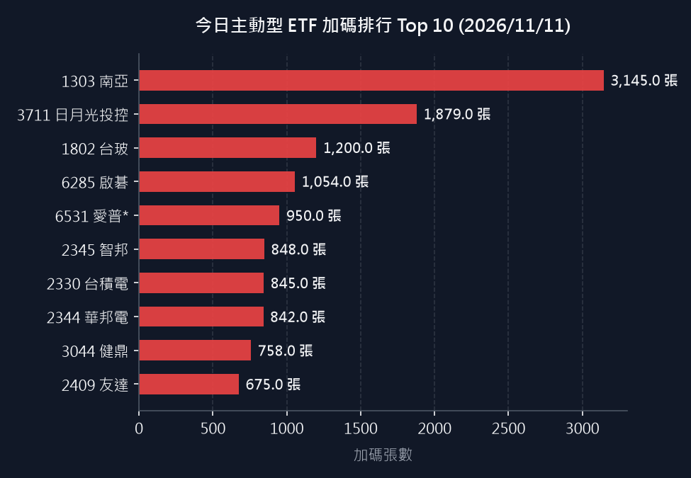
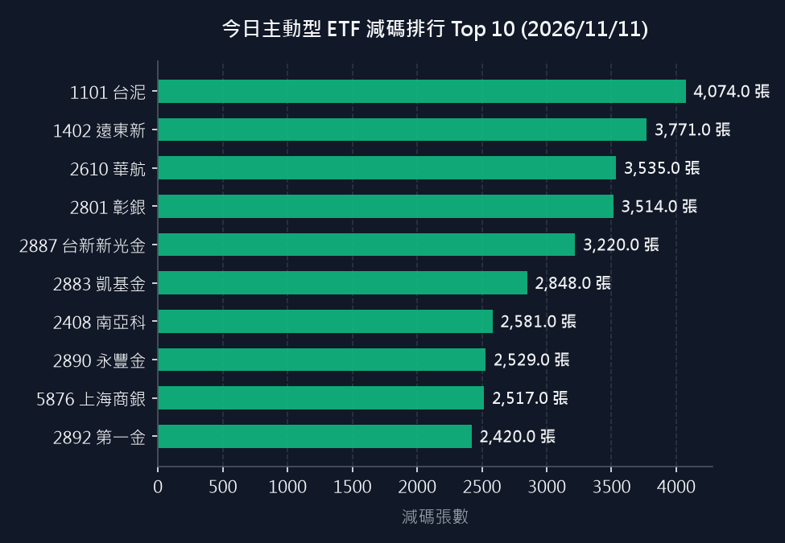

# 主動型 ETF 持股變動

資料來源：`主動型ETF持股明細.xlsx` 最近兩個日期分頁。

比較區間：`20261110` → `20261111`

## 今日加減碼視覺化排行

| 今日加碼 Top 10 | 今日減碼 Top 10 |
| :---: | :---: |
|  |  |

| ETF | 新增 | 刪除 | 比例變動 |
| :-- | --: | --: | --: |
| 00400A | 0 | 1 | 45 |
| 00401A | 1 | 1 | 56 |
| 00402A | 0 | 0 | 40 |
| 00403A | 0 | 0 | 32 |
| 00404A | 7 | 4 | 45 |
| 00405A | 0 | 0 | 26 |
| 00406A | 0 | 1 | 54 |
| 00407A | 0 | 0 | 42 |
| 00408A | 2 | 0 | 38 |
| 00980A | 0 | 0 | 46 |
| 00980D | 0 | 0 | 0 |
| 00981A | 1 | 1 | 34 |
| 00982A | 0 | 0 | 42 |
| 00983A | 0 | 0 | 34 |
| 00983D | 0 | 0 | 25 |
| 00984A | 9 | 3 | 76 |
| 00985A | 0 | 0 | 50 |
| 00986A | 0 | 0 | 28 |
| 00987A | 0 | 0 | 23 |
| 00988A | 1 | 1 | 29 |
| 00989A | 0 | 0 | 49 |
| 00990A | 2 | 1 | 32 |
| 00991A | 0 | 0 | 25 |
| 00992A | 0 | 1 | 39 |
| 00993A | 5 | 6 | 44 |
| 00994A | 2 | 2 | 27 |
| 00995A | 1 | 0 | 41 |
| 00996A | 0 | 0 | 37 |
| 00997A | 0 | 2 | 41 |
| 00998A | 1 | 0 | 42 |
| 00999A | 0 | 0 | 53 |

## 00400A

### 新增持股

- 無

### 刪除持股

- 台股期貨 2026/11(FITXN*1.TF)（4.31%，-0.15 張）

### 投資比例變動

- 1303 南亞：3.80% → 4.12%（+0.32）
- 1476 儒鴻：0.09% → 0.08%（-0.01）
- 2059 川湖：4.55% → 4.52%（-0.03）
- 2303 聯電：1.41% → 1.38%（-0.03）
- 2308 台達電：1.91% → 1.94%（+0.03）
- 2317 鴻海：1.80% → 1.66%（-0.14）
- 2327 國巨*：1.01% → 0.95%（-0.06）
- 2330 台積電：8.76% → 9.02%（+0.26）
- 2345 智邦：1.23% → 1.25%（+0.02）
- 2360 致茂：2.04% → 2.03%（-0.01）
- 2368 金像電：2.27% → 2.43%（+0.16）
- 2383 台光電：5.09% → 5.13%（+0.04）
- 2454 聯發科：7.09% → 6.92%（-0.17）
- 2603 長榮：2.50% → 2.39%（-0.11）
- 2637 慧洋-KY：0.49% → 0.27%（-0.22）
- 2891 中信金：1.72% → 1.54%（-0.18）
- 3008 大立光：1.30% → 1.28%（-0.02）
- 3017 奇鋐：2.90% → 4.15%（+1.25）
- 3023 信邦：0.58% → 0.75%（+0.17）
- 3036 文曄：1.39% → 1.35%（-0.04）
- 3037 欣興：2.81% → 2.92%（+0.11）
- 3044 健鼎：1.98% → 3.09%（+1.11）
- 3081 聯亞：0.74% → 0.78%（+0.04）
- 3090 日電貿：0.27% → 0.26%（-0.01）
- 3167 大量：0.29% → 0.32%（+0.03）
- 3231 緯創：0.94% → 0.89%（-0.05）
- 3293 鈊象：0.34% → 0.33%（-0.01）
- 3406 玉晶光：1.01% → 1.08%（+0.07）
- 3443 創意：2.25% → 3.39%（+1.14）
- 3529 力旺：0.99% → 1.03%（+0.04）
- 3653 健策：3.01% → 3.99%（+0.98）
- 3661 世芯-KY：2.07% → 2.21%（+0.14）
- 3665 貿聯-KY：1.12% → 1.14%（+0.02）
- 4958 臻鼎-KY：0.35% → 0.37%（+0.02）
- 5274 信驊：3.10% → 3.03%（-0.07）
- 6121 新普：0.22% → 0.18%（-0.04）
- 6187 萬潤：0.82% → 0.80%（-0.02）
- 6223 旺矽：2.39% → 2.94%（+0.55）
- 6271 同欣電：0.22% → 0.23%（+0.01）
- 6278 台表科：1.96% → 2.54%（+0.58）
- 6488 環球晶：1.23% → 1.26%（+0.03）
- 6505 台塑化：0.22% → 0.21%（-0.01）
- 7750 新代：0.38% → 0.36%（-0.02）
- 7769 鴻勁：0.56% → 0.82%（+0.26）
- ＸＡＧＸ金兌(3533.HK)：1.39% → 1.36%（-0.03）

## 00401A

### 新增持股

- 3653 健策（0.89%，6 張）

### 刪除持股

- 4991 環宇-KY（0.42%，52 張）

### 投資比例變動

- 1216 統一：0.28% → 0.26%（-0.02）
- 1303 南亞：1.07% → 1.19%（+0.12）
- 1476 儒鴻：1.95% → 1.80%（-0.15）
- 1477 聚陽：0.97% → 0.89%（-0.08）
- 2059 川湖：1.88% → 1.92%（+0.04）
- 2303 聯電：2.36% → 2.37%（+0.01）
- 2308 台達電：1.59% → 1.66%（+0.07）
- 2313 華通：1.08% → 1.11%（+0.03）
- 2317 鴻海：0.55% → 0.52%（-0.03）
- 2327 國巨*：0.46% → 0.45%（-0.01）
- 2330 台積電：19.71% → 20.50%（+0.79）
- 2357 華碩：1.65% → 1.62%（-0.03）
- 2360 致茂：1.46% → 1.49%（+0.03）
- 2379 瑞昱：1.06% → 1.02%（-0.04）
- 2382 廣達：1.92% → 1.81%（-0.11）
- 2383 台光電：0.82% → 0.85%（+0.03）
- 2412 中華電：0.90% → 0.85%（-0.05）
- 2454 聯發科：5.24% → 5.25%（+0.01）
- 2455 全新：1.46% → 1.53%（+0.07）
- 2603 長榮：2.08% → 2.04%（-0.04）
- 2881 富邦金：2.03% → 1.98%（-0.05）
- 2882 國泰金：1.04% → 0.99%（-0.05）
- 2883 凱基金：1.50% → 1.46%（-0.04）
- 2884 玉山金：1.84% → 1.73%（-0.11）
- 2886 兆豐金：1.41% → 1.36%（-0.05）
- 2887 台新新光金：1.03% → 0.97%（-0.06）
- 2890 永豐金：1.55% → 1.47%（-0.08）
- 2891 中信金：2.44% → 2.24%（-0.20）
- 2912 統一超：0.25% → 0.23%（-0.02）
- 3008 大立光：2.20% → 2.23%（+0.03）
- 3034 聯詠：0.19% → 0.17%（-0.02）
- 3037 欣興：1.21% → 0.92%（-0.29）
- 3131 弘塑：0.47% → 0.49%（+0.02）
- 3231 緯創：1.95% → 1.89%（-0.06）
- 3443 創意：2.05% → 2.26%（+0.21）
- 3491 昇達科：1.37% → 1.54%（+0.17）
- 3711 日月光投控：3.91% → 4.02%（+0.11）
- 4904 遠傳：0.75% → 0.72%（-0.03）
- 4938 和碩：0.32% → 0.30%（-0.02）
- 4958 臻鼎-KY：1.02% → 1.10%（+0.08）
- 5347 世界：1.02% → 1.00%（-0.02）
- 5904 寶雅*：0.57% → 0.54%（-0.03）
- 6147 頎邦：1.01% → 1.04%（+0.03）
- 6223 旺矽：1.33% → 1.51%（+0.18）
- 6285 啟碁：1.03% → 1.04%（+0.01）
- 6515 穎崴：0.64% → 0.70%（+0.06）
- 6531 愛普*：1.18% → 1.21%（+0.03）
- 6669 緯穎：1.45% → 1.39%（-0.06）
- 7828 創新服務：1.10% → 1.24%（+0.14）
- 7856 漢測：0.72% → 0.77%（+0.05）
- 8464 億豐：0.93% → 0.87%（-0.06）
- TAIWAN TAIE C 16DEC26 40000 TWSE：-0.07% → -0.11%（-0.04）
- TAIWAN TAIE C 18NOV26 40000 TWSE：-0.03% → -0.05%（-0.02）
- 台股期貨11/26(FITXN*1.TF)：-0.85% → -0.36%（+0.49）
- 臺指選擇權11/26 43300 買權：-0.01% → -0.05%（-0.04）
- 臺指選擇權11/26 46500 買權：-0.01% → -0.06%（-0.05）

## 00402A

### 新增持股

- 無

### 刪除持股

- 無

### 投資比例變動

- AAPL.US Apple：9.12% → 9.16%（+0.04）
- ADI.US Analog Devices：2.16% → 2.17%（+0.01）
- AMD.US AMD：6.05% → 6.17%（+0.12）
- AMZN.US Amazon：5.19% → 5.30%（+0.11）
- ARM.US Arm：0.74% → 0.72%（-0.02）
- AVGO.US Broadcom：2.30% → 2.41%（+0.11）
- BABA.US Alibaba Group：0.54% → 0.53%（-0.01）
- BKNG.US Booking Holdings：0.60% → 0.59%（-0.01）
- CDNS.US Cadence Design Systems：1.73% → 1.72%（-0.01）
- CIEN.US Ciena：0.98% → 1.00%（+0.02）
- CLS.US Celestica：1.00% → 1.01%（+0.01）
- COHR.US Coherent：1.22% → 1.17%（-0.05）
- CRWD.US CrowdStrike Holdings：1.83% → 1.82%（-0.01）
- GOOG.US Alphabet - Class C Capital Stock：3.23% → 3.24%（+0.01）
- GOOGL.US Alphabet - Class A Common Stock：3.24% → 3.25%（+0.01）
- INTC.US Intel：1.03% → 1.01%（-0.02）
- IOT.US Samsara：0.63% → 0.62%（-0.01）
- KLAC.US KLA：1.40% → 1.43%（+0.03）
- LITE.US Lumentum：1.34% → 1.32%（-0.02）
- LRCX.US Lam Research：2.13% → 2.16%（+0.03）
- MCHP.US Microchip Technology：1.24% → 1.22%（-0.02）
- MDB.US MongoDB：0.39% → 0.40%（+0.01）
- META.US Meta：3.86% → 3.88%（+0.02）
- MRVL.US Marvell：1.18% → 1.19%（+0.01）
- MSFT.US Microsoft：6.27% → 6.17%（-0.10）
- MU.US Micron：5.09% → 5.07%（-0.02）
- NFLX.US Netflix：1.02% → 1.01%（-0.01）
- NOW.US ServiceNow：0.90% → 0.88%（-0.02）
- NVDA.US NVIDIA：7.99% → 7.61%（-0.38）
- PANW.US Palo Alto：2.89% → 2.87%（-0.02）
- PLTR.US Palantir Technologies：2.12% → 2.13%（+0.01）
- SHOP.US Shopify：1.22% → 1.18%（-0.04）
- SKHY.US SK hynix：0.82% → 0.79%（-0.03）
- SNOW.US Snowflake：1.33% → 1.36%（+0.03）
- SPCX.US SpaceX：0.80% → 0.81%（+0.01）
- TSM.US TSMC(ADR)：1.54% → 1.58%（+0.04）
- TTWO.US Take-Two：0.67% → 0.73%（+0.06）
- TXN.US Texas Instruments：2.85% → 2.92%（+0.07）
- V.US Visa：1.45% → 1.46%（+0.01）
- WDC.US Western Digital：1.61% → 1.62%（+0.01）

## 00403A

### 新增持股

- 無

### 刪除持股

- 無

### 投資比例變動

- 1303 南亞：2.92% → 3.61%（+0.69）
- 1717 長興：0.05% → 0.04%（-0.01）
- 2059 川湖：0.70% → 0.69%（-0.01）
- 2308 台達電：2.18% → 2.22%（+0.04）
- 2317 鴻海：0.66% → 0.61%（-0.05）
- 2327 國巨*：3.14% → 2.95%（-0.19）
- 2330 台積電：16.00% → 15.61%（-0.39）
- 2345 智邦：1.54% → 1.57%（+0.03）
- 2368 金像電：0.80% → 0.85%（+0.05）
- 2383 台光電：4.24% → 4.27%（+0.03）
- 2408 南亞科：0.90% → 0.87%（-0.03）
- 2454 聯發科：5.56% → 5.77%（+0.21）
- 2481 強茂：0.04% → 0.03%（-0.01）
- 2882 國泰金：0.48% → 0.45%（-0.03）
- 2883 凱基金：0.12% → 0.11%（-0.01）
- 3008 大立光：1.60% → 1.58%（-0.02）
- 3017 奇鋐：5.22% → 6.01%（+0.79）
- 3037 欣興：4.73% → 4.92%（+0.19）
- 3044 健鼎：0.12% → 0.18%（+0.06）
- 3189 景碩：2.66% → 2.61%（-0.05）
- 3211 順達：0.29% → 0.28%（-0.01）
- 3443 創意：4.13% → 4.53%（+0.40）
- 3653 健策：5.04% → 5.07%（+0.03）
- 3665 貿聯-KY：1.80% → 1.82%（+0.02）
- 3711 日月光投控：1.00% → 1.23%（+0.23）
- 5274 信驊：1.83% → 1.79%（-0.04）
- 6223 旺矽：2.99% → 3.29%（+0.30）
- 6274 台燿：1.90% → 1.47%（-0.43）
- 6669 緯穎：2.64% → 2.54%（-0.10）
- 6805 富世達：0.50% → 0.60%（+0.10）
- 8046 南電：2.44% → 2.57%（+0.13）
- 8996 高力：2.09% → 2.17%（+0.08）

## 00404A

### 新增持股

- 2006 東和鋼鐵（0.66%，282 張）
- 2377 微星（0.41%，106 張）
- 2603 長榮（1.35%，194 張）
- 3014 聯陽（0.56%，161 張）
- 3036 文曄（0.53%，103 張）
- 4961 天鈺（0.19%，41 張）
- 6957 裕慶-KY（0.07%，6 張）

### 刪除持股

- 2059 川湖（0.68%，3 張）
- 2308 台達電（1.86%，57 張）
- 2345 智邦（0.87%，22 張）
- 2351 順德（0.28%，73 張）

### 投資比例變動

- 1303 南亞：0.79% → 0.84%（+0.05）
- 2301 光寶科：0.50% → 0.52%（+0.02）
- 2303 聯電：2.67% → 1.22%（-1.45）
- 2317 鴻海：0.73% → 0.47%（-0.26）
- 2330 台積電：22.94% → 22.58%（-0.36）
- 2347 聯強：1.68% → 1.58%（-0.10）
- 2379 瑞昱：1.11% → 2.05%（+0.94）
- 2382 廣達：1.01% → 0.45%（-0.56）
- 2383 台光電：2.87% → 2.62%（-0.25）
- 2395 研華：1.22% → 1.80%（+0.58）
- 2436 偉詮電：0.98% → 0.48%（-0.50）
- 2454 聯發科：7.51% → 6.64%（-0.87）
- 2637 慧洋-KY：1.12% → 1.09%（-0.03）
- 2851 中再保：1.09% → 1.02%（-0.07）
- 2882 國泰金：2.70% → 3.07%（+0.37）
- 2885 元大金：2.41% → 3.10%（+0.69）
- 2887 台新新光金：1.37% → 1.77%（+0.40）
- 2890 永豐金：1.43% → 1.12%（-0.31）
- 3017 奇鋐：1.29% → 1.37%（+0.08）
- 3034 聯詠：1.89% → 1.98%（+0.09）
- 3037 欣興：0.32% → 0.34%（+0.02）
- 3264 欣銓：0.53% → 0.44%（-0.09）
- 3293 鈊象：1.10% → 1.83%（+0.73）
- 3374 精材：0.11% → 0.12%（+0.01）
- 3443 創意：1.13% → 1.76%（+0.63）
- 3653 健策：0.48% → 0.95%（+0.47）
- 3680 家登：0.45% → 0.29%（-0.16）
- 3711 日月光投控：3.07% → 3.43%（+0.36）
- 5274 信驊：2.45% → 2.10%（-0.35）
- 5434 崇越：1.62% → 1.80%（+0.18）
- 5876 上海商銀：1.46% → 0.70%（-0.76）
- 5904 寶雅*：0.46% → 0.45%（-0.01）
- 6196 帆宣：1.63% → 1.74%（+0.11）
- 6206 飛捷：0.73% → 0.69%（-0.04）
- 6223 旺矽：1.10% → 0.72%（-0.38）
- 6257 矽格：1.65% → 0.74%（-0.91）
- 6491 晶碩：0.93% → 0.94%（+0.01）
- 6505 台塑化：0.47% → 0.46%（-0.01）
- 6669 緯穎：1.02% → 1.01%（-0.01）
- 6691 洋基工程：1.72% → 1.50%（-0.22）
- 7769 鴻勁：1.14% → 1.15%（+0.01）
- 8016 矽創：1.25% → 1.46%（+0.21）
- 8081 致新：0.79% → 0.73%（-0.06）
- 8299 群聯：1.16% → 1.14%（-0.02）
- 台股期貨11/26(FITXN*1.TF)：19.65% → 19.55%（-0.10）

## 00405A

### 新增持股

- 無

### 刪除持股

- 無

### 投資比例變動

- 2059 川湖：2.13% → 2.08%（-0.05）
- 2308 台達電：0.60% → 0.58%（-0.02）
- 2330 台積電：5.55% → 5.57%（+0.02）
- 2345 智邦：4.67% → 4.56%（-0.11）
- 2368 金像電：5.50% → 5.63%（+0.13）
- 2383 台光電：4.60% → 4.54%（-0.06）
- 2454 聯發科：6.66% → 6.64%（-0.02）
- 3017 奇鋐：1.77% → 1.85%（+0.08）
- 3037 欣興：4.24% → 4.23%（-0.01）
- 3443 創意：2.60% → 2.74%（+0.14）
- 3653 健策：7.48% → 7.70%（+0.22）
- 3665 貿聯-KY：5.05% → 5.00%（-0.05）
- 3711 日月光投控：1.51% → 1.48%（-0.03）
- 5274 信驊：5.41% → 5.45%（+0.04）
- 6187 萬潤：0.75% → 0.71%（-0.04）
- 6223 旺矽：6.54% → 6.89%（+0.35）
- 6274 台燿：1.49% → 1.54%（+0.05）
- 6285 啟碁：0.10% → 0.09%（-0.01）
- 6415 矽力*-KY：0.55% → 0.56%（+0.01）
- 6515 穎崴：0.42% → 0.45%（+0.03）
- 6531 愛普*：3.73% → 3.59%（-0.14）
- 6669 緯穎：0.83% → 0.79%（-0.04）
- 6805 富世達：1.69% → 1.67%（-0.02）
- 7769 鴻勁：2.51% → 2.48%（-0.03）
- 8046 南電：6.48% → 6.68%（+0.20）
- 8996 高力：1.40% → 1.39%（-0.01）

## 00406A

### 新增持股

- 無

### 刪除持股

- 臺指選擇權第二週週三到期契約（-18.68%，-15 張）

### 投資比例變動

- 1303 南亞：2.27% → 2.35%（+0.08）
- 1560 中砂：0.21% → 0.20%（-0.01）
- 1815 富喬：0.59% → 0.62%（+0.03）
- 2059 川湖：1.82% → 1.78%（-0.04）
- 2303 聯電：1.22% → 1.21%（-0.01）
- 2308 台達電：1.66% → 1.61%（-0.05）
- 2317 鴻海：0.22% → 0.21%（-0.01）
- 2327 國巨*：1.33% → 1.30%（-0.03）
- 2345 智邦：2.03% → 1.98%（-0.05）
- 2368 金像電：2.42% → 2.48%（+0.06）
- 2383 台光電：6.36% → 6.28%（-0.08）
- 2449 京元電子：0.36% → 0.35%（-0.01）
- 2454 聯發科：6.17% → 6.15%（-0.02）
- 2481 強茂：0.31% → 0.30%（-0.01）
- 2881 富邦金：0.63% → 0.62%（-0.01）
- 2882 國泰金：0.62% → 0.61%（-0.01）
- 2884 玉山金：0.28% → 0.27%（-0.01）
- 2885 元大金：0.51% → 0.50%（-0.01）
- 2886 兆豐金：0.42% → 0.41%（-0.01）
- 2887 台新新光金：0.44% → 0.43%（-0.01）
- 2890 永豐金：0.29% → 0.28%（-0.01）
- 3008 大立光：0.98% → 0.99%（+0.01）
- 3017 奇鋐：5.52% → 5.76%（+0.24）
- 3081 聯亞：1.14% → 1.15%（+0.01）
- 3105 穩懋：0.52% → 0.53%（+0.01）
- 3167 大量：0.50% → 0.53%（+0.03）
- 3189 景碩：1.62% → 1.55%（-0.07）
- 3231 緯創：0.32% → 0.31%（-0.01）
- 3443 創意：2.10% → 2.21%（+0.11）
- 3450 聯鈞：0.08% → 0.07%（-0.01）
- 3491 昇達科：0.28% → 0.30%（+0.02）
- 3653 健策：4.87% → 5.02%（+0.15）
- 3661 世芯-KY：0.72% → 0.74%（+0.02）
- 3665 貿聯-KY：1.04% → 1.02%（-0.02）
- 3711 日月光投控：2.21% → 2.16%（-0.05）
- 4938 和碩：0.44% → 0.42%（-0.02）
- 4958 臻鼎-KY：0.84% → 0.87%（+0.03）
- 5274 信驊：1.20% → 1.21%（+0.01）
- 6147 頎邦：0.63% → 0.62%（-0.01）
- 6187 萬潤：0.11% → 0.10%（-0.01）
- 6213 聯茂：0.35% → 0.37%（+0.02）
- 6223 旺矽：2.82% → 2.97%（+0.15）
- 6274 台燿：1.77% → 1.82%（+0.05）
- 6278 台表科：0.21% → 0.22%（+0.01）
- 6510 精測：0.50% → 0.53%（+0.03）
- 6669 緯穎：0.97% → 0.92%（-0.05）
- 6715 嘉基：0.76% → 0.80%（+0.04）
- 6805 富世達：0.97% → 0.95%（-0.02）
- 8046 南電：3.14% → 3.23%（+0.09）
- 8150 南茂：0.02% → 0.03%（+0.01）
- 8996 高力：0.70% → 0.69%（-0.01）
- 臺指選擇權第二週週五到期契約：-6.08% → -9.33%（-3.25）
- 臺股期貨 202611(FITXN*1.TF)：20.35% → 20.83%（+0.48）
- 臺股期貨 202612(FITXN*1.TF)：2.25% → 2.23%（-0.02）

## 00407A

### 新增持股

- 無

### 刪除持股

- 無

### 投資比例變動

- 1303 南亞：3.53% → 3.65%（+0.12）
- 1560 中砂：0.94% → 0.88%（-0.06）
- 2059 川湖：1.75% → 1.71%（-0.04）
- 2301 光寶科：1.39% → 1.36%（-0.03）
- 2308 台達電：2.11% → 2.05%（-0.06）
- 2313 華通：0.37% → 0.38%（+0.01）
- 2327 國巨*：1.91% → 1.86%（-0.05）
- 2330 台積電：10.96% → 10.98%（+0.02）
- 2344 華邦電：0.13% → 0.12%（-0.01）
- 2345 智邦：1.43% → 1.39%（-0.04）
- 2368 金像電：1.98% → 2.02%（+0.04）
- 2383 台光電：6.08% → 5.99%（-0.09）
- 2408 南亞科：1.38% → 1.36%（-0.02）
- 2451 創見：0.30% → 0.29%（-0.01）
- 2454 聯發科：6.13% → 6.11%（-0.02）
- 2615 萬海：1.06% → 1.00%（-0.06）
- 3008 大立光：1.34% → 1.35%（+0.01）
- 3017 奇鋐：5.35% → 5.57%（+0.22）
- 3034 聯詠：0.74% → 0.71%（-0.03）
- 3037 欣興：5.23% → 5.22%（-0.01）
- 3131 弘塑：0.70% → 0.69%（-0.01）
- 3231 緯創：1.05% → 1.02%（-0.03）
- 3260 威剛：0.27% → 0.26%（-0.01）
- 3293 鈊象：0.67% → 0.65%（-0.02）
- 3406 玉晶光：0.70% → 0.74%（+0.04）
- 3443 創意：4.69% → 4.93%（+0.24）
- 3491 昇達科：0.90% → 0.94%（+0.04）
- 3533 嘉澤：0.94% → 0.93%（-0.01）
- 3653 健策：3.44% → 3.53%（+0.09）
- 3665 貿聯-KY：2.82% → 2.79%（-0.03）
- 3711 日月光投控：3.43% → 3.34%（-0.09）
- 4958 臻鼎-KY：0.92% → 0.94%（+0.02）
- 5274 信驊：1.42% → 1.43%（+0.01）
- 6187 萬潤：1.33% → 1.26%（-0.07）
- 6223 旺矽：1.95% → 2.05%（+0.10）
- 6274 台燿：1.55% → 1.60%（+0.05）
- 6510 精測：1.35% → 1.42%（+0.07）
- 6531 愛普*：0.29% → 0.28%（-0.01）
- 6669 緯穎：2.30% → 2.20%（-0.10）
- 6805 富世達：1.14% → 1.12%（-0.02）
- 8046 南電：3.12% → 3.21%（+0.09）
- 8996 高力：1.29% → 1.28%（-0.01）

## 00408A

### 新增持股

- 3081 聯亞（0.50%，3 張）
- 3661 世芯-KY（0.82%，3 張）

### 刪除持股

- 無

### 投資比例變動

- 1303 南亞：4.05% → 4.66%（+0.61）
- 1560 中砂：1.35% → 1.27%（-0.08）
- 2059 川湖：0.93% → 0.92%（-0.01）
- 2301 光寶科：0.49% → 0.48%（-0.01）
- 2327 國巨*：0.68% → 0.67%（-0.01）
- 2330 台積電：7.54% → 7.67%（+0.13）
- 2344 華邦電：0.42% → 0.41%（-0.01）
- 2368 金像電：5.12% → 5.68%（+0.56）
- 2382 廣達：0.23% → 0.22%（-0.01）
- 2383 台光電：4.59% → 4.56%（-0.03）
- 2395 研華：1.57% → 1.56%（-0.01）
- 2408 南亞科：1.22% → 1.21%（-0.01）
- 2449 京元電子：0.83% → 0.82%（-0.01）
- 2454 聯發科：5.07% → 5.09%（+0.02）
- 2542 興富發：3.91% → 3.80%（-0.11）
- 2603 長榮：1.75% → 1.70%（-0.05）
- 2880 華南金：1.34% → 1.29%（-0.05）
- 2891 中信金：2.24% → 2.19%（-0.05）
- 3017 奇鋐：2.80% → 3.86%（+1.06）
- 3026 禾伸堂：1.03% → 1.43%（+0.40）
- 3037 欣興：2.64% → 2.66%（+0.02）
- 3044 健鼎：1.14% → 1.21%（+0.07）
- 3045 台灣大：0.63% → 0.61%（-0.02）
- 3189 景碩：2.84% → 2.73%（-0.11）
- 3231 緯創：1.48% → 1.46%（-0.02）
- 3443 創意：0.56% → 0.59%（+0.03）
- 3653 健策：4.42% → 4.58%（+0.16）
- 3711 日月光投控：2.78% → 2.73%（-0.05）
- 4904 遠傳：0.99% → 0.97%（-0.02）
- 6223 旺矽：1.84% → 1.95%（+0.11）
- 6274 台燿：1.99% → 2.07%（+0.08）
- 6510 精測：0.87% → 1.15%（+0.28）
- 6526 達發：0.32% → 0.33%（+0.01）
- 6669 緯穎：2.45% → 2.37%（-0.08）
- 6805 富世達：2.79% → 2.77%（-0.02）
- 8046 南電：0.55% → 1.62%（+1.07）
- 8996 高力：3.06% → 3.07%（+0.01）
- 9802 鈺齊-KY：0.93% → 0.88%（-0.05）

## 00980A

### 新增持股

- 無

### 刪除持股

- 無

### 投資比例變動

- 1303 南亞：3.71% → 3.87%（+0.16）
- 2059 川湖：4.10% → 4.03%（-0.07）
- 2303 聯電：1.31% → 1.30%（-0.01）
- 2308 台達電：2.94% → 2.87%（-0.07）
- 2317 鴻海：3.59% → 3.46%（-0.13）
- 2327 國巨*：0.76% → 0.75%（-0.01）
- 2330 台積電：9.82% → 9.90%（+0.08）
- 2344 華邦電：1.58% → 1.54%（-0.04）
- 2345 智邦：0.88% → 0.86%（-0.02）
- 2360 致茂：0.82% → 0.83%（+0.01）
- 2368 金像電：1.89% → 1.94%（+0.05）
- 2376 技嘉：1.62% → 1.56%（-0.06）
- 2382 廣達：1.99% → 1.91%（-0.08）
- 2383 台光電：3.81% → 3.78%（-0.03）
- 2408 南亞科：2.25% → 2.22%（-0.03）
- 2454 聯發科：5.79% → 5.80%（+0.01）
- 2884 玉山金：1.38% → 1.35%（-0.03）
- 2891 中信金：1.75% → 1.70%（-0.05）
- 3008 大立光：1.99% → 2.02%（+0.03）
- 3017 奇鋐：2.26% → 2.37%（+0.11）
- 3026 禾伸堂：0.83% → 0.88%（+0.05）
- 3036 文曄：0.98% → 0.96%（-0.02）
- 3037 欣興：2.95% → 2.96%（+0.01）
- 3044 健鼎：1.29% → 1.37%（+0.08）
- 3081 聯亞：1.44% → 1.45%（+0.01）
- 3189 景碩：1.13% → 1.08%（-0.05）
- 3231 緯創：1.72% → 1.69%（-0.03）
- 3293 鈊象：0.48% → 0.47%（-0.01）
- 3443 創意：1.96% → 2.08%（+0.12）
- 3653 健策：3.17% → 3.28%（+0.11）
- 3665 貿聯-KY：1.33% → 1.32%（-0.01）
- 3711 日月光投控：2.28% → 2.24%（-0.04）
- 5274 信驊：1.45% → 1.47%（+0.02）
- 5904 寶雅*：0.75% → 0.72%（-0.03）
- 6213 聯茂：1.07% → 1.13%（+0.06）
- 6223 旺矽：1.14% → 1.20%（+0.06）
- 6274 台燿：1.05% → 1.09%（+0.04）
- 6442 光聖：0.25% → 0.24%（-0.01）
- 6515 穎崴：1.29% → 1.37%（+0.08）
- 6669 緯穎：1.89% → 1.82%（-0.07）
- 7751 竑騰：0.59% → 0.60%（+0.01）
- 7769 鴻勁：1.81% → 1.78%（-0.03）
- 8046 南電：1.44% → 1.49%（+0.05）
- 8210 勤誠：0.31% → 0.32%（+0.01）
- 8299 群聯：1.06% → 1.05%（-0.01）
- 台灣證交所加權股價指數(FITXN*1.TF)：4.87% → 4.85%（-0.02）

## 00980D

### 新增持股

- 無

### 刪除持股

- 無

### 投資比例變動

- 無

## 00981A

### 新增持股

- 4551 智伸科（0.00%，40 張）

### 刪除持股

- 2439 美律（0.00%，1 張）

### 投資比例變動

- 1802 台玻：0.21% → 0.26%（+0.05）
- 2002 中鋼：0.04% → 0.03%（-0.01）
- 2303 聯電：3.03% → 2.93%（-0.10）
- 2308 台達電：3.46% → 3.47%（+0.01）
- 2317 鴻海：0.44% → 0.40%（-0.04）
- 2327 國巨*：3.80% → 3.53%（-0.27）
- 2330 台積電：15.58% → 15.78%（+0.20）
- 2345 智邦：3.50% → 3.95%（+0.45）
- 2368 金像電：2.71% → 2.99%（+0.28）
- 2383 台光電：6.93% → 6.88%（-0.05）
- 2449 京元電子：0.64% → 0.63%（-0.01）
- 2454 聯發科：8.37% → 8.06%（-0.31）
- 2891 中信金：0.16% → 0.14%（-0.02）
- 3017 奇鋐：6.65% → 7.48%（+0.83）
- 3037 欣興：5.88% → 6.03%（+0.15）
- 3231 緯創：0.79% → 0.74%（-0.05）
- 3264 欣銓：0.36% → 0.35%（-0.01）
- 3376 新日興：0.02% → 0.00%（-0.02）
- 3443 創意：2.51% → 2.83%（+0.32）
- 3653 健策：5.66% → 5.62%（-0.04）
- 3711 日月光投控：3.73% → 3.82%（+0.09）
- 5274 信驊：1.10% → 1.06%（-0.04）
- 6187 萬潤：0.05% → 0.04%（-0.01）
- 6223 旺矽：3.65% → 3.97%（+0.32）
- 6271 同欣電：0.17% → 0.20%（+0.03）
- 6274 台燿：2.78% → 2.75%（-0.03）
- 6278 台表科：0.06% → 0.07%（+0.01）
- 6510 精測：0.47% → 0.51%（+0.04）
- 6515 穎崴：0.09% → 0.10%（+0.01）
- 6669 緯穎：2.12% → 1.40%（-0.72）
- 6805 富世達：1.06% → 1.21%（+0.15）
- 8046 南電：3.30% → 3.43%（+0.13）
- 8996 高力：0.49% → 0.51%（+0.02）
- 台指期貨 2026/11(FITXN*1.TF)：2.83% → 2.71%（-0.12）

## 00982A

### 新增持股

- 無

### 刪除持股

- 無

### 投資比例變動

- 2059 川湖：2.75% → 2.69%（-0.06）
- 2301 光寶科：1.75% → 1.72%（-0.03）
- 2303 聯電：1.23% → 1.22%（-0.01）
- 2330 台積電：8.27% → 8.29%（+0.02）
- 2360 致茂：2.97% → 2.98%（+0.01）
- 2376 技嘉：1.26% → 1.21%（-0.05）
- 2383 台光電：3.22% → 3.18%（-0.04）
- 2395 研華：1.35% → 1.33%（-0.02）
- 2428 興勤：1.06% → 1.00%（-0.06）
- 2454 聯發科：8.24% → 8.22%（-0.02）
- 2455 全新：1.35% → 1.34%（-0.01）
- 2467 志聖：0.24% → 0.23%（-0.01）
- 2476 鉅祥：0.29% → 0.31%（+0.02）
- 2478 大毅：0.34% → 0.33%（-0.01）
- 2486 一詮：0.40% → 0.41%（+0.01）
- 3008 大立光：3.01% → 3.03%（+0.02）
- 3017 奇鋐：2.44% → 2.55%（+0.11）
- 3045 台灣大：0.82% → 0.79%（-0.03）
- 3105 穩懋：7.69% → 7.92%（+0.23）
- 3231 緯創：1.93% → 1.88%（-0.05）
- 3265 台星科：1.26% → 1.27%（+0.01）
- 3491 昇達科：3.46% → 3.64%（+0.18）
- 3711 日月光投控：1.90% → 1.86%（-0.04）
- 4958 臻鼎-KY：3.06% → 3.13%（+0.07）
- 5274 信驊：1.34% → 1.35%（+0.01）
- 5425 台半：1.17% → 1.15%（-0.02）
- 5483 中美晶：1.31% → 1.25%（-0.06）
- 5536 聖暉*：0.91% → 0.90%（-0.01）
- 6196 帆宣：0.31% → 0.30%（-0.01）
- 6213 聯茂：1.49% → 1.56%（+0.07）
- 6223 旺矽：2.76% → 2.90%（+0.14）
- 6239 力成：1.25% → 1.26%（+0.01）
- 6274 台燿：1.00% → 1.03%（+0.03）
- 6472 保瑞：0.93% → 0.92%（-0.01）
- 6488 環球晶：1.59% → 1.58%（-0.01）
- 6510 精測：0.94% → 0.99%（+0.05）
- 6531 愛普*：6.05% → 7.32%（+1.27）
- 6640 均華：0.21% → 0.20%（-0.01）
- 6669 緯穎：1.91% → 1.83%（-0.08）
- 6672 騰輝電子-KY：2.62% → 2.61%（-0.01）
- 8070 長華*：0.69% → 0.68%（-0.01）
- 8996 高力：1.21% → 1.20%（-0.01）

## 00983A

### 新增持股

- 無

### 刪除持股

- 無

### 投資比例變動

- AMD.US AMD：3.31% → 3.41%（+0.10）
- AMZN.US Amazon：4.35% → 4.50%（+0.15）
- AVGO.US Broadcom：1.09% → 1.15%（+0.06）
- BEAM.US Beam Therapeutics：2.76% → 2.62%（-0.14）
- BLSH.US Bullish：1.13% → 1.12%（-0.01）
- BMNR.US BitMine：1.18% → 1.17%（-0.01）
- COIN.US Coinbase：2.95% → 2.79%（-0.16）
- CRCL.US Circle：3.62% → 3.41%（-0.21）
- CRSP.US CRISPR Therapeutics：3.99% → 3.66%（-0.33）
- DE.US Deere：0.48% → 0.49%（+0.01）
- GOOG.US Alphabet - Class C Capital Stock：2.60% → 2.77%（+0.17）
- GOOGL.US Alphabet - Class A Common Stock：1.55% → 1.57%（+0.02）
- HOOD.US Robinhood Markets：2.49% → 2.48%（-0.01）
- ILMN.US Illumina：1.56% → 1.54%（-0.02）
- LLY.US Eli Lilly：1.95% → 2.02%（+0.07）
- META.US Meta：3.33% → 3.39%（+0.06）
- MSFT.US Microsoft：1.60% → 1.73%（+0.13）
- NET.US Cloudflare：1.46% → 1.55%（+0.09）
- NTLA.US Intellia Therapeutics：1.96% → 1.84%（-0.12）
- NTRA.US Natera：1.42% → 1.41%（-0.01）
- NVDA.US NVIDIA：3.31% → 3.18%（-0.13）
- PLTR.US Palantir Technologies：3.08% → 3.13%（+0.05）
- RKLB.US Rocket Lab：1.44% → 1.56%（+0.12）
- RXRX.US Recursion Pharmaceuticals：1.22% → 1.16%（-0.06）
- SHOP.US Shopify：4.85% → 4.77%（-0.08）
- SNOW.US Snowflake：0.54% → 0.55%（+0.01）
- SPCX.US SpaceX：7.63% → 7.83%（+0.20）
- TEM.US Tempus：7.22% → 7.02%（-0.20）
- TSLA.US Tesla：8.45% → 8.68%（+0.23）
- TSM.US TSMC(ADR)：2.65% → 2.76%（+0.11）
- TWST.US Twist Bioscience：3.71% → 3.69%（-0.02）
- TXG.US 10x Genomics：3.17% → 3.12%（-0.05）
- WGS.US GeneDx：0.52% → 0.45%（-0.07）
- XYZ.US Block：2.22% → 2.19%（-0.03）

## 00983D

### 新增持股

- 無

### 刪除持股

- 無

### 投資比例變動

- ABIBB 8.2 01/15/39：1.94% → 1.93%（-0.01）
- AET 6 5/8 06/15/36：0.81% → 0.80%（-0.01）
- AMCX 10 1/2 07/15/32：1.71% → 1.69%（-0.02）
- BATSLN 7.081 08/02/53：1.27% → 1.26%（-0.01）
- BHCCN 11 09/30/28：2.11% → 2.12%（+0.01）
- CRWV 9 02/01/31：1.20% → 0.85%（-0.35）
- CYH 10 7/8 01/15/32：1.45% → 1.42%（-0.03）
- DOW 6.9 05/15/53：0.84% → 0.83%（-0.01）
- DOW 9.4 05/15/39：1.91% → 1.90%（-0.01）
- DTV 8 7/8 02/01/30：1.76% → 1.78%（+0.02）
- ENBCN 6.7 11/15/53：0.66% → 0.65%（-0.01）
- GS 6 1/4 02/01/41：0.36% → 0.35%（-0.01）
- GT 8 7/8 07/15/32：0.91% → 0.89%（-0.02）
- HAL 7.45 09/15/39：1.81% → 1.80%（-0.01）
- IEP 10 11/15/29：1.58% → 1.51%（-0.07）
- LQDW.US iShares LQD Premium Income+ ETF：7.33% → 7.36%（+0.03）
- MINAU 9 1/4 10/01/28：0.97% → 0.98%（+0.01）
- MOHEGN 11 7/8 04/15/31：1.49% → 1.50%（+0.01）
- MS 7 1/4 04/01/32：1.60% → 1.61%（+0.01）
- RAKUTN 11 1/4 02/15/27：1.98% → 1.99%（+0.01）
- SPCX 6.6 07/15/46：1.19% → 1.20%（+0.01）
- SVC 8 7/8 06/15/32：0.52% → 0.53%（+0.01）
- TIME WARNER CABLE INC 7.300 07/01/38：0.52% → 0.53%（+0.01）
- VENLNG 9 1/2 02/01/29：1.55% → 1.56%（+0.01）
- VZ 7 3/4 12/01/30：1.25% → 1.26%（+0.01）

## 00984A

### 新增持股

- 2347 聯強（0.71%，873 張）
- 2412 中華電（0.89%，542 張）
- 2464 盟立（0.87%，520 張）
- 2466 冠西電（0.34%，84 張）
- 3006 晶豪科（0.75%，313 張）
- 3265 台星科（0.75%，442 張）
- 4967 十銓（0.83%，310 張）
- 6214 精誠（0.85%，432 張）
- 8039 台虹（0.82%，353 張）

### 刪除持股

- 2851 中再保（0.67%，1343 張）
- 2855 統一證（0.66%，1229 張）
- 2891 中信金（0.71%，874 張）

### 投資比例變動

- 1216 統一：1.08% → 0.60%（-0.48）
- 1301 台塑：0.68% → 0.83%（+0.15）
- 1303 南亞：1.78% → 3.56%（+1.78）
- 1326 台化：2.43% → 2.46%（+0.03）
- 1560 中砂：1.45% → 1.82%（+0.37）
- 1605 華新：0.66% → 0.82%（+0.16）
- 1709 和益：0.66% → 0.93%（+0.27）
- 2006 東和鋼鐵：1.06% → 0.61%（-0.45）
- 2027 大成鋼：0.68% → 0.86%（+0.18）
- 2059 川湖：1.90% → 2.59%（+0.69）
- 2301 光寶科：0.64% → 0.85%（+0.21）
- 2313 華通：0.48% → 0.66%（+0.18）
- 2317 鴻海：0.04% → 0.05%（+0.01）
- 2330 台積電：2.74% → 2.28%（-0.46）
- 2351 順德：0.53% → 0.74%（+0.21）
- 2357 華碩：0.68% → 0.85%（+0.17）
- 2377 微星：0.65% → 0.79%（+0.14）
- 2379 瑞昱：1.04% → 0.61%（-0.43）
- 2408 南亞科：1.25% → 2.42%（+1.17）
- 2409 友達：0.66% → 0.83%（+0.17）
- 2449 京元電子：0.34% → 0.47%（+0.13）
- 2454 聯發科：0.32% → 0.37%（+0.05）
- 2455 全新：0.91% → 1.08%（+0.17）
- 2603 長榮：2.50% → 2.54%（+0.04）
- 2615 萬海：1.64% → 1.41%（-0.23）
- 2618 長榮航：1.16% → 0.64%（-0.52）
- 2634 漢翔：1.04% → 0.60%（-0.44）
- 2637 慧洋-KY：1.11% → 0.59%（-0.52）
- 2801 彰銀：1.69% → 0.60%（-1.09）
- 2880 華南金：1.78% → 0.61%（-1.17）
- 2881 富邦金：3.24% → 1.48%（-1.76）
- 2882 國泰金：3.18% → 1.40%（-1.78）
- 2883 凱基金：1.69% → 0.62%（-1.07）
- 2884 玉山金：1.78% → 0.60%（-1.18）
- 2885 元大金：2.92% → 1.27%（-1.65）
- 2886 兆豐金：1.09% → 0.61%（-0.48）
- 2887 台新新光金：2.97% → 1.35%（-1.62）
- 2890 永豐金：1.67% → 0.61%（-1.06）
- 2892 第一金：1.70% → 0.61%（-1.09）
- 3008 大立光：1.59% → 2.18%（+0.59）
- 3017 奇鋐：3.42% → 3.68%（+0.26）
- 3034 聯詠：0.95% → 0.59%（-0.36）
- 3037 欣興：1.14% → 1.62%（+0.48）
- 3044 健鼎：0.62% → 0.87%（+0.25）
- 3045 台灣大：1.81% → 1.42%（-0.39）
- 3189 景碩：1.89% → 1.93%（+0.04）
- 3264 欣銓：0.60% → 1.64%（+1.04）
- 3406 玉晶光：1.07% → 1.59%（+0.52）
- 3443 創意：1.81% → 2.82%（+1.01）
- 3450 聯鈞：0.19% → 0.26%（+0.07）
- 3605 宏致：0.52% → 0.75%（+0.23）
- 3653 健策：1.09% → 1.46%（+0.37）
- 3702 大聯大：0.59% → 0.73%（+0.14）
- 3711 日月光投控：1.69% → 2.28%（+0.59）
- 4958 臻鼎-KY：0.41% → 0.60%（+0.19）
- 5274 信驊：0.40% → 0.41%（+0.01）
- 5351 鈺創：0.63% → 0.80%（+0.17）
- 5434 崇越：0.95% → 1.47%（+0.52）
- 5871 中租-KY：1.10% → 0.61%（-0.49）
- 5876 上海商銀：1.74% → 0.60%（-1.14）
- 5904 寶雅*：1.17% → 0.61%（-0.56）
- 6187 萬潤：0.70% → 1.68%（+0.98）
- 6196 帆宣：0.55% → 1.38%（+0.83）
- 6197 佳必琪：0.55% → 0.71%（+0.16）
- 6213 聯茂：0.55% → 0.57%（+0.02）
- 6274 台燿：0.33% → 0.46%（+0.13）
- 6415 矽力*-KY：0.54% → 0.76%（+0.22）
- 6446 藥華藥：1.22% → 1.44%（+0.22）
- 6505 台塑化：3.69% → 3.34%（-0.35）
- 6669 緯穎：0.77% → 0.94%（+0.17）
- 6670 復盛應用：0.62% → 0.51%（-0.11）
- 6672 騰輝電子-KY：0.66% → 0.85%（+0.19）
- 6691 洋基工程：0.61% → 0.79%（+0.18）
- 6770 力積電：0.62% → 0.76%（+0.14）
- 6957 裕慶-KY：0.74% → 0.89%（+0.15）
- 9933 中鼎：0.72% → 0.98%（+0.26）

## 00985A

### 新增持股

- 無

### 刪除持股

- 無

### 投資比例變動

- 1101 台泥：0.72% → 0.30%（-0.42）
- 1216 統一：1.01% → 0.47%（-0.54）
- 1301 台塑：0.45% → 0.43%（-0.02）
- 1402 遠東新：0.70% → 0.29%（-0.41）
- 1504 東元：0.55% → 0.51%（-0.04）
- 1605 華新：1.40% → 1.34%（-0.06）
- 2027 大成鋼：2.52% → 2.46%（-0.06）
- 2059 川湖：2.63% → 2.97%（+0.34）
- 2303 聯電：1.97% → 1.99%（+0.02）
- 2308 台達電：2.59% → 2.76%（+0.17）
- 2317 鴻海：2.03% → 1.93%（-0.10）
- 2327 國巨*：1.57% → 1.80%（+0.23）
- 2330 台積電：14.72% → 14.80%（+0.08）
- 2344 華邦電：1.51% → 1.46%（-0.05）
- 2345 智邦：2.27% → 2.39%（+0.12）
- 2368 金像電：1.17% → 2.04%（+0.87）
- 2376 技嘉：2.48% → 2.29%（-0.19）
- 2377 微星：0.86% → 0.82%（-0.04）
- 2383 台光電：3.08% → 3.53%（+0.45）
- 2408 南亞科：1.18% → 1.17%（-0.01）
- 2412 中華電：0.93% → 0.48%（-0.45）
- 2454 聯發科：1.79% → 1.80%（+0.01）
- 2603 長榮：1.86% → 1.83%（-0.03）
- 2609 陽明：1.81% → 1.75%（-0.06）
- 2610 華航：0.80% → 0.51%（-0.29）
- 3008 大立光：1.58% → 1.60%（+0.02）
- 3017 奇鋐：1.19% → 1.34%（+0.15）
- 3036 文曄：3.24% → 3.25%（+0.01）
- 3037 欣興：2.14% → 2.29%（+0.15）
- 3081 聯亞：1.92% → 2.07%（+0.15）
- 3105 穩懋：0.33% → 1.12%（+0.79）
- 3189 景碩：0.79% → 0.80%（+0.01）
- 3231 緯創：0.99% → 0.96%（-0.03）
- 3491 昇達科：0.33% → 1.07%（+0.74）
- 3653 健策：3.55% → 3.74%（+0.19）
- 3661 世芯-KY：0.61% → 1.02%（+0.41）
- 3665 貿聯-KY：1.40% → 1.46%（+0.06）
- 3711 日月光投控：1.51% → 1.55%（+0.04）
- 4904 遠傳：1.13% → 0.49%（-0.64）
- 6285 啟碁：0.64% → 1.25%（+0.61）
- 6442 光聖：0.97% → 1.38%（+0.41）
- 6446 藥華藥：4.13% → 2.20%（-1.93）
- 6488 環球晶：1.29% → 1.36%（+0.07）
- 6526 達發：0.80% → 0.82%（+0.02）
- 6531 愛普*：1.70% → 1.75%（+0.05）
- 6669 緯穎：3.30% → 3.16%（-0.14）
- 7750 新代：1.60% → 1.56%（-0.04）
- 7769 鴻勁：2.59% → 2.79%（+0.20）
- 8046 南電：0.42% → 1.63%（+1.21）
- 8996 高力：0.12% → 0.13%（+0.01）

## 00986A

### 新增持股

- 無

### 刪除持股

- 無

### 投資比例變動

- 2330 台積電：8.45% → 8.64%（+0.19）
- 2454 聯發科：1.56% → 1.61%（+0.05）
- AAPL.US Apple：3.03% → 3.02%（-0.01）
- AMD.US AMD：4.93% → 5.00%（+0.07）
- AMZN.US Amazon：5.17% → 5.25%（+0.08）
- AVGO.US Broadcom：3.98% → 4.14%（+0.16）
- BE.US Bloom Energy：2.28% → 2.18%（-0.10）
- CRWD.US CrowdStrike Holdings：4.74% → 4.69%（-0.05）
- ETN.US Eaton：2.49% → 2.45%（-0.04）
- GEV.US GE Vernova：2.87% → 2.76%（-0.11）
- GOOGL.US Alphabet - Class A Common Stock：5.98% → 5.97%（-0.01）
- GS.US Goldman Sachs：1.25% → 1.26%（+0.01）
- JPM.US JPMorgan Chase：2.60% → 2.61%（+0.01）
- LITE.US Lumentum：3.22% → 3.16%（-0.06）
- LLY.US Eli Lilly：4.40% → 4.46%（+0.06）
- MA.US Mastercard：1.59% → 1.60%（+0.01）
- MSFT.US Microsoft：4.53% → 4.43%（-0.10）
- MU.US Micron：4.06% → 4.02%（-0.04）
- MUFG(8306.JP)：1.18% → 1.20%（+0.02）
- NET.US Cloudflare：2.44% → 2.54%（+0.10）
- NVDA.US NVIDIA：6.18% → 5.85%（-0.33）
- RBRK.US Rubrik：1.00% → 0.98%（-0.02）
- SKHY.US SK hynix：0.93% → 0.90%（-0.03）
- SNOW.US Snowflake：2.22% → 2.25%（+0.03）
- 嘉能可公司：1.91% → 1.88%（-0.03）
- 施奈德電機公司：1.63% → 1.65%（+0.02）
- 艾司摩爾控股公司：2.08% → 2.12%（+0.04）
- 英飛凌科技股份有限公司：1.13% → 1.14%（+0.01）

## 00987A

### 新增持股

- 無

### 刪除持股

- 無

### 投資比例變動

- 1815 富喬：2.24% → 3.65%（+1.41）
- 2330 台積電：10.84% → 9.65%（-1.19）
- 2368 金像電：2.89% → 2.82%（-0.07）
- 2383 台光電：6.36% → 5.84%（-0.52）
- 2454 聯發科：5.42% → 4.82%（-0.60）
- 2455 全新：2.12% → 1.98%（-0.14）
- 3008 大立光：0.27% → 3.57%（+3.30）
- 3017 奇鋐：7.12% → 7.07%（-0.05）
- 3037 欣興：4.73% → 4.48%（-0.25）
- 3081 聯亞：3.09% → 2.95%（-0.14）
- 3363 上詮：1.89% → 1.70%（-0.19）
- 3443 創意：6.14% → 6.00%（-0.14）
- 3653 健策：5.47% → 5.01%（-0.46）
- 3665 貿聯-KY：3.37% → 3.11%（-0.26）
- 4958 臻鼎-KY：2.15% → 2.06%（-0.09）
- 4991 環宇-KY：2.79% → 2.59%（-0.20）
- 5274 信驊：0.19% → 0.17%（-0.02）
- 6274 台燿：3.89% → 3.56%（-0.33）
- 6515 穎崴：2.26% → 2.20%（-0.06）
- 6805 富世達：3.60% → 3.30%（-0.30）
- 8046 南電：3.22% → 3.09%（-0.13）
- 8358 金居：1.51% → 3.13%（+1.62）
- 8996 高力：2.97% → 2.81%（-0.16）

## 00988A

### 新增持股

- MRNA.US Moderna（0.62%，30 張）

### 刪除持股

- NOW.US ServiceNow（0.74%，86 張）

### 投資比例變動

- 1303 南亞：1.89% → 2.06%（+0.17）
- 2330 台積電：2.73% → 2.76%（+0.03）
- 2383 台光電：2.59% → 2.75%（+0.16）
- 2454 聯發科：0.76% → 0.77%（+0.01）
- 3017 奇鋐：3.88% → 4.22%（+0.34）
- 3037 欣興：5.01% → 5.42%（+0.41）
- 3443 創意：3.58% → 4.14%（+0.56）
- 3711 日月光投控：0.96% → 1.94%（+0.98）
- 6223 旺矽：1.04% → 1.13%（+0.09）
- AAPL.US Apple：5.29% → 5.21%（-0.08）
- AMD.US AMD：5.54% → 5.99%（+0.45）
- AMZN.US Amazon：2.24% → 2.92%（+0.68）
- BE.US Bloom Energy：7.32% → 6.93%（-0.39）
- CRWD.US CrowdStrike Holdings：4.23% → 4.14%（-0.09）
- INFINEON TECHNOLOGIES AG：1.02% → 1.03%（+0.01）
- META.US Meta：1.34% → 1.33%（-0.01）
- MSFT.US Microsoft：7.31% → 7.08%（-0.23）
- MU.US Micron：0.93% → 0.91%（-0.02）
- NET.US Cloudflare：2.02% → 2.08%（+0.06）
- NTSK.US Netskope：1.51% → 1.42%（-0.09）
- NVDA.US NVIDIA：4.79% → 4.26%（-0.53）
- OKTA.US Okta：2.98% → 2.96%（-0.02）
- PANW.US Palo Alto：4.16% → 4.07%（-0.09）
- PLTR.US Palantir Technologies：4.97% → 4.91%（-0.06）
- SNOW.US Snowflake：2.44% → 2.46%（+0.02）
- SPCX.US SpaceX：6.55% → 6.54%（-0.01）
- Samsung Elec Mech(009150.KS)：2.10% → 2.19%（+0.09）
- TWLO.US Twilio：1.04% → 1.07%（+0.03）
- ZS.US Zscaler：1.67% → 1.62%（-0.05）

## 00989A

### 新增持股

- 無

### 刪除持股

- 無

### 投資比例變動

- ACN.US Accenture：1.38% → 1.41%（+0.03）
- AMD.US AMD：3.64% → 3.70%（+0.06）
- AMZN.US Amazon：2.21% → 2.25%（+0.04）
- AVGO.US Broadcom：3.52% → 3.67%（+0.15）
- CDNS.US Cadence Design Systems：1.05% → 1.04%（-0.01）
- CIEN.US Ciena：0.79% → 0.81%（+0.02）
- CRDO.US Credo：0.70% → 0.69%（-0.01）
- CRM.US Salesforce：3.21% → 3.20%（-0.01）
- CRWD.US CrowdStrike Holdings：3.64% → 3.61%（-0.03）
- ESTC.US Elastic：0.84% → 0.82%（-0.02）
- GWRE.US Guidewire Software：0.72% → 0.70%（-0.02）
- HOOD.US Robinhood Markets：1.61% → 1.57%（-0.04）
- HUBS.US HubSpot：1.82% → 1.75%（-0.07）
- ILMN.US Illumina：1.10% → 1.07%（-0.03）
- INTC.US Intel：1.57% → 1.55%（-0.02）
- LITE.US Lumentum：1.04% → 1.03%（-0.01）
- LMND.US Lemonade：0.71% → 0.70%（-0.01）
- LRCX.US Lam Research：1.96% → 1.98%（+0.02）
- MDB.US MongoDB：0.73% → 0.74%（+0.01）
- META.US Meta：4.43% → 4.45%（+0.02）
- MPWR.US Monolithic Power Systems：1.63% → 1.60%（-0.03）
- MSFT.US Microsoft：3.75% → 3.68%（-0.07）
- NET.US Cloudflare：2.92% → 3.05%（+0.13）
- NOW.US ServiceNow：1.08% → 0.86%（-0.22）
- NU.US Nu：0.32% → 0.31%（-0.01）
- NVDA.US NVIDIA：4.09% → 3.88%（-0.21）
- OKTA.US Okta：0.77% → 0.78%（+0.01）
- PANW.US Palo Alto：3.37% → 3.34%（-0.03）
- RIVN.US Rivian：1.35% → 1.32%（-0.03）
- ROK.US Rockwell Automation：0.84% → 0.86%（+0.02）
- SHOP.US Shopify：3.15% → 3.05%（-0.10）
- SNDK.US Sandisk：0.35% → 0.34%（-0.01）
- SNOW.US Snowflake：2.85% → 2.91%（+0.06）
- SPCX.US SpaceX：0.90% → 0.91%（+0.01）
- TEAM.US Atlassian：1.15% → 1.11%（-0.04）
- TEM.US Tempus：1.51% → 1.45%（-0.06）
- TSLA.US Tesla：3.35% → 3.02%（-0.33）
- TSM.US TSMC(ADR)：0.96% → 0.98%（+0.02）
- TTWO.US Take-Two：3.24% → 3.53%（+0.29）
- TWLO.US Twilio：2.00% → 2.08%（+0.08）
- TWST.US Twist Bioscience：0.52% → 0.51%（-0.01）
- TXG.US 10x Genomics：0.75% → 0.73%（-0.02）
- TXN.US Texas Instruments：1.74% → 1.78%（+0.04）
- U.US Unity Software：1.59% → 1.56%（-0.03）
- VEEV.US Veeva Systems：1.09% → 1.10%（+0.01）
- VICR.US Vicor Corporation：0.30% → 0.29%（-0.01）
- WRBY.US Warby Parker：0.94% → 0.93%（-0.01）
- XYZ.US Block：0.65% → 0.63%（-0.02）
- ZM.US Zoom：1.77% → 1.76%（-0.01）

## 00990A

### 新增持股

- APP.US Applovin（0.77%，17.56 張）
- FROG.US JFrog（0.67%，58.2 張）

### 刪除持股

- DDOG.US Datadog（0.81%，40.5 張）

### 投資比例變動

- 2330 台積電：3.06% → 3.12%（+0.06）
- 2368 金像電：1.11% → 1.22%（+0.11）
- 2383 台光電：1.84% → 1.97%（+0.13）
- 2454 聯發科：2.08% → 2.13%（+0.05）
- 3017 奇鋐：1.36% → 1.48%（+0.12）
- 3037 欣興：1.71% → 1.86%（+0.15）
- 3443 創意：2.47% → 2.63%（+0.16）
- 8046 南電：0.54% → 0.58%（+0.04）
- AAPL.US Apple：2.16% → 2.15%（-0.01）
- AEM.US Agnico Eagle Mines：1.12% → 1.06%（-0.06）
- AMD.US AMD：5.68% → 5.74%（+0.06）
- AMZN.US Amazon：4.49% → 4.55%（+0.06）
- ANET.US Arista Networks：1.14% → 1.13%（-0.01）
- AVGO.US Broadcom：1.52% → 1.58%（+0.06）
- BE.US Bloom Energy：5.40% → 5.15%（-0.25）
- CRWD.US CrowdStrike Holdings：2.85% → 2.81%（-0.04）
- GE.US GE Aerospace：2.82% → 2.83%（+0.01）
- GOOGL.US Alphabet - Class A Common Stock：4.20% → 4.18%（-0.02）
- HWM.US Howmet Aerospace：1.56% → 1.58%（+0.02）
- LLY.US Eli Lilly：2.53% → 2.56%（+0.03）
- META.US Meta：4.59% → 4.58%（-0.01）
- MSFT.US Microsoft：7.62% → 7.44%（-0.18）
- MU.US Micron：1.82% → 1.80%（-0.02）
- NET.US Cloudflare：1.83% → 2.18%（+0.35）
- NVDA.US NVIDIA：5.56% → 5.25%（-0.31）
- PLTR.US Palantir Technologies：5.00% → 4.98%（-0.02）
- RPRX.US Royalty Pharma：1.12% → 1.13%（+0.01）
- Recruit Holdings(6098.JP)：2.16% → 2.19%（+0.03）
- SHOP.US Shopify：3.44% → 3.31%（-0.13）
- SNOW.US Snowflake：2.24% → 2.78%（+0.54）
- SPCX.US SpaceX：2.97% → 3.49%（+0.52）
- ZS.US Zscaler：2.17% → 1.14%（-1.03）

## 00991A

### 新增持股

- 無

### 刪除持股

- 無

### 投資比例變動

- 1303 南亞：5.72% → 6.41%（+0.69）
- 2059 川湖：6.92% → 6.75%（-0.17）
- 2308 台達電：0.56% → 0.92%（+0.36）
- 2317 鴻海：0.52% → 0.61%（+0.09）
- 2327 國巨*：3.37% → 2.51%（-0.86）
- 2330 台積電：15.21% → 15.36%（+0.15）
- 2345 智邦：0.71% → 0.93%（+0.22）
- 2368 金像電：0.70% → 0.72%（+0.02）
- 2383 台光電：9.44% → 9.32%（-0.12）
- 2408 南亞科：5.77% → 3.88%（-1.89）
- 2454 聯發科：7.16% → 7.26%（+0.10）
- 3017 奇鋐：7.07% → 7.38%（+0.31）
- 3026 禾伸堂：2.42% → 2.55%（+0.13）
- 3037 欣興：7.22% → 7.21%（-0.01）
- 3189 景碩：5.55% → 5.28%（-0.27）
- 3231 緯創：0.52% → 0.61%（+0.09）
- 3443 創意：0.68% → 0.72%（+0.04）
- 3653 健策：3.49% → 3.59%（+0.10）
- 4958 臻鼎-KY：0.75% → 0.98%（+0.23）
- 5274 信驊：2.56% → 2.58%（+0.02）
- 6223 旺矽：0.70% → 1.01%（+0.31）
- 6805 富世達：0.68% → 0.93%（+0.25）
- 7769 鴻勁：0.54% → 0.53%（-0.01）
- 8046 南電：5.73% → 5.90%（+0.17）
- 8299 群聯：0.52% → 0.51%（-0.01）

## 00992A

### 新增持股

- 無

### 刪除持股

- 5347 世界（0.19%，629 張）

### 投資比例變動

- 1303 南亞：3.40% → 3.51%（+0.11）
- 1815 富喬：3.63% → 3.79%（+0.16）
- 2059 川湖：4.19% → 4.07%（-0.12）
- 2301 光寶科：0.36% → 0.35%（-0.01）
- 2308 台達電：1.00% → 0.97%（-0.03）
- 2330 台積電：6.39% → 6.38%（-0.01）
- 2345 智邦：4.70% → 4.56%（-0.14）
- 2357 華碩：0.41% → 0.40%（-0.01）
- 2368 金像電：2.60% → 2.64%（+0.04）
- 2376 技嘉：0.36% → 0.35%（-0.01）
- 2383 台光電：5.98% → 5.87%（-0.11）
- 2454 聯發科：3.17% → 3.15%（-0.02）
- 3008 大立光：3.67% → 3.68%（+0.01）
- 3017 奇鋐：5.77% → 5.98%（+0.21）
- 3026 禾伸堂：0.65% → 0.68%（+0.03）
- 3037 欣興：5.64% → 5.60%（-0.04）
- 3189 景碩：2.23% → 2.11%（-0.12）
- 3231 緯創：1.71% → 1.66%（-0.05）
- 3264 欣銓：0.22% → 0.21%（-0.01）
- 3443 創意：4.06% → 4.25%（+0.19）
- 3653 健策：1.83% → 1.88%（+0.05）
- 3661 世芯-KY：1.00% → 1.01%（+0.01）
- 3665 貿聯-KY：5.94% → 5.85%（-0.09）
- 3711 日月光投控：1.03% → 1.00%（-0.03）
- 4958 臻鼎-KY：1.16% → 1.18%（+0.02）
- 5289 宜鼎：0.34% → 0.32%（-0.02）
- 6139 亞翔：0.48% → 0.47%（-0.01）
- 6187 萬潤：0.64% → 0.60%（-0.04）
- 6213 聯茂：1.28% → 1.34%（+0.06）
- 6223 旺矽：3.33% → 3.49%（+0.16）
- 6274 台燿：1.17% → 1.21%（+0.04）
- 6415 矽力*-KY：0.58% → 0.59%（+0.01）
- 6515 穎崴：0.48% → 0.50%（+0.02）
- 6584 南俊國際：0.50% → 0.39%（-0.11）
- 6669 緯穎：1.66% → 1.58%（-0.08）
- 8021 尖點：2.27% → 2.31%（+0.04）
- 8046 南電：2.61% → 2.67%（+0.06）
- 8150 南茂：0.37% → 0.38%（+0.01）
- 8996 高力：5.50% → 5.44%（-0.06）

## 00993A

### 新增持股

- 2049 上銀（0.33%，90 張）
- 2345 智邦（0.15%，8 張）
- 3491 昇達科（0.79%，47 張）
- 6505 台塑化（0.89%，828 張）
- 6510 精測（0.25%，7 張）

### 刪除持股

- 1301 台塑（0.39%，441 張）
- 2006 東和鋼鐵（0.52%，480 張）
- 2412 中華電（1.20%，585 張）
- 3045 台灣大（0.70%，415 張）
- 4904 遠傳（0.51%，374 張）
- 6782 視陽（0.48%，139 張）

### 投資比例變動

- 1303 南亞：5.00% → 4.59%（-0.41）
- 1560 中砂：1.56% → 0.41%（-1.15）
- 2027 大成鋼：0.59% → 0.53%（-0.06）
- 2059 川湖：3.20% → 2.56%（-0.64）
- 2303 聯電：0.75% → 1.46%（+0.71）
- 2308 台達電：0.58% → 0.61%（+0.03）
- 2330 台積電：13.38% → 8.87%（-4.51）
- 2344 華邦電：0.36% → 1.69%（+1.33）
- 2347 聯強：1.42% → 0.54%（-0.88）
- 2368 金像電：0.74% → 1.26%（+0.52）
- 2383 台光電：3.25% → 4.02%（+0.77）
- 2395 研華：2.96% → 0.43%（-2.53）
- 2404 漢唐：0.55% → 0.57%（+0.02）
- 2408 南亞科：3.01% → 3.54%（+0.53）
- 2454 聯發科：3.07% → 1.92%（-1.15）
- 2455 全新：0.72% → 0.74%（+0.02）
- 2603 長榮：0.85% → 0.16%（-0.69）
- 2606 裕民：0.31% → 0.23%（-0.08）
- 3008 大立光：0.76% → 0.75%（-0.01）
- 3017 奇鋐：2.88% → 4.68%（+1.80）
- 3037 欣興：3.72% → 6.99%（+3.27）
- 3044 健鼎：0.28% → 0.19%（-0.09）
- 3081 聯亞：2.23% → 3.75%（+1.52）
- 3105 穩懋：2.87% → 2.44%（-0.43）
- 3189 景碩：4.64% → 4.55%（-0.09）
- 3231 緯創：0.59% → 0.60%（+0.01）
- 3406 玉晶光：1.66% → 1.74%（+0.08）
- 3443 創意：5.35% → 5.37%（+0.02）
- 3653 健策：2.25% → 1.02%（-1.23）
- 3711 日月光投控：2.76% → 2.66%（-0.10）
- 4958 臻鼎-KY：1.92% → 2.00%（+0.08）
- 5274 信驊：2.65% → 4.37%（+1.72）
- 6147 頎邦：0.41% → 0.22%（-0.19）
- 6196 帆宣：0.74% → 0.46%（-0.28）
- 6213 聯茂：2.97% → 2.96%（-0.01）
- 6223 旺矽：1.76% → 2.11%（+0.35）
- 6274 台燿：1.21% → 2.11%（+0.90）
- 6285 啟碁：0.24% → 0.69%（+0.45）
- 6415 矽力*-KY：0.30% → 0.34%（+0.04）
- 6669 緯穎：0.61% → 0.57%（-0.04）
- 6805 富世達：0.88% → 1.76%（+0.88）
- 8046 南電：3.37% → 5.06%（+1.69）
- 8996 高力：0.64% → 0.69%（+0.05）
- 台指期貨 2026/11(FITXN*1.TF)：2.28% → 2.09%（-0.19）

## 00994A

### 新增持股

- 3081 聯亞（0.39%，6 張）
- 3661 世芯-KY（0.65%，6 張）

### 刪除持股

- 2360 致茂（1.02%，25 張）
- 2880 華南金（0.32%，210 張）

### 投資比例變動

- 1303 南亞：3.11% → 3.86%（+0.75）
- 1560 中砂：0.73% → 0.68%（-0.05）
- 2059 川湖：3.46% → 3.36%（-0.10）
- 2301 光寶科：0.36% → 0.35%（-0.01）
- 2327 國巨*：0.26% → 0.25%（-0.01）
- 2330 台積電：17.70% → 17.67%（-0.03）
- 2368 金像電：2.96% → 3.48%（+0.52）
- 2383 台光電：6.91% → 6.79%（-0.12）
- 2454 聯發科：6.91% → 6.86%（-0.05）
- 2603 長榮：1.02% → 0.98%（-0.04）
- 2891 中信金：0.46% → 0.45%（-0.01）
- 3017 奇鋐：6.54% → 7.15%（+0.61）
- 3026 禾伸堂：0.93% → 1.25%（+0.32）
- 3037 欣興：6.12% → 6.09%（-0.03）
- 3044 健鼎：0.79% → 0.83%（+0.04）
- 3189 景碩：2.78% → 2.63%（-0.15）
- 3231 緯創：0.85% → 0.83%（-0.02）
- 3443 創意：4.02% → 4.21%（+0.19）
- 3653 健策：5.21% → 5.34%（+0.13）
- 3711 日月光投控：3.33% → 3.23%（-0.10）
- 6223 旺矽：4.04% → 4.23%（+0.19）
- 6274 台燿：3.05% → 3.14%（+0.09）
- 6510 精測：0.69% → 1.09%（+0.40）
- 6669 緯穎：2.48% → 2.36%（-0.12）
- 6805 富世達：3.21% → 3.16%（-0.05）
- 8046 南電：1.15% → 1.95%（+0.80）
- 8996 高力：2.27% → 2.25%（-0.02）

## 00995A

### 新增持股

- 3026 禾伸堂（0.34%，25 張）

### 刪除持股

- 無

### 投資比例變動

- 1303 南亞：2.97% → 3.06%（+0.09）
- 1326 台化：0.74% → 0.72%（-0.02）
- 1560 中砂：0.41% → 0.38%（-0.03）
- 2059 川湖：1.33% → 1.29%（-0.04）
- 2308 台達電：3.06% → 2.32%（-0.74）
- 2317 鴻海：0.19% → 0.18%（-0.01）
- 2330 台積電：8.78% → 8.80%（+0.02）
- 2345 智邦：1.99% → 1.94%（-0.05）
- 2360 致茂：1.32% → 1.31%（-0.01）
- 2368 金像電：2.03% → 2.07%（+0.04）
- 2383 台光電：8.11% → 7.97%（-0.14）
- 2449 京元電子：1.00% → 0.97%（-0.03）
- 2454 聯發科：6.92% → 6.87%（-0.05）
- 2885 元大金：0.52% → 0.51%（-0.01）
- 2886 兆豐金：0.30% → 0.29%（-0.01）
- 3008 大立光：2.09% → 2.10%（+0.01）
- 3017 奇鋐：5.76% → 5.98%（+0.22）
- 3037 欣興：2.95% → 2.93%（-0.02）
- 3044 健鼎：0.12% → 0.13%（+0.01）
- 3105 穩懋：0.39% → 0.40%（+0.01）
- 3189 景碩：0.60% → 0.56%（-0.04）
- 3264 欣銓：0.75% → 0.74%（-0.01）
- 3443 創意：3.15% → 3.30%（+0.15）
- 3653 健策：4.93% → 5.05%（+0.12）
- 3665 貿聯-KY：2.49% → 2.45%（-0.04）
- 3711 日月光投控：3.39% → 3.29%（-0.10）
- 4958 臻鼎-KY：2.11% → 2.15%（+0.04）
- 5274 信驊：2.71% → 2.72%（+0.01）
- 6187 萬潤：0.13% → 0.12%（-0.01）
- 6213 聯茂：0.68% → 0.71%（+0.03）
- 6223 旺矽：4.00% → 4.19%（+0.19）
- 6274 台燿：0.25% → 0.26%（+0.01）
- 6510 精測：2.37% → 2.48%（+0.11）
- 6526 達發：0.28% → 0.29%（+0.01）
- 6531 愛普*：1.00% → 0.96%（-0.04）
- 6669 緯穎：2.18% → 2.08%（-0.10）
- 6715 嘉基：0.32% → 0.33%（+0.01）
- 7769 鴻勁：1.20% → 1.17%（-0.03）
- 8046 南電：4.41% → 4.51%（+0.10）
- 8150 南茂：0.62% → 0.65%（+0.03）
- 8996 高力：1.27% → 1.26%（-0.01）

## 00996A

### 新增持股

- 無

### 刪除持股

- 無

### 投資比例變動

- 1303 南亞：0.41% → 0.42%（+0.01）
- 1802 台玻：0.12% → 0.13%（+0.01）
- 2303 聯電：2.24% → 2.20%（-0.04）
- 2308 台達電：4.17% → 4.65%（+0.48）
- 2327 國巨*：4.78% → 4.65%（-0.13）
- 2330 台積電：8.92% → 8.91%（-0.01）
- 2368 金像電：1.02% → 1.03%（+0.01）
- 2383 台光電：4.18% → 4.10%（-0.08）
- 2454 聯發科：6.67% → 6.62%（-0.05）
- 2472 立隆電：2.31% → 2.25%（-0.06）
- 2882 國泰金：0.50% → 0.49%（-0.01）
- 3017 奇鋐：3.37% → 3.49%（+0.12）
- 3037 欣興：2.57% → 2.55%（-0.02）
- 3042 晶技：0.80% → 0.78%（-0.02）
- 3189 景碩：2.91% → 2.76%（-0.15）
- 3443 創意：4.80% → 5.03%（+0.23）
- 3533 嘉澤：1.28% → 1.26%（-0.02）
- 3653 健策：1.88% → 1.93%（+0.05）
- 3711 日月光投控：0.37% → 0.36%（-0.01）
- 4749 新應材：0.06% → 0.07%（+0.01）
- 4958 臻鼎-KY：6.85% → 6.99%（+0.14）
- 6223 旺矽：1.87% → 1.96%（+0.09）
- 6274 台燿：1.18% → 0.64%（-0.54）
- 6278 台表科：3.38% → 4.00%（+0.62）
- 6415 矽力*-KY：1.42% → 1.71%（+0.29）
- 6510 精測：5.71% → 5.97%（+0.26）
- 6526 達發：0.43% → 0.44%（+0.01）
- 6683 雍智科技：2.57% → 2.55%（-0.02）
- 6770 力積電：2.09% → 2.23%（+0.14）
- 6805 富世達：0.72% → 0.97%（+0.25）
- 6830 汎銓：1.56% → 1.50%（-0.06）
- 7751 竑騰：2.63% → 2.33%（-0.30）
- 8021 尖點：3.08% → 3.14%（+0.06）
- 8046 南電：1.91% → 1.95%（+0.04）
- 8210 勤誠：0.71% → 0.15%（-0.56）
- 8358 金居：0.72% → 0.73%（+0.01）
- 8996 高力：1.16% → 1.15%（-0.01）

## 00997A

### 新增持股

- 無

### 刪除持股

- DT.US Dynatrace（2.88%，191.966 張）
- SNOW.US Snowflake（0.59%，5.963 張）

### 投資比例變動

- 2330 台積電：3.06% → 3.13%（+0.07）
- 2383 台光電：1.73% → 1.86%（+0.13）
- 3037 欣興：2.83% → 3.10%（+0.27）
- AAPL.US Apple：5.00% → 4.99%（-0.01）
- ABBV.US AbbVie：2.72% → 2.73%（+0.01）
- AMAT.US Applied Materials：1.78% → 1.79%（+0.01）
- AMD.US AMD：1.70% → 2.80%（+1.10）
- ANET.US Arista Networks：1.89% → 1.88%（-0.01）
- APH.US Amphenol：1.45% → 1.44%（-0.01）
- ARM.US Arm：0.66% → 0.65%（-0.01）
- AVGO.US Broadcom：1.20% → 1.25%（+0.05）
- BE.US Bloom Energy：2.00% → 1.92%（-0.08）
- CDNS.US Cadence Design Systems：0.51% → 0.50%（-0.01）
- CRL.US Charles River：2.56% → 2.51%（-0.05）
- CRWD.US CrowdStrike Holdings：4.96% → 4.91%（-0.05）
- CSCO.US Cisco：1.08% → 1.57%（+0.49）
- DELL.US Dell：2.01% → 1.95%（-0.06）
- FTNT.US Fortinet：0.85% → 1.99%（+1.14）
- GE.US GE Aerospace：1.25% → 1.27%（+0.02）
- HWM.US Howmet Aerospace：1.12% → 1.14%（+0.02）
- INTC.US Intel：0.83% → 1.16%（+0.33）
- KLAC.US KLA：0.58% → 0.59%（+0.01）
- LITE.US Lumentum：0.87% → 0.85%（-0.02）
- LMT.US Lockheed Martin：0.98% → 1.00%（+0.02）
- LRCX.US Lam Research：1.67% → 1.98%（+0.31）
- MPWR.US Monolithic Power Systems：1.04% → 1.02%（-0.02）
- MRVL.US Marvell：1.07% → 1.08%（+0.01）
- MSFT.US Microsoft：5.32% → 5.21%（-0.11）
- MU.US Micron：2.59% → 4.88%（+2.29）
- NTRA.US Natera：2.04% → 1.99%（-0.05）
- NVDA.US NVIDIA：3.57% → 3.39%（-0.18）
- OKTA.US Okta：2.77% → 1.98%（-0.79）
- PANW.US Palo Alto：2.90% → 2.87%（-0.03）
- SN.US SharkNinja：0.97% → 0.96%（-0.01）
- SNDK.US Sandisk：1.82% → 2.98%（+1.16）
- SPCX.US SpaceX：3.54% → 3.57%（+0.03）
- STX.US Seagate：1.31% → 2.72%（+1.41）
- TXN.US Texas Instruments：1.79% → 1.83%（+0.04）
- U.US Unity Software：1.17% → 1.15%（-0.02）
- VRT.US Vertiv：0.83% → 0.81%（-0.02）
- WDC.US Western Digital：1.16% → 2.74%（+1.58）

## 00998A

### 新增持股

- BPM銀行股份公司（1.04%，130 張）

### 刪除持股

- 無

### 投資比例變動

- 202612 歐盟STOXX銀行指數期貨：4.83% → 4.88%（+0.05）
- 2881 富邦金：0.46% → 0.45%（-0.01）
- 2882 國泰金：1.82% → 1.77%（-0.05）
- 2885 元大金：0.83% → 0.81%（-0.02）
- ASR荷蘭公眾有限公司：2.99% → 2.13%（-0.86）
- Admiral集團公開有限公司：3.07% → 3.02%（-0.05）
- Ageas：3.00% → 2.15%（-0.85）
- Alpha Bank SA：1.36% → 1.40%（+0.04）
- BLK.US BlackRock：2.37% → 2.35%（-0.02）
- BNY.US Bank of New York Mellon：1.26% → 1.24%（-0.02）
- C.US Citigroup：0.95% → 0.94%（-0.01）
- CHYM.US Chime：0.72% → 0.71%（-0.01）
- Chiba Bank(8331.JP)：1.35% → 1.39%（+0.04）
- EQH.US Equitable Holdings：2.98% → 2.94%（-0.04）
- Eurobank SA：3.61% → 4.18%（+0.57）
- GPN.US Global Payments：0.96% → 0.98%（+0.02）
- JPM.US JPMorgan Chase：2.51% → 2.47%（-0.04）
- MS&AD Insurance Group Holdings(8725.JP)：1.58% → 1.57%（-0.01）
- Mebuki Financial Group(7167.JP)：0.87% → 0.90%（+0.03）
- Mizuho Financial(8411.JP)：1.64% → 1.69%（+0.05）
- Piraeus Bank SA：2.96% → 2.98%（+0.02）
- Resona(8308.JP)：1.49% → 1.54%（+0.05）
- Sumitomo Mitsui Trust Group(8309.JP)：0.99% → 1.01%（+0.02）
- Tokio Marine Holdings(8766.JP)：1.52% → 1.50%（-0.02）
- UBS.US UBS Group：0.84% → 0.83%（-0.01）
- V.US Visa：2.68% → 2.65%（-0.03）
- VCTR.US Victory Capital Holdings：1.55% → 1.52%（-0.03）
- 安盛有限責任公司：0.94% → 0.95%（+0.01）
- 安聯集團：1.35% → 1.36%（+0.01）
- 希臘國家銀行：3.27% → 4.21%（+0.94）
- 德意志證交所：2.24% → 2.26%（+0.02）
- 忠意保險股份公司：0.96% → 0.97%（+0.01）
- 東方匯理資產管理有限責任公司：1.30% → 1.31%（+0.01）
- 標準人壽公開有限公司：3.08% → 2.12%（-0.96）
- 法通保險集團公開有限公司：1.41% → 1.40%（-0.01）
- 泛歐交易所：2.66% → 2.65%（-0.01）
- 畢爾巴鄂比斯開銀行：1.18% → 1.19%（+0.01）
- 英傑華保險：3.50% → 3.43%（-0.07）
- 荷蘭保險公司：2.85% → 2.86%（+0.01）
- 荷蘭國際集團：2.57% → 1.61%（-0.96）
- 荷蘭銀行公眾有限公司：3.96% → 3.97%（+0.01）
- 裕信銀行：2.90% → 4.07%（+1.17）

## 00999A

### 新增持股

- 無

### 刪除持股

- 無

### 投資比例變動

- 1303 南亞：2.10% → 2.19%（+0.09）
- 2027 大成鋼：0.91% → 0.90%（-0.01）
- 2059 川湖：3.96% → 3.89%（-0.07）
- 2308 台達電：2.42% → 2.37%（-0.05）
- 2330 台積電：6.76% → 6.84%（+0.08）
- 2345 智邦：1.02% → 1.00%（-0.02）
- 2357 華碩：2.16% → 2.13%（-0.03）
- 2368 金像電：2.36% → 2.44%（+0.08）
- 2382 廣達：2.89% → 2.78%（-0.11）
- 2383 台光電：3.72% → 3.70%（-0.02）
- 2408 南亞科：1.54% → 1.53%（-0.01）
- 2451 創見：1.09% → 1.06%（-0.03）
- 2454 聯發科：4.37% → 4.39%（+0.02）
- 2603 長榮：2.02% → 1.97%（-0.05）
- 2618 長榮航：1.57% → 1.56%（-0.01）
- 2880 華南金：1.49% → 1.47%（-0.02）
- 2884 玉山金：1.54% → 1.50%（-0.04）
- 2885 元大金：1.39% → 1.38%（-0.01）
- 2886 兆豐金：1.47% → 1.45%（-0.02）
- 2887 台新新光金：1.88% → 1.86%（-0.02）
- 2890 永豐金：1.22% → 1.20%（-0.02）
- 2892 第一金：1.54% → 1.53%（-0.01）
- 3008 大立光：2.19% → 2.22%（+0.03）
- 3017 奇鋐：1.92% → 2.02%（+0.10）
- 3026 禾伸堂：1.29% → 1.37%（+0.08）
- 3037 欣興：2.84% → 2.86%（+0.02）
- 3044 健鼎：1.08% → 1.14%（+0.06）
- 3081 聯亞：1.84% → 1.86%（+0.02）
- 3090 日電貿：0.84% → 0.83%（-0.01）
- 3293 鈊象：1.63% → 1.58%（-0.05）
- 3529 力旺：1.12% → 1.10%（-0.02）
- 3653 健策：3.99% → 4.13%（+0.14）
- 3665 貿聯-KY：1.31% → 1.30%（-0.01）
- 3702 大聯大：1.00% → 0.96%（-0.04）
- 3706 神達：0.97% → 0.91%（-0.06）
- 4551 智伸科：0.55% → 0.58%（+0.03）
- 4746 台耀：0.19% → 0.18%（-0.01）
- 4904 遠傳：1.09% → 1.08%（-0.01）
- 5274 信驊：1.10% → 1.12%（+0.02）
- 5434 崇越：0.83% → 0.82%（-0.01）
- 5439 高技：0.68% → 0.61%（-0.07）
- 5904 寶雅*：1.30% → 1.25%（-0.05）
- 6121 新普：1.02% → 0.98%（-0.04）
- 6138 茂達：0.78% → 0.77%（-0.01）
- 6223 旺矽：2.01% → 2.13%（+0.12）
- 6274 台燿：0.52% → 0.55%（+0.03）
- 6515 穎崴：1.19% → 1.26%（+0.07）
- 6669 緯穎：3.27% → 3.15%（-0.12）
- 6805 富世達：0.86% → 0.85%（-0.01）
- 7769 鴻勁：2.34% → 2.32%（-0.02）
- 8046 南電：0.61% → 0.63%（+0.02）
- 9941 裕融：0.16% → 0.15%（-0.01）
- 9958 世紀鋼：0.29% → 0.27%（-0.02）
