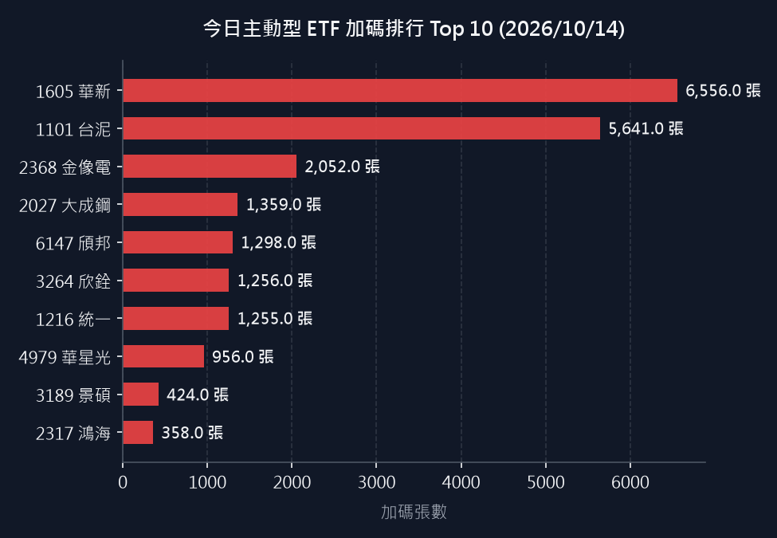
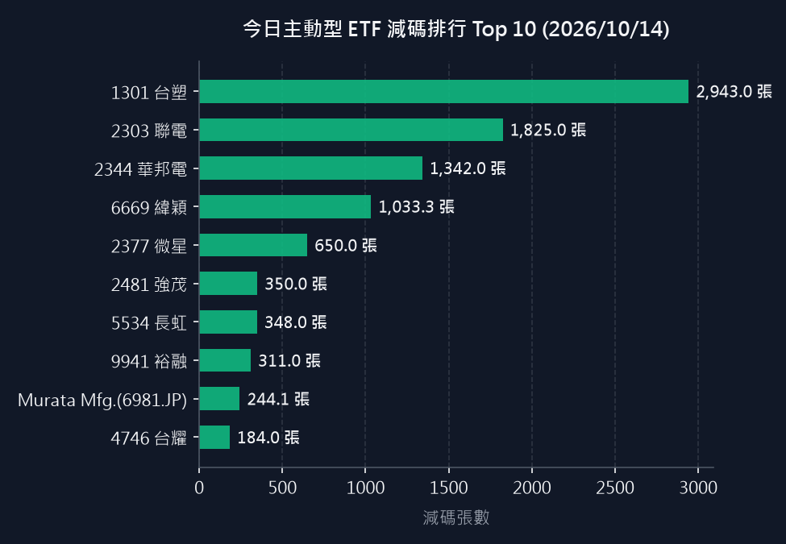

# 主動型 ETF 持股變動

資料來源：`主動型ETF持股明細.xlsx` 最近兩個日期分頁。

比較區間：`20261013` → `20261014`

## 今日加減碼視覺化排行

| 今日加碼 Top 10 | 今日減碼 Top 10 |
| :---: | :---: |
|  |  |

| ETF | 新增 | 刪除 | 比例變動 |
| :-- | --: | --: | --: |
| 00400A | 1 | 0 | 41 |
| 00401A | 0 | 0 | 42 |
| 00402A | 0 | 0 | 39 |
| 00403A | 0 | 1 | 26 |
| 00404A | 0 | 0 | 41 |
| 00405A | 0 | 0 | 24 |
| 00406A | 1 | 1 | 53 |
| 00407A | 1 | 1 | 36 |
| 00408A | 1 | 0 | 37 |
| 00980A | 0 | 0 | 43 |
| 00980D | 0 | 0 | 49 |
| 00981A | 0 | 0 | 22 |
| 00982A | 0 | 0 | 39 |
| 00983A | 0 | 0 | 38 |
| 00983D | 0 | 0 | 60 |
| 00984A | 0 | 0 | 61 |
| 00985A | 1 | 1 | 50 |
| 00986A | 0 | 0 | 29 |
| 00987A | 0 | 1 | 26 |
| 00988A | 2 | 0 | 34 |
| 00989A | 0 | 0 | 50 |
| 00990A | 2 | 3 | 37 |
| 00991A | 0 | 0 | 18 |
| 00992A | 0 | 0 | 31 |
| 00993A | 0 | 0 | 40 |
| 00994A | 1 | 0 | 32 |
| 00995A | 1 | 0 | 37 |
| 00996A | 0 | 0 | 39 |
| 00997A | 0 | 1 | 44 |
| 00998A | 0 | 0 | 39 |
| 00999A | 0 | 0 | 45 |

## 00400A

### 新增持股

- 6147 頎邦（0.97%，1293 張）

### 刪除持股

- 無

### 投資比例變動

- 1303 南亞：4.37% → 4.72%（+0.35）
- 2059 川湖：2.58% → 2.53%（-0.05）
- 2303 聯電：0.98% → 1.93%（+0.95）
- 2308 台達電：2.77% → 2.75%（-0.02）
- 2313 華通：0.89% → 0.90%（+0.01）
- 2327 國巨*：0.92% → 1.44%（+0.52）
- 2330 台積電：8.96% → 8.85%（-0.11）
- 2345 智邦：0.50% → 0.49%（-0.01）
- 2360 致茂：3.40% → 3.43%（+0.03）
- 2368 金像電：1.95% → 3.00%（+1.05）
- 2383 台光電：4.63% → 4.55%（-0.08）
- 2449 京元電子：1.00% → 0.96%（-0.04）
- 2454 聯發科：6.15% → 6.00%（-0.15）
- 2603 長榮：1.62% → 1.60%（-0.02）
- 2881 富邦金：1.63% → 1.62%（-0.01）
- 2891 中信金：1.54% → 1.52%（-0.02）
- 3008 大立光：1.70% → 1.59%（-0.11）
- 3017 奇鋐：3.55% → 3.54%（-0.01）
- 3036 文曄：1.54% → 1.55%（+0.01）
- 3037 欣興：4.15% → 4.11%（-0.04）
- 3044 健鼎：1.95% → 2.52%（+0.57）
- 3081 聯亞：0.74% → 0.77%（+0.03）
- 3090 日電貿：0.33% → 0.35%（+0.02）
- 3167 大量：0.37% → 0.36%（-0.01）
- 3231 緯創：0.99% → 0.98%（-0.01）
- 3374 精材：0.52% → 0.55%（+0.03）
- 3443 創意：2.58% → 2.60%（+0.02）
- 3529 力旺：1.22% → 1.23%（+0.01）
- 3661 世芯-KY：2.45% → 2.35%（-0.10）
- 3665 貿聯-KY：1.70% → 1.66%（-0.04）
- 5274 信驊：1.62% → 1.61%（-0.01）
- 6187 萬潤：2.08% → 1.48%（-0.60）
- 6223 旺矽：3.54% → 3.46%（-0.08）
- 6278 台表科：0.70% → 0.76%（+0.06）
- 6488 環球晶：2.95% → 2.93%（-0.02）
- 6505 台塑化：2.41% → 2.39%（-0.02）
- 6669 緯穎：3.16% → 3.01%（-0.15）
- 7750 新代：0.73% → 0.75%（+0.02）
- 7769 鴻勁：0.14% → 0.13%（-0.01）
- 台指選擇權 2026/10：0.04% → 0.05%（+0.01）
- ＸＡＧＸ金兌(3533.HK)：0.47% → 0.48%（+0.01）

## 00401A

### 新增持股

- 無

### 刪除持股

- 無

### 投資比例變動

- 1303 南亞：1.26% → 1.38%（+0.12）
- 2303 聯電：2.31% → 2.32%（+0.01）
- 2308 台達電：2.41% → 2.38%（-0.03）
- 2313 華通：1.45% → 1.50%（+0.05）
- 2317 鴻海：0.53% → 0.54%（+0.01）
- 2327 國巨*：0.64% → 0.67%（+0.03）
- 2330 台積電：20.20% → 20.25%（+0.05）
- 2357 華碩：1.78% → 1.84%（+0.06）
- 2360 致茂：1.37% → 1.41%（+0.04）
- 2379 瑞昱：1.05% → 1.08%（+0.03）
- 2382 廣達：2.03% → 2.04%（+0.01）
- 2383 台光電：1.11% → 1.09%（-0.02）
- 2454 聯發科：6.18% → 6.12%（-0.06）
- 2455 全新：2.10% → 2.16%（+0.06）
- 2603 長榮：1.11% → 1.10%（-0.01）
- 2881 富邦金：2.05% → 2.07%（+0.02）
- 2884 玉山金：1.93% → 1.96%（+0.03）
- 2886 兆豐金：1.32% → 1.33%（+0.01）
- 2912 統一超：0.24% → 0.25%（+0.01）
- 3008 大立光：2.57% → 2.39%（-0.18）
- 3034 聯詠：0.20% → 0.21%（+0.01）
- 3037 欣興：2.35% → 2.37%（+0.02）
- 3491 昇達科：1.61% → 1.57%（-0.04）
- 3711 日月光投控：2.70% → 2.74%（+0.04）
- 4904 遠傳：0.74% → 0.75%（+0.01）
- 4938 和碩：0.33% → 0.32%（-0.01）
- 4958 臻鼎-KY：1.40% → 1.41%（+0.01）
- 5274 信驊：1.83% → 1.86%（+0.03）
- 5347 世界：1.31% → 1.32%（+0.01）
- 6147 頎邦：1.38% → 1.46%（+0.08）
- 6187 萬潤：0.81% → 0.78%（-0.03）
- 6223 旺矽：1.78% → 1.73%（-0.05）
- 6285 啟碁：1.35% → 1.40%（+0.05）
- 6515 穎崴：1.09% → 1.06%（-0.03）
- 6531 愛普*：1.58% → 1.57%（-0.01）
- 6669 緯穎：1.88% → 1.81%（-0.07）
- 7769 鴻勁：1.13% → 1.06%（-0.07）
- 7828 創新服務：1.59% → 1.58%（-0.01）
- 7856 漢測：0.77% → 0.73%（-0.04）
- 8464 億豐：0.99% → 0.97%（-0.02）
- 台股期貨10/26(FITXN*1.TF)：0.34% → 0.39%（+0.05）
- 臺指選擇權10/26 46400 買權：-0.92% → -1.02%（-0.10）

## 00402A

### 新增持股

- 無

### 刪除持股

- 無

### 投資比例變動

- AAPL.US Apple：7.45% → 7.50%（+0.05）
- ADI.US Analog Devices：1.87% → 1.92%（+0.05）
- AMD.US AMD：5.93% → 6.08%（+0.15）
- AMZN.US Amazon：4.23% → 4.24%（+0.01）
- ANET.US Arista Networks：0.85% → 0.83%（-0.02）
- ASML.US ASML Holding：1.17% → 1.15%（-0.02）
- AVGO.US Broadcom：2.15% → 2.17%（+0.02）
- BABA.US Alibaba Group：0.47% → 0.48%（+0.01）
- CDNS.US Cadence Design Systems：1.51% → 1.45%（-0.06）
- CIEN.US Ciena：1.24% → 1.23%（-0.01）
- CLS.US Celestica：1.31% → 1.36%（+0.05）
- COHR.US Coherent：1.31% → 1.33%（+0.02）
- FSLY.US Fastly：0.37% → 0.38%（+0.01）
- GOOG.US Alphabet - Class C Capital Stock：3.31% → 3.33%（+0.02）
- GOOGL.US Alphabet - Class A Common Stock：3.33% → 3.36%（+0.03）
- INTC.US Intel：1.47% → 1.50%（+0.03）
- KLAC.US KLA：1.61% → 1.57%（-0.04）
- LITE.US Lumentum：1.88% → 1.87%（-0.01）
- LRCX.US Lam Research：2.63% → 2.57%（-0.06）
- MCHP.US Microchip Technology：1.25% → 1.26%（+0.01）
- MDB.US MongoDB：0.38% → 0.37%（-0.01）
- META.US Meta：3.75% → 3.87%（+0.12）
- MRVL.US Marvell：1.71% → 1.74%（+0.03）
- MSFT.US Microsoft：5.22% → 5.28%（+0.06）
- MU.US Micron：5.76% → 5.58%（-0.18）
- NFLX.US Netflix：0.94% → 0.95%（+0.01）
- NOW.US ServiceNow：1.04% → 1.03%（-0.01）
- NVDA.US NVIDIA：8.53% → 8.67%（+0.14）
- PANW.US Palo Alto：2.96% → 2.92%（-0.04）
- PLTR.US Palantir Technologies：2.20% → 2.21%（+0.01）
- SHOP.US Shopify：1.20% → 1.19%（-0.01）
- SKHY.US SK hynix：1.15% → 1.12%（-0.03）
- SPCX.US SpaceX：0.77% → 0.74%（-0.03）
- STX.US Seagate：1.09% → 1.08%（-0.01）
- TSM.US TSMC(ADR)：1.48% → 1.49%（+0.01）
- TTWO.US Take-Two：0.57% → 0.55%（-0.02）
- TXN.US Texas Instruments：2.28% → 2.34%（+0.06）
- V.US Visa：1.12% → 1.15%（+0.03）
- WDC.US Western Digital：1.80% → 1.78%（-0.02）

## 00403A

### 新增持股

- 無

### 刪除持股

- 7769 鴻勁（0.00%，1 張）

### 投資比例變動

- 1303 南亞：2.64% → 2.88%（+0.24）
- 2303 聯電：2.04% → 1.53%（-0.51）
- 2313 華通：0.21% → 0.22%（+0.01）
- 2317 鴻海：0.55% → 0.56%（+0.01）
- 2327 國巨*：3.80% → 3.96%（+0.16）
- 2330 台積電：13.81% → 13.75%（-0.06）
- 2368 金像電：0.40% → 0.43%（+0.03）
- 2383 台光電：5.59% → 5.54%（-0.05）
- 2408 南亞科：0.98% → 0.97%（-0.01）
- 2449 京元電子：0.88% → 0.85%（-0.03）
- 2454 聯發科：6.35% → 6.26%（-0.09）
- 2455 全新：0.07% → 0.08%（+0.01）
- 2481 強茂：0.08% → 0.04%（-0.04）
- 3008 大立光：1.75% → 1.65%（-0.10）
- 3017 奇鋐：4.96% → 4.99%（+0.03）
- 3189 景碩：3.33% → 3.35%（+0.02）
- 3443 創意：3.73% → 3.87%（+0.14）
- 3450 聯鈞：0.51% → 0.54%（+0.03）
- 3653 健策：5.61% → 5.65%（+0.04）
- 3665 貿聯-KY：2.38% → 2.34%（-0.04）
- 5274 信驊：1.47% → 1.83%（+0.36）
- 6223 旺矽：3.98% → 3.93%（-0.05）
- 6274 台燿：2.50% → 2.71%（+0.21）
- 6669 緯穎：2.68% → 2.58%（-0.10）
- 8046 南電：3.12% → 3.09%（-0.03）
- 8996 高力：2.32% → 2.27%（-0.05）

## 00404A

### 新增持股

- 無

### 刪除持股

- 無

### 投資比例變動

- 1303 南亞：0.82% → 0.89%（+0.07）
- 2059 川湖：0.49% → 0.48%（-0.01）
- 2301 光寶科：0.55% → 0.56%（+0.01）
- 2303 聯電：2.72% → 2.71%（-0.01）
- 2330 台積電：22.47% → 22.35%（-0.12）
- 2347 聯強：1.95% → 1.98%（+0.03）
- 2357 華碩：1.18% → 1.20%（+0.02）
- 2360 致茂：0.48% → 0.49%（+0.01）
- 2379 瑞昱：1.09% → 1.11%（+0.02）
- 2383 台光電：2.97% → 2.94%（-0.03）
- 2395 研華：1.29% → 1.28%（-0.01）
- 2436 偉詮電：1.11% → 1.13%（+0.02）
- 2454 聯發科：6.77% → 6.66%（-0.11）
- 2882 國泰金：2.79% → 2.76%（-0.03）
- 2885 元大金：2.43% → 2.47%（+0.04）
- 2887 台新新光金：1.48% → 1.46%（-0.02）
- 2890 永豐金：1.41% → 1.38%（-0.03）
- 3034 聯詠：2.03% → 2.07%（+0.04）
- 3264 欣銓：0.69% → 0.71%（+0.02）
- 3293 鈊象：1.16% → 1.18%（+0.02）
- 3374 精材：0.11% → 0.12%（+0.01）
- 3443 創意：0.98% → 1.00%（+0.02）
- 3680 家登：0.51% → 0.50%（-0.01）
- 3711 日月光投控：3.49% → 3.51%（+0.02）
- 5274 信驊：2.72% → 2.73%（+0.01）
- 5434 崇越：1.77% → 1.76%（-0.01）
- 5876 上海商銀：1.48% → 1.47%（-0.01）
- 6196 帆宣：1.78% → 1.81%（+0.03）
- 6206 飛捷：0.73% → 0.72%（-0.01）
- 6223 旺矽：1.23% → 1.21%（-0.02）
- 6257 矽格：1.87% → 1.85%（-0.02）
- 6491 晶碩：0.86% → 0.85%（-0.01）
- 6669 緯穎：1.01% → 0.97%（-0.04）
- 6691 洋基工程：1.61% → 1.63%（+0.02）
- 7769 鴻勁：1.18% → 1.12%（-0.06）
- 8016 矽創：1.22% → 1.23%（+0.01）
- 8081 致新：0.84% → 0.85%（+0.01）
- 8299 群聯：1.20% → 1.19%（-0.01）
- iShares MSCI Japan SRI ETF(2851.JP)：1.12% → 1.18%（+0.06）
- 台指選擇權10/26 49100 買權：-0.10% → -0.11%（-0.01）
- 台股期貨10/26(FITXN*1.TF)：20.72% → 20.78%（+0.06）

## 00405A

### 新增持股

- 無

### 刪除持股

- 無

### 投資比例變動

- 2059 川湖：2.10% → 2.08%（-0.02）
- 2330 台積電：1.86% → 1.85%（-0.01）
- 2345 智邦：5.18% → 5.19%（+0.01）
- 2368 金像電：5.50% → 5.91%（+0.41）
- 2383 台光電：4.90% → 4.87%（-0.03）
- 2454 聯發科：5.54% → 5.47%（-0.07）
- 3017 奇鋐：3.80% → 3.83%（+0.03）
- 3037 欣興：7.52% → 7.54%（+0.02）
- 3443 創意：5.84% → 5.93%（+0.09）
- 3653 健策：7.57% → 7.65%（+0.08）
- 3665 貿聯-KY：6.26% → 6.18%（-0.08）
- 5274 信驊：5.73% → 5.77%（+0.04）
- 6187 萬潤：0.99% → 0.95%（-0.04）
- 6223 旺矽：8.00% → 7.91%（-0.09）
- 6274 台燿：2.11% → 2.21%（+0.10）
- 6285 啟碁：0.10% → 0.11%（+0.01）
- 6515 穎崴：0.55% → 0.54%（-0.01）
- 6526 達發：0.48% → 0.49%（+0.01）
- 6531 愛普*：3.98% → 3.95%（-0.03）
- 6669 緯穎：0.91% → 0.87%（-0.04）
- 6805 富世達：3.14% → 3.11%（-0.03）
- 7769 鴻勁：3.04% → 2.88%（-0.16）
- 8046 南電：7.80% → 7.73%（-0.07）
- 8996 高力：1.43% → 1.40%（-0.03）

## 00406A

### 新增持股

- 臺指選擇權（-4.64%，-2.04 張）

### 刪除持股

- 臺指選擇權第二週週三到期契約（-15.61%，-6.55 張）

### 投資比例變動

- 1303 南亞：0.90% → 0.95%（+0.05）
- 1326 台化：0.26% → 0.27%（+0.01）
- 1560 中砂：0.53% → 0.51%（-0.02）
- 2059 川湖：1.07% → 1.02%（-0.05）
- 2303 聯電：1.83% → 1.95%（+0.12）
- 2308 台達電：2.64% → 2.71%（+0.07）
- 2317 鴻海：0.44% → 0.43%（-0.01）
- 2327 國巨*：1.59% → 1.61%（+0.02）
- 2330 台積電：9.36% → 9.39%（+0.03）
- 2345 智邦：3.44% → 3.79%（+0.35）
- 2360 致茂：1.24% → 1.22%（-0.02）
- 2368 金像電：0.95% → 0.98%（+0.03）
- 2383 台光電：6.25% → 6.56%（+0.31）
- 2395 研華：0.12% → 0.11%（-0.01）
- 2449 京元電子：0.53% → 0.50%（-0.03）
- 2454 聯發科：5.77% → 5.95%（+0.18）
- 2481 強茂：0.39% → 0.38%（-0.01）
- 2885 元大金：0.81% → 0.79%（-0.02）
- 2886 兆豐金：0.17% → 0.16%（-0.01）
- 3008 大立光：0.39% → 0.69%（+0.30）
- 3017 奇鋐：5.16% → 5.25%（+0.09）
- 3037 欣興：5.71% → 5.79%（+0.08）
- 3081 聯亞：0.35% → 0.36%（+0.01）
- 3105 穩懋：0.16% → 0.15%（-0.01）
- 3167 大量：0.84% → 0.80%（-0.04）
- 3189 景碩：1.70% → 1.65%（-0.05）
- 3443 創意：2.22% → 2.28%（+0.06）
- 3491 昇達科：0.63% → 0.59%（-0.04）
- 3529 力旺：0.28% → 0.27%（-0.01）
- 3653 健策：3.75% → 3.65%（-0.10）
- 3661 世芯-KY：0.54% → 0.65%（+0.11）
- 3665 貿聯-KY：2.31% → 2.20%（-0.11）
- 3711 日月光投控：2.30% → 2.23%（-0.07）
- 4958 臻鼎-KY：0.90% → 1.06%（+0.16）
- 5274 信驊：2.32% → 2.25%（-0.07）
- 6147 頎邦：0.72% → 0.73%（+0.01）
- 6187 萬潤：0.34% → 0.31%（-0.03）
- 6213 聯茂：0.53% → 0.55%（+0.02）
- 6223 旺矽：3.15% → 3.31%（+0.16）
- 6274 台燿：1.51% → 1.52%（+0.01）
- 6285 啟碁：0.11% → 0.10%（-0.01）
- 6488 環球晶：0.50% → 0.48%（-0.02）
- 6510 精測：1.19% → 1.13%（-0.06）
- 6515 穎崴：0.41% → 0.39%（-0.02）
- 6531 愛普*：0.20% → 0.19%（-0.01）
- 6669 緯穎：2.07% → 1.92%（-0.15）
- 6715 嘉基：0.46% → 0.49%（+0.03）
- 7769 鴻勁：0.33% → 0.30%（-0.03）
- 8046 南電：3.05% → 3.10%（+0.05）
- 8996 高力：0.35% → 0.33%（-0.02）
- 臺指選擇權第三週週五到期契約：-0.87% → -1.93%（-1.06）
- 臺股期貨 202610(FITXN*1.TF)：20.50% → 13.69%（-6.81）
- 臺股期貨 202611(FITXN*1.TF)：2.57% → 8.74%（+6.17）

## 00407A

### 新增持股

- 3533 嘉澤（0.47%，54 張）

### 刪除持股

- 2412 中華電（0.04%，64 張）

### 投資比例變動

- 1303 南亞：1.00% → 1.09%（+0.09）
- 1560 中砂：1.04% → 1.03%（-0.01）
- 2059 川湖：1.81% → 1.79%（-0.02）
- 2301 光寶科：1.44% → 1.47%（+0.03）
- 2308 台達電：2.57% → 2.58%（+0.01）
- 2327 國巨*：2.41% → 2.51%（+0.10）
- 2330 台積電：9.28% → 9.25%（-0.03）
- 2360 致茂：1.04% → 1.06%（+0.02）
- 2368 金像電：0.59% → 1.33%（+0.74）
- 2379 瑞昱：0.23% → 0.24%（+0.01）
- 2383 台光電：5.60% → 5.56%（-0.04）
- 2408 南亞科：0.93% → 0.92%（-0.01）
- 2454 聯發科：5.46% → 5.39%（-0.07）
- 2615 萬海：1.01% → 1.03%（+0.02）
- 3008 大立光：1.70% → 1.60%（-0.10）
- 3017 奇鋐：5.52% → 5.56%（+0.04）
- 3034 聯詠：0.74% → 0.76%（+0.02）
- 3037 欣興：5.81% → 5.82%（+0.01）
- 3081 聯亞：1.38% → 1.46%（+0.08）
- 3231 緯創：0.74% → 0.73%（-0.01）
- 3293 鈊象：0.61% → 0.62%（+0.01）
- 3443 創意：5.20% → 4.72%（-0.48）
- 3491 昇達科：0.88% → 0.85%（-0.03）
- 3653 健策：3.64% → 3.67%（+0.03）
- 3665 貿聯-KY：2.82% → 2.78%（-0.04）
- 3711 日月光投控：3.16% → 3.18%（+0.02）
- 4958 臻鼎-KY：1.04% → 1.06%（+0.02）
- 5289 宜鼎：0.30% → 0.29%（-0.01）
- 6187 萬潤：1.83% → 1.76%（-0.07）
- 6223 旺矽：3.04% → 3.00%（-0.04）
- 6274 台燿：4.00% → 4.18%（+0.18）
- 6510 精測：1.40% → 1.37%（-0.03）
- 6669 緯穎：3.82% → 3.67%（-0.15）
- 6805 富世達：1.11% → 1.10%（-0.01）
- 8046 南電：3.12% → 3.09%（-0.03）
- 8996 高力：2.49% → 1.35%（-1.14）

## 00408A

### 新增持股

- 6526 達發（0.32%，6 張）

### 刪除持股

- 無

### 投資比例變動

- 1303 南亞：3.66% → 3.97%（+0.31）
- 2303 聯電：1.74% → 1.73%（-0.01）
- 2327 國巨*：0.92% → 0.96%（+0.04）
- 2330 台積電：5.72% → 6.10%（+0.38）
- 2344 華邦電：0.43% → 0.44%（+0.01）
- 2357 華碩：1.94% → 1.98%（+0.04）
- 2360 致茂：1.18% → 1.20%（+0.02）
- 2368 金像電：4.39% → 4.95%（+0.56）
- 2376 技嘉：1.31% → 1.30%（-0.01）
- 2383 台光電：5.02% → 4.96%（-0.06）
- 2395 研華：1.64% → 1.62%（-0.02）
- 2408 南亞科：1.37% → 1.34%（-0.03）
- 2449 京元電子：1.06% → 1.03%（-0.03）
- 2454 聯發科：3.64% → 3.58%（-0.06）
- 2542 興富發：3.59% → 3.57%（-0.02）
- 2880 華南金：0.79% → 1.14%（+0.35）
- 3008 大立光：1.46% → 1.37%（-0.09）
- 3017 奇鋐：3.06% → 3.07%（+0.01）
- 3026 禾伸堂：0.32% → 0.85%（+0.53）
- 3037 欣興：3.32% → 3.31%（-0.01）
- 3081 聯亞：1.74% → 2.21%（+0.47）
- 3189 景碩：2.86% → 2.87%（+0.01）
- 3231 緯創：0.38% → 0.37%（-0.01）
- 3264 欣銓：0.77% → 0.80%（+0.03）
- 3653 健策：2.72% → 3.67%（+0.95）
- 3665 貿聯-KY：1.20% → 1.18%（-0.02）
- 5434 崇越：2.31% → 2.30%（-0.01）
- 6187 萬潤：1.18% → 1.13%（-0.05）
- 6223 旺矽：2.31% → 2.27%（-0.04）
- 6274 台燿：3.11% → 3.70%（+0.59）
- 6510 精測：0.44% → 0.43%（-0.01）
- 6669 緯穎：3.94% → 3.77%（-0.17）
- 6805 富世達：1.33% → 1.32%（-0.01）
- 7769 鴻勁：0.61% → 0.58%（-0.03）
- 8046 南電：1.64% → 1.62%（-0.02）
- 8996 高力：2.07% → 2.02%（-0.05）
- 9802 鈺齊-KY：0.86% → 0.85%（-0.01）

## 00980A

### 新增持股

- 無

### 刪除持股

- 無

### 投資比例變動

- 1303 南亞：3.94% → 4.27%（+0.33）
- 2059 川湖：4.06% → 4.00%（-0.06）
- 2303 聯電：1.07% → 1.06%（-0.01）
- 2308 台達電：3.66% → 3.65%（-0.01）
- 2317 鴻海：1.98% → 1.99%（+0.01）
- 2327 國巨*：1.48% → 1.54%（+0.06）
- 2330 台積電：9.58% → 9.49%（-0.09）
- 2344 華邦電：1.89% → 1.92%（+0.03）
- 2345 智邦：1.48% → 1.47%（-0.01）
- 2360 致茂：1.66% → 1.69%（+0.03）
- 2368 金像電：2.01% → 2.15%（+0.14）
- 2376 技嘉：0.88% → 0.87%（-0.01）
- 2382 廣達：1.18% → 1.17%（-0.01）
- 2383 台光電：4.70% → 4.64%（-0.06）
- 2408 南亞科：2.73% → 2.67%（-0.06）
- 2454 聯發科：5.75% → 5.64%（-0.11）
- 2884 玉山金：0.70% → 0.71%（+0.01）
- 2891 中信金：1.02% → 1.01%（-0.01）
- 3008 大立光：1.41% → 1.32%（-0.09）
- 3017 奇鋐：2.24% → 2.25%（+0.01）
- 3026 禾伸堂：1.18% → 1.24%（+0.06）
- 3036 文曄：0.98% → 0.99%（+0.01）
- 3037 欣興：3.77% → 3.75%（-0.02）
- 3044 健鼎：0.57% → 0.60%（+0.03）
- 3081 聯亞：2.25% → 2.36%（+0.11）
- 3231 緯創：0.91% → 0.90%（-0.01）
- 3264 欣銓：0.89% → 0.91%（+0.02）
- 3293 鈊象：0.83% → 0.84%（+0.01）
- 3443 創意：2.44% → 2.46%（+0.02）
- 3529 力旺：0.63% → 0.64%（+0.01）
- 3653 健策：3.71% → 3.72%（+0.01）
- 3665 貿聯-KY：0.56% → 0.55%（-0.01）
- 6213 聯茂：1.02% → 1.09%（+0.07）
- 6223 旺矽：2.24% → 2.20%（-0.04）
- 6274 台燿：1.21% → 1.26%（+0.05）
- 6515 穎崴：1.78% → 1.73%（-0.05）
- 6669 緯穎：1.74% → 1.66%（-0.08）
- 6805 富世達：0.61% → 0.60%（-0.01）
- 7751 竑騰：0.76% → 0.78%（+0.02）
- 7769 鴻勁：3.19% → 3.01%（-0.18）
- 8046 南電：1.85% → 1.82%（-0.03）
- 8299 群聯：1.69% → 1.67%（-0.02）
- 8996 高力：0.51% → 0.49%（-0.02）

## 00980D

### 新增持股

- 無

### 刪除持股

- 無

### 投資比例變動

- APA CORP 6.750000 % 15-FEB-2055：0.36% → 0.37%（+0.01）
- ASURION LLC/ASURION CO 8.375% 01FEB2034：0.46% → 0.42%（-0.04）
- ATHENE HOLDING LTD (REG) 6.25% 01APR2054：0.74% → 0.75%（+0.01）
- ATHENE HOLDING LTD 6.625000 % 19MAY2055：0.55% → 0.56%（+0.01）
- BAT CAPITAL CORP (REG) 7.079% 02AUG2043：0.31% → 0.32%（+0.01）
- BAT CAPITAL CORP (REG) 7.081% 02AUG2053：0.56% → 0.57%（+0.01）
- BAYER US FINANCE LLC SER REGS 6.875000 % 21NOV2053：0.34% → 0.35%（+0.01）
- CHARTER COMM OPT 6.484% 23OCT2045 W/I：0.44% → 0.43%（-0.01）
- CHARTER COMM OPT LLC/CAP (REG) 6.834000 % 23OCT2055：0.44% → 0.43%（-0.01）
- CITIGROUP INC 8.125% 15JUL2039：0.61% → 0.62%（+0.01）
- COREWEAVE INC SER REGS (REG S) 9.25% 01JUN2030：0.42% → 0.41%（-0.01）
- COREWEAVE INC SER REGS (REG S) 9.75% 01OCT2031：0.49% → 0.47%（-0.02）
- COREWEAVE INC SER REGS (REG) (REG S) 9.625% 15JUL2032：0.48% → 0.46%（-0.02）
- DELL INT LLC / EMC CORP (REG) 8.35% 15JUL2046：0.54% → 0.55%（+0.01）
- ENBRIDGE ENERGY PARTNERS (REG) 7.375% 15OCT2045：0.50% → 0.51%（+0.01）
- GENERAL MOTORS CO (REG) 6.75% 01APR2046：0.55% → 0.56%（+0.01）
- GLOBAL ATLANTIC FIN CO SER REGS 6.750000 % 15MAR2054：0.60% → 0.61%（+0.01）
- HSBC HOLDINGS PLC (REG) VAR 13NOV2034：0.34% → 0.35%（+0.01）
- HSBC HOLDINGS PLC VAR 03NOV2028：0.33% → 0.34%（+0.01）
- JETBLUE AIRWAYS/LOYALTY SER REGS (REG S) 9.875% 20SEP2031：0.42% → 0.37%（-0.05）
- MYLAN NV 5.25% 15JUN2046 WI：0.52% → 0.53%（+0.01）
- NATIONWIDE MUTUAL INSUR 9.375% 15AUG2039：0.51% → 0.52%（+0.01）
- NAVIENT CORP (REG) 11.5% 15MAR2031：0.43% → 0.44%（+0.01）
- NRG ENERGY INC SER REGS (REG S) 7% 15MAR2033：0.31% → 0.32%（+0.01）
- ORACLE CORP (REG) 5.500000 % 27SEP2064：0.40% → 0.41%（+0.01）
- ORACLE CORP 6.125000 % 03AUG2065：0.54% → 0.53%（-0.01）
- PACIFIC GAS & ELECTRIC (REG) 6.7% 01APR2053：0.32% → 0.33%（+0.01）
- PACIFIC GAS & ELECTRIC (REG) 6.75% 15JAN2053：0.32% → 0.33%（+0.01）
- PBF HOLDING CO LLC SER REGS 9.875000 % 15MAR2030：0.36% → 0.37%（+0.01）
- PHOTO HOLDINGS LLC SER REGS (REG) (REG S) 12% 01JUL2031：0.51% → 0.50%（-0.01）
- RR DONNELLEY & SONS CO SER REGS (REG S) 9.5% 01AUG2029：0.42% → 0.43%（+0.01）
- SABRE GLBL INC SER REGS 11.125000 % 15JUL2030：0.49% → 0.48%（-0.01）
- SALESFORCE INC (REG) 6.55% 15MAR2056：0.53% → 0.54%（+0.01）
- SALESFORCE INC (REG) 6.7% 15MAR2066：0.52% → 0.53%（+0.01）
- SOCIETE GENERALE SER REGS (REG) (REG S) 7.367% 10JAN2053：0.31% → 0.32%（+0.01）
- TELEFONICA EUROPE BV (REG) 8.25% 15SEP2030：0.41% → 0.42%（+0.01）
- TOUCAN FINCO LTD/CAN/US SER REGS 9.500000 % 15MAY2030：0.26% → 0.25%（-0.01）
- TRANSCANADA PIPELINES LTD 7.625PCT 15/01/2039：0.52% → 0.53%（+0.01）
- US 10YR NOTE (CBT)DEC26 21-DEC-2026：17.78% → 17.84%（+0.06）
- US 10YR ULTRA FUT DEC26 21-DEC-2026：-1.55% → -1.56%（-0.01）
- US 2YR NOTE (CBT) DEC26 31-DEC-2026：1.66% → 1.67%（+0.01）
- US 5YR NOTE (CBT) DEC26 31-DEC-2026：-13.55% → -13.59%（-0.04）
- US LONG BOND(CBT) DEC26 21-DEC-2026：5.22% → 5.27%（+0.05）
- US ULTRA BOND CBT DEC26 21-DEC-2026：-0.51% → -0.52%（-0.01）
- VAR ENERGI ASA SER REGS (REG S) 7.5% 15JAN2028：0.33% → 0.34%（+0.01）
- VIACOM INC (REG) 5.85% 01SEP2043：0.48% → 0.46%（-0.02）
- VIACOMCBS INC (REG) 4.95% 19MAY2050：0.43% → 0.41%（-0.02）
- VIRGINIA ELEC & POWER CO (REG) 8.875% 15NOV2038：0.57% → 0.58%（+0.01）
- WESTLAKE CORP 6.375000 % 15-NOV-2055：0.51% → 0.52%（+0.01）

## 00981A

### 新增持股

- 無

### 刪除持股

- 無

### 投資比例變動

- 2327 國巨*：5.01% → 5.22%（+0.21）
- 2330 台積電：10.79% → 10.73%（-0.06）
- 2368 金像電：1.56% → 2.42%（+0.86）
- 2383 台光電：8.53% → 8.45%（-0.08）
- 2449 京元電子：0.45% → 0.43%（-0.02）
- 2454 聯發科：8.18% → 8.05%（-0.13）
- 3017 奇鋐：7.17% → 7.21%（+0.04）
- 3264 欣銓：0.00% → 0.12%（+0.12）
- 3376 新日興：0.10% → 0.11%（+0.01）
- 3443 創意：1.97% → 2.19%（+0.22）
- 3653 健策：6.22% → 6.26%（+0.04）
- 3665 貿聯-KY：2.32% → 2.28%（-0.04）
- 3711 日月光投控：2.20% → 2.21%（+0.01）
- 4979 華星光：0.00% → 0.20%（+0.20）
- 5274 信驊：0.97% → 1.16%（+0.19）
- 6223 旺矽：5.29% → 5.21%（-0.08）
- 6274 台燿：4.03% → 4.20%（+0.17）
- 6510 精測：0.49% → 0.54%（+0.05）
- 6515 穎崴：0.19% → 0.18%（-0.01）
- 6669 緯穎：3.37% → 2.45%（-0.92）
- 8046 南電：4.57% → 4.52%（-0.05）
- 8996 高力：0.35% → 0.41%（+0.06）

## 00982A

### 新增持股

- 無

### 刪除持股

- 無

### 投資比例變動

- 2059 川湖：3.62% → 2.58%（-1.04）
- 2301 光寶科：1.78% → 1.82%（+0.04）
- 2330 台積電：7.72% → 7.68%（-0.04）
- 2360 致茂：3.73% → 3.80%（+0.07）
- 2377 微星：0.53% → 0.32%（-0.21）
- 2383 台光電：3.44% → 3.41%（-0.03）
- 2395 研華：1.39% → 1.38%（-0.01）
- 2428 興勤：1.21% → 1.26%（+0.05）
- 2454 聯發科：6.69% → 6.58%（-0.11）
- 2455 全新：1.56% → 1.60%（+0.04）
- 2467 志聖：1.12% → 1.09%（-0.03）
- 2476 鉅祥：0.33% → 0.32%（-0.01）
- 2478 大毅：1.09% → 1.19%（+0.10）
- 2885 元大金：0.31% → 0.32%（+0.01）
- 3008 大立光：3.67% → 3.45%（-0.22）
- 3017 奇鋐：2.45% → 2.46%（+0.01）
- 3090 日電貿：1.10% → 1.20%（+0.10）
- 3105 穩懋：6.38% → 6.35%（-0.03）
- 3231 緯創：1.37% → 1.36%（-0.01）
- 3265 台星科：1.79% → 1.96%（+0.17）
- 3491 昇達科：3.44% → 3.32%（-0.12）
- 3583 辛耘：1.13% → 1.12%（-0.01）
- 3617 碩天：0.33% → 0.34%（+0.01）
- 3711 日月光投控：1.30% → 1.31%（+0.01）
- 4958 臻鼎-KY：3.50% → 3.58%（+0.08）
- 5274 信驊：1.25% → 1.26%（+0.01）
- 5425 台半：1.23% → 1.24%（+0.01）
- 5536 聖暉*：0.82% → 0.83%（+0.01）
- 6139 亞翔：5.40% → 5.39%（-0.01）
- 6196 帆宣：0.39% → 0.40%（+0.01）
- 6213 聯茂：1.50% → 1.61%（+0.11）
- 6214 精誠：1.34% → 1.35%（+0.01）
- 6223 旺矽：3.59% → 3.54%（-0.05）
- 6274 台燿：1.39% → 1.45%（+0.06）
- 6472 保瑞：0.87% → 0.88%（+0.01）
- 6531 愛普*：3.91% → 3.88%（-0.03）
- 6669 緯穎：4.48% → 4.30%（-0.18）
- 6672 騰輝電子-KY：0.79% → 0.86%（+0.07）
- 8996 高力：1.32% → 1.29%（-0.03）

## 00983A

### 新增持股

- 無

### 刪除持股

- 無

### 投資比例變動

- ACHR.US Archer：0.33% → 0.32%（-0.01）
- AMD.US AMD：3.48% → 3.57%（+0.09）
- AMZN.US Amazon：2.80% → 2.94%（+0.14）
- AVGO.US Broadcom：1.49% → 1.52%（+0.03）
- BEAM.US Beam Therapeutics：1.59% → 1.55%（-0.04）
- BLSH.US Bullish：2.13% → 2.15%（+0.02）
- BMNR.US BitMine：2.27% → 2.25%（-0.02）
- CBRS.US Cerebras：0.84% → 0.41%（-0.43）
- COIN.US Coinbase：4.64% → 4.71%（+0.07）
- CRCL.US Circle：5.08% → 5.14%（+0.06）
- CRSP.US CRISPR Therapeutics：3.91% → 3.62%（-0.29）
- CRWV.US CoreWeave：1.23% → 1.20%（-0.03）
- DE.US Deere：0.50% → 0.41%（-0.09）
- GOOG.US Alphabet - Class C Capital Stock：1.61% → 1.62%（+0.01）
- GOOGL.US Alphabet - Class A Common Stock：0.56% → 0.57%（+0.01）
- HOOD.US Robinhood Markets：4.53% → 4.19%（-0.34）
- ILMN.US Illumina：1.76% → 1.73%（-0.03）
- KTOS.US Kratos Defense & Security：0.26% → 0.25%（-0.01）
- LLY.US Eli Lilly：0.74% → 0.73%（-0.01）
- META.US Meta：1.91% → 1.98%（+0.07）
- NTLA.US Intellia Therapeutics：0.63% → 0.60%（-0.03）
- NTRA.US Natera：1.59% → 1.60%（+0.01）
- NVDA.US NVIDIA：2.82% → 2.87%（+0.05）
- PLTR.US Palantir Technologies：3.86% → 3.89%（+0.03）
- RKLB.US Rocket Lab：1.37% → 1.35%（-0.02）
- RXRX.US Recursion Pharmaceuticals：0.92% → 0.89%（-0.03）
- SHOP.US Shopify：5.15% → 5.11%（-0.04）
- SOFI.US SoFi Technologies：0.43% → 0.44%（+0.01）
- SPCX.US SpaceX：7.22% → 6.96%（-0.26）
- TEM.US Tempus：5.23% → 5.29%（+0.06）
- TER.US Teradyne：0.66% → 0.65%（-0.01）
- TSLA.US Tesla：9.15% → 8.95%（-0.20）
- TSM.US TSMC(ADR)：2.73% → 2.75%（+0.02）
- TWST.US Twist Bioscience：3.75% → 3.76%（+0.01）
- TXG.US 10x Genomics：3.29% → 3.17%（-0.12）
- WGS.US GeneDx：0.46% → 0.47%（+0.01）
- XE.US X-Energy：0.68% → 0.33%（-0.35）
- XYZ.US Block：1.25% → 1.26%（+0.01）

## 00983D

### 新增持股

- 無

### 刪除持股

- 無

### 投資比例變動

- ABIBB 8.2 01/15/39：1.91% → 1.93%（+0.02）
- ALLY 8 11/01/31：1.19% → 1.20%（+0.01）
- AMCX 10 1/2 07/15/32：1.60% → 1.61%（+0.01）
- ATH 6 5/8 05/19/55：0.97% → 0.98%（+0.01）
- BACR 7.437 11/02/33：1.26% → 1.27%（+0.01）
- BATSLN 7.079 08/02/43：1.06% → 1.07%（+0.01）
- BATSLN 7.081 08/02/53：1.29% → 1.31%（+0.02）
- BHCCN 11 09/30/28：1.88% → 1.89%（+0.01）
- BNCN 7 3/8 03/01/33：1.09% → 1.10%（+0.01）
- BRITEL 9 5/8 12/15/30：1.34% → 1.35%（+0.01）
- BRKHEC 6 3/4 07/01/37：0.80% → 0.81%（+0.01）
- C 8 1/8 07/15/39：1.89% → 1.91%（+0.02）
- CEG 6 1/2 10/01/53：0.75% → 0.77%（+0.02）
- CP 7 1/8 10/15/31：0.81% → 0.82%（+0.01）
- CRWV 9 02/01/31：1.22% → 1.20%（-0.02）
- CYH 10 7/8 01/15/32：1.50% → 1.51%（+0.01）
- DELL 8.1 07/15/36：1.50% → 1.51%（+0.01）
- DELL 8.35 07/15/46：1.37% → 1.38%（+0.01）
- DOW 9.4 05/15/39：1.91% → 1.92%（+0.01）
- DT 9 1/4 06/01/32：1.48% → 1.49%（+0.01）
- DTV 8 7/8 02/01/30：1.61% → 1.62%（+0.01）
- DUK 7 3/4 03/01/31：1.55% → 1.56%（+0.01）
- ED 6 3/4 04/01/38：0.60% → 0.61%（+0.01）
- ENBCN 6.7 11/15/53：1.10% → 1.11%（+0.01）
- FFHCN 6.35 03/22/54：0.68% → 0.69%（+0.01）
- GE 6 3/4 03/15/32：0.57% → 0.58%（+0.01）
- GE 6 7/8 01/10/39：0.82% → 0.83%（+0.01）
- GM 6 3/4 04/01/46：1.15% → 1.16%（+0.01）
- GS 6 1/4 02/01/41：0.31% → 0.32%（+0.01）
- GT 8 7/8 07/15/32：0.89% → 0.90%（+0.01）
- GTN 10 1/2 07/15/29：0.58% → 0.59%（+0.01）
- HAL 7.45 09/15/39：1.78% → 1.80%（+0.02）
- HPE 6.35 10/15/45：0.97% → 0.98%（+0.01）
- HSBC 6.332 03/09/44：1.03% → 1.04%（+0.01）
- IEP 10 11/15/29：1.51% → 1.54%（+0.03）
- KMI 6.95 01/15/38：1.04% → 1.05%（+0.01）
- LOW 6.65 09/15/37：0.82% → 0.83%（+0.01）
- LQDW.US iShares Investment Grade Corpora：7.16% → 7.22%（+0.06）
- MBGGR 8 1/2 01/18/31：1.30% → 1.31%（+0.01）
- MCD 6.3 03/01/38：0.71% → 0.72%（+0.01）
- MINAU 9 1/4 10/01/28：0.89% → 0.90%（+0.01）
- MOHEGN 11 7/8 04/15/31：1.36% → 1.37%（+0.01）
- MS 7 1/4 04/01/32：1.62% → 1.63%（+0.01）
- NTRCN 7 1/8 05/23/36：0.54% → 0.55%（+0.01）
- NVDA 5.55 06/15/46：1.13% → 1.14%（+0.01）
- OKE 6 5/8 09/01/53：0.69% → 0.70%（+0.01）
- OXY 6.6 03/15/46：0.73% → 0.74%（+0.01）
- PCG 6 3/4 01/15/53：1.10% → 1.11%（+0.01）
- PCG 6.7 04/01/53：1.06% → 1.08%（+0.02）
- PFE 7.2 03/15/39：1.40% → 1.41%（+0.01）
- RAKUTN 11 1/4 02/15/27：1.81% → 1.83%（+0.02）
- SPCX 6.6 07/15/46：1.10% → 1.11%（+0.01）
- SUCN 6.85 06/01/39：1.19% → 1.20%（+0.01）
- SVC 8 7/8 06/15/32：0.47% → 0.48%（+0.01）
- TELEFO 8 1/4 09/15/30：1.00% → 1.01%（+0.01）
- TELEFONICA EMISIONES SAU 7.045 06/20/36：1.52% → 1.53%（+0.01）
- TLTW.US iShares 20+ Year Treasury Bond B：7.67% → 7.78%（+0.11）
- TRPCN 7 5/8 01/15/39：1.65% → 1.67%（+0.02）
- UNITEDHEALTH GROUP INC 6.875 02/15/38：0.85% → 0.86%（+0.01）
- VENLNG 9 1/2 02/01/29：1.42% → 1.43%（+0.01）

## 00984A

### 新增持股

- 無

### 刪除持股

- 無

### 投資比例變動

- 1303 南亞：3.09% → 3.34%（+0.25）
- 1326 台化：1.04% → 1.13%（+0.09）
- 1409 新纖：0.65% → 0.68%（+0.03）
- 1560 中砂：1.28% → 1.26%（-0.02）
- 1709 和益：0.77% → 0.81%（+0.04）
- 2059 川湖：2.01% → 1.97%（-0.04）
- 2301 光寶科：0.61% → 0.62%（+0.01）
- 2303 聯電：0.79% → 0.78%（-0.01）
- 2313 華通：0.15% → 0.16%（+0.01）
- 2330 台積電：4.27% → 4.19%（-0.08）
- 2344 華邦電：0.66% → 0.67%（+0.01）
- 2351 順德：0.62% → 0.61%（-0.01）
- 2379 瑞昱：0.30% → 0.31%（+0.01）
- 2383 台光電：1.37% → 1.35%（-0.02）
- 2395 研華：2.58% → 2.53%（-0.05）
- 2408 南亞科：2.05% → 1.99%（-0.06）
- 2409 友達：1.13% → 1.18%（+0.05）
- 2454 聯發科：0.82% → 0.80%（-0.02）
- 2464 盟立：1.21% → 1.23%（+0.02）
- 2603 長榮：1.87% → 1.84%（-0.03）
- 2615 萬海：0.99% → 1.01%（+0.02）
- 2634 漢翔：0.30% → 0.29%（-0.01）
- 2851 中再保：0.68% → 0.70%（+0.02）
- 2855 統一證：0.67% → 0.68%（+0.01）
- 2880 華南金：1.62% → 1.59%（-0.03）
- 2881 富邦金：4.24% → 4.20%（-0.04）
- 2882 國泰金：3.23% → 3.18%（-0.05）
- 2883 凱基金：2.44% → 2.41%（-0.03）
- 2885 元大金：3.26% → 3.29%（+0.03）
- 2886 兆豐金：2.04% → 2.02%（-0.02）
- 2887 台新新光金：3.45% → 3.38%（-0.07）
- 2890 永豐金：2.33% → 2.27%（-0.06）
- 2892 第一金：1.27% → 1.25%（-0.02）
- 3006 晶豪科：0.54% → 0.55%（+0.01）
- 3008 大立光：1.80% → 1.68%（-0.12）
- 3017 奇鋐：4.21% → 4.20%（-0.01）
- 3034 聯詠：0.30% → 0.31%（+0.01）
- 3037 欣興：1.73% → 1.71%（-0.02）
- 3231 緯創：0.63% → 0.62%（-0.01）
- 3264 欣銓：1.91% → 1.95%（+0.04）
- 3450 聯鈞：0.66% → 0.69%（+0.03）
- 3605 宏致：0.70% → 0.71%（+0.01）
- 3653 健策：1.80% → 1.79%（-0.01）
- 3661 世芯-KY：0.27% → 0.26%（-0.01）
- 3665 貿聯-KY：0.62% → 0.61%（-0.01）
- 3714 富采：0.54% → 0.57%（+0.03）
- 4958 臻鼎-KY：0.60% → 0.61%（+0.01）
- 5274 信驊：1.19% → 1.18%（-0.01）
- 5871 中租-KY：0.30% → 0.31%（+0.01）
- 5876 上海商銀：0.33% → 0.32%（-0.01）
- 5904 寶雅*：0.96% → 0.95%（-0.01）
- 6187 萬潤：2.47% → 2.34%（-0.13）
- 6213 聯茂：1.58% → 1.68%（+0.10）
- 6446 藥華藥：1.44% → 1.45%（+0.01）
- 6505 台塑化：3.49% → 3.45%（-0.04）
- 6531 愛普*：0.04% → 0.03%（-0.01）
- 6669 緯穎：0.85% → 0.81%（-0.04）
- 6691 洋基工程：0.62% → 0.63%（+0.01）
- 7750 新代：0.59% → 0.60%（+0.01）
- 8039 台虹：0.59% → 0.64%（+0.05）
- 8046 南電：0.66% → 0.64%（-0.02）

## 00985A

### 新增持股

- 1402 遠東新（1.42%，12326 張）

### 刪除持股

- 6187 萬潤（0.01%，1 張）

### 投資比例變動

- 1101 台泥：1.25% → 1.78%（+0.53）
- 1216 統一：3.37% → 3.53%（+0.16）
- 1301 台塑：1.39% → 0.40%（-0.99）
- 1504 東元：0.64% → 0.60%（-0.04）
- 1605 華新：1.18% → 2.18%（+1.00）
- 2027 大成鋼：1.42% → 1.61%（+0.19）
- 2059 川湖：2.87% → 2.64%（-0.23）
- 2303 聯電：1.02% → 0.95%（-0.07）
- 2308 台達電：2.01% → 1.87%（-0.14）
- 2317 鴻海：1.23% → 1.49%（+0.26）
- 2327 國巨*：1.74% → 1.22%（-0.52）
- 2330 台積電：14.81% → 13.81%（-1.00）
- 2344 華邦電：1.02% → 0.10%（-0.92）
- 2345 智邦：3.24% → 3.01%（-0.23）
- 2368 金像電：1.53% → 1.52%（-0.01）
- 2376 技嘉：2.14% → 1.98%（-0.16）
- 2377 微星：1.04% → 0.97%（-0.07）
- 2383 台光電：3.54% → 3.45%（-0.09）
- 2395 研華：1.10% → 1.01%（-0.09）
- 2408 南亞科：1.41% → 1.67%（+0.26）
- 2412 中華電：1.77% → 1.64%（-0.13）
- 2454 聯發科：1.52% → 1.77%（+0.25）
- 2603 長榮：1.54% → 1.42%（-0.12）
- 2609 陽明：1.54% → 1.43%（-0.11）
- 2610 華航：1.41% → 1.31%（-0.10）
- 2881 富邦金：1.41% → 1.31%（-0.10）
- 3008 大立光：0.49% → 0.03%（-0.46）
- 3017 奇鋐：2.00% → 1.86%（-0.14）
- 3036 文曄：3.24% → 3.06%（-0.18）
- 3037 欣興：1.52% → 1.75%（+0.23）
- 3081 聯亞：1.83% → 2.07%（+0.24）
- 3105 穩懋：1.56% → 1.44%（-0.12）
- 3189 景碩：0.83% → 0.77%（-0.06）
- 3491 昇達科：1.90% → 1.71%（-0.19）
- 3653 健策：3.49% → 3.68%（+0.19）
- 3661 世芯-KY：0.87% → 0.78%（-0.09）
- 3665 貿聯-KY：1.15% → 1.05%（-0.10）
- 3711 日月光投控：0.76% → 0.99%（+0.23）
- 4904 遠傳：3.12% → 2.90%（-0.22）
- 6442 光聖：0.62% → 0.57%（-0.05）
- 6446 藥華藥：0.82% → 0.77%（-0.05）
- 6488 環球晶：1.32% → 1.23%（-0.09）
- 6526 達發：0.34% → 0.32%（-0.02）
- 6531 愛普*：1.51% → 1.39%（-0.12）
- 6669 緯穎：1.05% → 0.94%（-0.11）
- 7750 新代：0.74% → 0.71%（-0.03）
- 7769 鴻勁：3.54% → 3.12%（-0.42）
- 8046 南電：0.51% → 0.47%（-0.04）
- 8996 高力：0.14% → 0.01%（-0.13）
- 台積電期貨(FICDFN*1.TF)：1.99% → 1.85%（-0.14）

## 00986A

### 新增持股

- 無

### 刪除持股

- 無

### 投資比例變動

- 2330 台積電：7.94% → 7.78%（-0.16）
- 2454 聯發科：1.61% → 1.57%（-0.04）
- AAPL.US Apple：2.08% → 2.10%（+0.02）
- AMAT.US Applied Materials：1.93% → 1.82%（-0.11）
- AMD.US AMD：4.62% → 4.74%（+0.12）
- AMZN.US Amazon：4.03% → 4.05%（+0.02）
- AVGO.US Broadcom：3.54% → 3.59%（+0.05）
- BE.US Bloom Energy：0.87% → 0.88%（+0.01）
- COHR.US Coherent：2.08% → 2.11%（+0.03）
- DDOG.US Datadog：1.12% → 1.11%（-0.01）
- ETN.US Eaton：2.37% → 2.39%（+0.02）
- GEV.US GE Vernova：2.76% → 2.81%（+0.05）
- GOOGL.US Alphabet - Class A Common Stock：5.87% → 5.93%（+0.06）
- GS.US Goldman Sachs：0.99% → 1.00%（+0.01）
- HOOD.US Robinhood Markets：0.73% → 0.74%（+0.01）
- ILMN.US Illumina：0.62% → 0.61%（-0.01）
- LLY.US Eli Lilly：2.95% → 2.93%（-0.02）
- MA.US Mastercard：1.16% → 1.18%（+0.02）
- MSFT.US Microsoft：3.00% → 3.04%（+0.04）
- MU.US Micron：4.39% → 4.26%（-0.13）
- MUFG(8306.JP)：0.97% → 1.00%（+0.03）
- Murata Mfg.(6981.JP)：1.95% → 1.88%（-0.07）
- NET.US Cloudflare：2.34% → 2.33%（-0.01）
- NVDA.US NVIDIA：6.28% → 6.39%（+0.11）
- Siemens Energy AG：2.01% → 1.97%（-0.04）
- TSEM.US Tower Semiconductor：1.02% → 1.06%（+0.04）
- 施奈德電機公司：1.48% → 1.49%（+0.01）
- 艾司摩爾控股公司：1.18% → 1.13%（-0.05）
- 英飛凌科技股份有限公司：2.49% → 2.45%（-0.04）

## 00987A

### 新增持股

- 無

### 刪除持股

- 2408 南亞科（2.06%，100 張）

### 投資比例變動

- 2330 台積電：9.47% → 9.40%（-0.07）
- 2368 金像電：2.97% → 3.17%（+0.20）
- 2383 台光電：6.80% → 6.71%（-0.09）
- 2454 聯發科：6.12% → 6.01%（-0.11）
- 2455 全新：2.47% → 2.52%（+0.05）
- 3017 奇鋐：7.21% → 7.23%（+0.02）
- 3037 欣興：5.79% → 5.76%（-0.03）
- 3081 聯亞：3.43% → 3.60%（+0.17）
- 3363 上詮：2.14% → 2.17%（+0.03）
- 3443 創意：4.45% → 4.50%（+0.05）
- 3455 由田：2.25% → 2.21%（-0.04）
- 3491 昇達科：3.19% → 3.07%（-0.12）
- 3529 力旺：1.90% → 1.93%（+0.03）
- 3653 健策：5.32% → 5.34%（+0.02）
- 3665 貿聯-KY：4.20% → 4.12%（-0.08）
- 4958 臻鼎-KY：2.33% → 2.38%（+0.05）
- 4991 環宇-KY：2.44% → 2.49%（+0.05）
- 6223 旺矽：1.26% → 1.23%（-0.03）
- 6274 台燿：5.25% → 5.46%（+0.21）
- 6510 精測：3.46% → 3.38%（-0.08）
- 6515 穎崴：1.93% → 1.88%（-0.05）
- 6805 富世達：3.36% → 3.31%（-0.05）
- 7856 漢測：0.96% → 0.92%（-0.04）
- 8046 南電：2.80% → 2.76%（-0.04）
- 8358 金居：2.79% → 2.82%（+0.03）
- 8996 高力：2.54% → 2.47%（-0.07）

## 00988A

### 新增持股

- 6223 旺矽（0.59%，50 張）
- AAPL.US Apple（0.98%，45 張）

### 刪除持股

- 無

### 投資比例變動

- 1303 南亞：1.32% → 1.42%（+0.10）
- 2303 聯電：1.02% → 1.00%（-0.02）
- 2308 台達電：0.74% → 0.70%（-0.04）
- 2330 台積電：0.99% → 0.98%（-0.01）
- 2383 台光電：2.99% → 2.73%（-0.26）
- 2454 聯發科：3.06% → 2.41%（-0.65）
- 3017 奇鋐：3.35% → 3.62%（+0.27）
- 3037 欣興：6.34% → 6.05%（-0.29）
- AMD.US AMD：2.51% → 2.62%（+0.11）
- BE.US Bloom Energy：6.84% → 7.03%（+0.19）
- COIN.US Coinbase：0.78% → 0.81%（+0.03）
- CRWD.US CrowdStrike Holdings：2.46% → 2.50%（+0.04）
- Furukawa Electric(5801.JP)：1.28% → 1.25%（-0.03）
- HOOD.US Robinhood Markets：2.71% → 2.81%（+0.10）
- INTC.US Intel：2.52% → 2.61%（+0.09）
- IREN.US IREN：0.70% → 0.72%（+0.02）
- LENOVO GROUP LTD：1.54% → 1.51%（-0.03）
- LITE.US Lumentum：7.23% → 7.34%（+0.11）
- MRVL.US Marvell：2.48% → 2.56%（+0.08）
- MU.US Micron：1.97% → 0.97%（-1.00）
- Meiko Electronics(6787.JP)：1.34% → 1.31%（-0.03）
- Murata Mfg.(6981.JP)：4.22% → 4.11%（-0.11）
- NET.US Cloudflare：1.79% → 1.81%（+0.02）
- NOW.US ServiceNow：2.00% → 2.02%（+0.02）
- NVDA.US NVIDIA：4.08% → 4.21%（+0.13）
- OKTA.US Okta：2.82% → 2.88%（+0.06）
- PANW.US Palo Alto：4.14% → 4.16%（+0.02）
- PLTR.US Palantir Technologies：3.57% → 3.64%（+0.07）
- ROBOTECHNIK INTELLIGENT TE-A：1.50% → 1.57%（+0.07）
- SNOW.US Snowflake：2.24% → 2.27%（+0.03）
- SPCX.US SpaceX：5.58% → 5.47%（-0.11）
- Samsung Elec Mech(009150.KS)：4.85% → 4.51%（-0.34）
- TDK(6762.JP)：0.90% → 0.88%（-0.02）
- TWLO.US Twilio：2.11% → 2.15%（+0.04）

## 00989A

### 新增持股

- 無

### 刪除持股

- 無

### 投資比例變動

- ADBE.US Adobe：1.17% → 1.16%（-0.01）
- ADI.US Analog Devices：1.11% → 1.13%（+0.02）
- ALAB.US Astera Labs：0.73% → 0.74%（+0.01）
- AMD.US AMD：2.99% → 3.05%（+0.06）
- ASML.US ASML Holding：2.19% → 2.16%（-0.03）
- AVGO.US Broadcom：3.35% → 3.38%（+0.03）
- BE.US Bloom Energy：1.17% → 1.18%（+0.01）
- CDNS.US Cadence Design Systems：0.93% → 0.89%（-0.04）
- CIEN.US Ciena：1.02% → 1.01%（-0.01）
- CRDO.US Credo：0.91% → 0.90%（-0.01）
- CRM.US Salesforce：2.99% → 3.05%（+0.06）
- CRWD.US CrowdStrike Holdings：3.59% → 3.58%（-0.01）
- CRWV.US CoreWeave：0.69% → 0.67%（-0.02）
- DDOG.US Datadog：0.85% → 0.84%（-0.01）
- DOCN.US DigitalOcean：1.49% → 1.45%（-0.04）
- GENB.US Generate Biomedicines：0.09% → 0.08%（-0.01）
- GLW.US Corning：0.97% → 0.98%（+0.01）
- GOOG.US Alphabet - Class C Capital Stock：2.29% → 2.30%（+0.01）
- GWRE.US Guidewire Software：0.63% → 0.64%（+0.01）
- HOOD.US Robinhood Markets：1.80% → 1.83%（+0.03）
- HUBS.US HubSpot：1.69% → 1.68%（-0.01）
- ILMN.US Illumina：0.98% → 0.96%（-0.02）
- INTC.US Intel：2.74% → 2.79%（+0.05）
- LRCX.US Lam Research：2.35% → 2.29%（-0.06）
- MDB.US MongoDB：0.73% → 0.72%（-0.01）
- META.US Meta：4.24% → 4.53%（+0.29）
- MSFT.US Microsoft：2.82% → 2.84%（+0.02）
- MTSI.US MACOM Technology Solutions：0.82% → 0.68%（-0.14）
- MU.US Micron：1.11% → 1.07%（-0.04）
- NET.US Cloudflare：2.77% → 2.75%（-0.02）
- NOW.US ServiceNow：1.83% → 1.81%（-0.02）
- NU.US Nu：0.35% → 0.34%（-0.01）
- NVDA.US NVIDIA：4.44% → 4.50%（+0.06）
- PANW.US Palo Alto：3.53% → 3.48%（-0.05）
- RIVN.US Rivian：1.11% → 1.10%（-0.01）
- SHOP.US Shopify：3.02% → 3.15%（+0.13）
- SMCI.US Super Micro Computer：0.47% → 0.46%（-0.01）
- SNOW.US Snowflake：3.02% → 3.01%（-0.01）
- SPCX.US SpaceX：0.89% → 0.85%（-0.04）
- TEAM.US Atlassian：1.32% → 1.33%（+0.01）
- TEM.US Tempus：1.04% → 1.05%（+0.01）
- TSLA.US Tesla：2.86% → 2.85%（-0.01）
- TTMI.US TTM Technologies：0.34% → 0.36%（+0.02）
- TTWO.US Take-Two：2.80% → 2.69%（-0.11）
- TXG.US 10x Genomics：0.46% → 0.44%（-0.02）
- TXN.US Texas Instruments：1.42% → 1.46%（+0.04）
- VEEV.US Veeva Systems：0.75% → 0.77%（+0.02）
- VICR.US Vicor Corporation：0.40% → 0.42%（+0.02）
- WRBY.US Warby Parker：0.69% → 0.71%（+0.02）
- ZM.US Zoom：1.62% → 1.63%（+0.01）

## 00990A

### 新增持股

- NOW.US ServiceNow（1.00%，81.6 張）
- TEAM.US Atlassian（1.51%，82.6 張）

### 刪除持股

- CLS.US Celestica（1.36%，45.16 張）
- MXL.US MaxLinear（0.62%，80.3 張）
- TTMI.US TTM Technologies（1.23%，129 張）

### 投資比例變動

- 2308 台達電：3.27% → 2.04%（-1.23）
- 2330 台積電：2.80% → 2.77%（-0.03）
- 2345 智邦：1.12% → 1.08%（-0.04）
- 2360 致茂：0.83% → 0.78%（-0.05）
- 2368 金像電：0.52% → 0.50%（-0.02）
- 2383 台光電：2.24% → 2.04%（-0.20）
- 2449 京元電子：0.79% → 0.81%（+0.02）
- 2454 聯發科：2.07% → 2.05%（-0.02）
- 3017 奇鋐：1.45% → 1.42%（-0.03）
- 3037 欣興：2.27% → 2.16%（-0.11）
- 4958 臻鼎-KY：0.57% → 0.55%（-0.02）
- 8046 南電：1.36% → 1.37%（+0.01）
- AMD.US AMD：4.19% → 4.34%（+0.15）
- Advantest(6857.JP)：2.35% → 2.32%（-0.03）
- BE.US Bloom Energy：5.66% → 5.79%（+0.13）
- CRWD.US CrowdStrike Holdings：1.69% → 1.71%（+0.02）
- DDOG.US Datadog：2.44% → 2.45%（+0.01）
- HPE.US HP Enterprise：1.69% → 1.68%（-0.01）
- IBIDEN(4062.JP)：1.49% → 1.40%（-0.09）
- INTC.US Intel：1.02% → 1.05%（+0.03）
- LITE.US Lumentum：7.88% → 7.96%（+0.08）
- Lasertec Corporation(6920.JP)：1.65% → 1.59%（-0.06）
- META.US Meta：5.24% → 5.47%（+0.23）
- MRVL.US Marvell：2.39% → 2.46%（+0.07）
- MSFT.US Microsoft：3.30% → 3.88%（+0.58）
- MU.US Micron：2.33% → 2.28%（-0.05）
- Murata Mfg.(6981.JP)：1.82% → 0.74%（-1.08）
- NET.US Cloudflare：2.21% → 2.23%（+0.02）
- NVDA.US NVIDIA：4.57% → 4.70%（+0.13）
- OKTA.US Okta：1.63% → 1.65%（+0.02）
- PLTR.US Palantir Technologies：3.39% → 3.45%（+0.06）
- SHOP.US Shopify：3.17% → 3.18%（+0.01）
- SMTC.US Semtech：2.08% → 2.17%（+0.09）
- SNOW.US Snowflake：3.16% → 3.19%（+0.03）
- SPCX.US SpaceX：3.63% → 3.54%（-0.09）
- TWST.US Twist Bioscience：1.37% → 1.39%（+0.02）
- ZETA.US Zeta：0.54% → 0.55%（+0.01）

## 00991A

### 新增持股

- 無

### 刪除持股

- 無

### 投資比例變動

- 1303 南亞：3.72% → 4.05%（+0.33）
- 2059 川湖：6.34% → 6.27%（-0.07）
- 2327 國巨*：4.66% → 4.85%（+0.19）
- 2330 台積電：14.03% → 13.95%（-0.08）
- 2383 台光電：10.04% → 9.94%（-0.10）
- 2408 南亞科：7.66% → 7.50%（-0.16）
- 2454 聯發科：6.38% → 6.27%（-0.11）
- 3008 大立光：1.07% → 1.19%（+0.12）
- 3017 奇鋐：5.50% → 5.53%（+0.03）
- 3026 禾伸堂：2.81% → 2.96%（+0.15）
- 3037 欣興：8.47% → 8.45%（-0.02）
- 3081 聯亞：2.93% → 3.07%（+0.14）
- 3189 景碩：6.45% → 6.47%（+0.02）
- 3653 健策：2.72% → 2.73%（+0.01）
- 5274 信驊：2.57% → 2.58%（+0.01）
- 6505 台塑化：1.60% → 1.59%（-0.01）
- 6669 緯穎：3.39% → 3.24%（-0.15）
- 8046 南電：6.57% → 6.48%（-0.09）

## 00992A

### 新增持股

- 無

### 刪除持股

- 無

### 投資比例變動

- 1303 南亞：2.49% → 2.71%（+0.22）
- 1815 富喬：3.52% → 3.61%（+0.09）
- 2059 川湖：3.94% → 3.91%（-0.03）
- 2301 光寶科：0.41% → 0.42%（+0.01）
- 2330 台積電：6.22% → 6.19%（-0.03）
- 2360 致茂：2.01% → 2.04%（+0.03）
- 2368 金像電：0.90% → 0.96%（+0.06）
- 2383 台光電：5.64% → 5.59%（-0.05）
- 2454 聯發科：1.74% → 1.71%（-0.03）
- 3008 大立光：5.04% → 4.74%（-0.30）
- 3017 奇鋐：6.47% → 6.51%（+0.04）
- 3026 禾伸堂：0.63% → 0.67%（+0.04）
- 3037 欣興：6.28% → 6.27%（-0.01）
- 3081 聯亞：0.40% → 0.42%（+0.02）
- 3189 景碩：2.03% → 2.99%（+0.96）
- 3231 緯創：2.90% → 2.89%（-0.01）
- 3443 創意：3.50% → 3.55%（+0.05）
- 3653 健策：1.03% → 1.04%（+0.01）
- 3665 貿聯-KY：6.01% → 5.92%（-0.09）
- 4958 臻鼎-KY：1.42% → 1.45%（+0.03）
- 5289 宜鼎：0.39% → 0.38%（-0.01）
- 6187 萬潤：0.95% → 0.91%（-0.04）
- 6213 聯茂：0.82% → 0.87%（+0.05）
- 6223 旺矽：4.63% → 4.57%（-0.06）
- 6274 台燿：0.65% → 0.68%（+0.03）
- 6515 穎崴：0.70% → 0.68%（-0.02）
- 6584 南俊國際：2.01% → 2.07%（+0.06）
- 6669 緯穎：2.07% → 1.99%（-0.08）
- 8021 尖點：3.13% → 3.07%（-0.06）
- 8046 南電：3.11% → 3.07%（-0.04）
- 8996 高力：6.11% → 5.98%（-0.13）

## 00993A

### 新增持股

- 無

### 刪除持股

- 無

### 投資比例變動

- 1303 南亞：2.68% → 2.92%（+0.24）
- 1560 中砂：1.68% → 1.67%（-0.01）
- 2027 大成鋼：0.40% → 0.41%（+0.01）
- 2059 川湖：1.00% → 0.99%（-0.01）
- 2301 光寶科：0.62% → 0.64%（+0.02）
- 2303 聯電：1.88% → 1.87%（-0.01）
- 2313 華通：0.46% → 0.47%（+0.01）
- 2330 台積電：8.26% → 8.20%（-0.06）
- 2344 華邦電：1.44% → 1.46%（+0.02）
- 2360 致茂：0.55% → 0.56%（+0.01）
- 2368 金像電：0.30% → 0.32%（+0.02）
- 2383 台光電：6.23% → 6.17%（-0.06）
- 2395 研華：1.47% → 1.46%（-0.01）
- 2408 南亞科：2.80% → 2.74%（-0.06）
- 2454 聯發科：1.48% → 1.46%（-0.02）
- 2455 全新：0.78% → 0.80%（+0.02）
- 2467 志聖：0.54% → 0.53%（-0.01）
- 3008 大立光：1.81% → 1.70%（-0.11）
- 3017 奇鋐：5.74% → 5.77%（+0.03）
- 3042 晶技：0.60% → 0.63%（+0.03）
- 3044 健鼎：0.77% → 0.81%（+0.04）
- 3081 聯亞：1.33% → 1.40%（+0.07）
- 3189 景碩：4.80% → 4.82%（+0.02）
- 3264 欣銓：0.58% → 0.60%（+0.02）
- 3406 玉晶光：1.36% → 1.22%（-0.14）
- 3443 創意：3.62% → 3.67%（+0.05）
- 3491 昇達科：0.92% → 0.89%（-0.03）
- 3653 健策：0.76% → 0.77%（+0.01）
- 3711 日月光投控：1.85% → 1.86%（+0.01）
- 4958 臻鼎-KY：2.34% → 2.40%（+0.06）
- 5274 信驊：4.42% → 4.43%（+0.01）
- 6187 萬潤：1.99% → 1.91%（-0.08）
- 6223 旺矽：4.49% → 4.43%（-0.06）
- 6257 矽格：1.10% → 1.09%（-0.01）
- 6274 台燿：4.10% → 4.28%（+0.18）
- 6669 緯穎：2.17% → 2.08%（-0.09）
- 6805 富世達：1.12% → 1.11%（-0.01）
- 8021 尖點：0.99% → 0.97%（-0.02）
- 8046 南電：4.02% → 3.98%（-0.04）
- 8996 高力：1.71% → 1.67%（-0.04）

## 00994A

### 新增持股

- 6526 達發（0.30%，16 張）

### 刪除持股

- 無

### 投資比例變動

- 1303 南亞：2.29% → 2.51%（+0.22）
- 2303 聯電：0.91% → 0.92%（+0.01）
- 2308 台達電：2.31% → 2.09%（-0.22）
- 2327 國巨*：0.58% → 0.61%（+0.03）
- 2330 台積電：14.65% → 15.04%（+0.39）
- 2345 智邦：1.46% → 1.47%（+0.01）
- 2360 致茂：1.27% → 1.30%（+0.03）
- 2368 金像電：1.16% → 1.75%（+0.59）
- 2449 京元電子：0.58% → 0.56%（-0.02）
- 2454 聯發科：5.33% → 5.29%（-0.04）
- 2880 華南金：0.23% → 0.24%（+0.01）
- 3008 大立光：0.84% → 0.80%（-0.04）
- 3017 奇鋐：6.01% → 6.10%（+0.09）
- 3026 禾伸堂：0.32% → 0.67%（+0.35）
- 3037 欣興：5.63% → 5.68%（+0.05）
- 3081 聯亞：1.88% → 2.27%（+0.39）
- 3105 穩懋：0.51% → 0.52%（+0.01）
- 3189 景碩：2.52% → 2.55%（+0.03）
- 3264 欣銓：0.30% → 0.32%（+0.02）
- 3443 創意：3.00% → 3.06%（+0.06）
- 3653 健策：3.87% → 4.42%（+0.55）
- 3665 貿聯-KY：1.20% → 0.93%（-0.27）
- 3711 日月光投控：2.15% → 2.18%（+0.03）
- 5274 信驊：2.57% → 2.60%（+0.03）
- 6187 萬潤：0.92% → 0.89%（-0.03）
- 6223 旺矽：4.37% → 4.35%（-0.02）
- 6239 力成：1.19% → 1.21%（+0.02）
- 6274 台燿：5.26% → 5.54%（+0.28）
- 6669 緯穎：2.81% → 2.72%（-0.09）
- 6691 洋基工程：0.33% → 0.34%（+0.01）
- 7769 鴻勁：0.56% → 0.54%（-0.02）
- 8996 高力：1.46% → 1.44%（-0.02）

## 00995A

### 新增持股

- 3008 大立光（0.58%，4 張）

### 刪除持股

- 無

### 投資比例變動

- 1326 台化：0.65% → 0.72%（+0.07）
- 2308 台達電：4.10% → 4.11%（+0.01）
- 2330 台積電：9.08% → 9.02%（-0.06）
- 2345 智邦：3.64% → 3.65%（+0.01）
- 2360 致茂：2.26% → 2.31%（+0.05）
- 2368 金像電：0.93% → 1.00%（+0.07）
- 2383 台光電：8.37% → 8.31%（-0.06）
- 2449 京元電子：1.09% → 1.06%（-0.03）
- 2454 聯發科：7.02% → 6.93%（-0.09）
- 2455 全新：1.08% → 0.44%（-0.64）
- 3017 奇鋐：5.50% → 5.55%（+0.05）
- 3044 健鼎：0.12% → 0.13%（+0.01）
- 3131 弘塑：0.20% → 0.05%（-0.15）
- 3264 欣銓：0.86% → 0.88%（+0.02）
- 3443 創意：2.38% → 2.59%（+0.21）
- 3450 聯鈞：0.40% → 0.01%（-0.39）
- 3529 力旺：0.29% → 0.30%（+0.01）
- 3653 健策：4.84% → 4.88%（+0.04）
- 3661 世芯-KY：0.77% → 0.74%（-0.03）
- 3665 貿聯-KY：3.84% → 3.79%（-0.05）
- 3711 日月光投控：3.37% → 3.39%（+0.02）
- 4958 臻鼎-KY：1.51% → 1.54%（+0.03）
- 5274 信驊：3.20% → 3.22%（+0.02）
- 6147 頎邦：0.44% → 0.46%（+0.02）
- 6187 萬潤：0.67% → 0.64%（-0.03）
- 6213 聯茂：0.83% → 0.90%（+0.07）
- 6223 旺矽：4.73% → 4.68%（-0.05）
- 6274 台燿：2.36% → 2.47%（+0.11）
- 6488 環球晶：1.06% → 1.07%（+0.01）
- 6510 精測：1.58% → 1.55%（-0.03）
- 6515 穎崴：0.60% → 0.59%（-0.01）
- 6669 緯穎：3.93% → 3.77%（-0.16）
- 6715 嘉基：0.64% → 0.70%（+0.06）
- 7769 鴻勁：2.16% → 2.06%（-0.10）
- 8046 南電：5.14% → 5.09%（-0.05）
- 8358 金居：0.36% → 0.21%（-0.15）
- 8996 高力：0.72% → 0.71%（-0.01）

## 00996A

### 新增持股

- 無

### 刪除持股

- 無

### 投資比例變動

- 1303 南亞：0.21% → 0.23%（+0.02）
- 1802 台玻：0.11% → 0.12%（+0.01）
- 2303 聯電：2.39% → 2.53%（+0.14）
- 2308 台達電：4.60% → 4.53%（-0.07）
- 2327 國巨*：5.24% → 5.38%（+0.14）
- 2330 台積電：8.37% → 8.19%（-0.18）
- 2368 金像電：0.32% → 0.34%（+0.02）
- 2383 台光電：3.84% → 3.74%（-0.10）
- 2408 南亞科：0.61% → 0.59%（-0.02）
- 2449 京元電子：0.20% → 0.18%（-0.02）
- 2454 聯發科：5.99% → 5.80%（-0.19）
- 2467 志聖：0.27% → 0.26%（-0.01）
- 2472 立隆電：2.87% → 2.91%（+0.04）
- 2882 國泰金：0.22% → 0.21%（-0.01）
- 3017 奇鋐：2.20% → 2.63%（+0.43）
- 3037 欣興：2.61% → 2.57%（-0.04）
- 3042 晶技：0.85% → 0.88%（+0.03）
- 3189 景碩：3.31% → 3.27%（-0.04）
- 3363 上詮：1.27% → 1.28%（+0.01）
- 3443 創意：4.32% → 4.31%（-0.01）
- 3533 嘉澤：0.59% → 0.60%（+0.01）
- 3653 健策：3.18% → 3.15%（-0.03）
- 3693 營邦：0.39% → 0.41%（+0.02）
- 4958 臻鼎-KY：6.08% → 6.11%（+0.03）
- 6213 聯茂：0.09% → 0.10%（+0.01）
- 6223 旺矽：2.35% → 2.28%（-0.07）
- 6274 台燿：1.41% → 1.65%（+0.24）
- 6278 台表科：3.92% → 4.22%（+0.30）
- 6415 矽力*-KY：0.14% → 0.15%（+0.01）
- 6510 精測：4.79% → 4.62%（-0.17）
- 6683 雍智科技：3.17% → 3.19%（+0.02）
- 6770 力積電：0.50% → 0.51%（+0.01）
- 6830 汎銓：1.09% → 1.25%（+0.16）
- 6831 邁科：1.84% → 1.80%（-0.04）
- 7751 竑騰：2.65% → 2.88%（+0.23）
- 8021 尖點：3.57% → 3.45%（-0.12）
- 8046 南電：2.02% → 1.97%（-0.05）
- 8210 勤誠：1.08% → 1.07%（-0.01）
- 8996 高力：1.56% → 1.50%（-0.06）

## 00997A

### 新增持股

- 無

### 刪除持股

- Kioxia Holdings(285A.JP)（0.80%，27.546 張）

### 投資比例變動

- 2330 台積電：2.74% → 2.73%（-0.01）
- 2383 台光電：2.06% → 1.89%（-0.17）
- 2454 聯發科：0.95% → 0.94%（-0.01）
- 3037 欣興：3.70% → 3.53%（-0.17）
- AAPL.US Apple：2.28% → 3.05%（+0.77）
- ADI.US Analog Devices：0.93% → 0.97%（+0.04）
- AMAT.US Applied Materials：2.74% → 2.61%（-0.13）
- AMD.US AMD：3.29% → 3.43%（+0.14）
- ANET.US Arista Networks：1.64% → 1.62%（-0.02）
- APH.US Amphenol：1.18% → 1.21%（+0.03）
- ARM.US Arm：1.09% → 0.71%（-0.38）
- AVGO.US Broadcom：1.02% → 1.05%（+0.03）
- Advantest(6857.JP)：1.03% → 1.02%（-0.01）
- BE.US Bloom Energy：1.42% → 1.46%（+0.04）
- CDNS.US Cadence Design Systems：0.40% → 0.39%（-0.01）
- CRWD.US CrowdStrike Holdings：4.37% → 4.44%（+0.07）
- CSCO.US Cisco：0.97% → 0.98%（+0.01）
- DDOG.US Datadog：0.89% → 0.90%（+0.01）
- DELL.US Dell：2.57% → 2.60%（+0.03）
- DT.US Dynatrace：2.97% → 3.31%（+0.34）
- FTNT.US Fortinet：2.45% → 2.48%（+0.03）
- GE.US GE Aerospace：0.88% → 0.90%（+0.02）
- GOOGL.US Alphabet - Class A Common Stock：1.88% → 2.55%（+0.67）
- IBIDEN(4062.JP)：4.40% → 4.16%（-0.24）
- INTC.US Intel：2.66% → 1.75%（-0.91）
- KLAC.US KLA：0.56% → 0.55%（-0.01）
- LITE.US Lumentum：4.77% → 4.23%（-0.54）
- LRCX.US Lam Research：2.18% → 1.78%（-0.40）
- MRVL.US Marvell：3.92% → 4.05%（+0.13）
- MSFT.US Microsoft：1.50% → 3.06%（+1.56）
- MU.US Micron：4.63% → 3.43%（-1.20）
- NTRA.US Natera：1.98% → 2.01%（+0.03）
- NVDA.US NVIDIA：3.47% → 3.58%（+0.11）
- OKTA.US Okta：2.72% → 2.77%（+0.05）
- PANW.US Palo Alto：2.71% → 2.73%（+0.02）
- PLTR.US Palantir Technologies：1.29% → 1.32%（+0.03）
- SNDK.US Sandisk：2.82% → 2.88%（+0.06）
- SNOW.US Snowflake：0.56% → 0.57%（+0.01）
- SPCX.US SpaceX：2.50% → 2.45%（-0.05）
- STX.US Seagate：1.97% → 1.51%（-0.46）
- Samsung Elec Mech(009150.KS)：2.69% → 2.50%（-0.19）
- TXN.US Texas Instruments：0.73% → 0.77%（+0.04）
- VICR.US Vicor Corporation：0.89% → 0.93%（+0.04）
- VRT.US Vertiv：0.76% → 0.77%（+0.01）

## 00998A

### 新增持股

- 無

### 刪除持股

- 無

### 投資比例變動

- 2885 元大金：1.30% → 1.29%（-0.01）
- ASR荷蘭公眾有限公司：2.57% → 2.58%（+0.01）
- Admiral集團公開有限公司：2.43% → 2.47%（+0.04）
- BLK.US BlackRock：1.48% → 1.45%（-0.03）
- BPM銀行股份公司：1.51% → 1.49%（-0.02）
- C.US Citigroup：2.04% → 1.92%（-0.12）
- CHYM.US Chime：1.24% → 1.22%（-0.02）
- Chiba Bank(8331.JP)：1.34% → 1.36%（+0.02）
- EQH.US Equitable Holdings：2.31% → 2.29%（-0.02）
- GPN.US Global Payments：0.75% → 0.74%（-0.01）
- HOOD.US Robinhood Markets：1.19% → 1.20%（+0.01）
- IBKR.US Interactive Brokers：1.12% → 1.11%（-0.01）
- JPM.US JPMorgan Chase：2.28% → 2.25%（-0.03）
- KB Financial Group(105560.KS)：0.78% → 0.77%（-0.01）
- MRX.US Marex：1.97% → 1.96%（-0.01）
- MS&AD Insurance Group Holdings(8725.JP)：0.39% → 1.15%（+0.76）
- MS.US Morgan Stanley：1.29% → 1.27%（-0.02）
- Mebuki Financial Group(7167.JP)：1.54% → 1.57%（+0.03）
- Mizuho Financial(8411.JP)：2.24% → 2.28%（+0.04）
- Resona(8308.JP)：1.51% → 1.54%（+0.03）
- SHINHAN FINANCIAL GROUP(055550.KS)：1.37% → 1.35%（-0.02）
- Samsung Fire & Marine Insurance(000810.KS)：0.78% → 0.76%（-0.02）
- Sumitomo Mitsui Trust Group(8309.JP)：0.97% → 0.99%（+0.02）
- Unipol保險股份公司：0.02% → 0.03%（+0.01）
- V.US Visa：3.00% → 3.05%（+0.05）
- VCTR.US Victory Capital Holdings：1.26% → 1.24%（-0.02）
- WFC.US Wells Fargo：0.57% → 0.55%（-0.02）
- 凱克薩銀行有限責任公司：1.22% → 1.20%（-0.02）
- 匯豐控股有限公司：0.95% → 0.94%（-0.01）
- 國民西敏集團公開有限公司：2.12% → 2.16%（+0.04）
- 德意志銀行：2.00% → 1.97%（-0.03）
- 東方匯理資產管理有限責任公司：1.12% → 1.13%（+0.01）
- 標準人壽公開有限公司：3.35% → 3.42%（+0.07）
- 畢爾巴鄂比斯開銀行：1.11% → 1.10%（-0.01）
- 英傑華保險：2.60% → 2.61%（+0.01）
- 荷蘭銀行公眾有限公司：3.52% → 3.55%（+0.03）
- 裕信銀行：2.06% → 2.07%（+0.01）
- 西班牙洲際銀行有限責任公司：0.71% → 0.72%（+0.01）
- 賽普勒斯銀行控股公開有限公司：3.22% → 3.23%（+0.01）

## 00999A

### 新增持股

- 無

### 刪除持股

- 無

### 投資比例變動

- 2059 川湖：4.38% → 4.34%（-0.04）
- 2308 台達電：2.92% → 2.93%（+0.01）
- 2330 台積電：6.37% → 6.35%（-0.02）
- 2357 華碩：2.04% → 2.09%（+0.05）
- 2360 致茂：1.37% → 1.40%（+0.03）
- 2368 金像電：2.43% → 2.61%（+0.18）
- 2382 廣達：2.02% → 2.01%（-0.01）
- 2383 台光電：4.58% → 4.55%（-0.03）
- 2408 南亞科：2.08% → 2.04%（-0.04）
- 2451 創見：1.11% → 1.12%（+0.01）
- 2454 聯發科：4.46% → 4.40%（-0.06）
- 2618 長榮航：1.26% → 1.27%（+0.01）
- 2880 華南金：1.29% → 1.27%（-0.02）
- 2884 玉山金：1.32% → 1.33%（+0.01）
- 2885 元大金：1.23% → 1.25%（+0.02）
- 2887 台新新光金：1.40% → 1.38%（-0.02）
- 2890 永豐金：1.09% → 1.07%（-0.02）
- 2892 第一金：1.31% → 1.32%（+0.01）
- 3008 大立光：2.00% → 1.89%（-0.11）
- 3017 奇鋐：1.95% → 1.97%（+0.02）
- 3026 禾伸堂：1.76% → 1.86%（+0.10）
- 3037 欣興：3.50% → 3.51%（+0.01）
- 3081 聯亞：2.46% → 2.60%（+0.14）
- 3090 日電貿：0.89% → 0.97%（+0.08）
- 3227 原相：0.99% → 1.00%（+0.01）
- 3293 鈊象：1.46% → 1.48%（+0.02）
- 3529 力旺：1.22% → 1.25%（+0.03）
- 3653 健策：4.78% → 4.82%（+0.04）
- 3665 貿聯-KY：1.31% → 1.29%（-0.02）
- 3702 大聯大：1.56% → 1.57%（+0.01）
- 3706 神達：1.37% → 1.38%（+0.01）
- 4746 台耀：0.39% → 0.31%（-0.08）
- 5274 信驊：1.39% → 1.40%（+0.01）
- 5434 崇越：0.85% → 0.84%（-0.01）
- 5439 高技：0.77% → 0.79%（+0.02）
- 5534 長虹：0.44% → 0.22%（-0.22）
- 6121 新普：1.01% → 1.02%（+0.01）
- 6138 茂達：0.81% → 0.82%（+0.01）
- 6223 旺矽：2.53% → 2.50%（-0.03）
- 6274 台燿：1.53% → 1.60%（+0.07）
- 6515 穎崴：2.08% → 2.04%（-0.04）
- 6669 緯穎：3.69% → 3.55%（-0.14）
- 7769 鴻勁：3.45% → 3.28%（-0.17）
- 9941 裕融：0.36% → 0.14%（-0.22）
- 台灣證交所加權股價指數(FITXN*1.TF)：2.58% → 2.59%（+0.01）
