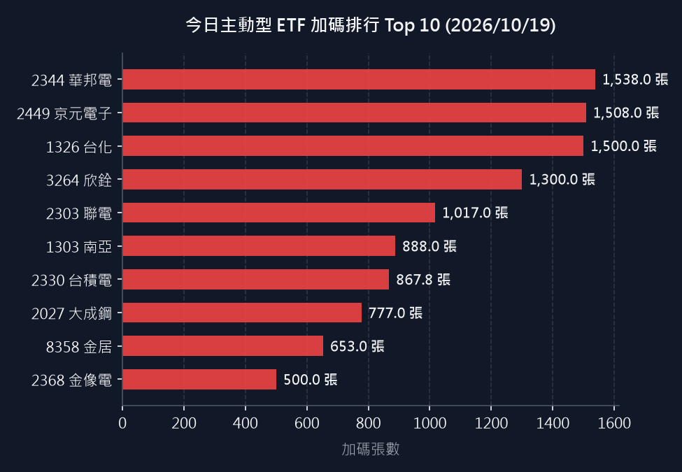
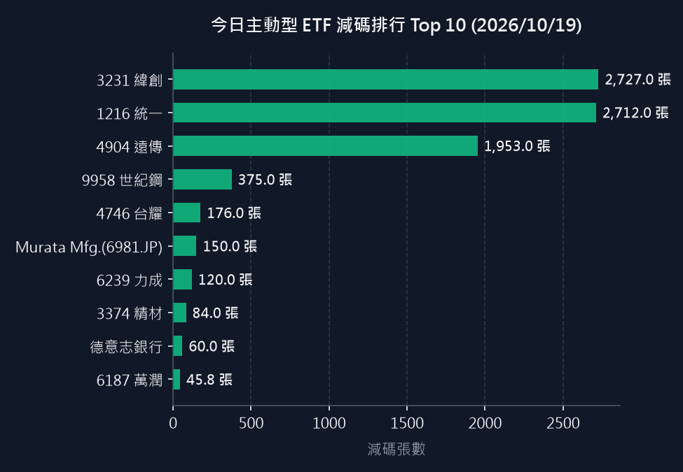

# 主動型 ETF 持股變動

資料來源：`主動型ETF持股明細.xlsx` 最近兩個日期分頁。

比較區間：`20261016` → `20261019`

## 今日加減碼視覺化排行

| 今日加碼 Top 10 | 今日減碼 Top 10 |
| :---: | :---: |
|  |  |

| ETF | 新增 | 刪除 | 比例變動 |
| :-- | --: | --: | --: |
| 00400A | 0 | 0 | 49 |
| 00401A | 1 | 1 | 45 |
| 00402A | 0 | 0 | 48 |
| 00403A | 0 | 0 | 31 |
| 00404A | 0 | 0 | 43 |
| 00405A | 0 | 0 | 21 |
| 00406A | 0 | 0 | 59 |
| 00407A | 0 | 0 | 39 |
| 00408A | 0 | 0 | 41 |
| 00980A | 0 | 0 | 47 |
| 00980D | 0 | 0 | 33 |
| 00981A | 0 | 0 | 28 |
| 00982A | 0 | 0 | 38 |
| 00983A | 0 | 0 | 39 |
| 00983D | 0 | 0 | 12 |
| 00984A | 0 | 0 | 64 |
| 00985A | 0 | 0 | 47 |
| 00986A | 0 | 0 | 35 |
| 00987A | 0 | 0 | 26 |
| 00988A | 1 | 0 | 36 |
| 00989A | 3 | 1 | 59 |
| 00990A | 2 | 0 | 42 |
| 00991A | 0 | 0 | 16 |
| 00992A | 0 | 0 | 39 |
| 00993A | 1 | 1 | 35 |
| 00994A | 0 | 1 | 34 |
| 00995A | 0 | 1 | 35 |
| 00996A | 0 | 0 | 37 |
| 00997A | 0 | 0 | 46 |
| 00998A | 0 | 0 | 41 |
| 00999A | 1 | 3 | 45 |

## 00400A

### 新增持股

- 無

### 刪除持股

- 無

### 投資比例變動

- 1303 南亞：4.26% → 4.16%（-0.10）
- 1476 儒鴻：0.08% → 0.07%（-0.01）
- 2059 川湖：3.05% → 3.00%（-0.05）
- 2303 聯電：1.85% → 1.81%（-0.04）
- 2308 台達電：2.58% → 2.56%（-0.02）
- 2313 華通：0.91% → 0.90%（-0.01）
- 2317 鴻海：0.78% → 0.76%（-0.02）
- 2327 國巨*：1.34% → 1.24%（-0.10）
- 2330 台積電：8.81% → 8.71%（-0.10）
- 2345 智邦：0.49% → 0.69%（+0.20）
- 2360 致茂：3.13% → 3.10%（-0.03）
- 2368 金像電：3.04% → 3.02%（-0.02）
- 2383 台光電：4.36% → 4.28%（-0.08）
- 2449 京元電子：0.91% → 0.87%（-0.04）
- 2454 聯發科：6.29% → 6.16%（-0.13）
- 2603 長榮：1.65% → 1.61%（-0.04）
- 2637 慧洋-KY：0.48% → 0.47%（-0.01）
- 2881 富邦金：1.67% → 1.62%（-0.05）
- 2891 中信金：1.60% → 1.58%（-0.02）
- 3008 大立光：1.51% → 1.56%（+0.05）
- 3017 奇鋐：3.63% → 3.59%（-0.04）
- 3036 文曄：1.54% → 1.49%（-0.05）
- 3037 欣興：3.88% → 3.94%（+0.06）
- 3044 健鼎：2.50% → 2.44%（-0.06）
- 3090 日電貿：0.34% → 0.32%（-0.02）
- 3167 大量：0.40% → 0.37%（-0.03）
- 3231 緯創：0.98% → 0.96%（-0.02）
- 3293 鈊象：0.35% → 0.34%（-0.01）
- 3374 精材：0.27% → 0.14%（-0.13）
- 3443 創意：2.41% → 2.50%（+0.09）
- 3529 力旺：1.21% → 1.26%（+0.05）
- 3653 健策：3.45% → 3.32%（-0.13）
- 3661 世芯-KY：2.26% → 2.25%（-0.01）
- 3665 貿聯-KY：1.53% → 1.48%（-0.05）
- 3711 日月光投控：1.04% → 1.02%（-0.02）
- 4958 臻鼎-KY：0.48% → 0.46%（-0.02）
- 5274 信驊：1.56% → 1.49%（-0.07）
- 6121 新普：0.22% → 0.21%（-0.01）
- 6147 頎邦：0.89% → 0.88%（-0.01）
- 6187 萬潤：1.38% → 1.15%（-0.23）
- 6223 旺矽：3.13% → 3.12%（-0.01）
- 6271 同欣電：0.26% → 0.25%（-0.01）
- 6278 台表科：1.82% → 1.74%（-0.08）
- 6488 環球晶：2.65% → 2.57%（-0.08）
- 6505 台塑化：2.50% → 2.35%（-0.15）
- 6669 緯穎：1.36% → 1.37%（+0.01）
- 7750 新代：0.74% → 0.73%（-0.01）
- 9939 宏全：0.08% → 0.07%（-0.01）
- 台指選擇權 2026/10：0.01% → 0.00%（-0.01）

## 00401A

### 新增持股

- TAIEX FUTURES 18NOV26 FTX6（-0.01%，0.028 張）

### 刪除持股

- 台股期貨10/26(FITXN*1.TF)（0.18%，0.028 張）

### 投資比例變動

- 1303 南亞：1.26% → 1.25%（-0.01）
- 1477 聚陽：0.96% → 0.94%（-0.02）
- 2303 聯電：2.27% → 2.25%（-0.02）
- 2308 台達電：2.27% → 2.28%（+0.01）
- 2317 鴻海：0.57% → 0.56%（-0.01）
- 2327 國巨*：0.64% → 0.61%（-0.03）
- 2330 台積電：20.57% → 20.58%（+0.01）
- 2357 華碩：1.93% → 1.89%（-0.04）
- 2379 瑞昱：1.12% → 1.13%（+0.01）
- 2382 廣達：2.12% → 2.07%（-0.05）
- 2383 台光電：1.06% → 1.05%（-0.01）
- 2412 中華電：0.88% → 0.89%（+0.01）
- 2454 聯發科：6.08% → 6.01%（-0.07）
- 2603 長榮：1.16% → 1.15%（-0.01）
- 2881 富邦金：2.17% → 2.13%（-0.04）
- 2882 國泰金：1.10% → 1.09%（-0.01）
- 2883 凱基金：1.73% → 1.69%（-0.04）
- 2884 玉山金：2.13% → 2.14%（+0.01）
- 2886 兆豐金：1.46% → 1.47%（+0.01）
- 2891 中信金：1.67% → 1.66%（-0.01）
- 2912 統一超：0.26% → 0.27%（+0.01）
- 3008 大立光：2.32% → 2.26%（-0.06）
- 3037 欣興：2.28% → 2.34%（+0.06）
- 3131 弘塑：0.66% → 0.64%（-0.02）
- 3231 緯創：1.67% → 1.65%（-0.02）
- 3491 昇達科：1.70% → 1.62%（-0.08）
- 4904 遠傳：0.82% → 0.81%（-0.01）
- 4958 臻鼎-KY：1.45% → 1.42%（-0.03）
- 4991 環宇-KY：0.60% → 0.58%（-0.02）
- 5274 信驊：1.75% → 1.70%（-0.05）
- 5347 世界：1.31% → 1.29%（-0.02）
- 5904 寶雅*：0.57% → 0.56%（-0.01）
- 6147 頎邦：1.36% → 1.37%（+0.01）
- 6187 萬潤：0.76% → 0.75%（-0.01）
- 6285 啟碁：1.47% → 1.43%（-0.04）
- 6515 穎崴：0.97% → 0.96%（-0.01）
- 6531 愛普*：1.57% → 1.47%（-0.10）
- 6669 緯穎：1.65% → 1.69%（+0.04）
- 7769 鴻勁：0.97% → 0.98%（+0.01）
- 7828 創新服務：1.51% → 1.46%（-0.05）
- 7856 漢測：0.73% → 0.72%（-0.01）
- 8464 億豐：1.02% → 0.98%（-0.04）
- 臺指選擇權10/26 46000 買權：-0.04% → -0.02%（+0.02）
- 臺指選擇權10/26 46400 買權：-0.43% → -0.25%（+0.18）
- 臺指選擇權10/26 46800 買權：-0.02% → -0.01%（+0.01）

## 00402A

### 新增持股

- 無

### 刪除持股

- 無

### 投資比例變動

- AAPL.US Apple：7.84% → 8.16%（+0.32）
- ADI.US Analog Devices：1.95% → 1.98%（+0.03）
- AMD.US AMD：5.89% → 5.74%（-0.15）
- AMZN.US Amazon：4.36% → 4.43%（+0.07）
- ANET.US Arista Networks：0.79% → 0.78%（-0.01）
- ARM.US Arm：0.85% → 0.82%（-0.03）
- ASML.US ASML Holding：1.16% → 1.19%（+0.03）
- AVGO.US Broadcom：2.18% → 2.16%（-0.02）
- AXON.US Axon Enterprise：0.58% → 0.56%（-0.02）
- BABA.US Alibaba Group：0.50% → 0.51%（+0.01）
- BKNG.US Booking Holdings：0.54% → 0.55%（+0.01）
- CDNS.US Cadence Design Systems：1.47% → 1.50%（+0.03）
- CIEN.US Ciena：1.14% → 1.10%（-0.04）
- COHR.US Coherent：1.20% → 1.15%（-0.05）
- CRWD.US CrowdStrike Holdings：1.59% → 1.54%（-0.05）
- DASH.US DoorDash：0.48% → 0.49%（+0.01）
- FSLY.US Fastly：0.37% → 0.34%（-0.03）
- GOOG.US Alphabet - Class C Capital Stock：3.43% → 3.47%（+0.04）
- GOOGL.US Alphabet - Class A Common Stock：3.46% → 3.49%（+0.03）
- INTC.US Intel：1.45% → 1.42%（-0.03）
- IOT.US Samsara：0.56% → 0.54%（-0.02）
- KLAC.US KLA：1.55% → 1.53%（-0.02）
- LITE.US Lumentum：1.72% → 1.69%（-0.03）
- LRCX.US Lam Research：2.47% → 2.44%（-0.03）
- MCHP.US Microchip Technology：1.32% → 1.36%（+0.04）
- MDB.US MongoDB：0.38% → 0.37%（-0.01）
- META.US Meta：3.90% → 3.89%（-0.01）
- MRVL.US Marvell：1.63% → 1.59%（-0.04）
- MSFT.US Microsoft：5.46% → 5.55%（+0.09）
- MU.US Micron：5.69% → 5.57%（-0.12）
- NFLX.US Netflix：1.02% → 1.03%（+0.01）
- NOW.US ServiceNow：1.15% → 1.14%（-0.01）
- NVDA.US NVIDIA：8.58% → 8.76%（+0.18）
- PANW.US Palo Alto：2.84% → 2.72%（-0.12）
- PLTR.US Palantir Technologies：2.22% → 2.13%（-0.09）
- SHOP.US Shopify：1.25% → 1.24%（-0.01）
- SKHY.US SK hynix：0.78% → 0.76%（-0.02）
- SNOW.US Snowflake：1.35% → 1.28%（-0.07）
- SPCX.US SpaceX：0.74% → 0.75%（+0.01）
- SPOT.US Spotify：0.37% → 0.38%（+0.01）
- STX.US Seagate：1.05% → 1.00%（-0.05）
- TER.US Teradyne：0.76% → 0.74%（-0.02）
- TSM.US TSMC(ADR)：1.47% → 1.49%（+0.02）
- TTWO.US Take-Two：0.60% → 0.61%（+0.01）
- TXN.US Texas Instruments：2.37% → 2.43%（+0.06）
- UBER.US Uber：0.32% → 0.33%（+0.01）
- V.US Visa：1.21% → 1.26%（+0.05）
- WDC.US Western Digital：1.74% → 1.68%（-0.06）

## 00403A

### 新增持股

- 無

### 刪除持股

- 無

### 投資比例變動

- 1303 南亞：2.68% → 2.66%（-0.02）
- 1560 中砂：0.13% → 0.20%（+0.07）
- 2303 聯電：1.52% → 1.50%（-0.02）
- 2308 台達電：3.60% → 3.63%（+0.03）
- 2317 鴻海：0.59% → 0.58%（-0.01）
- 2327 國巨*：3.79% → 3.58%（-0.21）
- 2330 台積電：14.17% → 14.21%（+0.04）
- 2345 智邦：2.41% → 2.45%（+0.04）
- 2368 金像電：0.66% → 0.78%（+0.12）
- 2383 台光電：4.71% → 4.69%（-0.02）
- 2408 南亞科：0.95% → 0.93%（-0.02）
- 2449 京元電子：0.84% → 0.80%（-0.04）
- 2454 聯發科：5.49% → 4.81%（-0.68）
- 3008 大立光：1.63% → 1.60%（-0.03）
- 3017 奇鋐：5.39% → 5.42%（+0.03）
- 3037 欣興：5.80% → 5.98%（+0.18）
- 3189 景碩：3.38% → 3.33%（-0.05）
- 3211 順達：0.53% → 0.52%（-0.01）
- 3443 創意：3.72% → 4.06%（+0.34）
- 3450 聯鈞：0.52% → 0.51%（-0.01）
- 3583 辛耘：0.40% → 0.39%（-0.01）
- 3653 健策：5.70% → 5.58%（-0.12）
- 3665 貿聯-KY：2.24% → 2.20%（-0.04）
- 5274 信驊：1.82% → 1.77%（-0.05）
- 6223 旺矽：3.68% → 3.71%（+0.03）
- 6274 台燿：2.82% → 2.98%（+0.16）
- 6488 環球晶：0.21% → 0.20%（-0.01）
- 6669 緯穎：2.38% → 2.44%（+0.06）
- 6805 富世達：0.43% → 0.55%（+0.12）
- 8046 南電：3.10% → 3.17%（+0.07）
- 8996 高力：2.24% → 2.19%（-0.05）

## 00404A

### 新增持股

- 無

### 刪除持股

- 無

### 投資比例變動

- 1303 南亞：0.82% → 0.81%（-0.01）
- 2301 光寶科：0.54% → 0.55%（+0.01）
- 2303 聯電：2.63% → 2.62%（-0.01）
- 2308 台達電：1.64% → 1.66%（+0.02）
- 2317 鴻海：0.66% → 0.65%（-0.01）
- 2330 台積電：22.51% → 22.66%（+0.15）
- 2345 智邦：0.89% → 0.91%（+0.02）
- 2347 聯強：2.06% → 2.03%（-0.03）
- 2351 順德：0.38% → 0.37%（-0.01）
- 2357 華碩：1.25% → 1.22%（-0.03）
- 2360 致茂：0.45% → 0.46%（+0.01）
- 2379 瑞昱：1.15% → 1.16%（+0.01）
- 2382 廣達：0.98% → 0.96%（-0.02）
- 2436 偉詮電：1.14% → 1.13%（-0.01）
- 2454 聯發科：6.55% → 6.53%（-0.02）
- 2637 慧洋-KY：1.15% → 1.14%（-0.01）
- 2882 國泰金：2.91% → 2.89%（-0.02）
- 2885 元大金：2.58% → 2.56%（-0.02）
- 2887 台新新光金：1.50% → 1.51%（+0.01）
- 3017 奇鋐：1.33% → 1.34%（+0.01）
- 3034 聯詠：2.21% → 2.26%（+0.05）
- 3037 欣興：0.27% → 0.28%（+0.01）
- 3260 威剛：0.06% → 0.05%（-0.01）
- 3293 鈊象：1.20% → 1.17%（-0.03）
- 3443 創意：0.94% → 0.99%（+0.05）
- 3653 健策：0.51% → 0.50%（-0.01）
- 3711 日月光投控：3.26% → 3.28%（+0.02）
- 5274 信驊：2.66% → 2.60%（-0.06）
- 5904 寶雅*：0.52% → 0.51%（-0.01）
- 6196 帆宣：1.74% → 1.72%（-0.02）
- 6206 飛捷：0.75% → 0.73%（-0.02）
- 6223 旺矽：1.11% → 1.12%（+0.01）
- 6257 矽格：1.74% → 1.72%（-0.02）
- 6505 台塑化：0.57% → 0.55%（-0.02）
- 6669 緯穎：0.88% → 0.90%（+0.02）
- 6691 洋基工程：1.61% → 1.59%（-0.02）
- 7769 鴻勁：1.06% → 1.09%（+0.03）
- 8016 矽創：1.29% → 1.27%（-0.02）
- 8081 致新：0.89% → 0.87%（-0.02）
- 8299 群聯：1.18% → 1.16%（-0.02）
- iShares MSCI Japan SRI ETF(2851.JP)：1.15% → 1.21%（+0.06）
- 台股期貨10/26(FITXN*1.TF)：9.72% → 9.68%（-0.04）
- 台股期貨11/26(FITXN*1.TF)：7.38% → 7.35%（-0.03）

## 00405A

### 新增持股

- 無

### 刪除持股

- 無

### 投資比例變動

- 2059 川湖：2.19% → 2.18%（-0.01）
- 2345 智邦：5.31% → 5.38%（+0.07）
- 2368 金像電：6.18% → 6.21%（+0.03）
- 2383 台光電：4.83% → 4.79%（-0.04）
- 2395 研華：0.02% → 0.01%（-0.01）
- 2454 聯發科：5.51% → 5.45%（-0.06）
- 3017 奇鋐：4.06% → 4.07%（+0.01）
- 3037 欣興：7.35% → 7.55%（+0.20）
- 3443 創意：5.70% → 5.97%（+0.27）
- 3653 健策：7.71% → 7.51%（-0.20）
- 3665 貿聯-KY：5.90% → 5.79%（-0.11）
- 5274 信驊：5.76% → 5.58%（-0.18）
- 5347 世界：0.16% → 0.15%（-0.01）
- 6223 旺矽：7.41% → 7.45%（+0.04）
- 6274 台燿：2.18% → 2.20%（+0.02）
- 6531 愛普*：4.00% → 3.72%（-0.28）
- 6669 緯穎：0.81% → 0.82%（+0.01）
- 6805 富世達：3.38% → 3.51%（+0.13）
- 7769 鴻勁：2.79% → 2.85%（+0.06）
- 8046 南電：7.76% → 7.90%（+0.14）
- 8996 高力：1.38% → 1.34%（-0.04）

## 00406A

### 新增持股

- 無

### 刪除持股

- 無

### 投資比例變動

- 1303 南亞：1.48% → 1.55%（+0.07）
- 1326 台化：0.37% → 0.44%（+0.07）
- 1560 中砂：0.39% → 0.36%（-0.03）
- 2059 川湖：0.83% → 0.90%（+0.07）
- 2308 台達電：2.72% → 2.55%（-0.17）
- 2317 鴻海：0.36% → 0.33%（-0.03）
- 2327 國巨*：1.93% → 1.88%（-0.05）
- 2330 台積電：8.50% → 9.49%（+0.99）
- 2344 華邦電：0.20% → 0.09%（-0.11）
- 2345 智邦：3.85% → 3.82%（-0.03）
- 2360 致茂：1.37% → 1.28%（-0.09）
- 2368 金像電：1.25% → 1.38%（+0.13）
- 2383 台光電：7.00% → 6.75%（-0.25）
- 2395 研華：0.09% → 0.08%（-0.01）
- 2449 京元電子：0.38% → 0.47%（+0.09）
- 2454 聯發科：5.64% → 5.72%（+0.08）
- 2481 強茂：0.58% → 0.54%（-0.04）
- 2486 一詮：0.19% → 0.17%（-0.02）
- 2885 元大金：0.66% → 0.60%（-0.06）
- 2886 兆豐金：0.14% → 0.13%（-0.01）
- 3008 大立光：1.68% → 1.54%（-0.14）
- 3017 奇鋐：4.95% → 5.18%（+0.23）
- 3037 欣興：5.56% → 5.73%（+0.17）
- 3081 聯亞：0.26% → 0.25%（-0.01）
- 3105 穩懋：0.11% → 0.10%（-0.01）
- 3167 大量：0.71% → 0.63%（-0.08）
- 3189 景碩：1.92% → 2.06%（+0.14）
- 3264 欣銓：0.16% → 0.28%（+0.12）
- 3363 上詮：0.22% → 0.20%（-0.02）
- 3443 創意：2.16% → 2.12%（-0.04）
- 3450 聯鈞：0.15% → 0.14%（-0.01）
- 3491 昇達科：0.50% → 0.45%（-0.05）
- 3529 力旺：0.22% → 0.20%（-0.02）
- 3653 健策：3.47% → 3.49%（+0.02）
- 3661 世芯-KY：0.69% → 0.76%（+0.07）
- 3665 貿聯-KY：1.62% → 1.49%（-0.13）
- 3711 日月光投控：2.16% → 2.02%（-0.14）
- 4938 和碩：0.49% → 0.50%（+0.01）
- 4958 臻鼎-KY：0.98% → 1.01%（+0.03）
- 5274 信驊：2.11% → 2.04%（-0.07）
- 6147 頎邦：0.75% → 0.71%（-0.04）
- 6187 萬潤：0.24% → 0.22%（-0.02）
- 6213 聯茂：0.40% → 0.38%（-0.02）
- 6223 旺矽：2.94% → 3.03%（+0.09）
- 6274 台燿：1.16% → 1.51%（+0.35）
- 6285 啟碁：0.09% → 0.08%（-0.01）
- 6488 環球晶：0.35% → 0.32%（-0.03）
- 6510 精測：0.89% → 0.85%（-0.04）
- 6515 穎崴：0.29% → 0.24%（-0.05）
- 6531 愛普*：0.15% → 0.13%（-0.02）
- 6669 緯穎：1.68% → 1.60%（-0.08）
- 6715 嘉基：0.82% → 0.74%（-0.08）
- 7769 鴻勁：0.23% → 0.22%（-0.01）
- 8358 金居：0.12% → 0.11%（-0.01）
- 8996 高力：0.25% → 0.23%（-0.02）
- 臺指選擇權：-14.53% → -16.80%（-2.27）
- 臺指選擇權第四週週五到期契約：-2.84% → -3.41%（-0.57）
- 臺股期貨 202610(FITXN*1.TF)：6.04% → 5.22%（-0.82）
- 臺股期貨 202611(FITXN*1.TF)：16.71% → 17.67%（+0.96）

## 00407A

### 新增持股

- 無

### 刪除持股

- 無

### 投資比例變動

- 1303 南亞：1.01% → 1.00%（-0.01）
- 1560 中砂：1.01% → 1.00%（-0.01）
- 2059 川湖：1.89% → 1.88%（-0.01）
- 2308 台達電：2.50% → 2.51%（+0.01）
- 2327 國巨*：2.41% → 2.26%（-0.15）
- 2330 台積電：9.52% → 9.50%（-0.02）
- 2345 智邦：2.25% → 2.28%（+0.03）
- 2383 台光電：5.51% → 5.46%（-0.05）
- 2408 南亞科：0.90% → 0.88%（-0.02）
- 2451 創見：0.33% → 0.32%（-0.01）
- 2454 聯發科：5.42% → 5.35%（-0.07）
- 2615 萬海：1.07% → 1.04%（-0.03）
- 3008 大立光：1.58% → 1.54%（-0.04）
- 3034 聯詠：0.83% → 0.84%（+0.01）
- 3037 欣興：5.67% → 5.81%（+0.14）
- 3081 聯亞：1.36% → 1.37%（+0.01）
- 3131 弘塑：0.83% → 0.80%（-0.03）
- 3231 緯創：0.76% → 0.75%（-0.01）
- 3260 威剛：0.30% → 0.28%（-0.02）
- 3293 鈊象：0.64% → 0.63%（-0.01）
- 3443 創意：4.54% → 4.74%（+0.20）
- 3491 昇達科：0.93% → 0.88%（-0.05）
- 3653 健策：3.70% → 3.60%（-0.10）
- 3665 貿聯-KY：2.65% → 2.60%（-0.05）
- 3711 日月光投控：3.03% → 3.02%（-0.01）
- 4958 臻鼎-KY：1.10% → 1.08%（-0.02）
- 5274 信驊：1.32% → 1.28%（-0.04）
- 5289 宜鼎：0.31% → 0.30%（-0.01）
- 5434 崇越：0.23% → 0.22%（-0.01）
- 6187 萬潤：1.70% → 1.69%（-0.01）
- 6223 旺矽：2.81% → 2.82%（+0.01）
- 6274 台燿：4.13% → 4.16%（+0.03）
- 6446 藥華藥：0.35% → 0.33%（-0.02）
- 6510 精測：1.40% → 1.43%（+0.03）
- 6531 愛普*：0.32% → 0.30%（-0.02）
- 6669 緯穎：3.39% → 3.46%（+0.07）
- 6805 富世達：1.19% → 1.24%（+0.05）
- 8046 南電：3.39% → 3.45%（+0.06）
- 8996 高力：1.33% → 1.29%（-0.04）

## 00408A

### 新增持股

- 無

### 刪除持股

- 無

### 投資比例變動

- 1303 南亞：3.69% → 3.67%（-0.02）
- 2303 聯電：1.41% → 1.36%（-0.05）
- 2308 台達電：2.63% → 2.66%（+0.03）
- 2327 國巨*：0.92% → 0.76%（-0.16）
- 2330 台積電：6.29% → 6.34%（+0.05）
- 2344 華邦電：0.45% → 0.44%（-0.01）
- 2345 智邦：0.84% → 0.85%（+0.01）
- 2357 華碩：2.10% → 1.51%（-0.59）
- 2368 金像電：5.52% → 5.57%（+0.05）
- 2376 技嘉：1.38% → 1.37%（-0.01）
- 2382 廣達：0.23% → 0.22%（-0.01）
- 2383 台光電：4.90% → 4.89%（-0.01）
- 2395 研華：1.64% → 1.63%（-0.01）
- 2408 南亞科：1.32% → 1.29%（-0.03）
- 2449 京元電子：0.91% → 0.88%（-0.03）
- 2454 聯發科：4.18% → 4.16%（-0.02）
- 2542 興富發：3.76% → 3.81%（+0.05）
- 2603 長榮：1.31% → 1.30%（-0.01）
- 2880 華南金：1.20% → 1.21%（+0.01）
- 3008 大立光：0.90% → 0.88%（-0.02）
- 3017 奇鋐：1.61% → 1.62%（+0.01）
- 3026 禾伸堂：0.85% → 0.78%（-0.07）
- 3037 欣興：2.30% → 2.38%（+0.08）
- 3081 聯亞：2.06% → 2.09%（+0.03）
- 3105 穩懋：0.49% → 0.48%（-0.01）
- 3189 景碩：3.45% → 3.40%（-0.05）
- 3653 健策：3.69% → 3.62%（-0.07）
- 3665 貿聯-KY：1.12% → 1.10%（-0.02）
- 3711 日月光投控：1.51% → 1.52%（+0.01）
- 5434 崇越：2.35% → 2.34%（-0.01）
- 6223 旺矽：2.12% → 2.14%（+0.02）
- 6239 力成：1.29% → 0.41%（-0.88）
- 6274 台燿：3.63% → 3.69%（+0.06）
- 6488 環球晶：0.89% → 0.87%（-0.02）
- 6510 精測：0.44% → 0.45%（+0.01）
- 6669 緯穎：1.92% → 1.97%（+0.05）
- 6805 富世達：1.90% → 2.31%（+0.41）
- 7769 鴻勁：0.56% → 0.57%（+0.01）
- 8046 南電：1.62% → 1.66%（+0.04）
- 8996 高力：1.99% → 1.94%（-0.05）
- 9802 鈺齊-KY：0.91% → 0.90%（-0.01）

## 00980A

### 新增持股

- 無

### 刪除持股

- 無

### 投資比例變動

- 1303 南亞：3.96% → 3.93%（-0.03）
- 2303 聯電：1.05% → 1.04%（-0.01）
- 2308 台達電：3.53% → 3.55%（+0.02）
- 2317 鴻海：2.10% → 2.07%（-0.03）
- 2327 國巨*：1.47% → 1.39%（-0.08）
- 2330 台積電：9.73% → 9.76%（+0.03）
- 2344 華邦電：1.98% → 1.91%（-0.07）
- 2345 智邦：1.50% → 1.52%（+0.02）
- 2360 致茂：1.58% → 1.59%（+0.01）
- 2368 金像電：2.24% → 2.26%（+0.02）
- 2376 技嘉：0.92% → 0.91%（-0.01）
- 2382 廣達：1.23% → 1.21%（-0.02）
- 2383 台光電：4.58% → 4.55%（-0.03）
- 2408 南亞科：2.62% → 2.56%（-0.06）
- 2454 聯發科：5.65% → 5.61%（-0.04）
- 3008 大立光：1.30% → 1.27%（-0.03）
- 3017 奇鋐：2.37% → 2.38%（+0.01）
- 3026 禾伸堂：1.23% → 1.13%（-0.10）
- 3036 文曄：1.02% → 1.00%（-0.02）
- 3037 欣興：3.64% → 3.75%（+0.11）
- 3044 健鼎：0.61% → 0.60%（-0.01）
- 3081 聯亞：2.19% → 2.22%（+0.03）
- 3189 景碩：1.42% → 1.40%（-0.02）
- 3231 緯創：0.92% → 0.91%（-0.01）
- 3293 鈊象：0.87% → 0.85%（-0.02）
- 3443 創意：2.36% → 2.47%（+0.11）
- 3529 力旺：0.65% → 0.63%（-0.02）
- 3653 健策：3.74% → 3.65%（-0.09）
- 3665 貿聯-KY：0.52% → 0.51%（-0.01）
- 3711 日月光投控：2.22% → 2.23%（+0.01）
- 5274 信驊：1.79% → 1.74%（-0.05）
- 5904 寶雅*：0.89% → 0.88%（-0.01）
- 6213 聯茂：1.04% → 1.03%（-0.01）
- 6223 旺矽：2.06% → 2.07%（+0.01）
- 6274 台燿：1.23% → 1.25%（+0.02）
- 6442 光聖：0.31% → 0.30%（-0.01）
- 6515 穎崴：1.68% → 1.69%（+0.01）
- 6669 緯穎：1.53% → 1.57%（+0.04）
- 6805 富世達：0.65% → 0.68%（+0.03）
- 6831 邁科：0.41% → 0.40%（-0.01）
- 7751 竑騰：0.75% → 0.73%（-0.02）
- 7769 鴻勁：2.91% → 2.98%（+0.07）
- 8046 南電：1.82% → 1.85%（+0.03）
- 8210 勤誠：0.42% → 0.41%（-0.01）
- 8299 群聯：1.69% → 1.66%（-0.03）
- 8996 高力：0.49% → 0.47%（-0.02）
- 台灣證交所加權股價指數(FITXN*1.TF)：1.51% → 1.50%（-0.01）

## 00980D

### 新增持股

- 無

### 刪除持股

- 無

### 投資比例變動

- ARCELORMITTAL SA 6.55% 29NOV2027：0.56% → 0.57%（+0.01）
- AVIANCA MIDCO 2 PLC SER REGS 10.25 % 07-JAN-2032：0.28% → 0.25%（-0.03）
- AVIANCA MIDCO 2 PLC SER REGS 9.625000 % 14FEB2030：0.28% → 0.24%（-0.04）
- BANK OF AMERICA CORP (REG) 7.75% 14MAY2038：0.52% → 0.53%（+0.01）
- BAT CAPITAL CORP (REG) 7.079% 02AUG2043：0.32% → 0.33%（+0.01）
- BAT CAPITAL CORP (REG) 7.081% 02AUG2053：0.58% → 0.59%（+0.01）
- CONCENTRIX CORP (REG) 6.6% 02AUG2028：0.53% → 0.54%（+0.01）
- CONSOLIDATED ENERGY FIN SER REGS 12.000000 % 15FEB2031：0.58% → 0.59%（+0.01）
- COREWEAVE INC SER REGS (REG S) 9.25% 01JUN2030：0.41% → 0.40%（-0.01）
- COREWEAVE INC SER REGS (REG S) 9.75% 01OCT2031：0.48% → 0.47%（-0.01）
- COREWEAVE INC SER REGS (REG) (REG S) 9.625% 15JUL2032：0.48% → 0.46%（-0.02）
- DELL INT LLC / EMC CORP (REG) 8.1% 15JUL2036：0.59% → 0.60%（+0.01）
- EDISON INTERNATIONAL (REG) 6.95% 15NOV2029：0.59% → 0.60%（+0.01）
- JETBLUE AIRWAYS/LOYALTY SER REGS (REG S) 9.875% 20SEP2031：0.36% → 0.35%（-0.01）
- LADDER CAP FIN LLLP/CORP SER REGS 7.000000 % 15JUL2031：0.33% → 0.34%（+0.01）
- LBM ACQUISITION LLC SER REGS 9.500000 % 15JUN2031：0.40% → 0.42%（+0.02）
- M&T BANK CORPORATION (REG) VAR 30OCT2029：0.55% → 0.56%（+0.01）
- MDC HOLDINGS INC (REG) 6% 15JAN2043：0.33% → 0.32%（-0.01）
- ORACLE CORP 6.000000 % 03AUG2055：0.30% → 0.29%（-0.01）
- ORACLE CORP 6.125000 % 03AUG2065：0.54% → 0.53%（-0.01）
- PHOTO HOLDINGS LLC SER REGS (REG) (REG S) 12% 01JUL2031：0.49% → 0.50%（+0.01）
- POLARIS INC 6.950000 % 15MAR2029：0.48% → 0.49%（+0.01）
- SANTANDER HOLDINGS USA VAR 09NOV2031：0.60% → 0.61%（+0.01）
- SBL HOLDINGS INC SER REGS 7.200000 % 30OCT2034：0.52% → 0.53%（+0.01）
- SES GLOBAL AMERICAS HLDG SER REGS (REG) 5.300000 % 25MAR2044：0.29% → 0.30%（+0.01）
- SPACE EXPLORATION TECH SER 144A (REG) 6.65% 15JUL2056：0.32% → 0.31%（-0.01）
- US 10YR NOTE (CBT)DEC26 21-DEC-2026：18.22% → 18.25%（+0.03）
- US 2YR NOTE (CBT) DEC26 31-DEC-2026：1.69% → 1.70%（+0.01）
- US 5YR NOTE (CBT) DEC26 31-DEC-2026：-13.83% → -13.86%（-0.03）
- US ACUTE CARE SOLUTIONS SER REGS (REG S) 9.75% 15MAY2029：0.34% → 0.33%（-0.01）
- US LONG BOND(CBT) DEC26 21-DEC-2026：5.43% → 5.44%（+0.01）
- VIACOM INC (REG) 5.85% 01SEP2043：0.46% → 0.47%（+0.01）
- VIACOMCBS INC 6.875% 30APR2036：0.23% → 0.24%（+0.01）

## 00981A

### 新增持股

- 無

### 刪除持股

- 無

### 投資比例變動

- 2303 聯電：3.89% → 3.79%（-0.10）
- 2308 台達電：4.51% → 4.50%（-0.01）
- 2327 國巨*：4.90% → 4.55%（-0.35）
- 2330 台積電：10.84% → 10.86%（+0.02）
- 2345 智邦：4.56% → 4.55%（-0.01）
- 2368 金像電：3.06% → 3.12%（+0.06）
- 2383 台光電：8.21% → 8.04%（-0.17）
- 2449 京元電子：0.42% → 0.49%（+0.07）
- 2454 聯發科：8.03% → 7.84%（-0.19）
- 3017 奇鋐：7.68% → 7.58%（-0.10）
- 3037 欣興：7.76% → 7.91%（+0.15）
- 3264 欣銓：0.18% → 0.25%（+0.07）
- 3443 創意：2.06% → 2.42%（+0.36）
- 3653 健策：6.19% → 5.95%（-0.24）
- 3665 貿聯-KY：2.14% → 2.07%（-0.07）
- 3711 日月光投控：2.06% → 2.03%（-0.03）
- 4979 華星光：0.18% → 0.17%（-0.01）
- 5274 信驊：1.22% → 1.17%（-0.05）
- 6223 旺矽：4.79% → 4.75%（-0.04）
- 6274 台燿：4.29% → 4.27%（-0.02）
- 6515 穎崴：0.18% → 0.17%（-0.01）
- 6669 緯穎：2.22% → 2.24%（+0.02）
- 6805 富世達：0.54% → 0.65%（+0.11）
- 8046 南電：4.45% → 4.47%（+0.02）
- 8210 勤誠：0.15% → 0.14%（-0.01）
- 8358 金居：0.00% → 0.11%（+0.11）
- 8996 高力：0.57% → 0.54%（-0.03）
- 台指期貨 2026/11(FITXN*1.TF)：2.37% → 2.31%（-0.06）

## 00982A

### 新增持股

- 無

### 刪除持股

- 無

### 投資比例變動

- 2059 川湖：2.70% → 2.72%（+0.02）
- 2301 光寶科：1.79% → 1.82%（+0.03）
- 2303 聯電：1.43% → 1.44%（+0.01）
- 2330 台積電：7.87% → 7.95%（+0.08）
- 2360 致茂：3.56% → 3.63%（+0.07）
- 2383 台光電：3.36% → 3.37%（+0.01）
- 2454 聯發科：6.59% → 7.03%（+0.44）
- 2455 全新：1.59% → 1.61%（+0.02）
- 2467 志聖：1.07% → 1.04%（-0.03）
- 2476 鉅祥：0.33% → 0.34%（+0.01）
- 2478 大毅：1.21% → 1.13%（-0.08）
- 3008 大立光：3.38% → 3.36%（-0.02）
- 3017 奇鋐：2.60% → 2.64%（+0.04）
- 3090 日電貿：1.18% → 1.13%（-0.05）
- 3105 穩懋：6.02% → 5.85%（-0.17）
- 3231 緯創：1.40% → 1.39%（-0.01）
- 3265 台星科：1.89% → 1.80%（-0.09）
- 3491 昇達科：3.62% → 3.48%（-0.14）
- 3583 辛耘：1.08% → 1.07%（-0.01）
- 3711 日月光投控：1.24% → 1.26%（+0.02）
- 4958 臻鼎-KY：3.70% → 3.68%（-0.02）
- 5274 信驊：1.25% → 1.22%（-0.03）
- 5425 台半：1.24% → 1.25%（+0.01）
- 5483 中美晶：1.44% → 1.42%（-0.02）
- 5536 聖暉*：0.82% → 0.80%（-0.02）
- 6139 亞翔：5.34% → 5.28%（-0.06）
- 6213 聯茂：1.53% → 1.54%（+0.01）
- 6214 精誠：1.43% → 1.44%（+0.01）
- 6223 旺矽：3.30% → 3.35%（+0.05）
- 6239 力成：1.10% → 1.07%（-0.03）
- 6274 台燿：1.42% → 1.46%（+0.04）
- 6446 藥華藥：0.11% → 0.10%（-0.01）
- 6472 保瑞：0.92% → 0.91%（-0.01）
- 6531 愛普*：3.92% → 3.69%（-0.23）
- 6640 均華：0.31% → 0.30%（-0.01）
- 6669 緯穎：3.95% → 4.08%（+0.13）
- 6672 騰輝電子-KY：1.46% → 1.40%（-0.06）
- 8996 高力：1.26% → 1.24%（-0.02）

## 00983A

### 新增持股

- 無

### 刪除持股

- 無

### 投資比例變動

- ACHR.US Archer：0.31% → 0.10%（-0.21）
- AMD.US AMD：3.40% → 3.35%（-0.05）
- AMZN.US Amazon：2.97% → 3.05%（+0.08）
- AVGO.US Broadcom：1.50% → 1.60%（+0.10）
- BEAM.US Beam Therapeutics：1.61% → 1.60%（-0.01）
- BLSH.US Bullish：2.22% → 2.15%（-0.07）
- BMNR.US BitMine：2.29% → 2.23%（-0.06）
- BWXT.US BWX Technologies：0.05% → 0.06%（+0.01）
- COIN.US Coinbase：4.89% → 4.82%（-0.07）
- CRCL.US Circle：5.44% → 5.38%（-0.06）
- CRWV.US CoreWeave：1.10% → 1.01%（-0.09）
- DE.US Deere：0.42% → 0.44%（+0.02）
- FTNT.US Fortinet：0.35% → 0.39%（+0.04）
- GOOG.US Alphabet - Class C Capital Stock：1.64% → 1.68%（+0.04）
- GOOGL.US Alphabet - Class A Common Stock：0.57% → 0.69%（+0.12）
- HOOD.US Robinhood Markets：4.04% → 4.02%（-0.02）
- ILMN.US Illumina：1.76% → 1.80%（+0.04）
- KTOS.US Kratos Defense & Security：0.26% → 0.10%（-0.16）
- LLY.US Eli Lilly：0.81% → 0.85%（+0.04）
- META.US Meta：2.12% → 2.24%（+0.12）
- NET.US Cloudflare：1.33% → 1.30%（-0.03）
- NTLA.US Intellia Therapeutics：0.59% → 0.62%（+0.03）
- NTRA.US Natera：1.67% → 1.70%（+0.03）
- NVDA.US NVIDIA：3.16% → 3.26%（+0.10）
- PACB.US Pacific Biosciences of Californi：0.12% → 0.11%（-0.01）
- PLTR.US Palantir Technologies：3.39% → 3.29%（-0.10）
- RKLB.US Rocket Lab：1.28% → 1.23%（-0.05）
- RXRX.US Recursion Pharmaceuticals：0.99% → 0.86%（-0.13）
- SHOP.US Shopify：5.29% → 5.26%（-0.03）
- SNOW.US Snowflake：0.57% → 0.55%（-0.02）
- SPCX.US SpaceX：6.78% → 6.97%（+0.19）
- TEM.US Tempus：5.66% → 5.38%（-0.28）
- TER.US Teradyne：0.61% → 0.60%（-0.01）
- TSLA.US Tesla：8.76% → 8.99%（+0.23）
- TSM.US TSMC(ADR)：2.68% → 2.74%（+0.06）
- TWST.US Twist Bioscience：3.68% → 3.54%（-0.14）
- TXG.US 10x Genomics：3.28% → 3.31%（+0.03）
- WGS.US GeneDx：0.52% → 0.49%（-0.03）
- XYZ.US Block：1.34% → 1.37%（+0.03）

## 00983D

### 新增持股

- 無

### 刪除持股

- 無

### 投資比例變動

- C 8 1/8 07/15/39：1.94% → 1.93%（-0.01）
- CRWV 9 02/01/31：1.20% → 1.15%（-0.05）
- DELL 8.35 07/15/46：1.41% → 1.40%（-0.01）
- DUK 7 3/4 03/01/31：1.57% → 1.58%（+0.01）
- GE 6 3/4 03/15/32：0.58% → 0.59%（+0.01）
- GT 8 7/8 07/15/32：0.89% → 0.88%（-0.01）
- LOW 6.65 09/15/37：0.84% → 0.85%（+0.01）
- LQDW.US iShares LQD Premium Income+ ETF：7.33% → 7.34%（+0.01）
- ORCL 6.9 11/09/52：0.81% → 0.80%（-0.01）
- SPCX 6.6 07/15/46：1.13% → 1.12%（-0.01）
- TELEFONICA EMISIONES SAU 7.045 06/20/36：1.54% → 1.55%（+0.01）
- TLTW.US iShares TLT Premium Income+ ETF：8.00% → 8.01%（+0.01）

## 00984A

### 新增持股

- 無

### 刪除持股

- 無

### 投資比例變動

- 1216 統一：0.33% → 0.34%（+0.01）
- 1303 南亞：2.99% → 3.04%（+0.05）
- 1326 台化：1.06% → 1.04%（-0.02）
- 1409 新纖：0.65% → 0.66%（+0.01）
- 1560 中砂：1.19% → 1.22%（+0.03）
- 1709 和益：0.69% → 0.67%（-0.02）
- 2006 東和鋼鐵：0.33% → 0.34%（+0.01）
- 2059 川湖：2.04% → 2.10%（+0.06）
- 2301 光寶科：0.59% → 0.61%（+0.02）
- 2303 聯電：0.74% → 0.76%（+0.02）
- 2330 台積電：4.18% → 4.30%（+0.12）
- 2344 華邦電：0.67% → 0.66%（-0.01）
- 2379 瑞昱：0.31% → 0.32%（+0.01）
- 2383 台光電：1.30% → 1.33%（+0.03）
- 2395 研華：2.47% → 2.52%（+0.05）
- 2404 漢唐：0.38% → 0.39%（+0.01）
- 2409 友達：1.19% → 1.25%（+0.06）
- 2454 聯發科：0.79% → 0.81%（+0.02）
- 2464 盟立：1.17% → 1.18%（+0.01）
- 2603 長榮：1.89% → 1.92%（+0.03）
- 2615 萬海：1.01% → 1.00%（-0.01）
- 2637 慧洋-KY：0.32% → 0.33%（+0.01）
- 2801 彰銀：0.33% → 0.34%（+0.01）
- 2851 中再保：0.67% → 0.72%（+0.05）
- 2855 統一證：0.67% → 0.66%（-0.01）
- 2880 華南金：1.61% → 1.65%（+0.04）
- 2881 富邦金：4.31% → 4.34%（+0.03）
- 2882 國泰金：3.29% → 3.34%（+0.05）
- 2883 凱基金：2.48% → 2.49%（+0.01）
- 2884 玉山金：2.36% → 2.44%（+0.08）
- 2885 元大金：3.38% → 3.42%（+0.04）
- 2886 兆豐金：2.16% → 2.23%（+0.07）
- 2887 台新新光金：3.42% → 3.51%（+0.09）
- 2890 永豐金：2.40% → 2.44%（+0.04）
- 2892 第一金：1.30% → 1.33%（+0.03）
- 3006 晶豪科：0.55% → 0.56%（+0.01）
- 3008 大立光：1.61% → 1.62%（+0.01）
- 3017 奇鋐：4.27% → 4.39%（+0.12）
- 3034 聯詠：0.32% → 0.34%（+0.02）
- 3037 欣興：1.60% → 1.69%（+0.09）
- 3045 台灣大：1.73% → 1.78%（+0.05）
- 3189 景碩：1.53% → 1.55%（+0.02）
- 3231 緯創：0.62% → 0.63%（+0.01）
- 3264 欣銓：1.84% → 1.89%（+0.05）
- 3443 創意：1.12% → 1.20%（+0.08）
- 3661 世芯-KY：0.28% → 0.29%（+0.01）
- 3665 貿聯-KY：0.56% → 0.57%（+0.01）
- 3711 日月光投控：0.59% → 0.60%（+0.01）
- 3714 富采：0.57% → 0.58%（+0.01）
- 4958 臻鼎-KY：0.61% → 0.62%（+0.01）
- 5274 信驊：1.11% → 1.10%（-0.01）
- 5871 中租-KY：0.31% → 0.32%（+0.01）
- 5876 上海商銀：0.34% → 0.35%（+0.01）
- 5904 寶雅*：0.99% → 1.01%（+0.02）
- 6187 萬潤：2.18% → 2.24%（+0.06）
- 6197 佳必琪：0.67% → 0.66%（-0.01）
- 6213 聯茂：1.51% → 1.54%（+0.03）
- 6214 精誠：0.66% → 0.67%（+0.01）
- 6446 藥華藥：1.55% → 1.51%（-0.04）
- 6505 台塑化：3.76% → 3.67%（-0.09）
- 6669 緯穎：0.72% → 0.76%（+0.04）
- 7750 新代：0.60% → 0.61%（+0.01）
- 8039 台虹：0.67% → 0.66%（-0.01）
- 8046 南電：0.62% → 0.65%（+0.03）

## 00985A

### 新增持股

- 無

### 刪除持股

- 無

### 投資比例變動

- 1101 台泥：1.24% → 1.33%（+0.09）
- 1216 統一：3.61% → 3.16%（-0.45）
- 1301 台塑：0.44% → 0.46%（+0.02）
- 1402 遠東新：1.47% → 1.56%（+0.09）
- 1504 東元：0.48% → 0.51%（+0.03）
- 1605 華新：1.33% → 1.40%（+0.07）
- 2027 大成鋼：1.74% → 1.88%（+0.14）
- 2059 川湖：2.13% → 2.29%（+0.16）
- 2303 聯電：1.30% → 1.39%（+0.09）
- 2308 台達電：1.75% → 2.57%（+0.82）
- 2317 鴻海：1.21% → 1.28%（+0.07）
- 2327 國巨*：1.37% → 1.81%（+0.44）
- 2330 台積電：12.77% → 13.78%（+1.01）
- 2344 華邦電：0.08% → 1.21%（+1.13）
- 2345 智邦：2.35% → 2.74%（+0.39）
- 2368 金像電：1.22% → 1.32%（+0.10）
- 2376 技嘉：1.99% → 2.11%（+0.12）
- 2377 微星：0.80% → 0.85%（+0.05）
- 2383 台光電：2.65% → 2.87%（+0.22）
- 2408 南亞科：1.54% → 1.61%（+0.07）
- 2412 中華電：1.35% → 1.48%（+0.13）
- 2454 聯發科：1.36% → 1.45%（+0.09）
- 2603 長榮：1.72% → 1.83%（+0.11）
- 2609 陽明：1.71% → 1.81%（+0.10）
- 2610 華航：1.54% → 1.63%（+0.09）
- 3008 大立光：1.69% → 1.78%（+0.09）
- 3017 奇鋐：1.51% → 1.63%（+0.12）
- 3036 文曄：2.41% → 2.54%（+0.13）
- 3037 欣興：1.90% → 2.11%（+0.21）
- 3081 聯亞：1.89% → 1.98%（+0.09）
- 3105 穩懋：1.05% → 1.09%（+0.04）
- 3189 景碩：0.00% → 0.50%（+0.50）
- 3491 昇達科：0.18% → 0.19%（+0.01）
- 3653 健策：3.09% → 3.25%（+0.16）
- 3661 世芯-KY：0.59% → 0.64%（+0.05）
- 3665 貿聯-KY：1.34% → 1.41%（+0.07）
- 3711 日月光投控：1.48% → 1.60%（+0.12）
- 4904 遠傳：3.26% → 2.74%（-0.52）
- 6442 光聖：0.95% → 1.02%（+0.07）
- 6446 藥華藥：2.15% → 2.19%（+0.04）
- 6488 環球晶：1.39% → 1.47%（+0.08）
- 6526 達發：0.25% → 0.27%（+0.02）
- 6669 緯穎：1.32% → 2.50%（+1.18）
- 7750 新代：0.56% → 0.60%（+0.04）
- 7769 鴻勁：2.66% → 3.07%（+0.41）
- 8996 高力：0.00% → 0.01%（+0.01）
- 台積電期貨(FICDFN*1.TF)：1.45% → 1.56%（+0.11）

## 00986A

### 新增持股

- 無

### 刪除持股

- 無

### 投資比例變動

- 2330 台積電：8.11% → 8.25%（+0.14）
- 2454 聯發科：1.54% → 1.61%（+0.07）
- AAPL.US Apple：2.56% → 2.63%（+0.07）
- AMD.US AMD：4.71% → 4.54%（-0.17）
- AMZN.US Amazon：4.27% → 4.30%（+0.03）
- AVGO.US Broadcom：3.71% → 3.63%（-0.08）
- BE.US Bloom Energy：0.99% → 0.95%（-0.04）
- CRWD.US CrowdStrike Holdings：4.39% → 4.19%（-0.20）
- DDOG.US Datadog：1.12% → 1.06%（-0.06）
- ETN.US Eaton：2.41% → 2.40%（-0.01）
- GEV.US GE Vernova：2.77% → 2.83%（+0.06）
- GS.US Goldman Sachs：1.07% → 1.08%（+0.01）
- HOOD.US Robinhood Markets：0.75% → 0.73%（-0.02）
- ILMN.US Illumina：0.64% → 0.65%（+0.01）
- JPM.US JPMorgan Chase：2.21% → 2.29%（+0.08）
- LITE.US Lumentum：4.06% → 3.94%（-0.12）
- LLY.US Eli Lilly：3.37% → 3.47%（+0.10）
- MA.US Mastercard：1.29% → 1.33%（+0.04）
- MSFT.US Microsoft：3.23% → 3.25%（+0.02）
- MU.US Micron：4.46% → 4.31%（-0.15）
- MUFG(8306.JP)：1.04% → 1.08%（+0.04）
- Murata Mfg.(6981.JP)：1.79% → 1.88%（+0.09）
- NET.US Cloudflare：2.27% → 2.18%（-0.09）
- NTRA.US Natera：0.73% → 0.72%（-0.01）
- NVDA.US NVIDIA：6.51% → 6.57%（+0.06）
- PLTR.US Palantir Technologies：0.96% → 0.91%（-0.05）
- SNOW.US Snowflake：2.21% → 2.07%（-0.14）
- Siemens Energy AG：1.95% → 2.05%（+0.10）
- TER.US Teradyne：1.03% → 1.00%（-0.03）
- TSEM.US Tower Semiconductor：1.07% → 1.02%（-0.05）
- 嘉能可公司：1.82% → 1.91%（+0.09）
- 尼比厄斯集團公眾有限公司：0.85% → 0.76%（-0.09）
- 施奈德電機公司：1.56% → 1.57%（+0.01）
- 艾司摩爾控股公司：1.18% → 1.22%（+0.04）
- 英飛凌科技股份有限公司：1.06% → 1.08%（+0.02）

## 00987A

### 新增持股

- 無

### 刪除持股

- 無

### 投資比例變動

- 1815 富喬：1.00% → 1.11%（+0.11）
- 2368 金像電：3.27% → 3.28%（+0.01）
- 2383 台光電：6.55% → 6.50%（-0.05）
- 2454 聯發科：5.02% → 4.97%（-0.05）
- 2455 全新：2.48% → 2.47%（-0.01）
- 3017 奇鋐：7.54% → 7.55%（+0.01）
- 3037 欣興：5.53% → 5.69%（+0.16）
- 3081 聯亞：3.32% → 3.35%（+0.03）
- 3363 上詮：2.15% → 2.17%（+0.02）
- 3443 創意：4.25% → 4.45%（+0.20）
- 3455 由田：2.48% → 2.30%（-0.18）
- 3491 昇達科：3.31% → 3.15%（-0.16）
- 3529 力旺：1.93% → 1.89%（-0.04）
- 3653 健策：5.30% → 5.17%（-0.13）
- 3665 貿聯-KY：3.88% → 3.80%（-0.08）
- 4958 臻鼎-KY：2.44% → 2.39%（-0.05）
- 4991 環宇-KY：2.36% → 2.30%（-0.06）
- 5274 信驊：0.22% → 0.21%（-0.01）
- 6223 旺矽：1.14% → 1.15%（+0.01）
- 6274 台燿：5.30% → 5.35%（+0.05）
- 6510 精測：3.41% → 3.47%（+0.06）
- 6805 富世達：3.54% → 3.68%（+0.14）
- 7856 漢測：0.92% → 0.91%（-0.01）
- 8046 南電：2.73% → 2.78%（+0.05）
- 8358 金居：2.77% → 2.84%（+0.07）
- 8996 高力：2.40% → 2.34%（-0.06）

## 00988A

### 新增持股

- META.US Meta（1.26%，25 張）

### 刪除持股

- 無

### 投資比例變動

- 1303 南亞：1.50% → 1.51%（+0.01）
- 2308 台達電：0.69% → 0.71%（+0.02）
- 2330 台積電：1.65% → 1.69%（+0.04）
- 2383 台光電：2.71% → 2.82%（+0.11）
- 2454 聯發科：1.46% → 1.53%（+0.07）
- 3017 奇鋐：3.66% → 4.35%（+0.69）
- 3037 欣興：5.92% → 6.19%（+0.27）
- 6223 旺矽：0.90% → 1.25%（+0.35）
- AAPL.US Apple：2.12% → 2.19%（+0.07）
- AMD.US AMD：2.63% → 2.84%（+0.21）
- BE.US Bloom Energy：6.82% → 6.58%（-0.24）
- COIN.US Coinbase：0.88% → 0.86%（-0.02）
- CRWD.US CrowdStrike Holdings：2.53% → 2.99%（+0.46）
- Furukawa Electric(5801.JP)：1.18% → 1.21%（+0.03）
- HOOD.US Robinhood Markets：2.86% → 2.80%（-0.06）
- INFINEON TECHNOLOGIES AG：1.21% → 1.25%（+0.04）
- INTC.US Intel：2.62% → 2.54%（-0.08）
- LENOVO GROUP LTD：0.83% → 0.93%（+0.10）
- LITE.US Lumentum：5.50% → 5.37%（-0.13）
- MRVL.US Marvell：2.49% → 2.42%（-0.07）
- MSFT.US Microsoft：2.23% → 2.25%（+0.02）
- MU.US Micron：1.02% → 1.00%（-0.02）
- Meiko Electronics(6787.JP)：1.49% → 2.13%（+0.64）
- Murata Mfg.(6981.JP)：1.91% → 1.55%（-0.36）
- NET.US Cloudflare：1.78% → 1.72%（-0.06）
- NOW.US ServiceNow：2.35% → 2.31%（-0.04）
- NVDA.US NVIDIA：4.33% → 4.39%（+0.06）
- OKTA.US Okta：2.87% → 2.65%（-0.22）
- PANW.US Palo Alto：4.20% → 3.99%（-0.21）
- PLTR.US Palantir Technologies：3.79% → 4.08%（+0.29）
- SNOW.US Snowflake：2.30% → 2.17%（-0.13）
- SPCX.US SpaceX：5.62% → 5.68%（+0.06）
- Samsung Elec Mech(009150.KS)：3.16% → 2.90%（-0.26）
- TDK(6762.JP)：0.88% → 0.92%（+0.04）
- TWLO.US Twilio：2.26% → 2.08%（-0.18）
- ZS.US Zscaler：0.76% → 0.73%（-0.03）

## 00989A

### 新增持股

- ACN.US Accenture（0.30%，0.411 張）
- SWKS.US Skyworks Solutions（0.32%，1.254 張）
- WDAY.US Workday（0.28%，0.471 張）

### 刪除持股

- SMCI.US Super Micro Computer（0.24%，2.295 張）

### 投資比例變動

- ADBE.US Adobe：1.28% → 1.31%（+0.03）
- ADI.US Analog Devices：1.14% → 1.17%（+0.03）
- ALAB.US Astera Labs：0.71% → 0.70%（-0.01）
- ALGM.US Allegro MicroSystems：0.29% → 0.30%（+0.01）
- AMD.US AMD：2.94% → 2.89%（-0.05）
- AMZN.US Amazon：1.06% → 1.09%（+0.03）
- ASML.US ASML Holding：2.16% → 2.24%（+0.08）
- AVGO.US Broadcom：3.38% → 3.37%（-0.01）
- BE.US Bloom Energy：0.91% → 0.60%（-0.31）
- CBRS.US Cerebras：0.13% → 0.12%（-0.01）
- CDNS.US Cadence Design Systems：0.90% → 0.93%（+0.03）
- CIEN.US Ciena：0.94% → 0.91%（-0.03）
- CRM.US Salesforce：3.28% → 3.35%（+0.07）
- CRWD.US CrowdStrike Holdings：3.47% → 3.38%（-0.09）
- DDOG.US Datadog：0.82% → 0.79%（-0.03）
- DOCN.US DigitalOcean：1.29% → 1.21%（-0.08）
- ENTG.US Entegris：0.48% → 0.47%（-0.01）
- ESTC.US Elastic：0.81% → 0.80%（-0.01）
- GLW.US Corning：0.95% → 0.62%（-0.33）
- GOOG.US Alphabet - Class C Capital Stock：2.36% → 2.41%（+0.05）
- HOOD.US Robinhood Markets：1.78% → 1.77%（-0.01）
- HUBS.US HubSpot：1.88% → 1.90%（+0.02）
- ILMN.US Illumina：0.98% → 1.01%（+0.03）
- INTC.US Intel：2.25% → 2.22%（-0.03）
- LITE.US Lumentum：1.36% → 1.34%（-0.02）
- LMND.US Lemonade：0.72% → 0.73%（+0.01）
- LRCX.US Lam Research：2.19% → 2.18%（-0.01）
- MDB.US MongoDB：0.73% → 0.70%（-0.03）
- META.US Meta：4.54% → 4.57%（+0.03）
- MPWR.US Monolithic Power Systems：0.95% → 0.96%（+0.01）
- MSFT.US Microsoft：2.92% → 3.00%（+0.08）
- MTSI.US MACOM Technology Solutions：0.62% → 0.63%（+0.01）
- MU.US Micron：0.78% → 0.57%（-0.21）
- NET.US Cloudflare：2.59% → 2.74%（+0.15）
- NU.US Nu：0.34% → 0.35%（+0.01）
- NVDA.US NVIDIA：4.43% → 4.57%（+0.14）
- OKTA.US Okta：0.81% → 0.76%（-0.05）
- PANW.US Palo Alto：3.36% → 3.25%（-0.11）
- PLTR.US Palantir Technologies：1.17% → 1.33%（+0.16）
- ROK.US Rockwell Automation：0.81% → 0.85%（+0.04）
- SHOP.US Shopify：3.29% → 3.28%（-0.01）
- SNDK.US Sandisk：0.59% → 0.58%（-0.01）
- SNOW.US Snowflake：2.92% → 2.80%（-0.12）
- SPCX.US SpaceX：0.84% → 0.86%（+0.02）
- SYM.US Symbotic：0.46% → 0.47%（+0.01）
- TEAM.US Atlassian：1.43% → 1.44%（+0.01）
- TEM.US Tempus：1.13% → 1.08%（-0.05）
- TSLA.US Tesla：2.86% → 2.92%（+0.06）
- TSM.US TSMC(ADR)：0.93% → 0.95%（+0.02）
- TTMI.US TTM Technologies：0.32% → 0.31%（-0.01）
- TTWO.US Take-Two：2.92% → 2.99%（+0.07）
- TWLO.US Twilio：2.35% → 2.20%（-0.15）
- TWST.US Twist Bioscience：0.23% → 0.36%（+0.13）
- TXN.US Texas Instruments：1.46% → 1.52%（+0.06）
- U.US Unity Software：0.93% → 0.91%（-0.02）
- VEEV.US Veeva Systems：0.83% → 1.03%（+0.20）
- VICR.US Vicor Corporation：0.35% → 0.32%（-0.03）
- WRBY.US Warby Parker：0.68% → 0.67%（-0.01）
- XYZ.US Block：0.52% → 0.53%（+0.01）

## 00990A

### 新增持股

- GH.US Guardant Health（0.49%，31.9 張）
- MRNA.US Moderna（0.95%，44.7 張）

### 刪除持股

- 無

### 投資比例變動

- 2308 台達電：1.99% → 2.07%（+0.08）
- 2330 台積電：2.89% → 2.96%（+0.07）
- 2345 智邦：1.10% → 1.15%（+0.05）
- 2368 金像電：0.54% → 0.58%（+0.04）
- 2383 台光電：2.00% → 2.08%（+0.08）
- 2449 京元電子：0.77% → 0.80%（+0.03）
- 2454 聯發科：2.00% → 2.11%（+0.11）
- 3017 奇鋐：1.42% → 1.58%（+0.16）
- 3037 欣興：2.09% → 2.19%（+0.10）
- 3443 創意：0.51% → 0.52%（+0.01）
- 4958 臻鼎-KY：0.55% → 0.61%（+0.06）
- 8046 南電：1.36% → 1.42%（+0.06）
- AMD.US AMD：4.32% → 4.20%（-0.12）
- Advantest(6857.JP)：1.22% → 1.27%（+0.05）
- BE.US Bloom Energy：4.05% → 3.91%（-0.14）
- CRWD.US CrowdStrike Holdings：1.71% → 1.65%（-0.06）
- DDOG.US Datadog：2.46% → 2.36%（-0.10）
- GOOGL.US Alphabet - Class A Common Stock：0.79% → 0.80%（+0.01）
- IBIDEN(4062.JP)：1.30% → 1.42%（+0.12）
- INTC.US Intel：1.04% → 1.01%（-0.03）
- LITE.US Lumentum：5.42% → 5.30%（-0.12）
- Lasertec Corporation(6920.JP)：1.01% → 1.09%（+0.08）
- META.US Meta：5.66% → 5.63%（-0.03）
- MRK.US Merck：1.51% → 1.57%（+0.06）
- MRVL.US Marvell：1.86% → 1.82%（-0.04）
- MSFT.US Microsoft：4.12% → 4.17%（+0.05）
- MU.US Micron：1.86% → 1.82%（-0.04）
- NET.US Cloudflare：2.17% → 2.10%（-0.07）
- NOW.US ServiceNow：1.14% → 2.61%（+1.47）
- NVDA.US NVIDIA：4.78% → 4.87%（+0.09）
- OKTA.US Okta：1.63% → 1.51%（-0.12）
- PANW.US Palo Alto：1.68% → 1.60%（-0.08）
- PLTR.US Palantir Technologies：4.06% → 3.89%（-0.17）
- RBRK.US Rubrik：1.08% → 1.54%（+0.46）
- SHOP.US Shopify：3.43% → 3.37%（-0.06）
- SMTC.US Semtech：1.94% → 1.90%（-0.04）
- SNOW.US Snowflake：3.20% → 3.03%（-0.17）
- SPCX.US SpaceX：3.60% → 3.65%（+0.05）
- TEAM.US Atlassian：1.69% → 1.67%（-0.02）
- TWST.US Twist Bioscience：1.42% → 1.35%（-0.07）
- ZETA.US Zeta：0.59% → 0.58%（-0.01）
- ZS.US Zscaler：1.55% → 1.99%（+0.44）

## 00991A

### 新增持股

- 無

### 刪除持股

- 無

### 投資比例變動

- 2059 川湖：6.60% → 6.64%（+0.04）
- 2327 國巨*：4.64% → 4.11%（-0.53）
- 2330 台積電：14.34% → 14.48%（+0.14）
- 2383 台光電：9.84% → 9.86%（+0.02）
- 2408 南亞科：7.39% → 7.27%（-0.12）
- 3008 大立光：1.35% → 1.34%（-0.01）
- 3017 奇鋐：5.85% → 6.39%（+0.54）
- 3026 禾伸堂：3.18% → 3.14%（-0.04）
- 3037 欣興：8.23% → 8.54%（+0.31）
- 3081 聯亞：2.87% → 2.93%（+0.06）
- 3189 景碩：6.52% → 6.47%（-0.05）
- 3653 健策：3.23% → 3.18%（-0.05）
- 3711 日月光投控：1.80% → 1.81%（+0.01）
- 5274 信驊：2.57% → 2.52%（-0.05）
- 6505 台塑化：2.59% → 2.48%（-0.11）
- 8046 南電：6.50% → 6.69%（+0.19）

## 00992A

### 新增持股

- 無

### 刪除持股

- 無

### 投資比例變動

- 1303 南亞：3.39% → 3.48%（+0.09）
- 1815 富喬：3.72% → 4.25%（+0.53）
- 2059 川湖：3.83% → 3.97%（+0.14）
- 2301 光寶科：0.39% → 0.40%（+0.01）
- 2308 台達電：0.69% → 0.72%（+0.03）
- 2330 台積電：5.94% → 6.17%（+0.23）
- 2345 智邦：5.23% → 5.51%（+0.28）
- 2357 華碩：0.43% → 0.44%（+0.01）
- 2360 致茂：1.79% → 1.87%（+0.08）
- 2368 金像電：1.99% → 2.08%（+0.09）
- 2376 技嘉：0.40% → 0.41%（+0.01）
- 2383 台光電：5.16% → 4.71%（-0.45）
- 2404 漢唐：0.39% → 0.40%（+0.01）
- 2454 聯發科：1.60% → 1.65%（+0.05）
- 3008 大立光：4.35% → 4.41%（+0.06）
- 3017 奇鋐：6.42% → 6.69%（+0.27）
- 3026 禾伸堂：0.62% → 0.59%（-0.03）
- 3037 欣興：5.69% → 6.08%（+0.39）
- 3081 聯亞：0.37% → 0.39%（+0.02）
- 3189 景碩：2.81% → 2.87%（+0.06）
- 3231 緯創：2.76% → 1.75%（-1.01）
- 3443 創意：3.18% → 3.46%（+0.28）
- 3653 健策：0.98% → 0.99%（+0.01）
- 3665 貿聯-KY：5.26% → 5.36%（+0.10）
- 3711 日月光投控：1.07% → 1.11%（+0.04）
- 4958 臻鼎-KY：1.41% → 1.44%（+0.03）
- 5347 世界：0.22% → 0.23%（+0.01）
- 6139 亞翔：0.38% → 0.39%（+0.01）
- 6187 萬潤：0.82% → 0.85%（+0.03）
- 6213 聯茂：1.76% → 1.81%（+0.05）
- 6223 旺矽：3.99% → 4.17%（+0.18）
- 6274 台燿：1.81% → 1.90%（+0.09）
- 6515 穎崴：0.62% → 0.64%（+0.02）
- 6584 南俊國際：1.90% → 1.97%（+0.07）
- 6669 緯穎：1.71% → 1.82%（+0.11）
- 8021 尖點：2.79% → 3.05%（+0.26）
- 8046 南電：2.87% → 3.04%（+0.17）
- 8150 南茂：0.45% → 0.46%（+0.01）
- 8996 高力：5.49% → 5.55%（+0.06）

## 00993A

### 新增持股

- 台指期貨 2026/11(FITXN*1.TF)（1.90%，0.019 張）

### 刪除持股

- 台指期貨 2026/10(FITXN*1.TF)（1.90%，0.019 張）

### 投資比例變動

- 1303 南亞：2.73% → 2.71%（-0.02）
- 1560 中砂：1.64% → 1.63%（-0.01）
- 2027 大成鋼：0.44% → 0.45%（+0.01）
- 2303 聯電：1.86% → 1.85%（-0.01）
- 2330 台積電：8.47% → 8.48%（+0.01）
- 2344 華邦電：1.52% → 1.47%（-0.05）
- 2345 智邦：1.17% → 1.18%（+0.01）
- 2383 台光電：6.13% → 6.11%（-0.02）
- 2408 南亞科：2.71% → 2.65%（-0.06）
- 2454 聯發科：1.47% → 1.46%（-0.01）
- 2467 志聖：0.52% → 0.51%（-0.01）
- 2606 裕民：0.42% → 0.41%（-0.01）
- 3008 大立光：1.68% → 1.65%（-0.03）
- 3017 奇鋐：6.13% → 6.16%（+0.03）
- 3037 欣興：6.03% → 6.21%（+0.18）
- 3042 晶技：0.61% → 0.60%（-0.01）
- 3081 聯亞：1.31% → 1.33%（+0.02）
- 3105 穩懋：1.13% → 1.09%（-0.04）
- 3189 景碩：4.88% → 4.81%（-0.07）
- 3406 玉晶光：1.32% → 1.28%（-0.04）
- 3443 創意：3.54% → 3.72%（+0.18）
- 3491 昇達科：0.98% → 0.93%（-0.05）
- 3653 健策：0.78% → 0.76%（-0.02）
- 3665 貿聯-KY：0.30% → 0.29%（-0.01）
- 4958 臻鼎-KY：2.50% → 2.46%（-0.04）
- 5274 信驊：4.43% → 4.32%（-0.11）
- 6223 旺矽：4.16% → 4.20%（+0.04）
- 6257 矽格：1.05% → 1.03%（-0.02）
- 6274 台燿：4.23% → 4.28%（+0.05）
- 6505 台塑化：1.41% → 1.34%（-0.07）
- 6669 緯穎：1.92% → 1.97%（+0.05）
- 6805 富世達：1.21% → 1.26%（+0.05）
- 8021 尖點：0.95% → 1.00%（+0.05）
- 8046 南電：4.00% → 4.09%（+0.09）
- 8996 高力：1.65% → 1.61%（-0.04）

## 00994A

### 新增持股

- 無

### 刪除持股

- 2303 聯電（0.59%，180 張）

### 投資比例變動

- 1303 南亞：2.37% → 2.35%（-0.02）
- 2059 川湖：2.71% → 2.72%（+0.01）
- 2308 台達電：0.83% → 0.84%（+0.01）
- 2327 國巨*：0.59% → 0.28%（-0.31）
- 2330 台積電：15.66% → 15.71%（+0.05）
- 2345 智邦：1.52% → 1.55%（+0.03）
- 2360 致茂：1.24% → 1.25%（+0.01）
- 2368 金像電：2.22% → 2.24%（+0.02）
- 2383 台光電：6.53% → 6.51%（-0.02）
- 2454 聯發科：5.80% → 5.77%（-0.03）
- 3008 大立光：0.48% → 0.47%（-0.01）
- 3017 奇鋐：5.55% → 5.58%（+0.03）
- 3026 禾伸堂：0.68% → 0.62%（-0.06）
- 3037 欣興：5.05% → 5.22%（+0.17）
- 3081 聯亞：2.14% → 2.18%（+0.04）
- 3105 穩懋：0.50% → 0.48%（-0.02）
- 3189 景碩：2.97% → 2.94%（-0.03）
- 3264 欣銓：0.31% → 0.32%（+0.01）
- 3443 創意：2.05% → 2.16%（+0.11）
- 3653 健策：4.50% → 4.41%（-0.09）
- 3665 貿聯-KY：0.90% → 0.89%（-0.01）
- 5274 信驊：2.62% → 2.56%（-0.06）
- 6187 萬潤：0.87% → 0.88%（+0.01）
- 6223 旺矽：4.11% → 4.16%（+0.05）
- 6239 力成：1.19% → 0.66%（-0.53）
- 6274 台燿：5.52% → 5.61%（+0.09）
- 6488 環球晶：0.34% → 0.33%（-0.01）
- 6510 精測：0.31% → 0.32%（+0.01）
- 6669 緯穎：1.72% → 1.76%（+0.04）
- 6691 洋基工程：0.35% → 0.34%（-0.01）
- 6805 富世達：2.40% → 2.73%（+0.33）
- 7769 鴻勁：0.52% → 0.54%（+0.02）
- 8046 南電：3.19% → 3.27%（+0.08）
- 8996 高力：1.44% → 1.41%（-0.03）

## 00995A

### 新增持股

- 無

### 刪除持股

- 6488 環球晶（0.80%，40 張）

### 投資比例變動

- 1326 台化：0.70% → 0.69%（-0.01）
- 2059 川湖：0.44% → 0.45%（+0.01）
- 2303 聯電：0.97% → 0.98%（+0.01）
- 2308 台達電：3.98% → 4.09%（+0.11）
- 2330 台積電：9.33% → 9.59%（+0.26）
- 2345 智邦：3.72% → 3.87%（+0.15）
- 2360 致茂：2.17% → 2.23%（+0.06）
- 2368 金像電：1.05% → 1.08%（+0.03）
- 2383 台光電：8.22% → 8.37%（+0.15）
- 2449 京元電子：1.04% → 1.02%（-0.02）
- 2454 聯發科：6.95% → 7.06%（+0.11）
- 2455 全新：0.44% → 0.45%（+0.01）
- 3008 大立光：1.27% → 1.28%（+0.01）
- 3017 奇鋐：5.86% → 6.03%（+0.17）
- 3037 欣興：3.33% → 3.51%（+0.18）
- 3264 欣銓：0.87% → 0.89%（+0.02）
- 3443 創意：2.48% → 2.84%（+0.36）
- 3529 力旺：0.30% → 0.31%（+0.01）
- 3661 世芯-KY：0.73% → 0.76%（+0.03）
- 3665 貿聯-KY：3.61% → 3.63%（+0.02）
- 3711 日月光投控：3.22% → 3.30%（+0.08）
- 4958 臻鼎-KY：1.60% → 1.61%（+0.01）
- 5274 信驊：3.21% → 3.19%（-0.02）
- 6147 頎邦：0.43% → 0.44%（+0.01）
- 6187 萬潤：0.47% → 0.48%（+0.01）
- 6213 聯茂：0.86% → 0.87%（+0.01）
- 6223 旺矽：4.37% → 4.51%（+0.14）
- 6274 台燿：2.43% → 2.52%（+0.09）
- 6510 精測：1.72% → 2.52%（+0.80）
- 6515 穎崴：0.34% → 0.35%（+0.01）
- 6669 緯穎：3.48% → 3.65%（+0.17）
- 6715 嘉基：0.66% → 0.65%（-0.01）
- 7769 鴻勁：1.29% → 1.35%（+0.06）
- 8046 南電：5.09% → 5.32%（+0.23）
- 8358 金居：0.21% → 0.22%（+0.01）

## 00996A

### 新增持股

- 無

### 刪除持股

- 無

### 投資比例變動

- 1802 台玻：0.10% → 0.11%（+0.01）
- 2303 聯電：2.32% → 2.71%（+0.39）
- 2308 台達電：4.00% → 4.39%（+0.39）
- 2327 國巨*：5.62% → 5.68%（+0.06）
- 2330 台積電：8.57% → 8.75%（+0.18）
- 2344 華邦電：0.64% → 0.63%（-0.01）
- 2368 金像電：0.69% → 0.95%（+0.26）
- 2383 台光電：4.04% → 4.27%（+0.23）
- 2454 聯發科：6.20% → 6.49%（+0.29）
- 2472 立隆電：2.75% → 2.66%（-0.09）
- 3017 奇鋐：3.17% → 3.41%（+0.24）
- 3037 欣興：2.50% → 2.88%（+0.38）
- 3042 晶技：0.96% → 0.95%（-0.01）
- 3189 景碩：3.37% → 3.55%（+0.18）
- 3363 上詮：1.09% → 1.12%（+0.03）
- 3443 創意：4.42% → 4.72%（+0.30）
- 3533 嘉澤：0.85% → 1.03%（+0.18）
- 3653 健策：2.92% → 2.91%（-0.01）
- 3665 貿聯-KY：0.10% → 0.11%（+0.01）
- 4749 新應材：0.06% → 0.07%（+0.01）
- 4958 臻鼎-KY：6.81% → 7.12%（+0.31）
- 6223 旺矽：1.99% → 2.04%（+0.05）
- 6274 台燿：1.77% → 1.82%（+0.05）
- 6278 台表科：3.89% → 3.85%（-0.04）
- 6415 矽力*-KY：0.14% → 0.13%（-0.01）
- 6510 精測：5.09% → 5.57%（+0.48）
- 6526 達發：0.16% → 0.17%（+0.01）
- 6531 愛普*：0.08% → 0.07%（-0.01）
- 6683 雍智科技：3.04% → 3.26%（+0.22）
- 6770 力積電：0.44% → 0.43%（-0.01）
- 6830 汎銓：1.29% → 1.33%（+0.04）
- 6831 邁科：1.42% → 1.41%（-0.01）
- 7751 竑騰：2.69% → 3.00%（+0.31）
- 8021 尖點：2.85% → 3.52%（+0.67）
- 8046 南電：1.93% → 2.18%（+0.25）
- 8358 金居：0.84% → 0.88%（+0.04）
- 8996 高力：1.25% → 1.24%（-0.01）

## 00997A

### 新增持股

- 無

### 刪除持股

- 無

### 投資比例變動

- 2330 台積電：2.84% → 2.92%（+0.08）
- 2383 台光電：1.85% → 1.94%（+0.09）
- 2454 聯發科：0.92% → 0.97%（+0.05）
- 3037 欣興：3.41% → 3.59%（+0.18）
- AAPL.US Apple：4.08% → 4.25%（+0.17）
- ADI.US Analog Devices：1.01% → 1.03%（+0.02）
- AMAT.US Applied Materials：2.59% → 2.55%（-0.04）
- AMD.US AMD：3.40% → 3.31%（-0.09）
- ANET.US Arista Networks：1.57% → 1.55%（-0.02）
- APH.US Amphenol：1.22% → 1.23%（+0.01）
- ARM.US Arm：0.73% → 0.70%（-0.03）
- AVGO.US Broadcom：1.08% → 1.07%（-0.01）
- Advantest(6857.JP)：0.93% → 0.97%（+0.04）
- BE.US Bloom Energy：1.40% → 1.36%（-0.04）
- CDNS.US Cadence Design Systems：0.41% → 0.42%（+0.01）
- CRWD.US CrowdStrike Holdings：4.44% → 4.28%（-0.16）
- CSCO.US Cisco：1.00% → 1.02%（+0.02）
- DDOG.US Datadog：0.90% → 0.87%（-0.03）
- DELL.US Dell：2.30% → 2.27%（-0.03）
- DT.US Dynatrace：3.50% → 3.47%（-0.03）
- FTNT.US Fortinet：2.53% → 2.43%（-0.10）
- GE.US GE Aerospace：0.97% → 1.02%（+0.05）
- GOOGL.US Alphabet - Class A Common Stock：2.68% → 2.71%（+0.03）
- HWM.US Howmet Aerospace：0.95% → 0.99%（+0.04）
- IBIDEN(4062.JP)：1.93% → 2.12%（+0.19）
- INTC.US Intel：1.74% → 1.69%（-0.05）
- KLAC.US KLA：0.56% → 0.55%（-0.01）
- LITE.US Lumentum：3.98% → 3.91%（-0.07）
- LMT.US Lockheed Martin：0.74% → 0.79%（+0.05）
- LRCX.US Lam Research：1.75% → 1.72%（-0.03）
- MRVL.US Marvell：3.89% → 3.80%（-0.09）
- MSFT.US Microsoft：3.24% → 3.30%（+0.06）
- MU.US Micron：3.57% → 3.49%（-0.08）
- NTRA.US Natera：2.20% → 2.21%（+0.01）
- NVDA.US NVIDIA：3.64% → 3.71%（+0.07）
- OKTA.US Okta：2.73% → 2.54%（-0.19）
- PANW.US Palo Alto：2.72% → 2.60%（-0.12）
- PLTR.US Palantir Technologies：1.35% → 1.30%（-0.05）
- SNDK.US Sandisk：2.89% → 2.79%（-0.10）
- SNOW.US Snowflake：0.57% → 0.54%（-0.03）
- SPCX.US SpaceX：2.48% → 2.53%（+0.05）
- STX.US Seagate：1.49% → 1.43%（-0.06）
- Samsung Elec Mech(009150.KS)：1.14% → 1.22%（+0.08）
- TXN.US Texas Instruments：0.79% → 0.81%（+0.02）
- VICR.US Vicor Corporation：0.79% → 0.71%（-0.08）
- WDC.US Western Digital：1.19% → 1.15%（-0.04）

## 00998A

### 新增持股

- 無

### 刪除持股

- 無

### 投資比例變動

- 2882 國泰金：1.75% → 1.77%（+0.02）
- 2885 元大金：1.73% → 1.72%（-0.01）
- ASR荷蘭公眾有限公司：3.34% → 3.36%（+0.02）
- Admiral集團公開有限公司：2.48% → 2.49%（+0.01）
- BLK.US BlackRock：1.53% → 2.04%（+0.51）
- BNY.US Bank of New York Mellon：0.58% → 1.09%（+0.51）
- BPM銀行股份公司：1.43% → 1.39%（-0.04）
- CHYM.US Chime：1.23% → 1.20%（-0.03）
- EQH.US Equitable Holdings：2.31% → 2.27%（-0.04）
- GPN.US Global Payments：0.77% → 0.75%（-0.02）
- KB Financial Group(105560.KS)：0.74% → 0.75%（+0.01）
- M&G公開有限公司：1.87% → 1.88%（+0.01）
- MRX.US Marex：1.97% → 1.90%（-0.07）
- MS&AD Insurance Group Holdings(8725.JP)：1.16% → 1.17%（+0.01）
- Mizuho Financial(8411.JP)：2.16% → 2.17%（+0.01）
- Piraeus Bank SA：2.66% → 2.71%（+0.05）
- Resona(8308.JP)：1.44% → 1.46%（+0.02）
- Sumitomo Mitsui Trust Group(8309.JP)：0.96% → 0.95%（-0.01）
- Tokio Marine Holdings(8766.JP)：1.31% → 1.33%（+0.02）
- UBS.US UBS Group：0.76% → 0.75%（-0.01）
- Unipol保險股份公司：0.02% → 0.03%（+0.01）
- V.US Visa：3.09% → 3.07%（-0.02）
- VCTR.US Victory Capital Holdings：1.24% → 1.22%（-0.02）
- WFC.US Wells Fargo：0.56% → 0.57%（+0.01）
- 凱克薩銀行有限責任公司：1.21% → 1.20%（-0.01）
- 勞埃德銀行集團：1.91% → 1.88%（-0.03）
- 國民西敏集團公開有限公司：2.19% → 2.15%（-0.04）
- 安盛有限責任公司：0.83% → 0.82%（-0.01）
- 希臘國家銀行：1.55% → 1.57%（+0.02）
- 德意志證交所：2.02% → 2.03%（+0.01）
- 德意志銀行：1.93% → 1.04%（-0.89）
- 忠意保險股份公司：0.86% → 0.87%（+0.01）
- 標準人壽公開有限公司：3.50% → 3.54%（+0.04）
- 比利時聯合金融集團：0.74% → 0.73%（-0.01）
- 法通保險集團公開有限公司：1.24% → 1.25%（+0.01）
- 渣打集團有限公司：2.30% → 2.29%（-0.01）
- 荷蘭保險公司：2.58% → 2.57%（-0.01）
- 荷蘭國際集團：2.41% → 2.43%（+0.02）
- 荷蘭銀行公眾有限公司：3.48% → 3.52%（+0.04）
- 裕信銀行：2.03% → 2.04%（+0.01）
- 賽普勒斯銀行控股公開有限公司：3.22% → 3.26%（+0.04）

## 00999A

### 新增持股

- 8046 南電（0.76%，59 張）

### 刪除持股

- 2360 致茂（0.65%，35 張）
- 3227 原相（0.73%，420 張）
- 5534 長虹（0.11%，174 張）

### 投資比例變動

- 1303 南亞：1.25% → 2.00%（+0.75）
- 2027 大成鋼：0.49% → 0.86%（+0.37）
- 2059 川湖：4.14% → 4.15%（+0.01）
- 2308 台達電：2.80% → 2.82%（+0.02）
- 2330 台積電：6.44% → 6.48%（+0.04）
- 2345 智邦：1.17% → 1.19%（+0.02）
- 2357 華碩：2.19% → 2.15%（-0.04）
- 2368 金像電：2.69% → 2.72%（+0.03）
- 2382 廣達：2.81% → 2.76%（-0.05）
- 2408 南亞科：1.62% → 1.59%（-0.03）
- 2441 超豐：1.00% → 0.96%（-0.04）
- 2451 創見：1.16% → 1.14%（-0.02）
- 2454 聯發科：4.36% → 4.34%（-0.02）
- 2603 長榮：1.18% → 1.88%（+0.70）
- 2618 長榮航：1.34% → 1.31%（-0.03）
- 2884 玉山金：1.45% → 1.46%（+0.01）
- 2885 元大金：1.32% → 1.31%（-0.01）
- 2886 兆豐金：1.34% → 1.35%（+0.01）
- 2890 永豐金：1.16% → 1.15%（-0.01）
- 3008 大立光：2.48% → 2.44%（-0.04）
- 3017 奇鋐：2.05% → 2.07%（+0.02）
- 3026 禾伸堂：1.83% → 1.68%（-0.15）
- 3037 欣興：3.37% → 3.48%（+0.11）
- 3081 聯亞：2.39% → 2.02%（-0.37）
- 3090 日電貿：0.94% → 0.91%（-0.03）
- 3293 鈊象：1.51% → 1.48%（-0.03）
- 3529 力旺：1.25% → 1.23%（-0.02）
- 3653 健策：4.17% → 4.09%（-0.08）
- 3665 貿聯-KY：1.55% → 1.52%（-0.03）
- 3702 大聯大：1.14% → 1.12%（-0.02）
- 3706 神達：1.00% → 0.99%（-0.01）
- 4746 台耀：0.26% → 0.18%（-0.08）
- 4904 遠傳：1.06% → 1.05%（-0.01）
- 5274 信驊：1.37% → 1.34%（-0.03）
- 5439 高技：0.79% → 0.77%（-0.02）
- 5904 寶雅*：1.12% → 1.11%（-0.01）
- 6138 茂達：0.84% → 0.82%（-0.02）
- 6223 旺矽：2.31% → 2.34%（+0.03）
- 6274 台燿：0.78% → 0.79%（+0.01）
- 6515 穎崴：1.48% → 1.49%（+0.01）
- 6669 緯穎：3.23% → 3.32%（+0.09）
- 6805 富世達：0.87% → 0.91%（+0.04）
- 7769 鴻勁：2.64% → 2.71%（+0.07）
- 9958 世紀鋼：0.61% → 0.29%（-0.32）
- 台灣證交所加權股價指數(FITXN*1.TF)：2.62% → 2.61%（-0.01）
