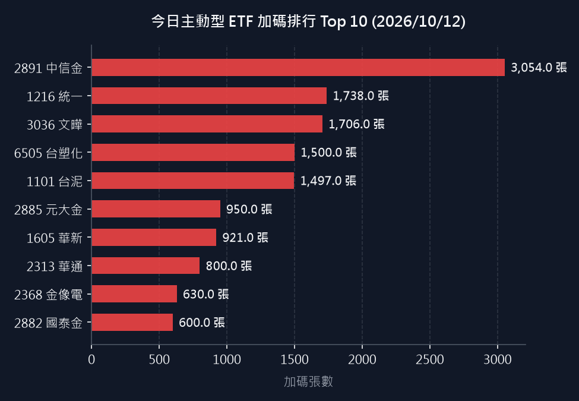
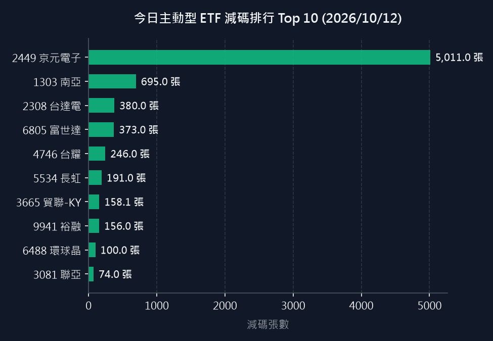

# 主動型 ETF 持股變動

資料來源：`主動型ETF持股明細.xlsx` 最近兩個日期分頁。

比較區間：`20261008` → `20261012`

## 今日加減碼視覺化排行

| 今日加碼 Top 10 | 今日減碼 Top 10 |
| :---: | :---: |
|  |  |

| ETF | 新增 | 刪除 | 比例變動 |
| :-- | --: | --: | --: |
| 00400A | 2 | 0 | 40 |
| 00401A | 0 | 0 | 50 |
| 00402A | 0 | 0 | 44 |
| 00403A | 1 | 0 | 30 |
| 00404A | 0 | 0 | 46 |
| 00405A | 0 | 0 | 29 |
| 00406A | 2 | 1 | 58 |
| 00407A | 0 | 0 | 38 |
| 00408A | 1 | 1 | 38 |
| 00980A | 0 | 0 | 44 |
| 00980D | 0 | 0 | 29 |
| 00981A | 0 | 0 | 25 |
| 00982A | 0 | 0 | 42 |
| 00983A | 0 | 0 | 39 |
| 00983D | 0 | 0 | 19 |
| 00984A | 0 | 0 | 64 |
| 00985A | 1 | 1 | 48 |
| 00986A | 0 | 0 | 35 |
| 00987A | 0 | 0 | 26 |
| 00988A | 0 | 3 | 33 |
| 00989A | 0 | 0 | 54 |
| 00990A | 2 | 0 | 44 |
| 00991A | 0 | 0 | 20 |
| 00992A | 1 | 0 | 37 |
| 00993A | 0 | 0 | 40 |
| 00994A | 1 | 1 | 34 |
| 00995A | 1 | 2 | 39 |
| 00996A | 0 | 0 | 45 |
| 00997A | 0 | 0 | 45 |
| 00998A | 2 | 0 | 54 |
| 00999A | 0 | 0 | 48 |

## 00400A

### 新增持股

- 2327 國巨*（0.96%，469 張）
- 2891 中信金（0.69%，3054 張）

### 刪除持股

- 無

### 投資比例變動

- 1303 南亞：4.23% → 4.07%（-0.16）
- 2059 川湖：2.71% → 2.66%（-0.05）
- 2303 聯電：1.01% → 0.98%（-0.03）
- 2308 台達電：4.30% → 4.10%（-0.20）
- 2317 鴻海：0.78% → 0.76%（-0.02）
- 2330 台積電：8.63% → 8.47%（-0.16）
- 2345 智邦：0.50% → 0.51%（+0.01）
- 2368 金像電：1.59% → 1.51%（-0.08）
- 2383 台光電：5.54% → 5.59%（+0.05）
- 2449 京元電子：1.00% → 0.97%（-0.03）
- 2454 聯發科：6.34% → 6.16%（-0.18）
- 2603 長榮：0.89% → 0.96%（+0.07）
- 2881 富邦金：1.55% → 1.59%（+0.04）
- 3008 大立光：0.85% → 1.20%（+0.35）
- 3017 奇鋐：4.25% → 4.12%（-0.13）
- 3036 文曄：1.56% → 1.54%（-0.02）
- 3037 欣興：5.03% → 4.89%（-0.14）
- 3044 健鼎：1.97% → 1.93%（-0.04）
- 3081 聯亞：0.79% → 0.80%（+0.01）
- 3090 日電貿：0.34% → 0.33%（-0.01）
- 3231 緯創：0.51% → 0.50%（-0.01）
- 3374 精材：0.55% → 0.53%（-0.02）
- 3443 創意：3.75% → 2.53%（-1.22）
- 3529 力旺：1.26% → 1.21%（-0.05）
- 3653 健策：4.13% → 4.06%（-0.07）
- 3661 世芯-KY：2.62% → 2.61%（-0.01）
- 3665 貿聯-KY：1.76% → 1.73%（-0.03）
- 3711 日月光投控：1.13% → 1.14%（+0.01）
- 5274 信驊：1.63% → 1.62%（-0.01）
- 5434 崇越：0.39% → 0.38%（-0.01）
- 6187 萬潤：2.98% → 3.22%（+0.24）
- 6223 旺矽：3.30% → 3.58%（+0.28）
- 6278 台表科：0.54% → 0.71%（+0.17）
- 6488 環球晶：3.27% → 3.18%（-0.09）
- 6505 台塑化：2.22% → 2.15%（-0.07）
- 7750 新代：0.79% → 0.75%（-0.04）
- 7769 鴻勁：0.14% → 0.15%（+0.01）
- 9939 宏全：0.08% → 0.07%（-0.01）
- 台指選擇權 2026/10：0.08% → 0.07%（-0.01）
- ＸＡＧＸ金兌(3533.HK)：0.48% → 0.47%（-0.01）

## 00401A

### 新增持股

- 無

### 刪除持股

- 無

### 投資比例變動

- 1303 南亞：1.20% → 1.17%（-0.03）
- 2059 川湖：0.83% → 0.82%（-0.01）
- 2303 聯電：2.37% → 2.32%（-0.05）
- 2308 台達電：2.61% → 2.51%（-0.10）
- 2313 華通：1.46% → 1.47%（+0.01）
- 2317 鴻海：0.54% → 0.53%（-0.01）
- 2330 台積電：20.38% → 20.17%（-0.21）
- 2345 智邦：0.35% → 0.36%（+0.01）
- 2357 華碩：1.80% → 1.75%（-0.05）
- 2360 致茂：1.43% → 1.44%（+0.01）
- 2379 瑞昱：1.01% → 1.00%（-0.01）
- 2382 廣達：2.01% → 1.98%（-0.03）
- 2383 台光電：1.20% → 1.22%（+0.02）
- 2412 中華電：0.79% → 0.78%（-0.01）
- 2454 聯發科：6.30% → 6.18%（-0.12）
- 2455 全新：2.27% → 2.28%（+0.01）
- 2603 長榮：0.96% → 1.04%（+0.08）
- 2881 富邦金：1.93% → 1.99%（+0.06）
- 2882 國泰金：0.98% → 1.00%（+0.02）
- 2883 凱基金：1.56% → 1.60%（+0.04）
- 2884 玉山金：1.84% → 1.86%（+0.02）
- 2886 兆豐金：1.26% → 1.27%（+0.01）
- 2887 台新新光金：1.01% → 1.05%（+0.04）
- 2890 永豐金：0.28% → 0.29%（+0.01）
- 2891 中信金：1.43% → 1.48%（+0.05）
- 3008 大立光：2.32% → 2.53%（+0.21）
- 3037 欣興：2.50% → 2.45%（-0.05）
- 3131 弘塑：0.70% → 0.72%（+0.02）
- 3491 昇達科：1.86% → 1.68%（-0.18）
- 3711 日月光投控：2.67% → 2.71%（+0.04）
- 4904 遠傳：0.72% → 0.71%（-0.01）
- 4938 和碩：0.28% → 0.31%（+0.03）
- 4958 臻鼎-KY：1.48% → 1.44%（-0.04）
- 4991 環宇-KY：0.71% → 0.70%（-0.01）
- 5274 信驊：1.84% → 1.85%（+0.01）
- 5347 世界：1.38% → 1.33%（-0.05）
- 5871 中租-KY：0.13% → 0.12%（-0.01）
- 5904 寶雅*：0.50% → 0.52%（+0.02）
- 6147 頎邦：1.39% → 1.40%（+0.01）
- 6187 萬潤：0.77% → 0.84%（+0.07）
- 6223 旺矽：1.65% → 1.80%（+0.15）
- 6285 啟碁：1.39% → 1.42%（+0.03）
- 6515 穎崴：1.07% → 1.14%（+0.07）
- 6531 愛普*：1.67% → 1.60%（-0.07）
- 6669 緯穎：1.91% → 1.93%（+0.02）
- 7769 鴻勁：1.10% → 1.20%（+0.10）
- 7828 創新服務：1.68% → 1.66%（-0.02）
- 7856 漢測：0.86% → 0.77%（-0.09）
- 8464 億豐：0.95% → 0.96%（+0.01）
- 臺指選擇權10/26 46400 買權：-1.29% → -1.26%（+0.03）

## 00402A

### 新增持股

- 無

### 刪除持股

- 無

### 投資比例變動

- AAPL.US Apple：7.29% → 7.63%（+0.34）
- ADI.US Analog Devices：1.87% → 1.92%（+0.05）
- AMD.US AMD：6.39% → 6.35%（-0.04）
- AMZN.US Amazon：4.20% → 4.25%（+0.05）
- ANET.US Arista Networks：0.87% → 0.88%（+0.01）
- ARM.US Arm：0.97% → 0.94%（-0.03）
- ASML.US ASML Holding：1.19% → 1.21%（+0.02）
- AVGO.US Broadcom：2.26% → 2.23%（-0.03）
- AXON.US Axon Enterprise：0.54% → 0.57%（+0.03）
- BABA.US Alibaba Group：0.45% → 0.46%（+0.01）
- BKNG.US Booking Holdings：0.48% → 0.51%（+0.03）
- CDNS.US Cadence Design Systems：1.53% → 1.55%（+0.02）
- CIEN.US Ciena：1.35% → 1.33%（-0.02）
- CLS.US Celestica：1.25% → 1.24%（-0.01）
- COHR.US Coherent：1.51% → 1.41%（-0.10）
- CRWD.US CrowdStrike Holdings：1.63% → 1.67%（+0.04）
- DASH.US DoorDash：0.45% → 0.47%（+0.02）
- FSLY.US Fastly：0.35% → 0.36%（+0.01）
- GOOG.US Alphabet - Class C Capital Stock：3.26% → 3.35%（+0.09）
- GOOGL.US Alphabet - Class A Common Stock：3.27% → 3.37%（+0.10）
- INTC.US Intel：1.63% → 1.60%（-0.03）
- IOT.US Samsara：0.50% → 0.53%（+0.03）
- KLAC.US KLA：1.65% → 1.71%（+0.06）
- LITE.US Lumentum：2.08% → 2.03%（-0.05）
- LRCX.US Lam Research：2.77% → 2.79%（+0.02）
- MDB.US MongoDB：0.36% → 0.38%（+0.02）
- META.US Meta：3.61% → 3.73%（+0.12）
- MSFT.US Microsoft：5.07% → 5.17%（+0.10）
- MU.US Micron：6.28% → 6.18%（-0.10）
- NFLX.US Netflix：0.92% → 0.98%（+0.06）
- NOW.US ServiceNow：0.83% → 0.87%（+0.04）
- NVDA.US NVIDIA：8.82% → 8.85%（+0.03）
- PANW.US Palo Alto：2.81% → 2.85%（+0.04）
- PLTR.US Palantir Technologies：1.90% → 2.01%（+0.11）
- SHOP.US Shopify：0.97% → 0.99%（+0.02）
- SIMO.US Silicon Motion：0.60% → 0.57%（-0.03）
- SKHY.US SK hynix：1.25% → 1.24%（-0.01）
- SNOW.US Snowflake：1.04% → 1.11%（+0.07）
- SPOT.US Spotify：0.34% → 0.36%（+0.02）
- TTWO.US Take-Two：0.55% → 0.58%（+0.03）
- TXN.US Texas Instruments：2.32% → 2.39%（+0.07）
- UBER.US Uber：0.29% → 0.31%（+0.02）
- V.US Visa：1.06% → 1.11%（+0.05）
- WDC.US Western Digital：1.96% → 1.97%（+0.01）

## 00403A

### 新增持股

- 2313 華通（0.14%，800 張）

### 刪除持股

- 無

### 投資比例變動

- 1303 南亞：2.48% → 2.43%（-0.05）
- 2303 聯電：2.06% → 2.03%（-0.03）
- 2308 台達電：3.97% → 3.84%（-0.13）
- 2317 鴻海：0.56% → 0.55%（-0.01）
- 2327 國巨*：3.89% → 3.91%（+0.02）
- 2330 台積電：13.68% → 13.65%（-0.03）
- 2345 智邦：2.31% → 2.38%（+0.07）
- 2368 金像電：0.43% → 0.41%（-0.02）
- 2383 台光電：5.85% → 6.01%（+0.16）
- 2408 南亞科：1.04% → 1.03%（-0.01）
- 2449 京元電子：0.85% → 0.84%（-0.01）
- 2454 聯發科：6.37% → 6.29%（-0.08）
- 2882 國泰金：0.31% → 0.32%（+0.01）
- 3008 大立光：0.93% → 1.24%（+0.31）
- 3017 奇鋐：5.03% → 4.96%（-0.07）
- 3037 欣興：6.90% → 6.83%（-0.07）
- 3189 景碩：3.33% → 3.29%（-0.04）
- 3211 順達：0.54% → 0.53%（-0.01）
- 3443 創意：3.73% → 3.62%（-0.11）
- 3450 聯鈞：0.55% → 0.54%（-0.01）
- 3583 辛耘：0.41% → 0.42%（+0.01）
- 5274 信驊：1.43% → 1.45%（+0.02）
- 6223 旺矽：3.61% → 3.98%（+0.37）
- 6274 台燿：2.55% → 2.54%（-0.01）
- 6442 光聖：0.44% → 0.42%（-0.02）
- 6488 環球晶：0.63% → 0.54%（-0.09）
- 6669 緯穎：2.65% → 2.70%（+0.05）
- 6805 富世達：0.58% → 0.27%（-0.31）
- 8046 南電：3.09% → 3.02%（-0.07）
- 8996 高力：2.14% → 2.16%（+0.02）

## 00404A

### 新增持股

- 無

### 刪除持股

- 無

### 投資比例變動

- 1303 南亞：0.79% → 0.77%（-0.02）
- 2301 光寶科：0.58% → 0.56%（-0.02）
- 2303 聯電：2.79% → 2.74%（-0.05）
- 2308 台達電：1.88% → 1.82%（-0.06）
- 2317 鴻海：0.64% → 0.63%（-0.01）
- 2330 台積電：22.68% → 22.51%（-0.17）
- 2345 智邦：0.89% → 0.92%（+0.03）
- 2347 聯強：1.84% → 1.88%（+0.04）
- 2351 順德：0.38% → 0.37%（-0.01）
- 2357 華碩：1.19% → 1.17%（-0.02）
- 2360 致茂：0.50% → 0.51%（+0.01）
- 2379 瑞昱：1.06% → 1.05%（-0.01）
- 2382 廣達：0.94% → 0.93%（-0.01）
- 2383 台光電：3.17% → 3.23%（+0.06）
- 2395 研華：1.29% → 1.27%（-0.02）
- 2454 聯發科：6.92% → 6.79%（-0.13）
- 2637 慧洋-KY：1.07% → 1.10%（+0.03）
- 2882 國泰金：2.64% → 2.70%（+0.06）
- 2885 元大金：2.31% → 2.37%（+0.06）
- 2887 台新新光金：1.39% → 1.45%（+0.06）
- 2890 永豐金：1.37% → 1.40%（+0.03）
- 3017 奇鋐：1.32% → 1.29%（-0.03）
- 3034 聯詠：1.95% → 1.93%（-0.02）
- 3264 欣銓：0.64% → 0.68%（+0.04）
- 3293 鈊象：1.13% → 1.14%（+0.01）
- 3443 創意：1.00% → 0.97%（-0.03）
- 3653 健策：0.52% → 0.51%（-0.01）
- 3711 日月光投控：3.46% → 3.53%（+0.07）
- 5274 信驊：2.70% → 2.72%（+0.02）
- 5434 崇越：1.74% → 1.73%（-0.01）
- 5876 上海商銀：1.40% → 1.41%（+0.01）
- 5904 寶雅*：0.46% → 0.48%（+0.02）
- 6196 帆宣：1.84% → 1.79%（-0.05）
- 6206 飛捷：0.71% → 0.72%（+0.01）
- 6223 旺矽：1.14% → 1.24%（+0.10）
- 6257 矽格：1.87% → 1.89%（+0.02）
- 6491 晶碩：0.83% → 0.84%（+0.01）
- 6505 台塑化：0.50% → 0.48%（-0.02）
- 6669 緯穎：1.02% → 1.03%（+0.01）
- 6691 洋基工程：1.74% → 1.64%（-0.10）
- 7769 鴻勁：1.14% → 1.24%（+0.10）
- 8016 矽創：1.19% → 1.18%（-0.01）
- 台指選擇權10/26 49100 買權：-0.24% → -0.21%（+0.03）
- 台指選擇權11/26 50300 買權：-0.02% → -0.01%（+0.01）
- 台指選擇權11/26 52300 買權：-0.12% → -0.11%（+0.01）
- 台股期貨10/26(FITXN*1.TF)：20.83% → 20.75%（-0.08）

## 00405A

### 新增持股

- 無

### 刪除持股

- 無

### 投資比例變動

- 1303 南亞：0.88% → 0.01%（-0.87）
- 2059 川湖：2.14% → 2.13%（-0.01）
- 2308 台達電：0.75% → 0.72%（-0.03）
- 2330 台積電：1.84% → 1.83%（-0.01）
- 2345 智邦：4.42% → 5.23%（+0.81）
- 2368 金像電：5.85% → 5.61%（-0.24）
- 2383 台光電：5.14% → 5.25%（+0.11）
- 2454 聯發科：5.57% → 5.48%（-0.09）
- 3017 奇鋐：3.86% → 3.79%（-0.07）
- 3037 欣興：7.85% → 7.74%（-0.11）
- 3189 景碩：0.22% → 0.21%（-0.01）
- 3443 創意：5.84% → 5.65%（-0.19）
- 3653 健策：7.53% → 7.50%（-0.03）
- 3665 貿聯-KY：6.34% → 6.31%（-0.03）
- 5274 信驊：5.60% → 5.65%（+0.05）
- 5347 世界：0.16% → 0.15%（-0.01）
- 6187 萬潤：0.91% → 1.00%（+0.09）
- 6223 旺矽：7.28% → 7.98%（+0.70）
- 6274 台燿：2.15% → 2.14%（-0.01）
- 6285 啟碁：0.10% → 0.11%（+0.01）
- 6515 穎崴：0.52% → 0.56%（+0.04）
- 6526 達發：0.47% → 0.46%（-0.01）
- 6531 愛普*：4.08% → 3.93%（-0.15）
- 6669 緯穎：0.90% → 0.91%（+0.01）
- 6805 富世達：3.27% → 3.12%（-0.15）
- 7769 鴻勁：2.87% → 3.14%（+0.27）
- 8046 南電：7.74% → 7.54%（-0.20）
- 8150 南茂：0.01% → 0.00%（-0.01）
- 8996 高力：1.38% → 1.39%（+0.01）

## 00406A

### 新增持股

- 3661 世芯-KY（0.42%，66 張）
- 臺指選擇權第三週週五到期契約（-2.62%，-1 張）

### 刪除持股

- 臺指選擇權第二週週五到期契約（-15.62%，-5.11 張）

### 投資比例變動

- 1303 南亞：0.68% → 0.64%（-0.04）
- 1326 台化：0.30% → 0.28%（-0.02）
- 1560 中砂：0.65% → 0.62%（-0.03）
- 2059 川湖：1.29% → 1.24%（-0.05）
- 2303 聯電：2.19% → 2.08%（-0.11）
- 2308 台達電：3.36% → 3.12%（-0.24）
- 2317 鴻海：0.53% → 0.50%（-0.03）
- 2327 國巨*：1.58% → 1.53%（-0.05）
- 2330 台積電：9.34% → 8.97%（-0.37）
- 2344 華邦電：0.32% → 0.30%（-0.02）
- 2345 智邦：3.24% → 3.21%（-0.03）
- 2360 致茂：1.21% → 1.30%（+0.09）
- 2368 金像電：0.61% → 0.77%（+0.16）
- 2383 台光電：6.18% → 6.41%（+0.23）
- 2449 京元電子：0.61% → 0.58%（-0.03）
- 2454 聯發科：5.94% → 5.98%（+0.04）
- 2481 強茂：0.28% → 0.27%（-0.01）
- 2486 一詮：0.30% → 0.29%（-0.01）
- 2885 元大金：0.90% → 0.88%（-0.02）
- 2886 兆豐金：0.19% → 0.18%（-0.01）
- 3008 大立光：0.41% → 0.43%（+0.02）
- 3037 欣興：5.88% → 5.98%（+0.10）
- 3081 聯亞：0.44% → 0.43%（-0.01）
- 3105 穩懋：0.19% → 0.18%（-0.01）
- 3167 大量：0.72% → 0.71%（-0.01）
- 3189 景碩：1.53% → 1.61%（+0.08）
- 3264 欣銓：0.23% → 0.24%（+0.01）
- 3363 上詮：0.39% → 0.34%（-0.05）
- 3443 創意：2.19% → 2.28%（+0.09）
- 3450 聯鈞：0.25% → 0.24%（-0.01）
- 3491 昇達科：0.85% → 0.74%（-0.11）
- 3529 力旺：0.33% → 0.31%（-0.02）
- 3653 健策：3.90% → 3.93%（+0.03）
- 3665 貿聯-KY：2.77% → 2.66%（-0.11）
- 3711 日月光投控：2.48% → 2.45%（-0.03）
- 4958 臻鼎-KY：0.52% → 0.49%（-0.03）
- 5274 信驊：2.58% → 2.51%（-0.07）
- 6139 亞翔：0.09% → 0.08%（-0.01）
- 6147 頎邦：0.73% → 0.71%（-0.02）
- 6187 萬潤：0.37% → 0.39%（+0.02）
- 6213 聯茂：0.61% → 0.60%（-0.01）
- 6223 旺矽：3.40% → 3.60%（+0.20）
- 6274 台燿：1.82% → 1.75%（-0.07）
- 6285 啟碁：0.13% → 0.12%（-0.01）
- 6488 環球晶：0.64% → 0.61%（-0.03）
- 6510 精測：1.24% → 1.23%（-0.01）
- 6515 穎崴：0.46% → 0.48%（+0.02）
- 6531 愛普*：0.25% → 0.23%（-0.02）
- 6669 緯穎：2.43% → 2.37%（-0.06）
- 6715 嘉基：0.22% → 0.46%（+0.24）
- 6805 富世達：0.08% → 0.07%（-0.01）
- 7769 鴻勁：0.37% → 0.39%（+0.02）
- 8046 南電：2.43% → 2.75%（+0.32）
- 8150 南茂：0.09% → 0.08%（-0.01）
- 8358 金居：0.19% → 0.18%（-0.01）
- 8996 高力：0.40% → 0.38%（-0.02）
- 臺指選擇權第二週週三到期契約：-4.82% → -16.81%（-11.99）
- 臺股期貨 202610(FITXN*1.TF)：23.73% → 23.12%（-0.61）

## 00407A

### 新增持股

- 無

### 刪除持股

- 無

### 投資比例變動

- 1303 南亞：0.93% → 0.91%（-0.02）
- 1560 中砂：1.06% → 1.05%（-0.01）
- 2059 川湖：2.30% → 2.29%（-0.01）
- 2301 光寶科：1.50% → 1.45%（-0.05）
- 2303 聯電：0.56% → 0.55%（-0.01）
- 2308 台達電：2.75% → 2.66%（-0.09）
- 2327 國巨*：2.46% → 2.47%（+0.01）
- 2330 台積電：9.17% → 9.13%（-0.04）
- 2345 智邦：2.15% → 2.21%（+0.06）
- 2360 致茂：1.06% → 1.08%（+0.02）
- 2368 金像電：0.63% → 0.60%（-0.03）
- 2383 台光電：5.85% → 6.00%（+0.15）
- 2408 南亞科：0.98% → 0.97%（-0.01）
- 2454 聯發科：5.47% → 5.39%（-0.08）
- 2615 萬海：0.65% → 0.71%（+0.06）
- 3008 大立光：1.50% → 1.65%（+0.15）
- 3017 奇鋐：5.59% → 5.50%（-0.09）
- 3034 聯詠：0.70% → 0.69%（-0.01）
- 3037 欣興：6.04% → 5.96%（-0.08）
- 3081 聯亞：1.45% → 1.48%（+0.03）
- 3131 弘塑：0.85% → 0.88%（+0.03）
- 3293 鈊象：0.58% → 0.59%（+0.01）
- 3443 創意：5.18% → 5.02%（-0.16）
- 3491 昇達科：0.99% → 0.89%（-0.10）
- 3529 力旺：0.23% → 0.22%（-0.01）
- 3711 日月光投控：3.07% → 3.14%（+0.07）
- 4958 臻鼎-KY：1.07% → 1.05%（-0.02）
- 5274 信驊：1.28% → 1.30%（+0.02）
- 6187 萬潤：1.69% → 1.85%（+0.16）
- 6223 旺矽：2.75% → 3.03%（+0.28）
- 6274 台燿：4.07% → 4.05%（-0.02）
- 6446 藥華藥：0.31% → 0.30%（-0.01）
- 6510 精測：1.37% → 1.41%（+0.04）
- 6531 愛普*：0.33% → 0.32%（-0.01）
- 6669 緯穎：3.76% → 3.82%（+0.06）
- 6805 富世達：1.15% → 1.10%（-0.05）
- 8046 南電：3.09% → 3.01%（-0.08）
- 8996 高力：2.40% → 2.41%（+0.01）

## 00408A

### 新增持股

- 6510 精測（0.45%，2 張）

### 刪除持股

- 3443 創意（0.54%，1 張）

### 投資比例變動

- 1303 南亞：3.44% → 3.37%（-0.07）
- 2303 聯電：1.75% → 1.73%（-0.02）
- 2308 台達電：3.69% → 3.57%（-0.12）
- 2330 台積電：5.62% → 5.64%（+0.02）
- 2344 華邦電：0.46% → 0.45%（-0.01）
- 2345 智邦：0.81% → 0.83%（+0.02）
- 2357 華碩：1.94% → 1.91%（-0.03）
- 2360 致茂：1.21% → 1.23%（+0.02）
- 2368 金像電：4.67% → 4.50%（-0.17）
- 2376 技嘉：1.30% → 1.27%（-0.03）
- 2383 台光電：5.26% → 5.40%（+0.14）
- 2395 研華：1.61% → 1.60%（-0.01）
- 2408 南亞科：1.80% → 1.78%（-0.02）
- 2449 京元電子：1.03% → 1.02%（-0.01）
- 2454 聯發科：4.11% → 3.61%（-0.50）
- 2542 興富發：3.42% → 3.52%（+0.10）
- 3008 大立光：0.87% → 0.95%（+0.08）
- 3017 奇鋐：3.11% → 3.06%（-0.05）
- 3026 禾伸堂：0.34% → 0.33%（-0.01）
- 3037 欣興：3.96% → 3.92%（-0.04）
- 3081 聯亞：1.83% → 1.87%（+0.04）
- 3189 景碩：2.86% → 2.83%（-0.03）
- 3264 欣銓：0.71% → 0.76%（+0.05）
- 3491 昇達科：1.09% → 0.20%（-0.89）
- 3665 貿聯-KY：1.23% → 1.21%（-0.02）
- 3711 日月光投控：1.55% → 1.59%（+0.04）
- 5434 崇越：2.25% → 2.24%（-0.01）
- 6187 萬潤：0.69% → 1.20%（+0.51）
- 6223 旺矽：2.10% → 2.31%（+0.21）
- 6239 力成：1.34% → 1.33%（-0.01）
- 6488 環球晶：1.03% → 1.02%（-0.01）
- 6669 緯穎：3.89% → 3.96%（+0.07）
- 6691 洋基工程：0.36% → 0.34%（-0.02）
- 6805 富世達：1.39% → 1.33%（-0.06）
- 7769 鴻勁：0.58% → 0.63%（+0.05）
- 8046 南電：2.01% → 1.59%（-0.42）
- 8996 高力：2.00% → 2.01%（+0.01）
- 9802 鈺齊-KY：0.82% → 0.83%（+0.01）

## 00980A

### 新增持股

- 無

### 刪除持股

- 無

### 投資比例變動

- 1303 南亞：3.71% → 3.61%（-0.10）
- 2059 川湖：4.15% → 4.12%（-0.03）
- 2303 聯電：1.08% → 1.06%（-0.02）
- 2308 台達電：3.93% → 3.79%（-0.14）
- 2317 鴻海：1.99% → 1.95%（-0.04）
- 2330 台積電：9.50% → 9.43%（-0.07）
- 2344 華邦電：2.01% → 1.97%（-0.04）
- 2345 智邦：1.45% → 1.49%（+0.04）
- 2360 致茂：1.71% → 1.73%（+0.02）
- 2368 金像電：2.14% → 2.05%（-0.09）
- 2376 技嘉：0.87% → 0.85%（-0.02）
- 2382 廣達：1.16% → 1.14%（-0.02）
- 2383 台光電：4.93% → 5.03%（+0.10）
- 2408 南亞科：2.89% → 2.85%（-0.04）
- 2454 聯發科：5.78% → 5.68%（-0.10）
- 2884 玉山金：0.66% → 0.67%（+0.01）
- 2891 中信金：0.93% → 0.96%（+0.03）
- 3008 大立光：1.25% → 1.37%（+0.12）
- 3017 奇鋐：2.28% → 2.24%（-0.04）
- 3026 禾伸堂：1.24% → 1.18%（-0.06）
- 3037 欣興：3.93% → 3.87%（-0.06）
- 3081 聯亞：2.37% → 2.41%（+0.04）
- 3189 景碩：1.42% → 1.39%（-0.03）
- 3231 緯創：0.88% → 0.89%（+0.01）
- 3264 欣銓：0.82% → 0.87%（+0.05）
- 3443 創意：2.44% → 2.36%（-0.08）
- 3529 力旺：0.63% → 0.62%（-0.01）
- 3653 健策：3.69% → 3.67%（-0.02）
- 3711 日月光投控：2.29% → 2.33%（+0.04）
- 5274 信驊：1.76% → 1.77%（+0.01）
- 5904 寶雅*：0.78% → 0.80%（+0.02）
- 6223 旺矽：2.04% → 2.24%（+0.20）
- 6274 台燿：1.23% → 1.22%（-0.01）
- 6442 光聖：0.34% → 0.32%（-0.02）
- 6515 穎崴：1.69% → 1.81%（+0.12）
- 6669 緯穎：1.72% → 1.74%（+0.02）
- 6805 富世達：0.63% → 0.60%（-0.03）
- 6831 邁科：0.43% → 0.44%（+0.01）
- 7751 竑騰：0.73% → 0.74%（+0.01）
- 7769 鴻勁：3.02% → 3.30%（+0.28）
- 8046 南電：1.83% → 1.78%（-0.05）
- 8210 勤誠：0.41% → 0.40%（-0.01）
- 8299 群聯：1.71% → 1.70%（-0.01）
- 台灣證交所加權股價指數(FITXN*1.TF)：3.03% → 3.02%（-0.01）

## 00980D

### 新增持股

- 無

### 刪除持股

- 無

### 投資比例變動

- ALLY FINANCIAL INC (REG) 8% 01NOV2031：0.52% → 0.53%（+0.01）
- AVIANCA MIDCO 2 PLC SER REGS 10.25 % 07-JAN-2032：0.28% → 0.27%（-0.01）
- CHC GROUP LLC SER REGS 11.750000 % 01-SEP-2030：0.43% → 0.44%（+0.01）
- CIMIC FINANCE USA PTY LT SER REGS (REG S) 7% 25MAR2034：0.32% → 0.33%（+0.01）
- COREWEAVE INC SER REGS (REG S) 9.25% 01JUN2030：0.43% → 0.42%（-0.01）
- COREWEAVE INC SER REGS (REG S) 9.75% 01OCT2031：0.50% → 0.49%（-0.01）
- COREWEAVE INC SER REGS (REG) (REG S) 9.625% 15JUL2032：0.49% → 0.48%（-0.01）
- COX COMMUNICATIONS INC SER REGS 5.950000 % 01SEP2054：0.51% → 0.52%（+0.01）
- ENERGY TRANSFER LP (REG) 7.5% 01JUL2038：0.32% → 0.33%（+0.01）
- HERTZ CORP/THE SER REGS (REG S) 12.625% 15JUL2029：0.31% → 0.32%（+0.01）
- HSBC HOLDINGS PLC VAR 03NOV2028：0.34% → 0.33%（-0.01）
- INTESA SANPAOLO SPA SER REGS (REG S) 7.8% 28NOV2053：0.35% → 0.36%（+0.01）
- JBS USA/FOOD/FINANCE (REG) 6.5% 01DEC2052：0.44% → 0.45%（+0.01）
- JETBLUE AIRWAYS/LOYALTY SER REGS (REG S) 9.875% 20SEP2031：0.43% → 0.42%（-0.01）
- LBM ACQUISITION LLC SER REGS 9.500000 % 15JUN2031：0.42% → 0.40%（-0.02）
- MACQUARIE BANK LTD SER REGS (REG S) 6.798% 18JAN2033：0.33% → 0.34%（+0.01）
- ONEOK INC 6.625% 01SEP2053：0.57% → 0.58%（+0.01）
- ORACLE CORP (REG) 5.500000 % 27SEP2064：0.41% → 0.40%（-0.01）
- ORACLE CORP 6.125000 % 03AUG2065：0.53% → 0.54%（+0.01）
- PROGRESS ENERGY INC (REG) 7.75% 01MAR2031：0.57% → 0.58%（+0.01）
- RR DONNELLEY & SONS CO SER REGS (REG S) 9.5% 01AUG2029：0.43% → 0.42%（-0.01）
- SBL HOLDINGS INC SER REGS 7.200000 % 30OCT2034：0.51% → 0.52%（+0.01）
- SYMETRA LIFE INSURANCE SER REGS 6.550000 % 01OCT2055：0.30% → 0.31%（+0.01）
- TELEFONICA EUROPE BV (REG) 8.25% 15SEP2030：0.42% → 0.41%（-0.01）
- US 10YR NOTE (CBT)DEC26 21-DEC-2026：17.77% → 17.78%（+0.01）
- US 2YR NOTE (CBT) DEC26 31-DEC-2026：1.67% → 1.66%（-0.01）
- US ACUTE CARE SOLUTIONS SER REGS (REG S) 9.75% 15MAY2029：0.34% → 0.33%（-0.01）
- US LONG BOND(CBT) DEC26 21-DEC-2026：5.18% → 5.22%（+0.04）
- VAR ENERGI ASA SER REGS (REG S) 7.5% 15JAN2028：0.34% → 0.33%（-0.01）

## 00981A

### 新增持股

- 無

### 刪除持股

- 無

### 投資比例變動

- 2303 聯電：4.03% → 3.97%（-0.06）
- 2308 台達電：4.99% → 4.82%（-0.17）
- 2330 台積電：10.35% → 10.30%（-0.05）
- 2345 智邦：4.45% → 4.58%（+0.13）
- 2368 金像電：1.65% → 1.58%（-0.07）
- 2383 台光電：9.58% → 9.81%（+0.23）
- 2449 京元電子：0.88% → 0.43%（-0.45）
- 2454 聯發科：8.19% → 8.07%（-0.12）
- 3017 奇鋐：7.16% → 7.04%（-0.12）
- 3037 欣興：8.16% → 8.06%（-0.10）
- 3443 創意：1.96% → 1.90%（-0.06）
- 3653 健策：6.16% → 6.14%（-0.02）
- 3665 貿聯-KY：2.46% → 2.33%（-0.13）
- 3711 日月光投控：2.13% → 2.18%（+0.05）
- 5274 信驊：0.95% → 0.96%（+0.01）
- 6187 萬潤：0.06% → 0.07%（+0.01）
- 6191 精成科：0.12% → 0.13%（+0.01）
- 6223 旺矽：4.78% → 5.26%（+0.48）
- 6271 同欣電：0.18% → 0.19%（+0.01）
- 6274 台燿：3.86% → 4.03%（+0.17）
- 6510 精測：0.29% → 0.49%（+0.20）
- 6515 穎崴：0.18% → 0.19%（+0.01）
- 6669 緯穎：3.32% → 3.37%（+0.05）
- 6805 富世達：0.56% → 0.39%（-0.17）
- 8046 南電：4.53% → 4.41%（-0.12）

## 00982A

### 新增持股

- 無

### 刪除持股

- 無

### 投資比例變動

- 2059 川湖：3.68% → 3.67%（-0.01）
- 2301 光寶科：1.85% → 1.79%（-0.06）
- 2303 聯電：1.46% → 1.44%（-0.02）
- 2330 台積電：7.62% → 7.60%（-0.02）
- 2360 致茂：3.81% → 3.87%（+0.06）
- 2376 技嘉：1.22% → 1.20%（-0.02）
- 2383 台光電：3.59% → 3.68%（+0.09）
- 2395 研華：1.36% → 1.35%（-0.01）
- 2454 聯發科：6.68% → 6.59%（-0.09）
- 2455 全新：1.65% → 1.67%（+0.02）
- 2467 志聖：1.07% → 1.14%（+0.07）
- 2478 大毅：1.13% → 1.09%（-0.04）
- 2486 一詮：0.74% → 0.73%（-0.01）
- 2885 元大金：0.29% → 0.30%（+0.01）
- 3008 大立光：3.24% → 3.56%（+0.32）
- 3017 奇鋐：2.48% → 2.44%（-0.04）
- 3090 日電貿：1.11% → 1.09%（-0.02）
- 3105 穩懋：6.42% → 6.41%（-0.01）
- 3231 緯創：1.33% → 1.34%（+0.01）
- 3265 台星科：1.54% → 1.70%（+0.16）
- 3491 昇達科：3.85% → 3.49%（-0.36）
- 3583 辛耘：1.13% → 1.16%（+0.03）
- 3617 碩天：0.29% → 0.31%（+0.02）
- 3711 日月光投控：1.26% → 1.29%（+0.03）
- 4958 臻鼎-KY：3.62% → 3.55%（-0.07）
- 5274 信驊：1.22% → 1.23%（+0.01）
- 5483 中美晶：1.43% → 1.41%（-0.02）
- 5536 聖暉*：0.91% → 0.82%（-0.09）
- 6139 亞翔：5.64% → 5.44%（-0.20）
- 6196 帆宣：0.40% → 0.39%（-0.01）
- 6213 聯茂：1.47% → 1.48%（+0.01）
- 6214 精誠：1.28% → 1.29%（+0.01）
- 6223 旺矽：3.25% → 3.57%（+0.32）
- 6239 力成：1.14% → 1.13%（-0.01）
- 6274 台燿：1.41% → 1.40%（-0.01）
- 6488 環球晶：2.37% → 2.34%（-0.03）
- 6531 愛普*：3.99% → 3.85%（-0.14）
- 6640 均華：0.29% → 0.32%（+0.03）
- 6669 緯穎：4.41% → 4.48%（+0.07）
- 6672 騰輝電子-KY：0.78% → 0.84%（+0.06）
- 8070 長華*：0.42% → 0.44%（+0.02）
- 8996 高力：1.26% → 1.27%（+0.01）

## 00983A

### 新增持股

- 無

### 刪除持股

- 無

### 投資比例變動

- ACHR.US Archer：0.33% → 0.34%（+0.01）
- AMD.US AMD：3.75% → 3.67%（-0.08）
- AMZN.US Amazon：2.78% → 2.76%（-0.02）
- AVGO.US Broadcom：1.57% → 1.53%（-0.04）
- BEAM.US Beam Therapeutics：1.55% → 1.57%（+0.02）
- BLSH.US Bullish：2.12% → 2.13%（+0.01）
- BMNR.US BitMine：2.32% → 2.31%（-0.01）
- CBRS.US Cerebras：1.00% → 0.98%（-0.02）
- COIN.US Coinbase：4.55% → 4.47%（-0.08）
- CRCL.US Circle：4.85% → 4.94%（+0.09）
- CRSP.US CRISPR Therapeutics：3.93% → 3.86%（-0.07）
- CRWV.US CoreWeave：1.34% → 1.26%（-0.08）
- DE.US Deere：0.51% → 0.52%（+0.01）
- FTNT.US Fortinet：0.30% → 0.31%（+0.01）
- GOOG.US Alphabet - Class C Capital Stock：1.59% → 1.60%（+0.01）
- GOOGL.US Alphabet - Class A Common Stock：0.55% → 0.56%（+0.01）
- HOOD.US Robinhood Markets：4.50% → 4.48%（-0.02）
- ILMN.US Illumina：1.68% → 1.69%（+0.01）
- LLY.US Eli Lilly：0.73% → 0.74%（+0.01）
- META.US Meta：1.84% → 1.87%（+0.03）
- NET.US Cloudflare：1.33% → 1.35%（+0.02）
- NTLA.US Intellia Therapeutics：0.58% → 0.64%（+0.06）
- NTRA.US Natera：1.57% → 1.58%（+0.01）
- NVDA.US NVIDIA：2.93% → 2.90%（-0.03）
- PACB.US Pacific Biosciences of Californi：0.16% → 0.14%（-0.02）
- PLTR.US Palantir Technologies：3.56% → 3.71%（+0.15）
- RKLB.US Rocket Lab：1.48% → 1.44%（-0.04）
- RXRX.US Recursion Pharmaceuticals：0.97% → 0.91%（-0.06）
- SHOP.US Shopify：4.73% → 4.77%（+0.04）
- SNOW.US Snowflake：0.55% → 0.57%（+0.02）
- SOFI.US SoFi Technologies：0.44% → 0.45%（+0.01）
- SPCX.US SpaceX：7.34% → 7.16%（-0.18）
- TEM.US Tempus：5.37% → 5.38%（+0.01）
- TER.US Teradyne：0.70% → 0.69%（-0.01）
- TSLA.US Tesla：9.08% → 9.18%（+0.10）
- TSM.US TSMC(ADR)：2.87% → 2.84%（-0.03）
- TWST.US Twist Bioscience：3.81% → 3.79%（-0.02）
- TXG.US 10x Genomics：3.31% → 3.42%（+0.11）
- XE.US X-Energy：0.74% → 0.72%（-0.02）

## 00983D

### 新增持股

- 無

### 刪除持股

- 無

### 投資比例變動

- AMCX 10 1/2 07/15/32：1.61% → 1.60%（-0.01）
- ATH 6 5/8 05/19/55：0.96% → 0.97%（+0.01）
- BHCCN 11 09/30/28：1.89% → 1.88%（-0.01）
- BRITEL 9 5/8 12/15/30：1.35% → 1.34%（-0.01）
- CRWV 9 02/01/31：1.25% → 1.22%（-0.03）
- DOW 6.9 05/15/53：0.73% → 0.74%（+0.01）
- ENBCN 6.7 11/15/53：1.09% → 1.10%（+0.01）
- GM 6 3/4 04/01/46：1.14% → 1.15%（+0.01）
- GT 8 7/8 07/15/32：0.90% → 0.89%（-0.01）
- GTN 10 1/2 07/15/29：0.59% → 0.58%（-0.01）
- IEP 10 11/15/29：1.52% → 1.51%（-0.01）
- LQDW.US iShares Investment Grade Corpora：7.15% → 7.16%（+0.01）
- NTRCN 7 1/8 05/23/36：0.53% → 0.54%（+0.01）
- ORCL 6.9 11/09/52：0.80% → 0.81%（+0.01）
- OXY 6.6 03/15/46：0.72% → 0.73%（+0.01）
- PCG 6 3/4 01/15/53：1.09% → 1.10%（+0.01）
- RAKUTN 11 1/4 02/15/27：1.82% → 1.81%（-0.01）
- TLTW.US iShares 20+ Year Treasury Bond B：7.62% → 7.67%（+0.05）
- TRGP 6 1/2 02/15/53：0.15% → 0.16%（+0.01）

## 00984A

### 新增持股

- 無

### 刪除持股

- 無

### 投資比例變動

- 1216 統一：0.31% → 0.30%（-0.01）
- 1303 南亞：3.00% → 2.89%（-0.11）
- 1326 台化：1.02% → 1.00%（-0.02）
- 1409 新纖：0.65% → 0.64%（-0.01）
- 1560 中砂：1.36% → 1.33%（-0.03）
- 1709 和益：0.81% → 0.76%（-0.05）
- 2059 川湖：2.18% → 2.14%（-0.04）
- 2301 光寶科：0.67% → 0.63%（-0.04）
- 2303 聯電：0.81% → 0.79%（-0.02）
- 2330 台積電：4.38% → 4.30%（-0.08）
- 2344 華邦電：0.73% → 0.70%（-0.03）
- 2351 順德：0.64% → 0.62%（-0.02）
- 2357 華碩：0.66% → 0.64%（-0.02）
- 2379 瑞昱：0.31% → 0.30%（-0.01）
- 2383 台光電：1.52% → 1.54%（+0.02）
- 2395 研華：2.56% → 2.50%（-0.06）
- 2404 漢唐：0.43% → 0.40%（-0.03）
- 2408 南亞科：2.29% → 2.24%（-0.05）
- 2409 友達：1.19% → 1.14%（-0.05）
- 2454 聯發科：0.87% → 0.85%（-0.02）
- 2464 盟立：1.23% → 1.24%（+0.01）
- 2603 長榮：1.65% → 1.78%（+0.13）
- 2615 萬海：0.90% → 0.96%（+0.06）
- 2634 漢翔：0.30% → 0.29%（-0.01）
- 2637 慧洋-KY：0.31% → 0.32%（+0.01）
- 2801 彰銀：0.31% → 0.30%（-0.01）
- 2851 中再保：0.66% → 0.65%（-0.01）
- 2880 華南金：1.48% → 1.52%（+0.04）
- 2881 富邦金：3.99% → 4.07%（+0.08）
- 2882 國泰金：3.06% → 3.09%（+0.03）
- 2883 凱基金：2.37% → 2.41%（+0.04）
- 2884 玉山金：2.12% → 2.13%（+0.01）
- 2885 元大金：3.11% → 3.15%（+0.04）
- 2887 台新新光金：3.24% → 3.34%（+0.10）
- 2890 永豐金：2.29% → 2.32%（+0.03）
- 2892 第一金：1.19% → 1.20%（+0.01）
- 3006 晶豪科：0.61% → 0.59%（-0.02）
- 3008 大立光：1.69% → 1.83%（+0.14）
- 3017 奇鋐：4.38% → 4.27%（-0.11）
- 3037 欣興：1.91% → 1.86%（-0.05）
- 3045 台灣大：1.63% → 1.58%（-0.05）
- 3189 景碩：1.64% → 1.59%（-0.05）
- 3231 緯創：0.64% → 0.63%（-0.01）
- 3264 欣銓：1.79% → 1.88%（+0.09）
- 3443 創意：1.22% → 1.17%（-0.05）
- 3450 聯鈞：0.73% → 0.72%（-0.01）
- 3605 宏致：0.64% → 0.69%（+0.05）
- 3653 健策：1.89% → 1.86%（-0.03）
- 3665 貿聯-KY：0.67% → 0.66%（-0.01）
- 3714 富采：0.59% → 0.55%（-0.04）
- 4958 臻鼎-KY：0.65% → 0.63%（-0.02）
- 5351 鈺創：0.67% → 0.65%（-0.02）
- 5434 崇越：0.33% → 0.32%（-0.01）
- 5904 寶雅*：0.92% → 0.94%（+0.02）
- 6187 萬潤：2.34% → 2.53%（+0.19）
- 6213 聯茂：1.65% → 1.63%（-0.02）
- 6223 旺矽：0.11% → 0.12%（+0.01）
- 6446 藥華藥：1.49% → 1.45%（-0.04）
- 6505 台塑化：3.32% → 3.21%（-0.11）
- 6670 復盛應用：0.32% → 0.30%（-0.02）
- 6691 洋基工程：0.68% → 0.63%（-0.05）
- 7750 新代：0.64% → 0.61%（-0.03）
- 8039 台虹：0.65% → 0.62%（-0.03）
- 8046 南電：0.69% → 0.66%（-0.03）

## 00985A

### 新增持股

- 2609 陽明（1.35%，4270 張）

### 刪除持股

- 3324 雙鴻（0.01%，1 張）

### 投資比例變動

- 1101 台泥：1.43% → 1.52%（+0.09）
- 1216 統一：2.71% → 3.03%（+0.32）
- 1301 台塑：1.40% → 1.21%（-0.19）
- 1504 東元：0.89% → 0.77%（-0.12）
- 1605 華新：1.41% → 1.45%（+0.04）
- 2027 大成鋼：1.41% → 1.23%（-0.18）
- 2059 川湖：2.35% → 2.84%（+0.49）
- 2303 聯電：2.61% → 2.25%（-0.36）
- 2308 台達電：1.16% → 1.58%（+0.42）
- 2317 鴻海：1.29% → 1.48%（+0.19）
- 2327 國巨*：2.20% → 2.21%（+0.01）
- 2330 台積電：13.32% → 14.02%（+0.70）
- 2345 智邦：3.41% → 3.18%（-0.23）
- 2368 金像電：1.50% → 1.26%（-0.24）
- 2376 技嘉：2.42% → 2.08%（-0.34）
- 2383 台光電：2.73% → 2.90%（+0.17）
- 2395 研華：1.51% → 1.31%（-0.20）
- 2408 南亞科：1.31% → 1.14%（-0.17）
- 2412 中華電：1.57% → 1.37%（-0.20）
- 2454 聯發科：1.33% → 1.15%（-0.18）
- 2603 長榮：1.30% → 1.25%（-0.05）
- 2610 華航：1.31% → 1.16%（-0.15）
- 2881 富邦金：0.78% → 0.71%（-0.07）
- 3008 大立光：1.36% → 1.13%（-0.23）
- 3017 奇鋐：2.46% → 2.12%（-0.34）
- 3036 文曄：2.00% → 3.59%（+1.59）
- 3037 欣興：2.42% → 2.09%（-0.33）
- 3081 聯亞：2.10% → 1.88%（-0.22）
- 3105 穩懋：1.50% → 1.31%（-0.19）
- 3189 景碩：1.15% → 0.99%（-0.16）
- 3491 昇達科：2.46% → 1.95%（-0.51）
- 3653 健策：3.42% → 3.52%（+0.10）
- 3661 世芯-KY：1.26% → 1.11%（-0.15）
- 3665 貿聯-KY：1.62% → 1.41%（-0.21）
- 3711 日月光投控：1.03% → 0.92%（-0.11）
- 4904 遠傳：3.02% → 2.63%（-0.39）
- 6187 萬潤：1.42% → 1.06%（-0.36）
- 6442 光聖：0.91% → 0.77%（-0.14）
- 6446 藥華藥：1.13% → 0.98%（-0.15）
- 6488 環球晶：1.07% → 0.92%（-0.15）
- 6526 達發：0.46% → 0.40%（-0.06）
- 6531 愛普*：1.87% → 1.58%（-0.29）
- 6669 緯穎：1.45% → 1.29%（-0.16）
- 7750 新代：1.09% → 0.92%（-0.17）
- 7769 鴻勁：2.46% → 4.28%（+1.82）
- 8046 南電：0.71% → 0.61%（-0.10）
- 8996 高力：0.19% → 0.17%（-0.02）
- 台積電期貨(FICDFN*1.TF)：2.77% → 2.40%（-0.37）

## 00986A

### 新增持股

- 無

### 刪除持股

- 無

### 投資比例變動

- 2330 台積電：7.89% → 7.92%（+0.03）
- 2454 聯發科：1.64% → 1.62%（-0.02）
- AAPL.US Apple：2.00% → 2.06%（+0.06）
- AMD.US AMD：4.88% → 4.79%（-0.09）
- AVGO.US Broadcom：3.65% → 3.57%（-0.08）
- BE.US Bloom Energy：0.47% → 0.45%（-0.02）
- COHR.US Coherent：2.35% → 2.17%（-0.18）
- CRWD.US CrowdStrike Holdings：4.29% → 4.35%（+0.06）
- DDOG.US Datadog：1.02% → 1.06%（+0.04）
- ETN.US Eaton：2.33% → 2.34%（+0.01）
- GEV.US GE Vernova：2.69% → 2.75%（+0.06）
- GOOGL.US Alphabet - Class A Common Stock：5.67% → 5.76%（+0.09）
- GS.US Goldman Sachs：0.96% → 0.97%（+0.01）
- JPM.US JPMorgan Chase：1.95% → 2.01%（+0.06）
- LITE.US Lumentum：4.67% → 4.51%（-0.16）
- LLY.US Eli Lilly：2.88% → 2.90%（+0.02）
- MA.US Mastercard：1.08% → 1.11%（+0.03）
- MSFT.US Microsoft：2.86% → 2.88%（+0.02）
- MU.US Micron：4.69% → 4.57%（-0.12）
- MUFG(8306.JP)：0.99% → 0.98%（-0.01）
- Murata Mfg.(6981.JP)：2.07% → 2.02%（-0.05）
- NET.US Cloudflare：2.22% → 2.26%（+0.04）
- NTRA.US Natera：0.35% → 0.36%（+0.01）
- NVDA.US NVIDIA：6.40% → 6.35%（-0.05）
- PLTR.US Palantir Technologies：0.42% → 0.44%（+0.02）
- SNDK.US Sandisk：1.00% → 0.98%（-0.02）
- SNOW.US Snowflake：1.97% → 2.08%（+0.11）
- Siemens Energy AG：1.91% → 1.93%（+0.02）
- TER.US Teradyne：0.89% → 0.88%（-0.01）
- TSEM.US Tower Semiconductor：1.14% → 1.07%（-0.07）
- 嘉能可公司：1.63% → 1.65%（+0.02）
- 尼比厄斯集團公眾有限公司：0.96% → 0.91%（-0.05）
- 施奈德電機公司：1.39% → 1.45%（+0.06）
- 艾司摩爾控股公司：1.17% → 1.21%（+0.04）
- 英飛凌科技股份有限公司：2.58% → 2.54%（-0.04）

## 00987A

### 新增持股

- 無

### 刪除持股

- 無

### 投資比例變動

- 2330 台積電：9.19% → 9.25%（+0.06）
- 2368 金像電：3.09% → 3.00%（-0.09）
- 2383 台光電：6.97% → 7.21%（+0.24）
- 2454 聯發科：6.01% → 5.99%（-0.02）
- 2455 全新：2.57% → 2.62%（+0.05）
- 3017 奇鋐：7.16% → 7.12%（-0.04）
- 3037 欣興：5.90% → 5.89%（-0.01）
- 3081 聯亞：3.53% → 3.65%（+0.12）
- 3363 上詮：2.48% → 2.26%（-0.22）
- 3443 創意：4.35% → 4.26%（-0.09）
- 3455 由田：2.08% → 2.16%（+0.08）
- 3491 昇達科：3.51% → 3.21%（-0.30）
- 3529 力旺：1.87% → 1.84%（-0.03）
- 3653 健策：5.17% → 5.21%（+0.04）
- 3665 貿聯-KY：4.16% → 4.19%（+0.03）
- 4958 臻鼎-KY：2.37% → 2.35%（-0.02）
- 4991 環宇-KY：2.50% → 2.52%（+0.02）
- 6223 旺矽：1.12% → 1.24%（+0.12）
- 6274 台燿：5.23% → 5.26%（+0.03）
- 6510 精測：3.32% → 3.46%（+0.14）
- 6515 穎崴：1.80% → 1.95%（+0.15）
- 6805 富世達：3.42% → 3.31%（-0.11）
- 7856 漢測：1.02% → 0.93%（-0.09）
- 8046 南電：2.72% → 2.68%（-0.04）
- 8358 金居：2.87% → 2.83%（-0.04）
- 8996 高力：2.40% → 2.43%（+0.03）

## 00988A

### 新增持股

- 無

### 刪除持股

- 3081 聯亞（0.44%，75 張）
- SK hynix(000660.KS)（1.13%，14.742 張）
- TER.US Teradyne（0.86%，35 張）

### 投資比例變動

- 1303 南亞：1.32% → 1.34%（+0.02）
- 2303 聯電：1.00% → 1.02%（+0.02）
- 2308 台達電：0.37% → 0.38%（+0.01）
- 2330 台積電：0.97% → 0.98%（+0.01）
- 2383 台光電：2.78% → 2.88%（+0.10）
- 3017 奇鋐：3.38% → 3.37%（-0.01）
- 3037 欣興：6.34% → 6.35%（+0.01）
- AMD.US AMD：2.61% → 2.59%（-0.02）
- BE.US Bloom Energy：7.27% → 7.03%（-0.24）
- CRWD.US CrowdStrike Holdings：2.06% → 2.11%（+0.05）
- Furukawa Electric(5801.JP)：1.33% → 1.31%（-0.02）
- HOOD.US Robinhood Markets：2.60% → 2.63%（+0.03）
- INFINEON TECHNOLOGIES AG：1.22% → 1.21%（-0.01）
- INTC.US Intel：2.69% → 2.63%（-0.06）
- IREN.US IREN：0.75% → 0.71%（-0.04）
- LENOVO GROUP LTD：1.60% → 1.52%（-0.08）
- LITE.US Lumentum：7.73% → 7.53%（-0.20）
- MRVL.US Marvell：2.54% → 2.53%（-0.01）
- MU.US Micron：2.59% → 2.54%（-0.05）
- Meiko Electronics(6787.JP)：0.80% → 1.31%（+0.51）
- Murata Mfg.(6981.JP)：4.40% → 4.33%（-0.07）
- NET.US Cloudflare：1.67% → 1.72%（+0.05）
- NOW.US ServiceNow：1.89% → 1.97%（+0.08）
- NVDA.US NVIDIA：3.53% → 4.10%（+0.57）
- OKTA.US Okta：2.59% → 2.70%（+0.11）
- PANW.US Palo Alto：3.62% → 3.67%（+0.05）
- PLTR.US Palantir Technologies：3.17% → 3.36%（+0.19）
- ROBOTECHNIK INTELLIGENT TE-A：1.58% → 1.56%（-0.02）
- SNOW.US Snowflake：1.98% → 2.11%（+0.13）
- SPCX.US SpaceX：5.48% → 5.42%（-0.06）
- Samsung Elec Mech(009150.KS)：4.98% → 4.96%（-0.02）
- TDK(6762.JP)：0.93% → 0.91%（-0.02）
- TWLO.US Twilio：1.95% → 2.03%（+0.08）

## 00989A

### 新增持股

- 無

### 刪除持股

- 無

### 投資比例變動

- ADBE.US Adobe：1.12% → 1.18%（+0.06）
- ALAB.US Astera Labs：0.85% → 0.79%（-0.06）
- AMD.US AMD：3.19% → 3.12%（-0.07）
- ASML.US ASML Holding：2.22% → 2.21%（-0.01）
- AVGO.US Broadcom：3.65% → 3.55%（-0.10）
- BE.US Bloom Energy：1.28% → 1.22%（-0.06）
- CBRS.US Cerebras：0.15% → 0.14%（-0.01）
- CIEN.US Ciena：1.11% → 1.08%（-0.03）
- CRDO.US Credo：0.98% → 0.96%（-0.02）
- CRM.US Salesforce：2.83% → 2.91%（+0.08）
- CRWD.US CrowdStrike Holdings：3.57% → 3.59%（+0.02）
- CRWV.US CoreWeave：0.74% → 0.70%（-0.04）
- DOCN.US DigitalOcean：1.42% → 1.40%（-0.02）
- ENTG.US Entegris：0.61% → 0.60%（-0.01）
- ESTC.US Elastic：0.73% → 0.76%（+0.03）
- GLW.US Corning：1.06% → 1.01%（-0.05）
- GOOG.US Alphabet - Class C Capital Stock：2.25% → 2.26%（+0.01）
- GWRE.US Guidewire Software：0.62% → 0.63%（+0.01）
- HOOD.US Robinhood Markets：1.78% → 1.76%（-0.02）
- HUBS.US HubSpot：1.64% → 1.75%（+0.11）
- INTC.US Intel：3.01% → 2.89%（-0.12）
- LITE.US Lumentum：1.92% → 1.84%（-0.08）
- LMND.US Lemonade：0.70% → 0.71%（+0.01）
- LRCX.US Lam Research：2.46% → 2.43%（-0.03）
- MDB.US MongoDB：0.68% → 0.71%（+0.03）
- META.US Meta：4.05% → 4.11%（+0.06）
- MPWR.US Monolithic Power Systems：1.02% → 1.00%（-0.02）
- MTSI.US MACOM Technology Solutions：0.88% → 0.86%（-0.02）
- MU.US Micron：1.20% → 1.16%（-0.04）
- NET.US Cloudflare：2.66% → 2.69%（+0.03）
- NOW.US ServiceNow：1.77% → 1.82%（+0.05）
- NVDA.US NVIDIA：4.59% → 4.52%（-0.07）
- OKTA.US Okta：0.65% → 0.82%（+0.17）
- PANW.US Palo Alto：3.49% → 3.48%（-0.01）
- PLTR.US Palantir Technologies：1.07% → 1.11%（+0.04）
- RIVN.US Rivian：1.16% → 1.18%（+0.02）
- SHOP.US Shopify：2.76% → 2.77%（+0.01）
- SMCI.US Super Micro Computer：0.52% → 0.50%（-0.02）
- SNDK.US Sandisk：0.90% → 0.87%（-0.03）
- SNOW.US Snowflake：2.75% → 2.88%（+0.13）
- SPCX.US SpaceX：0.90% → 0.87%（-0.03）
- SYM.US Symbotic：0.48% → 0.47%（-0.01）
- TEAM.US Atlassian：1.22% → 1.29%（+0.07）
- TSLA.US Tesla：2.82% → 2.84%（+0.02）
- TSM.US TSMC(ADR)：0.98% → 0.97%（-0.01）
- TTMI.US TTM Technologies：0.55% → 0.51%（-0.04）
- TTWO.US Take-Two：2.69% → 2.80%（+0.11）
- TWLO.US Twilio：2.22% → 2.28%（+0.06）
- TXG.US 10x Genomics：0.45% → 0.47%（+0.02）
- TXN.US Texas Instruments：1.43% → 1.45%（+0.02）
- U.US Unity Software：0.93% → 0.95%（+0.02）
- VEEV.US Veeva Systems：0.71% → 0.72%（+0.01）
- VICR.US Vicor Corporation：0.43% → 0.41%（-0.02）
- ZM.US Zoom：1.54% → 1.56%（+0.02）

## 00990A

### 新增持股

- 2368 金像電（0.54%，156 張）
- 3443 創意（0.51%，23 張）

### 刪除持股

- 無

### 投資比例變動

- 2308 台達電：3.28% → 3.33%（+0.05）
- 2330 台積電：2.73% → 2.77%（+0.04）
- 2345 智邦：1.01% → 1.07%（+0.06）
- 2383 台光電：2.08% → 2.15%（+0.07）
- 2449 京元電子：1.30% → 0.79%（-0.51）
- 2454 聯發科：2.08% → 2.07%（-0.01）
- 3017 奇鋐：1.46% → 1.45%（-0.01）
- 4958 臻鼎-KY：0.56% → 0.58%（+0.02）
- 8046 南電：1.34% → 1.37%（+0.03）
- AMD.US AMD：4.37% → 4.32%（-0.05）
- AXTI.US AXT：0.94% → 0.87%（-0.07）
- Advantest(6857.JP)：2.24% → 2.28%（+0.04）
- BE.US Bloom Energy：6.03% → 5.81%（-0.22）
- CLS.US Celestica：1.39% → 1.38%（-0.01）
- CRWD.US CrowdStrike Holdings：1.64% → 1.67%（+0.03）
- DDOG.US Datadog：1.49% → 1.55%（+0.06）
- HPE.US HP Enterprise：1.66% → 1.68%（+0.02）
- IBIDEN(4062.JP)：1.52% → 1.51%（-0.01）
- INTC.US Intel：1.09% → 1.06%（-0.03）
- LITE.US Lumentum：8.43% → 8.19%（-0.24）
- LRCX.US Lam Research：3.09% → 3.10%（+0.01）
- Lasertec Corporation(6920.JP)：1.52% → 1.56%（+0.04）
- META.US Meta：4.88% → 5.02%（+0.14）
- MRVL.US Marvell：2.46% → 2.44%（-0.02）
- MSFT.US Microsoft：2.14% → 2.17%（+0.03）
- MU.US Micron：2.45% → 2.40%（-0.05）
- MXL.US MaxLinear：0.72% → 0.64%（-0.08）
- Murata Mfg.(6981.JP)：1.91% → 1.87%（-0.04）
- NET.US Cloudflare：2.07% → 2.13%（+0.06）
- NVDA.US NVIDIA：4.60% → 4.59%（-0.01）
- OKTA.US Okta：1.04% → 1.08%（+0.04）
- PANW.US Palo Alto：1.62% → 1.63%（+0.01）
- PLTR.US Palantir Technologies：3.02% → 3.18%（+0.16）
- SHOP.US Shopify：2.34% → 2.39%（+0.05）
- SMTC.US Semtech：2.30% → 2.29%（-0.01）
- SNDK.US Sandisk：1.02% → 1.00%（-0.02）
- SNOW.US Snowflake：1.05% → 1.11%（+0.06）
- SPCX.US SpaceX：3.57% → 3.52%（-0.05）
- Samsung Elec Mech(009150.KS)：0.72% → 0.71%（-0.01）
- TTMI.US TTM Technologies：1.37% → 1.30%（-0.07）
- TWST.US Twist Bioscience：1.34% → 1.35%（+0.01）
- VSH.US Vishay：0.63% → 0.61%（-0.02）
- WOLF.US Wolfspeed：0.47% → 0.48%（+0.01）
- ZETA.US Zeta：0.52% → 0.53%（+0.01）

## 00991A

### 新增持股

- 無

### 刪除持股

- 無

### 投資比例變動

- 1303 南亞：3.38% → 3.32%（-0.06）
- 2059 川湖：6.40% → 6.41%（+0.01）
- 2308 台達電：1.64% → 0.49%（-1.15）
- 2327 國巨*：4.72% → 4.76%（+0.04）
- 2330 台積電：13.73% → 13.75%（+0.02）
- 2383 台光電：10.39% → 10.70%（+0.31）
- 2408 南亞科：7.98% → 7.95%（-0.03）
- 2454 聯發科：6.31% → 6.26%（-0.05）
- 3008 大立光：0.01% → 0.81%（+0.80）
- 3017 奇鋐：5.51% → 5.45%（-0.06）
- 3026 禾伸堂：2.92% → 2.82%（-0.10）
- 3037 欣興：8.60% → 8.54%（-0.06）
- 3081 聯亞：3.04% → 3.12%（+0.08）
- 3189 景碩：6.37% → 6.31%（-0.06）
- 3653 健策：2.66% → 2.68%（+0.02）
- 3711 日月光投控：1.62% → 1.67%（+0.05）
- 5274 信驊：2.48% → 2.52%（+0.04）
- 6505 台塑化：1.20% → 1.40%（+0.20）
- 6669 緯穎：3.30% → 3.37%（+0.07）
- 8046 南電：6.43% → 6.31%（-0.12）

## 00992A

### 新增持股

- 2368 金像電（0.96%，359 張）

### 刪除持股

- 無

### 投資比例變動

- 1303 南亞：2.51% → 2.39%（-0.12）
- 1815 富喬：3.43% → 3.29%（-0.14）
- 2059 川湖：4.02% → 4.03%（+0.01）
- 2301 光寶科：0.44% → 0.42%（-0.02）
- 2308 台達電：0.87% → 0.82%（-0.05）
- 2330 台積電：6.33% → 6.14%（-0.19）
- 2345 智邦：5.55% → 5.66%（+0.11）
- 2360 致茂：2.19% → 2.17%（-0.02）
- 2376 技嘉：0.41% → 0.40%（-0.01）
- 2383 台光電：6.21% → 6.32%（+0.11）
- 2404 漢唐：0.45% → 0.42%（-0.03）
- 2454 聯發科：1.87% → 1.79%（-0.08）
- 3008 大立光：4.34% → 4.65%（+0.31）
- 3017 奇鋐：6.67% → 6.55%（-0.12）
- 3026 禾伸堂：0.51% → 0.49%（-0.02）
- 3037 欣興：7.01% → 6.74%（-0.27）
- 3081 聯亞：0.41% → 0.42%（+0.01）
- 3189 景碩：2.02% → 1.97%（-0.05）
- 3231 緯創：3.04% → 2.97%（-0.07）
- 3443 創意：3.05% → 3.40%（+0.35）
- 3665 貿聯-KY：6.10% → 5.92%（-0.18）
- 3711 日月光投控：0.41% → 0.42%（+0.01）
- 4958 臻鼎-KY：1.32% → 1.26%（-0.06）
- 5274 信驊：0.43% → 0.42%（-0.01）
- 5289 宜鼎：0.28% → 0.41%（+0.13）
- 5347 世界：0.26% → 0.25%（-0.01）
- 6139 亞翔：0.43% → 0.42%（-0.01）
- 6187 萬潤：0.45% → 0.49%（+0.04）
- 6223 旺矽：4.27% → 4.57%（+0.30）
- 6274 台燿：0.44% → 0.50%（+0.06）
- 6515 穎崴：0.64% → 0.68%（+0.04）
- 6584 南俊國際：2.25% → 2.15%（-0.10）
- 6669 緯穎：2.14% → 2.17%（+0.03）
- 8021 尖點：3.32% → 3.21%（-0.11）
- 8046 南電：3.18% → 3.07%（-0.11）
- 8150 南茂：0.56% → 0.53%（-0.03）
- 8996 高力：6.20% → 6.07%（-0.13）

## 00993A

### 新增持股

- 無

### 刪除持股

- 無

### 投資比例變動

- 1303 南亞：2.53% → 2.47%（-0.06）
- 1560 中砂：1.70% → 1.67%（-0.03）
- 2059 川湖：1.13% → 1.12%（-0.01）
- 2301 光寶科：0.64% → 0.62%（-0.02）
- 2303 聯電：1.90% → 1.87%（-0.03）
- 2313 華通：0.44% → 0.45%（+0.01）
- 2330 台積電：8.38% → 8.35%（-0.03）
- 2344 華邦電：1.53% → 1.50%（-0.03）
- 2345 智邦：1.12% → 1.15%（+0.03）
- 2368 金像電：0.31% → 0.30%（-0.01）
- 2383 台光電：6.14% → 6.27%（+0.13）
- 2395 研華：1.45% → 1.43%（-0.02）
- 2404 漢唐：0.50% → 0.48%（-0.02）
- 2408 南亞科：2.96% → 2.93%（-0.03）
- 2454 聯發科：1.54% → 1.51%（-0.03）
- 2455 全新：0.83% → 0.84%（+0.01）
- 2467 志聖：0.51% → 0.55%（+0.04）
- 2606 裕民：0.38% → 0.39%（+0.01）
- 3008 大立光：1.61% → 1.76%（+0.15）
- 3017 奇鋐：5.84% → 5.73%（-0.11）
- 3037 欣興：6.35% → 6.26%（-0.09）
- 3042 晶技：0.60% → 0.58%（-0.02）
- 3081 聯亞：1.31% → 1.34%（+0.03）
- 3189 景碩：4.81% → 4.73%（-0.08）
- 3264 欣銓：0.53% → 0.56%（+0.03）
- 3443 創意：3.63% → 3.51%（-0.12）
- 3491 昇達科：1.01% → 0.91%（-0.10）
- 3711 日月光投控：1.78% → 1.82%（+0.04）
- 4958 臻鼎-KY：2.35% → 2.30%（-0.05）
- 5274 信驊：4.32% → 4.36%（+0.04）
- 5347 世界：0.31% → 0.30%（-0.01）
- 6187 萬潤：1.78% → 1.95%（+0.17）
- 6223 旺矽：4.09% → 4.48%（+0.39）
- 6257 矽格：1.06% → 1.07%（+0.01）
- 6274 台燿：4.10% → 4.07%（-0.03）
- 6505 台塑化：1.16% → 1.14%（-0.02）
- 6669 緯穎：4.22% → 4.27%（+0.05）
- 6805 富世達：1.17% → 1.11%（-0.06）
- 8021 尖點：0.98% → 0.97%（-0.01）
- 8046 南電：4.00% → 3.89%（-0.11）

## 00994A

### 新增持股

- 6510 精測（0.30%，4 張）

### 刪除持股

- 3491 昇達科（1.09%，30 張）

### 投資比例變動

- 1303 南亞：2.08% → 2.07%（-0.01）
- 2059 川湖：2.98% → 3.02%（+0.04）
- 2303 聯電：0.89% → 0.90%（+0.01）
- 2308 台達電：2.82% → 2.78%（-0.04）
- 2327 國巨*：1.17% → 1.19%（+0.02）
- 2330 台積電：14.06% → 14.23%（+0.17）
- 2345 智邦：1.39% → 1.45%（+0.06）
- 2360 致茂：1.26% → 1.30%（+0.04）
- 2368 金像電：1.19% → 1.17%（-0.02）
- 2383 台光電：6.61% → 6.90%（+0.29）
- 2454 聯發科：5.69% → 5.20%（-0.49）
- 3008 大立光：0.43% → 0.48%（+0.05）
- 3017 奇鋐：5.91% → 5.92%（+0.01）
- 3026 禾伸堂：0.32% → 0.31%（-0.01）
- 3037 欣興：6.31% → 6.35%（+0.04）
- 3081 聯亞：1.92% → 2.00%（+0.08）
- 3105 穩懋：0.50% → 0.51%（+0.01）
- 3189 景碩：2.44% → 2.45%（+0.01）
- 3264 欣銓：0.27% → 0.29%（+0.02）
- 3443 創意：3.98% → 2.86%（-1.12）
- 3653 健策：3.72% → 3.78%（+0.06）
- 3665 貿聯-KY：1.48% → 1.19%（-0.29）
- 3711 日月光投控：2.03% → 2.11%（+0.08）
- 5274 信驊：2.43% → 2.50%（+0.07）
- 6187 萬潤：0.53% → 0.92%（+0.39）
- 6223 旺矽：3.84% → 4.30%（+0.46）
- 6239 力成：1.16% → 1.17%（+0.01）
- 6274 台燿：5.19% → 5.27%（+0.08）
- 6669 緯穎：2.69% → 2.78%（+0.09）
- 6691 洋基工程：0.34% → 0.33%（-0.01）
- 6805 富世達：1.90% → 1.85%（-0.05）
- 7769 鴻勁：0.51% → 0.57%（+0.06）
- 8046 南電：3.99% → 3.01%（-0.98）
- 8996 高力：1.37% → 1.40%（+0.03）

## 00995A

### 新增持股

- 3661 世芯-KY（0.80%，9 張）

### 刪除持股

- 3211 順達（0.01%，1 張）
- 6438 迅得（0.01%，3 張）

### 投資比例變動

- 1326 台化：0.63% → 0.62%（-0.01）
- 1560 中砂：0.31% → 0.04%（-0.27）
- 2303 聯電：0.99% → 0.97%（-0.02）
- 2308 台達電：4.39% → 4.21%（-0.18）
- 2330 台積電：8.96% → 8.91%（-0.05）
- 2345 智邦：3.57% → 3.65%（+0.08）
- 2360 致茂：2.32% → 2.34%（+0.02）
- 2368 金像電：0.99% → 0.95%（-0.04）
- 2383 台光電：8.77% → 8.90%（+0.13）
- 2449 京元電子：1.06% → 1.03%（-0.03）
- 2454 聯發科：7.04% → 6.90%（-0.14）
- 2455 全新：1.14% → 1.15%（+0.01）
- 2467 志聖：0.30% → 0.32%（+0.02）
- 2486 一詮：0.05% → 0.00%（-0.05）
- 3017 奇鋐：5.59% → 5.46%（-0.13）
- 3037 欣興：3.56% → 3.49%（-0.07）
- 3131 弘塑：0.45% → 0.20%（-0.25）
- 3189 景碩：0.68% → 0.66%（-0.02）
- 3264 欣銓：0.79% → 0.84%（+0.05）
- 3443 創意：2.38% → 2.29%（-0.09）
- 3529 力旺：0.30% → 0.29%（-0.01）
- 3653 健策：4.80% → 4.76%（-0.04）
- 3665 貿聯-KY：3.88% → 3.85%（-0.03）
- 3711 日月光投控：3.28% → 3.33%（+0.05）
- 4958 臻鼎-KY：1.56% → 1.52%（-0.04）
- 5274 信驊：3.12% → 3.14%（+0.02）
- 6187 萬潤：0.62% → 0.68%（+0.06）
- 6223 旺矽：4.30% → 4.70%（+0.40）
- 6274 台燿：2.40% → 2.38%（-0.02）
- 6488 環球晶：1.15% → 1.12%（-0.03）
- 6510 精測：1.55% → 1.59%（+0.04）
- 6515 穎崴：0.57% → 0.61%（+0.04）
- 6669 緯穎：3.88% → 3.91%（+0.03）
- 6715 嘉基：0.57% → 0.61%（+0.04）
- 7769 鴻勁：2.04% → 2.22%（+0.18）
- 8046 南電：5.09% → 4.94%（-0.15）
- 8150 南茂：0.78% → 0.74%（-0.04）
- 8210 勤誠：0.05% → 0.02%（-0.03）
- 8358 金居：0.38% → 0.37%（-0.01）

## 00996A

### 新增持股

- 無

### 刪除持股

- 無

### 投資比例變動

- 1303 南亞：0.23% → 0.21%（-0.02）
- 1802 台玻：0.13% → 0.12%（-0.01）
- 2303 聯電：2.21% → 2.30%（+0.09）
- 2308 台達電：4.96% → 4.78%（-0.18）
- 2327 國巨*：5.36% → 5.37%（+0.01）
- 2330 台積電：8.23% → 8.39%（+0.16）
- 2344 華邦電：0.89% → 0.82%（-0.07）
- 2368 金像電：0.39% → 0.36%（-0.03）
- 2383 台光電：4.21% → 4.09%（-0.12）
- 2408 南亞科：0.74% → 0.69%（-0.05）
- 2454 聯發科：5.97% → 5.86%（-0.11）
- 2467 志聖：0.30% → 0.31%（+0.01）
- 2472 立隆電：2.75% → 2.83%（+0.08）
- 3017 奇鋐：2.34% → 2.18%（-0.16）
- 3037 欣興：2.54% → 2.63%（+0.09）
- 3042 晶技：0.75% → 0.69%（-0.06）
- 3131 弘塑：0.27% → 0.26%（-0.01）
- 3189 景碩：3.16% → 3.22%（+0.06）
- 3363 上詮：1.73% → 1.48%（-0.25）
- 3443 創意：4.40% → 4.21%（-0.19）
- 3533 嘉澤：0.50% → 0.47%（-0.03）
- 3653 健策：3.14% → 3.13%（-0.01）
- 3693 營邦：0.45% → 0.42%（-0.03）
- 4749 新應材：0.09% → 0.08%（-0.01）
- 4958 臻鼎-KY：6.22% → 6.15%（-0.07）
- 5269 祥碩：0.23% → 0.22%（-0.01）
- 6213 聯茂：0.11% → 0.10%（-0.01）
- 6223 旺矽：2.32% → 2.42%（+0.10）
- 6239 力成：0.16% → 0.15%（-0.01）
- 6274 台燿：1.41% → 1.34%（-0.07）
- 6278 台表科：4.09% → 4.25%（+0.16）
- 6415 矽力*-KY：0.16% → 0.15%（-0.01）
- 6510 精測：4.59% → 4.76%（+0.17）
- 6526 達發：0.21% → 0.20%（-0.01）
- 6531 愛普*：0.11% → 0.10%（-0.01）
- 6683 雍智科技：3.01% → 3.17%（+0.16）
- 6770 力積電：0.59% → 0.55%（-0.04）
- 6830 汎銓：1.24% → 1.20%（-0.04）
- 6831 邁科：1.79% → 1.75%（-0.04）
- 7751 竑騰：2.35% → 2.52%（+0.17）
- 8021 尖點：4.06% → 3.82%（-0.24）
- 8046 南電：1.75% → 1.89%（+0.14）
- 8210 勤誠：1.25% → 1.16%（-0.09）
- 8358 金居：1.21% → 1.12%（-0.09）
- 8996 高力：1.73% → 1.64%（-0.09）

## 00997A

### 新增持股

- 無

### 刪除持股

- 無

### 投資比例變動

- 2330 台積電：2.68% → 2.70%（+0.02）
- 2383 台光電：1.92% → 1.98%（+0.06）
- 2454 聯發科：0.95% → 0.94%（-0.01）
- 3037 欣興：3.70% → 3.67%（-0.03）
- AAPL.US Apple：2.15% → 2.23%（+0.08）
- ADI.US Analog Devices：0.90% → 0.91%（+0.01）
- AMAT.US Applied Materials：2.74% → 2.75%（+0.01）
- AMD.US AMD：3.42% → 3.37%（-0.05）
- ANET.US Arista Networks：1.60% → 1.61%（+0.01）
- ARM.US Arm：1.21% → 1.16%（-0.05）
- AVGO.US Broadcom：1.04% → 1.02%（-0.02）
- Advantest(6857.JP)：0.98% → 0.99%（+0.01）
- BE.US Bloom Energy：1.51% → 1.45%（-0.06）
- CRWD.US CrowdStrike Holdings：4.22% → 4.29%（+0.07）
- DDOG.US Datadog：0.81% → 0.83%（+0.02）
- DELL.US Dell：2.46% → 2.50%（+0.04）
- DT.US Dynatrace：2.61% → 2.73%（+0.12）
- FTNT.US Fortinet：2.30% → 2.36%（+0.06）
- GE.US GE Aerospace：0.83% → 0.86%（+0.03）
- GOOGL.US Alphabet - Class A Common Stock：1.79% → 1.82%（+0.03）
- HWM.US Howmet Aerospace：0.84% → 0.86%（+0.02）
- IBIDEN(4062.JP)：4.49% → 4.43%（-0.06）
- INTC.US Intel：2.84% → 2.75%（-0.09）
- KLAC.US KLA：0.55% → 0.57%（+0.02）
- Kioxia Holdings(285A.JP)：0.78% → 0.80%（+0.02）
- LITE.US Lumentum：5.10% → 4.93%（-0.17）
- LMT.US Lockheed Martin：0.61% → 0.63%（+0.02）
- LRCX.US Lam Research：2.22% → 2.21%（-0.01）
- MRVL.US Marvell：4.02% → 3.97%（-0.05）
- MSFT.US Microsoft：1.40% → 1.42%（+0.02）
- MU.US Micron：4.88% → 4.76%（-0.12）
- NTRA.US Natera：1.88% → 1.90%（+0.02）
- NVDA.US NVIDIA：3.48% → 3.46%（-0.02）
- OKTA.US Okta：2.01% → 2.08%（+0.07）
- PANW.US Palo Alto：2.61% → 2.62%（+0.01）
- PLTR.US Palantir Technologies：1.14% → 1.20%（+0.06）
- SNDK.US Sandisk：3.07% → 3.00%（-0.07）
- SNOW.US Snowflake：0.50% → 0.53%（+0.03）
- SPCX.US SpaceX：2.45% → 2.41%（-0.04）
- STX.US Seagate：2.02% → 1.98%（-0.04）
- Samsung Elec Mech(009150.KS)：2.77% → 2.73%（-0.04）
- TXN.US Texas Instruments：0.72% → 0.74%（+0.02）
- VICR.US Vicor Corporation：0.93% → 0.88%（-0.05）
- VRT.US Vertiv：0.75% → 0.76%（+0.01）
- WDC.US Western Digital：1.19% → 1.18%（-0.01）

## 00998A

### 新增持股

- 2882 國泰金（1.01%，600 張）
- 2885 元大金（0.99%，950 張）

### 刪除持股

- 無

### 投資比例變動

- ASR荷蘭公眾有限公司：2.24% → 2.73%（+0.49）
- Admiral集團公開有限公司：2.19% → 2.57%（+0.38）
- BLK.US BlackRock：1.63% → 1.56%（-0.07）
- BNY.US Bank of New York Mellon：0.65% → 0.63%（-0.02）
- BPM銀行股份公司：1.69% → 1.60%（-0.09）
- C.US Citigroup：1.10% → 1.06%（-0.04）
- Chiba Bank(8331.JP)：1.57% → 1.46%（-0.11）
- EQH.US Equitable Holdings：2.56% → 2.48%（-0.08）
- Eurobank SA：1.17% → 1.09%（-0.08）
- GPN.US Global Payments：0.82% → 0.81%（-0.01）
- HOOD.US Robinhood Markets：1.33% → 1.25%（-0.08）
- Hokuhoku FG(8377.JP)：0.70% → 0.65%（-0.05）
- IBKR.US Interactive Brokers：1.24% → 1.18%（-0.06）
- JPM.US JPMorgan Chase：1.84% → 1.78%（-0.06）
- KB Financial Group(105560.KS)：0.89% → 0.83%（-0.06）
- M&G公開有限公司：2.07% → 1.96%（-0.11）
- MRX.US Marex：2.18% → 2.09%（-0.09）
- MS&AD Insurance Group Holdings(8725.JP)：0.44% → 0.42%（-0.02）
- Mebuki Financial Group(7167.JP)：1.79% → 1.69%（-0.10）
- Mizuho Financial(8411.JP)：2.63% → 2.45%（-0.18）
- Piraeus Bank SA：3.12% → 2.90%（-0.22）
- Resona(8308.JP)：1.77% → 1.66%（-0.11）
- SHINHAN FINANCIAL GROUP(055550.KS)：1.56% → 1.45%（-0.11）
- Samsung Fire & Marine Insurance(000810.KS)：0.88% → 0.82%（-0.06）
- Sumitomo Mitsui Trust Group(8309.JP)：1.12% → 1.05%（-0.07）
- UBS.US UBS Group：0.84% → 0.80%（-0.04）
- Unipol保險股份公司：0.89% → 0.83%（-0.06）
- V.US Visa：2.64% → 3.11%（+0.47）
- WFC.US Wells Fargo：0.61% → 0.60%（-0.01）
- 凱克薩銀行有限責任公司：1.35% → 1.30%（-0.05）
- 勞埃德銀行集團：2.06% → 1.95%（-0.11）
- 匯豐控股有限公司：1.04% → 0.98%（-0.06）
- 國民西敏集團公開有限公司：2.35% → 2.23%（-0.12）
- 安盛有限責任公司：0.91% → 0.86%（-0.05）
- 希臘國家銀行：1.80% → 1.68%（-0.12）
- 德意志證交所：1.66% → 2.08%（+0.42）
- 德意志銀行：2.20% → 2.11%（-0.09）
- 忠意保險股份公司：0.94% → 0.90%（-0.04）
- 東方匯理資產管理有限責任公司：1.25% → 1.19%（-0.06）
- 標準人壽公開有限公司：3.80% → 3.51%（-0.29）
- 比利時聯合金融集團：0.84% → 0.79%（-0.05）
- 法國巴黎銀行股份有限公司：1.24% → 1.17%（-0.07）
- 法通保險集團公開有限公司：1.35% → 1.29%（-0.06）
- 泛歐交易所：2.12% → 2.03%（-0.09）
- 渣打集團有限公司：2.60% → 2.45%（-0.15）
- 義大利西恩那銀行股份公司：1.90% → 1.78%（-0.12）
- 英傑華保險：2.86% → 2.73%（-0.13）
- 荷蘭保險公司：2.89% → 2.75%（-0.14）
- 荷蘭國際集團：2.23% → 2.57%（+0.34）
- 荷蘭銀行公眾有限公司：3.90% → 3.70%（-0.20）
- 華僑銀行有限公司：0.85% → 0.33%（-0.52）
- 裕信銀行：2.33% → 2.18%（-0.15）
- 西班牙洲際銀行有限責任公司：0.80% → 0.76%（-0.04）
- 賽普勒斯銀行控股公開有限公司：3.63% → 3.38%（-0.25）

## 00999A

### 新增持股

- 無

### 刪除持股

- 無

### 投資比例變動

- 2059 川湖：4.51% → 4.46%（-0.05）
- 2308 台達電：3.15% → 3.02%（-0.13）
- 2330 台積電：6.37% → 6.29%（-0.08）
- 2345 智邦：1.81% → 1.85%（+0.04）
- 2357 華碩：2.06% → 2.00%（-0.06）
- 2368 金像電：2.61% → 2.49%（-0.12）
- 2382 廣達：1.98% → 1.95%（-0.03）
- 2383 台光電：4.84% → 4.92%（+0.08）
- 2408 南亞科：2.21% → 2.17%（-0.04）
- 2441 超豐：0.98% → 1.00%（+0.02）
- 2454 聯發科：4.52% → 4.42%（-0.10）
- 2618 長榮航：1.19% → 1.20%（+0.01）
- 2880 華南金：1.17% → 1.20%（+0.03）
- 2884 玉山金：1.24% → 1.26%（+0.02）
- 2885 元大金：1.16% → 1.18%（+0.02）
- 2886 兆豐金：1.15% → 1.16%（+0.01）
- 2887 台新新光金：1.30% → 1.36%（+0.06）
- 2890 永豐金：1.05% → 1.06%（+0.01）
- 2892 第一金：1.22% → 1.25%（+0.03）
- 3008 大立光：1.79% → 1.95%（+0.16）
- 3017 奇鋐：2.00% → 1.95%（-0.05）
- 3026 禾伸堂：1.87% → 1.78%（-0.09）
- 3037 欣興：3.68% → 3.61%（-0.07）
- 3081 聯亞：2.61% → 2.65%（+0.04）
- 3090 日電貿：0.90% → 0.88%（-0.02）
- 3529 力旺：1.24% → 1.20%（-0.04）
- 3653 健策：4.79% → 4.74%（-0.05）
- 3665 貿聯-KY：1.33% → 1.32%（-0.01）
- 3702 大聯大：1.53% → 1.49%（-0.04）
- 3706 神達：1.30% → 1.31%（+0.01）
- 4551 智伸科：0.65% → 0.63%（-0.02）
- 4746 台耀：0.58% → 0.46%（-0.12）
- 4904 遠傳：0.93% → 0.91%（-0.02）
- 5434 崇越：0.83% → 0.82%（-0.01）
- 5439 高技：0.82% → 0.80%（-0.02）
- 5534 長虹：0.66% → 0.53%（-0.13）
- 5904 寶雅*：0.99% → 1.02%（+0.03）
- 6121 新普：1.00% → 0.99%（-0.01）
- 6138 茂達：0.81% → 0.80%（-0.01）
- 6223 旺矽：2.32% → 2.53%（+0.21）
- 6274 台燿：1.57% → 1.55%（-0.02）
- 6515 穎崴：2.00% → 2.12%（+0.12）
- 6669 緯穎：3.68% → 3.70%（+0.02）
- 6805 富世達：0.86% → 0.82%（-0.04）
- 7769 鴻勁：3.29% → 3.57%（+0.28）
- 9941 裕融：0.58% → 0.47%（-0.11）
- 9958 世紀鋼：0.83% → 0.84%（+0.01）
- 台灣證交所加權股價指數(FITXN*1.TF)：2.57% → 2.55%（-0.02）
