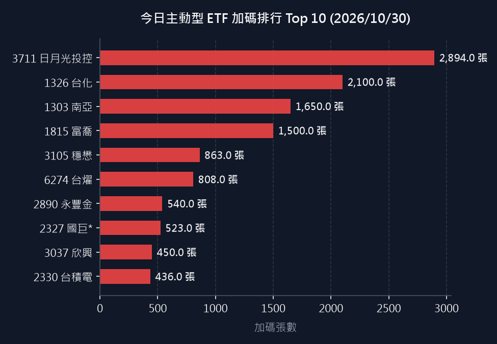
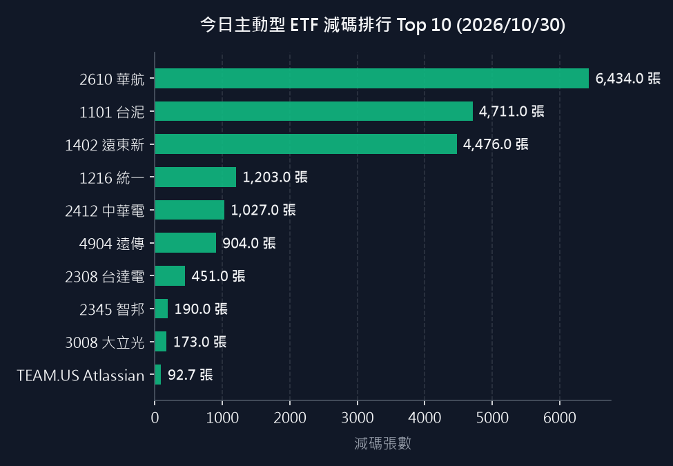

# 主動型 ETF 持股變動

資料來源：`主動型ETF持股明細.xlsx` 最近兩個日期分頁。

比較區間：`20261029` → `20261030`

## 今日加減碼視覺化排行

| 今日加碼 Top 10 | 今日減碼 Top 10 |
| :---: | :---: |
|  |  |

| ETF | 新增 | 刪除 | 比例變動 |
| :-- | --: | --: | --: |
| 00400A | 0 | 0 | 45 |
| 00401A | 0 | 0 | 49 |
| 00402A | 0 | 0 | 45 |
| 00403A | 0 | 0 | 35 |
| 00404A | 2 | 2 | 49 |
| 00405A | 0 | 0 | 25 |
| 00406A | 2 | 1 | 58 |
| 00407A | 0 | 0 | 40 |
| 00408A | 0 | 3 | 45 |
| 00980A | 0 | 0 | 49 |
| 00980D | 0 | 0 | 39 |
| 00981A | 0 | 0 | 28 |
| 00982A | 0 | 0 | 40 |
| 00983A | 0 | 0 | 34 |
| 00983D | 0 | 0 | 19 |
| 00984A | 0 | 0 | 62 |
| 00985A | 0 | 0 | 43 |
| 00986A | 2 | 1 | 33 |
| 00987A | 0 | 0 | 25 |
| 00988A | 0 | 1 | 33 |
| 00989A | 0 | 0 | 58 |
| 00990A | 0 | 4 | 33 |
| 00991A | 0 | 0 | 19 |
| 00992A | 0 | 0 | 36 |
| 00993A | 0 | 0 | 43 |
| 00994A | 0 | 2 | 35 |
| 00995A | 0 | 1 | 41 |
| 00996A | 0 | 0 | 39 |
| 00997A | 0 | 0 | 42 |
| 00998A | 2 | 2 | 51 |
| 00999A | 0 | 0 | 49 |

## 00400A

### 新增持股

- 無

### 刪除持股

- 無

### 投資比例變動

- 1303 南亞：4.25% → 4.14%（-0.11）
- 1476 儒鴻：0.07% → 0.08%（+0.01）
- 2303 聯電：1.58% → 1.57%（-0.01）
- 2308 台達電：2.30% → 2.13%（-0.17）
- 2313 華通：0.77% → 0.75%（-0.02）
- 2317 鴻海：0.78% → 0.79%（+0.01）
- 2327 國巨*：1.26% → 1.19%（-0.07）
- 2330 台積電：8.94% → 8.99%（+0.05）
- 2345 智邦：1.45% → 1.36%（-0.09）
- 2360 致茂：2.99% → 2.77%（-0.22）
- 2368 金像電：2.68% → 2.51%（-0.17）
- 2383 台光電：4.16% → 3.98%（-0.18）
- 2449 京元電子：0.88% → 0.85%（-0.03）
- 2454 聯發科：6.80% → 6.75%（-0.05）
- 2603 長榮：1.60% → 1.70%（+0.10）
- 2637 慧洋-KY：0.47% → 0.48%（+0.01）
- 2881 富邦金：1.65% → 1.68%（+0.03）
- 2891 中信金：1.61% → 1.66%（+0.05）
- 3008 大立光：1.45% → 1.38%（-0.07）
- 3017 奇鋐：3.34% → 3.41%（+0.07）
- 3036 文曄：1.55% → 1.53%（-0.02）
- 3037 欣興：3.64% → 3.55%（-0.09）
- 3044 健鼎：2.26% → 2.21%（-0.05）
- 3081 聯亞：0.69% → 0.65%（-0.04）
- 3090 日電貿：0.31% → 0.29%（-0.02）
- 3231 緯創：1.00% → 0.99%（-0.01）
- 3293 鈊象：0.35% → 0.36%（+0.01）
- 3406 玉晶光：0.96% → 0.89%（-0.07）
- 3443 創意：2.43% → 2.48%（+0.05）
- 3529 力旺：1.18% → 1.19%（+0.01）
- 3653 健策：3.23% → 3.26%（+0.03）
- 3661 世芯-KY：2.31% → 2.21%（-0.10）
- 3665 貿聯-KY：1.27% → 1.24%（-0.03）
- 4958 臻鼎-KY：0.44% → 0.42%（-0.02）
- 5274 信驊：2.52% → 2.43%（-0.09）
- 5434 崇越：0.36% → 0.37%（+0.01）
- 6147 頎邦：0.86% → 0.85%（-0.01）
- 6187 萬潤：1.03% → 0.99%（-0.04）
- 6223 旺矽：2.87% → 2.80%（-0.07）
- 6271 同欣電：0.23% → 0.22%（-0.01）
- 6274 台燿：1.27% → 1.18%（-0.09）
- 6278 台表科：2.56% → 2.41%（-0.15）
- 6488 環球晶：2.35% → 2.24%（-0.11）
- 6505 台塑化：1.40% → 1.43%（+0.03）
- 7769 鴻勁：0.68% → 0.66%（-0.02）

## 00401A

### 新增持股

- 無

### 刪除持股

- 無

### 投資比例變動

- 1216 統一：0.29% → 0.30%（+0.01）
- 1303 南亞：1.28% → 1.23%（-0.05）
- 1477 聚陽：0.93% → 0.94%（+0.01）
- 2059 川湖：0.82% → 0.80%（-0.02）
- 2303 聯電：1.97% → 1.92%（-0.05）
- 2308 台達電：2.05% → 1.87%（-0.18）
- 2313 華通：1.33% → 1.27%（-0.06）
- 2327 國巨*：0.62% → 0.58%（-0.04）
- 2330 台積電：20.47% → 20.29%（-0.18）
- 2357 華碩：1.84% → 1.77%（-0.07）
- 2360 致茂：1.52% → 1.80%（+0.28）
- 2379 瑞昱：1.15% → 1.17%（+0.02）
- 2382 廣達：2.09% → 2.11%（+0.02）
- 2383 台光電：1.02% → 0.97%（-0.05）
- 2412 中華電：0.90% → 0.92%（+0.02）
- 2454 聯發科：5.77% → 5.63%（-0.14）
- 2455 全新：2.09% → 1.95%（-0.14）
- 2603 長榮：1.96% → 2.35%（+0.39）
- 2881 富邦金：2.17% → 2.19%（+0.02）
- 2882 國泰金：1.10% → 1.11%（+0.01）
- 2883 凱基金：1.70% → 1.68%（-0.02）
- 2884 玉山金：2.12% → 2.14%（+0.02）
- 2886 兆豐金：1.49% → 1.50%（+0.01）
- 2890 永豐金：0.50% → 1.17%（+0.67）
- 2891 中信金：1.89% → 2.21%（+0.32）
- 2912 統一超：0.26% → 0.27%（+0.01）
- 3008 大立光：2.10% → 1.98%（-0.12）
- 3037 欣興：1.98% → 1.90%（-0.08）
- 3131 弘塑：0.60% → 0.57%（-0.03）
- 3231 緯創：1.72% → 1.69%（-0.03）
- 3491 昇達科：1.50% → 1.47%（-0.03）
- 3711 日月光投控：3.29% → 3.70%（+0.41）
- 4904 遠傳：0.81% → 0.83%（+0.02）
- 4958 臻鼎-KY：1.34% → 1.27%（-0.07）
- 4991 環宇-KY：0.57% → 0.53%（-0.04）
- 5274 信驊：1.80% → 1.71%（-0.09）
- 5347 世界：1.23% → 1.14%（-0.09）
- 6147 頎邦：1.33% → 1.29%（-0.04）
- 6187 萬潤：0.87% → 0.83%（-0.04）
- 6223 旺矽：1.48% → 1.42%（-0.06）
- 6285 啟碁：1.31% → 1.24%（-0.07）
- 6515 穎崴：0.87% → 0.86%（-0.01）
- 6531 愛普*：1.50% → 1.40%（-0.10）
- 6669 緯穎：1.69% → 1.63%（-0.06）
- 7769 鴻勁：0.81% → 0.78%（-0.03）
- 7828 創新服務：1.29% → 1.21%（-0.08）
- 7856 漢測：0.73% → 0.68%（-0.05）
- 台股期貨11/26(FITXN*1.TF)：-0.06% → -0.26%（-0.20）
- 臺指選擇權11/26 46500 買權：-0.56% → -0.32%（+0.24）

## 00402A

### 新增持股

- 無

### 刪除持股

- 無

### 投資比例變動

- AAPL.US Apple：7.95% → 8.25%（+0.30）
- ADI.US Analog Devices：2.09% → 2.16%（+0.07）
- AMD.US AMD：6.11% → 6.12%（+0.01）
- AMZN.US Amazon：4.39% → 4.30%（-0.09）
- ANET.US Arista Networks：0.80% → 0.81%（+0.01）
- ARM.US Arm：0.83% → 0.82%（-0.01）
- ASML.US ASML Holding：1.17% → 1.21%（+0.04）
- AVGO.US Broadcom：2.25% → 2.26%（+0.01）
- AXON.US Axon Enterprise：0.60% → 0.63%（+0.03）
- BKNG.US Booking Holdings：0.49% → 0.51%（+0.02）
- CDNS.US Cadence Design Systems：1.57% → 1.60%（+0.03）
- CIEN.US Ciena：1.17% → 1.15%（-0.02）
- CLS.US Celestica：1.20% → 1.15%（-0.05）
- COHR.US Coherent：1.15% → 1.17%（+0.02）
- CRWD.US CrowdStrike Holdings：1.89% → 1.90%（+0.01）
- FSLY.US Fastly：0.40% → 0.39%（-0.01）
- GOOG.US Alphabet - Class C Capital Stock：3.23% → 2.90%（-0.33）
- GOOGL.US Alphabet - Class A Common Stock：3.24% → 2.89%（-0.35）
- INTC.US Intel：1.47% → 1.45%（-0.02）
- IOT.US Samsara：0.57% → 0.56%（-0.01）
- KLAC.US KLA：1.30% → 1.41%（+0.11）
- LITE.US Lumentum：1.82% → 1.88%（+0.06）
- LRCX.US Lam Research：2.17% → 2.23%（+0.06）
- MCHP.US Microchip Technology：1.42% → 1.48%（+0.06）
- META.US Meta：3.27% → 3.41%（+0.14）
- MRVL.US Marvell：1.71% → 1.52%（-0.19）
- MSFT.US Microsoft：5.42% → 5.53%（+0.11）
- MU.US Micron：6.06% → 5.88%（-0.18）
- NFLX.US Netflix：0.88% → 0.90%（+0.02）
- NOW.US ServiceNow：1.17% → 0.87%（-0.30）
- NVDA.US NVIDIA：8.56% → 8.66%（+0.10）
- PANW.US Palo Alto：3.05% → 3.01%（-0.04）
- PLTR.US Palantir Technologies：2.19% → 2.24%（+0.05）
- SHOP.US Shopify：1.19% → 1.21%（+0.02）
- SIMO.US Silicon Motion：0.49% → 0.52%（+0.03）
- SNOW.US Snowflake：1.38% → 1.37%（-0.01）
- SPCX.US SpaceX：0.72% → 0.73%（+0.01）
- SPOT.US Spotify：0.38% → 0.40%（+0.02）
- STX.US Seagate：1.06% → 1.09%（+0.03）
- TER.US Teradyne：0.70% → 0.68%（-0.02）
- TTWO.US Take-Two：0.56% → 0.57%（+0.01）
- TXN.US Texas Instruments：2.65% → 2.74%（+0.09）
- UBER.US Uber：0.29% → 0.30%（+0.01）
- V.US Visa：1.22% → 1.28%（+0.06）
- WDC.US Western Digital：1.95% → 1.99%（+0.04）

## 00403A

### 新增持股

- 無

### 刪除持股

- 無

### 投資比例變動

- 1303 南亞：2.91% → 2.85%（-0.06）
- 1560 中砂：0.38% → 0.43%（+0.05）
- 2059 川湖：0.69% → 0.70%（+0.01）
- 2308 台達電：2.76% → 2.33%（-0.43）
- 2313 華通：0.33% → 0.32%（-0.01）
- 2317 鴻海：0.62% → 0.63%（+0.01）
- 2327 國巨*：3.72% → 3.55%（-0.17）
- 2330 台積電：14.48% → 14.65%（+0.17）
- 2345 智邦：2.19% → 2.07%（-0.12）
- 2368 金像電：0.81% → 0.76%（-0.05）
- 2383 台光電：4.68% → 4.50%（-0.18）
- 2408 南亞科：1.04% → 1.02%（-0.02）
- 2449 京元電子：0.84% → 0.81%（-0.03）
- 2454 聯發科：4.82% → 4.81%（-0.01）
- 2455 全新：0.08% → 0.07%（-0.01）
- 2882 國泰金：0.36% → 0.37%（+0.01）
- 3008 大立光：1.70% → 1.63%（-0.07）
- 3017 奇鋐：5.63% → 5.89%（+0.26）
- 3037 欣興：5.83% → 5.72%（-0.11）
- 3189 景碩：3.32% → 3.33%（+0.01）
- 3211 順達：0.50% → 0.48%（-0.02）
- 3443 創意：4.22% → 4.35%（+0.13）
- 3450 聯鈞：0.51% → 0.49%（-0.02）
- 3583 辛耘：0.30% → 0.26%（-0.04）
- 3653 健策：4.99% → 5.07%（+0.08）
- 3665 貿聯-KY：1.94% → 1.90%（-0.04）
- 3711 日月光投控：0.69% → 0.86%（+0.17）
- 5274 信驊：2.39% → 2.31%（-0.08）
- 6223 旺矽：3.50% → 3.44%（-0.06）
- 6274 台燿：2.60% → 2.44%（-0.16）
- 6442 光聖：0.36% → 0.35%（-0.01）
- 6488 環球晶：0.19% → 0.18%（-0.01）
- 6669 緯穎：2.72% → 2.69%（-0.03）
- 8046 南電：2.93% → 2.87%（-0.06）
- 8996 高力：2.26% → 2.17%（-0.09）

## 00404A

### 新增持股

- 台指選擇權11/26 48000 買權（-0.17%，-0.488 張）
- 台指選擇權12/26 49000 買權（-0.02%，-0.025 張）

### 刪除持股

- 台指選擇權11/26 50900 買權（-0.04%，-0.403 張）
- 台指選擇權12/26 51800 買權（-0.01%，-0.021 張）

### 投資比例變動

- 1303 南亞：0.83% → 0.81%（-0.02）
- 2301 光寶科：0.52% → 0.51%（-0.01）
- 2303 聯電：2.29% → 2.27%（-0.02）
- 2308 台達電：1.49% → 1.38%（-0.11）
- 2317 鴻海：0.67% → 0.68%（+0.01）
- 2330 台積電：22.49% → 22.70%（+0.21）
- 2345 智邦：0.79% → 0.75%（-0.04）
- 2347 聯強：2.04% → 2.05%（+0.01）
- 2351 順德：0.36% → 0.35%（-0.01）
- 2357 華碩：1.19% → 1.17%（-0.02）
- 2360 致茂：0.44% → 0.41%（-0.03）
- 2379 瑞昱：1.18% → 1.22%（+0.04）
- 2382 廣達：0.97% → 0.99%（+0.02）
- 2383 台光電：2.77% → 2.66%（-0.11）
- 2395 研華：1.25% → 1.30%（+0.05）
- 2436 偉詮電：1.14% → 1.13%（-0.01）
- 2454 聯發科：6.24% → 6.22%（-0.02）
- 2637 慧洋-KY：1.15% → 1.17%（+0.02）
- 2851 中再保：1.15% → 1.19%（+0.04）
- 2882 國泰金：2.93% → 3.00%（+0.07）
- 2885 元大金：2.60% → 2.65%（+0.05）
- 2887 台新新光金：1.50% → 1.54%（+0.04）
- 2890 永豐金：1.51% → 1.55%（+0.04）
- 3017 奇鋐：1.25% → 1.28%（+0.03）
- 3034 聯詠：2.29% → 2.27%（-0.02）
- 3264 欣銓：0.62% → 0.60%（-0.02）
- 3293 鈊象：1.22% → 1.25%（+0.03）
- 3374 精材：0.12% → 0.13%（+0.01）
- 3443 創意：0.96% → 0.99%（+0.03）
- 3653 健策：0.48% → 0.49%（+0.01）
- 3680 家登：0.50% → 0.48%（-0.02）
- 3711 日月光投控：3.33% → 3.35%（+0.02）
- 5274 信驊：2.74% → 2.66%（-0.08）
- 5434 崇越：1.69% → 1.76%（+0.07）
- 5876 上海商銀：1.61% → 1.65%（+0.04）
- 5904 寶雅*：0.51% → 0.52%（+0.01）
- 6196 帆宣：1.62% → 1.58%（-0.04）
- 6206 飛捷：0.72% → 0.73%（+0.01）
- 6223 旺矽：1.03% → 1.01%（-0.02）
- 6257 矽格：1.58% → 1.50%（-0.08）
- 6491 晶碩：0.91% → 0.93%（+0.02）
- 6505 台塑化：0.46% → 0.47%（+0.01）
- 6669 緯穎：0.90% → 0.89%（-0.01）
- 6691 洋基工程：1.50% → 1.51%（+0.01）
- 7769 鴻勁：1.04% → 1.02%（-0.02）
- 8016 矽創：1.26% → 1.27%（+0.01）
- 8081 致新：0.90% → 0.91%（+0.01）
- 8299 群聯：1.29% → 1.25%（-0.04）
- 台股期貨11/26(FITXN*1.TF)：18.00% → 19.65%（+1.65）

## 00405A

### 新增持股

- 無

### 刪除持股

- 無

### 投資比例變動

- 2059 川湖：2.28% → 2.32%（+0.04）
- 2303 聯電：0.01% → 0.02%（+0.01）
- 2308 台達電：0.64% → 0.60%（-0.04）
- 2330 台積電：2.00% → 2.04%（+0.04）
- 2345 智邦：4.94% → 4.73%（-0.21）
- 2368 金像電：5.81% → 5.53%（-0.28）
- 2383 台光電：4.91% → 4.77%（-0.14）
- 2454 聯發科：5.50% → 5.53%（+0.03）
- 3017 奇鋐：1.84% → 1.90%（+0.06）
- 3037 欣興：7.35% → 7.28%（-0.07）
- 3443 創意：2.58% → 2.68%（+0.10）
- 3653 健策：7.69% → 7.89%（+0.20）
- 3665 貿聯-KY：5.24% → 5.20%（-0.04）
- 5274 信驊：7.16% → 7.01%（-0.15）
- 6187 萬潤：0.86% → 0.85%（-0.01）
- 6223 旺矽：7.22% → 7.16%（-0.06）
- 6274 台燿：1.97% → 1.86%（-0.11）
- 6285 啟碁：0.11% → 0.10%（-0.01）
- 6415 矽力*-KY：0.61% → 0.60%（-0.01）
- 6515 穎崴：0.49% → 0.50%（+0.01）
- 6531 愛普*：4.00% → 3.84%（-0.16）
- 6805 富世達：3.04% → 3.11%（+0.07）
- 7769 鴻勁：2.88% → 2.86%（-0.02）
- 8046 南電：7.50% → 7.43%（-0.07）
- 8996 高力：1.43% → 1.38%（-0.05）

## 00406A

### 新增持股

- 6446 藥華藥（0.39%，430 張）
- 臺指選擇權第一週週五到期契約（-2.87%，-2.506 張）

### 刪除持股

- 臺指選擇權第五週週五到期契約（-16.84%，-13.7 張）

### 投資比例變動

- 1326 台化：0.52% → 0.61%（+0.09）
- 1560 中砂：0.30% → 0.28%（-0.02）
- 1815 富喬：0.35% → 0.46%（+0.11）
- 2059 川湖：1.60% → 1.52%（-0.08）
- 2303 聯電：1.39% → 1.31%（-0.08）
- 2308 台達電：2.07% → 1.82%（-0.25）
- 2317 鴻海：0.27% → 0.26%（-0.01）
- 2330 台積電：9.47% → 9.43%（-0.04）
- 2344 華邦電：0.08% → 0.07%（-0.01）
- 2345 智邦：2.71% → 2.42%（-0.29）
- 2360 致茂：1.01% → 0.88%（-0.13）
- 2368 金像電：2.24% → 2.22%（-0.02）
- 2383 台光電：6.18% → 6.25%（+0.07）
- 2449 京元電子：0.51% → 0.47%（-0.04）
- 2454 聯發科：5.72% → 5.80%（+0.08）
- 2481 強茂：0.41% → 0.38%（-0.03）
- 2486 一詮：0.13% → 0.12%（-0.01）
- 2885 元大金：0.50% → 0.48%（-0.02）
- 3008 大立光：1.36% → 1.23%（-0.13）
- 3017 奇鋐：5.19% → 5.21%（+0.02）
- 3037 欣興：5.97% → 5.84%（-0.13）
- 3081 聯亞：0.76% → 1.04%（+0.28）
- 3105 穩懋：0.10% → 0.45%（+0.35）
- 3167 大量：0.49% → 0.69%（+0.20）
- 3189 景碩：2.12% → 2.00%（-0.12）
- 3231 緯創：0.42% → 0.39%（-0.03）
- 3264 欣銓：0.41% → 0.37%（-0.04）
- 3363 上詮：0.15% → 0.14%（-0.01）
- 3443 創意：2.44% → 2.37%（-0.07）
- 3450 聯鈞：0.11% → 0.10%（-0.01）
- 3491 昇達科：0.34% → 0.32%（-0.02）
- 3529 力旺：0.15% → 0.14%（-0.01）
- 3653 健策：4.38% → 4.44%（+0.06）
- 3661 世芯-KY：0.93% → 0.84%（-0.09）
- 3665 貿聯-KY：1.04% → 0.96%（-0.08）
- 3711 日月光投控：1.96% → 2.02%（+0.06）
- 4938 和碩：0.58% → 0.55%（-0.03）
- 5274 信驊：1.95% → 1.78%（-0.17）
- 6147 頎邦：0.91% → 0.85%（-0.06）
- 6187 萬潤：0.16% → 0.15%（-0.01）
- 6213 聯茂：0.59% → 0.53%（-0.06）
- 6223 旺矽：3.18% → 3.08%（-0.10）
- 6274 台燿：1.13% → 1.78%（+0.65）
- 6278 台表科：0.31% → 0.28%（-0.03）
- 6285 啟碁：0.06% → 0.05%（-0.01）
- 6488 環球晶：0.24% → 0.22%（-0.02）
- 6510 精測：0.63% → 0.60%（-0.03）
- 6515 穎崴：0.18% → 0.06%（-0.12）
- 6531 愛普*：0.11% → 0.10%（-0.01）
- 6669 緯穎：1.30% → 1.21%（-0.09）
- 6715 嘉基：0.77% → 0.82%（+0.05）
- 6805 富世達：0.53% → 0.80%（+0.27）
- 7769 鴻勁：0.17% → 0.16%（-0.01）
- 8046 南電：3.03% → 3.01%（-0.02）
- 8358 金居：0.08% → 0.07%（-0.01）
- 8996 高力：0.49% → 0.61%（+0.12）
- 臺指選擇權第一週週三到期契約：-3.76% → -6.01%（-2.25）
- 臺股期貨 202611(FITXN*1.TF)：24.00% → 24.49%（+0.49）

## 00407A

### 新增持股

- 無

### 刪除持股

- 無

### 投資比例變動

- 1303 南亞：3.00% → 2.96%（-0.04）
- 1560 中砂：1.04% → 1.06%（+0.02）
- 2059 川湖：1.91% → 1.94%（+0.03）
- 2301 光寶科：1.41% → 1.40%（-0.01）
- 2308 台達電：2.30% → 2.16%（-0.14）
- 2327 國巨*：2.34% → 2.26%（-0.08）
- 2330 台積電：9.66% → 9.88%（+0.22）
- 2345 智邦：1.52% → 1.46%（-0.06）
- 2360 致茂：0.98% → 0.93%（-0.05）
- 2368 金像電：1.80% → 1.71%（-0.09）
- 2379 瑞昱：0.26% → 0.28%（+0.02）
- 2383 台光電：5.75% → 5.59%（-0.16）
- 2408 南亞科：1.62% → 1.61%（-0.01）
- 2454 聯發科：5.25% → 5.29%（+0.04）
- 2615 萬海：1.03% → 1.11%（+0.08）
- 3008 大立光：1.46% → 1.41%（-0.05）
- 3017 奇鋐：5.61% → 5.82%（+0.21）
- 3037 欣興：6.00% → 5.94%（-0.06）
- 3081 聯亞：1.90% → 1.82%（-0.08）
- 3131 弘塑：0.77% → 0.76%（-0.01）
- 3231 緯創：1.09% → 1.10%（+0.01）
- 3293 鈊象：0.67% → 0.69%（+0.02）
- 3406 玉晶光：0.26% → 0.24%（-0.02）
- 3443 創意：4.71% → 4.90%（+0.19）
- 3491 昇達科：0.84% → 0.85%（+0.01）
- 3533 嘉澤：0.95% → 0.97%（+0.02）
- 3653 健策：3.58% → 3.68%（+0.10）
- 3665 貿聯-KY：2.28% → 2.27%（-0.01）
- 3711 日月光投控：3.13% → 3.19%（+0.06）
- 4958 臻鼎-KY：1.05% → 1.02%（-0.03）
- 5434 崇越：0.22% → 0.23%（+0.01）
- 6187 萬潤：1.55% → 1.52%（-0.03）
- 6223 旺矽：2.19% → 2.17%（-0.02）
- 6274 台燿：2.07% → 1.96%（-0.11）
- 6510 精測：1.32% → 1.34%（+0.02）
- 6531 愛普*：0.31% → 0.30%（-0.01）
- 6805 富世達：1.31% → 1.34%（+0.03）
- 8046 南電：3.66% → 3.63%（-0.03）
- 8299 群聯：0.34% → 0.33%（-0.01）
- 8996 高力：1.33% → 1.29%（-0.04）

## 00408A

### 新增持股

- 無

### 刪除持股

- 2357 華碩（0.54%，8 張）
- 3008 大立光（0.83%，2 張）
- 6488 環球晶（0.81%，14 張）

### 投資比例變動

- 1216 統一：0.11% → 0.12%（+0.01）
- 1303 南亞：4.00% → 3.93%（-0.07）
- 1560 中砂：0.82% → 0.83%（+0.01）
- 2059 川湖：0.98% → 1.00%（+0.02）
- 2308 台達電：1.78% → 1.66%（-0.12）
- 2327 國巨*：0.54% → 0.52%（-0.02）
- 2330 台積電：6.18% → 6.29%（+0.11）
- 2345 智邦：0.69% → 0.66%（-0.03）
- 2360 致茂：1.11% → 1.04%（-0.07）
- 2368 金像電：5.00% → 4.74%（-0.26）
- 2383 台光電：4.82% → 4.65%（-0.17）
- 2395 研華：1.63% → 1.70%（+0.07）
- 2408 南亞科：2.07% → 2.04%（-0.03）
- 2449 京元電子：0.90% → 0.88%（-0.02）
- 2454 聯發科：4.03% → 4.04%（+0.01）
- 2455 全新：0.83% → 0.79%（-0.04）
- 2542 興富發：3.79% → 3.91%（+0.12）
- 2603 長榮：1.30% → 1.76%（+0.46）
- 2880 華南金：1.25% → 1.30%（+0.05）
- 2891 中信金：0.80% → 0.84%（+0.04）
- 3017 奇鋐：2.85% → 2.94%（+0.09）
- 3026 禾伸堂：0.82% → 0.78%（-0.04）
- 3037 欣興：3.04% → 2.99%（-0.05）
- 3045 台灣大：0.11% → 0.12%（+0.01）
- 3081 聯亞：2.11% → 2.01%（-0.10）
- 3105 穩懋：0.59% → 0.60%（+0.01）
- 3189 景碩：3.35% → 3.37%（+0.02）
- 3231 緯創：0.94% → 0.96%（+0.02）
- 3264 欣銓：0.72% → 0.70%（-0.02）
- 3443 創意：0.54% → 0.56%（+0.02）
- 3653 健策：3.56% → 3.63%（+0.07）
- 3711 日月光投控：1.90% → 1.92%（+0.02）
- 5434 崇越：2.28% → 2.39%（+0.11）
- 6187 萬潤：0.99% → 0.97%（-0.02）
- 6223 旺矽：2.00% → 1.97%（-0.03）
- 6274 台燿：2.87% → 2.71%（-0.16）
- 6510 精測：0.41% → 0.42%（+0.01）
- 6526 達發：0.33% → 0.34%（+0.01）
- 6669 緯穎：1.98% → 1.97%（-0.01）
- 6691 洋基工程：0.32% → 0.33%（+0.01）
- 6805 富世達：2.42% → 2.46%（+0.04）
- 7769 鴻勁：0.92% → 0.91%（-0.01）
- 8046 南電：1.51% → 1.49%（-0.02）
- 8996 高力：2.42% → 2.33%（-0.09）
- 9802 鈺齊-KY：0.84% → 0.87%（+0.03）

## 00980A

### 新增持股

- 無

### 刪除持股

- 無

### 投資比例變動

- 1303 南亞：3.58% → 3.51%（-0.07）
- 2059 川湖：4.22% → 4.27%（+0.05）
- 2308 台達電：3.24% → 3.02%（-0.22）
- 2317 鴻海：3.29% → 3.37%（+0.08）
- 2327 國巨*：0.94% → 0.90%（-0.04）
- 2330 台積電：9.84% → 9.99%（+0.15）
- 2344 華邦電：1.79% → 1.78%（-0.01）
- 2345 智邦：0.95% → 0.90%（-0.05）
- 2360 致茂：1.16% → 1.08%（-0.08）
- 2368 金像電：2.03% → 1.92%（-0.11）
- 2376 技嘉：1.63% → 1.65%（+0.02）
- 2382 廣達：1.89% → 1.96%（+0.07）
- 2383 台光電：3.91% → 3.77%（-0.14）
- 2408 南亞科：2.50% → 2.46%（-0.04）
- 2454 聯發科：5.45% → 5.46%（+0.01）
- 2884 玉山金：1.29% → 1.33%（+0.04）
- 2891 中信金：1.59% → 1.66%（+0.07）
- 3008 大立光：2.05% → 1.98%（-0.07）
- 3017 奇鋐：2.25% → 2.32%（+0.07）
- 3026 禾伸堂：1.19% → 1.13%（-0.06）
- 3037 欣興：3.52% → 3.46%（-0.06）
- 3044 健鼎：1.31% → 1.29%（-0.02）
- 3081 聯亞：1.67% → 1.59%（-0.08）
- 3189 景碩：1.38% → 1.39%（+0.01）
- 3231 緯創：1.69% → 1.70%（+0.01）
- 3264 欣銓：0.83% → 0.80%（-0.03）
- 3293 鈊象：0.48% → 0.50%（+0.02）
- 3443 創意：1.86% → 1.92%（+0.06）
- 3529 力旺：0.16% → 0.17%（+0.01）
- 3653 健策：3.12% → 3.18%（+0.06）
- 3665 貿聯-KY：1.32% → 1.30%（-0.02）
- 3711 日月光投控：2.30% → 2.32%（+0.02）
- 5274 信驊：1.87% → 1.81%（-0.06）
- 5904 寶雅*：0.67% → 0.69%（+0.02）
- 6213 聯茂：1.44% → 1.37%（-0.07）
- 6223 旺矽：1.28% → 1.26%（-0.02）
- 6274 台燿：1.32% → 1.25%（-0.07）
- 6442 光聖：0.27% → 0.26%（-0.01）
- 6515 穎崴：1.54% → 1.56%（+0.02）
- 6669 緯穎：1.89% → 1.88%（-0.01）
- 6805 富世達：0.71% → 0.72%（+0.01）
- 6831 邁科：0.27% → 0.26%（-0.01）
- 7751 竑騰：0.68% → 0.66%（-0.02）
- 7769 鴻勁：1.99% → 1.97%（-0.02）
- 8046 南電：1.70% → 1.67%（-0.03）
- 8210 勤誠：0.39% → 0.38%（-0.01）
- 8299 群聯：1.15% → 1.12%（-0.03）
- 8996 高力：0.49% → 0.47%（-0.02）
- 台灣證交所加權股價指數(FITXN*1.TF)：1.51% → 1.52%（+0.01）

## 00980D

### 新增持股

- 無

### 刪除持股

- 無

### 投資比例變動

- ALLY FINANCIAL INC (REG) 8% 01/11/2031：0.59% → 0.60%（+0.01）
- ANHEUSER-BUSCH INBEV WOR (REG) 8.2% 15JAN2039：0.53% → 0.54%（+0.01）
- APA CORP 6.750000 % 15-FEB-2055：0.38% → 0.39%（+0.01）
- BLUE OWL CREDIT INCOME (REG) 6.65% 15MAR2031：0.54% → 0.55%（+0.01）
- BLUE OWL CREDIT INCOME 7.750000 % 15JAN2029：0.55% → 0.56%（+0.01）
- CHS/COMMUNITY HEALTH SYS SER REGS 10.875000 % 15JAN2032：0.50% → 0.47%（-0.03）
- CHS/COMMUNITY HEALTH SYS SER REGS 9.750000 % 15JAN2034：0.32% → 0.31%（-0.01）
- CONSOLIDATED ENERGY FIN SER REGS 12.000000 % 15FEB2031：0.58% → 0.59%（+0.01）
- COX COMMUNICATIONS INC SER REGS 5.800000 % 15DEC2053：0.50% → 0.49%（-0.01）
- DELL INT LLC / EMC CORP (REG) 8.35% 15JUL2046：0.57% → 0.56%（-0.01）
- DEUTSCHE TELEKOM INT FIN (REG) 8.75% 15JUN2030：0.42% → 0.43%（+0.01）
- DOW CHEMICAL CO/THE 6.9% 15MAY2053：0.64% → 0.63%（-0.01）
- GLOBAL ATLANTIC FIN CO SER REGS 6.750000 % 15MAR2054：0.63% → 0.64%（+0.01）
- HSBC HOLDINGS PLC (REG) VAR 13NOV2034：0.36% → 0.35%（-0.01）
- ICAHN ENTERPRISES/FIN (REG) 9.75% 15JAN2029：0.32% → 0.33%（+0.01）
- JETBLUE AIRWAYS/LOYALTY SER REGS (REG S) 9.875% 20SEP2031：0.34% → 0.33%（-0.01）
- KINDER MORGAN INC/DELAWA SER GMTN (REG) 7.8% 01AUG2031：0.32% → 0.33%（+0.01）
- LBM ACQUISITION LLC SER REGS 9.500000 % 15JUN2031：0.42% → 0.43%（+0.01）
- LINCOLN NATIONAL CORP (REG) 7.000000 % 15JUN2040：0.47% → 0.48%（+0.01）
- MACQUARIE BANK LTD SER REGS (REG S) 6.798% 18JAN2033：0.34% → 0.35%（+0.01）
- MYLAN NV 5.25% 15JUN2046 WI：0.55% → 0.56%（+0.01）
- NRG ENERGY INC SER REGS (REG S) 7% 15MAR2033：0.33% → 0.32%（-0.01）
- ORACLE CORP 6.000000 % 03AUG2055：0.30% → 0.31%（+0.01）
- ORACLE CORP 6.9% 09NOV2052：0.51% → 0.52%（+0.01）
- ORANGE SA (REG) 9% 01MAR2031：0.67% → 0.68%（+0.01）
- SALESFORCE INC (REG) 6.55% 15MAR2056：0.56% → 0.55%（-0.01）
- SALESFORCE INC (REG) 6.7% 15MAR2066：0.55% → 0.54%（-0.01）
- SES GLOBAL AMERICAS HLDG SER REGS (REG) 5.300000 % 25MAR2044：0.31% → 0.30%（-0.01）
- SPACE EXPLORATION TECH SER 144A (REG) 6.65% 15JUL2056：0.32% → 0.31%（-0.01）
- STAPLES INC SER REGS (REG S) 10.75% 01SEP2029：0.51% → 0.52%（+0.01）
- TRANSCANADA PIPELINES LTD 7.625PCT 15/01/2039：0.54% → 0.55%（+0.01）
- US 10YR NOTE (CBT)DEC26 21-DEC-2026：18.43% → 18.49%（+0.06）
- US 10YR ULTRA FUT DEC26 21-DEC-2026：-2.33% → -2.34%（-0.01）
- US 5YR NOTE (CBT) DEC26 31-DEC-2026：-13.97% → -14.00%（-0.03）
- US ACUTE CARE SOLUTIONS SER REGS (REG S) 9.75% 15MAY2029：0.33% → 0.32%（-0.01）
- US LONG BOND(CBT) DEC26 21-DEC-2026：5.54% → 5.57%（+0.03）
- VALERO ENERGY CORP (REG) 7.5% 15APR2032：0.49% → 0.50%（+0.01）
- VIACOMCBS INC (REG) 4.95% 19MAY2050：0.46% → 0.45%（-0.01）
- VIACOMCBS INC 6.875% 30APR2036：0.26% → 0.25%（-0.01）

## 00981A

### 新增持股

- 無

### 刪除持股

- 無

### 投資比例變動

- 2303 聯電：3.38% → 3.35%（-0.03）
- 2308 台達電：4.12% → 3.82%（-0.30）
- 2327 國巨*：4.69% → 4.45%（-0.24）
- 2330 台積電：11.56% → 11.84%（+0.28）
- 2345 智邦：4.08% → 3.86%（-0.22）
- 2368 金像電：3.13% → 2.94%（-0.19）
- 2383 台光電：7.96% → 7.63%（-0.33）
- 2449 京元電子：0.75% → 0.72%（-0.03）
- 2454 聯發科：7.88% → 7.92%（+0.04）
- 3017 奇鋐：7.45% → 7.72%（+0.27）
- 3037 欣興：7.53% → 7.36%（-0.17）
- 3264 欣銓：0.44% → 0.42%（-0.02）
- 3376 新日興：0.10% → 0.09%（-0.01）
- 3443 創意：2.59% → 2.66%（+0.07）
- 3653 健策：5.91% → 5.98%（+0.07）
- 3665 貿聯-KY：1.81% → 1.77%（-0.04）
- 3711 日月光投控：2.99% → 3.42%（+0.43）
- 4979 華星光：0.17% → 0.16%（-0.01）
- 5274 信驊：1.49% → 1.44%（-0.05）
- 6187 萬潤：0.06% → 0.05%（-0.01）
- 6223 旺矽：4.45% → 4.35%（-0.10）
- 6271 同欣電：0.17% → 0.16%（-0.01）
- 6274 台燿：3.70% → 3.46%（-0.24）
- 6669 緯穎：2.27% → 2.24%（-0.03）
- 6805 富世達：1.07% → 1.27%（+0.20）
- 8046 南電：4.12% → 4.03%（-0.09）
- 8358 金居：0.11% → 0.10%（-0.01）
- 8996 高力：0.56% → 0.53%（-0.03）

## 00982A

### 新增持股

- 無

### 刪除持股

- 無

### 投資比例變動

- 2059 川湖：2.72% → 2.74%（+0.02）
- 2301 光寶科：1.74% → 1.71%（-0.03）
- 2330 台積電：8.28% → 8.40%（+0.12）
- 2360 致茂：3.94% → 3.68%（-0.26）
- 2376 技嘉：1.28% → 1.30%（+0.02）
- 2383 台光電：3.30% → 3.18%（-0.12）
- 2395 研華：1.38% → 1.44%（+0.06）
- 2428 興勤：1.18% → 1.14%（-0.04）
- 2455 全新：1.59% → 1.52%（-0.07）
- 2467 志聖：0.99% → 0.95%（-0.04）
- 2478 大毅：0.32% → 0.31%（-0.01）
- 2486 一詮：0.69% → 0.68%（-0.01）
- 3008 大立光：3.14% → 3.03%（-0.11）
- 3017 奇鋐：2.48% → 2.55%（+0.07）
- 3037 欣興：0.89% → 0.87%（-0.02）
- 3090 日電貿：0.33% → 0.32%（-0.01）
- 3105 穩懋：8.94% → 8.99%（+0.05）
- 3231 緯創：1.94% → 1.96%（+0.02）
- 3265 台星科：1.52% → 1.45%（-0.07）
- 3491 昇達科：3.24% → 3.26%（+0.02）
- 3583 辛耘：0.70% → 0.68%（-0.02）
- 3711 日月光投控：1.97% → 1.99%（+0.02）
- 4958 臻鼎-KY：3.50% → 3.38%（-0.12）
- 5274 信驊：1.30% → 1.26%（-0.04）
- 5425 台半：1.23% → 1.21%（-0.02）
- 5483 中美晶：1.35% → 1.32%（-0.03）
- 6139 亞翔：5.31% → 5.25%（-0.06）
- 6196 帆宣：0.37% → 0.36%（-0.01）
- 6213 聯茂：1.50% → 1.43%（-0.07）
- 6214 精誠：1.48% → 1.52%（+0.04）
- 6223 旺矽：3.11% → 3.06%（-0.05）
- 6239 力成：1.39% → 1.36%（-0.03）
- 6274 台燿：1.25% → 1.17%（-0.08）
- 6488 環球晶：1.89% → 1.82%（-0.07）
- 6510 精測：0.92% → 0.93%（+0.01）
- 6531 愛普*：4.12% → 3.93%（-0.19）
- 6669 緯穎：2.36% → 2.34%（-0.02）
- 6672 騰輝電子-KY：1.42% → 1.36%（-0.06）
- 8070 長華*：0.69% → 0.67%（-0.02）
- 8996 高力：1.26% → 1.21%（-0.05）

## 00983A

### 新增持股

- 無

### 刪除持股

- 無

### 投資比例變動

- AMD.US AMD：3.40% → 3.36%（-0.04）
- AMZN.US Amazon：3.54% → 3.42%（-0.12）
- AVGO.US Broadcom：1.81% → 1.80%（-0.01）
- BEAM.US Beam Therapeutics：1.82% → 1.85%（+0.03）
- BMNR.US BitMine：1.90% → 1.88%（-0.02）
- CRCL.US Circle：4.45% → 4.40%（-0.05）
- CRSP.US CRISPR Therapeutics：3.90% → 3.95%（+0.05）
- CRWV.US CoreWeave：0.74% → 0.71%（-0.03）
- DE.US Deere：0.41% → 0.42%（+0.01）
- FTNT.US Fortinet：0.53% → 0.43%（-0.10）
- GOOG.US Alphabet - Class C Capital Stock：1.49% → 1.62%（+0.13）
- GOOGL.US Alphabet - Class A Common Stock：1.58% → 1.39%（-0.19）
- HOOD.US Robinhood Markets：2.83% → 2.86%（+0.03）
- ILMN.US Illumina：1.84% → 1.87%（+0.03）
- LLY.US Eli Lilly：1.61% → 1.74%（+0.13）
- META.US Meta：2.43% → 2.67%（+0.24）
- MSFT.US Microsoft：0.98% → 0.99%（+0.01）
- NET.US Cloudflare：1.37% → 1.35%（-0.02）
- NTRA.US Natera：1.71% → 1.77%（+0.06）
- NVDA.US NVIDIA：3.60% → 3.61%（+0.01）
- PLTR.US Palantir Technologies：3.24% → 3.26%（+0.02）
- RKLB.US Rocket Lab：1.32% → 1.35%（+0.03）
- RXRX.US Recursion Pharmaceuticals：1.00% → 0.99%（-0.01）
- SHOP.US Shopify：4.85% → 4.86%（+0.01）
- SNOW.US Snowflake：0.57% → 0.55%（-0.02）
- TEM.US Tempus：5.92% → 6.07%（+0.15）
- TER.US Teradyne：0.54% → 0.51%（-0.03）
- TSLA.US Tesla：9.02% → 9.04%（+0.02）
- TSM.US TSMC(ADR)：2.71% → 2.69%（-0.02）
- TWST.US Twist Bioscience：4.30% → 4.34%（+0.04）
- TXG.US 10x Genomics：3.68% → 3.62%（-0.06）
- VCYT.US Veracyte：0.14% → 0.15%（+0.01）
- WGS.US GeneDx：0.47% → 0.52%（+0.05）
- XYZ.US Block：1.23% → 1.27%（+0.04）

## 00983D

### 新增持股

- 無

### 刪除持股

- 無

### 投資比例變動

- ABIBB 8.2 01/15/39：2.02% → 2.03%（+0.01）
- AMCX 10 1/2 07/15/32：1.62% → 1.61%（-0.01）
- BATSLN 7.081 08/02/53：1.21% → 1.20%（-0.01）
- BNCN 7 3/8 03/01/33：1.14% → 1.15%（+0.01）
- BRKHEC 6 3/4 07/01/37：0.84% → 0.85%（+0.01）
- CRWV 9 02/01/31：1.24% → 1.23%（-0.01）
- CYH 10 7/8 01/15/32：1.51% → 1.42%（-0.09）
- DELL 8.35 07/15/46：1.45% → 1.44%（-0.01）
- DOW 6.9 05/15/53：0.80% → 0.79%（-0.01）
- GS 6 1/4 02/01/41：0.33% → 0.34%（+0.01）
- GT 8 7/8 07/15/32：0.89% → 0.88%（-0.01）
- HAL 7.45 09/15/39：1.89% → 1.90%（+0.01）
- KHC 6 7/8 01/26/39：1.04% → 1.05%（+0.01）
- KMI 6.95 01/15/38：1.10% → 1.11%（+0.01）
- LQDW.US iShares LQD Premium Income+ ETF：7.05% → 7.06%（+0.01）
- ORCL 6.9 11/09/52：0.42% → 0.43%（+0.01）
- PCG 6.7 04/01/53：0.97% → 0.98%（+0.01）
- TLTW.US iShares TLT Premium Income+ ETF：8.35% → 8.38%（+0.03）
- VENLNG 9 1/2 02/01/29：1.49% → 1.48%（-0.01）

## 00984A

### 新增持股

- 無

### 刪除持股

- 無

### 投資比例變動

- 1216 統一：0.34% → 0.35%（+0.01）
- 1303 南亞：3.13% → 3.03%（-0.10）
- 1409 新纖：0.64% → 0.63%（-0.01）
- 1560 中砂：1.25% → 1.24%（-0.01）
- 1709 和益：0.66% → 0.64%（-0.02）
- 2301 光寶科：0.58% → 0.57%（-0.01）
- 2303 聯電：0.67% → 0.66%（-0.01）
- 2313 華通：0.14% → 0.13%（-0.01）
- 2330 台積電：4.30% → 4.31%（+0.01）
- 2344 華邦電：0.72% → 0.71%（-0.01）
- 2351 順德：0.61% → 0.58%（-0.03）
- 2357 華碩：0.63% → 0.61%（-0.02）
- 2379 瑞昱：0.33% → 0.34%（+0.01）
- 2383 台光電：1.30% → 1.24%（-0.06）
- 2395 研華：2.50% → 2.58%（+0.08）
- 2408 南亞科：2.10% → 2.04%（-0.06）
- 2409 友達：1.16% → 1.07%（-0.09）
- 2454 聯發科：0.78% → 0.77%（-0.01）
- 2464 盟立：1.20% → 1.17%（-0.03）
- 2603 長榮：1.92% → 2.04%（+0.12）
- 2615 萬海：0.97% → 1.04%（+0.07）
- 2637 慧洋-KY：0.33% → 0.34%（+0.01）
- 2801 彰銀：0.35% → 0.36%（+0.01）
- 2851 中再保：0.69% → 0.71%（+0.02）
- 2880 華南金：1.70% → 1.75%（+0.05）
- 2881 富邦金：4.45% → 4.56%（+0.11）
- 2882 國泰金：3.40% → 3.46%（+0.06）
- 2883 凱基金：2.51% → 2.52%（+0.01）
- 2884 玉山金：2.43% → 2.48%（+0.05）
- 2885 元大金：3.51% → 3.55%（+0.04）
- 2886 兆豐金：2.28% → 2.33%（+0.05）
- 2887 台新新光金：3.52% → 3.58%（+0.06）
- 2890 永豐金：2.51% → 2.57%（+0.06）
- 2892 第一金：1.44% → 1.47%（+0.03）
- 3008 大立光：1.51% → 1.44%（-0.07）
- 3017 奇鋐：4.12% → 4.20%（+0.08）
- 3037 欣興：1.57% → 1.53%（-0.04）
- 3045 台灣大：1.84% → 1.86%（+0.02）
- 3189 景碩：1.51% → 1.50%（-0.01）
- 3264 欣銓：1.74% → 1.66%（-0.08）
- 3443 創意：1.18% → 1.20%（+0.02）
- 3450 聯鈞：0.63% → 0.61%（-0.02）
- 3653 健策：1.72% → 1.74%（+0.02）
- 3661 世芯-KY：0.28% → 0.27%（-0.01）
- 3665 貿聯-KY：0.49% → 0.48%（-0.01）
- 3714 富采：0.58% → 0.55%（-0.03）
- 4958 臻鼎-KY：0.59% → 0.56%（-0.03）
- 5274 信驊：1.18% → 1.13%（-0.05）
- 5351 鈺創：0.68% → 0.66%（-0.02）
- 5434 崇越：0.31% → 0.32%（+0.01）
- 5876 上海商銀：0.35% → 0.36%（+0.01）
- 5904 寶雅*：1.01% → 1.03%（+0.02）
- 6187 萬潤：2.01% → 1.94%（-0.07）
- 6197 佳必琪：0.63% → 0.60%（-0.03）
- 6213 聯茂：1.50% → 1.41%（-0.09）
- 6214 精誠：0.69% → 0.71%（+0.02）
- 6274 台燿：0.08% → 0.07%（-0.01）
- 6446 藥華藥：1.59% → 1.56%（-0.03）
- 6505 台塑化：3.12% → 3.18%（+0.06）
- 6669 緯穎：0.76% → 0.74%（-0.02）
- 8039 台虹：0.59% → 0.55%（-0.04）
- 8046 南電：0.59% → 0.57%（-0.02）

## 00985A

### 新增持股

- 無

### 刪除持股

- 無

### 投資比例變動

- 1101 台泥：1.82% → 1.41%（-0.41）
- 1216 統一：2.20% → 1.96%（-0.24）
- 1402 遠東新：1.74% → 1.34%（-0.40）
- 1504 東元：0.52% → 0.53%（+0.01）
- 1605 華新：1.40% → 1.39%（-0.01）
- 2027 大成鋼：2.00% → 2.04%（+0.04）
- 2059 川湖：2.30% → 2.31%（+0.01）
- 2303 聯電：1.69% → 1.67%（-0.02）
- 2308 台達電：2.68% → 2.60%（-0.08）
- 2317 鴻海：1.89% → 1.92%（+0.03）
- 2327 國巨*：1.86% → 1.77%（-0.09）
- 2330 台積電：13.89% → 14.01%（+0.12）
- 2344 華邦電：1.57% → 1.56%（-0.01）
- 2345 智邦：2.42% → 2.41%（-0.01）
- 2368 金像電：1.19% → 1.23%（+0.04）
- 2376 技嘉：2.08% → 2.09%（+0.01）
- 2377 微星：0.86% → 0.87%（+0.01）
- 2408 南亞科：1.36% → 1.33%（-0.03）
- 2412 中華電：2.22% → 1.73%（-0.49）
- 2603 長榮：1.40% → 1.50%（+0.10）
- 2609 陽明：1.38% → 1.45%（+0.07）
- 2610 華航：1.78% → 1.37%（-0.41）
- 3008 大立光：1.67% → 1.61%（-0.06）
- 3017 奇鋐：1.16% → 1.19%（+0.03）
- 3036 文曄：3.03% → 3.01%（-0.02）
- 3037 欣興：1.98% → 1.93%（-0.05）
- 3081 聯亞：2.00% → 2.02%（+0.02）
- 3105 穩懋：0.10% → 0.23%（+0.13）
- 3653 健策：3.20% → 3.24%（+0.04）
- 3661 世芯-KY：0.64% → 0.61%（-0.03）
- 3665 貿聯-KY：1.51% → 1.48%（-0.03）
- 3711 日月光投控：1.65% → 1.66%（+0.01）
- 4904 遠傳：2.50% → 2.23%（-0.27）
- 6285 啟碁：0.73% → 0.70%（-0.03）
- 6442 光聖：0.90% → 0.99%（+0.09）
- 6446 藥華藥：3.03% → 2.99%（-0.04）
- 6488 環球晶：1.37% → 1.43%（+0.06）
- 6526 達發：0.83% → 0.85%（+0.02）
- 6531 愛普*：1.32% → 1.37%（+0.05）
- 6669 緯穎：2.99% → 2.95%（-0.04）
- 7769 鴻勁：2.99% → 2.93%（-0.06）
- 8996 高力：0.01% → 0.13%（+0.12）
- 台積電期貨(FICDFN*1.TF)：1.57% → 1.59%（+0.02）

## 00986A

### 新增持股

- DELL.US Dell（0.43%，0.15 張）
- SKHY.US SK hynix（0.49%，0.5 張）

### 刪除持股

- 尼比厄斯集團公眾有限公司（0.82%，0.75 張）

### 投資比例變動

- 2330 台積電：8.06% → 8.11%（+0.05）
- 2454 聯發科：1.56% → 1.51%（-0.05）
- AAPL.US Apple：2.57% → 2.65%（+0.08）
- AMD.US AMD：4.85% → 4.82%（-0.03）
- AMZN.US Amazon：4.27% → 4.15%（-0.12）
- AVGO.US Broadcom：3.79% → 3.78%（-0.01）
- BE.US Bloom Energy：1.37% → 1.89%（+0.52）
- CRWD.US CrowdStrike Holdings：4.79% → 4.76%（-0.03）
- DDOG.US Datadog：1.17% → 1.13%（-0.04）
- ETN.US Eaton：2.35% → 2.39%（+0.04）
- GEV.US GE Vernova：2.63% → 2.70%（+0.07）
- GOOGL.US Alphabet - Class A Common Stock：5.84% → 5.18%（-0.66）
- GS.US Goldman Sachs：1.11% → 1.13%（+0.02）
- HOOD.US Robinhood Markets：0.66% → 0.67%（+0.01）
- ILMN.US Illumina：0.69% → 0.71%（+0.02）
- JPM.US JPMorgan Chase：2.24% → 2.30%（+0.06）
- LITE.US Lumentum：4.27% → 4.36%（+0.09）
- LLY.US Eli Lilly：3.47% → 3.76%（+0.29）
- MA.US Mastercard：1.28% → 1.35%（+0.07）
- MSFT.US Microsoft：3.18% → 3.22%（+0.04）
- MU.US Micron：4.71% → 4.55%（-0.16）
- MUFG(8306.JP)：1.02% → 1.07%（+0.05）
- NET.US Cloudflare：2.29% → 2.26%（-0.03）
- NTRA.US Natera：0.76% → 1.06%（+0.30）
- NVDA.US NVIDIA：6.45% → 6.50%（+0.05）
- PLTR.US Palantir Technologies：1.41% → 1.43%（+0.02）
- SNOW.US Snowflake：2.24% → 2.21%（-0.03）
- TER.US Teradyne：0.94% → 0.90%（-0.04）
- TSEM.US Tower Semiconductor：0.99% → 0.97%（-0.02）
- 嘉能可公司：1.72% → 1.73%（+0.01）
- 施奈德電機公司：1.48% → 1.51%（+0.03）
- 艾司摩爾控股公司：1.59% → 2.04%（+0.45）
- 英飛凌科技股份有限公司：1.07% → 1.10%（+0.03）

## 00987A

### 新增持股

- 無

### 刪除持股

- 無

### 投資比例變動

- 1815 富喬：1.02% → 0.99%（-0.03）
- 2330 台積電：9.91% → 10.13%（+0.22）
- 2368 金像電：3.05% → 2.91%（-0.14）
- 2383 台光電：6.62% → 6.44%（-0.18）
- 2454 聯發科：4.98% → 5.02%（+0.04）
- 2455 全新：2.54% → 2.44%（-0.10）
- 3017 奇鋐：7.36% → 7.65%（+0.29）
- 3037 欣興：5.50% → 5.45%（-0.05）
- 3081 聯亞：3.50% → 3.36%（-0.14）
- 3363 上詮：2.07% → 2.09%（+0.02）
- 3443 創意：4.53% → 4.72%（+0.19）
- 3455 由田：2.44% → 2.32%（-0.12）
- 3491 昇達科：3.06% → 3.10%（+0.04）
- 3529 力旺：1.85% → 1.89%（+0.04）
- 3653 健策：5.26% → 5.40%（+0.14）
- 3665 貿聯-KY：3.42% → 3.40%（-0.02）
- 4958 臻鼎-KY：2.37% → 2.31%（-0.06）
- 4991 環宇-KY：2.36% → 2.25%（-0.11）
- 6274 台燿：4.75% → 4.51%（-0.24）
- 6510 精測：3.28% → 3.35%（+0.07）
- 6515 穎崴：1.70% → 1.73%（+0.03）
- 6805 富世達：3.98% → 4.08%（+0.10）
- 8046 南電：2.62% → 2.60%（-0.02）
- 8358 金居：1.68% → 1.62%（-0.06）
- 8996 高力：3.03% → 2.93%（-0.10）

## 00988A

### 新增持股

- 無

### 刪除持股

- LENOVO GROUP LTD（0.62%，2962 張）

### 投資比例變動

- 2308 台達電：0.66% → 0.64%（-0.02）
- 2330 台積電：1.64% → 1.68%（+0.04）
- 2383 台光電：2.66% → 2.72%（+0.06）
- 2454 聯發科：0.72% → 0.70%（-0.02）
- 3017 奇鋐：4.08% → 4.04%（-0.04）
- 3037 欣興：6.05% → 5.86%（-0.19）
- 3443 創意：1.38% → 1.66%（+0.28）
- 6223 旺矽：1.19% → 1.15%（-0.04）
- AAPL.US Apple：2.95% → 3.08%（+0.13）
- AMD.US AMD：3.97% → 4.00%（+0.03）
- BE.US Bloom Energy：7.04% → 7.07%（+0.03）
- CRWD.US CrowdStrike Holdings：4.04% → 4.07%（+0.03）
- INFINEON TECHNOLOGIES AG：1.22% → 1.27%（+0.05）
- INTC.US Intel：2.62% → 2.60%（-0.02）
- LITE.US Lumentum：4.58% → 4.29%（-0.29）
- META.US Meta：1.05% → 1.10%（+0.05）
- MRVL.US Marvell：2.59% → 2.31%（-0.28）
- MSFT.US Microsoft：3.75% → 4.79%（+1.04）
- MU.US Micron：1.08% → 1.06%（-0.02）
- Meiko Electronics(6787.JP)：2.20% → 2.16%（-0.04）
- Murata Mfg.(6981.JP)：1.45% → 1.54%（+0.09）
- NET.US Cloudflare：1.79% → 1.80%（+0.01）
- NOW.US ServiceNow：2.37% → 1.78%（-0.59）
- NVDA.US NVIDIA：4.28% → 4.38%（+0.10）
- OKTA.US Okta：3.05% → 3.13%（+0.08）
- PANW.US Palo Alto：4.46% → 4.44%（-0.02）
- PLTR.US Palantir Technologies：4.72% → 4.86%（+0.14）
- SPCX.US SpaceX：5.48% → 5.59%（+0.11）
- Samsung Elec Mech(009150.KS)：2.68% → 2.74%（+0.06）
- Shengyi Technology Co Ltd-A.600183 ch：0.70% → 0.66%（-0.04）
- TDK(6762.JP)：0.85% → 0.87%（+0.02）
- TWLO.US Twilio：2.09% → 1.03%（-1.06）
- ZS.US Zscaler：1.76% → 1.75%（-0.01）

## 00989A

### 新增持股

- 無

### 刪除持股

- 無

### 投資比例變動

- ACN.US Accenture：0.93% → 0.97%（+0.04）
- ADBE.US Adobe：1.28% → 1.30%（+0.02）
- ADI.US Analog Devices：1.22% → 1.26%（+0.04）
- AMD.US AMD：3.24% → 3.25%（+0.01）
- AMZN.US Amazon：1.06% → 1.04%（-0.02）
- ASML.US ASML Holding：2.17% → 2.24%（+0.07）
- AVGO.US Broadcom：3.46% → 3.47%（+0.01）
- CDNS.US Cadence Design Systems：0.95% → 0.98%（+0.03）
- CIEN.US Ciena：0.96% → 0.94%（-0.02）
- CRDO.US Credo：0.82% → 0.80%（-0.02）
- CRM.US Salesforce：3.23% → 3.15%（-0.08）
- CRWD.US CrowdStrike Holdings：3.80% → 3.81%（+0.01）
- DDOG.US Datadog：0.86% → 0.84%（-0.02）
- DOCN.US DigitalOcean：1.24% → 1.21%（-0.03）
- ENTG.US Entegris：0.52% → 0.53%（+0.01）
- ESTC.US Elastic：0.89% → 0.88%（-0.01）
- GENB.US Generate Biomedicines：0.10% → 0.11%（+0.01）
- GOOG.US Alphabet - Class C Capital Stock：2.20% → 1.98%（-0.22）
- GWRE.US Guidewire Software：0.67% → 0.65%（-0.02）
- HOOD.US Robinhood Markets：1.57% → 1.61%（+0.04）
- HUBS.US HubSpot：1.96% → 1.93%（-0.03）
- ILMN.US Illumina：1.17% → 1.20%（+0.03）
- INTC.US Intel：2.26% → 2.23%（-0.03）
- LITE.US Lumentum：1.43% → 1.47%（+0.04）
- LMND.US Lemonade：0.72% → 0.74%（+0.02）
- LRCX.US Lam Research：2.01% → 2.06%（+0.05）
- MDB.US MongoDB：0.78% → 0.79%（+0.01）
- META.US Meta：3.78% → 3.95%（+0.17）
- MPWR.US Monolithic Power Systems：0.92% → 0.93%（+0.01）
- MSFT.US Microsoft：2.89% → 2.95%（+0.06）
- MTSI.US MACOM Technology Solutions：0.60% → 0.59%（-0.01）
- MU.US Micron：0.61% → 0.60%（-0.01）
- NET.US Cloudflare：2.82% → 2.81%（-0.01）
- NOW.US ServiceNow：2.04% → 1.52%（-0.52）
- NU.US Nu：0.27% → 0.28%（+0.01）
- NVDA.US NVIDIA：4.41% → 4.47%（+0.06）
- OKTA.US Okta：0.87% → 0.88%（+0.01）
- PANW.US Palo Alto：3.59% → 3.55%（-0.04）
- PLTR.US Palantir Technologies：1.35% → 1.38%（+0.03）
- RIVN.US Rivian：1.00% → 1.01%（+0.01）
- ROK.US Rockwell Automation：0.85% → 0.89%（+0.04）
- SHOP.US Shopify：3.12% → 3.17%（+0.05）
- SNDK.US Sandisk：0.50% → 0.48%（-0.02）
- SNOW.US Snowflake：2.97% → 2.96%（-0.01）
- SPCX.US SpaceX：0.82% → 0.83%（+0.01）
- SWKS.US Skyworks Solutions：0.33% → 0.35%（+0.02）
- TEAM.US Atlassian：1.46% → 1.38%（-0.08）
- TEM.US Tempus：1.22% → 1.27%（+0.05）
- TSLA.US Tesla：3.19% → 3.26%（+0.07）
- TTWO.US Take-Two：2.73% → 2.77%（+0.04）
- TWLO.US Twilio：2.19% → 2.14%（-0.05）
- TWST.US Twist Bioscience：0.45% → 0.61%（+0.16）
- TXN.US Texas Instruments：1.63% → 1.68%（+0.05）
- U.US Unity Software：0.85% → 0.87%（+0.02）
- VICR.US Vicor Corporation：0.35% → 0.34%（-0.01）
- WRBY.US Warby Parker：0.68% → 0.70%（+0.02）
- XYZ.US Block：0.49% → 0.51%（+0.02）
- ZM.US Zoom：1.73% → 1.72%（-0.01）

## 00990A

### 新增持股

- 無

### 刪除持股

- 2345 智邦（1.03%，193 張）
- PANW.US Palo Alto（1.80%，47.955 張）
- TEAM.US Atlassian（1.94%，92.684 張）
- ZETA.US Zeta（0.59%，186.1 張）

### 投資比例變動

- 2308 台達電：1.91% → 0.78%（-1.13）
- 2330 台積電：2.88% → 2.95%（+0.07）
- 2368 金像電：1.28% → 1.24%（-0.04）
- 2383 台光電：1.97% → 2.02%（+0.05）
- 2454 聯發科：2.05% → 2.01%（-0.04）
- 3017 奇鋐：1.49% → 1.48%（-0.01）
- 3037 欣興：2.15% → 2.09%（-0.06）
- 3443 創意：1.05% → 1.01%（-0.04）
- 8046 南電：1.33% → 1.31%（-0.02）
- AMD.US AMD：4.47% → 4.52%（+0.05）
- AMZN.US Amazon：1.43% → 1.90%（+0.47）
- BE.US Bloom Energy：5.44% → 5.47%（+0.03）
- CLS.US Celestica：1.07% → 1.04%（-0.03）
- CRWD.US CrowdStrike Holdings：1.88% → 1.90%（+0.02）
- DDOG.US Datadog：2.59% → 2.55%（-0.04）
- GH.US Guardant Health：0.55% → 0.58%（+0.03）
- GOOGL.US Alphabet - Class A Common Stock：1.21% → 1.09%（-0.12）
- LITE.US Lumentum：5.15% → 5.34%（+0.19）
- META.US Meta：3.76% → 3.95%（+0.19）
- MSFT.US Microsoft：5.07% → 6.55%（+1.48）
- MU.US Micron：3.55% → 3.48%（-0.07）
- NET.US Cloudflare：2.72% → 2.73%（+0.01）
- NOW.US ServiceNow：3.27% → 2.46%（-0.81）
- NVDA.US NVIDIA：5.74% → 5.88%（+0.14）
- OKTA.US Okta：1.75% → 1.80%（+0.05）
- PLTR.US Palantir Technologies：4.99% → 5.13%（+0.14）
- RBRK.US Rubrik：1.82% → 1.84%（+0.02）
- Recruit Holdings(6098.JP)：1.97% → 2.04%（+0.07）
- SHOP.US Shopify：3.26% → 3.34%（+0.08）
- SMTC.US Semtech：1.51% → 1.49%（-0.02）
- SPCX.US SpaceX：3.54% → 3.62%（+0.08）
- TSLA.US Tesla：0.98% → 1.01%（+0.03）
- TWST.US Twist Bioscience：1.71% → 1.77%（+0.06）

## 00991A

### 新增持股

- 無

### 刪除持股

- 無

### 投資比例變動

- 1303 南亞：4.55% → 4.84%（+0.29）
- 2059 川湖：6.81% → 6.96%（+0.15）
- 2327 國巨*：4.19% → 4.03%（-0.16）
- 2330 台積電：14.50% → 14.80%（+0.30）
- 2383 台光電：9.67% → 9.38%（-0.29）
- 2408 南亞科：7.98% → 7.90%（-0.08）
- 2454 聯發科：6.07% → 6.11%（+0.04）
- 3008 大立光：1.41% → 0.01%（-1.40）
- 3017 奇鋐：6.22% → 6.58%（+0.36）
- 3026 禾伸堂：3.29% → 3.15%（-0.14）
- 3037 欣興：7.96% → 7.86%（-0.10）
- 3081 聯亞：2.95% → 2.82%（-0.13）
- 3189 景碩：6.34% → 6.44%（+0.10）
- 3653 健策：3.21% → 3.43%（+0.22）
- 3711 日月光投控：2.34% → 2.98%（+0.64）
- 5274 信驊：2.68% → 2.62%（-0.06）
- 6505 台塑化：1.83% → 1.90%（+0.07）
- 8046 南電：6.08% → 6.19%（+0.11）
- 8299 群聯：0.50% → 0.49%（-0.01）

## 00992A

### 新增持股

- 無

### 刪除持股

- 無

### 投資比例變動

- 1303 南亞：3.57% → 3.52%（-0.05）
- 1815 富喬：3.77% → 3.62%（-0.15）
- 2059 川湖：3.95% → 4.00%（+0.05）
- 2308 台達電：0.65% → 0.60%（-0.05）
- 2330 台積電：6.57% → 6.69%（+0.12）
- 2345 智邦：5.19% → 4.96%（-0.23）
- 2357 華碩：0.43% → 0.42%（-0.01）
- 2360 致茂：1.75% → 1.64%（-0.11）
- 2368 金像電：1.85% → 1.75%（-0.10）
- 2376 技嘉：0.40% → 0.41%（+0.01）
- 2383 台光電：5.52% → 5.35%（-0.17）
- 2454 聯發科：1.58% → 1.59%（+0.01）
- 3008 大立光：4.10% → 3.97%（-0.13）
- 3017 奇鋐：6.24% → 6.46%（+0.22）
- 3026 禾伸堂：0.95% → 0.91%（-0.04）
- 3037 欣興：6.09% → 6.01%（-0.08）
- 3081 聯亞：0.78% → 0.74%（-0.04）
- 3189 景碩：2.79% → 2.82%（+0.03）
- 3231 緯創：1.83% → 1.85%（+0.02）
- 3264 欣銓：0.26% → 0.25%（-0.01）
- 3443 創意：3.37% → 3.49%（+0.12）
- 3653 健策：0.96% → 0.99%（+0.03）
- 3665 貿聯-KY：4.99% → 4.94%（-0.05）
- 3711 日月光投控：1.13% → 1.14%（+0.01）
- 4958 臻鼎-KY：1.36% → 1.32%（-0.04）
- 5274 信驊：1.19% → 1.16%（-0.03）
- 6187 萬潤：0.76% → 0.75%（-0.01）
- 6213 聯茂：1.75% → 1.68%（-0.07）
- 6223 旺矽：3.84% → 3.80%（-0.04）
- 6274 台燿：1.62% → 1.53%（-0.09）
- 6515 穎崴：0.58% → 0.59%（+0.01）
- 6584 南俊國際：1.73% → 1.75%（+0.02）
- 8021 尖點：2.56% → 2.60%（+0.04）
- 8046 南電：3.16% → 3.12%（-0.04）
- 8150 南茂：0.43% → 0.42%（-0.01）
- 8996 高力：5.88% → 5.67%（-0.21）

## 00993A

### 新增持股

- 無

### 刪除持股

- 無

### 投資比例變動

- 1303 南亞：5.30% → 5.24%（-0.06）
- 1560 中砂：2.00% → 2.04%（+0.04）
- 2027 大成鋼：0.46% → 0.48%（+0.02）
- 2059 川湖：2.52% → 2.57%（+0.05）
- 2303 聯電：2.15% → 2.17%（+0.02）
- 2308 台達電：0.88% → 0.83%（-0.05）
- 2313 華通：0.55% → 0.54%（-0.01）
- 2327 國巨*：1.65% → 1.59%（-0.06）
- 2330 台積電：8.75% → 8.96%（+0.21）
- 2345 智邦：0.56% → 0.54%（-0.02）
- 2347 聯強：1.66% → 1.69%（+0.03）
- 2360 致茂：0.50% → 0.47%（-0.03）
- 2368 金像電：1.28% → 1.22%（-0.06）
- 2383 台光電：4.58% → 4.45%（-0.13）
- 2395 研華：0.90% → 0.95%（+0.05）
- 2408 南亞科：1.84% → 1.83%（-0.01）
- 2454 聯發科：2.97% → 2.99%（+0.02）
- 2455 全新：1.30% → 1.25%（-0.05）
- 2603 長榮：0.54% → 0.58%（+0.04）
- 2606 裕民：0.24% → 0.25%（+0.01）
- 3008 大立光：0.80% → 0.78%（-0.02）
- 3017 奇鋐：3.79% → 3.94%（+0.15）
- 3037 欣興：4.74% → 4.70%（-0.04）
- 3042 晶技：0.25% → 0.24%（-0.01）
- 3081 聯亞：3.28% → 3.15%（-0.13）
- 3105 穩懋：1.44% → 1.46%（+0.02）
- 3189 景碩：5.75% → 5.82%（+0.07）
- 3406 玉晶光：2.37% → 2.24%（-0.13）
- 3443 創意：6.01% → 6.26%（+0.25）
- 3491 昇達科：0.27% → 0.28%（+0.01）
- 3653 健策：1.70% → 1.75%（+0.05）
- 3711 日月光投控：1.87% → 1.91%（+0.04）
- 4904 遠傳：0.28% → 0.30%（+0.02）
- 4958 臻鼎-KY：1.81% → 1.77%（-0.04）
- 5274 信驊：4.98% → 4.88%（-0.10）
- 6196 帆宣：0.98% → 0.97%（-0.01）
- 6213 聯茂：2.87% → 2.76%（-0.11）
- 6223 旺矽：2.62% → 2.60%（-0.02）
- 6274 台燿：1.88% → 1.78%（-0.10）
- 6505 台塑化：0.51% → 0.53%（+0.02）
- 6805 富世達：1.24% → 1.27%（+0.03）
- 8046 南電：2.72% → 2.70%（-0.02）
- 8996 高力：0.72% → 0.70%（-0.02）

## 00994A

### 新增持股

- 無

### 刪除持股

- 2345 智邦（1.06%，23 張）
- 3008 大立光（0.46%，3 張）

### 投資比例變動

- 1303 南亞：2.83% → 2.79%（-0.04）
- 1560 中砂：0.39% → 0.40%（+0.01）
- 2059 川湖：3.36% → 3.41%（+0.05）
- 2330 台積電：15.40% → 15.74%（+0.34）
- 2360 致茂：1.27% → 1.19%（-0.08）
- 2368 金像電：2.10% → 2.00%（-0.10）
- 2383 台光電：6.68% → 6.48%（-0.20）
- 2454 聯發科：5.83% → 5.87%（+0.04）
- 2455 全新：0.63% → 0.61%（-0.02）
- 2603 長榮：0.87% → 0.95%（+0.08）
- 2880 華南金：0.28% → 0.29%（+0.01）
- 2891 中信金：0.20% → 0.21%（+0.01）
- 3017 奇鋐：6.13% → 6.36%（+0.23）
- 3026 禾伸堂：0.68% → 0.65%（-0.03）
- 3037 欣興：5.66% → 5.59%（-0.07）
- 3081 聯亞：2.29% → 2.19%（-0.10）
- 3105 穩懋：0.62% → 0.63%（+0.01）
- 3189 景碩：3.01% → 3.04%（+0.03）
- 3231 緯創：0.39% → 0.40%（+0.01）
- 3264 欣銓：0.30% → 0.29%（-0.01）
- 3443 創意：3.01% → 3.13%（+0.12）
- 3653 健策：4.52% → 4.64%（+0.12）
- 3711 日月光投控：2.61% → 2.65%（+0.04）
- 5274 信驊：2.85% → 2.79%（-0.06）
- 6187 萬潤：0.82% → 0.81%（-0.01）
- 6223 旺矽：4.04% → 4.00%（-0.04）
- 6274 台燿：4.29% → 4.06%（-0.23）
- 6488 環球晶：0.32% → 0.31%（-0.01）
- 6510 精測：0.30% → 0.31%（+0.01）
- 6526 達發：0.32% → 0.33%（+0.01）
- 6691 洋基工程：0.34% → 0.35%（+0.01）
- 6805 富世達：2.98% → 3.05%（+0.07）
- 7769 鴻勁：0.68% → 0.67%（-0.01）
- 8046 南電：3.10% → 3.07%（-0.03）
- 8996 高力：1.82% → 1.76%（-0.06）

## 00995A

### 新增持股

- 無

### 刪除持股

- 3529 力旺（0.30%，5 張）

### 投資比例變動

- 1303 南亞：2.66% → 2.64%（-0.02）
- 1326 台化：0.70% → 0.71%（+0.01）
- 1560 中砂：0.33% → 0.34%（+0.01）
- 2059 川湖：0.46% → 0.47%（+0.01）
- 2308 台達電：3.82% → 3.04%（-0.78）
- 2313 華通：0.01% → 0.00%（-0.01）
- 2330 台積電：9.24% → 9.50%（+0.26）
- 2345 智邦：2.06% → 1.98%（-0.08）
- 2360 致茂：2.23% → 2.11%（-0.12）
- 2368 金像電：1.62% → 1.55%（-0.07）
- 2383 台光電：8.46% → 8.25%（-0.21）
- 2449 京元電子：1.08% → 1.06%（-0.02）
- 2454 聯發科：6.16% → 6.24%（+0.08）
- 2455 全新：0.45% → 0.01%（-0.44）
- 2885 元大金：0.19% → 0.20%（+0.01）
- 3008 大立光：1.77% → 1.73%（-0.04）
- 3017 奇鋐：5.82% → 6.07%（+0.25）
- 3037 欣興：3.36% → 3.35%（-0.01）
- 3081 聯亞：1.33% → 1.28%（-0.05）
- 3189 景碩：0.70% → 0.71%（+0.01）
- 3264 欣銓：0.84% → 0.82%（-0.02）
- 3443 創意：2.87% → 2.99%（+0.12）
- 3653 健策：4.96% → 5.11%（+0.15）
- 3661 世芯-KY：0.78% → 0.76%（-0.02）
- 3665 貿聯-KY：2.52% → 2.51%（-0.01）
- 3711 日月光投控：3.47% → 3.55%（+0.08）
- 4770 上品：0.49% → 0.50%（+0.01）
- 4958 臻鼎-KY：2.19% → 2.14%（-0.05）
- 5274 信驊：3.50% → 3.45%（-0.05）
- 6147 頎邦：0.76% → 0.77%（+0.01）
- 6213 聯茂：0.87% → 0.84%（-0.03）
- 6223 旺矽：4.31% → 4.29%（-0.02）
- 6274 台燿：0.33% → 0.31%（-0.02）
- 6510 精測：2.03% → 2.07%（+0.04）
- 6531 愛普*：1.05% → 1.01%（-0.04）
- 6669 緯穎：2.22% → 2.23%（+0.01）
- 7769 鴻勁：1.34% → 1.33%（-0.01）
- 8046 南電：4.98% → 4.96%（-0.02）
- 8150 南茂：0.68% → 0.67%（-0.01）
- 8358 金居：0.21% → 0.20%（-0.01）
- 8996 高力：1.09% → 1.06%（-0.03）

## 00996A

### 新增持股

- 無

### 刪除持股

- 無

### 投資比例變動

- 1802 台玻：0.10% → 0.11%（+0.01）
- 2303 聯電：2.45% → 2.43%（-0.02）
- 2308 台達電：4.08% → 3.78%（-0.30）
- 2327 國巨*：5.95% → 5.65%（-0.30）
- 2330 台積電：8.99% → 9.07%（+0.08）
- 2344 華邦電：0.02% → 0.03%（+0.01）
- 2368 金像電：0.88% → 0.82%（-0.06）
- 2382 廣達：0.03% → 0.04%（+0.01）
- 2383 台光電：4.30% → 4.12%（-0.18）
- 2449 京元電子：0.16% → 0.15%（-0.01）
- 2454 聯發科：6.43% → 6.39%（-0.04）
- 2467 志聖：0.21% → 0.20%（-0.01）
- 2472 立隆電：2.60% → 2.50%（-0.10）
- 2882 國泰金：0.20% → 0.21%（+0.01）
- 3017 奇鋐：3.29% → 3.37%（+0.08）
- 3037 欣興：2.75% → 2.69%（-0.06）
- 3042 晶技：0.93% → 0.90%（-0.03）
- 3443 創意：4.74% → 4.87%（+0.13）
- 3533 嘉澤：1.11% → 1.12%（+0.01）
- 3653 健策：1.87% → 1.90%（+0.03）
- 3693 營邦：0.10% → 0.09%（-0.01）
- 4749 新應材：0.06% → 0.07%（+0.01）
- 4958 臻鼎-KY：6.97% → 6.70%（-0.27）
- 6223 旺矽：1.94% → 1.90%（-0.04）
- 6274 台燿：1.60% → 1.50%（-0.10）
- 6278 台表科：3.25% → 3.07%（-0.18）
- 6415 矽力*-KY：0.68% → 0.86%（+0.18）
- 6510 精測：5.21% → 5.24%（+0.03）
- 6531 愛普*：0.08% → 0.07%（-0.01）
- 6683 雍智科技：2.98% → 2.89%（-0.09）
- 6770 力積電：1.73% → 1.89%（+0.16）
- 6830 汎銓：1.34% → 1.28%（-0.06）
- 6831 邁科：0.85% → 0.82%（-0.03）
- 7751 竑騰：2.87% → 2.77%（-0.10）
- 8021 尖點：3.04% → 3.24%（+0.20）
- 8046 南電：2.03% → 1.99%（-0.04）
- 8210 勤誠：0.90% → 0.87%（-0.03）
- 8358 金居：0.83% → 0.78%（-0.05）
- 8996 高力：1.02% → 0.97%（-0.05）

## 00997A

### 新增持股

- 無

### 刪除持股

- 無

### 投資比例變動

- 2330 台積電：2.79% → 2.83%（+0.04）
- 2383 台光電：1.79% → 1.82%（+0.03）
- 2454 聯發科：0.92% → 0.90%（-0.02）
- 3037 欣興：3.45% → 3.32%（-0.13）
- AAPL.US Apple：4.06% → 4.21%（+0.15）
- ADI.US Analog Devices：1.06% → 1.10%（+0.04）
- AMAT.US Applied Materials：1.84% → 1.91%（+0.07）
- ANET.US Arista Networks：1.56% → 1.58%（+0.02）
- APH.US Amphenol：1.20% → 1.24%（+0.04）
- AVGO.US Broadcom：1.09% → 1.10%（+0.01）
- Advantest(6857.JP)：0.94% → 1.02%（+0.08）
- BE.US Bloom Energy：1.95% → 1.94%（-0.01）
- CDNS.US Cadence Design Systems：0.43% → 0.44%（+0.01）
- CRL.US Charles River：1.00% → 2.03%（+1.03）
- DDOG.US Datadog：0.93% → 0.91%（-0.02）
- DELL.US Dell：2.37% → 2.33%（-0.04）
- DT.US Dynatrace：3.41% → 3.38%（-0.03）
- FTNT.US Fortinet：2.39% → 0.82%（-1.57）
- GE.US GE Aerospace：0.93% → 0.99%（+0.06）
- GOOGL.US Alphabet - Class A Common Stock：2.47% → 2.20%（-0.27）
- HWM.US Howmet Aerospace：0.84% → 0.90%（+0.06）
- IBIDEN(4062.JP)：2.00% → 2.09%（+0.09）
- INTC.US Intel：1.72% → 1.69%（-0.03）
- KLAC.US KLA：0.50% → 0.54%（+0.04）
- LITE.US Lumentum：4.13% → 4.25%（+0.12）
- LMT.US Lockheed Martin：0.86% → 0.90%（+0.04）
- LRCX.US Lam Research：1.58% → 1.62%（+0.04）
- MRVL.US Marvell：3.07% → 2.73%（-0.34）
- MSFT.US Microsoft：3.16% → 3.22%（+0.06）
- MU.US Micron：3.73% → 3.07%（-0.66）
- NTRA.US Natera：2.28% → 2.90%（+0.62）
- NVDA.US NVIDIA：3.56% → 3.61%（+0.05）
- OKTA.US Okta：2.88% → 2.93%（+0.05）
- PANW.US Palo Alto：2.86% → 2.82%（-0.04）
- PLTR.US Palantir Technologies：1.31% → 1.34%（+0.03）
- SNDK.US Sandisk：2.38% → 2.31%（-0.07）
- SPCX.US SpaceX：2.99% → 3.03%（+0.04）
- STX.US Seagate：1.49% → 1.53%（+0.04）
- Samsung Elec Mech(009150.KS)：1.27% → 1.29%（+0.02）
- TXN.US Texas Instruments：0.87% → 0.90%（+0.03）
- VRT.US Vertiv：0.83% → 0.86%（+0.03）
- WDC.US Western Digital：1.31% → 1.34%（+0.03）

## 00998A

### 新增持股

- Alpha Bank SA（1.25%，540 張）
- 安聯集團（1.22%，5.4 張）

### 刪除持股

- 凱克薩銀行有限責任公司（1.16%，200 張）
- 匯豐控股有限公司（0.87%，110 張）

### 投資比例變動

- 2881 富邦金：1.07% → 1.08%（+0.01）
- 2882 國泰金：1.79% → 1.81%（+0.02）
- 2885 元大金：1.75% → 1.76%（+0.01）
- ASR荷蘭公眾有限公司：3.85% → 3.89%（+0.04）
- Admiral集團公開有限公司：2.75% → 2.81%（+0.06）
- Ageas：2.69% → 2.72%（+0.03）
- BLK.US BlackRock：2.12% → 2.16%（+0.04）
- BNY.US Bank of New York Mellon：1.16% → 1.17%（+0.01）
- C.US Citigroup：1.93% → 1.97%（+0.04）
- CHYM.US Chime：1.19% → 1.20%（+0.01）
- Chiba Bank(8331.JP)：1.26% → 1.30%（+0.04）
- Daiichi Life Group(8750.JP)：0.67% → 0.69%（+0.02）
- EQH.US Equitable Holdings：2.75% → 2.76%（+0.01）
- Eurobank SA：1.00% → 1.62%（+0.62）
- GPN.US Global Payments：0.77% → 0.79%（+0.02）
- JPM.US JPMorgan Chase：2.33% → 2.37%（+0.04）
- KB Financial Group(105560.KS)：0.74% → 0.76%（+0.02）
- M&G公開有限公司：1.95% → 1.98%（+0.03）
- MRX.US Marex：1.82% → 1.20%（-0.62）
- MS&AD Insurance Group Holdings(8725.JP)：1.51% → 1.52%（+0.01）
- Mebuki Financial Group(7167.JP)：1.43% → 1.47%（+0.04）
- Mizuho Financial(8411.JP)：2.11% → 2.18%（+0.07）
- Piraeus Bank SA：2.74% → 2.82%（+0.08）
- Resona(8308.JP)：1.42% → 1.46%（+0.04）
- Samsung Fire & Marine Insurance(000810.KS)：0.81% → 0.83%（+0.02）
- Sumitomo Mitsui Trust Group(8309.JP)：0.95% → 0.97%（+0.02）
- TRV.US Travelers：1.37% → 1.39%（+0.02）
- Tokio Marine Holdings(8766.JP)：1.35% → 1.39%（+0.04）
- UBS.US UBS Group：0.75% → 0.78%（+0.03）
- Unipol保險股份公司：0.90% → 0.91%（+0.01）
- V.US Visa：3.12% → 3.21%（+0.09）
- VCTR.US Victory Capital Holdings：1.28% → 1.31%（+0.03）
- WFC.US Wells Fargo：0.57% → 0.59%（+0.02）
- 勞埃德銀行集團：1.90% → 1.81%（-0.09）
- 國民西敏集團公開有限公司：2.12% → 2.10%（-0.02）
- 安盛有限責任公司：0.82% → 0.83%（+0.01）
- 希臘國家銀行：1.51% → 1.57%（+0.06）
- 德意志證交所：2.07% → 2.10%（+0.03）
- 東方匯理資產管理有限責任公司：1.14% → 1.17%（+0.03）
- 標準人壽公開有限公司：3.66% → 3.69%（+0.03）
- 法通保險集團公開有限公司：1.29% → 1.31%（+0.02）
- 泛歐交易所：2.69% → 2.72%（+0.03）
- 渣打集團有限公司：2.26% → 2.33%（+0.07）
- 畢爾巴鄂比斯開銀行：1.06% → 1.04%（-0.02）
- 義大利西恩那銀行股份公司：1.66% → 1.68%（+0.02）
- 英傑華保險：3.20% → 3.27%（+0.07）
- 荷蘭保險公司：2.58% → 2.60%（+0.02）
- 荷蘭國際集團：2.40% → 2.37%（-0.03）
- 荷蘭銀行公眾有限公司：3.48% → 3.50%（+0.02）
- 裕信銀行：2.01% → 2.02%（+0.01）
- 賽普勒斯銀行控股公開有限公司：3.21% → 3.34%（+0.13）

## 00999A

### 新增持股

- 無

### 刪除持股

- 無

### 投資比例變動

- 1303 南亞：2.09% → 2.04%（-0.05）
- 2027 大成鋼：0.86% → 0.89%（+0.03）
- 2059 川湖：4.21% → 4.24%（+0.03）
- 2308 台達電：2.59% → 2.41%（-0.18）
- 2330 台積電：6.58% → 6.67%（+0.09）
- 2345 智邦：1.06% → 1.01%（-0.05）
- 2357 華碩：2.14% → 2.11%（-0.03）
- 2368 金像電：2.47% → 2.33%（-0.14）
- 2382 廣達：2.84% → 2.93%（+0.09）
- 2383 台光電：3.93% → 3.79%（-0.14）
- 2408 南亞科：1.77% → 1.74%（-0.03）
- 2441 超豐：0.95% → 0.93%（-0.02）
- 2454 聯發科：4.25% → 4.24%（-0.01）
- 2603 長榮：1.90% → 2.04%（+0.14）
- 2618 長榮航：1.34% → 1.38%（+0.04）
- 2880 華南金：1.39% → 1.45%（+0.06）
- 2884 玉山金：1.48% → 1.53%（+0.05）
- 2885 元大金：1.36% → 1.39%（+0.03）
- 2886 兆豐金：1.40% → 1.45%（+0.05）
- 2887 台新新光金：1.86% → 1.91%（+0.05）
- 2890 永豐金：1.20% → 1.24%（+0.04）
- 2892 第一金：1.54% → 1.59%（+0.05）
- 3008 大立光：2.31% → 2.23%（-0.08）
- 3017 奇鋐：1.97% → 2.03%（+0.06）
- 3026 禾伸堂：1.79% → 1.70%（-0.09）
- 3037 欣興：3.29% → 3.23%（-0.06）
- 3044 健鼎：1.12% → 1.11%（-0.01）
- 3081 聯亞：2.06% → 1.96%（-0.10）
- 3090 日電貿：0.90% → 0.87%（-0.03）
- 3293 鈊象：1.57% → 1.63%（+0.06）
- 3529 力旺：1.18% → 1.19%（+0.01）
- 3653 健策：4.06% → 4.13%（+0.07）
- 3665 貿聯-KY：1.34% → 1.32%（-0.02）
- 3702 大聯大：1.10% → 1.12%（+0.02）
- 4904 遠傳：1.08% → 1.12%（+0.04）
- 5274 信驊：1.45% → 1.40%（-0.05）
- 5434 崇越：0.83% → 0.87%（+0.04）
- 5439 高技：0.73% → 0.70%（-0.03）
- 5904 寶雅*：1.13% → 1.17%（+0.04）
- 6121 新普：1.13% → 1.15%（+0.02）
- 6223 旺矽：2.20% → 2.16%（-0.04）
- 6274 台燿：0.68% → 0.64%（-0.04）
- 6515 穎崴：1.37% → 1.38%（+0.01）
- 6669 緯穎：3.37% → 3.35%（-0.02）
- 6805 富世達：0.96% → 0.98%（+0.02）
- 7769 鴻勁：2.65% → 2.61%（-0.04）
- 8046 南電：0.70% → 0.69%（-0.01）
- 9941 裕融：0.15% → 0.16%（+0.01）
- 台灣證交所加權股價指數(FITXN*1.TF)：2.64% → 2.65%（+0.01）
