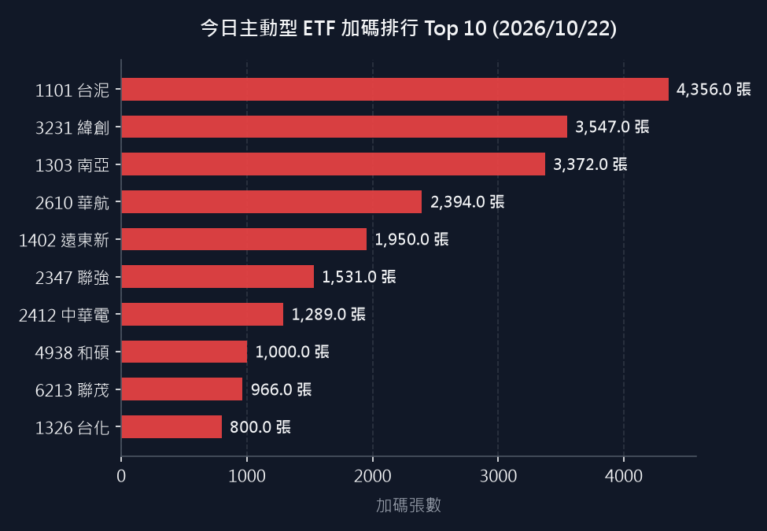
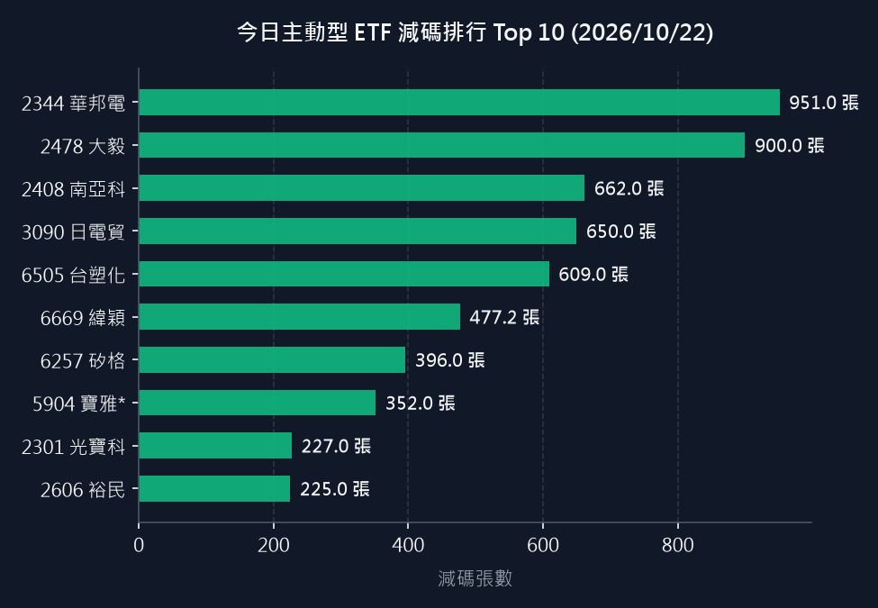

# 主動型 ETF 持股變動

資料來源：`主動型ETF持股明細.xlsx` 最近兩個日期分頁。

比較區間：`20261021` → `20261022`

## 今日加減碼視覺化排行

| 今日加碼 Top 10 | 今日減碼 Top 10 |
| :---: | :---: |
|  |  |

| ETF | 新增 | 刪除 | 比例變動 |
| :-- | --: | --: | --: |
| 00400A | 2 | 1 | 45 |
| 00401A | 1 | 2 | 45 |
| 00402A | 0 | 0 | 41 |
| 00403A | 0 | 0 | 32 |
| 00404A | 0 | 0 | 41 |
| 00405A | 0 | 0 | 20 |
| 00406A | 2 | 2 | 58 |
| 00407A | 0 | 0 | 42 |
| 00408A | 0 | 0 | 44 |
| 00980A | 0 | 0 | 44 |
| 00980D | 0 | 0 | 29 |
| 00981A | 0 | 1 | 26 |
| 00982A | 0 | 0 | 41 |
| 00983A | 0 | 0 | 37 |
| 00983D | 0 | 0 | 74 |
| 00984A | 0 | 0 | 61 |
| 00985A | 0 | 0 | 45 |
| 00986A | 0 | 0 | 31 |
| 00987A | 0 | 0 | 26 |
| 00988A | 1 | 2 | 36 |
| 00989A | 0 | 0 | 52 |
| 00990A | 0 | 1 | 39 |
| 00991A | 0 | 0 | 17 |
| 00992A | 0 | 0 | 33 |
| 00993A | 10 | 10 | 40 |
| 00994A | 0 | 1 | 36 |
| 00995A | 1 | 2 | 41 |
| 00996A | 0 | 0 | 37 |
| 00997A | 1 | 0 | 43 |
| 00998A | 1 | 3 | 47 |
| 00999A | 0 | 0 | 49 |

## 00400A

### 新增持股

- 3406 玉晶光（0.95%，245 張）
- 6274 台燿（1.32%，279 張）

### 刪除持股

- 6669 緯穎（1.35%，221 張）

### 投資比例變動

- 1303 南亞：4.34% → 4.19%（-0.15）
- 1476 儒鴻：0.07% → 0.08%（+0.01）
- 2059 川湖：3.67% → 3.65%（-0.02）
- 2303 聯電：1.75% → 1.76%（+0.01）
- 2308 台達電：2.51% → 2.48%（-0.03）
- 2313 華通：0.87% → 0.83%（-0.04）
- 2317 鴻海：0.78% → 0.79%（+0.01）
- 2327 國巨*：1.25% → 1.20%（-0.05）
- 2330 台積電：8.90% → 9.01%（+0.11）
- 2360 致茂：3.07% → 3.11%（+0.04）
- 2368 金像電：2.85% → 2.73%（-0.12）
- 2383 台光電：4.12% → 4.30%（+0.18）
- 2449 京元電子：0.90% → 0.88%（-0.02）
- 2454 聯發科：6.92% → 6.89%（-0.03）
- 2603 長榮：1.57% → 1.63%（+0.06）
- 2637 慧洋-KY：0.47% → 0.48%（+0.01）
- 2881 富邦金：1.60% → 1.64%（+0.04）
- 2891 中信金：1.59% → 1.64%（+0.05）
- 3008 大立光：1.53% → 1.57%（+0.04）
- 3036 文曄：1.53% → 1.57%（+0.04）
- 3037 欣興：3.83% → 3.88%（+0.05）
- 3044 健鼎：2.44% → 2.39%（-0.05）
- 3081 聯亞：0.70% → 0.65%（-0.05）
- 3090 日電貿：0.32% → 0.31%（-0.01）
- 3167 大量：0.37% → 0.36%（-0.01）
- 3293 鈊象：0.34% → 0.35%（+0.01）
- 3443 創意：2.52% → 2.46%（-0.06）
- 3529 力旺：1.20% → 1.18%（-0.02）
- 3653 健策：3.27% → 3.12%（-0.15）
- 3661 世芯-KY：2.22% → 2.15%（-0.07）
- 3665 貿聯-KY：1.45% → 1.43%（-0.02）
- 3711 日月光投控：1.03% → 1.01%（-0.02）
- 4958 臻鼎-KY：0.48% → 0.49%（+0.01）
- 5274 信驊：1.53% → 1.52%（-0.01）
- 6121 新普：0.21% → 0.22%（+0.01）
- 6147 頎邦：0.90% → 0.88%（-0.02）
- 6187 萬潤：1.08% → 1.05%（-0.03）
- 6223 旺矽：2.95% → 2.96%（+0.01）
- 6271 同欣電：0.26% → 0.24%（-0.02）
- 6278 台表科：2.93% → 2.76%（-0.17）
- 6488 環球晶：2.53% → 2.44%（-0.09）
- 7750 新代：0.75% → 0.74%（-0.01）
- 7769 鴻勁：0.12% → 0.70%（+0.58）
- 9939 宏全：0.07% → 0.08%（+0.01）
- ＸＡＧＸ金兌(3533.HK)：0.90% → 0.91%（+0.01）

## 00401A

### 新增持股

- TAIWAN TAIE C 18NOV26 46500 TWSE（-0.63%，-0.38 張）

### 刪除持股

- 臺指選擇權10/26 46000 買權（-0.02%，-0.02 張）
- 臺指選擇權10/26 46400 買權（-0.10%，-0.32 張）

### 投資比例變動

- 1216 統一：0.28% → 0.29%（+0.01）
- 1303 南亞：1.30% → 1.25%（-0.05）
- 1477 聚陽：0.94% → 0.95%（+0.01）
- 2059 川湖：0.82% → 0.81%（-0.01）
- 2308 台達電：2.23% → 2.18%（-0.05）
- 2313 華通：1.49% → 1.41%（-0.08）
- 2327 國巨*：0.61% → 0.58%（-0.03）
- 2330 台積電：20.30% → 20.39%（+0.09）
- 2357 華碩：1.89% → 1.85%（-0.04）
- 2379 瑞昱：1.14% → 1.13%（-0.01）
- 2382 廣達：2.14% → 2.13%（-0.01）
- 2383 台光電：1.01% → 1.05%（+0.04）
- 2412 中華電：0.87% → 0.91%（+0.04）
- 2454 聯發科：5.84% → 5.76%（-0.08）
- 2455 全新：2.10% → 2.03%（-0.07）
- 2603 長榮：1.56% → 1.61%（+0.05）
- 2881 富邦金：2.11% → 2.15%（+0.04）
- 2882 國泰金：1.07% → 1.08%（+0.01）
- 2883 凱基金：1.67% → 1.68%（+0.01）
- 2884 玉山金：2.11% → 2.17%（+0.06）
- 2886 兆豐金：1.44% → 1.51%（+0.07）
- 2887 台新新光金：1.08% → 1.11%（+0.03）
- 2890 永豐金：0.49% → 0.51%（+0.02）
- 2891 中信金：1.86% → 1.90%（+0.04）
- 2912 統一超：0.26% → 0.27%（+0.01）
- 3008 大立光：2.21% → 2.25%（+0.04）
- 3037 欣興：2.27% → 2.28%（+0.01）
- 3131 弘塑：0.63% → 0.60%（-0.03）
- 3231 緯創：1.76% → 1.75%（-0.01）
- 3491 昇達科：1.65% → 1.55%（-0.10）
- 3711 日月光投控：2.59% → 2.52%（-0.07）
- 4904 遠傳：0.80% → 0.83%（+0.03）
- 4991 環宇-KY：0.60% → 0.56%（-0.04）
- 5274 信驊：1.73% → 1.71%（-0.02）
- 5347 世界：1.29% → 1.27%（-0.02）
- 5904 寶雅*：0.56% → 0.57%（+0.01）
- 6147 頎邦：1.38% → 1.34%（-0.04）
- 6187 萬潤：0.70% → 0.68%（-0.02）
- 6285 啟碁：1.41% → 1.34%（-0.07）
- 6515 穎崴：0.92% → 0.90%（-0.02）
- 6531 愛普*：1.47% → 1.43%（-0.04）
- 7769 鴻勁：0.92% → 0.96%（+0.04）
- 7828 創新服務：1.39% → 1.34%（-0.05）
- 8464 億豐：0.98% → 1.00%（+0.02）
- 台股期貨11/26(FITXN*1.TF)：0.00% → -0.11%（-0.11）

## 00402A

### 新增持股

- 無

### 刪除持股

- 無

### 投資比例變動

- AAPL.US Apple：8.03% → 8.01%（-0.02）
- ADI.US Analog Devices：1.98% → 1.99%（+0.01）
- AMD.US AMD：5.77% → 5.88%（+0.11）
- AMZN.US Amazon：4.63% → 4.56%（-0.07）
- ANET.US Arista Networks：0.79% → 0.80%（+0.01）
- ASML.US ASML Holding：1.17% → 1.19%（+0.02）
- AVGO.US Broadcom：2.19% → 2.18%（-0.01）
- BABA.US Alibaba Group：0.50% → 0.48%（-0.02）
- BKNG.US Booking Holdings：0.55% → 0.52%（-0.03）
- CIEN.US Ciena：1.13% → 1.17%（+0.04）
- COHR.US Coherent：1.14% → 1.15%（+0.01）
- CRWD.US CrowdStrike Holdings：1.53% → 1.58%（+0.05）
- DASH.US DoorDash：0.49% → 0.47%（-0.02）
- FSLY.US Fastly：0.33% → 0.35%（+0.02）
- GOOG.US Alphabet - Class C Capital Stock：3.45% → 3.35%（-0.10）
- GOOGL.US Alphabet - Class A Common Stock：3.47% → 3.36%（-0.11）
- IOT.US Samsara：0.57% → 0.58%（+0.01）
- LITE.US Lumentum：1.68% → 1.71%（+0.03）
- LRCX.US Lam Research：2.42% → 2.36%（-0.06）
- MDB.US MongoDB：0.40% → 0.42%（+0.02）
- META.US Meta：3.79% → 3.75%（-0.04）
- MRVL.US Marvell：1.67% → 1.68%（+0.01）
- MSFT.US Microsoft：5.55% → 5.48%（-0.07）
- MU.US Micron：5.64% → 5.67%（+0.03）
- NFLX.US Netflix：0.99% → 0.93%（-0.06）
- NOW.US ServiceNow：1.19% → 1.20%（+0.01）
- NVDA.US NVIDIA：8.81% → 8.87%（+0.06）
- PANW.US Palo Alto：2.69% → 2.71%（+0.02）
- PLTR.US Palantir Technologies：2.20% → 2.27%（+0.07）
- SHOP.US Shopify：1.26% → 1.25%（-0.01）
- SIMO.US Silicon Motion：0.49% → 0.50%（+0.01）
- SKHY.US SK hynix：0.77% → 0.78%（+0.01）
- SPCX.US SpaceX：0.75% → 0.80%（+0.05）
- SPOT.US Spotify：0.38% → 0.37%（-0.01）
- STX.US Seagate：1.05% → 1.07%（+0.02）
- TER.US Teradyne：0.77% → 0.78%（+0.01）
- TTWO.US Take-Two：0.61% → 0.60%（-0.01）
- TXN.US Texas Instruments：2.43% → 2.46%（+0.03）
- UBER.US Uber：0.32% → 0.31%（-0.01）
- V.US Visa：1.27% → 1.25%（-0.02）
- WDC.US Western Digital：1.84% → 1.88%（+0.04）

## 00403A

### 新增持股

- 無

### 刪除持股

- 無

### 投資比例變動

- 1303 南亞：2.95% → 2.85%（-0.10）
- 2059 川湖：0.70% → 0.69%（-0.01）
- 2303 聯電：0.98% → 0.99%（+0.01）
- 2308 台達電：3.61% → 3.57%（-0.04）
- 2313 華通：0.37% → 0.35%（-0.02）
- 2317 鴻海：0.61% → 0.62%（+0.01）
- 2327 國巨*：3.66% → 3.52%（-0.14）
- 2330 台積電：14.28% → 14.50%（+0.22）
- 2345 智邦：2.23% → 2.24%（+0.01）
- 2368 金像電：0.75% → 0.72%（-0.03）
- 2383 台光電：4.59% → 4.80%（+0.21）
- 2408 南亞科：0.94% → 0.92%（-0.02）
- 2449 京元電子：0.85% → 0.83%（-0.02）
- 2454 聯發科：4.76% → 4.75%（-0.01）
- 2455 全新：0.08% → 0.07%（-0.01）
- 2882 國泰金：0.35% → 0.36%（+0.01）
- 3008 大立光：1.77% → 1.83%（+0.06）
- 3017 奇鋐：5.54% → 5.65%（+0.11）
- 3037 欣興：5.90% → 6.17%（+0.27）
- 3189 景碩：3.45% → 3.46%（+0.01）
- 3211 順達：0.52% → 0.51%（-0.01）
- 3443 創意：4.17% → 4.07%（-0.10）
- 3450 聯鈞：0.52% → 0.50%（-0.02）
- 3653 健策：5.59% → 4.79%（-0.80）
- 3665 貿聯-KY：2.18% → 2.16%（-0.02）
- 6223 旺矽：3.57% → 3.59%（+0.02）
- 6274 台燿：2.76% → 2.69%（-0.07）
- 6285 啟碁：0.07% → 0.06%（-0.01）
- 6442 光聖：0.40% → 0.39%（-0.01）
- 6669 緯穎：2.67% → 2.69%（+0.02）
- 8046 南電：3.09% → 3.01%（-0.08）
- 8996 高力：2.39% → 2.32%（-0.07）

## 00404A

### 新增持股

- 無

### 刪除持股

- 無

### 投資比例變動

- 1303 南亞：0.86% → 0.82%（-0.04）
- 2059 川湖：0.51% → 0.50%（-0.01）
- 2301 光寶科：0.55% → 0.54%（-0.01）
- 2308 台達電：1.64% → 1.60%（-0.04）
- 2330 台積電：22.65% → 22.74%（+0.09）
- 2347 聯強：2.00% → 2.03%（+0.03）
- 2351 順德：0.38% → 0.37%（-0.01）
- 2357 華碩：1.24% → 1.22%（-0.02）
- 2379 瑞昱：1.18% → 1.17%（-0.01）
- 2383 台光電：2.77% → 2.87%（+0.10）
- 2454 聯發科：6.42% → 6.34%（-0.08）
- 2637 慧洋-KY：1.15% → 1.17%（+0.02）
- 2882 國泰金：2.88% → 2.92%（+0.04）
- 2885 元大金：2.54% → 2.63%（+0.09）
- 2887 台新新光金：1.49% → 1.53%（+0.04）
- 2890 永豐金：1.48% → 1.54%（+0.06）
- 3017 奇鋐：1.31% → 1.29%（-0.02）
- 3034 聯詠：2.28% → 2.29%（+0.01）
- 3264 欣銓：0.70% → 0.67%（-0.03）
- 3293 鈊象：1.18% → 1.21%（+0.03）
- 3443 創意：1.01% → 0.97%（-0.04）
- 3653 健策：0.49% → 0.47%（-0.02）
- 3680 家登：0.50% → 0.49%（-0.01）
- 3711 日月光投控：3.35% → 3.26%（-0.09）
- 5274 信驊：2.68% → 2.65%（-0.03）
- 5434 崇越：1.76% → 1.72%（-0.04）
- 5876 上海商銀：1.59% → 1.65%（+0.06）
- 5904 寶雅*：0.52% → 0.53%（+0.01）
- 6196 帆宣：1.77% → 1.75%（-0.02）
- 6206 飛捷：0.73% → 0.72%（-0.01）
- 6257 矽格：1.73% → 1.65%（-0.08）
- 6491 晶碩：0.93% → 0.94%（+0.01）
- 6505 台塑化：0.52% → 0.51%（-0.01）
- 6691 洋基工程：1.56% → 1.57%（+0.01）
- 7769 鴻勁：1.04% → 1.08%（+0.04）
- 8016 矽創：1.28% → 1.29%（+0.01）
- 8081 致新：0.88% → 0.90%（+0.02）
- 8299 群聯：1.22% → 1.21%（-0.01）
- iShares MSCI Japan SRI ETF(2851.JP)：1.19% → 1.22%（+0.03）
- 台指選擇權11/26 50900 買權：-0.09% → -0.06%（+0.03）
- 台股期貨11/26(FITXN*1.TF)：17.08% → -0.33%（-17.41）

## 00405A

### 新增持股

- 無

### 刪除持股

- 無

### 投資比例變動

- 2330 台積電：1.94% → 1.98%（+0.04）
- 2345 智邦：4.95% → 5.00%（+0.05）
- 2368 金像電：6.03% → 5.82%（-0.21）
- 2383 台光電：4.74% → 4.98%（+0.24）
- 2454 聯發科：5.45% → 5.46%（+0.01）
- 3017 奇鋐：4.03% → 4.05%（+0.02）
- 3037 欣興：7.54% → 7.68%（+0.14）
- 3443 創意：6.20% → 6.07%（-0.13）
- 3653 健策：7.61% → 7.30%（-0.31）
- 3665 貿聯-KY：5.81% → 5.77%（-0.04）
- 5274 信驊：5.87% → 5.88%（+0.01）
- 6187 萬潤：0.88% → 0.86%（-0.02）
- 6223 旺矽：7.24% → 7.31%（+0.07）
- 6274 台燿：2.06% → 2.01%（-0.05）
- 6531 愛普*：3.83% → 3.79%（-0.04）
- 6669 緯穎：0.83% → 0.84%（+0.01）
- 6805 富世達：3.66% → 3.69%（+0.03）
- 7769 鴻勁：2.76% → 2.93%（+0.17）
- 8046 南電：7.80% → 7.61%（-0.19）
- 8996 高力：1.49% → 1.44%（-0.05）

## 00406A

### 新增持股

- 3231 緯創（0.37%，2100 張）
- 臺指選擇權第四週週三到期契約（-3.09%，-2.2 張）

### 刪除持股

- 6139 亞翔（0.05%，72 張）
- 臺指選擇權（-19.14%，-11.7 張）

### 投資比例變動

- 1303 南亞：1.54% → 1.97%（+0.43）
- 1326 台化：0.44% → 0.46%（+0.02）
- 1560 中砂：0.36% → 0.33%（-0.03）
- 2059 川湖：0.93% → 1.22%（+0.29）
- 2303 聯電：1.77% → 1.64%（-0.13）
- 2308 台達電：2.54% → 2.57%（+0.03）
- 2317 鴻海：0.34% → 0.32%（-0.02）
- 2327 國巨*：1.87% → 1.86%（-0.01）
- 2330 台積電：9.64% → 9.48%（-0.16）
- 2344 華邦電：0.09% → 0.08%（-0.01）
- 2345 智邦：3.82% → 3.21%（-0.61）
- 2360 致茂：1.30% → 1.20%（-0.10）
- 2368 金像電：1.51% → 1.84%（+0.33）
- 2383 台光電：6.63% → 6.73%（+0.10）
- 2449 京元電子：0.47% → 0.59%（+0.12）
- 2454 聯發科：5.74% → 5.48%（-0.26）
- 2481 強茂：0.54% → 0.50%（-0.04）
- 2486 一詮：0.17% → 0.16%（-0.01）
- 2885 元大金：0.60% → 0.58%（-0.02）
- 3008 大立光：1.50% → 1.44%（-0.06）
- 3017 奇鋐：5.27% → 5.28%（+0.01）
- 3037 欣興：5.67% → 5.88%（+0.21）
- 3081 聯亞：0.24% → 0.22%（-0.02）
- 3131 弘塑：0.05% → 0.04%（-0.01）
- 3167 大量：0.63% → 0.56%（-0.07）
- 3189 景碩：2.01% → 2.15%（+0.14）
- 3264 欣銓：0.39% → 0.50%（+0.11）
- 3363 上詮：0.20% → 0.18%（-0.02）
- 3443 創意：2.27% → 2.25%（-0.02）
- 3450 聯鈞：0.13% → 0.12%（-0.01）
- 3491 昇達科：0.44% → 0.40%（-0.04）
- 3529 力旺：0.20% → 0.17%（-0.03）
- 3653 健策：3.60% → 3.69%（+0.09）
- 3661 世芯-KY：0.76% → 0.78%（+0.02）
- 3665 貿聯-KY：1.47% → 1.34%（-0.13）
- 3711 日月光投控：2.02% → 1.99%（-0.03）
- 4938 和碩：0.52% → 0.58%（+0.06）
- 4958 臻鼎-KY：1.03% → 1.16%（+0.13）
- 5274 信驊：2.07% → 2.05%（-0.02）
- 6147 頎邦：0.82% → 0.77%（-0.05）
- 6187 萬潤：0.21% → 0.19%（-0.02）
- 6213 聯茂：0.37% → 0.72%（+0.35）
- 6223 旺矽：3.06% → 3.10%（+0.04）
- 6274 台燿：1.58% → 1.35%（-0.23）
- 6285 啟碁：0.08% → 0.07%（-0.01）
- 6488 環球晶：0.31% → 0.29%（-0.02）
- 6510 精測：0.85% → 0.78%（-0.07）
- 6515 穎崴：0.24% → 0.21%（-0.03）
- 6531 愛普*：0.13% → 0.12%（-0.01）
- 6669 緯穎：1.67% → 1.49%（-0.18）
- 6715 嘉基：0.73% → 0.89%（+0.16）
- 6805 富世達：0.05% → 0.36%（+0.31）
- 7769 鴻勁：0.21% → 0.20%（-0.01）
- 8046 南電：2.84% → 2.96%（+0.12）
- 8358 金居：0.11% → 0.10%（-0.01）
- 8996 高力：0.23% → 0.22%（-0.01）
- 臺指選擇權第四週週五到期契約：-3.09% → -15.28%（-12.19）
- 臺股期貨 202611(FITXN*1.TF)：23.09% → 23.08%（-0.01）

## 00407A

### 新增持股

- 無

### 刪除持股

- 無

### 投資比例變動

- 1303 南亞：0.99% → 2.06%（+1.07）
- 2059 川湖：1.95% → 1.92%（-0.03）
- 2301 光寶科：1.47% → 1.46%（-0.01）
- 2308 台達電：2.50% → 2.47%（-0.03）
- 2313 華通：0.47% → 0.44%（-0.03）
- 2327 國巨*：2.26% → 2.23%（-0.03）
- 2330 台積電：9.63% → 9.72%（+0.09）
- 2345 智邦：2.28% → 1.57%（-0.71）
- 2360 致茂：1.01% → 1.02%（+0.01）
- 2368 金像電：1.75% → 1.68%（-0.07）
- 2383 台光電：5.37% → 5.60%（+0.23）
- 2451 創見：0.33% → 0.34%（+0.01）
- 2454 聯發科：5.38% → 5.30%（-0.08）
- 2615 萬海：1.04% → 1.09%（+0.05）
- 3008 大立光：1.50% → 1.58%（+0.08）
- 3017 奇鋐：6.01% → 5.79%（-0.22）
- 3034 聯詠：0.83% → 0.86%（+0.03）
- 3037 欣興：5.58% → 6.38%（+0.80）
- 3081 聯亞：1.36% → 1.32%（-0.04）
- 3131 弘塑：0.82% → 0.78%（-0.04）
- 3231 緯創：1.09% → 1.12%（+0.03）
- 3260 威剛：0.29% → 0.28%（-0.01）
- 3293 鈊象：0.65% → 0.66%（+0.01）
- 3443 創意：4.78% → 4.77%（-0.01）
- 3491 昇達科：0.87% → 0.88%（+0.01）
- 3529 力旺：0.23% → 0.22%（-0.01）
- 3533 嘉澤：0.47% → 0.48%（+0.01）
- 3653 健策：3.72% → 3.46%（-0.26）
- 3665 貿聯-KY：2.58% → 2.56%（-0.02）
- 3711 日月光投控：3.03% → 3.06%（+0.03）
- 4958 臻鼎-KY：1.10% → 1.16%（+0.06）
- 5274 信驊：1.30% → 1.33%（+0.03）
- 6187 萬潤：1.62% → 1.58%（-0.04）
- 6223 旺矽：2.22% → 2.26%（+0.04）
- 6274 台燿：4.03% → 2.71%（-1.32）
- 6446 藥華藥：0.33% → 0.34%（+0.01）
- 6510 精測：1.42% → 1.43%（+0.01）
- 6669 緯穎：3.60% → 2.42%（-1.18）
- 6805 富世達：1.24% → 1.28%（+0.04）
- 8046 南電：3.32% → 3.78%（+0.46）
- 8299 群聯：0.30% → 0.31%（+0.01）
- 8996 高力：1.33% → 1.37%（+0.04）

## 00408A

### 新增持股

- 無

### 刪除持股

- 無

### 投資比例變動

- 1216 統一：0.11% → 0.12%（+0.01）
- 1303 南亞：4.18% → 4.04%（-0.14）
- 2303 聯電：1.36% → 1.37%（+0.01）
- 2308 台達電：2.70% → 2.66%（-0.04）
- 2327 國巨*：0.79% → 0.53%（-0.26）
- 2330 台積電：6.48% → 6.57%（+0.09）
- 2345 智邦：0.72% → 0.73%（+0.01）
- 2357 華碩：1.57% → 1.20%（-0.37）
- 2360 致茂：1.17% → 1.18%（+0.01）
- 2368 金像電：5.46% → 5.24%（-0.22）
- 2383 台光電：4.89% → 5.11%（+0.22）
- 2395 研華：1.68% → 1.70%（+0.02）
- 2408 南亞科：1.33% → 1.30%（-0.03）
- 2449 京元電子：0.95% → 0.92%（-0.03）
- 2454 聯發科：4.20% → 4.19%（-0.01）
- 2455 全新：0.43% → 0.42%（-0.01）
- 2542 興富發：3.93% → 4.03%（+0.10）
- 2603 長榮：1.31% → 1.36%（+0.05）
- 2880 華南金：1.26% → 1.31%（+0.05）
- 2891 中信金：0.33% → 0.84%（+0.51）
- 3008 大立光：0.89% → 0.92%（+0.03）
- 3026 禾伸堂：0.89% → 0.85%（-0.04）
- 3037 欣興：3.27% → 3.32%（+0.05）
- 3081 聯亞：2.19% → 2.04%（-0.15）
- 3105 穩懋：0.52% → 0.51%（-0.01）
- 3189 景碩：3.59% → 3.60%（+0.01）
- 3264 欣銓：0.83% → 0.79%（-0.04）
- 3443 創意：0.58% → 0.57%（-0.01）
- 3653 健策：3.70% → 3.53%（-0.17）
- 3665 貿聯-KY：1.12% → 1.10%（-0.02）
- 3711 日月光投控：1.59% → 1.56%（-0.03）
- 5434 崇越：2.41% → 2.38%（-0.03）
- 6187 萬潤：1.06% → 1.03%（-0.03）
- 6223 旺矽：2.10% → 2.11%（+0.01）
- 6274 台燿：3.48% → 3.39%（-0.09）
- 6488 環球晶：0.89% → 0.86%（-0.03）
- 6510 精測：0.47% → 0.46%（-0.01）
- 6669 緯穎：2.01% → 2.03%（+0.02）
- 6691 洋基工程：0.34% → 0.35%（+0.01）
- 6805 富世達：2.43% → 2.44%（+0.01）
- 7769 鴻勁：0.56% → 0.59%（+0.03）
- 8046 南電：1.65% → 1.60%（-0.05）
- 8996 高力：2.65% → 2.56%（-0.09）
- 9802 鈺齊-KY：0.88% → 0.90%（+0.02）

## 00980A

### 新增持股

- 無

### 刪除持股

- 無

### 投資比例變動

- 1303 南亞：3.60% → 3.48%（-0.12）
- 2059 川湖：4.23% → 4.21%（-0.02）
- 2303 聯電：1.36% → 1.56%（+0.20）
- 2308 台達電：3.48% → 3.44%（-0.04）
- 2317 鴻海：2.88% → 3.28%（+0.40）
- 2327 國巨*：0.92% → 0.89%（-0.03）
- 2330 台積電：9.67% → 9.81%（+0.14）
- 2344 華邦電：1.64% → 1.63%（-0.01）
- 2345 智邦：0.96% → 0.97%（+0.01）
- 2360 致茂：1.17% → 1.19%（+0.02）
- 2368 金像電：2.14% → 2.05%（-0.09）
- 2376 技嘉：1.42% → 1.67%（+0.25）
- 2382 廣達：1.68% → 1.93%（+0.25）
- 2383 台光電：3.81% → 3.99%（+0.18）
- 2408 南亞科：2.54% → 2.19%（-0.35）
- 2454 聯發科：5.47% → 5.46%（-0.01）
- 2884 玉山金：1.27% → 1.32%（+0.05）
- 2891 中信金：1.55% → 1.60%（+0.05）
- 3008 大立光：1.83% → 2.19%（+0.36）
- 3026 禾伸堂：1.24% → 1.18%（-0.06）
- 3036 文曄：1.02% → 1.05%（+0.03）
- 3037 欣興：3.65% → 3.71%（+0.06）
- 3044 健鼎：1.13% → 1.37%（+0.24）
- 3081 聯亞：1.67% → 1.55%（-0.12）
- 3231 緯創：1.46% → 1.72%（+0.26）
- 3264 欣銓：0.91% → 0.88%（-0.03）
- 3293 鈊象：0.46% → 0.47%（+0.01）
- 3443 創意：1.91% → 1.87%（-0.04）
- 3653 健策：3.12% → 2.99%（-0.13）
- 3665 貿聯-KY：1.14% → 1.47%（+0.33）
- 3711 日月光投控：2.25% → 2.22%（-0.03）
- 5904 寶雅*：0.81% → 0.69%（-0.12）
- 6213 聯茂：1.10% → 1.51%（+0.41）
- 6223 旺矽：1.97% → 1.31%（-0.66）
- 6274 台燿：1.40% → 1.37%（-0.03）
- 6442 光聖：0.30% → 0.29%（-0.01）
- 6515 穎崴：1.61% → 1.60%（-0.01）
- 6669 緯穎：1.85% → 1.86%（+0.01）
- 6831 邁科：0.29% → 0.28%（-0.01）
- 7751 竑騰：0.70% → 0.65%（-0.05）
- 7769 鴻勁：2.37% → 2.05%（-0.32）
- 8046 南電：1.79% → 1.74%（-0.05）
- 8996 高力：0.51% → 0.49%（-0.02）
- 台灣證交所加權股價指數(FITXN*1.TF)：1.50% → 1.52%（+0.02）

## 00980D

### 新增持股

- 無

### 刪除持股

- 無

### 投資比例變動

- AHOLD FINANCE USA LLC 6.88% 01MAY2029：0.51% → 0.50%（-0.01）
- APOLLO DEBT SOLUTIONS BD 6.900000 % 13APR2029：0.58% → 0.57%（-0.01）
- BAT CAPITAL CORP (REG) 7.081% 02AUG2053：0.60% → 0.59%（-0.01）
- BPCE SA SER REGS VAR 14JAN2046：0.40% → 0.39%（-0.01）
- BRITISH TELECOMMUNICATIO (BR) 9.625% 15DEC2030：0.60% → 0.59%（-0.01）
- CHARTER COMM OPT 6.484% 23OCT2045 W/I：0.45% → 0.44%（-0.01）
- CHC GROUP LLC SER REGS 11.750000 % 01-SEP-2030：0.45% → 0.46%（+0.01）
- CHS/COMMUNITY HEALTH SYS SER REGS 10.875000 % 15JAN2032：0.52% → 0.51%（-0.01）
- CONCENTRIX CORP (REG) 6.85% 02AUG2033：0.74% → 0.73%（-0.01）
- CONOCOPHILLIPS COMPANY (REG) 6.95% 15APR2029：0.54% → 0.53%（-0.01）
- COREWEAVE INC SER REGS (REG S) 9.75% 01OCT2031：0.47% → 0.48%（+0.01）
- COREWEAVE INC SER REGS (REG) (REG S) 9.625% 15JUL2032：0.47% → 0.48%（+0.01）
- COX COMMUNICATIONS INC SER REGS 5.800000 % 15DEC2053：0.51% → 0.50%（-0.01）
- GLENCORE FINANCE CANADA SER REGS 6.900000 % 15-NOV-2037：0.41% → 0.40%（-0.01）
- ICAHN ENTERPRISES/FIN (REG) 9.75% 15JAN2029：0.34% → 0.33%（-0.01）
- INTESA SANPAOLO SPA SER REGS (REG S) 7.8% 28NOV2053：0.38% → 0.37%（-0.01）
- JBS USA HOLD/FOOD/LUX CO 7.250000 % 15NOV2053：0.49% → 0.48%（-0.01）
- LBM ACQUISITION LLC SER REGS 9.500000 % 15JUN2031：0.41% → 0.42%（+0.01）
- MYLAN NV 5.25% 15JUN2046 WI：0.55% → 0.56%（+0.01）
- PROGRESS ENERGY INC (REG) 7.75% 01MAR2031：0.60% → 0.59%（-0.01）
- SPACE EXPLORATION TECH SER 144A (REG) 6.65% 15JUL2056：0.32% → 0.31%（-0.01）
- STAPLES INC SER REGS (REG S) 10.75% 01SEP2029：0.50% → 0.51%（+0.01）
- UNISYS CORP SER REGS 10.625000 % 15JAN2031：0.61% → 0.60%（-0.01）
- US 10YR NOTE (CBT)DEC26 21-DEC-2026：18.54% → 18.48%（-0.06）
- US 5YR NOTE (CBT) DEC26 31-DEC-2026：-14.08% → -14.04%（+0.04）
- US LONG BOND(CBT) DEC26 21-DEC-2026：5.54% → 5.53%（-0.01）
- VIACOM INC (REG) 5.85% 01SEP2043：0.47% → 0.48%（+0.01）
- VIACOMCBS INC (REG) 4.95% 19MAY2050：0.42% → 0.43%（+0.01）
- VISTRA OPERATIONS CO LLC SER REGS (REG S) 6.95% 15OCT2033：0.43% → 0.42%（-0.01）

## 00981A

### 新增持股

- 無

### 刪除持股

- 4966 譜瑞-KY（0.00%，1 張）

### 投資比例變動

- 2303 聯電：3.71% → 3.75%（+0.04）
- 2308 台達電：4.49% → 4.44%（-0.05）
- 2327 國巨*：4.64% → 4.47%（-0.17）
- 2330 台積電：11.16% → 11.34%（+0.18）
- 2345 智邦：4.18% → 4.22%（+0.04）
- 2368 金像電：3.00% → 2.89%（-0.11）
- 2383 台光電：7.86% → 8.23%（+0.37）
- 2449 京元電子：0.67% → 0.65%（-0.02）
- 2454 聯發科：7.75% → 7.74%（-0.01）
- 3017 奇鋐：7.60% → 7.62%（+0.02）
- 3037 欣興：7.88% → 8.01%（+0.13）
- 3264 欣銓：0.47% → 0.45%（-0.02）
- 3376 新日興：0.12% → 0.11%（-0.01）
- 3443 創意：2.48% → 2.42%（-0.06）
- 3653 健策：5.98% → 5.72%（-0.26）
- 3665 貿聯-KY：2.05% → 2.03%（-0.02）
- 3711 日月光投控：2.08% → 2.18%（+0.10）
- 4979 華星光：0.17% → 0.16%（-0.01）
- 6223 旺矽：4.56% → 4.59%（+0.03）
- 6274 台燿：3.95% → 3.85%（-0.10）
- 6510 精測：0.55% → 0.54%（-0.01）
- 6669 緯穎：2.25% → 2.27%（+0.02）
- 6805 富世達：0.80% → 0.81%（+0.01）
- 8046 南電：4.36% → 4.24%（-0.12）
- 8996 高力：0.59% → 0.57%（-0.02）
- 台指期貨 2026/11(FITXN*1.TF)：2.32% → 2.36%（+0.04）

## 00982A

### 新增持股

- 無

### 刪除持股

- 無

### 投資比例變動

- 2059 川湖：2.81% → 2.74%（-0.07）
- 2301 光寶科：1.83% → 1.80%（-0.03）
- 2330 台積電：8.01% → 8.02%（+0.01）
- 2360 致茂：3.67% → 4.10%（+0.43）
- 2376 技嘉：1.34% → 1.33%（-0.01）
- 2383 台光電：3.30% → 3.41%（+0.11）
- 2395 研華：1.42% → 1.41%（-0.01）
- 2428 興勤：1.24% → 1.21%（-0.03）
- 2454 聯發科：7.04% → 6.86%（-0.18）
- 2455 全新：1.61% → 1.56%（-0.05）
- 2467 志聖：1.04% → 0.98%（-0.06）
- 2476 鉅祥：0.34% → 0.32%（-0.02）
- 2478 大毅：0.57% → 0.34%（-0.23）
- 2486 一詮：0.72% → 0.70%（-0.02）
- 2885 元大金：0.34% → 0.35%（+0.01）
- 3008 大立光：3.26% → 3.40%（+0.14）
- 3017 奇鋐：2.68% → 2.56%（-0.12）
- 3090 日電貿：0.56% → 0.34%（-0.22）
- 3105 穩懋：5.85% → 6.04%（+0.19）
- 3231 緯創：1.48% → 2.00%（+0.52）
- 3265 台星科：1.80% → 1.66%（-0.14）
- 3583 辛耘：1.05% → 1.02%（-0.03）
- 4958 臻鼎-KY：3.73% → 3.90%（+0.17）
- 5274 信驊：1.23% → 1.25%（+0.02）
- 5425 台半：1.25% → 1.24%（-0.01）
- 5483 中美晶：1.42% → 1.39%（-0.03）
- 5536 聖暉*：0.80% → 0.78%（-0.02）
- 6196 帆宣：0.39% → 0.40%（+0.01）
- 6213 聯茂：1.52% → 1.59%（+0.07）
- 6214 精誠：1.46% → 1.50%（+0.04）
- 6223 旺矽：3.18% → 3.20%（+0.02）
- 6239 力成：1.06% → 1.03%（-0.03）
- 6274 台燿：1.41% → 1.30%（-0.11）
- 6446 藥華藥：0.10% → 0.11%（+0.01）
- 6472 保瑞：0.92% → 0.91%（-0.01）
- 6488 環球晶：1.99% → 1.96%（-0.03）
- 6531 愛普*：3.64% → 3.98%（+0.34）
- 6669 緯穎：4.22% → 3.71%（-0.51）
- 6672 騰輝電子-KY：1.45% → 1.49%（+0.04）
- 8070 長華*：0.47% → 0.46%（-0.01）
- 8996 高力：1.27% → 1.30%（+0.03）

## 00983A

### 新增持股

- 無

### 刪除持股

- 無

### 投資比例變動

- ACHR.US Archer：0.05% → 0.04%（-0.01）
- AMD.US AMD：3.29% → 3.24%（-0.05）
- AMZN.US Amazon：3.47% → 3.41%（-0.06）
- AVGO.US Broadcom：1.58% → 1.52%（-0.06）
- BEAM.US Beam Therapeutics：1.65% → 1.57%（-0.08）
- BLSH.US Bullish：2.03% → 2.01%（-0.02）
- COIN.US Coinbase：4.62% → 4.56%（-0.06）
- CRCL.US Circle：5.46% → 5.44%（-0.02）
- CRSP.US CRISPR Therapeutics：3.76% → 3.63%（-0.13）
- CRWV.US CoreWeave：0.95% → 0.90%（-0.05）
- DE.US Deere：0.42% → 0.40%（-0.02）
- FTNT.US Fortinet：0.45% → 0.43%（-0.02）
- GOOG.US Alphabet - Class C Capital Stock：1.63% → 1.53%（-0.10）
- GOOGL.US Alphabet - Class A Common Stock：0.82% → 1.62%（+0.80）
- HOOD.US Robinhood Markets：3.65% → 3.61%（-0.04）
- ILMN.US Illumina：1.79% → 1.80%（+0.01）
- KTOS.US Kratos Defense & Security：0.10% → 0.09%（-0.01）
- LLY.US Eli Lilly：0.84% → 1.58%（+0.74）
- META.US Meta：2.38% → 2.28%（-0.10）
- NET.US Cloudflare：1.31% → 1.32%（+0.01）
- NTLA.US Intellia Therapeutics：0.62% → 0.58%（-0.04）
- NTRA.US Natera：1.71% → 1.66%（-0.05）
- NVDA.US NVIDIA：3.39% → 3.54%（+0.15）
- RKLB.US Rocket Lab：1.20% → 1.21%（+0.01）
- RXRX.US Recursion Pharmaceuticals：0.88% → 0.84%（-0.04）
- SHOP.US Shopify：5.23% → 5.01%（-0.22）
- SNOW.US Snowflake：0.56% → 0.54%（-0.02）
- SOFI.US SoFi Technologies：0.15% → 0.14%（-0.01）
- SPCX.US SpaceX：6.85% → 7.04%（+0.19）
- TEM.US Tempus：5.40% → 5.22%（-0.18）
- TER.US Teradyne：0.60% → 0.59%（-0.01）
- TSLA.US Tesla：8.95% → 8.81%（-0.14）
- TSM.US TSMC(ADR)：2.74% → 2.66%（-0.08）
- TWST.US Twist Bioscience：3.70% → 3.68%（-0.02）
- TXG.US 10x Genomics：3.29% → 3.32%（+0.03）
- WGS.US GeneDx：0.52% → 0.50%（-0.02）
- XYZ.US Block：1.33% → 1.27%（-0.06）

## 00983D

### 新增持股

- 無

### 刪除持股

- 無

### 投資比例變動

- ABIBB 8.2 01/15/39：1.98% → 2.02%（+0.04）
- ABXCN 7 1/2 09/15/38：0.54% → 0.56%（+0.02）
- AET 6 5/8 06/15/36：0.74% → 0.75%（+0.01）
- ALLY 8 11/01/31：1.22% → 1.24%（+0.02）
- AMCX 10 1/2 07/15/32：1.62% → 1.65%（+0.03）
- ATH 6 5/8 05/19/55：0.99% → 1.01%（+0.02）
- AWK 6.593 10/15/37：0.72% → 0.73%（+0.01）
- BACR 7.437 11/02/33：1.29% → 1.31%（+0.02）
- BATSLN 7.079 08/02/43：1.10% → 1.12%（+0.02）
- BATSLN 7.081 08/02/53：1.34% → 1.20%（-0.14）
- BHCCN 11 09/30/28：1.93% → 1.97%（+0.04）
- BNCN 7 3/8 03/01/33：1.12% → 1.14%（+0.02）
- BRITEL 9 5/8 12/15/30：1.38% → 1.40%（+0.02）
- BRKHEC 6 3/4 07/01/37：0.83% → 0.84%（+0.01）
- C 8 1/8 07/15/39：1.94% → 1.99%（+0.05）
- CEG 6 1/2 10/01/53：0.79% → 0.81%（+0.02）
- CMCSA 6.95 08/15/37：0.67% → 0.69%（+0.02）
- CP 7 1/8 10/15/31：0.84% → 0.85%（+0.01）
- CRWV 9 02/01/31：1.18% → 1.20%（+0.02）
- CYH 10 7/8 01/15/32：1.54% → 1.55%（+0.01）
- DELL 8.1 07/15/36：1.54% → 1.57%（+0.03）
- DELL 8.35 07/15/46：1.40% → 1.43%（+0.03）
- DIS 7 3/4 12/01/45：0.61% → 0.62%（+0.01）
- DOW 6.9 05/15/53：0.76% → 0.78%（+0.02）
- DOW 9.4 05/15/39：1.96% → 2.00%（+0.04）
- DT 9 1/4 06/01/32：1.53% → 1.55%（+0.02）
- DTV 8 7/8 02/01/30：1.64% → 1.67%（+0.03）
- DUK 7 3/4 03/01/31：1.59% → 1.62%（+0.03）
- ED 6 3/4 04/01/38：0.62% → 0.64%（+0.02）
- ENBCN 6.7 11/15/53：0.80% → 0.62%（-0.18）
- ET 6 1/2 02/01/42：0.16% → 0.17%（+0.01）
- FFHCN 6.35 03/22/54：0.71% → 0.73%（+0.02）
- GE 6 3/4 03/15/32：0.59% → 0.60%（+0.01）
- GE 6 7/8 01/10/39：0.85% → 0.87%（+0.02）
- GM 6 3/4 04/01/46：0.87% → 0.89%（+0.02）
- GM 6.6 04/01/36：0.40% → 0.41%（+0.01）
- GS 6 1/4 02/01/41：0.32% → 0.33%（+0.01）
- GTN 10 1/2 07/15/29：0.34% → 0.35%（+0.01）
- HAL 7.45 09/15/39：1.84% → 1.88%（+0.04）
- HPE 6.35 10/15/45：1.00% → 1.02%（+0.02）
- HSBC 6.332 03/09/44：1.07% → 1.09%（+0.02）
- IEP 10 11/15/29：1.56% → 1.58%（+0.02）
- KHC 6 7/8 01/26/39：1.02% → 1.04%（+0.02）
- KMI 6.95 01/15/38：1.08% → 1.10%（+0.02）
- LOW 6.65 09/15/37：0.85% → 0.87%（+0.02）
- LQDW.US iShares LQD Premium Income+ ETF：7.40% → 7.55%（+0.15）
- MBGGR 8 1/2 01/18/31：1.34% → 1.36%（+0.02）
- MCD 6.3 03/01/38：0.40% → 0.41%（+0.01）
- MINAU 9 1/4 10/01/28：0.91% → 0.93%（+0.02）
- MOHEGN 11 7/8 04/15/31：1.39% → 1.42%（+0.03）
- MS 7 1/4 04/01/32：1.66% → 1.69%（+0.03）
- NTRCN 7 1/8 05/23/36：0.56% → 0.57%（+0.01）
- NVDA 5.55 06/15/46：1.16% → 1.18%（+0.02）
- OKE 6 5/8 09/01/53：0.72% → 0.74%（+0.02）
- ORCL 6.9 11/09/52：0.79% → 0.40%（-0.39）
- OXY 6.6 03/15/46：0.76% → 0.77%（+0.01）
- PCG 6 3/4 01/15/53：1.13% → 0.84%（-0.29）
- PCG 6.7 04/01/53：1.10% → 0.97%（-0.13）
- PFE 7.2 03/15/39：1.45% → 1.11%（-0.34）
- RAKUTN 11 1/4 02/15/27：1.86% → 1.89%（+0.03）
- RIOLN 7 1/4 03/15/31：0.52% → 0.53%（+0.01）
- S 8 3/4 03/15/32：1.51% → 1.54%（+0.03）
- SPCX 6.6 07/15/46：1.12% → 1.13%（+0.01）
- SUCN 6.85 06/01/39：1.23% → 1.04%（-0.19）
- TELEFO 8 1/4 09/15/30：1.03% → 1.05%（+0.02）
- TELEFONICA EMISIONES SAU 7.045 06/20/36：1.55% → 1.41%（-0.14）
- TIME WARNER CABLE INC 7.300 07/01/38：0.48% → 0.49%（+0.01）
- TLTW.US iShares TLT Premium Income+ ETF：8.05% → 8.28%（+0.23）
- TRGP 6 1/2 02/15/53：0.16% → 0.17%（+0.01）
- TRPCN 7 5/8 01/15/39：1.70% → 1.74%（+0.04）
- UNITEDHEALTH GROUP INC 6.875 02/15/38：0.88% → 0.89%（+0.01）
- VENLNG 9 1/2 02/01/29：1.45% → 1.48%（+0.03）
- VLO 6 5/8 06/15/37：0.75% → 0.77%（+0.02）
- VZ 7 3/4 12/01/30：1.17% → 1.19%（+0.02）

## 00984A

### 新增持股

- 無

### 刪除持股

- 無

### 投資比例變動

- 1216 統一：0.33% → 0.34%（+0.01）
- 1303 南亞：3.19% → 3.05%（-0.14）
- 1326 台化：1.05% → 1.02%（-0.03）
- 1560 中砂：1.22% → 1.20%（-0.02）
- 2059 川湖：2.12% → 2.09%（-0.03）
- 2330 台積電：4.28% → 4.29%（+0.01）
- 2344 華邦電：0.67% → 0.66%（-0.01）
- 2351 順德：0.63% → 0.61%（-0.02）
- 2357 華碩：0.65% → 0.63%（-0.02）
- 2379 瑞昱：0.33% → 0.32%（-0.01）
- 2383 台光電：1.29% → 1.33%（+0.04）
- 2408 南亞科：1.91% → 1.84%（-0.07）
- 2409 友達：1.26% → 1.22%（-0.04）
- 2454 聯發科：0.79% → 0.78%（-0.01）
- 2464 盟立：1.15% → 1.11%（-0.04）
- 2603 長榮：1.88% → 1.93%（+0.05）
- 2615 萬海：0.98% → 1.02%（+0.04）
- 2618 長榮航：0.31% → 0.32%（+0.01）
- 2637 慧洋-KY：0.33% → 0.34%（+0.01）
- 2801 彰銀：0.34% → 0.35%（+0.01）
- 2851 中再保：0.71% → 0.72%（+0.01）
- 2855 統一證：0.65% → 0.66%（+0.01）
- 2880 華南金：1.68% → 1.73%（+0.05）
- 2881 富邦金：4.34% → 4.44%（+0.10）
- 2882 國泰金：3.31% → 3.35%（+0.04）
- 2883 凱基金：2.48% → 2.49%（+0.01）
- 2884 玉山金：2.42% → 2.49%（+0.07）
- 2885 元大金：3.39% → 3.50%（+0.11）
- 2886 兆豐金：2.21% → 2.32%（+0.11）
- 2887 台新新光金：3.46% → 3.53%（+0.07）
- 2890 永豐金：2.43% → 2.53%（+0.10）
- 2892 第一金：1.33% → 1.38%（+0.05）
- 3006 晶豪科：0.57% → 0.55%（-0.02）
- 3008 大立光：1.59% → 1.62%（+0.03）
- 3017 奇鋐：4.27% → 4.22%（-0.05）
- 3037 欣興：1.65% → 1.66%（+0.01）
- 3045 台灣大：1.77% → 1.84%（+0.07）
- 3189 景碩：1.58% → 1.57%（-0.01）
- 3231 緯創：0.68% → 0.67%（-0.01）
- 3264 欣銓：1.93% → 1.83%（-0.10）
- 3443 創意：1.22% → 1.18%（-0.04）
- 3450 聯鈞：0.65% → 0.62%（-0.03）
- 3605 宏致：0.69% → 0.68%（-0.01）
- 3653 健策：1.75% → 1.65%（-0.10）
- 3661 世芯-KY：0.28% → 0.27%（-0.01）
- 3665 貿聯-KY：0.56% → 0.55%（-0.01）
- 3711 日月光投控：0.61% → 0.60%（-0.01）
- 5274 信驊：1.14% → 1.12%（-0.02）
- 5351 鈺創：0.63% → 0.61%（-0.02）
- 5876 上海商銀：0.35% → 0.36%（+0.01）
- 5904 寶雅*：1.02% → 1.03%（+0.01）
- 6187 萬潤：2.11% → 2.03%（-0.08）
- 6197 佳必琪：0.66% → 0.63%（-0.03）
- 6213 聯茂：1.64% → 1.58%（-0.06）
- 6214 精誠：0.68% → 0.70%（+0.02）
- 6274 台燿：0.09% → 0.08%（-0.01）
- 6446 藥華藥：1.50% → 1.51%（+0.01）
- 6505 台塑化：3.44% → 3.41%（-0.03）
- 7750 新代：0.63% → 0.62%（-0.01）
- 8039 台虹：0.64% → 0.60%（-0.04）
- 8046 南電：0.63% → 0.60%（-0.03）

## 00985A

### 新增持股

- 無

### 刪除持股

- 無

### 投資比例變動

- 1101 台泥：1.32% → 1.82%（+0.50）
- 1216 統一：2.46% → 2.54%（+0.08）
- 1301 台塑：0.45% → 0.44%（-0.01）
- 1402 遠東新：1.55% → 1.79%（+0.24）
- 1605 華新：1.39% → 1.40%（+0.01）
- 2027 大成鋼：1.84% → 2.02%（+0.18）
- 2059 川湖：2.33% → 2.29%（-0.04）
- 2308 台達電：2.55% → 2.49%（-0.06）
- 2317 鴻海：1.89% → 1.88%（-0.01）
- 2327 國巨*：1.84% → 1.75%（-0.09）
- 2330 台積電：13.81% → 13.83%（+0.02）
- 2344 華邦電：1.24% → 1.22%（-0.02）
- 2345 智邦：2.48% → 2.47%（-0.01）
- 2368 金像電：1.26% → 1.20%（-0.06）
- 2376 技嘉：2.15% → 2.13%（-0.02）
- 2377 微星：0.88% → 0.89%（+0.01）
- 2383 台光電：2.80% → 2.89%（+0.09）
- 2408 南亞科：1.62% → 1.19%（-0.43）
- 2412 中華電：1.47% → 2.24%（+0.77）
- 2454 聯發科：1.43% → 1.41%（-0.02）
- 2603 長榮：1.37% → 1.41%（+0.04）
- 2609 陽明：1.37% → 1.39%（+0.02）
- 2610 華航：1.61% → 1.82%（+0.21）
- 3008 大立光：1.76% → 1.79%（+0.03）
- 3017 奇鋐：1.59% → 1.18%（-0.41）
- 3036 文曄：2.63% → 3.04%（+0.41）
- 3037 欣興：2.07% → 2.08%（+0.01）
- 3081 聯亞：2.02% → 1.86%（-0.16）
- 3105 穩懋：1.16% → 1.12%（-0.04）
- 3231 緯創：1.02% → 1.01%（-0.01）
- 3491 昇達科：0.19% → 0.18%（-0.01）
- 3653 健策：3.24% → 3.06%（-0.18）
- 3661 世芯-KY：0.64% → 0.62%（-0.02）
- 3665 貿聯-KY：1.40% → 1.37%（-0.03）
- 3711 日月光投控：1.64% → 1.59%（-0.05）
- 4904 遠傳：2.73% → 2.95%（+0.22）
- 6285 啟碁：0.78% → 0.74%（-0.04）
- 6442 光聖：1.02% → 0.98%（-0.04）
- 6446 藥華藥：2.19% → 2.20%（+0.01）
- 6488 環球晶：1.47% → 1.40%（-0.07）
- 6526 達發：0.86% → 0.84%（-0.02）
- 6531 愛普*：1.10% → 1.07%（-0.03）
- 6669 緯穎：3.43% → 3.41%（-0.02）
- 7750 新代：0.62% → 0.61%（-0.01）
- 7769 鴻勁：2.93% → 3.06%（+0.13）

## 00986A

### 新增持股

- 無

### 刪除持股

- 無

### 投資比例變動

- 2330 台積電：8.14% → 8.10%（-0.04）
- 2454 聯發科：1.56% → 1.54%（-0.02）
- AAPL.US Apple：2.60% → 2.59%（-0.01）
- AMD.US AMD：4.60% → 4.67%（+0.07）
- AMZN.US Amazon：4.51% → 4.43%（-0.08）
- AVGO.US Broadcom：3.69% → 3.67%（-0.02）
- BE.US Bloom Energy：1.09% → 1.15%（+0.06）
- CRWD.US CrowdStrike Holdings：4.19% → 4.33%（+0.14）
- DDOG.US Datadog：1.10% → 1.15%（+0.05）
- ETN.US Eaton：2.34% → 2.38%（+0.04）
- GEV.US GE Vernova：2.73% → 2.79%（+0.06）
- GOOGL.US Alphabet - Class A Common Stock：6.27% → 6.06%（-0.21）
- HOOD.US Robinhood Markets：0.72% → 0.74%（+0.02）
- ILMN.US Illumina：0.66% → 0.68%（+0.02）
- JPM.US JPMorgan Chase：2.26% → 2.23%（-0.03）
- LITE.US Lumentum：3.94% → 4.00%（+0.06）
- LLY.US Eli Lilly：3.55% → 3.45%（-0.10）
- MA.US Mastercard：1.33% → 1.32%（-0.01）
- MSFT.US Microsoft：3.26% → 3.22%（-0.04）
- MU.US Micron：4.40% → 4.41%（+0.01）
- MUFG(8306.JP)：1.04% → 1.05%（+0.01）
- NET.US Cloudflare：2.15% → 2.22%（+0.07）
- NVDA.US NVIDIA：6.64% → 6.70%（+0.06）
- PLTR.US Palantir Technologies：1.06% → 1.10%（+0.04）
- SNOW.US Snowflake：2.16% → 2.14%（-0.02）
- Siemens Energy AG：1.98% → 1.99%（+0.01）
- TER.US Teradyne：1.03% → 1.04%（+0.01）
- TSEM.US Tower Semiconductor：0.96% → 0.97%（+0.01）
- 嘉能可公司：1.80% → 1.78%（-0.02）
- 尼比厄斯集團公眾有限公司：0.79% → 0.78%（-0.01）
- 艾司摩爾控股公司：1.60% → 1.62%（+0.02）

## 00987A

### 新增持股

- 無

### 刪除持股

- 無

### 投資比例變動

- 1815 富喬：1.06% → 1.04%（-0.02）
- 2330 台積電：9.58% → 9.84%（+0.26）
- 2368 金像電：3.15% → 3.07%（-0.08）
- 2383 台光電：6.37% → 6.74%（+0.37）
- 2454 聯發科：4.92% → 4.96%（+0.04）
- 2455 全新：2.48% → 2.46%（-0.02）
- 3017 奇鋐：7.40% → 7.50%（+0.10）
- 3037 欣興：5.61% → 5.77%（+0.16）
- 3081 聯亞：3.44% → 3.24%（-0.20）
- 3363 上詮：2.24% → 2.15%（-0.09）
- 3443 創意：4.58% → 4.52%（-0.06）
- 3455 由田：2.36% → 2.34%（-0.02）
- 3491 昇達科：3.27% → 3.15%（-0.12）
- 3653 健策：5.18% → 5.01%（-0.17）
- 3665 貿聯-KY：3.77% → 3.78%（+0.01）
- 4958 臻鼎-KY：2.54% → 2.60%（+0.06）
- 4991 環宇-KY：2.43% → 2.32%（-0.11）
- 6223 旺矽：1.10% → 1.12%（+0.02）
- 6274 台燿：4.95% → 4.88%（-0.07）
- 6510 精測：3.55% → 3.51%（-0.04）
- 6515 穎崴：1.75% → 1.76%（+0.01）
- 6805 富世達：3.79% → 3.85%（+0.06）
- 7856 漢測：0.91% → 0.94%（+0.03）
- 8046 南電：2.71% → 2.67%（-0.04）
- 8358 金居：2.84% → 2.69%（-0.15）
- 8996 高力：2.56% → 2.50%（-0.06）

## 00988A

### 新增持股

- Shengyi Technology Co Ltd-A.600183 ch（0.81%，660 張）

### 刪除持股

- COIN.US Coinbase（0.83%，70 張）
- Furukawa Electric(5801.JP)（1.18%，800 張）

### 投資比例變動

- 1303 南亞：1.47% → 1.53%（+0.06）
- 2308 台達電：0.71% → 0.69%（-0.02）
- 2330 台積電：1.67% → 1.64%（-0.03）
- 2383 台光電：2.76% → 2.65%（-0.11）
- 2454 聯發科：1.49% → 0.70%（-0.79）
- 3017 奇鋐：4.29% → 4.12%（-0.17）
- 3037 欣興：6.27% → 6.07%（-0.20）
- 3443 創意：0.81% → 1.36%（+0.55）
- 6223 旺矽：1.24% → 1.17%（-0.07）
- AAPL.US Apple：2.40% → 2.96%（+0.56）
- AMD.US AMD：2.86% → 3.80%（+0.94）
- BE.US Bloom Energy：6.66% → 7.38%（+0.72）
- CRWD.US CrowdStrike Holdings：2.97% → 3.06%（+0.09）
- HOOD.US Robinhood Markets：2.71% → 1.96%（-0.75）
- INFINEON TECHNOLOGIES AG：1.24% → 1.23%（-0.01）
- INTC.US Intel：2.58% → 2.56%（-0.02）
- LENOVO GROUP LTD：0.92% → 0.83%（-0.09）
- LITE.US Lumentum：5.38% → 4.80%（-0.58）
- META.US Meta：1.24% → 1.20%（-0.04）
- MRVL.US Marvell：2.49% → 2.53%（+0.04）
- MSFT.US Microsoft：2.92% → 2.86%（-0.06）
- Meiko Electronics(6787.JP)：2.42% → 2.28%（-0.14）
- Murata Mfg.(6981.JP)：1.51% → 1.47%（-0.04）
- NET.US Cloudflare：1.71% → 1.73%（+0.02）
- NOW.US ServiceNow：2.34% → 2.42%（+0.08）
- NVDA.US NVIDIA：4.41% → 4.43%（+0.02）
- OKTA.US Okta：2.66% → 2.87%（+0.21）
- PANW.US Palo Alto：4.01% → 3.94%（-0.07）
- PLTR.US Palantir Technologies：4.22% → 4.86%（+0.64）
- ROBOTECHNIK INTELLIGENT TE-A：0.79% → 0.78%（-0.01）
- SNOW.US Snowflake：2.21% → 2.22%（+0.01）
- SPCX.US SpaceX：5.70% → 6.03%（+0.33）
- Samsung Elec Mech(009150.KS)：2.46% → 2.43%（-0.03）
- TDK(6762.JP)：0.90% → 0.88%（-0.02）
- TWLO.US Twilio：2.16% → 2.20%（+0.04）
- ZS.US Zscaler：0.74% → 1.20%（+0.46）

## 00989A

### 新增持股

- 無

### 刪除持股

- 無

### 投資比例變動

- ACN.US Accenture：0.31% → 0.30%（-0.01）
- ADBE.US Adobe：1.34% → 1.31%（-0.03）
- ADI.US Analog Devices：1.15% → 1.16%（+0.01）
- AMD.US AMD：3.07% → 3.11%（+0.04）
- AMZN.US Amazon：1.12% → 1.10%（-0.02）
- ASML.US ASML Holding：2.18% → 2.20%（+0.02）
- AVGO.US Broadcom：3.37% → 3.34%（-0.03）
- BE.US Bloom Energy：0.59% → 0.62%（+0.03）
- CIEN.US Ciena：0.92% → 0.96%（+0.04）
- CRDO.US Credo：0.83% → 0.86%（+0.03）
- CRM.US Salesforce：3.31% → 3.24%（-0.07）
- CRWD.US CrowdStrike Holdings：3.32% → 3.42%（+0.10）
- DDOG.US Datadog：0.81% → 0.84%（+0.03）
- ESTC.US Elastic：0.82% → 0.83%（+0.01）
- GOOG.US Alphabet - Class C Capital Stock：2.36% → 2.28%（-0.08）
- GWRE.US Guidewire Software：0.75% → 0.73%（-0.02）
- HOOD.US Robinhood Markets：1.73% → 1.76%（+0.03）
- HUBS.US HubSpot：2.03% → 1.98%（-0.05）
- ILMN.US Illumina：1.11% → 1.15%（+0.04）
- INTC.US Intel：2.22% → 2.21%（-0.01）
- LITE.US Lumentum：1.32% → 1.34%（+0.02）
- LMND.US Lemonade：0.73% → 0.72%（-0.01）
- LRCX.US Lam Research：2.13% → 2.07%（-0.06）
- MDB.US MongoDB：0.75% → 0.78%（+0.03）
- META.US Meta：4.39% → 4.32%（-0.07）
- MPWR.US Monolithic Power Systems：0.97% → 0.98%（+0.01）
- MSFT.US Microsoft：2.96% → 2.91%（-0.05）
- MTSI.US MACOM Technology Solutions：0.62% → 0.63%（+0.01）
- NET.US Cloudflare：2.65% → 2.73%（+0.08）
- NOW.US ServiceNow：2.08% → 2.09%（+0.01）
- NVDA.US NVIDIA：4.54% → 4.56%（+0.02）
- OKTA.US Okta：0.77% → 0.81%（+0.04）
- PLTR.US Palantir Technologies：1.35% → 1.39%（+0.04）
- RIVN.US Rivian：1.09% → 1.07%（-0.02）
- SHOP.US Shopify：3.29% → 3.24%（-0.05）
- SNDK.US Sandisk：0.50% → 0.49%（-0.01）
- SNOW.US Snowflake：2.86% → 2.83%（-0.03）
- SPCX.US SpaceX：0.86% → 0.91%（+0.05）
- SWKS.US Skyworks Solutions：0.32% → 0.31%（-0.01）
- SYM.US Symbotic：0.47% → 0.49%（+0.02）
- TSLA.US Tesla：3.03% → 3.07%（+0.04）
- TSM.US TSMC(ADR)：0.96% → 0.95%（-0.01）
- TTMI.US TTM Technologies：0.31% → 0.33%（+0.02）
- TTWO.US Take-Two：2.96% → 2.89%（-0.07）
- TWLO.US Twilio：2.29% → 2.31%（+0.02）
- TWST.US Twist Bioscience：0.38% → 0.39%（+0.01）
- TXG.US 10x Genomics：0.46% → 0.48%（+0.02）
- VEEV.US Veeva Systems：1.04% → 1.03%（-0.01）
- VICR.US Vicor Corporation：0.34% → 0.35%（+0.01）
- WDAY.US Workday：0.30% → 0.29%（-0.01）
- WRBY.US Warby Parker：0.73% → 0.71%（-0.02）
- XYZ.US Block：0.52% → 0.51%（-0.01）

## 00990A

### 新增持股

- 無

### 刪除持股

- AAPL.US Apple（1.47%，44.64 張）

### 投資比例變動

- 2308 台達電：2.00% → 1.99%（-0.01）
- 2330 台積電：2.90% → 2.87%（-0.03）
- 2345 智邦：1.13% → 1.02%（-0.11）
- 2368 金像電：1.22% → 1.21%（-0.01）
- 2383 台光電：1.97% → 1.95%（-0.02）
- 2454 聯發科：2.04% → 1.99%（-0.05）
- 3017 奇鋐：1.56% → 1.49%（-0.07）
- 3037 欣興：2.09% → 2.14%（+0.05）
- 3443 創意：1.01% → 1.03%（+0.02）
- 8046 南電：1.35% → 1.36%（+0.01）
- AMD.US AMD：4.22% → 4.25%（+0.03）
- AMZN.US Amazon：1.00% → 1.46%（+0.46）
- Advantest(6857.JP)：1.23% → 1.22%（-0.01）
- BE.US Bloom Energy：3.92% → 5.13%（+1.21）
- CRWD.US CrowdStrike Holdings：1.64% → 1.68%（+0.04）
- DDOG.US Datadog：2.44% → 2.53%（+0.09）
- GOOGL.US Alphabet - Class A Common Stock：0.79% → 1.24%（+0.45）
- INTC.US Intel：1.03% → 1.02%（-0.01）
- LITE.US Lumentum：4.28% → 4.31%（+0.03）
- META.US Meta：5.48% → 5.37%（-0.11）
- MRK.US Merck：1.59% → 1.56%（-0.03）
- MRNA.US Moderna：1.05% → 1.04%（-0.01）
- MRVL.US Marvell：1.07% → 1.06%（-0.01）
- MSFT.US Microsoft：4.67% → 4.56%（-0.11）
- MU.US Micron：1.84% → 1.83%（-0.01）
- NET.US Cloudflare：2.06% → 2.12%（+0.06）
- NOW.US ServiceNow：3.25% → 3.24%（-0.01）
- OKTA.US Okta：1.55% → 1.63%（+0.08）
- PLTR.US Palantir Technologies：4.01% → 4.09%（+0.08）
- RBRK.US Rubrik：1.57% → 1.60%（+0.03）
- Recruit Holdings(6098.JP)：1.02% → 1.00%（-0.02）
- SHOP.US Shopify：3.44% → 3.36%（-0.08）
- SMTC.US Semtech：1.41% → 1.43%（+0.02）
- SNOW.US Snowflake：3.14% → 3.09%（-0.05）
- SPCX.US SpaceX：3.68% → 3.87%（+0.19）
- TEAM.US Atlassian：1.99% → 1.98%（-0.01）
- TWST.US Twist Bioscience：1.44% → 1.47%（+0.03）
- ZETA.US Zeta：0.61% → 0.60%（-0.01）
- ZS.US Zscaler：2.05% → 2.15%（+0.10）

## 00991A

### 新增持股

- 無

### 刪除持股

- 無

### 投資比例變動

- 1303 南亞：4.55% → 4.42%（-0.13）
- 2327 國巨*：4.16% → 4.02%（-0.14）
- 2330 台積電：14.44% → 14.69%（+0.25）
- 2383 台光電：9.57% → 10.04%（+0.47）
- 2408 南亞科：7.25% → 7.11%（-0.14）
- 2454 聯發科：6.17% → 6.18%（+0.01）
- 3008 大立光：1.49% → 1.54%（+0.05）
- 3017 奇鋐：6.20% → 6.23%（+0.03）
- 3026 禾伸堂：3.47% → 3.33%（-0.14）
- 3037 欣興：8.36% → 8.51%（+0.15）
- 3081 聯亞：2.98% → 2.79%（-0.19）
- 3189 景碩：6.63% → 6.68%（+0.05）
- 3653 健策：3.16% → 3.03%（-0.13）
- 3711 日月光投控：2.04% → 2.01%（-0.03）
- 5274 信驊：2.59% → 2.60%（+0.01）
- 6505 台塑化：2.33% → 2.34%（+0.01）
- 8046 南電：6.47% → 6.31%（-0.16）

## 00992A

### 新增持股

- 無

### 刪除持股

- 無

### 投資比例變動

- 1303 南亞：3.63% → 3.51%（-0.12）
- 1815 富喬：4.00% → 3.90%（-0.10）
- 2059 川湖：3.98% → 3.97%（-0.01）
- 2308 台達電：0.70% → 0.69%（-0.01）
- 2330 台積電：6.09% → 6.18%（+0.09）
- 2345 智邦：4.92% → 4.95%（+0.03）
- 2357 華碩：0.44% → 0.43%（-0.01）
- 2360 致茂：1.85% → 1.87%（+0.02）
- 2368 金像電：1.96% → 1.88%（-0.08）
- 2383 台光電：4.52% → 4.73%（+0.21）
- 3008 大立光：4.30% → 4.43%（+0.13）
- 3017 奇鋐：6.43% → 6.44%（+0.01）
- 3026 禾伸堂：1.00% → 0.95%（-0.05）
- 3037 欣興：5.89% → 5.99%（+0.10）
- 3081 聯亞：0.39% → 0.36%（-0.03）
- 3189 景碩：2.91% → 2.92%（+0.01）
- 3231 緯創：1.87% → 1.88%（+0.01）
- 3264 欣銓：0.29% → 0.27%（-0.02）
- 3443 創意：3.49% → 3.41%（-0.08）
- 3653 健策：0.97% → 0.93%（-0.04）
- 3665 貿聯-KY：5.22% → 5.17%（-0.05）
- 3711 日月光投控：1.11% → 1.10%（-0.01）
- 4958 臻鼎-KY：1.50% → 1.51%（+0.01）
- 6187 萬潤：0.80% → 0.78%（-0.02）
- 6213 聯茂：1.92% → 1.86%（-0.06）
- 6223 旺矽：3.93% → 3.96%（+0.03）
- 6274 台燿：1.73% → 1.68%（-0.05）
- 6584 南俊國際：1.90% → 1.85%（-0.05）
- 6669 緯穎：1.79% → 1.80%（+0.01）
- 8021 尖點：2.93% → 2.86%（-0.07）
- 8046 南電：2.91% → 2.83%（-0.08）
- 8150 南茂：0.45% → 0.43%（-0.02）
- 8996 高力：5.96% → 5.77%（-0.19）

## 00993A

### 新增持股

- 2006 東和鋼鐵（0.40%，405 張）
- 2308 台達電（0.94%，56 張）
- 2327 國巨*（1.55%，286 張）
- 2347 聯強（1.63%，1531 張）
- 2603 長榮（0.54%，193 張）
- 4904 遠傳（0.29%，237 張）
- 6147 頎邦（0.43%，199 張）
- 6196 帆宣（1.04%，163 張）
- 6213 聯茂（3.01%，362 張）
- 6782 視陽（0.20%，69 張）

### 刪除持股

- 2301 光寶科（0.64%，227 張）
- 2404 漢唐（0.50%，42 張）
- 2467 志聖（0.51%，98 張）
- 2481 強茂（0.26%，159 張）
- 3264 欣銓（0.59%，219 張）
- 5347 世界（0.31%，177 張）
- 6187 萬潤（1.79%，125 張）
- 6257 矽格（1.02%，396 張）
- 6271 同欣電（0.27%，114 張）
- 8021 尖點（0.97%，183 張）

### 投資比例變動

- 1303 南亞：2.71% → 5.15%（+2.44）
- 1560 中砂：1.65% → 1.92%（+0.27）
- 2027 大成鋼：0.45% → 0.46%（+0.01）
- 2059 川湖：1.09% → 2.51%（+1.42）
- 2303 聯電：1.83% → 2.35%（+0.52）
- 2313 華通：0.50% → 0.58%（+0.08）
- 2330 台積電：8.66% → 8.75%（+0.09）
- 2344 華邦電：1.48% → 0.27%（-1.21）
- 2345 智邦：1.19% → 0.57%（-0.62）
- 2360 致茂：0.54% → 0.51%（-0.03）
- 2368 金像電：0.33% → 1.29%（+0.96）
- 2383 台光電：6.05% → 4.67%（-1.38）
- 2395 研華：1.52% → 0.90%（-0.62）
- 2408 南亞科：2.64% → 1.61%（-1.03）
- 2454 聯發科：1.48% → 2.96%（+1.48）
- 2455 全新：0.81% → 1.26%（+0.45）
- 2606 裕民：0.41% → 0.23%（-0.18）
- 3008 大立光：1.62% → 0.86%（-0.76）
- 3017 奇鋐：6.33% → 3.87%（-2.46）
- 3037 欣興：6.01% → 4.98%（-1.03）
- 3042 晶技：0.60% → 0.24%（-0.36）
- 3044 健鼎：0.83% → 0.36%（-0.47）
- 3081 聯亞：1.32% → 3.05%（+1.73）
- 3105 穩懋：1.10% → 1.19%（+0.09）
- 3189 景碩：4.75% → 5.95%（+1.20）
- 3406 玉晶光：1.31% → 2.31%（+1.00）
- 3443 創意：3.77% → 6.01%（+2.24）
- 3491 昇達科：0.92% → 0.28%（-0.64）
- 3653 健策：0.79% → 1.62%（+0.83）
- 3665 貿聯-KY：0.29% → 0.62%（+0.33）
- 3711 日月光投控：1.80% → 1.81%（+0.01）
- 4958 臻鼎-KY：2.53% → 1.99%（-0.54）
- 5274 信驊：4.41% → 4.73%（+0.32）
- 6223 旺矽：4.03% → 2.67%（-1.36）
- 6274 台燿：4.18% → 1.93%（-2.25）
- 6505 台塑化：1.26% → 0.55%（-0.71）
- 6669 緯穎：2.07% → 1.04%（-1.03）
- 6805 富世達：1.26% → 1.20%（-0.06）
- 8046 南電：3.97% → 2.78%（-1.19）
- 8996 高力：1.67% → 0.73%（-0.94）

## 00994A

### 新增持股

- 無

### 刪除持股

- 2327 國巨*（0.29%，21 張）

### 投資比例變動

- 1303 南亞：2.81% → 2.72%（-0.09）
- 2308 台達電：0.84% → 0.83%（-0.01）
- 2330 台積電：15.97% → 16.26%（+0.29）
- 2360 致茂：1.27% → 1.29%（+0.02）
- 2368 金像電：2.18% → 2.09%（-0.09）
- 2383 台光電：6.44% → 6.74%（+0.30）
- 2454 聯發科：5.77% → 5.76%（-0.01）
- 2455 全新：0.31% → 0.30%（-0.01）
- 2603 長榮：0.83% → 0.87%（+0.04）
- 2880 華南金：0.26% → 0.28%（+0.02）
- 2891 中信金：0.00% → 0.20%（+0.20）
- 3008 大立光：0.47% → 0.48%（+0.01）
- 3017 奇鋐：6.18% → 6.19%（+0.01）
- 3026 禾伸堂：0.70% → 0.67%（-0.03）
- 3037 欣興：5.79% → 5.89%（+0.10）
- 3081 聯亞：2.26% → 2.11%（-0.15）
- 3105 穩懋：0.52% → 0.51%（-0.01）
- 3189 景碩：3.07% → 3.09%（+0.02）
- 3231 緯創：0.39% → 0.40%（+0.01）
- 3264 欣銓：0.33% → 0.32%（-0.01）
- 3443 創意：3.04% → 2.98%（-0.06）
- 3653 健策：4.46% → 4.27%（-0.19）
- 3665 貿聯-KY：0.89% → 0.88%（-0.01）
- 3711 日月光投控：2.18% → 2.15%（-0.03）
- 6187 萬潤：0.84% → 0.82%（-0.02）
- 6223 旺矽：4.04% → 4.07%（+0.03）
- 6274 台燿：5.24% → 5.11%（-0.13）
- 6488 環球晶：0.33% → 0.32%（-0.01）
- 6510 精測：0.33% → 0.32%（-0.01）
- 6526 達發：0.33% → 0.32%（-0.01）
- 6669 緯穎：1.78% → 1.80%（+0.02）
- 6691 洋基工程：0.34% → 0.35%（+0.01）
- 6805 富世達：2.85% → 2.86%（+0.01）
- 7769 鴻勁：0.52% → 0.55%（+0.03）
- 8046 南電：3.22% → 3.13%（-0.09）
- 8996 高力：1.89% → 1.83%（-0.06）

## 00995A

### 新增持股

- 4770 上品（0.48%，70 張）

### 刪除持股

- 2467 志聖（0.22%，20 張）
- 8210 勤誠（0.02%，1 張）

### 投資比例變動

- 1303 南亞：1.62% → 2.42%（+0.80）
- 1326 台化：0.70% → 0.69%（-0.01）
- 2303 聯電：0.97% → 0.98%（+0.01）
- 2308 台達電：4.10% → 4.05%（-0.05）
- 2330 台積電：9.06% → 9.18%（+0.12）
- 2345 智邦：2.08% → 2.10%（+0.02）
- 2360 致茂：2.26% → 2.29%（+0.03）
- 2368 金像電：1.04% → 1.00%（-0.04）
- 2383 台光電：8.24% → 8.62%（+0.38）
- 2449 京元電子：1.09% → 1.06%（-0.03）
- 2454 聯發科：6.17% → 6.16%（-0.01）
- 2455 全新：0.45% → 0.44%（-0.01）
- 2885 元大金：0.18% → 0.19%（+0.01）
- 3008 大立光：1.84% → 1.90%（+0.06）
- 3017 奇鋐：5.93% → 5.94%（+0.01）
- 3037 欣興：3.48% → 3.54%（+0.06）
- 3264 欣銓：0.92% → 0.89%（-0.03）
- 3443 創意：2.93% → 2.87%（-0.06）
- 3529 力旺：0.30% → 0.29%（-0.01）
- 3653 健策：4.94% → 4.73%（-0.21）
- 3661 世芯-KY：0.77% → 0.74%（-0.03）
- 3665 貿聯-KY：3.62% → 3.59%（-0.03）
- 3711 日月光投控：3.40% → 3.35%（-0.05）
- 4958 臻鼎-KY：2.38% → 2.41%（+0.03）
- 6147 頎邦：0.78% → 0.77%（-0.01）
- 6187 萬潤：0.46% → 0.15%（-0.31）
- 6213 聯茂：0.94% → 0.92%（-0.02）
- 6223 旺矽：4.36% → 4.39%（+0.03）
- 6274 台燿：0.86% → 0.34%（-0.52）
- 6415 矽力*-KY：0.79% → 0.78%（-0.01）
- 6510 精測：3.04% → 2.97%（-0.07）
- 6515 穎崴：0.34% → 0.11%（-0.23）
- 6531 愛普*：0.78% → 0.77%（-0.01）
- 6669 緯穎：2.17% → 2.18%（+0.01）
- 6715 嘉基：0.66% → 0.68%（+0.02）
- 6805 富世達：0.05% → 0.06%（+0.01）
- 7769 鴻勁：1.29% → 1.37%（+0.08）
- 8046 南電：5.22% → 5.08%（-0.14）
- 8150 南茂：0.70% → 0.68%（-0.02）
- 8358 金居：0.22% → 0.21%（-0.01）
- 8996 高力：1.14% → 1.11%（-0.03）

## 00996A

### 新增持股

- 無

### 刪除持股

- 無

### 投資比例變動

- 2303 聯電：2.63% → 2.69%（+0.06）
- 2308 台達電：4.33% → 4.34%（+0.01）
- 2327 國巨*：5.74% → 5.61%（-0.13）
- 2330 台積電：8.72% → 8.97%（+0.25）
- 2344 華邦電：0.64% → 0.02%（-0.62）
- 2368 金像電：0.91% → 0.88%（-0.03）
- 2382 廣達：0.03% → 0.04%（+0.01）
- 2383 台光電：4.14% → 4.39%（+0.25）
- 2408 南亞科：0.49% → 0.02%（-0.47）
- 2454 聯發科：6.36% → 6.43%（+0.07）
- 2472 立隆電：2.72% → 2.62%（-0.10）
- 2882 國泰金：0.19% → 0.20%（+0.01）
- 3017 奇鋐：3.31% → 3.36%（+0.05）
- 3037 欣興：2.82% → 2.90%（+0.08）
- 3042 晶技：0.95% → 0.92%（-0.03）
- 3131 弘塑：0.19% → 0.18%（-0.01）
- 3189 景碩：3.64% → 3.71%（+0.07）
- 3363 上詮：1.14% → 0.07%（-1.07）
- 3443 創意：4.80% → 4.75%（-0.05）
- 3533 嘉澤：1.03% → 1.06%（+0.03）
- 3653 健策：2.89% → 2.01%（-0.88）
- 3693 營邦：0.35% → 0.10%（-0.25）
- 4958 臻鼎-KY：7.49% → 7.67%（+0.18）
- 5269 祥碩：0.18% → 0.19%（+0.01）
- 6223 旺矽：1.94% → 1.98%（+0.04）
- 6274 台燿：1.67% → 1.65%（-0.02）
- 6278 台表科：4.20% → 4.02%（-0.18）
- 6510 精測：5.65% → 5.59%（-0.06）
- 6683 雍智科技：3.19% → 3.15%（-0.04）
- 6770 力積電：0.44% → 1.41%（+0.97）
- 6830 汎銓：1.33% → 1.28%（-0.05）
- 6831 邁科：1.46% → 1.42%（-0.04）
- 7751 竑騰：2.87% → 2.71%（-0.16）
- 8021 尖點：3.41% → 3.37%（-0.04）
- 8046 南電：2.11% → 2.08%（-0.03）
- 8358 金居：0.88% → 0.83%（-0.05）
- 8996 高力：1.35% → 1.32%（-0.03）

## 00997A

### 新增持股

- VEEV.US Veeva Systems（1.00%，10.8 張）

### 刪除持股

- 無

### 投資比例變動

- 2330 台積電：2.87% → 2.84%（-0.03）
- 2383 台光電：1.89% → 1.82%（-0.07）
- 2454 聯發科：0.94% → 0.92%（-0.02）
- 3037 欣興：3.62% → 3.52%（-0.10）
- AAPL.US Apple：4.19% → 4.14%（-0.05）
- ADI.US Analog Devices：1.01% → 1.03%（+0.02）
- AMAT.US Applied Materials：2.54% → 2.48%（-0.06）
- AMD.US AMD：3.33% → 3.37%（+0.04）
- ANET.US Arista Networks：1.59% → 1.58%（-0.01）
- APH.US Amphenol：1.23% → 1.20%（-0.03）
- ARM.US Arm：0.69% → 0.68%（-0.01）
- AVGO.US Broadcom：1.08% → 1.07%（-0.01）
- Advantest(6857.JP)：0.96% → 0.94%（-0.02）
- BE.US Bloom Energy：1.37% → 2.08%（+0.71）
- CDNS.US Cadence Design Systems：0.42% → 0.41%（-0.01）
- CRWD.US CrowdStrike Holdings：4.24% → 4.38%（+0.14）
- CSCO.US Cisco：1.00% → 0.99%（-0.01）
- DDOG.US Datadog：0.90% → 0.94%（+0.04）
- DELL.US Dell：2.26% → 2.38%（+0.12）
- DT.US Dynatrace：3.45% → 3.58%（+0.13）
- GE.US GE Aerospace：1.00% → 0.93%（-0.07）
- GOOGL.US Alphabet - Class A Common Stock：2.71% → 2.60%（-0.11）
- HWM.US Howmet Aerospace：0.97% → 0.91%（-0.06）
- IBIDEN(4062.JP)：2.04% → 2.01%（-0.03）
- KLAC.US KLA：0.55% → 0.53%（-0.02）
- LITE.US Lumentum：3.91% → 3.93%（+0.02）
- LMT.US Lockheed Martin：0.78% → 0.77%（-0.01）
- LRCX.US Lam Research：1.76% → 1.66%（-0.10）
- MRVL.US Marvell：3.91% → 3.98%（+0.07）
- MSFT.US Microsoft：3.28% → 3.23%（-0.05）
- MU.US Micron：3.55% → 3.54%（-0.01）
- NTRA.US Natera：2.22% → 2.26%（+0.04）
- NVDA.US NVIDIA：3.72% → 3.75%（+0.03）
- OKTA.US Okta：2.54% → 2.75%（+0.21）
- PANW.US Palo Alto：2.60% → 2.57%（-0.03）
- PLTR.US Palantir Technologies：1.34% → 1.37%（+0.03）
- SNDK.US Sandisk：2.91% → 2.39%（-0.52）
- SPCX.US SpaceX：2.53% → 3.35%（+0.82）
- STX.US Seagate：1.46% → 1.52%（+0.06）
- Samsung Elec Mech(009150.KS)：1.19% → 1.17%（-0.02）
- TXN.US Texas Instruments：0.80% → 0.82%（+0.02）
- VRT.US Vertiv：0.73% → 0.74%（+0.01）
- WDC.US Western Digital：1.21% → 1.28%（+0.07）

## 00998A

### 新增持股

- Daiichi Life Group(8750.JP)（0.68%，130 張）

### 刪除持股

- BPM銀行股份公司（1.36%，200 張）
- 比利時聯合金融集團（0.72%，12 張）
- 華僑銀行有限公司（0.31%，30 張）

### 投資比例變動

- 2881 富邦金：1.05% → 1.04%（-0.01）
- 2882 國泰金：1.78% → 1.75%（-0.03）
- 2885 元大金：1.72% → 1.70%（-0.02）
- ASR荷蘭公眾有限公司：3.40% → 3.42%（+0.02）
- Ageas：1.51% → 1.53%（+0.02）
- BLK.US BlackRock：2.06% → 2.09%（+0.03）
- BNY.US Bank of New York Mellon：1.11% → 1.13%（+0.02）
- C.US Citigroup：1.90% → 1.91%（+0.01）
- CHYM.US Chime：1.22% → 1.24%（+0.02）
- Chiba Bank(8331.JP)：1.32% → 1.27%（-0.05）
- EQH.US Equitable Holdings：2.32% → 2.34%（+0.02）
- Eurobank SA：1.03% → 1.04%（+0.01）
- GPN.US Global Payments：0.78% → 0.76%（-0.02）
- Hokuhoku FG(8377.JP)：0.56% → 0.54%（-0.02）
- JPM.US JPMorgan Chase：2.30% → 2.28%（-0.02）
- KB Financial Group(105560.KS)：0.78% → 0.77%（-0.01）
- M&G公開有限公司：1.90% → 1.91%（+0.01）
- MRX.US Marex：1.92% → 1.95%（+0.03）
- MS&AD Insurance Group Holdings(8725.JP)：1.20% → 1.48%（+0.28）
- Mebuki Financial Group(7167.JP)：1.52% → 1.44%（-0.08）
- Mizuho Financial(8411.JP)：2.23% → 2.14%（-0.09）
- Piraeus Bank SA：2.74% → 2.86%（+0.12）
- Resona(8308.JP)：1.49% → 1.43%（-0.06）
- Samsung Fire & Marine Insurance(000810.KS)：0.77% → 0.76%（-0.01）
- Sumitomo Mitsui Trust Group(8309.JP)：0.98% → 0.94%（-0.04）
- TRV.US Travelers：1.34% → 1.38%（+0.04）
- UBS.US UBS Group：0.75% → 0.76%（+0.01）
- Unipol保險股份公司：0.02% → 0.03%（+0.01）
- V.US Visa：3.14% → 3.15%（+0.01）
- VCTR.US Victory Capital Holdings：1.24% → 1.22%（-0.02）
- 凱克薩銀行有限責任公司：1.21% → 1.20%（-0.01）
- 勞埃德銀行集團：1.89% → 1.88%（-0.01）
- 匯豐控股有限公司：0.94% → 0.93%（-0.01）
- 國民西敏集團公開有限公司：2.14% → 2.13%（-0.01）
- 安盛有限責任公司：0.83% → 0.84%（+0.01）
- 希臘國家銀行：1.58% → 1.60%（+0.02）
- 德意志證交所：2.05% → 2.04%（-0.01）
- 忠意保險股份公司：0.86% → 0.88%（+0.02）
- 法國巴黎銀行股份有限公司：1.08% → 1.06%（-0.02）
- 法通保險集團公開有限公司：1.27% → 1.28%（+0.01）
- 泛歐交易所：2.61% → 2.66%（+0.05）
- 渣打集團有限公司：2.28% → 2.26%（-0.02）
- 荷蘭保險公司：2.58% → 2.61%（+0.03）
- 荷蘭國際集團：2.42% → 2.43%（+0.01）
- 荷蘭銀行公眾有限公司：3.52% → 3.54%（+0.02）
- 西班牙洲際銀行有限責任公司：0.71% → 0.72%（+0.01）
- 賽普勒斯銀行控股公開有限公司：3.27% → 3.26%（-0.01）

## 00999A

### 新增持股

- 無

### 刪除持股

- 無

### 投資比例變動

- 1303 南亞：1.97% → 2.03%（+0.06）
- 2027 大成鋼：0.85% → 0.87%（+0.02）
- 2059 川湖：4.28% → 4.18%（-0.10）
- 2308 台達電：2.80% → 2.75%（-0.05）
- 2330 台積電：6.53% → 6.54%（+0.01）
- 2345 智邦：1.19% → 1.08%（-0.11）
- 2357 華碩：2.20% → 2.15%（-0.05）
- 2368 金像電：2.61% → 2.49%（-0.12）
- 2382 廣達：2.85% → 2.89%（+0.04）
- 2383 台光電：3.87% → 4.01%（+0.14）
- 2408 南亞科：1.56% → 1.55%（-0.01）
- 2451 創見：1.15% → 1.19%（+0.04）
- 2454 聯發科：4.34% → 4.24%（-0.10）
- 2603 長榮：1.88% → 1.91%（+0.03）
- 2618 長榮航：1.32% → 1.33%（+0.01）
- 2880 華南金：1.33% → 1.41%（+0.08）
- 2884 玉山金：1.45% → 1.51%（+0.06）
- 2885 元大金：1.30% → 1.35%（+0.05）
- 2886 兆豐金：1.35% → 1.42%（+0.07）
- 2887 台新新光金：1.79% → 1.86%（+0.07）
- 2890 永豐金：1.14% → 1.21%（+0.07）
- 2892 第一金：1.40% → 1.47%（+0.07）
- 3008 大立光：2.37% → 2.47%（+0.10）
- 3017 奇鋐：2.10% → 2.01%（-0.09）
- 3026 禾伸堂：1.84% → 1.77%（-0.07）
- 3037 欣興：3.32% → 3.45%（+0.13）
- 3044 健鼎：1.18% → 1.17%（-0.01）
- 3081 聯亞：1.99% → 1.92%（-0.07）
- 3293 鈊象：1.52% → 1.54%（+0.02）
- 3529 力旺：1.23% → 1.16%（-0.07）
- 3653 健策：4.20% → 3.88%（-0.32）
- 3665 貿聯-KY：1.51% → 1.48%（-0.03）
- 3702 大聯大：1.13% → 1.15%（+0.02）
- 4904 遠傳：1.06% → 1.10%（+0.04）
- 5274 信驊：1.35% → 1.37%（+0.02）
- 5434 崇越：0.85% → 0.84%（-0.01）
- 5439 高技：0.75% → 0.76%（+0.01）
- 5904 寶雅*：1.13% → 1.16%（+0.03）
- 6121 新普：1.09% → 1.10%（+0.01）
- 6138 茂達：0.83% → 0.81%（-0.02）
- 6223 旺矽：2.22% → 2.24%（+0.02）
- 6274 台燿：0.76% → 0.70%（-0.06）
- 6515 穎崴：1.45% → 1.42%（-0.03）
- 6669 緯穎：3.43% → 3.32%（-0.11）
- 6805 富世達：0.91% → 0.93%（+0.02）
- 7769 鴻勁：2.65% → 2.71%（+0.06）
- 8046 南電：0.73% → 0.71%（-0.02）
- 9958 世紀鋼：0.30% → 0.31%（+0.01）
- 台灣證交所加權股價指數(FITXN*1.TF)：2.63% → 2.64%（+0.01）
