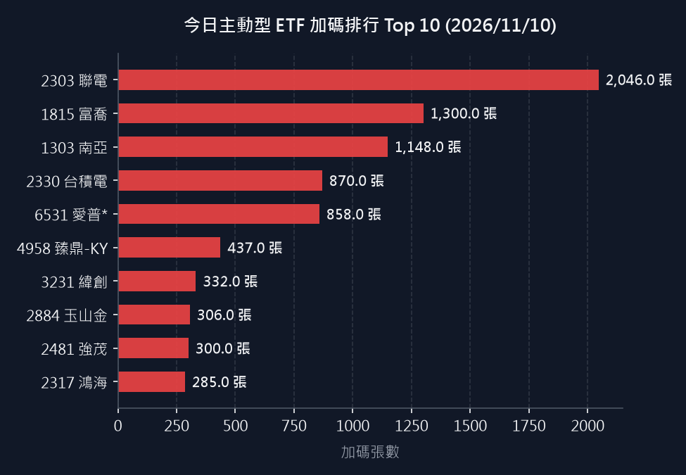
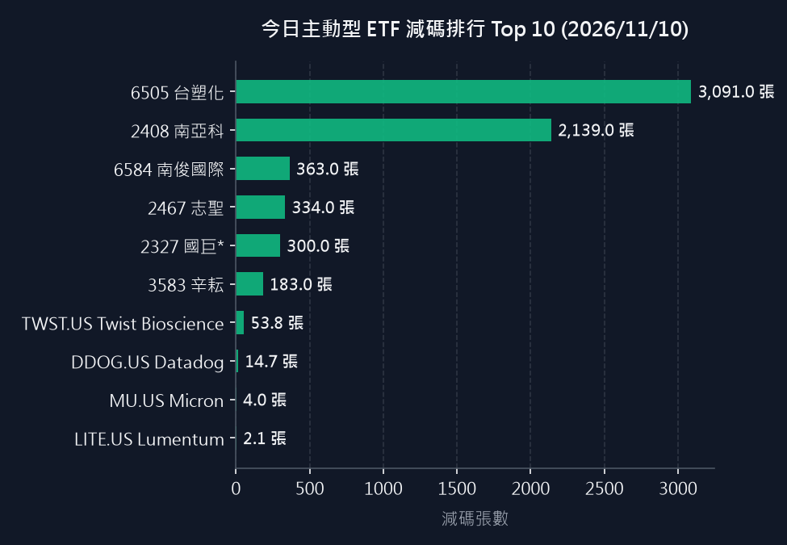

# 主動型 ETF 持股變動

資料來源：`主動型ETF持股明細.xlsx` 最近兩個日期分頁。

比較區間：`20261109` → `20261110`

## 今日加減碼視覺化排行

| 今日加碼 Top 10 | 今日減碼 Top 10 |
| :---: | :---: |
|  |  |

| ETF | 新增 | 刪除 | 比例變動 |
| :-- | --: | --: | --: |
| 00400A | 0 | 0 | 0 |
| 00401A | 0 | 0 | 0 |
| 00402A | 0 | 0 | 45 |
| 00403A | 0 | 0 | 0 |
| 00404A | 0 | 0 | 0 |
| 00405A | 0 | 0 | 27 |
| 00406A | 2 | 0 | 58 |
| 00407A | 0 | 0 | 46 |
| 00408A | 1 | 0 | 37 |
| 00980A | 0 | 0 | 46 |
| 00980D | 0 | 1 | 62 |
| 00981A | 0 | 0 | 0 |
| 00982A | 0 | 0 | 47 |
| 00983A | 0 | 1 | 34 |
| 00983D | 0 | 0 | 0 |
| 00984A | 0 | 0 | 0 |
| 00985A | 0 | 0 | 0 |
| 00986A | 0 | 0 | 27 |
| 00987A | 0 | 0 | 0 |
| 00988A | 0 | 0 | 30 |
| 00989A | 0 | 0 | 56 |
| 00990A | 0 | 1 | 33 |
| 00991A | 1 | 1 | 27 |
| 00992A | 1 | 0 | 39 |
| 00993A | 0 | 0 | 0 |
| 00994A | 1 | 1 | 30 |
| 00995A | 2 | 0 | 42 |
| 00996A | 0 | 0 | 42 |
| 00997A | 1 | 0 | 44 |
| 00998A | 0 | 0 | 42 |
| 00999A | 0 | 0 | 53 |

## 00400A

### 新增持股

- 無

### 刪除持股

- 無

### 投資比例變動

- 無

## 00401A

### 新增持股

- 無

### 刪除持股

- 無

### 投資比例變動

- 無

## 00402A

### 新增持股

- 無

### 刪除持股

- 無

### 投資比例變動

- AAPL.US Apple：9.27% → 9.12%（-0.15）
- ADI.US Analog Devices：2.08% → 2.16%（+0.08）
- AMD.US AMD：5.57% → 6.05%（+0.48）
- AMZN.US Amazon：5.26% → 5.19%（-0.07）
- ANET.US Arista Networks：0.86% → 0.90%（+0.04）
- ARM.US Arm：0.72% → 0.74%（+0.02）
- ASML.US ASML Holding：1.18% → 1.20%（+0.02）
- AVGO.US Broadcom：2.21% → 2.30%（+0.09）
- AXON.US Axon Enterprise：0.52% → 0.48%（-0.04）
- BABA.US Alibaba Group：0.58% → 0.54%（-0.04）
- BKNG.US Booking Holdings：0.62% → 0.60%（-0.02）
- CDNS.US Cadence Design Systems：1.72% → 1.73%（+0.01）
- CIEN.US Ciena：0.92% → 0.98%（+0.06）
- CLS.US Celestica：0.97% → 1.00%（+0.03）
- COHR.US Coherent：1.09% → 1.22%（+0.13）
- CRWD.US CrowdStrike Holdings：1.81% → 1.83%（+0.02）
- GOOG.US Alphabet - Class C Capital Stock：3.35% → 3.23%（-0.12）
- GOOGL.US Alphabet - Class A Common Stock：3.34% → 3.24%（-0.10）
- INTC.US Intel：1.02% → 1.03%（+0.01）
- IOT.US Samsara：0.64% → 0.63%（-0.01）
- KLAC.US KLA：1.34% → 1.40%（+0.06）
- LITE.US Lumentum：1.26% → 1.34%（+0.08）
- LRCX.US Lam Research：2.02% → 2.13%（+0.11）
- MCHP.US Microchip Technology：1.23% → 1.24%（+0.01）
- META.US Meta：3.83% → 3.86%（+0.03）
- MRVL.US Marvell：1.13% → 1.18%（+0.05）
- MSFT.US Microsoft：6.37% → 6.27%（-0.10）
- MU.US Micron：4.99% → 5.09%（+0.10）
- NFLX.US Netflix：1.05% → 1.02%（-0.03）
- NOW.US ServiceNow：0.94% → 0.90%（-0.04）
- NVDA.US NVIDIA：8.71% → 7.99%（-0.72）
- PANW.US Palo Alto：2.86% → 2.89%（+0.03）
- PLTR.US Palantir Technologies：2.10% → 2.12%（+0.02）
- SHOP.US Shopify：1.24% → 1.22%（-0.02）
- SKHY.US SK hynix：0.81% → 0.82%（+0.01）
- SNOW.US Snowflake：1.31% → 1.33%（+0.02）
- SPCX.US SpaceX：0.79% → 0.80%（+0.01）
- SPOT.US Spotify：0.50% → 0.48%（-0.02）
- STX.US Seagate：0.83% → 0.87%（+0.04）
- TER.US Teradyne：0.57% → 0.62%（+0.05）
- TSM.US TSMC(ADR)：1.55% → 1.54%（-0.01）
- TTWO.US Take-Two：0.73% → 0.67%（-0.06）
- TXN.US Texas Instruments：2.79% → 2.85%（+0.06）
- V.US Visa：1.52% → 1.45%（-0.07）
- WDC.US Western Digital：1.53% → 1.61%（+0.08）

## 00403A

### 新增持股

- 無

### 刪除持股

- 無

### 投資比例變動

- 無

## 00404A

### 新增持股

- 無

### 刪除持股

- 無

### 投資比例變動

- 無

## 00405A

### 新增持股

- 無

### 刪除持股

- 無

### 投資比例變動

- 2059 川湖：2.10% → 2.13%（+0.03）
- 2308 台達電：0.57% → 0.60%（+0.03）
- 2330 台積電：2.10% → 5.55%（+3.45）
- 2345 智邦：4.49% → 4.67%（+0.18）
- 2368 金像電：5.29% → 5.50%（+0.21）
- 2383 台光電：4.53% → 4.60%（+0.07）
- 2395 研華：0.02% → 0.01%（-0.01）
- 2454 聯發科：6.84% → 6.66%（-0.18）
- 3017 奇鋐：1.71% → 1.77%（+0.06）
- 3037 欣興：4.09% → 4.24%（+0.15）
- 3443 創意：2.57% → 2.60%（+0.03）
- 3653 健策：7.69% → 7.48%（-0.21）
- 3665 貿聯-KY：4.95% → 5.05%（+0.10）
- 3711 日月光投控：1.48% → 1.51%（+0.03）
- 5274 信驊：5.60% → 5.41%（-0.19）
- 5347 世界：0.15% → 0.14%（-0.01）
- 6187 萬潤：0.74% → 0.75%（+0.01）
- 6223 旺矽：6.28% → 6.54%（+0.26）
- 6274 台燿：1.54% → 1.49%（-0.05）
- 6285 啟碁：0.09% → 0.10%（+0.01）
- 6415 矽力*-KY：0.56% → 0.55%（-0.01）
- 6531 愛普*：3.61% → 3.73%（+0.12）
- 6669 緯穎：0.86% → 0.83%（-0.03）
- 6805 富世達：1.66% → 1.69%（+0.03）
- 7769 鴻勁：2.54% → 2.51%（-0.03）
- 8046 南電：6.36% → 6.48%（+0.12）
- 8996 高力：1.34% → 1.40%（+0.06）

## 00406A

### 新增持股

- 1727 中華化（0.04%，750 張）
- 臺股期貨 202612(FITXN*1.TF)（2.25%，0.4 張）

### 刪除持股

- 無

### 投資比例變動

- 1303 南亞：2.17% → 2.27%（+0.10）
- 1326 台化：0.52% → 0.51%（-0.01）
- 1560 中砂：0.22% → 0.21%（-0.01）
- 1815 富喬：0.51% → 0.59%（+0.08）
- 2059 川湖：1.80% → 1.82%（+0.02）
- 2303 聯電：1.11% → 1.22%（+0.11）
- 2308 台達電：1.59% → 1.66%（+0.07）
- 2317 鴻海：0.23% → 0.22%（-0.01）
- 2327 國巨*：1.38% → 1.33%（-0.05）
- 2330 台積電：9.06% → 9.40%（+0.34）
- 2345 智邦：1.90% → 2.03%（+0.13）
- 2368 金像電：2.32% → 2.42%（+0.10）
- 2383 台光電：6.08% → 6.36%（+0.28）
- 2449 京元電子：0.35% → 0.36%（+0.01）
- 2454 聯發科：6.16% → 6.17%（+0.01）
- 2481 強茂：0.28% → 0.31%（+0.03）
- 2881 富邦金：0.66% → 0.63%（-0.03）
- 2882 國泰金：0.66% → 0.62%（-0.04）
- 2884 玉山金：0.30% → 0.28%（-0.02）
- 2885 元大金：0.54% → 0.51%（-0.03）
- 2886 兆豐金：0.44% → 0.42%（-0.02）
- 2887 台新新光金：0.46% → 0.44%（-0.02）
- 2890 永豐金：0.30% → 0.29%（-0.01）
- 3008 大立光：1.01% → 0.98%（-0.03）
- 3017 奇鋐：5.30% → 5.52%（+0.22）
- 3037 欣興：5.20% → 5.39%（+0.19）
- 3081 聯亞：1.10% → 1.14%（+0.04）
- 3105 穩懋：0.50% → 0.52%（+0.02）
- 3167 大量：0.49% → 0.50%（+0.01）
- 3189 景碩：1.58% → 1.62%（+0.04）
- 3231 緯創：0.33% → 0.32%（-0.01）
- 3443 創意：2.07% → 2.10%（+0.03）
- 3450 聯鈞：0.07% → 0.08%（+0.01）
- 3491 昇達科：0.27% → 0.28%（+0.01）
- 3529 力旺：0.10% → 0.11%（+0.01）
- 3653 健策：4.76% → 4.87%（+0.11）
- 3661 世芯-KY：0.69% → 0.72%（+0.03）
- 3665 貿聯-KY：1.01% → 1.04%（+0.03）
- 3711 日月光投控：2.16% → 2.21%（+0.05）
- 4938 和碩：0.46% → 0.44%（-0.02）
- 4958 臻鼎-KY：0.82% → 0.84%（+0.02）
- 5274 信驊：1.24% → 1.20%（-0.04）
- 6147 頎邦：0.61% → 0.63%（+0.02）
- 6213 聯茂：0.37% → 0.35%（-0.02）
- 6223 旺矽：2.70% → 2.82%（+0.12）
- 6274 台燿：1.82% → 1.77%（-0.05）
- 6278 台表科：0.20% → 0.21%（+0.01）
- 6446 藥華藥：0.65% → 0.57%（-0.08）
- 6510 精測：0.48% → 0.50%（+0.02）
- 6669 緯穎：1.00% → 0.97%（-0.03）
- 6715 嘉基：0.73% → 0.76%（+0.03）
- 6805 富世達：0.95% → 0.97%（+0.02）
- 8046 南電：3.07% → 3.14%（+0.07）
- 8358 金居：0.05% → 0.06%（+0.01）
- 8996 高力：0.67% → 0.70%（+0.03）
- 臺指選擇權第二週週三到期契約：-16.74% → -18.68%（-1.94）
- 臺指選擇權第二週週五到期契約：-5.82% → -6.08%（-0.26）
- 臺股期貨 202611(FITXN*1.TF)：20.85% → 20.35%（-0.50）

## 00407A

### 新增持股

- 無

### 刪除持股

- 無

### 投資比例變動

- 1303 南亞：3.40% → 3.53%（+0.13）
- 1560 中砂：0.97% → 0.94%（-0.03）
- 2059 川湖：1.74% → 1.75%（+0.01）
- 2301 光寶科：1.37% → 1.39%（+0.02）
- 2303 聯電：0.46% → 0.45%（-0.01）
- 2308 台達電：2.03% → 2.11%（+0.08）
- 2313 華通：0.38% → 0.37%（-0.01）
- 2327 國巨*：1.99% → 1.91%（-0.08）
- 2330 台積電：11.35% → 10.96%（-0.39）
- 2345 智邦：1.37% → 1.43%（+0.06）
- 2368 金像電：1.90% → 1.98%（+0.08）
- 2379 瑞昱：0.28% → 0.26%（-0.02）
- 2383 台光電：6.00% → 6.08%（+0.08）
- 2408 南亞科：1.42% → 1.38%（-0.04）
- 2451 創見：0.33% → 0.30%（-0.03）
- 2454 聯發科：6.32% → 6.13%（-0.19）
- 2615 萬海：1.07% → 1.06%（-0.01）
- 3008 大立光：1.38% → 1.34%（-0.04）
- 3017 奇鋐：5.15% → 5.35%（+0.20）
- 3034 聯詠：0.80% → 0.74%（-0.06）
- 3037 欣興：5.07% → 5.23%（+0.16）
- 3081 聯亞：1.60% → 1.66%（+0.06）
- 3131 弘塑：0.68% → 0.70%（+0.02）
- 3231 緯創：1.09% → 1.05%（-0.04）
- 3260 威剛：0.29% → 0.27%（-0.02）
- 3293 鈊象：0.69% → 0.67%（-0.02）
- 3406 玉晶光：0.47% → 0.70%（+0.23）
- 3443 創意：4.64% → 4.69%（+0.05）
- 3491 昇達科：0.87% → 0.90%（+0.03）
- 3533 嘉澤：0.96% → 0.94%（-0.02）
- 3653 健策：3.54% → 3.44%（-0.10）
- 3665 貿聯-KY：2.59% → 2.82%（+0.23）
- 3711 日月光投控：3.16% → 3.43%（+0.27）
- 4958 臻鼎-KY：0.90% → 0.92%（+0.02）
- 5274 信驊：1.48% → 1.42%（-0.06）
- 6187 萬潤：1.31% → 1.33%（+0.02）
- 6223 旺矽：1.88% → 1.95%（+0.07）
- 6274 台燿：1.61% → 1.55%（-0.06）
- 6446 藥華藥：0.43% → 0.38%（-0.05）
- 6510 精測：1.30% → 1.35%（+0.05）
- 6531 愛普*：0.28% → 0.29%（+0.01）
- 6669 緯穎：2.39% → 2.30%（-0.09）
- 6805 富世達：1.13% → 1.14%（+0.01）
- 8046 南電：3.07% → 3.12%（+0.05）
- 8299 群聯：0.31% → 0.29%（-0.02）
- 8996 高力：1.24% → 1.29%（+0.05）

## 00408A

### 新增持股

- 2301 光寶科（0.49%，27 張）

### 刪除持股

- 無

### 投資比例變動

- 1303 南亞：3.82% → 4.05%（+0.23）
- 1560 中砂：1.36% → 1.35%（-0.01）
- 2059 川湖：0.90% → 0.93%（+0.03）
- 2327 國巨*：0.70% → 0.68%（-0.02）
- 2330 台積電：7.65% → 7.54%（-0.11）
- 2344 華邦電：0.43% → 0.42%（-0.01）
- 2368 金像電：4.55% → 5.12%（+0.57）
- 2382 廣達：0.24% → 0.23%（-0.01）
- 2383 台光電：4.44% → 4.59%（+0.15）
- 2395 研華：1.60% → 1.57%（-0.03）
- 2449 京元電子：0.79% → 0.83%（+0.04）
- 2454 聯發科：4.21% → 5.07%（+0.86）
- 2542 興富發：4.13% → 3.91%（-0.22）
- 2603 長榮：1.74% → 1.75%（+0.01）
- 2880 華南金：1.40% → 1.34%（-0.06）
- 2891 中信金：2.39% → 2.24%（-0.15）
- 3017 奇鋐：2.65% → 2.80%（+0.15）
- 3026 禾伸堂：1.05% → 1.03%（-0.02）
- 3037 欣興：2.51% → 2.64%（+0.13）
- 3044 健鼎：1.11% → 1.14%（+0.03）
- 3045 台灣大：0.67% → 0.63%（-0.04）
- 3189 景碩：2.73% → 2.84%（+0.11）
- 3231 緯創：1.51% → 1.48%（-0.03）
- 3443 創意：0.54% → 0.56%（+0.02）
- 3653 健策：3.55% → 4.42%（+0.87）
- 3711 日月光投控：2.67% → 2.78%（+0.11）
- 4904 遠傳：1.03% → 0.99%（-0.04）
- 5434 崇越：2.21% → 2.27%（+0.06）
- 6223 旺矽：1.73% → 1.84%（+0.11）
- 6274 台燿：2.02% → 1.99%（-0.03）
- 6510 精測：0.41% → 0.87%（+0.46）
- 6669 緯穎：2.49% → 2.45%（-0.04）
- 6805 富世達：2.70% → 2.79%（+0.09）
- 7769 鴻勁：0.82% → 0.49%（-0.33）
- 8046 南電：0.53% → 0.55%（+0.02）
- 8996 高力：2.89% → 3.06%（+0.17）
- 9802 鈺齊-KY：0.98% → 0.93%（-0.05）

## 00980A

### 新增持股

- 無

### 刪除持股

- 無

### 投資比例變動

- 1303 南亞：3.31% → 3.71%（+0.40）
- 2059 川湖：3.76% → 4.10%（+0.34）
- 2308 台達電：2.79% → 2.94%（+0.15）
- 2317 鴻海：3.48% → 3.59%（+0.11）
- 2327 國巨*：0.78% → 0.76%（-0.02）
- 2330 台積電：10.00% → 9.82%（-0.18）
- 2344 華邦電：1.52% → 1.58%（+0.06）
- 2345 智邦：0.84% → 0.88%（+0.04）
- 2368 金像電：1.79% → 1.89%（+0.10）
- 2376 技嘉：1.61% → 1.62%（+0.01）
- 2382 廣達：1.94% → 1.99%（+0.05）
- 2383 台光電：3.48% → 3.81%（+0.33）
- 2408 南亞科：2.13% → 2.25%（+0.12）
- 2454 聯發科：5.51% → 5.79%（+0.28）
- 2884 玉山金：1.36% → 1.38%（+0.02）
- 2891 中信金：1.76% → 1.75%（-0.01）
- 3008 大立光：1.90% → 1.99%（+0.09）
- 3017 奇鋐：2.02% → 2.26%（+0.24）
- 3026 禾伸堂：0.85% → 0.83%（-0.02）
- 3037 欣興：2.81% → 2.95%（+0.14）
- 3044 健鼎：1.19% → 1.29%（+0.10）
- 3081 聯亞：1.37% → 1.44%（+0.07）
- 3189 景碩：1.09% → 1.13%（+0.04）
- 3231 緯創：1.66% → 1.72%（+0.06）
- 3264 欣銓：0.70% → 0.71%（+0.01）
- 3293 鈊象：0.49% → 0.48%（-0.01）
- 3443 創意：1.79% → 1.96%（+0.17）
- 3529 力旺：0.14% → 0.15%（+0.01）
- 3653 健策：3.01% → 3.17%（+0.16）
- 3665 貿聯-KY：1.21% → 1.33%（+0.12）
- 3711 日月光投控：2.07% → 2.28%（+0.21）
- 5274 信驊：1.41% → 1.45%（+0.04）
- 5904 寶雅*：0.76% → 0.75%（-0.01）
- 6213 聯茂：1.12% → 1.07%（-0.05）
- 6223 旺矽：1.08% → 1.14%（+0.06）
- 6274 台燿：1.01% → 1.05%（+0.04）
- 6515 穎崴：1.27% → 1.29%（+0.02）
- 6669 緯穎：1.81% → 1.89%（+0.08）
- 6805 富世達：0.60% → 0.61%（+0.01）
- 7751 竑騰：0.57% → 0.59%（+0.02）
- 7769 鴻勁：1.70% → 1.81%（+0.11）
- 8046 南電：1.39% → 1.44%（+0.05）
- 8210 勤誠：0.32% → 0.31%（-0.01）
- 8299 群聯：1.02% → 1.06%（+0.04）
- 8996 高力：0.44% → 0.46%（+0.02）
- 台灣證交所加權股價指數(FITXN*1.TF)：4.93% → 4.87%（-0.06）

## 00980D

### 新增持股

- 無

### 刪除持股

- HSBC HOLDINGS PLC VAR 03NOV2028（0.35%，N/A 張）

### 投資比例變動

- ANHEUSER-BUSCH INBEV WOR (REG) 8.2% 15JAN2039：0.54% → 0.55%（+0.01）
- ARCELORMITTAL SA 6.55% 29NOV2027：0.57% → 0.58%（+0.01）
- ARIS WATER HOLDINGS LLC SER REGS 7.250000 % 01APR2030：0.49% → 0.50%（+0.01）
- ASURION LLC/ASURION CO 8.375% 01FEB2034：0.44% → 0.45%（+0.01）
- ATHENE HOLDING LTD (REG) 6.25% 01APR2054：0.78% → 0.79%（+0.01）
- BANCO SANTANDER SA (REG) 6.607% 07NOV2028：0.69% → 0.70%（+0.01）
- BAT CAPITAL CORP (REG) 7.079% 02AUG2043：0.33% → 0.34%（+0.01）
- BLUE OWL CREDIT INCOME (REG) 6.6% 15SEP2029：0.40% → 0.41%（+0.01）
- BLUE OWL TECHNOLOGY FIN CORP II 6.75 % 04APR2029：0.58% → 0.59%（+0.01）
- BOSTON PROPERTIES LP (REG) 6.750000 % 01-DEC-2027：0.48% → 0.49%（+0.01）
- BPCE SA SER REGS VAR 19OCT2034：0.43% → 0.44%（+0.01）
- CHARTER COMM OPT 6.484% 23OCT2045 W/I：0.45% → 0.46%（+0.01）
- CHARTER COMM OPT LLC/CAP (REG) 5.5% 01APR2063：0.48% → 0.49%（+0.01）
- CHARTER COMM OPT LLC/CAP (REG) 6.834000 % 23OCT2055：0.45% → 0.46%（+0.01）
- CHARTER COMM OPT LLC/CAP 6.700000 % 01-DEC-2055：0.46% → 0.47%（+0.01）
- COREWEAVE INC SER REGS (REG S) 9.25% 01JUN2030：0.39% → 0.40%（+0.01）
- COREWEAVE INC SER REGS (REG S) 9.75% 01OCT2031：0.46% → 0.48%（+0.02）
- COREWEAVE INC SER REGS (REG) (REG S) 9.625% 15JUL2032：0.46% → 0.47%（+0.01）
- COREWEAVE INC SER REGS 9.000000 % 01FEB2031：0.22% → 0.23%（+0.01）
- DAIMLER FINANCE NA LLC REG 8.5% 18JAN2031：0.66% → 0.67%（+0.01）
- DELL INT LLC / EMC CORP (REG) 8.35% 15JUL2046：0.56% → 0.57%（+0.01）
- DISCOVER FINANCIAL SVS (REG) VAR 02NOV2034：0.66% → 0.67%（+0.01）
- DOW CHEMICAL CO/THE (REG) 5.6% 15FEB2054：0.63% → 0.64%（+0.01）
- ENERGY TRANSFER LP (REG) 7.5% 01JUL2038：0.34% → 0.35%（+0.01）
- FMC CORP (REG) 6.375000 % 18MAY2053：0.35% → 0.34%（-0.01）
- GENERAL MOTORS CO (REG) 6.8% 01OCT2027：0.59% → 0.03%（-0.56）
- GLOBAL ATLANTIC FIN CO SER REGS 6.750000 % 15MAR2054：0.64% → 0.65%（+0.01）
- GLOBAL AUTO HO/AAG FH UK SER REGS (REG S) 8.75% 15JAN2032：0.42% → 0.43%（+0.01）
- HAH GROUP HOLDING CO LLC SER REGS (REG S) 9.75% 01OCT2031：0.51% → 0.52%（+0.01）
- HESS CORP (REG) 7.3% 15AUG2031：0.55% → 0.56%（+0.01）
- HISCOX LTD VAR 11JUN2036：0.44% → 0.45%（+0.01）
- INTESA SANPAOLO SPA SER REGS (REG) 7.200000 % 28NOV2033：0.36% → 0.37%（+0.01）
- JETBLUE AIRWAYS/LOYALTY SER REGS (REG S) 9.875% 20SEP2031：0.35% → 0.38%（+0.03）
- LBM ACQUISITION LLC SER REGS 9.500000 % 15JUN2031：0.44% → 0.45%（+0.01）
- META PLATFORMS INC 5.750000 % 15-NOV-2065：0.43% → 0.44%（+0.01）
- METLIFE INC (REG) 10.75% 01AUG2039：0.47% → 0.48%（+0.01）
- MOHEGAN TRIBAL / MS DIG SER REGS 11.875000 % 15APR2031：0.70% → 0.71%（+0.01）
- MYLAN INC (REG) 5.4% 29/11/2043：0.35% → 0.36%（+0.01）
- NATIONWIDE MUTUAL INSUR 9.375% 15AUG2039：0.54% → 0.55%（+0.01）
- NEPTUNE BIDCO US INC SER REGS (REG S) 9.29% 15APR2029：0.36% → 0.37%（+0.01）
- ORACLE CORP (REG) 5.500000 % 27SEP2064：0.41% → 0.42%（+0.01）
- ORACLE CORP 6.125000 % 03AUG2065：0.54% → 0.55%（+0.01）
- ORACLE CORP 6.85 % 04-FEB-2066：0.54% → 0.55%（+0.01）
- ORANGE SA (REG) 9% 01MAR2031：0.68% → 0.69%（+0.01）
- OWENS-BROCKWAY SER REGS (REG) (REG S) 9.5% 01JUN2033：0.50% → 0.51%（+0.01）
- PHOTO HOLDINGS LLC SER REGS (REG) (REG S) 12% 01JUL2031：0.47% → 0.48%（+0.01）
- PLANET FINANCIAL GROUP SER REGS 10.500000 % 15DEC2029：0.47% → 0.48%（+0.01）
- POLARIS INC 6.950000 % 15MAR2029：0.49% → 0.50%（+0.01）
- SABRE GLBL INC SER REGS 11.125000 % 15JUL2030：0.49% → 0.50%（+0.01）
- SALESFORCE INC (REG) 6.55% 15MAR2056：0.56% → 0.57%（+0.01）
- SALESFORCE INC (REG) 6.7% 15MAR2066：0.55% → 0.56%（+0.01）
- SPACE EXPLORATION TECH SER 144A (REG) 6.65% 15JUL2056：0.31% → 0.32%（+0.01）
- SPRINT CAPITAL CORP (REG) 8.75% 15MAR2032：0.42% → 0.43%（+0.01）
- TIME WARNER ENTERTAINMEN 8.375% 15JUL2033：0.64% → 0.65%（+0.01）
- TRANSCANADA PIPELINES LTD 7.625PCT 15/01/2039：0.55% → 0.56%（+0.01）
- TRUIST FINANCIAL CORP SER MTN VAR 30OCT2029：0.67% → 0.68%（+0.01）
- UNISYS CORP SER REGS 10.625000 % 15JAN2031：0.65% → 0.66%（+0.01）
- US 10YR NOTE (CBT)DEC26 21-DEC-2026：18.62% → 18.67%（+0.05）
- US 5YR NOTE (CBT) DEC26 31-DEC-2026：-15.81% → -15.85%（-0.04）
- US LONG BOND(CBT) DEC26 21-DEC-2026：5.68% → 5.70%（+0.02）
- VIACOM INC (REG) 5.85% 01SEP2043：0.50% → 0.51%（+0.01）
- VIACOMCBS INC 6.875% 30APR2036：0.25% → 0.26%（+0.01）

## 00981A

### 新增持股

- 無

### 刪除持股

- 無

### 投資比例變動

- 無

## 00982A

### 新增持股

- 無

### 刪除持股

- 無

### 投資比例變動

- 2059 川湖：2.68% → 2.75%（+0.07）
- 2301 光寶科：1.71% → 1.75%（+0.04）
- 2303 聯電：1.24% → 1.23%（-0.01）
- 2330 台積電：8.53% → 8.27%（-0.26）
- 2376 技嘉：1.34% → 1.26%（-0.08）
- 2377 微星：0.40% → 0.38%（-0.02）
- 2383 台光電：3.14% → 3.22%（+0.08）
- 2395 研華：1.39% → 1.35%（-0.04）
- 2428 興勤：1.10% → 1.06%（-0.04）
- 2454 聯發科：8.45% → 8.24%（-0.21）
- 2455 全新：1.30% → 1.35%（+0.05）
- 2467 志聖：0.49% → 0.24%（-0.25）
- 2476 鉅祥：0.31% → 0.29%（-0.02）
- 2486 一詮：0.41% → 0.40%（-0.01）
- 2885 元大金：0.36% → 0.34%（-0.02）
- 3008 大立光：3.06% → 3.01%（-0.05）
- 3017 奇鋐：2.34% → 2.44%（+0.10）
- 3037 欣興：0.72% → 0.74%（+0.02）
- 3045 台灣大：0.89% → 0.82%（-0.07）
- 3105 穩懋：7.47% → 7.69%（+0.22）
- 3231 緯創：1.99% → 1.93%（-0.06）
- 3265 台星科：1.22% → 1.26%（+0.04）
- 3491 昇達科：3.33% → 3.46%（+0.13）
- 3583 辛耘：0.40% → 0.20%（-0.20）
- 3617 碩天：0.36% → 0.38%（+0.02）
- 3711 日月光投控：1.85% → 1.90%（+0.05）
- 4958 臻鼎-KY：2.98% → 3.06%（+0.08）
- 5274 信驊：1.05% → 1.34%（+0.29）
- 5425 台半：1.18% → 1.17%（-0.01）
- 5483 中美晶：1.30% → 1.31%（+0.01）
- 5536 聖暉*：0.93% → 0.91%（-0.02）
- 6139 亞翔：5.42% → 5.32%（-0.10）
- 6196 帆宣：0.32% → 0.31%（-0.01）
- 6213 聯茂：1.57% → 1.49%（-0.08）
- 6223 旺矽：2.64% → 2.76%（+0.12）
- 6239 力成：1.28% → 1.25%（-0.03）
- 6274 台燿：1.02% → 1.00%（-0.02）
- 6446 藥華藥：0.14% → 0.12%（-0.02）
- 6472 保瑞：1.02% → 0.93%（-0.09）
- 6488 環球晶：1.52% → 1.59%（+0.07）
- 6510 精測：0.90% → 0.94%（+0.04）
- 6531 愛普*：4.48% → 6.05%（+1.57）
- 6640 均華：0.20% → 0.21%（+0.01）
- 6669 緯穎：1.97% → 1.91%（-0.06）
- 6672 騰輝電子-KY：2.70% → 2.62%（-0.08）
- 8070 長華*：0.72% → 0.69%（-0.03）
- 8996 高力：1.16% → 1.21%（+0.05）

## 00983A

### 新增持股

- 無

### 刪除持股

- VCYT.US Veracyte（0.27%，2.714 張）

### 投資比例變動

- AMD.US AMD：3.05% → 3.31%（+0.26）
- AMZN.US Amazon：4.42% → 4.35%（-0.07）
- AVGO.US Broadcom：1.75% → 1.09%（-0.66）
- BEAM.US Beam Therapeutics：2.82% → 2.76%（-0.06）
- BLSH.US Bullish：1.23% → 1.13%（-0.10）
- BMNR.US BitMine：1.38% → 1.18%（-0.20）
- COIN.US Coinbase：3.19% → 2.95%（-0.24）
- CRCL.US Circle：3.97% → 3.62%（-0.35）
- CRSP.US CRISPR Therapeutics：4.17% → 3.99%（-0.18）
- DE.US Deere：0.49% → 0.48%（-0.01）
- GOOG.US Alphabet - Class C Capital Stock：2.57% → 2.60%（+0.03）
- GOOGL.US Alphabet - Class A Common Stock：1.60% → 1.55%（-0.05）
- HOOD.US Robinhood Markets：2.53% → 2.49%（-0.04）
- ILMN.US Illumina：1.57% → 1.56%（-0.01）
- LLY.US Eli Lilly：1.96% → 1.95%（-0.01）
- META.US Meta：3.31% → 3.33%（+0.02）
- MSFT.US Microsoft：1.29% → 1.60%（+0.31）
- NET.US Cloudflare：1.40% → 1.46%（+0.06）
- NTLA.US Intellia Therapeutics：1.92% → 1.96%（+0.04）
- NTRA.US Natera：1.44% → 1.42%（-0.02）
- NVDA.US NVIDIA：3.61% → 3.31%（-0.30）
- PLTR.US Palantir Technologies：3.05% → 3.08%（+0.03）
- RKLB.US Rocket Lab：1.38% → 1.44%（+0.06）
- RXRX.US Recursion Pharmaceuticals：1.18% → 1.22%（+0.04）
- SHOP.US Shopify：4.97% → 4.85%（-0.12）
- SNOW.US Snowflake：0.53% → 0.54%（+0.01）
- SPCX.US SpaceX：7.41% → 7.63%（+0.22）
- TEM.US Tempus：6.80% → 7.22%（+0.42）
- TER.US Teradyne：0.43% → 0.06%（-0.37）
- TSLA.US Tesla：8.26% → 8.45%（+0.19）
- TSM.US TSMC(ADR)：2.68% → 2.65%（-0.03）
- TWST.US Twist Bioscience：3.46% → 3.71%（+0.25）
- TXG.US 10x Genomics：3.02% → 3.17%（+0.15）
- XYZ.US Block：1.61% → 2.22%（+0.61）

## 00983D

### 新增持股

- 無

### 刪除持股

- 無

### 投資比例變動

- 無

## 00984A

### 新增持股

- 無

### 刪除持股

- 無

### 投資比例變動

- 無

## 00985A

### 新增持股

- 無

### 刪除持股

- 無

### 投資比例變動

- 無

## 00986A

### 新增持股

- 無

### 刪除持股

- 無

### 投資比例變動

- 2330 台積電：8.46% → 8.45%（-0.01）
- 2454 聯發科：1.49% → 1.56%（+0.07）
- AAPL.US Apple：3.08% → 3.03%（-0.05）
- AMD.US AMD：4.53% → 4.93%（+0.40）
- AMZN.US Amazon：5.23% → 5.17%（-0.06）
- AVGO.US Broadcom：3.81% → 3.98%（+0.17）
- BE.US Bloom Energy：2.12% → 2.28%（+0.16）
- CRWD.US CrowdStrike Holdings：4.69% → 4.74%（+0.05）
- ETN.US Eaton：2.46% → 2.49%（+0.03）
- GEV.US GE Vernova：2.79% → 2.87%（+0.08）
- GOOGL.US Alphabet - Class A Common Stock：6.15% → 5.98%（-0.17）
- JPM.US JPMorgan Chase：2.65% → 2.60%（-0.05）
- LITE.US Lumentum：3.03% → 3.22%（+0.19）
- LLY.US Eli Lilly：4.39% → 4.40%（+0.01）
- MA.US Mastercard：1.65% → 1.59%（-0.06）
- MSFT.US Microsoft：4.59% → 4.53%（-0.06）
- MU.US Micron：3.98% → 4.06%（+0.08）
- MUFG(8306.JP)：1.17% → 1.18%（+0.01）
- NET.US Cloudflare：2.32% → 2.44%（+0.12）
- NVDA.US NVIDIA：6.72% → 6.18%（-0.54）
- PLTR.US Palantir Technologies：1.62% → 1.64%（+0.02）
- RBRK.US Rubrik：0.99% → 1.00%（+0.01）
- SKHY.US SK hynix：0.92% → 0.93%（+0.01）
- SNOW.US Snowflake：2.19% → 2.22%（+0.03）
- 施奈德電機公司：1.66% → 1.63%（-0.03）
- 艾司摩爾控股公司：2.07% → 2.08%（+0.01）
- 英飛凌科技股份有限公司：1.11% → 1.13%（+0.02）

## 00987A

### 新增持股

- 無

### 刪除持股

- 無

### 投資比例變動

- 無

## 00988A

### 新增持股

- 無

### 刪除持股

- 無

### 投資比例變動

- 1303 南亞：1.82% → 1.89%（+0.07）
- 2330 台積電：1.84% → 2.73%（+0.89）
- 2383 台光電：2.57% → 2.59%（+0.02）
- 2454 聯發科：0.73% → 0.76%（+0.03）
- 3017 奇鋐：3.72% → 3.88%（+0.16）
- 3037 欣興：5.08% → 5.01%（-0.07）
- 3443 創意：3.00% → 3.58%（+0.58）
- 3711 日月光投控：0.95% → 0.96%（+0.01）
- 6223 旺矽：1.02% → 1.04%（+0.02）
- AAPL.US Apple：5.41% → 5.29%（-0.12）
- AMD.US AMD：5.13% → 5.54%（+0.41）
- AMZN.US Amazon：1.59% → 2.24%（+0.65）
- BE.US Bloom Energy：6.85% → 7.32%（+0.47）
- CRWD.US CrowdStrike Holdings：4.21% → 4.23%（+0.02）
- INFINEON TECHNOLOGIES AG：1.01% → 1.02%（+0.01）
- MSFT.US Microsoft：7.46% → 7.31%（-0.15）
- MU.US Micron：0.92% → 0.93%（+0.01）
- NET.US Cloudflare：1.94% → 2.02%（+0.08）
- NOW.US ServiceNow：0.77% → 0.74%（-0.03）
- NTSK.US Netskope：1.50% → 1.51%（+0.01）
- NVDA.US NVIDIA：5.25% → 4.79%（-0.46）
- OKTA.US Okta：2.96% → 2.98%（+0.02）
- PANW.US Palo Alto：4.14% → 4.16%（+0.02）
- PLTR.US Palantir Technologies：4.93% → 4.97%（+0.04）
- SHIFT(3697.JP)：0.47% → 0.48%（+0.01）
- SNOW.US Snowflake：2.42% → 2.44%（+0.02）
- SPCX.US SpaceX：6.49% → 6.55%（+0.06）
- Samsung Elec Mech(009150.KS)：2.25% → 2.10%（-0.15）
- TWLO.US Twilio：1.06% → 1.04%（-0.02）
- ZS.US Zscaler：1.74% → 1.67%（-0.07）

## 00989A

### 新增持股

- 無

### 刪除持股

- 無

### 投資比例變動

- ACN.US Accenture：1.48% → 1.38%（-0.10）
- ADBE.US Adobe：1.43% → 1.36%（-0.07）
- ADI.US Analog Devices：1.21% → 1.25%（+0.04）
- ALAB.US Astera Labs：0.65% → 0.71%（+0.06）
- AMD.US AMD：3.35% → 3.64%（+0.29）
- AMZN.US Amazon：2.24% → 2.21%（-0.03）
- ASML.US ASML Holding：2.17% → 2.21%（+0.04）
- AVGO.US Broadcom：3.38% → 3.52%（+0.14）
- CDNS.US Cadence Design Systems：1.04% → 1.05%（+0.01）
- CIEN.US Ciena：0.75% → 0.79%（+0.04）
- CRDO.US Credo：0.67% → 0.70%（+0.03）
- CRM.US Salesforce：3.33% → 3.21%（-0.12）
- CRWD.US CrowdStrike Holdings：3.61% → 3.64%（+0.03）
- DDOG.US Datadog：0.95% → 0.91%（-0.04）
- ENTG.US Entegris：0.49% → 0.51%（+0.02）
- GENB.US Generate Biomedicines：0.10% → 0.11%（+0.01）
- GOOG.US Alphabet - Class C Capital Stock：2.27% → 2.19%（-0.08）
- GWRE.US Guidewire Software：0.75% → 0.72%（-0.03）
- HOOD.US Robinhood Markets：1.63% → 1.61%（-0.02）
- HUBS.US HubSpot：1.85% → 1.82%（-0.03）
- ILMN.US Illumina：1.11% → 1.10%（-0.01）
- INTC.US Intel：1.56% → 1.57%（+0.01）
- LITE.US Lumentum：0.98% → 1.04%（+0.06）
- LMND.US Lemonade：0.73% → 0.71%（-0.02）
- LRCX.US Lam Research：1.85% → 1.96%（+0.11）
- META.US Meta：4.40% → 4.43%（+0.03）
- MPWR.US Monolithic Power Systems：1.46% → 1.63%（+0.17）
- MSFT.US Microsoft：3.81% → 3.75%（-0.06）
- MTSI.US MACOM Technology Solutions：0.57% → 0.59%（+0.02）
- MU.US Micron：0.50% → 0.51%（+0.01）
- NET.US Cloudflare：2.78% → 2.92%（+0.14）
- NOW.US ServiceNow：1.12% → 1.08%（-0.04）
- NVDA.US NVIDIA：4.46% → 4.09%（-0.37）
- PANW.US Palo Alto：3.34% → 3.37%（+0.03）
- PLTR.US Palantir Technologies：1.28% → 1.30%（+0.02）
- RIVN.US Rivian：1.37% → 1.35%（-0.02）
- SHOP.US Shopify：3.23% → 3.15%（-0.08）
- SNOW.US Snowflake：2.82% → 2.85%（+0.03）
- SPCX.US SpaceX：0.89% → 0.90%（+0.01）
- SWKS.US Skyworks Solutions：0.37% → 0.35%（-0.02）
- SYM.US Symbotic：0.50% → 0.49%（-0.01）
- TEAM.US Atlassian：1.19% → 1.15%（-0.04）
- TEM.US Tempus：1.42% → 1.51%（+0.09）
- TSLA.US Tesla：3.31% → 3.35%（+0.04）
- TSM.US TSMC(ADR)：0.97% → 0.96%（-0.01）
- TTWO.US Take-Two：3.51% → 3.24%（-0.27）
- TWLO.US Twilio：2.04% → 2.00%（-0.04）
- TWST.US Twist Bioscience：0.48% → 0.52%（+0.04）
- TXG.US 10x Genomics：0.72% → 0.75%（+0.03）
- TXN.US Texas Instruments：1.70% → 1.74%（+0.04）
- U.US Unity Software：1.66% → 1.59%（-0.07）
- VEEV.US Veeva Systems：1.13% → 1.09%（-0.04）
- VICR.US Vicor Corporation：0.28% → 0.30%（+0.02）
- WDAY.US Workday：0.32% → 0.30%（-0.02）
- WRBY.US Warby Parker：0.82% → 0.94%（+0.12）
- ZM.US Zoom：1.81% → 1.77%（-0.04）

## 00990A

### 新增持股

- 無

### 刪除持股

- TWST.US Twist Bioscience（0.75%，53.836 張）

### 投資比例變動

- 2368 金像電：1.06% → 1.11%（+0.05）
- 2383 台光電：1.81% → 1.84%（+0.03）
- 2454 聯發科：1.97% → 2.08%（+0.11）
- 3017 奇鋐：1.29% → 1.36%（+0.07）
- 3443 創意：0.96% → 2.47%（+1.51）
- 8046 南電：0.44% → 0.54%（+0.10）
- AAPL.US Apple：2.21% → 2.16%（-0.05）
- AMD.US AMD：5.24% → 5.68%（+0.44）
- AMZN.US Amazon：4.56% → 4.49%（-0.07）
- ANET.US Arista Networks：1.09% → 1.14%（+0.05）
- AVGO.US Broadcom：1.46% → 1.52%（+0.06）
- BE.US Bloom Energy：5.05% → 5.40%（+0.35）
- CRWD.US CrowdStrike Holdings：2.83% → 2.85%（+0.02）
- DDOG.US Datadog：1.15% → 0.81%（-0.34）
- GE.US GE Aerospace：2.84% → 2.82%（-0.02）
- GOOGL.US Alphabet - Class A Common Stock：4.34% → 4.20%（-0.14）
- HWM.US Howmet Aerospace：1.55% → 1.56%（+0.01）
- LLY.US Eli Lilly：2.54% → 2.53%（-0.01）
- META.US Meta：4.57% → 4.59%（+0.02）
- MSFT.US Microsoft：7.75% → 7.62%（-0.13）
- MU.US Micron：2.11% → 1.82%（-0.29）
- NET.US Cloudflare：1.75% → 1.83%（+0.08）
- NVDA.US NVIDIA：6.07% → 5.56%（-0.51）
- PLTR.US Palantir Technologies：4.96% → 5.00%（+0.04）
- RPRX.US Royalty Pharma：1.15% → 1.12%（-0.03）
- Recruit Holdings(6098.JP)：2.17% → 2.16%（-0.01）
- SHOP.US Shopify：3.52% → 3.44%（-0.08）
- SNOW.US Snowflake：2.22% → 2.24%（+0.02）
- SPCX.US SpaceX：2.93% → 2.97%（+0.04）
- THC.US Tenet Healthcare：0.52% → 0.51%（-0.01）
- TOHO(9602.JP)：0.21% → 0.20%（-0.01）
- TSLA.US Tesla：1.35% → 1.36%（+0.01）
- ZS.US Zscaler：2.25% → 2.17%（-0.08）

## 00991A

### 新增持股

- 6805 富世達（0.68%，215 張）

### 刪除持股

- 3036 文曄（0.00%，1 張）

### 投資比例變動

- 1303 南亞：5.10% → 5.72%（+0.62）
- 2059 川湖：6.89% → 6.92%（+0.03）
- 2308 台達電：0.49% → 0.56%（+0.07）
- 2317 鴻海：0.50% → 0.52%（+0.02）
- 2327 國巨*：3.74% → 3.37%（-0.37）
- 2330 台積電：15.83% → 15.21%（-0.62）
- 2345 智邦：0.50% → 0.71%（+0.21）
- 2368 金像電：0.51% → 0.70%（+0.19）
- 2382 廣達：0.01% → 0.00%（-0.01）
- 2383 台光電：9.27% → 9.44%（+0.17）
- 2408 南亞科：7.30% → 5.77%（-1.53）
- 2454 聯發科：7.29% → 7.16%（-0.13）
- 3017 奇鋐：6.77% → 7.07%（+0.30）
- 3026 禾伸堂：2.53% → 2.42%（-0.11）
- 3037 欣興：6.96% → 7.22%（+0.26）
- 3189 景碩：5.47% → 5.55%（+0.08）
- 3231 緯創：0.48% → 0.52%（+0.04）
- 3443 創意：0.51% → 0.68%（+0.17）
- 3653 健策：3.56% → 3.49%（-0.07）
- 3711 日月光投控：3.88% → 3.93%（+0.05）
- 4958 臻鼎-KY：0.48% → 0.75%（+0.27）
- 5274 信驊：2.58% → 2.56%（-0.02）
- 6223 旺矽：0.48% → 0.70%（+0.22）
- 6505 台塑化：0.46% → 0.00%（-0.46）
- 7769 鴻勁：0.49% → 0.54%（+0.05）
- 8046 南電：5.67% → 5.73%（+0.06）
- 8299 群聯：0.47% → 0.52%（+0.05）

## 00992A

### 新增持股

- 3661 世芯-KY（1.00%，130 張）

### 刪除持股

- 無

### 投資比例變動

- 1303 南亞：3.37% → 3.40%（+0.03）
- 1815 富喬：3.98% → 3.63%（-0.35）
- 2059 川湖：4.26% → 4.19%（-0.07）
- 2301 光寶科：0.37% → 0.36%（-0.01）
- 2308 台達電：0.99% → 1.00%（+0.01）
- 2330 台積電：6.80% → 6.39%（-0.41）
- 2345 智邦：4.65% → 4.70%（+0.05）
- 2357 華碩：0.43% → 0.41%（-0.02）
- 2360 致茂：1.26% → 1.21%（-0.05）
- 2368 金像電：2.57% → 2.60%（+0.03）
- 2376 技嘉：0.40% → 0.36%（-0.04）
- 2383 台光電：6.06% → 5.98%（-0.08）
- 2404 漢唐：0.38% → 0.35%（-0.03）
- 2454 聯發科：2.36% → 3.17%（+0.81）
- 3008 大立光：3.88% → 3.67%（-0.21）
- 3017 奇鋐：5.71% → 5.77%（+0.06）
- 3026 禾伸堂：0.69% → 0.65%（-0.04）
- 3037 欣興：5.61% → 5.64%（+0.03）
- 3081 聯亞：1.40% → 1.41%（+0.01）
- 3189 景碩：2.25% → 2.23%（-0.02）
- 3231 緯創：1.83% → 1.71%（-0.12）
- 3443 創意：4.13% → 4.06%（-0.07）
- 3653 健策：0.95% → 1.83%（+0.88）
- 3665 貿聯-KY：6.00% → 5.94%（-0.06）
- 4958 臻鼎-KY：1.17% → 1.16%（-0.01）
- 5274 信驊：0.91% → 0.86%（-0.05）
- 5289 宜鼎：0.35% → 0.34%（-0.01）
- 5347 世界：0.20% → 0.19%（-0.01）
- 6139 亞翔：0.50% → 0.48%（-0.02）
- 6213 聯茂：1.40% → 1.28%（-0.12）
- 6223 旺矽：3.29% → 3.33%（+0.04）
- 6274 台燿：1.25% → 1.17%（-0.08）
- 6415 矽力*-KY：0.62% → 0.58%（-0.04）
- 6515 穎崴：0.49% → 0.48%（-0.01）
- 6584 南俊國際：0.80% → 0.50%（-0.30）
- 6669 緯穎：1.77% → 1.66%（-0.11）
- 8046 南電：2.64% → 2.61%（-0.03）
- 8150 南茂：0.38% → 0.37%（-0.01）
- 8996 高力：5.45% → 5.50%（+0.05）

## 00993A

### 新增持股

- 無

### 刪除持股

- 無

### 投資比例變動

- 無

## 00994A

### 新增持股

- 2301 光寶科（0.36%，50 張）

### 刪除持股

- 5274 信驊（2.45%，6.42 張）

### 投資比例變動

- 1303 南亞：2.98% → 3.11%（+0.13）
- 1560 中砂：0.74% → 0.73%（-0.01）
- 2059 川湖：3.40% → 3.46%（+0.06）
- 2327 國巨*：0.27% → 0.26%（-0.01）
- 2330 台積電：18.14% → 17.70%（-0.44）
- 2368 金像電：2.10% → 2.96%（+0.86）
- 2383 台光電：6.77% → 6.91%（+0.14）
- 2454 聯發科：6.69% → 6.91%（+0.22）
- 2603 長榮：1.03% → 1.02%（-0.01）
- 2880 華南金：0.34% → 0.32%（-0.02）
- 2891 中信金：0.50% → 0.46%（-0.04）
- 3017 奇鋐：6.25% → 6.54%（+0.29）
- 3026 禾伸堂：0.96% → 0.93%（-0.03）
- 3037 欣興：5.88% → 6.12%（+0.24）
- 3044 健鼎：0.78% → 0.79%（+0.01）
- 3045 台灣大：0.03% → 0.02%（-0.01）
- 3189 景碩：2.70% → 2.78%（+0.08）
- 3231 緯創：0.88% → 0.85%（-0.03）
- 3443 創意：3.95% → 4.02%（+0.07）
- 3653 健策：4.96% → 5.21%（+0.25）
- 3711 日月光投控：3.24% → 3.33%（+0.09）
- 6223 旺矽：3.85% → 4.04%（+0.19）
- 6274 台燿：3.14% → 3.05%（-0.09）
- 6510 精測：0.33% → 0.69%（+0.36）
- 6526 達發：0.35% → 0.34%（-0.01）
- 6669 緯穎：2.55% → 2.48%（-0.07）
- 6805 富世達：3.15% → 3.21%（+0.06）
- 7769 鴻勁：0.66% → 0.13%（-0.53）
- 8046 南電：1.13% → 1.15%（+0.02）
- 8996 高力：2.17% → 2.27%（+0.10）

## 00995A

### 新增持股

- 2317 鴻海（0.19%，30 張）
- 6446 藥華藥（0.43%，13 張）

### 刪除持股

- 無

### 投資比例變動

- 1303 南亞：2.80% → 2.97%（+0.17）
- 1326 台化：0.76% → 0.74%（-0.02）
- 1560 中砂：0.43% → 0.41%（-0.02）
- 2303 聯電：0.56% → 0.54%（-0.02）
- 2308 台達電：2.99% → 3.06%（+0.07）
- 2330 台積電：9.27% → 8.78%（-0.49）
- 2345 智邦：1.95% → 1.99%（+0.04）
- 2360 致茂：1.35% → 1.32%（-0.03）
- 2368 金像電：1.98% → 2.03%（+0.05）
- 2383 台光電：8.12% → 8.11%（-0.01）
- 2449 京元電子：0.99% → 1.00%（+0.01）
- 2454 聯發科：7.22% → 6.92%（-0.30）
- 2885 元大金：0.56% → 0.52%（-0.04）
- 2886 兆豐金：0.32% → 0.30%（-0.02）
- 3008 大立光：2.18% → 2.09%（-0.09）
- 3017 奇鋐：5.63% → 5.76%（+0.13）
- 3037 欣興：2.89% → 2.95%（+0.06）
- 3081 聯亞：1.39% → 1.42%（+0.03）
- 3105 穩懋：0.01% → 0.39%（+0.38）
- 3189 景碩：0.59% → 0.60%（+0.01）
- 3264 欣銓：0.76% → 0.75%（-0.01）
- 3443 創意：2.97% → 3.15%（+0.18）
- 3653 健策：5.15% → 4.93%（-0.22）
- 3665 貿聯-KY：2.48% → 2.49%（+0.01）
- 3711 日月光投控：3.37% → 3.39%（+0.02）
- 4770 上品：0.55% → 0.53%（-0.02）
- 4958 臻鼎-KY：2.10% → 2.11%（+0.01）
- 5274 信驊：2.85% → 2.71%（-0.14）
- 6213 聯茂：0.74% → 0.68%（-0.06）
- 6223 旺矽：3.90% → 4.00%（+0.10）
- 6274 台燿：0.27% → 0.25%（-0.02）
- 6415 矽力*-KY：0.83% → 0.80%（-0.03）
- 6510 精測：2.32% → 2.37%（+0.05）
- 6526 達發：0.30% → 0.28%（-0.02）
- 6531 愛普*：0.98% → 1.00%（+0.02）
- 6669 緯穎：2.29% → 2.18%（-0.11）
- 6715 嘉基：0.31% → 0.32%（+0.01）
- 7769 鴻勁：1.23% → 1.20%（-0.03）
- 8046 南電：4.39% → 4.41%（+0.02）
- 8150 南茂：0.64% → 0.62%（-0.02）
- 8358 金居：0.18% → 0.19%（+0.01）
- 8996 高力：1.24% → 1.27%（+0.03）

## 00996A

### 新增持股

- 無

### 刪除持股

- 無

### 投資比例變動

- 1303 南亞：0.39% → 0.41%（+0.02）
- 2303 聯電：2.27% → 2.24%（-0.03）
- 2308 台達電：3.73% → 4.17%（+0.44）
- 2327 國巨*：4.99% → 4.78%（-0.21）
- 2330 台積電：9.22% → 8.92%（-0.30）
- 2368 金像電：0.98% → 1.02%（+0.04）
- 2382 廣達：0.04% → 0.03%（-0.01）
- 2383 台光電：4.11% → 4.18%（+0.07）
- 2454 聯發科：6.85% → 6.67%（-0.18）
- 2467 志聖：0.16% → 0.15%（-0.01）
- 2472 立隆電：2.35% → 2.31%（-0.04）
- 2881 富邦金：0.53% → 0.50%（-0.03）
- 2882 國泰金：0.53% → 0.50%（-0.03）
- 3017 奇鋐：3.23% → 3.37%（+0.14）
- 3037 欣興：2.48% → 2.57%（+0.09）
- 3081 聯亞：0.19% → 0.20%（+0.01）
- 3189 景碩：2.85% → 2.91%（+0.06）
- 3443 創意：4.74% → 4.80%（+0.06）
- 3533 嘉澤：1.31% → 1.28%（-0.03）
- 3653 健策：1.94% → 1.88%（-0.06）
- 3693 營邦：0.09% → 0.10%（+0.01）
- 3711 日月光投控：0.36% → 0.37%（+0.01）
- 4749 新應材：0.07% → 0.06%（-0.01）
- 4958 臻鼎-KY：6.23% → 6.85%（+0.62）
- 5269 祥碩：0.18% → 0.15%（-0.03）
- 6223 旺矽：1.80% → 1.87%（+0.07）
- 6274 台燿：1.23% → 1.18%（-0.05）
- 6278 台表科：2.80% → 3.38%（+0.58）
- 6415 矽力*-KY：0.99% → 1.42%（+0.43）
- 6510 精測：5.23% → 5.71%（+0.48）
- 6526 達發：0.44% → 0.43%（-0.01）
- 6672 騰輝電子-KY：0.20% → 0.19%（-0.01）
- 6683 雍智科技：2.50% → 2.57%（+0.07）
- 6770 力積電：2.17% → 2.09%（-0.08）
- 6805 富世達：0.26% → 0.72%（+0.46）
- 6830 汎銓：1.62% → 1.56%（-0.06）
- 7751 竑騰：2.57% → 2.63%（+0.06）
- 8021 尖點：2.99% → 3.08%（+0.09）
- 8046 南電：1.87% → 1.91%（+0.04）
- 8210 勤誠：0.75% → 0.71%（-0.04）
- 8358 金居：0.69% → 0.72%（+0.03）
- 8996 高力：1.11% → 1.16%（+0.05）

## 00997A

### 新增持股

- SN.US SharkNinja（0.97%，12.357 張）

### 刪除持股

- 無

### 投資比例變動

- 2383 台光電：1.70% → 1.73%（+0.03）
- 3037 欣興：2.85% → 2.83%（-0.02）
- AAPL.US Apple：5.09% → 5.00%（-0.09）
- ABBV.US AbbVie：0.12% → 2.72%（+2.60）
- ADI.US Analog Devices：0.78% → 0.81%（+0.03）
- AMAT.US Applied Materials：1.66% → 1.78%（+0.12）
- AMD.US AMD：1.57% → 1.70%（+0.13）
- ANET.US Arista Networks：1.80% → 1.89%（+0.09）
- APH.US Amphenol：1.39% → 1.45%（+0.06）
- ARM.US Arm：0.65% → 0.66%（+0.01）
- AVGO.US Broadcom：1.15% → 1.20%（+0.05）
- BE.US Bloom Energy：1.86% → 2.00%（+0.14）
- CDNS.US Cadence Design Systems：0.50% → 0.51%（+0.01）
- CRL.US Charles River：2.24% → 2.56%（+0.32）
- CRWD.US CrowdStrike Holdings：4.90% → 4.96%（+0.06）
- CSCO.US Cisco：1.07% → 1.08%（+0.01）
- DDOG.US Datadog：0.76% → 0.73%（-0.03）
- DELL.US Dell：1.99% → 2.01%（+0.02）
- DT.US Dynatrace：2.97% → 2.88%（-0.09）
- FTNT.US Fortinet：0.86% → 0.85%（-0.01）
- GE.US GE Aerospace：1.26% → 1.25%（-0.01）
- GOOGL.US Alphabet - Class A Common Stock：2.72% → 2.65%（-0.07）
- HWM.US Howmet Aerospace：1.11% → 1.12%（+0.01）
- INTC.US Intel：0.82% → 0.83%（+0.01）
- KLAC.US KLA：0.55% → 0.58%（+0.03）
- LITE.US Lumentum：1.23% → 0.87%（-0.36）
- LRCX.US Lam Research：1.57% → 1.67%（+0.10）
- MPWR.US Monolithic Power Systems：0.93% → 1.04%（+0.11）
- MRVL.US Marvell：1.02% → 1.07%（+0.05）
- MSFT.US Microsoft：4.78% → 5.32%（+0.54）
- MU.US Micron：2.54% → 2.59%（+0.05）
- NTRA.US Natera：2.06% → 2.04%（-0.02）
- NVDA.US NVIDIA：3.89% → 3.57%（-0.32）
- OKTA.US Okta：2.74% → 2.77%（+0.03）
- PANW.US Palo Alto：2.87% → 2.90%（+0.03）
- PLTR.US Palantir Technologies：1.34% → 1.36%（+0.02）
- SNDK.US Sandisk：1.78% → 1.82%（+0.04）
- SPCX.US SpaceX：3.48% → 3.54%（+0.06）
- STX.US Seagate：1.24% → 1.31%（+0.07）
- TXN.US Texas Instruments：1.75% → 1.79%（+0.04）
- U.US Unity Software：1.22% → 1.17%（-0.05）
- VEEV.US Veeva Systems：1.17% → 1.13%（-0.04）
- VRT.US Vertiv：0.79% → 0.83%（+0.04）
- WDC.US Western Digital：1.10% → 1.16%（+0.06）

## 00998A

### 新增持股

- 無

### 刪除持股

- 無

### 投資比例變動

- 202612 歐盟STOXX銀行指數期貨：4.81% → 4.83%（+0.02）
- 2881 富邦金：0.45% → 0.46%（+0.01）
- 2882 國泰金：1.78% → 1.82%（+0.04）
- 2885 元大金：0.82% → 0.83%（+0.01）
- ASR荷蘭公眾有限公司：3.02% → 2.99%（-0.03）
- Admiral集團公開有限公司：3.16% → 3.07%（-0.09）
- Ageas：3.03% → 3.00%（-0.03）
- Alpha Bank SA：1.37% → 1.36%（-0.01）
- BLK.US BlackRock：2.36% → 2.37%（+0.01）
- CHYM.US Chime：0.71% → 0.72%（+0.01）
- Chiba Bank(8331.JP)：1.32% → 1.35%（+0.03）
- Daiichi Life Group(8750.JP)：0.70% → 0.71%（+0.01）
- EQH.US Equitable Holdings：2.90% → 2.98%（+0.08）
- Eurobank SA：3.51% → 3.61%（+0.10）
- GPN.US Global Payments：0.97% → 0.96%（-0.01）
- ICE.US Intercontinental Exchange：1.51% → 1.49%（-0.02）
- M&G公開有限公司：2.15% → 2.13%（-0.02）
- MRX.US Marex：1.32% → 1.33%（+0.01）
- MS&AD Insurance Group Holdings(8725.JP)：1.56% → 1.58%（+0.02）
- Mizuho Financial(8411.JP)：1.60% → 1.64%（+0.04）
- Resona(8308.JP)：1.47% → 1.49%（+0.02）
- TRV.US Travelers：1.50% → 1.47%（-0.03）
- Unipol保險股份公司：0.99% → 1.00%（+0.01）
- V.US Visa：2.75% → 2.68%（-0.07）
- VCTR.US Victory Capital Holdings：1.49% → 1.55%（+0.06）
- 安盛有限責任公司：0.95% → 0.94%（-0.01）
- 安聯集團：1.36% → 1.35%（-0.01）
- 希臘國家銀行：3.19% → 3.27%（+0.08）
- 德意志證交所：2.33% → 2.24%（-0.09）
- 忠意保險股份公司：0.98% → 0.96%（-0.02）
- 東方匯理資產管理有限責任公司：1.31% → 1.30%（-0.01）
- 標準人壽公開有限公司：3.11% → 3.08%（-0.03）
- 法通保險集團公開有限公司：1.43% → 1.41%（-0.02）
- 泛歐交易所：2.85% → 2.66%（-0.19）
- 渣打集團有限公司：2.53% → 2.54%（+0.01）
- 義大利西恩那銀行股份公司：1.89% → 1.88%（-0.01）
- 聯合聖保羅銀行：2.07% → 2.08%（+0.01）
- 英傑華保險：3.59% → 3.50%（-0.09）
- 荷蘭保險公司：2.86% → 2.85%（-0.01）
- 荷蘭銀行公眾有限公司：3.90% → 3.96%（+0.06）
- 裕信銀行：2.79% → 2.90%（+0.11）
- 賽普勒斯銀行控股公開有限公司：3.58% → 3.57%（-0.01）

## 00999A

### 新增持股

- 無

### 刪除持股

- 無

### 投資比例變動

- 1303 南亞：2.00% → 2.10%（+0.10）
- 2027 大成鋼：0.94% → 0.91%（-0.03）
- 2059 川湖：3.87% → 3.96%（+0.09）
- 2308 台達電：2.30% → 2.42%（+0.12）
- 2330 台積電：6.91% → 6.76%（-0.15）
- 2345 智邦：0.97% → 1.02%（+0.05）
- 2357 華碩：2.20% → 2.16%（-0.04）
- 2368 金像電：2.25% → 2.36%（+0.11）
- 2382 廣達：3.00% → 2.89%（-0.11）
- 2383 台光電：3.63% → 3.72%（+0.09）
- 2408 南亞科：1.56% → 1.54%（-0.02）
- 2441 超豐：1.02% → 0.99%（-0.03）
- 2451 創見：1.16% → 1.09%（-0.07）
- 2454 聯發科：4.44% → 4.37%（-0.07）
- 2603 長榮：2.03% → 2.02%（-0.01）
- 2618 長榮航：1.56% → 1.57%（+0.01）
- 2880 華南金：1.56% → 1.49%（-0.07）
- 2884 玉山金：1.62% → 1.54%（-0.08）
- 2885 元大金：1.46% → 1.39%（-0.07）
- 2886 兆豐金：1.53% → 1.47%（-0.06）
- 2887 台新新光金：1.98% → 1.88%（-0.10）
- 2890 永豐金：1.28% → 1.22%（-0.06）
- 2892 第一金：1.60% → 1.54%（-0.06）
- 3008 大立光：2.22% → 2.19%（-0.03）
- 3017 奇鋐：1.83% → 1.92%（+0.09）
- 3026 禾伸堂：1.32% → 1.29%（-0.03）
- 3037 欣興：2.71% → 2.84%（+0.13）
- 3044 健鼎：1.05% → 1.08%（+0.03）
- 3081 聯亞：1.75% → 1.84%（+0.09）
- 3090 日電貿：0.86% → 0.84%（-0.02）
- 3293 鈊象：1.65% → 1.63%（-0.02）
- 3529 力旺：1.06% → 1.12%（+0.06）
- 3653 健策：4.05% → 3.99%（-0.06）
- 3665 貿聯-KY：1.26% → 1.31%（+0.05）
- 3702 大聯大：1.02% → 1.00%（-0.02）
- 3706 神達：1.02% → 0.97%（-0.05）
- 4551 智伸科：0.59% → 0.55%（-0.04）
- 4746 台耀：0.20% → 0.19%（-0.01）
- 4904 遠傳：1.15% → 1.09%（-0.06）
- 5274 信驊：1.13% → 1.10%（-0.03）
- 5434 崇越：0.81% → 0.83%（+0.02）
- 5439 高技：0.70% → 0.68%（-0.02）
- 5904 寶雅*：1.33% → 1.30%（-0.03）
- 6121 新普：1.18% → 1.02%（-0.16）
- 6138 茂達：0.80% → 0.78%（-0.02）
- 6223 旺矽：1.91% → 2.01%（+0.10）
- 6274 台燿：0.54% → 0.52%（-0.02）
- 6515 穎崴：1.16% → 1.19%（+0.03）
- 6669 緯穎：3.34% → 3.27%（-0.07）
- 6805 富世達：0.84% → 0.86%（+0.02）
- 8046 南電：0.59% → 0.61%（+0.02）
- 9958 世紀鋼：0.30% → 0.29%（-0.01）
- 台灣證交所加權股價指數(FITXN*1.TF)：2.67% → 3.94%（+1.27）
