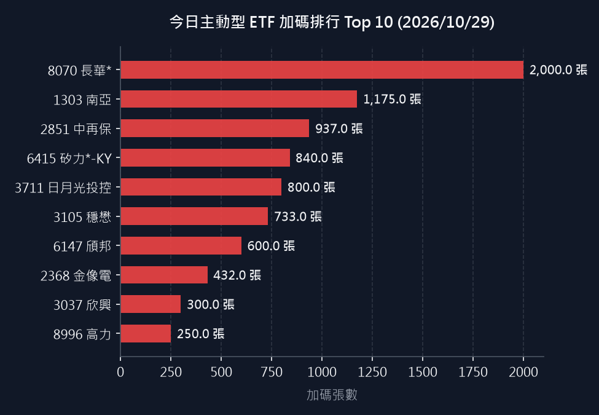
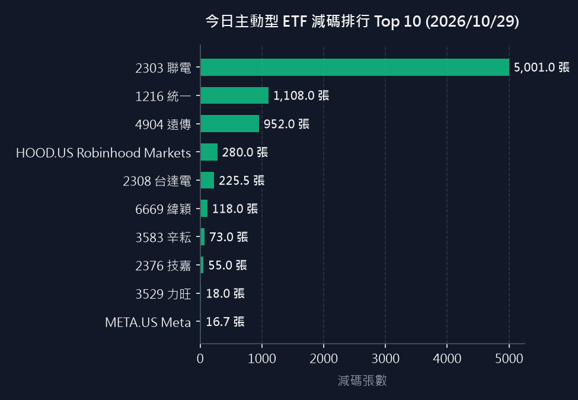

# 主動型 ETF 持股變動

資料來源：`主動型ETF持股明細.xlsx` 最近兩個日期分頁。

比較區間：`20261028` → `20261029`

## 今日加減碼視覺化排行

| 今日加碼 Top 10 | 今日減碼 Top 10 |
| :---: | :---: |
|  |  |

| ETF | 新增 | 刪除 | 比例變動 |
| :-- | --: | --: | --: |
| 00400A | 0 | 0 | 43 |
| 00401A | 0 | 0 | 51 |
| 00402A | 0 | 0 | 42 |
| 00403A | 0 | 0 | 30 |
| 00404A | 1 | 1 | 41 |
| 00405A | 1 | 0 | 25 |
| 00406A | 0 | 1 | 58 |
| 00407A | 1 | 1 | 40 |
| 00408A | 0 | 1 | 45 |
| 00980A | 0 | 0 | 49 |
| 00980D | 0 | 0 | 37 |
| 00981A | 0 | 0 | 25 |
| 00982A | 0 | 0 | 38 |
| 00983A | 0 | 0 | 36 |
| 00983D | 0 | 0 | 23 |
| 00984A | 0 | 0 | 61 |
| 00985A | 0 | 0 | 46 |
| 00986A | 0 | 0 | 31 |
| 00987A | 0 | 0 | 25 |
| 00988A | 0 | 2 | 36 |
| 00989A | 0 | 0 | 53 |
| 00990A | 3 | 2 | 33 |
| 00991A | 0 | 0 | 18 |
| 00992A | 1 | 0 | 38 |
| 00993A | 0 | 0 | 45 |
| 00994A | 0 | 1 | 34 |
| 00995A | 0 | 0 | 35 |
| 00996A | 0 | 0 | 35 |
| 00997A | 0 | 0 | 43 |
| 00998A | 0 | 0 | 46 |
| 00999A | 0 | 0 | 45 |

## 00400A

### 新增持股

- 無

### 刪除持股

- 無

### 投資比例變動

- 1303 南亞：4.23% → 4.25%（+0.02）
- 2059 川湖：3.61% → 3.62%（+0.01）
- 2303 聯電：1.71% → 1.58%（-0.13）
- 2308 台達電：2.34% → 2.30%（-0.04）
- 2313 華通：0.79% → 0.77%（-0.02）
- 2317 鴻海：0.77% → 0.78%（+0.01）
- 2327 國巨*：1.23% → 1.26%（+0.03）
- 2330 台積電：8.72% → 8.94%（+0.22）
- 2360 致茂：3.04% → 2.99%（-0.05）
- 2368 金像電：2.76% → 2.68%（-0.08）
- 2383 台光電：4.06% → 4.16%（+0.10）
- 2454 聯發科：6.92% → 6.80%（-0.12）
- 2603 長榮：1.56% → 1.60%（+0.04）
- 2637 慧洋-KY：0.45% → 0.47%（+0.02）
- 2881 富邦金：1.59% → 1.65%（+0.06）
- 2891 中信金：1.54% → 1.61%（+0.07）
- 3008 大立光：1.53% → 1.45%（-0.08）
- 3017 奇鋐：3.36% → 3.34%（-0.02）
- 3036 文曄：1.52% → 1.55%（+0.03）
- 3037 欣興：3.74% → 3.64%（-0.10）
- 3044 健鼎：2.23% → 2.26%（+0.03）
- 3081 聯亞：0.67% → 0.69%（+0.02）
- 3167 大量：0.38% → 0.36%（-0.02）
- 3293 鈊象：0.34% → 0.35%（+0.01）
- 3406 玉晶光：1.04% → 0.96%（-0.08）
- 3443 創意：2.52% → 2.43%（-0.09）
- 3529 力旺：1.20% → 1.18%（-0.02）
- 3653 健策：3.12% → 3.23%（+0.11）
- 3661 世芯-KY：2.22% → 2.31%（+0.09）
- 3665 貿聯-KY：1.31% → 1.27%（-0.04）
- 3711 日月光投控：1.03% → 1.04%（+0.01）
- 4958 臻鼎-KY：0.45% → 0.44%（-0.01）
- 5274 信驊：1.56% → 2.52%（+0.96）
- 6147 頎邦：0.91% → 0.86%（-0.05）
- 6187 萬潤：1.06% → 1.03%（-0.03）
- 6223 旺矽：2.94% → 2.87%（-0.07）
- 6274 台燿：1.22% → 1.27%（+0.05）
- 6278 台表科：2.58% → 2.56%（-0.02）
- 6488 環球晶：2.39% → 2.35%（-0.04）
- 6505 台塑化：1.42% → 1.40%（-0.02）
- 7750 新代：0.78% → 0.83%（+0.05）
- 7769 鴻勁：0.71% → 0.68%（-0.03）
- ＸＡＧＸ金兌(3533.HK)：0.94% → 0.95%（+0.01）

## 00401A

### 新增持股

- 無

### 刪除持股

- 無

### 投資比例變動

- 1216 統一：0.28% → 0.29%（+0.01）
- 1477 聚陽：0.92% → 0.93%（+0.01）
- 2303 聯電：2.13% → 1.97%（-0.16）
- 2308 台達電：2.10% → 2.05%（-0.05）
- 2313 華通：1.37% → 1.33%（-0.04）
- 2317 鴻海：0.57% → 0.58%（+0.01）
- 2327 國巨*：0.61% → 0.62%（+0.01）
- 2330 台積電：20.11% → 20.47%（+0.36）
- 2345 智邦：0.12% → 0.11%（-0.01）
- 2357 華碩：1.88% → 1.84%（-0.04）
- 2360 致茂：1.56% → 1.52%（-0.04）
- 2379 瑞昱：1.12% → 1.15%（+0.03）
- 2382 廣達：2.12% → 2.09%（-0.03）
- 2383 台光電：1.01% → 1.02%（+0.01）
- 2412 中華電：0.88% → 0.90%（+0.02）
- 2454 聯發科：5.91% → 5.77%（-0.14）
- 2455 全新：2.16% → 2.09%（-0.07）
- 2603 長榮：1.94% → 1.96%（+0.02）
- 2881 富邦金：2.11% → 2.17%（+0.06）
- 2882 國泰金：1.07% → 1.10%（+0.03）
- 2883 凱基金：1.66% → 1.70%（+0.04）
- 2884 玉山金：2.05% → 2.12%（+0.07）
- 2886 兆豐金：1.43% → 1.49%（+0.06）
- 2887 台新新光金：1.07% → 1.11%（+0.04）
- 2890 永豐金：0.49% → 0.50%（+0.01）
- 2891 中信金：1.82% → 1.89%（+0.07）
- 3008 大立光：2.24% → 2.10%（-0.14）
- 3037 欣興：2.05% → 1.98%（-0.07）
- 3131 弘塑：0.61% → 0.60%（-0.01）
- 3231 緯創：1.74% → 1.72%（-0.02）
- 3491 昇達科：1.52% → 1.50%（-0.02）
- 3711 日月光投控：3.27% → 3.29%（+0.02）
- 4904 遠傳：0.79% → 0.81%（+0.02）
- 4938 和碩：0.36% → 0.35%（-0.01）
- 4958 臻鼎-KY：1.39% → 1.34%（-0.05）
- 4991 環宇-KY：0.58% → 0.57%（-0.01）
- 5347 世界：1.28% → 1.23%（-0.05）
- 5904 寶雅*：0.54% → 0.56%（+0.02）
- 6147 頎邦：1.42% → 1.33%（-0.09）
- 6187 萬潤：0.91% → 0.87%（-0.04）
- 6223 旺矽：1.53% → 1.48%（-0.05）
- 6285 啟碁：1.33% → 1.31%（-0.02）
- 6515 穎崴：0.90% → 0.87%（-0.03）
- 6531 愛普*：1.47% → 1.50%（+0.03）
- 6669 緯穎：1.71% → 1.69%（-0.02）
- 7769 鴻勁：0.84% → 0.81%（-0.03）
- 7828 創新服務：1.33% → 1.29%（-0.04）
- 7856 漢測：0.72% → 0.73%（+0.01）
- 8464 億豐：0.99% → 1.01%（+0.02）
- 台股期貨11/26(FITXN*1.TF)：0.04% → -0.06%（-0.10）
- 臺指選擇權11/26 46500 買權：-0.75% → -0.56%（+0.19）

## 00402A

### 新增持股

- 無

### 刪除持股

- 無

### 投資比例變動

- AAPL.US Apple：8.11% → 7.95%（-0.16）
- AMD.US AMD：5.98% → 6.11%（+0.13）
- AMZN.US Amazon：4.41% → 4.39%（-0.02）
- ANET.US Arista Networks：0.81% → 0.80%（-0.01）
- ARM.US Arm：0.81% → 0.83%（+0.02）
- ASML.US ASML Holding：1.16% → 1.17%（+0.01）
- AVGO.US Broadcom：2.21% → 2.25%（+0.04）
- AXON.US Axon Enterprise：0.61% → 0.60%（-0.01）
- BKNG.US Booking Holdings：0.50% → 0.49%（-0.01）
- CDNS.US Cadence Design Systems：1.59% → 1.57%（-0.02）
- CIEN.US Ciena：1.15% → 1.17%（+0.02）
- CLS.US Celestica：1.12% → 1.20%（+0.08）
- CRWD.US CrowdStrike Holdings：1.92% → 1.89%（-0.03）
- FSLY.US Fastly：0.41% → 0.40%（-0.01）
- GOOG.US Alphabet - Class C Capital Stock：3.21% → 3.23%（+0.02）
- GOOGL.US Alphabet - Class A Common Stock：3.23% → 3.24%（+0.01）
- INTC.US Intel：1.46% → 1.47%（+0.01）
- IOT.US Samsara：0.58% → 0.57%（-0.01）
- KLAC.US KLA：1.28% → 1.30%（+0.02）
- LITE.US Lumentum：1.75% → 1.82%（+0.07）
- LRCX.US Lam Research：2.09% → 2.17%（+0.08）
- MCHP.US Microchip Technology：1.45% → 1.42%（-0.03）
- META.US Meta：3.35% → 3.27%（-0.08）
- MRVL.US Marvell：1.68% → 1.71%（+0.03）
- MSFT.US Microsoft：5.48% → 5.42%（-0.06）
- MU.US Micron：5.78% → 6.06%（+0.28）
- NFLX.US Netflix：0.89% → 0.88%（-0.01）
- NOW.US ServiceNow：1.22% → 1.17%（-0.05）
- NVDA.US NVIDIA：8.73% → 8.56%（-0.17）
- PANW.US Palo Alto：3.15% → 3.05%（-0.10）
- PLTR.US Palantir Technologies：2.24% → 2.19%（-0.05）
- SIMO.US Silicon Motion：0.46% → 0.49%（+0.03）
- SKHY.US SK hynix：0.79% → 0.89%（+0.10）
- SPCX.US SpaceX：0.75% → 0.72%（-0.03）
- SPOT.US Spotify：0.40% → 0.38%（-0.02）
- STX.US Seagate：1.03% → 1.06%（+0.03）
- TER.US Teradyne：0.73% → 0.70%（-0.03）
- TTWO.US Take-Two：0.59% → 0.56%（-0.03）
- TXN.US Texas Instruments：2.68% → 2.65%（-0.03）
- UBER.US Uber：0.30% → 0.29%（-0.01）
- V.US Visa：1.24% → 1.22%（-0.02）
- WDC.US Western Digital：1.90% → 1.95%（+0.05）

## 00403A

### 新增持股

- 無

### 刪除持股

- 無

### 投資比例變動

- 2303 聯電：0.58% → 0.00%（-0.58）
- 2308 台達電：3.13% → 2.76%（-0.37）
- 2313 華通：0.34% → 0.33%（-0.01）
- 2317 鴻海：0.61% → 0.62%（+0.01）
- 2327 國巨*：3.65% → 3.72%（+0.07）
- 2330 台積電：14.17% → 14.48%（+0.31）
- 2345 智邦：2.20% → 2.19%（-0.01）
- 2368 金像電：0.74% → 0.81%（+0.07）
- 2383 台光電：4.58% → 4.68%（+0.10）
- 2408 南亞科：1.01% → 1.04%（+0.03）
- 2454 聯發科：4.92% → 4.82%（-0.10）
- 2882 國泰金：0.35% → 0.36%（+0.01）
- 3008 大立光：1.80% → 1.70%（-0.10）
- 3017 奇鋐：5.69% → 5.63%（-0.06）
- 3037 欣興：6.01% → 5.83%（-0.18）
- 3189 景碩：3.50% → 3.32%（-0.18）
- 3211 順達：0.51% → 0.50%（-0.01）
- 3443 創意：4.40% → 4.22%（-0.18）
- 3450 聯鈞：0.50% → 0.51%（+0.01）
- 3583 辛耘：0.34% → 0.30%（-0.04）
- 3653 健策：4.84% → 4.99%（+0.15）
- 3665 貿聯-KY：2.01% → 1.94%（-0.07）
- 3711 日月光投控：0.47% → 0.69%（+0.22）
- 5274 信驊：2.24% → 2.39%（+0.15）
- 6223 旺矽：3.61% → 3.50%（-0.11）
- 6274 台燿：2.51% → 2.60%（+0.09）
- 6442 光聖：0.37% → 0.36%（-0.01）
- 6669 緯穎：2.74% → 2.72%（-0.02）
- 6805 富世達：0.58% → 0.59%（+0.01）
- 8046 南電：2.97% → 2.93%（-0.04）

## 00404A

### 新增持股

- 2851 中再保（1.15%，937 張）

### 刪除持股

- iShares MSCI Japan SRI ETF(2851.JP)（1.13%，937 張）

### 投資比例變動

- 2301 光寶科：0.53% → 0.52%（-0.01）
- 2303 聯電：2.49% → 2.29%（-0.20）
- 2308 台達電：1.53% → 1.49%（-0.04）
- 2330 台積電：22.19% → 22.49%（+0.30）
- 2345 智邦：0.81% → 0.79%（-0.02）
- 2347 聯強：2.02% → 2.04%（+0.02）
- 2351 順德：0.37% → 0.36%（-0.01）
- 2357 華碩：1.22% → 1.19%（-0.03）
- 2360 致茂：0.45% → 0.44%（-0.01）
- 2379 瑞昱：1.15% → 1.18%（+0.03）
- 2382 廣達：0.99% → 0.97%（-0.02）
- 2383 台光電：2.73% → 2.77%（+0.04）
- 2395 研華：1.26% → 1.25%（-0.01）
- 2436 偉詮電：1.13% → 1.14%（+0.01）
- 2454 聯發科：6.43% → 6.24%（-0.19）
- 2637 慧洋-KY：1.12% → 1.15%（+0.03）
- 2882 國泰金：2.85% → 2.93%（+0.08）
- 2885 元大金：2.54% → 2.60%（+0.06）
- 2887 台新新光金：1.46% → 1.50%（+0.04）
- 2890 永豐金：1.48% → 1.51%（+0.03）
- 3017 奇鋐：1.27% → 1.25%（-0.02）
- 3034 聯詠：2.26% → 2.29%（+0.03）
- 3037 欣興：0.27% → 0.26%（-0.01）
- 3293 鈊象：1.18% → 1.22%（+0.04）
- 3443 創意：1.01% → 0.96%（-0.05）
- 3653 健策：0.47% → 0.48%（+0.01）
- 5274 信驊：2.75% → 2.74%（-0.01）
- 5876 上海商銀：1.56% → 1.61%（+0.05）
- 5904 寶雅*：0.49% → 0.51%（+0.02）
- 6196 帆宣：1.66% → 1.62%（-0.04）
- 6206 飛捷：0.73% → 0.72%（-0.01）
- 6223 旺矽：1.07% → 1.03%（-0.04）
- 6257 矽格：1.59% → 1.58%（-0.01）
- 6505 台塑化：0.48% → 0.46%（-0.02）
- 6669 緯穎：0.91% → 0.90%（-0.01）
- 7769 鴻勁：1.10% → 1.04%（-0.06）
- 8016 矽創：1.25% → 1.26%（+0.01）
- 8081 致新：0.89% → 0.90%（+0.01）
- 8299 群聯：1.26% → 1.29%（+0.03）
- 台指選擇權11/26 50900 買權：-0.06% → -0.04%（+0.02）
- 台股期貨11/26(FITXN*1.TF)：17.95% → 18.00%（+0.05）

## 00405A

### 新增持股

- 6415 矽力*-KY（0.61%，250 張）

### 刪除持股

- 無

### 投資比例變動

- 2059 川湖：2.27% → 2.28%（+0.01）
- 2303 聯電：0.02% → 0.01%（-0.01）
- 2308 台達電：0.65% → 0.64%（-0.01）
- 2330 台積電：1.94% → 2.00%（+0.06）
- 2345 智邦：4.95% → 4.94%（-0.01）
- 2368 金像電：5.98% → 5.81%（-0.17）
- 2383 台光電：4.77% → 4.91%（+0.14）
- 2454 聯發科：5.58% → 5.50%（-0.08）
- 3037 欣興：7.54% → 7.35%（-0.19）
- 3189 景碩：0.23% → 0.22%（-0.01）
- 3443 創意：2.67% → 2.58%（-0.09）
- 3653 健策：7.43% → 7.69%（+0.26）
- 3665 貿聯-KY：5.39% → 5.24%（-0.15）
- 5274 信驊：7.07% → 7.16%（+0.09）
- 5347 世界：0.16% → 0.15%（-0.01）
- 6187 萬潤：0.89% → 0.86%（-0.03）
- 6223 旺矽：7.40% → 7.22%（-0.18）
- 6274 台燿：1.89% → 1.97%（+0.08）
- 6515 穎崴：0.51% → 0.49%（-0.02）
- 6531 愛普*：3.89% → 4.00%（+0.11）
- 6669 緯穎：0.87% → 0.86%（-0.01）
- 6805 富世達：2.99% → 3.04%（+0.05）
- 7769 鴻勁：2.99% → 2.88%（-0.11）
- 8046 南電：7.57% → 7.50%（-0.07）
- 8996 高力：1.42% → 1.43%（+0.01）

## 00406A

### 新增持股

- 無

### 刪除持股

- 3260 威剛（0.00%，8.32 張）

### 投資比例變動

- 1303 南亞：2.32% → 2.39%（+0.07）
- 1326 台化：0.53% → 0.52%（-0.01）
- 1560 中砂：0.31% → 0.30%（-0.01）
- 1815 富喬：0.37% → 0.35%（-0.02）
- 2059 川湖：1.28% → 1.60%（+0.32）
- 2303 聯電：1.56% → 1.39%（-0.17）
- 2308 台達電：2.20% → 2.07%（-0.13）
- 2317 鴻海：0.28% → 0.27%（-0.01）
- 2327 國巨*：1.90% → 1.86%（-0.04）
- 2330 台積電：9.34% → 9.47%（+0.13）
- 2345 智邦：2.84% → 2.71%（-0.13）
- 2360 致茂：1.07% → 1.01%（-0.06）
- 2368 金像電：2.12% → 2.24%（+0.12）
- 2383 台光電：6.16% → 6.18%（+0.02）
- 2395 研華：0.07% → 0.06%（-0.01）
- 2449 京元電子：0.54% → 0.51%（-0.03）
- 2454 聯發科：5.61% → 5.72%（+0.11）
- 2481 強茂：0.44% → 0.41%（-0.03）
- 2486 一詮：0.14% → 0.13%（-0.01）
- 3008 大立光：1.28% → 1.36%（+0.08）
- 3017 奇鋐：5.44% → 5.19%（-0.25）
- 3037 欣興：6.14% → 5.97%（-0.17）
- 3081 聯亞：0.46% → 0.76%（+0.30）
- 3105 穩懋：0.09% → 0.10%（+0.01）
- 3167 大量：0.54% → 0.49%（-0.05）
- 3189 景碩：2.19% → 2.12%（-0.07）
- 3231 緯創：0.44% → 0.42%（-0.02）
- 3264 欣銓：0.42% → 0.41%（-0.01）
- 3363 上詮：0.17% → 0.15%（-0.02）
- 3443 創意：2.41% → 2.44%（+0.03）
- 3491 昇達科：0.35% → 0.34%（-0.01）
- 3529 力旺：0.16% → 0.15%（-0.01）
- 3653 健策：4.11% → 4.38%（+0.27）
- 3661 世芯-KY：0.88% → 0.93%（+0.05）
- 3665 貿聯-KY：1.12% → 1.04%（-0.08）
- 3711 日月光投控：2.02% → 1.96%（-0.06）
- 4938 和碩：0.61% → 0.58%（-0.03）
- 4958 臻鼎-KY：1.19% → 1.11%（-0.08）
- 5274 信驊：2.01% → 1.95%（-0.06）
- 6147 頎邦：0.90% → 0.91%（+0.01）
- 6187 萬潤：0.17% → 0.16%（-0.01）
- 6213 聯茂：0.62% → 0.59%（-0.03）
- 6223 旺矽：3.29% → 3.18%（-0.11）
- 6278 台表科：0.33% → 0.31%（-0.02）
- 6488 環球晶：0.25% → 0.24%（-0.01）
- 6510 精測：0.70% → 0.63%（-0.07）
- 6515 穎崴：0.19% → 0.18%（-0.01）
- 6669 緯穎：1.36% → 1.30%（-0.06）
- 6715 嘉基：0.78% → 0.77%（-0.01）
- 6805 富世達：0.55% → 0.53%（-0.02）
- 7769 鴻勁：0.18% → 0.17%（-0.01）
- 8046 南電：3.20% → 3.03%（-0.17）
- 8150 南茂：0.04% → 0.03%（-0.01）
- 8358 金居：0.09% → 0.08%（-0.01）
- 8996 高力：0.19% → 0.49%（+0.30）
- 臺指選擇權第一週週三到期契約：-4.34% → -3.76%（+0.58）
- 臺指選擇權第五週週五到期契約：-16.45% → -16.84%（-0.39）
- 臺股期貨 202611(FITXN*1.TF)：22.85% → 24.00%（+1.15）

## 00407A

### 新增持股

- 3406 玉晶光（0.26%，45 張）

### 刪除持股

- 3529 力旺（0.22%，18 張）

### 投資比例變動

- 1303 南亞：2.98% → 3.00%（+0.02）
- 2059 川湖：1.90% → 1.91%（+0.01）
- 2301 光寶科：1.42% → 1.41%（-0.01）
- 2303 聯電：0.53% → 0.49%（-0.04）
- 2308 台達電：2.34% → 2.30%（-0.04）
- 2313 華通：0.42% → 0.41%（-0.01）
- 2327 國巨*：2.29% → 2.34%（+0.05）
- 2330 台積電：9.42% → 9.66%（+0.24）
- 2345 智邦：1.53% → 1.52%（-0.01）
- 2360 致茂：1.00% → 0.98%（-0.02）
- 2368 金像電：1.86% → 1.80%（-0.06）
- 2383 台光電：5.60% → 5.75%（+0.15）
- 2408 南亞科：1.58% → 1.62%（+0.04）
- 2451 創見：0.35% → 0.36%（+0.01）
- 2454 聯發科：5.33% → 5.25%（-0.08）
- 3008 大立光：1.54% → 1.46%（-0.08）
- 3017 奇鋐：5.64% → 5.61%（-0.03）
- 3034 聯詠：0.85% → 0.87%（+0.02）
- 3037 欣興：6.16% → 6.00%（-0.16）
- 3081 聯亞：1.85% → 1.90%（+0.05）
- 3131 弘塑：0.78% → 0.77%（-0.01）
- 3260 威剛：0.30% → 0.31%（+0.01）
- 3293 鈊象：0.64% → 0.67%（+0.03）
- 3443 創意：4.89% → 4.71%（-0.18）
- 3491 昇達科：0.85% → 0.84%（-0.01）
- 3653 健策：3.46% → 3.58%（+0.12）
- 3665 貿聯-KY：2.36% → 2.28%（-0.08）
- 3711 日月光投控：3.10% → 3.13%（+0.03）
- 4958 臻鼎-KY：1.08% → 1.05%（-0.03）
- 5274 信驊：1.85% → 1.87%（+0.02）
- 6187 萬潤：1.61% → 1.55%（-0.06）
- 6223 旺矽：2.25% → 2.19%（-0.06）
- 6274 台燿：1.99% → 2.07%（+0.08）
- 6446 藥華藥：0.33% → 0.35%（+0.02）
- 6510 精測：1.42% → 1.32%（-0.10）
- 6531 愛普*：0.30% → 0.31%（+0.01）
- 6669 緯穎：2.44% → 2.43%（-0.01）
- 6805 富世達：1.29% → 1.31%（+0.02）
- 8046 南電：3.70% → 3.66%（-0.04）
- 8299 群聯：0.32% → 0.34%（+0.02）

## 00408A

### 新增持股

- 無

### 刪除持股

- 2376 技嘉（1.39%，55 張）

### 投資比例變動

- 1303 南亞：3.99% → 4.00%（+0.01）
- 1560 中砂：0.83% → 0.82%（-0.01）
- 2059 川湖：0.99% → 0.98%（-0.01）
- 2303 聯電：1.30% → 0.87%（-0.43）
- 2308 台達電：2.47% → 1.78%（-0.69）
- 2327 國巨*：0.53% → 0.54%（+0.01）
- 2330 台積電：6.07% → 6.18%（+0.11）
- 2344 華邦電：0.48% → 0.49%（+0.01）
- 2357 華碩：1.17% → 0.54%（-0.63）
- 2360 致茂：1.13% → 1.11%（-0.02）
- 2368 金像電：5.19% → 5.00%（-0.19）
- 2383 台光電：4.71% → 4.82%（+0.11）
- 2408 南亞科：2.02% → 2.07%（+0.05）
- 2449 京元電子：0.91% → 0.90%（-0.01）
- 2454 聯發科：4.12% → 4.03%（-0.09）
- 2455 全新：0.85% → 0.83%（-0.02）
- 2542 興富發：3.65% → 3.79%（+0.14）
- 2603 長榮：1.28% → 1.30%（+0.02）
- 2880 華南金：1.20% → 1.25%（+0.05）
- 2891 中信金：0.77% → 0.80%（+0.03）
- 3008 大立光：0.88% → 0.83%（-0.05）
- 3017 奇鋐：2.88% → 2.85%（-0.03）
- 3026 禾伸堂：0.78% → 0.82%（+0.04）
- 3037 欣興：3.13% → 3.04%（-0.09）
- 3045 台灣大：0.01% → 0.11%（+0.10）
- 3081 聯亞：2.06% → 2.11%（+0.05）
- 3105 穩懋：0.53% → 0.59%（+0.06）
- 3189 景碩：3.52% → 3.35%（-0.17）
- 3231 緯創：0.95% → 0.94%（-0.01）
- 3264 欣銓：0.71% → 0.72%（+0.01）
- 3443 創意：0.57% → 0.54%（-0.03）
- 3653 健策：3.46% → 3.56%（+0.10）
- 3665 貿聯-KY：0.36% → 0.35%（-0.01）
- 3711 日月光投控：1.88% → 1.90%（+0.02）
- 5434 崇越：2.26% → 2.28%（+0.02）
- 6187 萬潤：1.03% → 0.99%（-0.04）
- 6223 旺矽：2.06% → 2.00%（-0.06）
- 6274 台燿：2.77% → 2.87%（+0.10）
- 6488 環球晶：0.83% → 0.81%（-0.02）
- 6510 精測：0.44% → 0.41%（-0.03）
- 6669 緯穎：2.00% → 1.98%（-0.02）
- 6805 富世達：2.39% → 2.42%（+0.03）
- 7769 鴻勁：0.97% → 0.92%（-0.05）
- 8046 南電：1.54% → 1.51%（-0.03）
- 9802 鈺齊-KY：0.82% → 0.84%（+0.02）

## 00980A

### 新增持股

- 無

### 刪除持股

- 無

### 投資比例變動

- 1303 南亞：3.56% → 3.58%（+0.02）
- 2059 川湖：4.23% → 4.22%（-0.01）
- 2303 聯電：1.54% → 1.42%（-0.12）
- 2308 台達電：3.30% → 3.24%（-0.06）
- 2317 鴻海：3.25% → 3.29%（+0.04）
- 2327 國巨*：0.92% → 0.94%（+0.02）
- 2330 台積電：9.63% → 9.84%（+0.21）
- 2344 華邦電：1.75% → 1.79%（+0.04）
- 2345 智邦：0.96% → 0.95%（-0.01）
- 2360 致茂：1.18% → 1.16%（-0.02）
- 2368 金像電：2.11% → 2.03%（-0.08）
- 2376 技嘉：1.68% → 1.63%（-0.05）
- 2382 廣達：1.91% → 1.89%（-0.02）
- 2383 台光電：3.82% → 3.91%（+0.09）
- 2408 南亞科：2.43% → 2.50%（+0.07）
- 2454 聯發科：5.56% → 5.45%（-0.11）
- 2884 玉山金：1.24% → 1.29%（+0.05）
- 2891 中信金：1.53% → 1.59%（+0.06）
- 3008 大立光：2.17% → 2.05%（-0.12）
- 3017 奇鋐：2.27% → 2.25%（-0.02）
- 3026 禾伸堂：1.13% → 1.19%（+0.06）
- 3036 文曄：1.04% → 1.05%（+0.01）
- 3037 欣興：3.63% → 3.52%（-0.11）
- 3044 健鼎：1.29% → 1.31%（+0.02）
- 3081 聯亞：1.63% → 1.67%（+0.04）
- 3189 景碩：1.45% → 1.38%（-0.07）
- 3231 緯創：1.70% → 1.69%（-0.01）
- 3264 欣銓：0.81% → 0.83%（+0.02）
- 3293 鈊象：0.46% → 0.48%（+0.02）
- 3443 創意：1.94% → 1.86%（-0.08）
- 3529 力旺：0.17% → 0.16%（-0.01）
- 3653 健策：3.03% → 3.12%（+0.09）
- 3665 貿聯-KY：1.37% → 1.32%（-0.05）
- 3711 日月光投控：2.28% → 2.30%（+0.02）
- 5274 信驊：1.85% → 1.87%（+0.02）
- 5904 寶雅*：0.65% → 0.67%（+0.02）
- 6213 聯茂：1.46% → 1.44%（-0.02）
- 6223 旺矽：1.32% → 1.28%（-0.04）
- 6274 台燿：1.28% → 1.32%（+0.04）
- 6442 光聖：0.28% → 0.27%（-0.01）
- 6515 穎崴：1.59% → 1.54%（-0.05）
- 6669 緯穎：1.90% → 1.89%（-0.01）
- 6805 富世達：0.70% → 0.71%（+0.01）
- 7751 竑騰：0.69% → 0.68%（-0.01）
- 7769 鴻勁：2.08% → 1.99%（-0.09）
- 8046 南電：1.72% → 1.70%（-0.02）
- 8299 群聯：1.12% → 1.15%（+0.03）
- 8996 高力：0.48% → 0.49%（+0.01）
- 台灣證交所加權股價指數(FITXN*1.TF)：1.49% → 1.51%（+0.02）

## 00980D

### 新增持股

- 無

### 刪除持股

- 無

### 投資比例變動

- ANHEUSER-BUSCH INBEV WOR (REG) 8.2% 15JAN2039：0.54% → 0.53%（-0.01）
- APA CORP 6.750000 % 15-FEB-2055：0.39% → 0.38%（-0.01）
- BAT CAPITAL CORP (REG) 7.081% 02AUG2053：0.60% → 0.59%（-0.01）
- BRIGHTHOUSE FINANCIAL IN (REG) 4.7% 22JUN2047：0.49% → 0.48%（-0.01）
- CHC GROUP LLC SER REGS 11.750000 % 01-SEP-2030：0.46% → 0.45%（-0.01）
- CHS/COMMUNITY HEALTH SYS SER REGS 9.750000 % 15JAN2034：0.33% → 0.32%（-0.01）
- CONSOLIDATED ENERGY FIN SER REGS 12.000000 % 15FEB2031：0.59% → 0.58%（-0.01）
- COREWEAVE INC SER REGS (REG S) 9.25% 01JUN2030：0.41% → 0.42%（+0.01）
- COREWEAVE INC SER REGS (REG S) 9.75% 01OCT2031：0.48% → 0.49%（+0.01）
- COREWEAVE INC SER REGS (REG) (REG S) 9.625% 15JUL2032：0.48% → 0.49%（+0.01）
- FORD MOTOR CREDIT CO LLC 6.798% 07NOV2028：0.34% → 0.35%（+0.01）
- GLOBAL ATLANTIC FIN CO SER REGS 6.750000 % 15MAR2054：0.64% → 0.63%（-0.01）
- GLOBAL AUTO HO/AAG FH UK SER REGS (REG S) 11.5% 15AUG2029：0.36% → 0.37%（+0.01）
- GLOBAL AUTO HO/AAG FH UK SER REGS (REG S) 8.75% 15JAN2032：0.40% → 0.41%（+0.01）
- HISCOX LTD VAR 11JUN2036：0.43% → 0.44%（+0.01）
- HSBC HOLDINGS PLC (REG) VAR 13NOV2034：0.35% → 0.36%（+0.01）
- ICAHN ENTERPRISES/FIN SER REGS 10.000000 % 15NOV2029：0.31% → 0.32%（+0.01）
- KINDER MORGAN INC/DELAWA SER GMTN (REG) 7.8% 01AUG2031：0.33% → 0.32%（-0.01）
- LINCOLN NATIONAL CORP (REG) 7.000000 % 15JUN2040：0.48% → 0.47%（-0.01）
- METLIFE INC (REG) 10.75% 01AUG2039：0.46% → 0.47%（+0.01）
- MYLAN NV 5.25% 15JUN2046 WI：0.56% → 0.55%（-0.01）
- ORACLE CORP 6.100000 % 26-SEP-2065：0.51% → 0.52%（+0.01）
- ORACLE CORP 6.7 % 04-FEB-2056：0.20% → 0.21%（+0.01）
- ORACLE CORP 6.85 % 04-FEB-2066：0.54% → 0.55%（+0.01）
- ORANGE SA (REG) 9% 01MAR2031：0.68% → 0.67%（-0.01）
- PHOTO HOLDINGS LLC SER REGS (REG) (REG S) 12% 01JUL2031：0.48% → 0.49%（+0.01）
- SABRE GLBL INC SER REGS 11.125000 % 15JUL2030：0.47% → 0.48%（+0.01）
- STELLANTIS FIN US INC SER REGS 6.450000 % 18MAR2035：0.31% → 0.32%（+0.01）
- TOUCAN FINCO LTD/CAN/US SER REGS 9.500000 % 15MAY2030：0.26% → 0.25%（-0.01）
- TRANSCANADA PIPELINES LTD 7.625PCT 15/01/2039：0.55% → 0.54%（-0.01）
- UNISYS CORP SER REGS 10.625000 % 15JAN2031：0.62% → 0.63%（+0.01）
- US 10YR NOTE (CBT)DEC26 21-DEC-2026：18.46% → 18.43%（-0.03）
- US 10YR ULTRA FUT DEC26 21-DEC-2026：-2.34% → -2.33%（+0.01）
- US 5YR NOTE (CBT) DEC26 31-DEC-2026：-13.98% → -13.97%（+0.01）
- US LONG BOND(CBT) DEC26 21-DEC-2026：5.58% → 5.54%（-0.04）
- VIACOMCBS INC (REG) 4.95% 19MAY2050：0.45% → 0.46%（+0.01）
- VIACOMCBS INC 6.875% 30APR2036：0.25% → 0.26%（+0.01）

## 00981A

### 新增持股

- 無

### 刪除持股

- 無

### 投資比例變動

- 2303 聯電：3.64% → 3.38%（-0.26）
- 2308 台達電：4.20% → 4.12%（-0.08）
- 2327 國巨*：4.60% → 4.69%（+0.09）
- 2330 台積電：11.31% → 11.56%（+0.25）
- 2345 智邦：4.11% → 4.08%（-0.03）
- 2368 金像電：3.24% → 3.13%（-0.11）
- 2383 台光電：7.78% → 7.96%（+0.18）
- 2454 聯發科：8.03% → 7.88%（-0.15）
- 3017 奇鋐：7.51% → 7.45%（-0.06）
- 3037 欣興：7.76% → 7.53%（-0.23）
- 3264 欣銓：0.41% → 0.44%（+0.03）
- 3443 創意：2.70% → 2.59%（-0.11）
- 3653 健策：5.73% → 5.91%（+0.18）
- 3665 貿聯-KY：1.87% → 1.81%（-0.06）
- 3711 日月光投控：2.97% → 2.99%（+0.02）
- 5274 信驊：1.38% → 1.49%（+0.11）
- 6191 精成科：0.13% → 0.12%（-0.01）
- 6223 旺矽：4.58% → 4.45%（-0.13）
- 6274 台燿：3.55% → 3.70%（+0.15）
- 6510 精測：0.54% → 0.50%（-0.04）
- 6515 穎崴：0.14% → 0.12%（-0.02）
- 6669 緯穎：2.29% → 2.27%（-0.02）
- 6805 富世達：0.99% → 1.07%（+0.08）
- 8046 南電：4.15% → 4.12%（-0.03）
- 台指期貨 2026/11(FITXN*1.TF)：2.29% → 2.32%（+0.03）

## 00982A

### 新增持股

- 無

### 刪除持股

- 無

### 投資比例變動

- 2059 川湖：2.73% → 2.72%（-0.01）
- 2301 光寶科：1.77% → 1.74%（-0.03）
- 2303 聯電：1.38% → 1.27%（-0.11）
- 2330 台積電：8.14% → 8.28%（+0.14）
- 2360 致茂：4.04% → 3.94%（-0.10）
- 2376 技嘉：1.32% → 1.28%（-0.04）
- 2377 微星：0.36% → 0.35%（-0.01）
- 2383 台光電：3.24% → 3.30%（+0.06）
- 2395 研華：1.39% → 1.38%（-0.01）
- 2454 聯發科：6.95% → 6.78%（-0.17）
- 2455 全新：1.64% → 1.59%（-0.05）
- 2467 志聖：1.00% → 0.99%（-0.01）
- 2885 元大金：0.34% → 0.35%（+0.01）
- 3008 大立光：3.35% → 3.14%（-0.21）
- 3017 奇鋐：2.51% → 2.48%（-0.03）
- 3037 欣興：0.92% → 0.89%（-0.03）
- 3090 日電貿：0.34% → 0.33%（-0.01）
- 3105 穩懋：6.43% → 8.94%（+2.51）
- 3231 緯創：1.96% → 1.94%（-0.02）
- 3265 台星科：1.55% → 1.52%（-0.03）
- 3491 昇達科：3.30% → 3.24%（-0.06）
- 3711 日月光投控：1.38% → 1.97%（+0.59）
- 4958 臻鼎-KY：3.63% → 3.50%（-0.13）
- 5536 聖暉*：0.75% → 0.76%（+0.01）
- 6139 亞翔：5.26% → 5.31%（+0.05）
- 6196 帆宣：0.38% → 0.37%（-0.01）
- 6213 聯茂：1.53% → 1.50%（-0.03）
- 6214 精誠：1.44% → 1.48%（+0.04）
- 6223 旺矽：3.21% → 3.11%（-0.10）
- 6239 力成：1.37% → 1.39%（+0.02）
- 6274 台燿：1.21% → 1.25%（+0.04）
- 6472 保瑞：0.85% → 0.86%（+0.01）
- 6488 環球晶：1.93% → 1.89%（-0.04）
- 6510 精測：1.00% → 0.92%（-0.08）
- 6531 愛普*：4.05% → 4.12%（+0.07）
- 6669 緯穎：2.41% → 2.36%（-0.05）
- 6672 騰輝電子-KY：1.38% → 1.42%（+0.04）
- 8070 長華*：0.47% → 0.69%（+0.22）

## 00983A

### 新增持股

- 無

### 刪除持股

- 無

### 投資比例變動

- AMD.US AMD：3.35% → 3.40%（+0.05）
- AMZN.US Amazon：3.35% → 3.54%（+0.19）
- AVGO.US Broadcom：1.57% → 1.81%（+0.24）
- BEAM.US Beam Therapeutics：1.60% → 1.82%（+0.22）
- BLSH.US Bullish：1.99% → 1.81%（-0.18）
- BMNR.US BitMine：2.10% → 1.90%（-0.20）
- COIN.US Coinbase：4.03% → 3.89%（-0.14）
- CRCL.US Circle：4.52% → 4.45%（-0.07）
- CRSP.US CRISPR Therapeutics：3.77% → 3.90%（+0.13）
- CRWV.US CoreWeave：0.88% → 0.74%（-0.14）
- FTNT.US Fortinet：0.57% → 0.53%（-0.04）
- HOOD.US Robinhood Markets：2.97% → 2.83%（-0.14）
- ILMN.US Illumina：1.81% → 1.84%（+0.03）
- LLY.US Eli Lilly：1.63% → 1.61%（-0.02）
- META.US Meta：2.35% → 2.43%（+0.08）
- MSFT.US Microsoft：0.78% → 0.98%（+0.20）
- NET.US Cloudflare：1.43% → 1.37%（-0.06）
- NTLA.US Intellia Therapeutics：0.63% → 0.67%（+0.04）
- NTRA.US Natera：1.68% → 1.71%（+0.03）
- NVDA.US NVIDIA：3.54% → 3.60%（+0.06）
- PACB.US Pacific Biosciences of Californi：0.07% → 0.08%（+0.01）
- PLTR.US Palantir Technologies：3.32% → 3.24%（-0.08）
- RKLB.US Rocket Lab：1.34% → 1.32%（-0.02）
- RXRX.US Recursion Pharmaceuticals：0.95% → 1.00%（+0.05）
- SHOP.US Shopify：4.86% → 4.85%（-0.01）
- SOFI.US SoFi Technologies：0.16% → 0.17%（+0.01）
- SPCX.US SpaceX：6.69% → 6.44%（-0.25）
- TEM.US Tempus：5.67% → 5.92%（+0.25）
- TER.US Teradyne：0.56% → 0.54%（-0.02）
- TSLA.US Tesla：9.41% → 9.02%（-0.39）
- TSM.US TSMC(ADR)：2.74% → 2.71%（-0.03）
- TWST.US Twist Bioscience：4.02% → 4.30%（+0.28）
- TXG.US 10x Genomics：3.49% → 3.68%（+0.19）
- VCYT.US Veracyte：0.15% → 0.14%（-0.01）
- WGS.US GeneDx：0.46% → 0.47%（+0.01）
- XYZ.US Block：1.24% → 1.23%（-0.01）

## 00983D

### 新增持股

- 無

### 刪除持股

- 無

### 投資比例變動

- ABIBB 8.2 01/15/39：2.03% → 2.02%（-0.01）
- ALLY 8 11/01/31：1.24% → 1.25%（+0.01）
- BACR 7.437 11/02/33：1.31% → 1.32%（+0.01）
- BHCCN 11 09/30/28：1.97% → 1.99%（+0.02）
- BRKHEC 6 3/4 07/01/37：0.85% → 0.84%（-0.01）
- CEG 6 1/2 10/01/53：0.82% → 0.81%（-0.01）
- CRWV 9 02/01/31：1.21% → 1.24%（+0.03）
- CYH 10 7/8 01/15/32：1.52% → 1.51%（-0.01）
- DT 9 1/4 06/01/32：1.55% → 1.56%（+0.01）
- ENBCN 6.7 11/15/53：0.63% → 0.62%（-0.01）
- FFHCN 6.35 03/22/54：0.74% → 0.73%（-0.01）
- GT 8 7/8 07/15/32：0.88% → 0.89%（+0.01）
- HAL 7.45 09/15/39：1.90% → 1.89%（-0.01）
- HPE 6.35 10/15/45：1.04% → 1.03%（-0.01）
- IEP 10 11/15/29：1.52% → 1.53%（+0.01）
- KHC 6 7/8 01/26/39：1.05% → 1.04%（-0.01）
- KMI 6.95 01/15/38：1.11% → 1.10%（-0.01）
- NVDA 5.55 06/15/46：1.19% → 1.18%（-0.01）
- PCG 6.7 04/01/53：0.98% → 0.97%（-0.01）
- TELEFONICA EMISIONES SAU 7.045 06/20/36：1.42% → 1.41%（-0.01）
- TLTW.US iShares TLT Premium Income+ ETF：8.37% → 8.35%（-0.02）
- VENLNG 9 1/2 02/01/29：1.48% → 1.49%（+0.01）
- VZ 7 3/4 12/01/30：1.18% → 1.19%（+0.01）

## 00984A

### 新增持股

- 無

### 刪除持股

- 無

### 投資比例變動

- 1216 統一：0.33% → 0.34%（+0.01）
- 1303 南亞：3.16% → 3.13%（-0.03）
- 1409 新纖：0.65% → 0.64%（-0.01）
- 1560 中砂：1.27% → 1.25%（-0.02）
- 1709 和益：0.69% → 0.66%（-0.03）
- 2059 川湖：2.12% → 2.09%（-0.03）
- 2301 光寶科：0.60% → 0.58%（-0.02）
- 2303 聯電：0.73% → 0.67%（-0.06）
- 2330 台積電：4.26% → 4.30%（+0.04）
- 2351 順德：0.63% → 0.61%（-0.02）
- 2357 華碩：0.65% → 0.63%（-0.02）
- 2379 瑞昱：0.32% → 0.33%（+0.01）
- 2383 台光電：1.29% → 1.30%（+0.01）
- 2395 研華：2.52% → 2.50%（-0.02）
- 2408 南亞科：2.07% → 2.10%（+0.03）
- 2409 友達：1.20% → 1.16%（-0.04）
- 2454 聯發科：0.80% → 0.78%（-0.02）
- 2464 盟立：1.21% → 1.20%（-0.01）
- 2603 長榮：1.91% → 1.92%（+0.01）
- 2615 萬海：0.99% → 0.97%（-0.02）
- 2618 長榮航：0.31% → 0.32%（+0.01）
- 2801 彰銀：0.34% → 0.35%（+0.01）
- 2855 統一證：0.65% → 0.66%（+0.01）
- 2880 華南金：1.65% → 1.70%（+0.05）
- 2881 富邦金：4.33% → 4.45%（+0.12）
- 2882 國泰金：3.33% → 3.40%（+0.07）
- 2883 凱基金：2.48% → 2.51%（+0.03）
- 2884 玉山金：2.36% → 2.43%（+0.07）
- 2885 元大金：3.44% → 3.51%（+0.07）
- 2886 兆豐金：2.21% → 2.28%（+0.07）
- 2887 台新新光金：3.44% → 3.52%（+0.08）
- 2890 永豐金：2.46% → 2.51%（+0.05）
- 2892 第一金：1.36% → 1.44%（+0.08）
- 3006 晶豪科：0.63% → 0.66%（+0.03）
- 3008 大立光：1.62% → 1.51%（-0.11）
- 3017 奇鋐：4.21% → 4.12%（-0.09）
- 3037 欣興：1.64% → 1.57%（-0.07）
- 3045 台灣大：1.79% → 1.84%（+0.05）
- 3189 景碩：1.61% → 1.51%（-0.10）
- 3231 緯創：0.67% → 0.66%（-0.01）
- 3264 欣銓：1.72% → 1.74%（+0.02）
- 3443 創意：1.24% → 1.18%（-0.06）
- 3605 宏致：0.66% → 0.65%（-0.01）
- 3653 健策：1.69% → 1.72%（+0.03）
- 3661 世芯-KY：0.29% → 0.28%（-0.01）
- 3665 貿聯-KY：0.52% → 0.49%（-0.03）
- 3714 富采：0.59% → 0.58%（-0.01）
- 4958 臻鼎-KY：0.62% → 0.59%（-0.03）
- 5871 中租-KY：0.31% → 0.32%（+0.01）
- 5876 上海商銀：0.34% → 0.35%（+0.01）
- 5904 寶雅*：0.98% → 1.01%（+0.03）
- 6187 萬潤：2.12% → 2.01%（-0.11）
- 6213 聯茂：1.54% → 1.50%（-0.04）
- 6214 精誠：0.68% → 0.69%（+0.01）
- 6223 旺矽：0.15% → 0.14%（-0.01）
- 6446 藥華藥：1.52% → 1.59%（+0.07）
- 6505 台塑化：3.22% → 3.12%（-0.10）
- 6669 緯穎：0.77% → 0.76%（-0.01）
- 6670 復盛應用：0.30% → 0.31%（+0.01）
- 7750 新代：0.67% → 0.70%（+0.03）
- 8046 南電：0.60% → 0.59%（-0.01）

## 00985A

### 新增持股

- 無

### 刪除持股

- 無

### 投資比例變動

- 1101 台泥：1.78% → 1.82%（+0.04）
- 1216 統一：2.45% → 2.20%（-0.25）
- 1402 遠東新：1.70% → 1.74%（+0.04）
- 1504 東元：0.51% → 0.52%（+0.01）
- 1605 華新：1.39% → 1.40%（+0.01）
- 2027 大成鋼：1.99% → 2.00%（+0.01）
- 2059 川湖：2.32% → 2.30%（-0.02）
- 2303 聯電：1.34% → 1.69%（+0.35）
- 2308 台達電：2.41% → 2.68%（+0.27）
- 2317 鴻海：1.88% → 1.89%（+0.01）
- 2327 國巨*：1.84% → 1.86%（+0.02）
- 2330 台積電：13.72% → 13.89%（+0.17）
- 2344 華邦電：1.56% → 1.57%（+0.01）
- 2345 智邦：2.46% → 2.42%（-0.04）
- 2368 金像電：1.24% → 1.19%（-0.05）
- 2376 技嘉：2.16% → 2.08%（-0.08）
- 2377 微星：0.89% → 0.86%（-0.03）
- 2383 台光電：2.79% → 2.83%（+0.04）
- 2408 南亞科：1.34% → 1.36%（+0.02）
- 2412 中華電：2.16% → 2.22%（+0.06）
- 2454 聯發科：1.45% → 1.74%（+0.29）
- 2603 長榮：1.39% → 1.40%（+0.01）
- 2609 陽明：1.37% → 1.38%（+0.01）
- 2610 華航：1.75% → 1.78%（+0.03）
- 3008 大立光：1.79% → 1.67%（-0.12）
- 3017 奇鋐：1.18% → 1.16%（-0.02）
- 3036 文曄：3.02% → 3.03%（+0.01）
- 3037 欣興：2.06% → 1.98%（-0.08）
- 3081 聯亞：1.97% → 2.00%（+0.03）
- 3105 穩懋：1.21% → 0.10%（-1.11）
- 3189 景碩：0.52% → 0.49%（-0.03）
- 3231 緯創：1.01% → 0.99%（-0.02）
- 3653 健策：3.13% → 3.20%（+0.07）
- 3661 世芯-KY：0.65% → 0.64%（-0.01）
- 3665 貿聯-KY：1.29% → 1.51%（+0.22）
- 4904 遠傳：2.80% → 2.50%（-0.30）
- 6285 啟碁：0.74% → 0.73%（-0.01）
- 6442 光聖：0.95% → 0.90%（-0.05）
- 6446 藥華藥：2.44% → 3.03%（+0.59）
- 6488 環球晶：1.41% → 1.37%（-0.04）
- 6526 達發：0.85% → 0.83%（-0.02）
- 6531 愛普*：1.30% → 1.32%（+0.02）
- 6669 緯穎：3.78% → 2.99%（-0.79）
- 7750 新代：0.89% → 1.31%（+0.42）
- 7769 鴻勁：3.15% → 2.99%（-0.16）
- 台積電期貨(FICDFN*1.TF)：1.56% → 1.57%（+0.01）

## 00986A

### 新增持股

- 無

### 刪除持股

- 無

### 投資比例變動

- 2330 台積電：8.05% → 8.06%（+0.01）
- 2454 聯發科：1.48% → 1.56%（+0.08）
- AAPL.US Apple：2.63% → 2.57%（-0.06）
- AMD.US AMD：4.75% → 4.85%（+0.10）
- AMZN.US Amazon：4.29% → 4.27%（-0.02）
- AVGO.US Broadcom：3.73% → 3.79%（+0.06）
- BE.US Bloom Energy：1.32% → 1.37%（+0.05）
- CRWD.US CrowdStrike Holdings：4.87% → 4.79%（-0.08）
- DDOG.US Datadog：1.19% → 1.17%（-0.02）
- ETN.US Eaton：2.33% → 2.35%（+0.02）
- GEV.US GE Vernova：2.71% → 2.63%（-0.08）
- GOOGL.US Alphabet - Class A Common Stock：5.82% → 5.84%（+0.02）
- GS.US Goldman Sachs：1.10% → 1.11%（+0.01）
- HOOD.US Robinhood Markets：0.69% → 0.66%（-0.03）
- ILMN.US Illumina：0.68% → 0.69%（+0.01）
- LITE.US Lumentum：4.09% → 4.27%（+0.18）
- LLY.US Eli Lilly：3.49% → 3.47%（-0.02）
- MA.US Mastercard：1.29% → 1.28%（-0.01）
- MSFT.US Microsoft：3.22% → 3.18%（-0.04）
- MU.US Micron：4.50% → 4.71%（+0.21）
- MUFG(8306.JP)：1.03% → 1.02%（-0.01）
- NET.US Cloudflare：2.38% → 2.29%（-0.09）
- NTRA.US Natera：0.75% → 0.76%（+0.01）
- NVDA.US NVIDIA：6.60% → 6.45%（-0.15）
- PLTR.US Palantir Technologies：1.44% → 1.41%（-0.03）
- RBRK.US Rubrik：0.99% → 0.98%（-0.01）
- SNOW.US Snowflake：2.25% → 2.24%（-0.01）
- TER.US Teradyne：0.98% → 0.94%（-0.04）
- TSEM.US Tower Semiconductor：0.97% → 0.99%（+0.02）
- 嘉能可公司：1.75% → 1.72%（-0.03）
- 尼比厄斯集團公眾有限公司：0.77% → 0.82%（+0.05）

## 00987A

### 新增持股

- 無

### 刪除持股

- 無

### 投資比例變動

- 1815 富喬：1.04% → 1.02%（-0.02）
- 2330 台積電：9.64% → 9.91%（+0.27）
- 2368 金像電：3.14% → 3.05%（-0.09）
- 2383 台光電：6.43% → 6.62%（+0.19）
- 2454 聯發科：5.05% → 4.98%（-0.07）
- 2455 全新：2.60% → 2.54%（-0.06）
- 3017 奇鋐：7.38% → 7.36%（-0.02）
- 3037 欣興：5.63% → 5.50%（-0.13）
- 3081 聯亞：3.39% → 3.50%（+0.11）
- 3363 上詮：2.18% → 2.07%（-0.11）
- 3443 創意：4.69% → 4.53%（-0.16）
- 3491 昇達科：3.08% → 3.06%（-0.02）
- 3529 力旺：1.88% → 1.85%（-0.03）
- 3653 健策：5.07% → 5.26%（+0.19）
- 3665 貿聯-KY：3.52% → 3.42%（-0.10）
- 4958 臻鼎-KY：2.43% → 2.37%（-0.06）
- 4991 環宇-KY：2.38% → 2.36%（-0.02）
- 6223 旺矽：1.13% → 1.10%（-0.03）
- 6274 台燿：4.55% → 4.75%（+0.20）
- 6510 精測：3.53% → 3.28%（-0.25）
- 6515 穎崴：1.74% → 1.70%（-0.04）
- 6805 富世達：3.91% → 3.98%（+0.07）
- 8046 南電：2.64% → 2.62%（-0.02）
- 8358 金居：1.71% → 1.68%（-0.03）
- 8996 高力：3.01% → 3.03%（+0.02）

## 00988A

### 新增持股

- 無

### 刪除持股

- HOOD.US Robinhood Markets（1.84%，280 張）
- ROBOTECHNIK INTELLIGENT TE-A（0.33%，85.748 張）

### 投資比例變動

- 1303 南亞：1.44% → 1.91%（+0.47）
- 2308 台達電：0.65% → 0.66%（+0.01）
- 2330 台積電：1.65% → 1.64%（-0.01）
- 2383 台光電：2.55% → 2.66%（+0.11）
- 2454 聯發科：0.68% → 0.72%（+0.04）
- 3017 奇鋐：4.03% → 4.08%（+0.05）
- 3037 欣興：5.91% → 6.05%（+0.14）
- 3443 創意：1.27% → 1.38%（+0.11）
- 6223 旺矽：1.13% → 1.19%（+0.06）
- AAPL.US Apple：3.02% → 2.95%（-0.07）
- AMD.US AMD：3.90% → 3.97%（+0.07）
- BE.US Bloom Energy：6.85% → 7.04%（+0.19）
- CRWD.US CrowdStrike Holdings：4.12% → 4.04%（-0.08）
- INFINEON TECHNOLOGIES AG：1.23% → 1.22%（-0.01）
- INTC.US Intel：2.61% → 2.62%（+0.01）
- LENOVO GROUP LTD：0.59% → 0.62%（+0.03）
- LITE.US Lumentum：4.41% → 4.58%（+0.17）
- META.US Meta：1.08% → 1.05%（-0.03）
- MRVL.US Marvell：2.54% → 2.59%（+0.05）
- MSFT.US Microsoft：2.89% → 3.75%（+0.86）
- MU.US Micron：1.04% → 1.08%（+0.04）
- Meiko Electronics(6787.JP)：2.15% → 2.20%（+0.05）
- Murata Mfg.(6981.JP)：1.41% → 1.45%（+0.04）
- NET.US Cloudflare：1.87% → 1.79%（-0.08）
- NOW.US ServiceNow：2.48% → 2.37%（-0.11）
- NVDA.US NVIDIA：4.40% → 4.28%（-0.12）
- OKTA.US Okta：3.15% → 3.05%（-0.10）
- PANW.US Palo Alto：4.62% → 4.46%（-0.16）
- PLTR.US Palantir Technologies：4.85% → 4.72%（-0.13）
- SNOW.US Snowflake：2.35% → 2.33%（-0.02）
- SPCX.US SpaceX：5.69% → 5.48%（-0.21）
- Samsung Elec Mech(009150.KS)：2.53% → 2.68%（+0.15）
- Shengyi Technology Co Ltd-A.600183 ch：0.67% → 0.70%（+0.03）
- TDK(6762.JP)：0.82% → 0.85%（+0.03）
- TWLO.US Twilio：2.13% → 2.09%（-0.04）
- ZS.US Zscaler：1.81% → 1.76%（-0.05）

## 00989A

### 新增持股

- 無

### 刪除持股

- 無

### 投資比例變動

- ACN.US Accenture：0.91% → 0.93%（+0.02）
- ADI.US Analog Devices：1.21% → 1.22%（+0.01）
- ALAB.US Astera Labs：0.84% → 0.87%（+0.03）
- AMD.US AMD：3.16% → 3.24%（+0.08）
- ASML.US ASML Holding：2.15% → 2.17%（+0.02）
- AVGO.US Broadcom：3.39% → 3.46%（+0.07）
- BE.US Bloom Energy：0.57% → 0.59%（+0.02）
- CDNS.US Cadence Design Systems：0.96% → 0.95%（-0.01）
- CIEN.US Ciena：0.93% → 0.96%（+0.03）
- CRDO.US Credo：0.80% → 0.82%（+0.02）
- CRWD.US CrowdStrike Holdings：3.84% → 3.80%（-0.04）
- DDOG.US Datadog：0.87% → 0.86%（-0.01）
- DOCN.US DigitalOcean：1.26% → 1.24%（-0.02）
- ENTG.US Entegris：0.49% → 0.52%（+0.03）
- ESTC.US Elastic：0.88% → 0.89%（+0.01）
- GENB.US Generate Biomedicines：0.09% → 0.10%（+0.01）
- GLW.US Corning：0.57% → 0.59%（+0.02）
- GOOG.US Alphabet - Class C Capital Stock：2.18% → 2.20%（+0.02）
- GWRE.US Guidewire Software：0.68% → 0.67%（-0.01）
- HOOD.US Robinhood Markets：1.64% → 1.57%（-0.07）
- HUBS.US HubSpot：1.99% → 1.96%（-0.03）
- ILMN.US Illumina：1.14% → 1.17%（+0.03）
- INTC.US Intel：2.23% → 2.26%（+0.03）
- LITE.US Lumentum：1.36% → 1.43%（+0.07）
- LMND.US Lemonade：0.73% → 0.72%（-0.01）
- LRCX.US Lam Research：1.91% → 2.01%（+0.10）
- META.US Meta：3.85% → 3.78%（-0.07）
- MSFT.US Microsoft：2.90% → 2.89%（-0.01）
- MTSI.US MACOM Technology Solutions：0.59% → 0.60%（+0.01）
- MU.US Micron：0.58% → 0.61%（+0.03）
- NET.US Cloudflare：2.92% → 2.82%（-0.10）
- NOW.US ServiceNow：2.11% → 2.04%（-0.07）
- NU.US Nu：0.29% → 0.27%（-0.02）
- NVDA.US NVIDIA：4.48% → 4.41%（-0.07）
- OKTA.US Okta：0.88% → 0.87%（-0.01）
- PANW.US Palo Alto：3.68% → 3.59%（-0.09）
- PLTR.US Palantir Technologies：1.37% → 1.35%（-0.02）
- RIVN.US Rivian：1.02% → 1.00%（-0.02）
- SHOP.US Shopify：3.09% → 3.12%（+0.03）
- SNDK.US Sandisk：0.47% → 0.50%（+0.03）
- SPCX.US SpaceX：0.85% → 0.82%（-0.03）
- SYM.US Symbotic：0.46% → 0.45%（-0.01）
- TEM.US Tempus：1.16% → 1.22%（+0.06）
- TSLA.US Tesla：3.24% → 3.19%（-0.05）
- TTWO.US Take-Two：2.83% → 2.73%（-0.10）
- TWLO.US Twilio：2.21% → 2.19%（-0.02）
- TWST.US Twist Bioscience：0.42% → 0.45%（+0.03）
- TXG.US 10x Genomics：0.71% → 0.75%（+0.04）
- U.US Unity Software：0.87% → 0.85%（-0.02）
- VICR.US Vicor Corporation：0.34% → 0.35%（+0.01）
- WDAY.US Workday：0.30% → 0.29%（-0.01）
- WRBY.US Warby Parker：0.70% → 0.68%（-0.02）
- ZM.US Zoom：1.69% → 1.73%（+0.04）

## 00990A

### 新增持股

- CLS.US Celestica（1.07%，37.68 張）
- SMTC.US Semtech（1.51%，108.3 張）
- TSLA.US Tesla（0.98%，25.56 張）

### 刪除持股

- MRK.US Merck（1.50%，110.2 張）
- MRNA.US Moderna（0.47%，23.3 張）

### 投資比例變動

- 2308 台達電：1.88% → 1.91%（+0.03）
- 2345 智邦：1.01% → 1.03%（+0.02）
- 2368 金像電：1.11% → 1.28%（+0.17）
- 2383 台光電：1.88% → 1.97%（+0.09）
- 2454 聯發科：1.93% → 2.05%（+0.12）
- 3017 奇鋐：1.46% → 1.49%（+0.03）
- 3037 欣興：2.09% → 2.15%（+0.06）
- 3443 創意：0.97% → 1.05%（+0.08）
- 8046 南電：1.29% → 1.33%（+0.04）
- AMD.US AMD：4.38% → 4.47%（+0.09）
- AMZN.US Amazon：1.44% → 1.43%（-0.01）
- BE.US Bloom Energy：4.78% → 5.44%（+0.66）
- CRWD.US CrowdStrike Holdings：1.91% → 1.88%（-0.03）
- DDOG.US Datadog：2.65% → 2.59%（-0.06）
- LITE.US Lumentum：3.43% → 5.15%（+1.72）
- META.US Meta：4.85% → 3.76%（-1.09）
- MSFT.US Microsoft：5.13% → 5.07%（-0.06）
- MU.US Micron：1.89% → 3.55%（+1.66）
- NET.US Cloudflare：2.83% → 2.72%（-0.11）
- NOW.US ServiceNow：3.41% → 3.27%（-0.14）
- NVDA.US NVIDIA：5.88% → 5.74%（-0.14）
- OKTA.US Okta：1.80% → 1.75%（-0.05）
- PANW.US Palo Alto：1.85% → 1.80%（-0.05）
- PLTR.US Palantir Technologies：4.10% → 4.99%（+0.89）
- RBRK.US Rubrik：1.84% → 1.82%（-0.02）
- Recruit Holdings(6098.JP)：1.99% → 1.97%（-0.02）
- SHOP.US Shopify：3.25% → 3.26%（+0.01）
- SNOW.US Snowflake：3.28% → 3.27%（-0.01）
- SPCX.US SpaceX：3.66% → 3.54%（-0.12）
- TEAM.US Atlassian：1.95% → 1.94%（-0.01）
- TWST.US Twist Bioscience：1.60% → 1.71%（+0.11）
- ZETA.US Zeta：0.60% → 0.59%（-0.01）
- ZS.US Zscaler：2.46% → 2.39%（-0.07）

## 00991A

### 新增持股

- 無

### 刪除持股

- 無

### 投資比例變動

- 2059 川湖：6.84% → 6.81%（-0.03）
- 2327 國巨*：4.13% → 4.19%（+0.06）
- 2330 台積電：14.25% → 14.50%（+0.25）
- 2383 台光電：9.49% → 9.67%（+0.18）
- 2408 南亞科：7.81% → 7.98%（+0.17）
- 2454 聯發科：6.22% → 6.07%（-0.15）
- 3008 大立光：1.51% → 1.41%（-0.10）
- 3017 奇鋐：6.30% → 6.22%（-0.08）
- 3026 禾伸堂：3.15% → 3.29%（+0.14）
- 3037 欣興：8.23% → 7.96%（-0.27）
- 3081 聯亞：2.89% → 2.95%（+0.06）
- 3189 景碩：6.69% → 6.34%（-0.35）
- 3653 健策：3.12% → 3.21%（+0.09）
- 3711 日月光投控：2.33% → 2.34%（+0.01）
- 5274 信驊：2.67% → 2.68%（+0.01）
- 6505 台塑化：1.87% → 1.83%（-0.04）
- 8046 南電：6.18% → 6.08%（-0.10）
- 8299 群聯：0.49% → 0.50%（+0.01）

## 00992A

### 新增持股

- 6415 矽力*-KY（0.67%，590 張）

### 刪除持股

- 無

### 投資比例變動

- 1303 南亞：3.54% → 3.57%（+0.03）
- 1815 富喬：3.85% → 3.77%（-0.08）
- 2059 川湖：3.93% → 3.95%（+0.02）
- 2308 台達電：0.66% → 0.65%（-0.01）
- 2330 台積電：6.40% → 6.57%（+0.17）
- 2345 智邦：5.21% → 5.19%（-0.02）
- 2360 致茂：1.84% → 1.75%（-0.09）
- 2368 金像電：1.91% → 1.85%（-0.06）
- 2376 技嘉：0.41% → 0.40%（-0.01）
- 2383 台光電：4.47% → 5.52%（+1.05）
- 2404 漢唐：0.39% → 0.40%（+0.01）
- 2454 聯發科：1.61% → 1.58%（-0.03）
- 3008 大立光：4.33% → 4.10%（-0.23）
- 3017 奇鋐：6.27% → 6.24%（-0.03）
- 3026 禾伸堂：0.90% → 0.95%（+0.05）
- 3037 欣興：6.25% → 6.09%（-0.16）
- 3081 聯亞：0.75% → 0.78%（+0.03）
- 3189 景碩：2.92% → 2.79%（-0.13）
- 3264 欣銓：0.25% → 0.26%（+0.01）
- 3443 創意：3.50% → 3.37%（-0.13）
- 3653 健策：0.93% → 0.96%（+0.03）
- 3665 貿聯-KY：5.14% → 4.99%（-0.15）
- 3711 日月光投控：1.11% → 1.13%（+0.02）
- 4958 臻鼎-KY：1.40% → 1.36%（-0.04）
- 5274 信驊：1.17% → 1.19%（+0.02）
- 5289 宜鼎：0.38% → 0.39%（+0.01）
- 5347 世界：0.22% → 0.21%（-0.01）
- 6139 亞翔：0.50% → 0.51%（+0.01）
- 6187 萬潤：0.79% → 0.76%（-0.03）
- 6213 聯茂：1.78% → 1.75%（-0.03）
- 6223 旺矽：3.94% → 3.84%（-0.10）
- 6274 台燿：1.55% → 1.62%（+0.07）
- 6515 穎崴：0.60% → 0.58%（-0.02）
- 6584 南俊國際：1.76% → 1.73%（-0.03）
- 6669 緯穎：1.82% → 1.81%（-0.01）
- 8021 尖點：2.55% → 2.56%（+0.01）
- 8046 南電：3.19% → 3.16%（-0.03）
- 8996 高力：5.85% → 5.88%（+0.03）

## 00993A

### 新增持股

- 無

### 刪除持股

- 無

### 投資比例變動

- 1303 南亞：5.24% → 5.30%（+0.06）
- 1560 中砂：1.99% → 2.00%（+0.01）
- 2006 東和鋼鐵：0.39% → 0.40%（+0.01）
- 2027 大成鋼：0.45% → 0.46%（+0.01）
- 2059 川湖：2.51% → 2.52%（+0.01）
- 2303 聯電：2.31% → 2.15%（-0.16）
- 2308 台達電：0.89% → 0.88%（-0.01）
- 2313 華通：0.56% → 0.55%（-0.01）
- 2327 國巨*：1.61% → 1.65%（+0.04）
- 2330 台積電：8.53% → 8.75%（+0.22）
- 2344 華邦電：0.29% → 0.30%（+0.01）
- 2347 聯強：1.61% → 1.66%（+0.05）
- 2368 金像電：1.32% → 1.28%（-0.04）
- 2383 台光電：4.44% → 4.58%（+0.14）
- 2395 研華：0.89% → 0.90%（+0.01）
- 2408 南亞科：1.78% → 1.84%（+0.06）
- 2454 聯發科：3.01% → 2.97%（-0.04）
- 2455 全新：1.33% → 1.30%（-0.03）
- 2603 長榮：0.52% → 0.54%（+0.02）
- 2606 裕民：0.23% → 0.24%（+0.01）
- 3008 大立光：0.85% → 0.80%（-0.05）
- 3017 奇鋐：3.80% → 3.79%（-0.01）
- 3037 欣興：4.85% → 4.74%（-0.11）
- 3042 晶技：0.24% → 0.25%（+0.01）
- 3044 健鼎：0.34% → 0.35%（+0.01）
- 3081 聯亞：3.18% → 3.28%（+0.10）
- 3105 穩懋：1.27% → 1.44%（+0.17）
- 3189 景碩：6.00% → 5.75%（-0.25）
- 3406 玉晶光：2.54% → 2.37%（-0.17）
- 3443 創意：6.22% → 6.01%（-0.21）
- 3491 昇達科：0.28% → 0.27%（-0.01）
- 3653 健策：1.64% → 1.70%（+0.06）
- 3665 貿聯-KY：0.58% → 0.56%（-0.02）
- 3711 日月光投控：1.84% → 1.87%（+0.03）
- 4904 遠傳：0.27% → 0.28%（+0.01）
- 4958 臻鼎-KY：1.86% → 1.81%（-0.05）
- 5274 信驊：4.91% → 4.98%（+0.07）
- 6147 頎邦：0.46% → 0.43%（-0.03）
- 6196 帆宣：0.99% → 0.98%（-0.01）
- 6213 聯茂：2.90% → 2.87%（-0.03）
- 6223 旺矽：2.68% → 2.62%（-0.06）
- 6274 台燿：1.80% → 1.88%（+0.08）
- 6782 視陽：0.19% → 0.20%（+0.01）
- 6805 富世達：1.21% → 1.24%（+0.03）
- 8046 南電：2.74% → 2.72%（-0.02）

## 00994A

### 新增持股

- 無

### 刪除持股

- 2308 台達電（0.81%，20.5 張）

### 投資比例變動

- 1303 南亞：2.82% → 2.83%（+0.01）
- 1560 中砂：0.40% → 0.39%（-0.01）
- 2330 台積電：15.05% → 15.40%（+0.35）
- 2360 致茂：1.29% → 1.27%（-0.02）
- 2368 金像電：2.17% → 2.10%（-0.07）
- 2383 台光電：6.52% → 6.68%（+0.16）
- 2408 南亞科：0.30% → 0.31%（+0.01）
- 2454 聯發科：5.94% → 5.83%（-0.11）
- 2455 全新：0.65% → 0.63%（-0.02）
- 2603 長榮：0.86% → 0.87%（+0.01）
- 2880 華南金：0.26% → 0.28%（+0.02）
- 2891 中信金：0.19% → 0.20%（+0.01）
- 3008 大立光：0.48% → 0.46%（-0.02）
- 3017 奇鋐：6.18% → 6.13%（-0.05）
- 3026 禾伸堂：0.65% → 0.68%（+0.03）
- 3037 欣興：5.82% → 5.66%（-0.16）
- 3045 台灣大：0.00% → 0.01%（+0.01）
- 3081 聯亞：2.23% → 2.29%（+0.06）
- 3105 穩懋：0.55% → 0.62%（+0.07）
- 3189 景碩：3.16% → 3.01%（-0.15）
- 3231 緯創：0.40% → 0.39%（-0.01）
- 3443 創意：3.13% → 3.01%（-0.12）
- 3653 健策：4.38% → 4.52%（+0.14）
- 3711 日月光投控：2.58% → 2.61%（+0.03）
- 5274 信驊：2.83% → 2.85%（+0.02）
- 6187 萬潤：0.86% → 0.82%（-0.04）
- 6223 旺矽：4.15% → 4.04%（-0.11）
- 6274 台燿：4.13% → 4.29%（+0.16）
- 6510 精測：0.33% → 0.30%（-0.03）
- 6526 達發：0.33% → 0.32%（-0.01）
- 6669 緯穎：1.86% → 1.85%（-0.01）
- 6805 富世達：2.94% → 2.98%（+0.04）
- 7769 鴻勁：0.71% → 0.68%（-0.03）
- 8046 南電：3.14% → 3.10%（-0.04）

## 00995A

### 新增持股

- 無

### 刪除持股

- 無

### 投資比例變動

- 1303 南亞：2.63% → 2.66%（+0.03）
- 1326 台化：0.68% → 0.70%（+0.02）
- 2303 聯電：0.96% → 0.57%（-0.39）
- 2308 台達電：3.87% → 3.82%（-0.05）
- 2330 台積電：8.97% → 9.24%（+0.27）
- 2360 致茂：2.26% → 2.23%（-0.03）
- 2368 金像電：1.67% → 1.62%（-0.05）
- 2383 台光電：8.20% → 8.46%（+0.26）
- 2449 京元電子：1.07% → 1.08%（+0.01）
- 2454 聯發科：6.24% → 6.16%（-0.08）
- 2455 全新：0.46% → 0.45%（-0.01）
- 3008 大立光：1.87% → 1.77%（-0.10）
- 3017 奇鋐：5.83% → 5.82%（-0.01）
- 3037 欣興：3.44% → 3.36%（-0.08）
- 3044 健鼎：0.12% → 0.13%（+0.01）
- 3081 聯亞：0.70% → 1.33%（+0.63）
- 3189 景碩：0.73% → 0.70%（-0.03）
- 3264 欣銓：0.82% → 0.84%（+0.02）
- 3443 創意：2.96% → 2.87%（-0.09）
- 3653 健策：4.77% → 4.96%（+0.19）
- 3665 貿聯-KY：2.59% → 2.52%（-0.07）
- 3711 日月光投控：3.42% → 3.47%（+0.05）
- 4958 臻鼎-KY：2.24% → 2.19%（-0.05）
- 5274 信驊：3.45% → 3.50%（+0.05）
- 6147 頎邦：0.81% → 0.76%（-0.05）
- 6213 聯茂：0.88% → 0.87%（-0.01）
- 6223 旺矽：4.41% → 4.31%（-0.10）
- 6274 台燿：0.31% → 0.33%（+0.02）
- 6415 矽力*-KY：0.83% → 0.86%（+0.03）
- 6510 精測：2.97% → 2.03%（-0.94）
- 6531 愛普*：1.01% → 1.05%（+0.04）
- 6715 嘉基：0.33% → 0.34%（+0.01）
- 7769 鴻勁：1.39% → 1.34%（-0.05）
- 8046 南電：5.01% → 4.98%（-0.03）
- 8996 高力：1.08% → 1.09%（+0.01）

## 00996A

### 新增持股

- 無

### 刪除持股

- 無

### 投資比例變動

- 2303 聯電：2.63% → 2.45%（-0.18）
- 2308 台達電：4.14% → 4.08%（-0.06）
- 2327 國巨*：5.80% → 5.95%（+0.15）
- 2330 台積電：8.75% → 8.99%（+0.24）
- 2368 金像電：0.90% → 0.88%（-0.02）
- 2383 台光電：4.17% → 4.30%（+0.13）
- 2408 南亞科：0.02% → 0.03%（+0.01）
- 2454 聯發科：6.51% → 6.43%（-0.08）
- 2472 立隆電：2.58% → 2.60%（+0.02）
- 2881 富邦金：0.20% → 0.21%（+0.01）
- 2882 國泰金：0.19% → 0.20%（+0.01）
- 3017 奇鋐：3.30% → 3.29%（-0.01）
- 3037 欣興：2.82% → 2.75%（-0.07）
- 3189 景碩：3.73% → 3.57%（-0.16）
- 3363 上詮：0.08% → 0.07%（-0.01）
- 3443 創意：4.91% → 4.74%（-0.17）
- 3653 健策：1.80% → 1.87%（+0.07）
- 3665 貿聯-KY：0.10% → 0.09%（-0.01）
- 3693 營邦：0.09% → 0.10%（+0.01）
- 4958 臻鼎-KY：7.14% → 6.97%（-0.17）
- 6223 旺矽：1.99% → 1.94%（-0.05）
- 6274 台燿：1.53% → 1.60%（+0.07）
- 6278 台表科：3.27% → 3.25%（-0.02）
- 6415 矽力*-KY：0.66% → 0.68%（+0.02）
- 6510 精測：5.60% → 5.21%（-0.39）
- 6531 愛普*：0.07% → 0.08%（+0.01）
- 6683 雍智科技：3.09% → 2.98%（-0.11）
- 6770 力積電：1.72% → 1.73%（+0.01）
- 6830 汎銓：1.37% → 1.34%（-0.03）
- 6831 邁科：0.84% → 0.85%（+0.01）
- 7751 竑騰：2.86% → 2.87%（+0.01）
- 8021 尖點：3.02% → 3.04%（+0.02）
- 8046 南電：2.05% → 2.03%（-0.02）
- 8358 金居：0.84% → 0.83%（-0.01）
- 8996 高力：1.01% → 1.02%（+0.01）

## 00997A

### 新增持股

- 無

### 刪除持股

- 無

### 投資比例變動

- 2330 台積電：2.80% → 2.79%（-0.01）
- 2383 台光電：1.72% → 1.79%（+0.07）
- 2454 聯發科：0.87% → 0.92%（+0.05）
- 3037 欣興：3.37% → 3.45%（+0.08）
- AAPL.US Apple：4.16% → 4.06%（-0.10）
- ADI.US Analog Devices：1.07% → 1.06%（-0.01）
- AMAT.US Applied Materials：1.78% → 1.84%（+0.06）
- AMD.US AMD：2.24% → 2.28%（+0.04）
- ANET.US Arista Networks：1.59% → 1.56%（-0.03）
- APH.US Amphenol：1.18% → 1.20%（+0.02）
- ARM.US Arm：0.68% → 0.69%（+0.01）
- AVGO.US Broadcom：1.08% → 1.09%（+0.01）
- Advantest(6857.JP)：0.92% → 0.94%（+0.02）
- BE.US Bloom Energy：1.90% → 1.95%（+0.05）
- CRL.US Charles River：0.97% → 1.00%（+0.03）
- CRWD.US CrowdStrike Holdings：4.89% → 4.79%（-0.10）
- CSCO.US Cisco：1.02% → 1.00%（-0.02）
- DDOG.US Datadog：0.96% → 0.93%（-0.03）
- DELL.US Dell：2.45% → 2.37%（-0.08）
- DT.US Dynatrace：3.51% → 3.41%（-0.10）
- FTNT.US Fortinet：2.58% → 2.39%（-0.19）
- HWM.US Howmet Aerospace：0.83% → 0.84%（+0.01）
- IBIDEN(4062.JP)：1.88% → 2.00%（+0.12）
- INTC.US Intel：1.71% → 1.72%（+0.01）
- LITE.US Lumentum：3.98% → 4.13%（+0.15）
- LMT.US Lockheed Martin：0.87% → 0.86%（-0.01）
- LRCX.US Lam Research：1.52% → 1.58%（+0.06）
- MRVL.US Marvell：3.02% → 3.07%（+0.05）
- MSFT.US Microsoft：3.21% → 3.16%（-0.05）
- MU.US Micron：3.58% → 3.73%（+0.15）
- NTRA.US Natera：2.24% → 2.28%（+0.04）
- NVDA.US NVIDIA：3.66% → 3.56%（-0.10）
- OKTA.US Okta：2.97% → 2.88%（-0.09）
- PANW.US Palo Alto：2.96% → 2.86%（-0.10）
- PLTR.US Palantir Technologies：1.34% → 1.31%（-0.03）
- SNDK.US Sandisk：2.25% → 2.38%（+0.13）
- SNOW.US Snowflake：0.58% → 0.57%（-0.01）
- SPCX.US SpaceX：3.11% → 2.99%（-0.12）
- STX.US Seagate：1.45% → 1.49%（+0.04）
- Samsung Elec Mech(009150.KS)：1.20% → 1.27%（+0.07）
- TXN.US Texas Instruments：0.88% → 0.87%（-0.01）
- VRT.US Vertiv：0.73% → 0.83%（+0.10）
- WDC.US Western Digital：1.28% → 1.31%（+0.03）

## 00998A

### 新增持股

- 無

### 刪除持股

- 無

### 投資比例變動

- 2881 富邦金：1.08% → 1.07%（-0.01）
- 2882 國泰金：1.77% → 1.79%（+0.02）
- 2885 元大金：1.76% → 1.75%（-0.01）
- ASR荷蘭公眾有限公司：3.87% → 3.85%（-0.02）
- Admiral集團公開有限公司：2.79% → 2.75%（-0.04）
- Ageas：2.70% → 2.69%（-0.01）
- BLK.US BlackRock：2.09% → 2.12%（+0.03）
- BNY.US Bank of New York Mellon：1.15% → 1.16%（+0.01）
- C.US Citigroup：1.92% → 1.93%（+0.01）
- CHYM.US Chime：1.18% → 1.19%（+0.01）
- Daiichi Life Group(8750.JP)：0.69% → 0.67%（-0.02）
- EQH.US Equitable Holdings：2.76% → 2.75%（-0.01）
- Eurobank SA：1.01% → 1.00%（-0.01）
- GPN.US Global Payments：0.75% → 0.77%（+0.02）
- JPM.US JPMorgan Chase：2.31% → 2.33%（+0.02）
- KB Financial Group(105560.KS)：0.72% → 0.74%（+0.02）
- MRX.US Marex：1.92% → 1.82%（-0.10）
- MS&AD Insurance Group Holdings(8725.JP)：1.54% → 1.51%（-0.03）
- Mizuho Financial(8411.JP)：2.10% → 2.11%（+0.01）
- Piraeus Bank SA：2.76% → 2.74%（-0.02）
- Samsung Fire & Marine Insurance(000810.KS)：0.77% → 0.81%（+0.04）
- Sumitomo Mitsui Trust Group(8309.JP)：0.96% → 0.95%（-0.01）
- TRV.US Travelers：1.39% → 1.37%（-0.02）
- Tokio Marine Holdings(8766.JP)：1.41% → 1.35%（-0.06）
- V.US Visa：3.14% → 3.12%（-0.02）
- VCTR.US Victory Capital Holdings：1.27% → 1.28%（+0.01）
- 凱克薩銀行有限責任公司：1.18% → 1.16%（-0.02）
- 勞埃德銀行集團：1.88% → 1.90%（+0.02）
- 國民西敏集團公開有限公司：2.10% → 2.12%（+0.02）
- 安盛有限責任公司：0.83% → 0.82%（-0.01）
- 希臘國家銀行：1.52% → 1.51%（-0.01）
- 德意志證交所：2.08% → 2.07%（-0.01）
- 忠意保險股份公司：0.88% → 0.87%（-0.01）
- 東方匯理資產管理有限責任公司：1.15% → 1.14%（-0.01）
- 標準人壽公開有限公司：3.67% → 3.66%（-0.01）
- 法通保險集團公開有限公司：1.30% → 1.29%（-0.01）
- 泛歐交易所：2.72% → 2.69%（-0.03）
- 渣打集團有限公司：2.22% → 2.26%（+0.04）
- 畢爾巴鄂比斯開銀行：1.08% → 1.06%（-0.02）
- 義大利西恩那銀行股份公司：1.68% → 1.66%（-0.02）
- 英傑華保險：3.21% → 3.20%（-0.01）
- 荷蘭保險公司：2.59% → 2.58%（-0.01）
- 荷蘭銀行公眾有限公司：3.50% → 3.48%（-0.02）
- 裕信銀行：2.02% → 2.01%（-0.01）
- 西班牙洲際銀行有限責任公司：0.68% → 0.67%（-0.01）
- 賽普勒斯銀行控股公開有限公司：3.23% → 3.21%（-0.02）

## 00999A

### 新增持股

- 無

### 刪除持股

- 無

### 投資比例變動

- 2059 川湖：4.23% → 4.21%（-0.02）
- 2308 台達電：2.66% → 2.59%（-0.07）
- 2330 台積電：6.47% → 6.58%（+0.11）
- 2345 智邦：1.08% → 1.06%（-0.02）
- 2357 華碩：2.18% → 2.14%（-0.04）
- 2368 金像電：2.57% → 2.47%（-0.10）
- 2382 廣達：2.88% → 2.84%（-0.04）
- 2383 台光電：3.86% → 3.93%（+0.07）
- 2408 南亞科：1.73% → 1.77%（+0.04）
- 2451 創見：1.23% → 1.26%（+0.03）
- 2454 聯發科：4.35% → 4.25%（-0.10）
- 2603 長榮：1.88% → 1.90%（+0.02）
- 2618 長榮航：1.30% → 1.34%（+0.04）
- 2880 華南金：1.34% → 1.39%（+0.05）
- 2884 玉山金：1.43% → 1.48%（+0.05）
- 2885 元大金：1.32% → 1.36%（+0.04）
- 2886 兆豐金：1.35% → 1.40%（+0.05）
- 2887 台新新光金：1.80% → 1.86%（+0.06）
- 2890 永豐金：1.17% → 1.20%（+0.03）
- 2892 第一金：1.45% → 1.54%（+0.09）
- 3008 大立光：2.46% → 2.31%（-0.15）
- 3017 奇鋐：2.00% → 1.97%（-0.03）
- 3026 禾伸堂：1.71% → 1.79%（+0.08）
- 3037 欣興：3.40% → 3.29%（-0.11）
- 3044 健鼎：1.11% → 1.12%（+0.01）
- 3081 聯亞：2.02% → 2.06%（+0.04）
- 3293 鈊象：1.53% → 1.57%（+0.04）
- 3529 力旺：1.21% → 1.18%（-0.03）
- 3653 健策：3.96% → 4.06%（+0.10）
- 3665 貿聯-KY：1.39% → 1.34%（-0.05）
- 3702 大聯大：1.13% → 1.10%（-0.03）
- 4551 智伸科：0.61% → 0.60%（-0.01）
- 4904 遠傳：1.05% → 1.08%（+0.03）
- 5274 信驊：1.44% → 1.45%（+0.01）
- 5439 高技：0.74% → 0.73%（-0.01）
- 5904 寶雅*：1.09% → 1.13%（+0.04）
- 6121 新普：1.12% → 1.13%（+0.01）
- 6138 茂達：0.84% → 0.83%（-0.01）
- 6223 旺矽：2.27% → 2.20%（-0.07）
- 6274 台燿：0.66% → 0.68%（+0.02）
- 6515 穎崴：1.42% → 1.37%（-0.05）
- 6669 緯穎：3.42% → 3.37%（-0.05）
- 7769 鴻勁：2.78% → 2.65%（-0.13）
- 8046 南電：0.71% → 0.70%（-0.01）
- 台灣證交所加權股價指數(FITXN*1.TF)：2.63% → 2.64%（+0.01）
