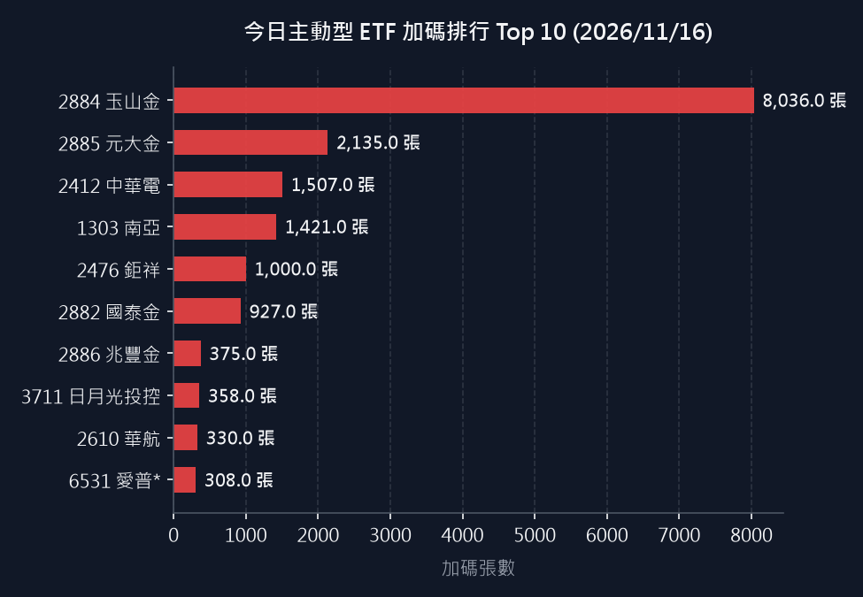
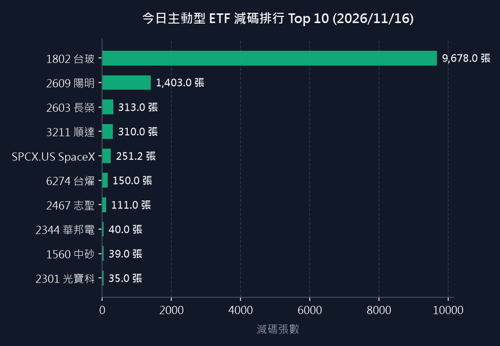

# 主動型 ETF 持股變動

資料來源：`主動型ETF持股明細.xlsx` 最近兩個日期分頁。

比較區間：`20261113` → `20261116`

## 今日加減碼視覺化排行

| 今日加碼 Top 10 | 今日減碼 Top 10 |
| :---: | :---: |
|  |  |

| ETF | 新增 | 刪除 | 比例變動 |
| :-- | --: | --: | --: |
| 00400A | 0 | 0 | 41 |
| 00401A | 1 | 1 | 53 |
| 00402A | 0 | 0 | 49 |
| 00403A | 0 | 0 | 36 |
| 00404A | 0 | 1 | 48 |
| 00405A | 0 | 0 | 25 |
| 00406A | 1 | 0 | 55 |
| 00407A | 0 | 0 | 39 |
| 00408A | 0 | 2 | 39 |
| 00980A | 0 | 0 | 46 |
| 00980D | 0 | 0 | 31 |
| 00981A | 0 | 0 | 29 |
| 00982A | 0 | 0 | 45 |
| 00983A | 0 | 0 | 31 |
| 00983D | 0 | 0 | 14 |
| 00984A | 0 | 0 | 78 |
| 00985A | 0 | 0 | 46 |
| 00986A | 0 | 0 | 0 |
| 00987A | 0 | 0 | 0 |
| 00988A | 0 | 0 | 27 |
| 00989A | 0 | 0 | 54 |
| 00990A | 2 | 2 | 31 |
| 00991A | 0 | 0 | 23 |
| 00992A | 0 | 1 | 41 |
| 00993A | 0 | 0 | 41 |
| 00994A | 0 | 1 | 28 |
| 00995A | 0 | 0 | 43 |
| 00996A | 0 | 0 | 37 |
| 00997A | 0 | 1 | 43 |
| 00998A | 0 | 0 | 40 |
| 00999A | 0 | 0 | 50 |

## 00400A

### 新增持股

- 無

### 刪除持股

- 無

### 投資比例變動

- 1303 南亞：3.58% → 3.49%（-0.09）
- 2059 川湖：4.15% → 4.06%（-0.09）
- 2303 聯電：1.36% → 1.39%（+0.03）
- 2308 台達電：1.89% → 1.85%（-0.04）
- 2313 華通：0.73% → 0.74%（+0.01）
- 2327 國巨*：0.93% → 0.92%（-0.01）
- 2330 台積電：8.99% → 9.19%（+0.20）
- 2345 智邦：1.23% → 1.21%（-0.02）
- 2360 致茂：2.11% → 2.06%（-0.05）
- 2368 金像電：2.43% → 2.37%（-0.06）
- 2383 台光電：5.79% → 5.65%（-0.14）
- 2449 京元電子：0.68% → 0.67%（-0.01）
- 2454 聯發科：7.26% → 7.25%（-0.01）
- 2603 長榮：2.43% → 2.62%（+0.19）
- 2637 慧洋-KY：0.09% → 0.10%（+0.01）
- 2891 中信金：1.65% → 1.75%（+0.10）
- 3008 大立光：1.29% → 1.26%（-0.03）
- 3017 奇鋐：5.19% → 5.07%（-0.12）
- 3023 信邦：0.75% → 0.80%（+0.05）
- 3036 文曄：1.32% → 1.37%（+0.05）
- 3037 欣興：2.69% → 2.63%（-0.06）
- 3044 健鼎：4.10% → 4.00%（-0.10）
- 3081 聯亞：0.75% → 0.73%（-0.02）
- 3090 日電貿：0.26% → 0.25%（-0.01）
- 3293 鈊象：0.34% → 0.36%（+0.02）
- 3406 玉晶光：1.09% → 1.07%（-0.02）
- 3443 創意：3.76% → 3.67%（-0.09）
- 3653 健策：3.48% → 3.40%（-0.08）
- 3661 世芯-KY：2.48% → 2.44%（-0.04）
- 3665 貿聯-KY：1.11% → 1.17%（+0.06）
- 4958 臻鼎-KY：0.36% → 0.35%（-0.01）
- 5274 信驊：2.94% → 2.87%（-0.07）
- 6147 頎邦：0.71% → 0.69%（-0.02）
- 6187 萬潤：0.76% → 0.74%（-0.02）
- 6223 旺矽：3.12% → 3.11%（-0.01）
- 6274 台燿：0.87% → 0.85%（-0.02）
- 6278 台表科：2.50% → 2.44%（-0.06）
- 6488 環球晶：1.27% → 1.26%（-0.01）
- 7769 鴻勁：0.79% → 0.77%（-0.02）
- 9939 宏全：0.07% → 0.08%（+0.01）
- ＸＡＧＸ金兌(3533.HK)：1.81% → 1.78%（-0.03）

## 00401A

### 新增持股

- TAIEX FUTURES 16DEC26 FTZ6（-0.17%，0.034 張）

### 刪除持股

- 台股期貨11/26(FITXN*1.TF)（-0.41%，0.034 張）

### 投資比例變動

- 1216 統一：0.27% → 0.28%（+0.01）
- 1303 南亞：1.17% → 1.12%（-0.05）
- 1476 儒鴻：2.00% → 2.12%（+0.12）
- 1477 聚陽：0.96% → 1.01%（+0.05）
- 2059 川湖：1.75% → 1.68%（-0.07）
- 2303 聯電：2.35% → 2.34%（-0.01）
- 2308 台達電：1.61% → 1.54%（-0.07）
- 2317 鴻海：0.53% → 0.51%（-0.02）
- 2327 國巨*：0.44% → 0.42%（-0.02）
- 2357 華碩：1.60% → 1.61%（+0.01）
- 2360 致茂：1.55% → 1.48%（-0.07）
- 2382 廣達：1.70% → 1.73%（+0.03）
- 2383 台光電：0.81% → 0.77%（-0.04）
- 2412 中華電：0.88% → 0.93%（+0.05）
- 2454 聯發科：5.50% → 5.38%（-0.12）
- 2455 全新：1.59% → 1.52%（-0.07）
- 2603 長榮：2.07% → 2.19%（+0.12）
- 2882 國泰金：1.02% → 1.04%（+0.02）
- 2883 凱基金：1.50% → 1.51%（+0.01）
- 2884 玉山金：1.78% → 1.89%（+0.11）
- 2886 兆豐金：1.41% → 1.81%（+0.40）
- 2890 永豐金：1.53% → 1.58%（+0.05）
- 2891 中信金：2.40% → 2.48%（+0.08）
- 2912 統一超：0.24% → 0.25%（+0.01）
- 3008 大立光：1.87% → 1.78%（-0.09）
- 3037 欣興：0.51% → 0.48%（-0.03）
- 3131 弘塑：0.49% → 0.47%（-0.02）
- 3231 緯創：1.88% → 1.85%（-0.03）
- 3443 創意：2.50% → 2.39%（-0.11）
- 3491 昇達科：1.56% → 1.62%（+0.06）
- 3653 健策：0.78% → 0.74%（-0.04）
- 3711 日月光投控：3.96% → 3.86%（-0.10）
- 4904 遠傳：0.74% → 0.78%（+0.04）
- 4938 和碩：0.28% → 0.29%（+0.01）
- 4958 臻鼎-KY：1.07% → 1.02%（-0.05）
- 5274 信驊：1.19% → 1.14%（-0.05）
- 5347 世界：0.99% → 0.97%（-0.02）
- 5904 寶雅*：0.55% → 0.56%（+0.01）
- 6147 頎邦：1.05% → 1.01%（-0.04）
- 6187 萬潤：1.41% → 1.35%（-0.06）
- 6223 旺矽：1.60% → 1.56%（-0.04）
- 6285 啟碁：1.05% → 1.03%（-0.02）
- 6515 穎崴：0.72% → 0.69%（-0.03）
- 6531 愛普*：1.20% → 1.14%（-0.06）
- 6669 緯穎：1.37% → 1.35%（-0.02）
- 7769 鴻勁：0.59% → 0.57%（-0.02）
- 7828 創新服務：1.24% → 1.22%（-0.02）
- 7856 漢測：0.73% → 0.70%（-0.03）
- 8464 億豐：0.91% → 0.99%（+0.08）
- TAIWAN TAIE C 16DEC26 40000 TWSE：-0.11% → -0.06%（+0.05）
- TAIWAN TAIE C 18NOV26 40000 TWSE：-0.05% → -0.02%（+0.03）
- 臺指選擇權11/26 43300 買權：-0.04% → 0.00%（+0.04）
- 臺指選擇權11/26 46500 買權：-0.01% → 0.00%（+0.01）

## 00402A

### 新增持股

- 無

### 刪除持股

- 無

### 投資比例變動

- AAPL.US Apple：9.04% → 9.23%（+0.19）
- ADI.US Analog Devices：2.19% → 2.18%（-0.01）
- AMD.US AMD：6.80% → 6.33%（-0.47）
- AMZN.US Amazon：5.08% → 5.16%（+0.08）
- ANET.US Arista Networks：0.97% → 0.95%（-0.02）
- ARM.US Arm：0.77% → 0.75%（-0.02）
- ASML.US ASML Holding：1.16% → 1.18%（+0.02）
- AVGO.US Broadcom：2.56% → 2.49%（-0.07）
- AXON.US Axon Enterprise：0.48% → 0.50%（+0.02）
- BABA.US Alibaba Group：0.47% → 0.48%（+0.01）
- BKNG.US Booking Holdings：0.58% → 0.59%（+0.01）
- CDNS.US Cadence Design Systems：1.68% → 1.66%（-0.02）
- CIEN.US Ciena：1.04% → 1.02%（-0.02）
- CLS.US Celestica：1.12% → 1.08%（-0.04）
- COHR.US Coherent：1.23% → 1.18%（-0.05）
- CRWD.US CrowdStrike Holdings：1.80% → 1.81%（+0.01）
- FSLY.US Fastly：0.28% → 0.27%（-0.01）
- GOOG.US Alphabet - Class C Capital Stock：3.26% → 3.29%（+0.03）
- GOOGL.US Alphabet - Class A Common Stock：3.28% → 3.31%（+0.03）
- INTC.US Intel：1.04% → 1.03%（-0.01）
- IOT.US Samsara：0.60% → 0.62%（+0.02）
- KLAC.US KLA：1.42% → 1.40%（-0.02）
- LITE.US Lumentum：1.37% → 1.34%（-0.03）
- LRCX.US Lam Research：2.20% → 2.17%（-0.03）
- MCHP.US Microchip Technology：1.22% → 1.24%（+0.02）
- MDB.US MongoDB：0.39% → 0.40%（+0.01）
- META.US Meta：3.66% → 3.85%（+0.19）
- MRVL.US Marvell：1.23% → 1.20%（-0.03）
- MSFT.US Microsoft：5.88% → 6.00%（+0.12）
- MU.US Micron：5.41% → 5.38%（-0.03）
- NFLX.US Netflix：0.98% → 0.99%（+0.01）
- NOW.US ServiceNow：0.86% → 0.90%（+0.04）
- NVDA.US NVIDIA：6.44% → 5.92%（-0.52）
- PANW.US Palo Alto：2.75% → 2.80%（+0.05）
- PLTR.US Palantir Technologies：2.11% → 2.10%（-0.01）
- SHOP.US Shopify：1.29% → 1.32%（+0.03）
- SIMO.US Silicon Motion：0.44% → 0.42%（-0.02）
- SKHY.US SK hynix：0.82% → 0.80%（-0.02）
- SNOW.US Snowflake：1.33% → 1.32%（-0.01）
- SPCX.US SpaceX：0.77% → 0.78%（+0.01）
- SPOT.US Spotify：0.46% → 0.48%（+0.02）
- STX.US Seagate：0.92% → 0.90%（-0.02）
- TER.US Teradyne：0.65% → 0.62%（-0.03）
- TSM.US TSMC(ADR)：1.57% → 1.58%（+0.01）
- TTWO.US Take-Two：1.30% → 1.34%（+0.04）
- TXN.US Texas Instruments：2.95% → 2.92%（-0.03）
- UBER.US Uber：0.34% → 0.35%（+0.01）
- V.US Visa：1.55% → 1.60%（+0.05）
- WDC.US Western Digital：1.69% → 1.64%（-0.05）

## 00403A

### 新增持股

- 無

### 刪除持股

- 無

### 投資比例變動

- 1303 南亞：3.59% → 3.49%（-0.10）
- 1560 中砂：0.47% → 0.46%（-0.01）
- 2059 川湖：0.64% → 0.62%（-0.02）
- 2301 光寶科：0.06% → 0.05%（-0.01）
- 2308 台達電：2.18% → 2.12%（-0.06）
- 2313 華通：0.33% → 0.34%（+0.01）
- 2317 鴻海：0.62% → 0.61%（-0.01）
- 2327 國巨*：2.92% → 2.87%（-0.05）
- 2330 台積電：15.68% → 15.94%（+0.26）
- 2345 智邦：1.55% → 1.52%（-0.03）
- 2368 金像電：0.86% → 0.83%（-0.03）
- 2383 台光電：4.09% → 3.97%（-0.12）
- 2408 南亞科：0.85% → 0.83%（-0.02）
- 2449 京元電子：0.69% → 0.67%（-0.02）
- 2454 聯發科：6.36% → 6.32%（-0.04）
- 2882 國泰金：0.46% → 0.58%（+0.12）
- 3008 大立光：1.61% → 1.56%（-0.05）
- 3017 奇鋐：6.27% → 6.09%（-0.18）
- 3037 欣興：4.57% → 4.44%（-0.13）
- 3189 景碩：2.40% → 2.34%（-0.06）
- 3211 順達：0.28% → 0.21%（-0.07）
- 3443 創意：5.43% → 5.27%（-0.16）
- 3450 聯鈞：0.44% → 0.43%（-0.01）
- 3583 辛耘：0.24% → 0.23%（-0.01）
- 3653 健策：4.45% → 4.32%（-0.13）
- 3665 貿聯-KY：1.79% → 1.87%（+0.08）
- 3711 日月光投控：1.38% → 1.37%（-0.01）
- 5274 信驊：1.75% → 1.70%（-0.05）
- 6223 旺矽：3.51% → 3.49%（-0.02）
- 6274 台燿：0.71% → 0.57%（-0.14）
- 6442 光聖：0.24% → 0.23%（-0.01）
- 6515 穎崴：0.30% → 0.29%（-0.01）
- 6669 緯穎：2.53% → 2.52%（-0.01）
- 6805 富世達：0.59% → 0.58%（-0.01）
- 8046 南電：2.38% → 2.31%（-0.07）
- 8996 高力：2.19% → 2.13%（-0.06）

## 00404A

### 新增持股

- 無

### 刪除持股

- 台股期貨11/26(FITXN*1.TF)（10.73%，0.046 張）

### 投資比例變動

- 1303 南亞：0.75% → 0.72%（-0.03）
- 2006 東和鋼鐵：1.25% → 1.31%（+0.06）
- 2317 鴻海：0.46% → 0.44%（-0.02）
- 2330 台積電：22.06% → 22.41%（+0.35）
- 2347 聯強：1.48% → 1.55%（+0.07）
- 2357 華碩：1.17% → 1.19%（+0.02）
- 2360 致茂：0.48% → 0.47%（-0.01）
- 2377 微星：0.39% → 0.40%（+0.01）
- 2379 瑞昱：2.04% → 2.06%（+0.02）
- 2382 廣達：0.40% → 0.41%（+0.01）
- 2383 台光電：2.47% → 2.80%（+0.33）
- 2395 研華：1.79% → 1.83%（+0.04）
- 2454 聯發科：7.29% → 6.96%（-0.33）
- 2603 長榮：1.33% → 1.42%（+0.09）
- 2637 慧洋-KY：1.05% → 1.10%（+0.05）
- 2851 中再保：1.07% → 1.10%（+0.03）
- 2882 國泰金：3.23% → 3.09%（-0.14）
- 2885 元大金：3.18% → 3.21%（+0.03）
- 2887 台新新光金：1.78% → 1.80%（+0.02）
- 2890 永豐金：1.14% → 1.18%（+0.04）
- 3014 聯陽：1.15% → 1.16%（+0.01）
- 3017 奇鋐：1.29% → 1.25%（-0.04）
- 3034 聯詠：2.03% → 2.06%（+0.03）
- 3036 文曄：1.02% → 1.04%（+0.02）
- 3037 欣興：0.31% → 0.30%（-0.01）
- 3264 欣銓：0.43% → 0.42%（-0.01）
- 3293 鈊象：1.85% → 1.81%（-0.04）
- 3374 精材：0.14% → 0.13%（-0.01）
- 3443 創意：2.06% → 1.98%（-0.08）
- 3653 健策：0.85% → 1.09%（+0.24）
- 3711 日月光投控：3.31% → 3.53%（+0.22）
- 4961 天鈺：0.56% → 0.57%（+0.01）
- 5274 信驊：2.06% → 2.28%（+0.22）
- 5904 寶雅*：0.44% → 0.46%（+0.02）
- 6196 帆宣：1.69% → 1.80%（+0.11）
- 6206 飛捷：0.68% → 0.70%（+0.02）
- 6223 旺矽：0.81% → 0.80%（-0.01）
- 6257 矽格：0.73% → 0.70%（-0.03）
- 6491 晶碩：0.90% → 0.91%（+0.01）
- 6505 台塑化：0.46% → 0.48%（+0.02）
- 6669 緯穎：0.96% → 1.03%（+0.07）
- 6691 洋基工程：1.30% → 1.26%（-0.04）
- 7769 鴻勁：1.09% → 1.16%（+0.07）
- 8081 致新：0.72% → 0.74%（+0.02）
- 8299 群聯：1.09% → 1.16%（+0.07）
- 台指選擇權01/27 47500 買權：-0.03% → -0.02%（+0.01）
- 台指選擇權12/26 46500 買權：-0.45% → -0.23%（+0.22）
- 台股期貨12/26(FITXN*1.TF)：8.64% → 19.28%（+10.64）

## 00405A

### 新增持股

- 無

### 刪除持股

- 無

### 投資比例變動

- 2059 川湖：1.94% → 1.89%（-0.05）
- 2308 台達電：0.57% → 0.56%（-0.01）
- 2330 台積電：5.65% → 5.76%（+0.11）
- 2345 智邦：4.55% → 4.47%（-0.08）
- 2368 金像電：5.71% → 5.55%（-0.16）
- 2383 台光電：4.40% → 4.28%（-0.12）
- 2395 研華：0.01% → 0.02%（+0.01）
- 2454 聯發科：7.09% → 7.06%（-0.03）
- 3017 奇鋐：1.91% → 1.86%（-0.05）
- 3037 欣興：3.98% → 3.87%（-0.11）
- 3443 創意：3.09% → 3.01%（-0.08）
- 3653 健策：6.84% → 6.65%（-0.19）
- 3665 貿聯-KY：4.97% → 5.20%（+0.23）
- 3711 日月光投控：1.48% → 1.47%（-0.01）
- 5274 信驊：5.39% → 5.24%（-0.15）
- 6187 萬潤：0.69% → 0.67%（-0.02）
- 6223 旺矽：7.42% → 7.39%（-0.03）
- 6274 台燿：1.47% → 1.43%（-0.04）
- 6415 矽力*-KY：0.54% → 0.52%（-0.02）
- 6515 穎崴：0.47% → 0.45%（-0.02）
- 6531 愛普*：3.63% → 3.53%（-0.10）
- 6805 富世達：1.66% → 1.64%（-0.02）
- 7769 鴻勁：2.41% → 2.36%（-0.05）
- 8046 南電：6.24% → 6.08%（-0.16）
- 8996 高力：1.42% → 1.38%（-0.04）

## 00406A

### 新增持股

- 4770 上品（0.05%，270 張）

### 刪除持股

- 無

### 投資比例變動

- 1303 南亞：2.51% → 2.58%（+0.07）
- 1560 中砂：0.20% → 0.19%（-0.01）
- 1815 富喬：0.64% → 0.63%（-0.01）
- 2059 川湖：1.63% → 1.58%（-0.05）
- 2303 聯電：1.20% → 1.21%（+0.01）
- 2308 台達電：1.57% → 1.52%（-0.05）
- 2317 鴻海：0.22% → 0.21%（-0.01）
- 2327 國巨*：1.27% → 1.24%（-0.03）
- 2330 台積電：9.39% → 9.53%（+0.14）
- 2345 智邦：1.94% → 1.89%（-0.05）
- 2368 金像電：2.47% → 2.38%（-0.09）
- 2383 台光電：5.97% → 5.76%（-0.21）
- 2449 京元電子：0.33% → 0.32%（-0.01）
- 2454 聯發科：6.45% → 6.37%（-0.08）
- 2481 強茂：0.30% → 0.29%（-0.01）
- 2881 富邦金：0.64% → 0.65%（+0.01）
- 2882 國泰金：0.63% → 0.65%（+0.02）
- 2884 玉山金：0.28% → 0.57%（+0.29）
- 2885 元大金：0.68% → 0.79%（+0.11）
- 2886 兆豐金：0.43% → 0.45%（+0.02）
- 2890 永豐金：0.29% → 0.30%（+0.01）
- 3008 大立光：1.00% → 0.97%（-0.03）
- 3017 奇鋐：5.85% → 5.66%（-0.19）
- 3037 欣興：4.97% → 4.80%（-0.17）
- 3081 聯亞：1.11% → 1.07%（-0.04）
- 3105 穩懋：0.59% → 0.57%（-0.02）
- 3167 大量：0.50% → 0.48%（-0.02）
- 3189 景碩：1.41% → 1.37%（-0.04）
- 3264 欣銓：0.27% → 0.26%（-0.01）
- 3443 創意：2.45% → 2.36%（-0.09）
- 3491 昇達科：0.30% → 0.32%（+0.02）
- 3653 健策：4.37% → 4.22%（-0.15）
- 3661 世芯-KY：0.82% → 0.80%（-0.02）
- 3665 貿聯-KY：1.00% → 1.14%（+0.14）
- 3711 日月光投控：2.12% → 2.24%（+0.12）
- 4938 和碩：0.40% → 0.41%（+0.01）
- 4958 臻鼎-KY：0.84% → 0.81%（-0.03）
- 5274 信驊：1.19% → 1.15%（-0.04）
- 6147 頎邦：0.62% → 0.60%（-0.02）
- 6187 萬潤：0.10% → 0.09%（-0.01）
- 6213 聯茂：0.34% → 0.33%（-0.01）
- 6223 旺矽：3.15% → 3.11%（-0.04）
- 6274 台燿：1.70% → 1.65%（-0.05）
- 6278 台表科：0.21% → 0.20%（-0.01）
- 6446 藥華藥：0.80% → 0.90%（+0.10）
- 6510 精測：0.59% → 0.57%（-0.02）
- 6715 嘉基：0.80% → 0.77%（-0.03）
- 6805 富世達：0.93% → 0.91%（-0.02）
- 8046 南電：2.97% → 2.87%（-0.10）
- 8358 金居：0.06% → 0.05%（-0.01）
- 8996 高力：0.69% → 0.67%（-0.02）
- 臺指選擇權：-9.47% → -1.86%（+7.61）
- 臺指選擇權第三週週五到期契約：-6.16% → -2.06%（+4.10）
- 臺股期貨 202611(FITXN*1.TF)：21.01% → 12.55%（-8.46）
- 臺股期貨 202612(FITXN*1.TF)：2.25% → 10.67%（+8.42）

## 00407A

### 新增持股

- 無

### 刪除持股

- 無

### 投資比例變動

- 1303 南亞：3.64% → 3.56%（-0.08）
- 1560 中砂：0.88% → 0.87%（-0.01）
- 2059 川湖：0.81% → 0.80%（-0.01）
- 2303 聯電：0.45% → 0.46%（+0.01）
- 2308 台達電：2.01% → 1.97%（-0.04）
- 2313 華通：0.41% → 0.42%（+0.01）
- 2327 國巨*：1.85% → 1.82%（-0.03）
- 2330 台積電：11.05% → 11.31%（+0.26）
- 2345 智邦：1.38% → 1.36%（-0.02）
- 2360 致茂：0.74% → 0.72%（-0.02）
- 2368 金像電：2.03% → 1.99%（-0.04）
- 2379 瑞昱：0.26% → 0.27%（+0.01）
- 2383 台光電：5.75% → 5.63%（-0.12）
- 2408 南亞科：1.34% → 1.31%（-0.03）
- 2615 萬海：1.00% → 1.10%（+0.10）
- 3008 大立光：1.38% → 1.35%（-0.03）
- 3017 奇鋐：5.71% → 5.59%（-0.12）
- 3034 聯詠：0.72% → 0.74%（+0.02）
- 3037 欣興：4.87% → 4.76%（-0.11）
- 3081 聯亞：1.62% → 1.59%（-0.03）
- 3131 弘塑：0.70% → 0.68%（-0.02）
- 3231 緯創：1.03% → 1.04%（+0.01）
- 3293 鈊象：0.68% → 0.72%（+0.04）
- 3406 玉晶光：0.99% → 0.97%（-0.02）
- 3443 創意：5.52% → 5.40%（-0.12）
- 3491 昇達科：0.97% → 1.03%（+0.06）
- 3533 嘉澤：1.00% → 0.98%（-0.02）
- 3653 健策：3.11% → 3.04%（-0.07）
- 3665 貿聯-KY：2.75% → 2.89%（+0.14）
- 4958 臻鼎-KY：0.92% → 0.90%（-0.02）
- 5274 信驊：1.40% → 1.37%（-0.03）
- 6187 萬潤：1.22% → 1.19%（-0.03）
- 6274 台燿：1.51% → 1.48%（-0.03）
- 6510 精測：1.58% → 1.55%（-0.03）
- 6531 愛普*：0.28% → 0.27%（-0.01）
- 6669 緯穎：1.40% → 1.41%（+0.01）
- 6805 富世達：1.11% → 1.10%（-0.01）
- 8046 南電：2.98% → 2.91%（-0.07）
- 8996 高力：1.60% → 1.57%（-0.03）

## 00408A

### 新增持股

- 無

### 刪除持股

- 1560 中砂（1.28%，23 張）
- 2344 華邦電（0.38%，40 張）

### 投資比例變動

- 1216 統一：0.12% → 0.13%（+0.01）
- 1303 南亞：4.63% → 4.48%（-0.15）
- 2059 川湖：0.85% → 0.82%（-0.03）
- 2301 光寶科：0.48% → 0.47%（-0.01）
- 2327 國巨*：0.66% → 0.65%（-0.01）
- 2330 台積電：7.69% → 7.78%（+0.09）
- 2345 智邦：0.58% → 0.57%（-0.01）
- 2368 金像電：5.70% → 5.51%（-0.19）
- 2383 台光電：4.38% → 4.23%（-0.15）
- 2395 研華：1.59% → 1.63%（+0.04）
- 2408 南亞科：1.19% → 1.15%（-0.04）
- 2449 京元電子：0.77% → 0.75%（-0.02）
- 2454 聯發科：5.39% → 5.33%（-0.06）
- 2542 興富發：3.99% → 4.22%（+0.23）
- 2603 長榮：1.45% → 1.55%（+0.10）
- 2880 華南金：1.36% → 1.42%（+0.06）
- 2891 中信金：2.36% → 2.47%（+0.11）
- 3017 奇鋐：3.95% → 3.82%（-0.13）
- 3026 禾伸堂：1.34% → 1.29%（-0.05）
- 3037 欣興：3.20% → 3.09%（-0.11）
- 3044 健鼎：1.27% → 1.23%（-0.04）
- 3081 聯亞：0.49% → 0.47%（-0.02）
- 3105 穩懋：0.70% → 0.68%（-0.02）
- 3167 大量：0.44% → 0.43%（-0.01）
- 3189 景碩：2.52% → 2.44%（-0.08）
- 3443 創意：1.99% → 1.92%（-0.07）
- 3653 健策：4.03% → 3.90%（-0.13）
- 3661 世芯-KY：1.86% → 1.81%（-0.05）
- 3711 日月光投控：2.71% → 1.86%（-0.85）
- 4904 遠傳：1.01% → 1.44%（+0.43）
- 5434 崇越：2.28% → 2.29%（+0.01）
- 6510 精測：2.05% → 1.98%（-0.07）
- 6526 達發：0.35% → 0.34%（-0.01）
- 6669 緯穎：1.23% → 1.22%（-0.01）
- 6805 富世達：2.73% → 2.68%（-0.05）
- 8021 尖點：0.59% → 0.57%（-0.02）
- 8046 南電：1.50% → 1.45%（-0.05）
- 8996 高力：3.10% → 3.00%（-0.10）
- 9802 鈺齊-KY：0.91% → 0.97%（+0.06）

## 00980A

### 新增持股

- 無

### 刪除持股

- 無

### 投資比例變動

- 1303 南亞：3.87% → 3.77%（-0.10）
- 2059 川湖：3.74% → 3.66%（-0.08）
- 2303 聯電：1.31% → 1.33%（+0.02）
- 2308 台達電：2.83% → 2.77%（-0.06）
- 2317 鴻海：3.55% → 3.48%（-0.07）
- 2327 國巨*：0.74% → 0.73%（-0.01）
- 2330 台積電：10.01% → 10.20%（+0.19）
- 2344 華邦電：1.45% → 1.42%（-0.03）
- 2345 智邦：0.86% → 0.84%（-0.02）
- 2360 致茂：0.87% → 0.85%（-0.02）
- 2368 金像電：1.96% → 1.91%（-0.05）
- 2376 技嘉：1.50% → 1.58%（+0.08）
- 2382 廣達：1.83% → 1.89%（+0.06）
- 2383 台光電：3.65% → 3.55%（-0.10）
- 2408 南亞科：2.19% → 2.14%（-0.05）
- 2454 聯發科：6.17% → 6.15%（-0.02）
- 2884 玉山金：1.41% → 1.52%（+0.11）
- 2891 中信金：1.85% → 1.95%（+0.10）
- 3008 大立光：2.07% → 2.02%（-0.05）
- 3017 奇鋐：2.44% → 2.38%（-0.06）
- 3026 禾伸堂：0.83% → 0.81%（-0.02）
- 3036 文曄：0.96% → 0.99%（+0.03）
- 3037 欣興：2.77% → 2.70%（-0.07）
- 3044 健鼎：1.44% → 1.41%（-0.03）
- 3081 聯亞：1.43% → 1.39%（-0.04）
- 3189 景碩：1.00% → 0.98%（-0.02）
- 3231 緯創：1.70% → 1.71%（+0.01）
- 3264 欣銓：0.71% → 0.69%（-0.02）
- 3293 鈊象：0.50% → 0.52%（+0.02）
- 3443 創意：2.34% → 2.27%（-0.07）
- 3653 健策：2.90% → 2.83%（-0.07）
- 3665 貿聯-KY：1.31% → 1.37%（+0.06）
- 3711 日月光投控：2.23% → 2.22%（-0.01）
- 5274 信驊：1.45% → 1.41%（-0.04）
- 5904 寶雅*：0.74% → 0.77%（+0.03）
- 6213 聯茂：1.07% → 1.04%（-0.03）
- 6274 台燿：1.03% → 1.00%（-0.03）
- 6442 光聖：0.25% → 0.24%（-0.01）
- 6515 穎崴：1.42% → 1.38%（-0.04）
- 6669 緯穎：1.82% → 1.83%（+0.01）
- 6831 邁科：0.24% → 0.23%（-0.01）
- 7751 竑騰：0.59% → 0.60%（+0.01）
- 7769 鴻勁：1.73% → 1.69%（-0.04）
- 8046 南電：1.39% → 1.35%（-0.04）
- 8996 高力：0.47% → 0.46%（-0.01）
- 台灣證交所加權股價指數(FITXN*1.TF)：4.96% → 2.50%（-2.46）

## 00980D

### 新增持股

- 無

### 刪除持股

- 無

### 投資比例變動

- ALLY FINANCIAL INC (REG) VAR 13JUN2029：0.58% → 0.59%（+0.01）
- AMC GLOBAL MEDIA INC SER REGS (REG) (REG S) 10.5% 15JUL2032：0.72% → 0.73%（+0.01）
- APOLLO DEBT SOLUTIONS BD 6.900000 % 13APR2029：0.58% → 0.59%（+0.01）
- ASURION LLC/ASURION CO 8.375% 01FEB2034：0.45% → 0.44%（-0.01）
- BAYER US FINANCE LLC SER REGS 6.875000 % 21NOV2053：0.37% → 0.36%（-0.01）
- BLUE OWL CREDIT INCOME 7.950000 % 13JUN2028：0.56% → 0.57%（+0.01）
- CAPITAL ONE FINANCIAL CO SER . (REG) VAR 30OCT2031：0.61% → 0.62%（+0.01）
- COREWEAVE INC SER REGS (REG) (REG S) 9.625% 15JUL2032：0.50% → 0.49%（-0.01）
- DEUTSCHE BANK NY VAR 20NOV2029：0.49% → 0.50%（+0.01）
- ENBRIDGE ENERGY PARTNERS (REG) 7.375% 15OCT2045：0.54% → 0.53%（-0.01）
- FMC CORP (REG) 6.375000 % 18MAY2053：0.31% → 0.30%（-0.01）
- FORD MOTOR COMPANY 5.291% 08DEC2046：0.30% → 0.29%（-0.01）
- GEORGIA-PACIFIC LLC (REG) 7.75% 15NOV2029：0.60% → 0.61%（+0.01）
- GLOBAL AUTO HO/AAG FH UK SER REGS (REG S) 8.75% 15JAN2032：0.42% → 0.41%（-0.01）
- HSBC HOLDINGS PLC VAR 03NOV2033：0.37% → 0.38%（+0.01）
- ICAHN ENTERPRISES/FIN (REG) 9.75% 15JAN2029：0.30% → 0.29%（-0.01）
- ICAHN ENTERPRISES/FIN SER REGS 10.000000 % 15NOV2029：0.30% → 0.27%（-0.03）
- LPL HOLDINGS INC (REG) 6.75% 17NOV2028：0.59% → 0.60%（+0.01）
- MOBIUS MERGER SUB SER REGS 9.000000 % 01JUN2030：0.28% → 0.29%（+0.01）
- NAVIENT CORP (REG) 11.5% 15MAR2031：0.40% → 0.41%（+0.01）
- ORACLE CORP (REG) 5.500000 % 27SEP2064：0.42% → 0.41%（-0.01）
- PLANET FINANCIAL GROUP SER REGS 10.500000 % 15DEC2029：0.48% → 0.47%（-0.01）
- RR DONNELLEY & SONS CO SER REGS (REG S) 9.5% 01AUG2029：0.45% → 0.44%（-0.01）
- TIME WARNER ENTERTAINMEN 8.375% 15JUL2033：0.65% → 0.66%（+0.01）
- TOUCAN FINCO LTD/CAN/US SER REGS 9.500000 % 15MAY2030：0.27% → 0.26%（-0.01）
- UNISYS CORP SER REGS 10.625000 % 15JAN2031：0.66% → 0.65%（-0.01）
- US 5YR NOTE (CBT) DEC26 31-DEC-2026：-15.87% → -15.89%（-0.02）
- US ACUTE CARE SOLUTIONS SER REGS (REG S) 9.75% 15MAY2029：0.33% → 0.34%（+0.01）
- US LONG BOND(CBT) DEC26 21-DEC-2026：5.63% → 5.61%（-0.02）
- VIACOMCBS INC (REG) 4.95% 19MAY2050：0.45% → 0.44%（-0.01）
- VIACOMCBS INC 6.875% 30APR2036：0.26% → 0.25%（-0.01）

## 00981A

### 新增持股

- 無

### 刪除持股

- 無

### 投資比例變動

- 1802 台玻：0.30% → 0.00%（-0.30）
- 2002 中鋼：0.03% → 0.04%（+0.01）
- 2303 聯電：2.53% → 2.58%（+0.05）
- 2308 台達電：3.42% → 3.35%（-0.07）
- 2317 鴻海：0.41% → 0.40%（-0.01）
- 2327 國巨*：3.51% → 3.47%（-0.04）
- 2330 台積電：16.38% → 16.77%（+0.39）
- 2345 智邦：3.92% → 3.86%（-0.06）
- 2368 金像電：3.01% → 2.95%（-0.06）
- 2383 台光電：6.63% → 6.48%（-0.15）
- 2449 京元電子：0.60% → 0.59%（-0.01）
- 2454 聯發科：8.55% → 8.56%（+0.01）
- 2891 中信金：0.27% → 0.28%（+0.01）
- 3017 奇鋐：7.69% → 7.53%（-0.16）
- 3037 欣興：5.63% → 5.51%（-0.12）
- 3231 緯創：0.74% → 0.75%（+0.01）
- 3443 創意：3.18% → 3.11%（-0.07）
- 3653 健策：4.96% → 4.85%（-0.11）
- 3665 貿聯-KY：1.69% → 1.78%（+0.09）
- 3711 日月光投控：3.81% → 3.80%（-0.01）
- 5274 信驊：1.04% → 1.02%（-0.02）
- 6223 旺矽：4.51% → 4.52%（+0.01）
- 6274 台燿：2.60% → 2.54%（-0.06）
- 6510 精測：0.57% → 0.56%（-0.01）
- 6669 緯穎：1.40% → 1.41%（+0.01）
- 6805 富世達：1.20% → 1.19%（-0.01）
- 8046 南電：3.19% → 3.12%（-0.07）
- 8996 高力：0.51% → 0.50%（-0.01）
- 台指期貨 2026/12(FITXN*1.TF)：2.77% → 2.80%（+0.03）

## 00982A

### 新增持股

- 無

### 刪除持股

- 無

### 投資比例變動

- 2059 川湖：2.45% → 2.39%（-0.06）
- 2303 聯電：1.20% → 1.22%（+0.02）
- 2330 台積電：8.04% → 8.20%（+0.16）
- 2360 致茂：3.07% → 2.99%（-0.08）
- 2376 技嘉：1.14% → 1.21%（+0.07）
- 2377 微星：0.36% → 0.38%（+0.02）
- 2383 台光電：3.01% → 2.95%（-0.06）
- 2395 研華：1.33% → 1.38%（+0.05）
- 2454 聯發科：8.38% → 8.36%（-0.02）
- 2455 全新：1.37% → 1.34%（-0.03）
- 2467 志聖：0.14% → 0.07%（-0.07）
- 2476 鉅祥：0.46% → 0.69%（+0.23）
- 2478 大毅：0.33% → 0.32%（-0.01）
- 2486 一詮：0.39% → 0.38%（-0.01）
- 2885 元大金：0.34% → 0.35%（+0.01）
- 3008 大立光：3.04% → 2.97%（-0.07）
- 3017 奇鋐：2.57% → 2.52%（-0.05）
- 3037 欣興：0.67% → 0.65%（-0.02）
- 3045 台灣大：0.80% → 0.85%（+0.05）
- 3090 日電貿：0.34% → 0.33%（-0.01）
- 3105 穩懋：8.53% → 8.32%（-0.21）
- 3231 緯創：1.86% → 1.87%（+0.01）
- 3265 台星科：1.25% → 1.23%（-0.02）
- 3491 昇達科：3.59% → 4.25%（+0.66）
- 3583 辛耘：0.20% → 0.19%（-0.01）
- 3617 碩天：0.51% → 0.59%（+0.08）
- 4958 臻鼎-KY：2.95% → 2.88%（-0.07）
- 5274 信驊：1.30% → 1.26%（-0.04）
- 5425 台半：1.15% → 1.13%（-0.02）
- 5483 中美晶：1.27% → 1.28%（+0.01）
- 5536 聖暉*：0.88% → 0.89%（+0.01）
- 6139 亞翔：5.26% → 5.37%（+0.11）
- 6196 帆宣：0.28% → 0.27%（-0.01）
- 6213 聯茂：1.42% → 1.52%（+0.10）
- 6214 精誠：0.04% → 0.05%（+0.01）
- 6223 旺矽：2.99% → 2.98%（-0.01）
- 6239 力成：1.93% → 1.88%（-0.05）
- 6274 台燿：0.30% → 0.29%（-0.01）
- 6446 藥華藥：0.12% → 0.13%（+0.01）
- 6472 保瑞：0.90% → 0.88%（-0.02）
- 6510 精測：1.06% → 1.04%（-0.02）
- 6531 愛普*：7.06% → 6.88%（-0.18）
- 6672 騰輝電子-KY：2.55% → 2.50%（-0.05）
- 8070 長華*：0.78% → 0.80%（+0.02）
- 8996 高力：1.17% → 1.14%（-0.03）

## 00983A

### 新增持股

- 無

### 刪除持股

- 無

### 投資比例變動

- ACHR.US Archer：0.06% → 0.05%（-0.01）
- AMD.US AMD：3.91% → 3.64%（-0.27）
- AMZN.US Amazon：4.47% → 4.55%（+0.08）
- AVGO.US Broadcom：1.27% → 1.24%（-0.03）
- BEAM.US Beam Therapeutics：2.52% → 2.33%（-0.19）
- BLSH.US Bullish：1.18% → 1.17%（-0.01）
- BMNR.US BitMine：1.20% → 1.17%（-0.03）
- COIN.US Coinbase：2.59% → 2.40%（-0.19）
- CRCL.US Circle：3.27% → 3.18%（-0.09）
- CRSP.US CRISPR Therapeutics：3.49% → 3.36%（-0.13）
- GOOG.US Alphabet - Class C Capital Stock：2.89% → 2.92%（+0.03）
- GOOGL.US Alphabet - Class A Common Stock：1.65% → 1.66%（+0.01）
- HOOD.US Robinhood Markets：2.50% → 2.44%（-0.06）
- ILMN.US Illumina：1.52% → 1.26%（-0.26）
- LLY.US Eli Lilly：2.03% → 2.09%（+0.06）
- META.US Meta：3.32% → 3.58%（+0.26）
- MSFT.US Microsoft：2.05% → 2.25%（+0.20）
- NET.US Cloudflare：1.63% → 1.59%（-0.04）
- NTLA.US Intellia Therapeutics：1.75% → 1.50%（-0.25）
- NTRA.US Natera：1.47% → 1.49%（+0.02）
- RKLB.US Rocket Lab：1.61% → 1.57%（-0.04）
- RXRX.US Recursion Pharmaceuticals：1.10% → 1.07%（-0.03）
- SHOP.US Shopify：4.81% → 4.92%（+0.11）
- SPCX.US SpaceX：8.13% → 8.52%（+0.39）
- TEM.US Tempus：6.03% → 5.54%（-0.49）
- TSLA.US Tesla：9.14% → 9.16%（+0.02）
- TSM.US TSMC(ADR)：2.84% → 2.85%（+0.01）
- TWST.US Twist Bioscience：3.21% → 3.08%（-0.13）
- TXG.US 10x Genomics：2.95% → 2.97%（+0.02）
- WGS.US GeneDx：0.42% → 0.44%（+0.02）
- XYZ.US Block：2.12% → 2.22%（+0.10）

## 00983D

### 新增持股

- 無

### 刪除持股

- 無

### 投資比例變動

- AMCX 10 1/2 07/15/32：1.79% → 1.80%（+0.01）
- BHCCN 11 09/30/28：2.20% → 2.22%（+0.02）
- CRWV 9 02/01/31：0.91% → 0.90%（-0.01）
- DTV 8 7/8 02/01/30：1.84% → 1.85%（+0.01）
- GTN 10 1/2 07/15/29：0.38% → 0.39%（+0.01）
- IEP 10 11/15/29：1.53% → 1.40%（-0.13）
- KHC 6 7/8 01/26/39：1.14% → 1.15%（+0.01）
- LQDW.US iShares LQD Premium Income+ ETF：7.64% → 7.65%（+0.01）
- NVDA 5.55 06/15/46：1.27% → 1.28%（+0.01）
- ORCL 6 1/2 04/15/38：0.42% → 0.41%（-0.01）
- RAKUTN 11 1/4 02/15/27：2.07% → 2.08%（+0.01）
- SPCX 6.6 07/15/46：1.23% → 1.24%（+0.01）
- TLTW.US iShares TLT Premium Income+ ETF：8.99% → 8.97%（-0.02）
- VENLNG 9 1/2 02/01/29：1.62% → 1.63%（+0.01）

## 00984A

### 新增持股

- 無

### 刪除持股

- 無

### 投資比例變動

- 1216 統一：0.62% → 0.66%（+0.04）
- 1303 南亞：3.51% → 3.37%（-0.14）
- 1326 台化：2.55% → 2.53%（-0.02）
- 1560 中砂：1.82% → 1.75%（-0.07）
- 1605 華新：0.81% → 0.80%（-0.01）
- 1709 和益：1.00% → 1.02%（+0.02）
- 2006 東和鋼鐵：0.61% → 0.64%（+0.03）
- 2027 大成鋼：0.77% → 0.83%（+0.06）
- 2059 川湖：2.37% → 2.28%（-0.09）
- 2301 光寶科：0.84% → 0.82%（-0.02）
- 2317 鴻海：0.06% → 0.05%（-0.01）
- 2330 台積電：2.27% → 2.28%（+0.01）
- 2347 聯強：0.69% → 0.72%（+0.03）
- 2351 順德：0.71% → 0.69%（-0.02）
- 2357 華碩：0.84% → 0.85%（+0.01）
- 2377 微星：0.76% → 0.78%（+0.02）
- 2379 瑞昱：0.61% → 0.62%（+0.01）
- 2383 台光電：0.18% → 0.17%（-0.01）
- 2395 研華：2.20% → 2.24%（+0.04）
- 2408 南亞科：2.35% → 2.25%（-0.10）
- 2409 友達：0.90% → 0.87%（-0.03）
- 2412 中華電：0.93% → 0.98%（+0.05）
- 2449 京元電子：0.45% → 0.43%（-0.02）
- 2454 聯發科：0.39% → 0.38%（-0.01）
- 2455 全新：1.12% → 1.07%（-0.05）
- 2464 盟立：0.86% → 0.83%（-0.03）
- 2466 冠西電：0.34% → 0.37%（+0.03）
- 2603 長榮：2.58% → 2.74%（+0.16）
- 2615 萬海：1.39% → 1.50%（+0.11）
- 2618 長榮航：0.66% → 0.69%（+0.03）
- 2634 漢翔：0.61% → 0.62%（+0.01）
- 2637 慧洋-KY：0.60% → 0.63%（+0.03）
- 2801 彰銀：0.62% → 0.65%（+0.03）
- 2880 華南金：0.63% → 0.66%（+0.03）
- 2881 富邦金：1.52% → 1.53%（+0.01）
- 2882 國泰金：1.44% → 1.48%（+0.04）
- 2884 玉山金：0.62% → 0.66%（+0.04）
- 2886 兆豐金：0.64% → 0.66%（+0.02）
- 2887 台新新光金：1.38% → 1.39%（+0.01）
- 2890 永豐金：0.63% → 0.65%（+0.02）
- 2892 第一金：0.64% → 0.67%（+0.03）
- 3006 晶豪科：0.76% → 0.75%（-0.01）
- 3008 大立光：2.21% → 2.11%（-0.10）
- 3017 奇鋐：3.77% → 3.60%（-0.17）
- 3034 聯詠：0.59% → 0.60%（+0.01）
- 3037 欣興：1.49% → 1.43%（-0.06）
- 3044 健鼎：0.90% → 0.86%（-0.04）
- 3045 台灣大：1.46% → 1.53%（+0.07）
- 3189 景碩：1.77% → 1.70%（-0.07）
- 3264 欣銓：1.62% → 1.55%（-0.07）
- 3265 台星科：0.75% → 0.72%（-0.03）
- 3406 玉晶光：1.60% → 1.53%（-0.07）
- 3443 創意：3.13% → 3.00%（-0.13）
- 3450 聯鈞：0.26% → 0.25%（-0.01）
- 3605 宏致：0.71% → 0.68%（-0.03）
- 3653 健策：1.28% → 1.22%（-0.06）
- 3702 大聯大：0.70% → 0.71%（+0.01）
- 3711 日月光投控：2.25% → 2.20%（-0.05）
- 4958 臻鼎-KY：0.58% → 0.56%（-0.02）
- 4967 十銓：0.83% → 0.82%（-0.01）
- 5274 信驊：0.40% → 0.38%（-0.02）
- 5871 中租-KY：0.61% → 0.63%（+0.02）
- 5876 上海商銀：0.63% → 0.67%（+0.04）
- 5904 寶雅*：0.61% → 0.63%（+0.02）
- 6187 萬潤：1.60% → 1.54%（-0.06）
- 6196 帆宣：1.31% → 1.25%（-0.06）
- 6197 佳必琪：0.69% → 0.66%（-0.03）
- 6213 聯茂：0.53% → 0.51%（-0.02）
- 6214 精誠：0.80% → 0.90%（+0.10）
- 6274 台燿：0.42% → 0.41%（-0.01）
- 6415 矽力*-KY：0.72% → 0.69%（-0.03）
- 6505 台塑化：3.44% → 3.55%（+0.11）
- 6669 緯穎：0.93% → 0.92%（-0.01）
- 6670 復盛應用：0.53% → 0.56%（+0.03）
- 6672 騰輝電子-KY：0.84% → 0.81%（-0.03）
- 6691 洋基工程：0.77% → 0.75%（-0.02）
- 8039 台虹：0.78% → 0.75%（-0.03）
- 9933 中鼎：1.00% → 1.06%（+0.06）

## 00985A

### 新增持股

- 無

### 刪除持股

- 無

### 投資比例變動

- 1101 台泥：0.30% → 0.31%（+0.01）
- 1216 統一：1.38% → 1.47%（+0.09）
- 1402 遠東新：0.30% → 0.31%（+0.01）
- 1605 華新：1.46% → 1.45%（-0.01）
- 2027 大成鋼：2.72% → 2.94%（+0.22）
- 2059 川湖：2.07% → 1.99%（-0.08）
- 2308 台達電：2.72% → 2.62%（-0.10）
- 2317 鴻海：1.98% → 1.91%（-0.07）
- 2327 國巨*：1.79% → 1.74%（-0.05）
- 2330 台積電：14.97% → 15.06%（+0.09）
- 2344 華邦電：1.38% → 1.33%（-0.05）
- 2345 智邦：2.47% → 2.40%（-0.07）
- 2368 金像電：2.06% → 1.98%（-0.08）
- 2376 技嘉：2.20% → 2.29%（+0.09）
- 2383 台光電：2.72% → 2.93%（+0.21）
- 2408 南亞科：1.68% → 1.61%（-0.07）
- 2412 中華電：0.51% → 1.51%（+1.00）
- 2454 聯發科：1.92% → 1.88%（-0.04）
- 2603 長榮：1.24% → 1.01%（-0.23）
- 2609 陽明：1.27% → 1.02%（-0.25）
- 2610 華航：0.52% → 0.55%（+0.03）
- 3008 大立光：1.65% → 1.58%（-0.07）
- 3017 奇鋐：1.38% → 1.33%（-0.05）
- 3036 文曄：3.22% → 3.29%（+0.07）
- 3037 欣興：2.14% → 2.56%（+0.42）
- 3081 聯亞：2.03% → 2.56%（+0.53）
- 3105 穩懋：0.56% → 0.54%（-0.02）
- 3189 景碩：0.74% → 0.71%（-0.03）
- 3231 緯創：0.97% → 0.96%（-0.01）
- 3491 昇達科：0.20% → 0.21%（+0.01）
- 3653 健策：2.53% → 2.86%（+0.33）
- 3661 世芯-KY：1.32% → 1.28%（-0.04）
- 3665 貿聯-KY：1.50% → 1.55%（+0.05）
- 3711 日月光投控：1.55% → 1.52%（-0.03）
- 4904 遠傳：1.05% → 1.12%（+0.07）
- 6285 啟碁：1.28% → 1.26%（-0.02）
- 6442 光聖：1.41% → 1.35%（-0.06）
- 6446 藥華藥：2.34% → 2.35%（+0.01）
- 6488 環球晶：1.49% → 1.46%（-0.03）
- 6526 達發：0.88% → 0.85%（-0.03）
- 6531 愛普*：0.78% → 1.53%（+0.75）
- 6669 緯穎：3.17% → 3.14%（-0.03）
- 7750 新代：1.53% → 1.51%（-0.02）
- 7769 鴻勁：2.71% → 2.62%（-0.09）
- 8046 南電：1.52% → 1.46%（-0.06）
- 8996 高力：0.13% → 0.92%（+0.79）

## 00986A

### 新增持股

- 無

### 刪除持股

- 無

### 投資比例變動

- 無

## 00987A

### 新增持股

- 無

### 刪除持股

- 無

### 投資比例變動

- 無

## 00988A

### 新增持股

- 無

### 刪除持股

- 無

### 投資比例變動

- 1303 南亞：3.01% → 3.64%（+0.63）
- 2330 台積電：2.78% → 2.82%（+0.04）
- 2383 台光電：2.54% → 2.63%（+0.09）
- 2454 聯發科：0.76% → 0.82%（+0.06）
- 3017 奇鋐：4.13% → 4.90%（+0.77）
- 3443 創意：4.67% → 5.16%（+0.49）
- 3711 日月光投控：1.84% → 1.90%（+0.06）
- 6223 旺矽：1.27% → 1.28%（+0.01）
- AAPL.US Apple：5.22% → 5.26%（+0.04）
- AMD.US AMD：7.65% → 7.01%（-0.64）
- BE.US Bloom Energy：7.42% → 7.09%（-0.33）
- CRWD.US CrowdStrike Holdings：4.15% → 4.10%（-0.05）
- INFINEON TECHNOLOGIES AG：0.47% → 0.45%（-0.02）
- META.US Meta：1.27% → 1.32%（+0.05）
- MRNA.US Moderna：0.57% → 1.10%（+0.53）
- MSFT.US Microsoft：6.84% → 6.88%（+0.04）
- MU.US Micron：0.99% → 0.97%（-0.02）
- NET.US Cloudflare：2.60% → 3.01%（+0.41）
- NTSK.US Netskope：1.46% → 1.43%（-0.03）
- OKTA.US Okta：2.98% → 3.00%（+0.02）
- PANW.US Palo Alto：3.95% → 3.97%（+0.02）
- PLTR.US Palantir Technologies：4.91% → 4.82%（-0.09）
- SHIFT(3697.JP)：0.45% → 0.46%（+0.01）
- SNOW.US Snowflake：2.44% → 2.39%（-0.05）
- SPCX.US SpaceX：6.63% → 6.62%（-0.01）
- Samsung Elec Mech(009150.KS)：2.17% → 2.10%（-0.07）
- TWLO.US Twilio：1.04% → 0.52%（-0.52）

## 00989A

### 新增持股

- 無

### 刪除持股

- 無

### 投資比例變動

- ACN.US Accenture：1.34% → 1.46%（+0.12）
- ADBE.US Adobe：1.35% → 1.39%（+0.04）
- ADI.US Analog Devices：1.28% → 1.26%（-0.02）
- ALAB.US Astera Labs：0.74% → 0.73%（-0.01）
- AMD.US AMD：4.13% → 3.82%（-0.31）
- AMZN.US Amazon：2.18% → 2.21%（+0.03）
- ASML.US ASML Holding：2.16% → 2.18%（+0.02）
- AVGO.US Broadcom：3.52% → 3.40%（-0.12）
- CDNS.US Cadence Design Systems：1.02% → 1.00%（-0.02）
- CIEN.US Ciena：0.85% → 0.83%（-0.02）
- CRDO.US Credo：0.73% → 0.70%（-0.03）
- CRM.US Salesforce：3.20% → 3.25%（+0.05）
- DDOG.US Datadog：0.92% → 0.93%（+0.01）
- ENTG.US Entegris：0.55% → 0.54%（-0.01）
- GOOG.US Alphabet - Class C Capital Stock：2.23% → 2.24%（+0.01）
- GWRE.US Guidewire Software：0.70% → 0.71%（+0.01）
- HOOD.US Robinhood Markets：1.54% → 1.50%（-0.04）
- HUBS.US HubSpot：1.88% → 1.92%（+0.04）
- INTC.US Intel：1.60% → 1.58%（-0.02）
- LITE.US Lumentum：1.08% → 1.04%（-0.04）
- LMND.US Lemonade：0.75% → 0.78%（+0.03）
- LRCX.US Lam Research：2.04% → 2.00%（-0.04）
- META.US Meta：4.25% → 4.43%（+0.18）
- MPWR.US Monolithic Power Systems：1.68% → 1.63%（-0.05）
- MSFT.US Microsoft：3.54% → 3.60%（+0.06）
- MTSI.US MACOM Technology Solutions：0.62% → 0.60%（-0.02）
- MU.US Micron：0.55% → 0.54%（-0.01）
- NET.US Cloudflare：3.11% → 3.13%（+0.02）
- NOW.US ServiceNow：0.85% → 0.88%（+0.03）
- NU.US Nu：0.30% → 0.34%（+0.04）
- NVDA.US NVIDIA：3.75% → 1.64%（-2.11）
- OKTA.US Okta：0.78% → 0.80%（+0.02）
- PANW.US Palo Alto：3.24% → 3.28%（+0.04）
- PLTR.US Palantir Technologies：1.30% → 1.29%（-0.01）
- RIVN.US Rivian：1.21% → 1.17%（-0.04）
- ROK.US Rockwell Automation：0.85% → 0.86%（+0.01）
- SHOP.US Shopify：3.00% → 3.05%（+0.05）
- SNDK.US Sandisk：0.37% → 0.35%（-0.02）
- SNOW.US Snowflake：2.88% → 2.85%（-0.03）
- SPCX.US SpaceX：0.87% → 0.88%（+0.01）
- SWKS.US Skyworks Solutions：0.38% → 0.69%（+0.31）
- SYM.US Symbotic：0.46% → 0.45%（-0.01）
- TEM.US Tempus：1.34% → 1.28%（-0.06）
- TSLA.US Tesla：3.10% → 3.09%（-0.01）
- TTWO.US Take-Two：3.50% → 3.56%（+0.06）
- TWLO.US Twilio：2.02% → 2.04%（+0.02）
- TWST.US Twist Bioscience：0.43% → 0.62%（+0.19）
- TXN.US Texas Instruments：1.81% → 1.79%（-0.02）
- U.US Unity Software：1.53% → 1.63%（+0.10）
- VEEV.US Veeva Systems：1.06% → 1.08%（+0.02）
- WDAY.US Workday：0.30% → 0.31%（+0.01）
- WRBY.US Warby Parker：0.82% → 0.85%（+0.03）
- XYZ.US Block：0.59% → 0.62%（+0.03）
- ZM.US Zoom：1.86% → 1.92%（+0.06）

## 00990A

### 新增持股

- CLS.US Celestica（0.95%，35.84 張）
- PANW.US Palo Alto（1.51%，42.32 張）

### 刪除持股

- SMTC.US Semtech（0.90%，68.308 張）
- SPCX.US SpaceX（3.87%，251.728 張）

### 投資比例變動

- 2308 台達電：0.99% → 1.00%（+0.01）
- 2330 台積電：4.04% → 4.10%（+0.06）
- 2368 金像電：1.44% → 1.53%（+0.09）
- 2383 台光電：1.83% → 1.90%（+0.07）
- 2454 聯發科：2.48% → 2.68%（+0.20）
- 3017 奇鋐：1.76% → 1.95%（+0.19）
- 3443 創意：2.85% → 3.16%（+0.31）
- 8046 南電：0.55% → 0.56%（+0.01）
- AMD.US AMD：6.47% → 5.95%（-0.52）
- AMZN.US Amazon：4.46% → 4.48%（+0.02）
- ANET.US Arista Networks：2.35% → 2.75%（+0.40）
- APP.US Applovin：0.76% → 0.80%（+0.04）
- AVGO.US Broadcom：3.90% → 3.75%（-0.15）
- BE.US Bloom Energy：5.66% → 5.43%（-0.23）
- CRWD.US CrowdStrike Holdings：2.84% → 3.32%（+0.48）
- FROG.US JFrog：1.32% → 1.86%（+0.54）
- GE.US GE Aerospace：2.75% → 2.78%（+0.03）
- GOOGL.US Alphabet - Class A Common Stock：3.28% → 4.27%（+0.99）
- HPE.US HP Enterprise：0.52% → 0.50%（-0.02）
- LLY.US Eli Lilly：3.04% → 3.10%（+0.06）
- META.US Meta：4.42% → 4.59%（+0.17）
- MSFT.US Microsoft：5.78% → 5.84%（+0.06）
- MU.US Micron：1.97% → 1.93%（-0.04）
- NET.US Cloudflare：2.77% → 2.68%（-0.09）
- NVDA.US NVIDIA：1.23% → 1.22%（-0.01）
- PLTR.US Palantir Technologies：5.03% → 4.96%（-0.07）
- Recruit Holdings(6098.JP)：2.00% → 2.62%（+0.62）
- SHOP.US Shopify：3.29% → 3.32%（+0.03）
- SNOW.US Snowflake：2.78% → 2.74%（-0.04）
- TOHO(9602.JP)：0.19% → 0.20%（+0.01）
- ZS.US Zscaler：1.12% → 1.63%（+0.51）

## 00991A

### 新增持股

- 無

### 刪除持股

- 無

### 投資比例變動

- 1303 南亞：6.52% → 6.45%（-0.07）
- 2059 川湖：6.45% → 6.40%（-0.05）
- 2308 台達電：1.01% → 1.00%（-0.01）
- 2327 國巨*：2.55% → 2.54%（-0.01）
- 2330 台積電：15.80% → 16.33%（+0.53）
- 2368 金像電：1.06% → 1.05%（-0.01）
- 2383 台光電：9.21% → 9.09%（-0.12）
- 2408 南亞科：2.52% → 2.49%（-0.03）
- 2454 聯發科：7.86% → 7.94%（+0.08）
- 3017 奇鋐：7.73% → 7.64%（-0.09）
- 3026 禾伸堂：2.44% → 2.41%（-0.03）
- 3037 欣興：6.86% → 6.78%（-0.08）
- 3189 景碩：4.99% → 4.93%（-0.06）
- 3231 緯創：0.63% → 0.64%（+0.01）
- 3443 創意：1.10% → 1.08%（-0.02）
- 3653 健策：3.23% → 3.19%（-0.04）
- 3665 貿聯-KY：0.51% → 0.54%（+0.03）
- 3711 日月光投控：3.99% → 4.03%（+0.04）
- 4958 臻鼎-KY：1.05% → 1.04%（-0.01）
- 5274 信驊：2.68% → 2.65%（-0.03）
- 6223 旺矽：1.19% → 1.20%（+0.01）
- 8046 南電：5.59% → 5.52%（-0.07）
- 8299 群聯：0.51% → 0.52%（+0.01）

## 00992A

### 新增持股

- 無

### 刪除持股

- 6584 南俊國際（0.12%，170 張）

### 投資比例變動

- 1303 南亞：3.51% → 3.46%（-0.05）
- 1815 富喬：3.95% → 3.98%（+0.03）
- 2059 川湖：3.78% → 3.74%（-0.04）
- 2301 光寶科：0.35% → 0.36%（+0.01）
- 2308 台達電：0.96% → 0.94%（-0.02）
- 2330 台積電：6.45% → 6.65%（+0.20）
- 2345 智邦：4.53% → 4.51%（-0.02）
- 2357 華碩：0.40% → 0.42%（+0.02）
- 2360 致茂：1.27% → 1.25%（-0.02）
- 2368 金像電：2.67% → 2.63%（-0.04）
- 2376 技嘉：0.33% → 0.36%（+0.03）
- 2383 台光電：5.66% → 5.58%（-0.08）
- 2404 漢唐：0.36% → 0.38%（+0.02）
- 2408 南亞科：1.08% → 1.06%（-0.02）
- 2454 聯發科：3.35% → 3.38%（+0.03）
- 3008 大立光：3.78% → 3.72%（-0.06）
- 3017 奇鋐：6.16% → 6.08%（-0.08）
- 3026 禾伸堂：0.64% → 0.63%（-0.01）
- 3037 欣興：5.24% → 5.17%（-0.07）
- 3081 聯亞：1.38% → 1.36%（-0.02）
- 3189 景碩：1.96% → 1.94%（-0.02）
- 3231 緯創：1.68% → 1.71%（+0.03）
- 3443 創意：4.78% → 4.71%（-0.07）
- 3653 健策：1.66% → 1.64%（-0.02）
- 3665 貿聯-KY：5.79% → 6.13%（+0.34）
- 3711 日月光投控：0.99% → 1.00%（+0.01）
- 4958 臻鼎-KY：1.16% → 1.15%（-0.01）
- 5274 信驊：0.85% → 0.83%（-0.02）
- 6139 亞翔：0.48% → 0.49%（+0.01）
- 6187 萬潤：0.58% → 0.57%（-0.01）
- 6213 聯茂：1.27% → 1.25%（-0.02）
- 6223 旺矽：3.74% → 3.78%（+0.04）
- 6274 台燿：1.14% → 1.13%（-0.01）
- 6415 矽力*-KY：0.57% → 0.56%（-0.01）
- 6515 穎崴：0.52% → 0.51%（-0.01）
- 6669 緯穎：1.59% → 1.61%（+0.02）
- 8021 尖點：2.32% → 2.29%（-0.03）
- 8046 南電：2.49% → 2.45%（-0.04）
- 8150 南茂：0.38% → 0.37%（-0.01）
- 8210 勤誠：0.86% → 0.85%（-0.01）
- 8996 高力：5.53% → 5.46%（-0.07）

## 00993A

### 新增持股

- 無

### 刪除持股

- 無

### 投資比例變動

- 1303 南亞：4.61% → 4.55%（-0.06）
- 1560 中砂：0.39% → 0.38%（-0.01）
- 2027 大成鋼：0.46% → 0.51%（+0.05）
- 2049 上銀：0.37% → 0.38%（+0.01）
- 2059 川湖：2.30% → 2.27%（-0.03）
- 2303 聯電：1.50% → 1.54%（+0.04）
- 2330 台積電：8.41% → 8.67%（+0.26）
- 2344 華邦電：1.64% → 1.62%（-0.02）
- 2347 聯強：0.51% → 0.55%（+0.04）
- 2360 致茂：0.31% → 0.30%（-0.01）
- 2368 金像電：1.38% → 1.36%（-0.02）
- 2383 台光電：4.04% → 3.99%（-0.05）
- 2395 研華：0.43% → 0.45%（+0.02）
- 2404 漢唐：0.59% → 0.62%（+0.03）
- 2408 南亞科：3.50% → 3.46%（-0.04）
- 2454 聯發科：2.05% → 2.07%（+0.02）
- 2455 全新：0.78% → 0.77%（-0.01）
- 2603 長榮：0.16% → 0.17%（+0.01）
- 2606 裕民：0.23% → 0.25%（+0.02）
- 3008 大立光：0.77% → 0.76%（-0.01）
- 3017 奇鋐：5.13% → 5.06%（-0.07）
- 3037 欣興：6.81% → 6.71%（-0.10）
- 3081 聯亞：3.72% → 3.66%（-0.06）
- 3105 穩懋：2.66% → 2.63%（-0.03）
- 3189 景碩：4.24% → 4.19%（-0.05）
- 3231 緯創：0.61% → 0.62%（+0.01）
- 3406 玉晶光：1.79% → 1.76%（-0.03）
- 3443 創意：5.85% → 5.77%（-0.08）
- 3491 昇達科：0.89% → 0.95%（+0.06）
- 3653 健策：0.97% → 0.96%（-0.01）
- 3711 日月光投控：2.61% → 2.63%（+0.02）
- 4958 臻鼎-KY：1.97% → 1.94%（-0.03）
- 5274 信驊：4.31% → 4.25%（-0.06）
- 6213 聯茂：2.84% → 2.80%（-0.04）
- 6223 旺矽：3.23% → 3.26%（+0.03）
- 6274 台燿：2.18% → 2.15%（-0.03）
- 6285 啟碁：0.71% → 0.72%（+0.01）
- 6505 台塑化：0.97% → 1.02%（+0.05）
- 8046 南電：4.99% → 4.93%（-0.06）
- 8996 高力：0.70% → 0.69%（-0.01）
- 台指期貨 2026/12(FITXN*1.TF)：2.09% → 2.28%（+0.19）

## 00994A

### 新增持股

- 無

### 刪除持股

- 2327 國巨*（0.25%，20 張）

### 投資比例變動

- 1303 南亞：3.86% → 3.83%（-0.03）
- 1560 中砂：0.69% → 0.33%（-0.36）
- 2059 川湖：3.12% → 3.11%（-0.01）
- 2301 光寶科：0.35% → 0.36%（+0.01）
- 2330 台積電：17.83% → 18.52%（+0.69）
- 2368 金像電：3.51% → 3.48%（-0.03）
- 2383 台光電：6.55% → 5.22%（-1.33）
- 2454 聯發科：7.29% → 7.40%（+0.11）
- 2891 中信金：0.48% → 0.52%（+0.04）
- 3017 奇鋐：7.36% → 7.31%（-0.05）
- 3026 禾伸堂：1.17% → 1.16%（-0.01）
- 3037 欣興：5.72% → 5.67%（-0.05）
- 3044 健鼎：0.88% → 0.87%（-0.01）
- 3081 聯亞：0.39% → 0.38%（-0.01）
- 3189 景碩：2.44% → 2.42%（-0.02）
- 3231 緯創：0.84% → 0.86%（+0.02）
- 3443 創意：5.13% → 5.08%（-0.05）
- 3653 健策：4.72% → 4.69%（-0.03）
- 3661 世芯-KY：1.22% → 1.23%（+0.01）
- 3711 日月光投控：3.22% → 2.53%（-0.69）
- 4904 遠傳：0.00% → 0.01%（+0.01）
- 6274 台燿：2.97% → 2.94%（-0.03）
- 6510 精測：2.44% → 2.42%（-0.02）
- 6669 緯穎：0.62% → 0.64%（+0.02）
- 6805 富世達：3.13% → 3.15%（+0.02）
- 8021 尖點：0.32% → 0.31%（-0.01）
- 8046 南電：1.82% → 1.80%（-0.02）
- 8996 高力：2.28% → 2.27%（-0.01）

## 00995A

### 新增持股

- 無

### 刪除持股

- 無

### 投資比例變動

- 1303 南亞：3.05% → 3.00%（-0.05）
- 1326 台化：0.76% → 0.77%（+0.01）
- 2059 川湖：1.19% → 1.18%（-0.01）
- 2303 聯電：0.54% → 0.55%（+0.01）
- 2308 台達電：2.28% → 2.25%（-0.03）
- 2330 台積電：8.85% → 9.04%（+0.19）
- 2345 智邦：1.92% → 1.90%（-0.02）
- 2360 致茂：1.38% → 1.35%（-0.03）
- 2368 金像電：2.08% → 2.04%（-0.04）
- 2383 台光電：7.65% → 7.51%（-0.14）
- 2449 京元電子：0.38% → 0.24%（-0.14）
- 2454 聯發科：7.27% → 7.30%（+0.03）
- 2610 華航：0.50% → 0.74%（+0.24）
- 2885 元大金：0.90% → 0.93%（+0.03）
- 2886 兆豐金：0.31% → 0.53%（+0.22）
- 3008 大立光：2.14% → 2.10%（-0.04）
- 3017 奇鋐：6.13% → 6.03%（-0.10）
- 3037 欣興：2.73% → 2.68%（-0.05）
- 3081 聯亞：1.38% → 1.36%（-0.02）
- 3189 景碩：0.52% → 0.51%（-0.01）
- 3264 欣銓：0.74% → 0.73%（-0.01）
- 3443 創意：3.69% → 3.62%（-0.07）
- 3653 健策：4.45% → 4.37%（-0.08）
- 3665 貿聯-KY：2.41% → 2.55%（+0.14）
- 3711 日月光投控：3.27% → 3.28%（+0.01）
- 4770 上品：0.53% → 0.57%（+0.04）
- 4958 臻鼎-KY：2.11% → 2.07%（-0.04）
- 5274 信驊：2.66% → 2.61%（-0.05）
- 6213 聯茂：0.67% → 0.66%（-0.01）
- 6223 旺矽：4.47% → 4.50%（+0.03）
- 6274 台燿：0.25% → 0.24%（-0.01）
- 6415 矽力*-KY：0.77% → 0.76%（-0.01）
- 6446 藥華藥：1.04% → 1.07%（+0.03）
- 6510 精測：2.78% → 2.73%（-0.05）
- 6526 達發：0.31% → 0.30%（-0.01）
- 6531 愛普*：0.96% → 0.94%（-0.02）
- 6669 緯穎：2.07% → 2.09%（+0.02）
- 6715 嘉基：0.34% → 0.33%（-0.01）
- 7769 鴻勁：1.13% → 1.12%（-0.01）
- 8046 南電：4.19% → 4.11%（-0.08）
- 8150 南茂：0.64% → 0.63%（-0.01）
- 8358 金居：0.19% → 0.13%（-0.06）
- 8996 高力：1.27% → 1.25%（-0.02）

## 00996A

### 新增持股

- 無

### 刪除持股

- 無

### 投資比例變動

- 1303 南亞：0.42% → 0.41%（-0.01）
- 2303 聯電：2.19% → 2.23%（+0.04）
- 2308 台達電：4.52% → 4.45%（-0.07）
- 2327 國巨*：4.57% → 4.53%（-0.04）
- 2330 台積電：8.88% → 9.11%（+0.23）
- 2368 金像電：1.03% → 1.01%（-0.02）
- 2383 台光電：3.90% → 3.83%（-0.07）
- 2449 京元電子：0.13% → 0.12%（-0.01）
- 2454 聯發科：6.94% → 6.97%（+0.03）
- 2472 立隆電：2.20% → 2.16%（-0.04）
- 2881 富邦金：0.52% → 0.53%（+0.01）
- 2882 國泰金：0.50% → 0.52%（+0.02）
- 3017 奇鋐：3.55% → 3.48%（-0.07）
- 3037 欣興：2.36% → 2.31%（-0.05）
- 3042 晶技：0.78% → 0.77%（-0.01）
- 3167 大量：0.52% → 0.51%（-0.01）
- 3189 景碩：2.52% → 2.48%（-0.04）
- 3443 創意：5.58% → 5.47%（-0.11）
- 3533 嘉澤：1.34% → 1.33%（-0.01）
- 3653 健策：1.68% → 1.65%（-0.03）
- 3711 日月光投控：0.36% → 0.35%（-0.01）
- 4958 臻鼎-KY：6.77% → 6.64%（-0.13）
- 6223 旺矽：2.07% → 2.08%（+0.01）
- 6278 台表科：3.93% → 3.86%（-0.07）
- 6415 矽力*-KY：1.62% → 1.59%（-0.03）
- 6510 精測：6.61% → 6.49%（-0.12）
- 6526 達發：1.04% → 1.03%（-0.01）
- 6531 愛普*：0.07% → 0.06%（-0.01）
- 6672 騰輝電子-KY：0.19% → 0.18%（-0.01）
- 6683 雍智科技：2.57% → 2.52%（-0.05）
- 6770 力積電：2.20% → 2.26%（+0.06）
- 6830 汎銓：1.53% → 1.50%（-0.03）
- 7751 竑騰：2.24% → 2.31%（+0.07）
- 8021 尖點：3.11% → 3.05%（-0.06）
- 8046 南電：1.79% → 1.76%（-0.03）
- 8358 金居：0.72% → 0.71%（-0.01）
- 8996 高力：1.15% → 1.13%（-0.02）

## 00997A

### 新增持股

- 無

### 刪除持股

- OKTA.US Okta（1.18%，19.283 張）

### 投資比例變動

- 2330 台積電：3.13% → 3.23%（+0.10）
- 2383 台光電：1.71% → 1.80%（+0.09）
- 3037 欣興：2.89% → 2.94%（+0.05）
- AAPL.US Apple：4.95% → 5.09%（+0.14）
- ABBV.US AbbVie：2.67% → 2.74%（+0.07）
- ADI.US Analog Devices：1.18% → 1.17%（-0.01）
- AMAT.US Applied Materials：2.33% → 2.32%（-0.01）
- AMD.US AMD：3.10% → 5.02%（+1.92）
- ANET.US Arista Networks：2.05% → 2.39%（+0.34）
- ARM.US Arm：0.69% → 0.68%（-0.01）
- AVGO.US Broadcom：1.34% → 1.31%（-0.03）
- BE.US Bloom Energy：2.04% → 1.99%（-0.05）
- CDNS.US Cadence Design Systems：0.88% → 0.87%（-0.01）
- CRL.US Charles River：2.42% → 2.45%（+0.03）
- CRWD.US CrowdStrike Holdings：4.88% → 4.92%（+0.04）
- CSCO.US Cisco：1.59% → 1.53%（-0.06）
- DDOG.US Datadog：0.73% → 0.75%（+0.02）
- DELL.US Dell：2.11% → 2.00%（-0.11）
- FTNT.US Fortinet：2.03% → 2.04%（+0.01）
- GE.US GE Aerospace：1.21% → 1.24%（+0.03）
- GOOGL.US Alphabet - Class A Common Stock：2.68% → 2.72%（+0.04）
- HWM.US Howmet Aerospace：1.13% → 1.14%（+0.01）
- INTC.US Intel：1.88% → 1.87%（-0.01）
- KLAC.US KLA：1.29% → 1.28%（-0.01）
- LITE.US Lumentum：0.89% → 0.87%（-0.02）
- LMT.US Lockheed Martin：0.98% → 0.99%（+0.01）
- LRCX.US Lam Research：2.03% → 2.01%（-0.02）
- MPWR.US Monolithic Power Systems：1.06% → 1.05%（-0.01）
- MRVL.US Marvell：1.12% → 1.09%（-0.03）
- MSFT.US Microsoft：4.99% → 5.11%（+0.12）
- MU.US Micron：5.24% → 5.22%（-0.02）
- NTRA.US Natera：0.99% → 0.49%（-0.50）
- NVDA.US NVIDIA：3.25% → 3.26%（+0.01）
- PANW.US Palo Alto：1.71% → 1.74%（+0.03）
- SN.US SharkNinja：0.91% → 0.96%（+0.05）
- SNDK.US Sandisk：3.23% → 3.12%（-0.11）
- SPCX.US SpaceX：3.41% → 3.47%（+0.06）
- STX.US Seagate：2.88% → 2.85%（-0.03）
- TXN.US Texas Instruments：1.85% → 1.84%（-0.01）
- U.US Unity Software：1.12% → 1.21%（+0.09）
- VEEV.US Veeva Systems：1.09% → 1.11%（+0.02）
- VRT.US Vertiv：0.85% → 0.84%（-0.01）
- WDC.US Western Digital：2.87% → 2.79%（-0.08）

## 00998A

### 新增持股

- 無

### 刪除持股

- 無

### 投資比例變動

- 202612 歐盟STOXX銀行指數期貨：4.92% → 4.89%（-0.03）
- 2881 富邦金：0.48% → 0.49%（+0.01）
- 2882 國泰金：1.85% → 1.89%（+0.04）
- 2885 元大金：0.86% → 0.87%（+0.01）
- Admiral集團公開有限公司：3.09% → 3.11%（+0.02）
- BLK.US BlackRock：2.41% → 2.42%（+0.01）
- BPM銀行股份公司：1.05% → 1.06%（+0.01）
- CHYM.US Chime：0.74% → 0.75%（+0.01）
- Chiba Bank(8331.JP)：1.40% → 1.41%（+0.01）
- Daiichi Life Group(8750.JP)：0.75% → 0.73%（-0.02）
- EQH.US Equitable Holdings：3.03% → 3.05%（+0.02）
- Eurobank SA：4.29% → 4.21%（-0.08）
- GPN.US Global Payments：0.87% → 0.91%（+0.04）
- JPM.US JPMorgan Chase：2.54% → 2.57%（+0.03）
- MRX.US Marex：1.42% → 1.40%（-0.02）
- MS&AD Insurance Group Holdings(8725.JP)：1.63% → 1.64%（+0.01）
- Mebuki Financial Group(7167.JP)：0.95% → 0.94%（-0.01）
- Mizuho Financial(8411.JP)：1.77% → 1.74%（-0.03）
- Piraeus Bank SA：3.05% → 3.00%（-0.05）
- Resona(8308.JP)：1.55% → 1.53%（-0.02）
- Sumitomo Mitsui Trust Group(8309.JP)：1.05% → 1.10%（+0.05）
- TRV.US Travelers：1.52% → 1.51%（-0.01）
- Unipol保險股份公司：1.01% → 0.99%（-0.02）
- V.US Visa：2.70% → 2.74%（+0.04）
- VCTR.US Victory Capital Holdings：1.54% → 1.55%（+0.01）
- 安盛有限責任公司：0.97% → 0.98%（+0.01）
- 安聯集團：1.40% → 1.41%（+0.01）
- 希臘國家銀行：4.33% → 4.29%（-0.04）
- 德意志證交所：2.33% → 2.35%（+0.02）
- 忠意保險股份公司：0.99% → 0.97%（-0.02）
- 星展集團控股有限公司：2.73% → 2.68%（-0.05）
- 東方匯理資產管理有限責任公司：1.34% → 1.32%（-0.02）
- 泛歐交易所：2.74% → 2.77%（+0.03）
- 渣打集團有限公司：2.63% → 2.60%（-0.03）
- 聯合聖保羅銀行：2.06% → 2.05%（-0.01）
- 英傑華保險：3.55% → 3.65%（+0.10）
- 荷蘭保險公司：2.93% → 2.92%（-0.01）
- 荷蘭銀行公眾有限公司：3.92% → 3.91%（-0.01）
- 裕信銀行：4.16% → 4.12%（-0.04）
- 賽普勒斯銀行控股公開有限公司：3.67% → 3.64%（-0.03）

## 00999A

### 新增持股

- 無

### 刪除持股

- 無

### 投資比例變動

- 1303 南亞：2.19% → 2.11%（-0.08）
- 2027 大成鋼：0.82% → 0.89%（+0.07）
- 2059 川湖：3.61% → 3.49%（-0.12）
- 2308 台達電：2.33% → 2.26%（-0.07）
- 2330 台積電：6.89% → 6.95%（+0.06）
- 2345 智邦：0.99% → 0.96%（-0.03）
- 2357 華碩：2.14% → 2.17%（+0.03）
- 2368 金像電：2.45% → 2.36%（-0.09）
- 2382 廣達：2.65% → 2.72%（+0.07）
- 2383 台光電：3.56% → 3.43%（-0.13）
- 2408 南亞科：1.50% → 1.45%（-0.05）
- 2441 超豐：1.00% → 0.97%（-0.03）
- 2451 創見：1.07% → 1.05%（-0.02）
- 2454 聯發科：4.65% → 4.59%（-0.06）
- 2603 長榮：2.02% → 2.16%（+0.14）
- 2618 長榮航：1.61% → 1.71%（+0.10）
- 2880 華南金：1.55% → 1.62%（+0.07）
- 2884 玉山金：1.56% → 1.68%（+0.12）
- 2885 元大金：1.45% → 1.47%（+0.02）
- 2886 兆豐金：1.52% → 1.60%（+0.08）
- 2887 台新新光金：1.92% → 1.95%（+0.03）
- 2890 永豐金：1.26% → 1.31%（+0.05）
- 2892 第一金：1.61% → 1.68%（+0.07）
- 3008 大立光：2.27% → 2.19%（-0.08）
- 3017 奇鋐：2.07% → 2.00%（-0.07）
- 3026 禾伸堂：1.28% → 1.24%（-0.04）
- 3037 欣興：2.67% → 2.57%（-0.10）
- 3044 健鼎：1.20% → 1.16%（-0.04）
- 3081 聯亞：1.82% → 1.75%（-0.07）
- 3090 日電貿：0.83% → 0.80%（-0.03）
- 3293 鈊象：1.67% → 1.74%（+0.07）
- 3529 力旺：1.17% → 1.15%（-0.02）
- 3653 健策：3.64% → 3.51%（-0.13）
- 3665 貿聯-KY：1.28% → 1.33%（+0.05）
- 3702 大聯大：0.93% → 0.95%（+0.02）
- 3706 神達：0.89% → 0.91%（+0.02）
- 4551 智伸科：0.58% → 0.57%（-0.01）
- 4904 遠傳：1.12% → 1.20%（+0.08）
- 5274 信驊：1.10% → 1.06%（-0.04）
- 5439 高技：0.61% → 0.59%（-0.02）
- 5904 寶雅*：1.28% → 1.32%（+0.04）
- 6223 旺矽：2.28% → 2.25%（-0.03）
- 6274 台燿：0.52% → 0.50%（-0.02）
- 6515 穎崴：1.30% → 1.25%（-0.05）
- 6669 緯穎：3.15% → 3.12%（-0.03）
- 6805 富世達：0.84% → 0.83%（-0.01）
- 7769 鴻勁：2.24% → 2.17%（-0.07）
- 8046 南電：0.59% → 0.57%（-0.02）
- 9941 裕融：0.16% → 0.17%（+0.01）
- 台灣證交所加權股價指數(FITXN*1.TF)：4.01% → 2.67%（-1.34）
