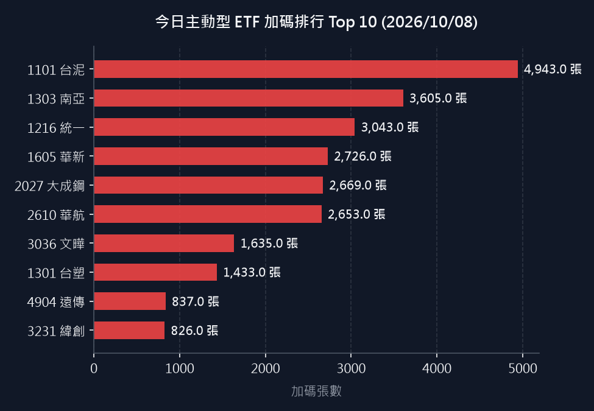
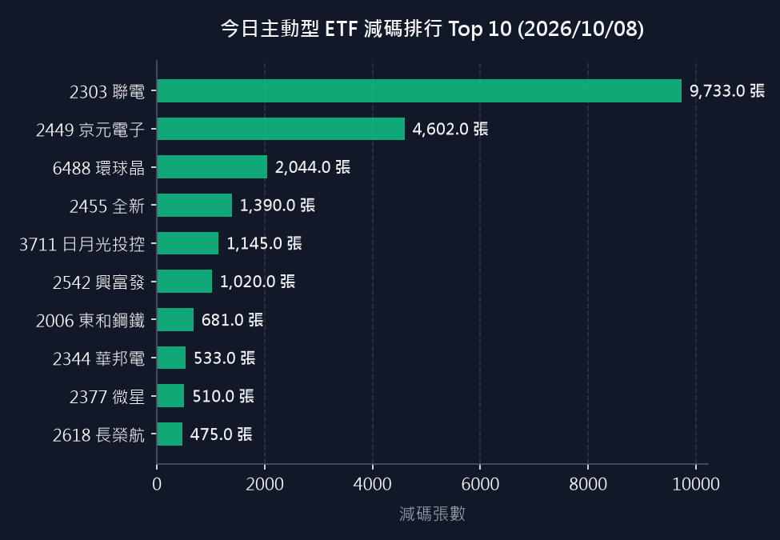

# 主動型 ETF 持股變動

資料來源：`主動型ETF持股明細.xlsx` 最近兩個日期分頁。

比較區間：`20261007` → `20261008`

## 今日加減碼視覺化排行

| 今日加碼 Top 10 | 今日減碼 Top 10 |
| :---: | :---: |
|  |  |

| ETF | 新增 | 刪除 | 比例變動 |
| :-- | --: | --: | --: |
| 00400A | 3 | 0 | 40 |
| 00401A | 0 | 0 | 47 |
| 00402A | 0 | 0 | 42 |
| 00403A | 0 | 1 | 28 |
| 00404A | 2 | 3 | 43 |
| 00405A | 0 | 0 | 29 |
| 00406A | 1 | 4 | 49 |
| 00407A | 0 | 0 | 43 |
| 00408A | 0 | 1 | 40 |
| 00980A | 0 | 0 | 49 |
| 00980D | 0 | 0 | 26 |
| 00981A | 0 | 0 | 24 |
| 00982A | 0 | 0 | 46 |
| 00983A | 2 | 0 | 39 |
| 00983D | 0 | 0 | 15 |
| 00984A | 0 | 0 | 61 |
| 00985A | 1 | 1 | 50 |
| 00986A | 3 | 3 | 32 |
| 00987A | 1 | 0 | 24 |
| 00988A | 2 | 3 | 33 |
| 00989A | 0 | 0 | 61 |
| 00990A | 2 | 3 | 43 |
| 00991A | 0 | 0 | 19 |
| 00992A | 0 | 1 | 32 |
| 00993A | 12 | 14 | 36 |
| 00994A | 0 | 1 | 37 |
| 00995A | 0 | 0 | 36 |
| 00996A | 0 | 0 | 47 |
| 00997A | 2 | 4 | 42 |
| 00998A | 1 | 0 | 54 |
| 00999A | 0 | 0 | 48 |

## 00400A

### 新增持股

- 1476 儒鴻（0.07%，70 張）
- 2345 智邦（0.50%，74 張）
- 3231 緯創（0.51%，819 張）

### 刪除持股

- 無

### 投資比例變動

- 1303 南亞：3.94% → 4.23%（+0.29）
- 2059 川湖：5.20% → 2.71%（-2.49）
- 2303 聯電：1.00% → 1.01%（+0.01）
- 2308 台達電：4.43% → 4.30%（-0.13）
- 2317 鴻海：0.79% → 0.78%（-0.01）
- 2360 致茂：3.57% → 3.58%（+0.01）
- 2368 金像電：1.54% → 1.59%（+0.05）
- 2383 台光電：5.46% → 5.54%（+0.08）
- 2449 京元電子：0.96% → 1.00%（+0.04）
- 2454 聯發科：6.56% → 6.34%（-0.22）
- 3008 大立光：0.86% → 0.85%（-0.01）
- 3017 奇鋐：4.49% → 4.25%（-0.24）
- 3036 文曄：1.53% → 1.56%（+0.03）
- 3037 欣興：5.11% → 5.03%（-0.08）
- 3044 健鼎：1.93% → 1.97%（+0.04）
- 3081 聯亞：0.77% → 0.79%（+0.02）
- 3090 日電貿：0.33% → 0.34%（+0.01）
- 3167 大量：0.38% → 0.40%（+0.02）
- 3293 鈊象：0.33% → 0.34%（+0.01）
- 3374 精材：0.54% → 0.55%（+0.01）
- 3443 創意：4.19% → 3.75%（-0.44）
- 3529 力旺：1.33% → 1.26%（-0.07）
- 3653 健策：5.05% → 4.13%（-0.92）
- 3661 世芯-KY：0.49% → 2.62%（+2.13）
- 3665 貿聯-KY：2.21% → 1.76%（-0.45）
- 3711 日月光投控：1.11% → 1.13%（+0.02）
- 5274 信驊：2.91% → 1.63%（-1.28）
- 5434 崇越：0.40% → 0.39%（-0.01）
- 6187 萬潤：2.95% → 2.98%（+0.03）
- 6223 旺矽：3.31% → 3.30%（-0.01）
- 6271 同欣電：0.26% → 0.27%（+0.01）
- 6278 台表科：0.51% → 0.54%（+0.03）
- 6488 環球晶：3.44% → 3.27%（-0.17）
- 6505 台塑化：2.01% → 2.22%（+0.21）
- 6669 緯穎：3.24% → 3.21%（-0.03）
- 7750 新代：0.78% → 0.79%（+0.01）
- 7769 鴻勁：0.13% → 0.14%（+0.01）
- 9939 宏全：0.07% → 0.08%（+0.01）
- 台指選擇權 2026/10：0.10% → 0.08%（-0.02）
- ＸＡＧＸ金兌(3533.HK)：0.46% → 0.48%（+0.02）

## 00401A

### 新增持股

- 無

### 刪除持股

- 無

### 投資比例變動

- 1216 統一：0.25% → 0.26%（+0.01）
- 1303 南亞：1.12% → 1.20%（+0.08）
- 1477 聚陽：0.85% → 0.87%（+0.02）
- 2059 川湖：1.01% → 0.83%（-0.18）
- 2303 聯電：2.33% → 2.37%（+0.04）
- 2308 台達電：2.68% → 2.61%（-0.07）
- 2317 鴻海：0.55% → 0.54%（-0.01）
- 2327 國巨*：0.65% → 0.67%（+0.02）
- 2345 智邦：0.34% → 0.35%（+0.01）
- 2357 華碩：1.78% → 1.80%（+0.02）
- 2360 致茂：1.42% → 1.43%（+0.01）
- 2382 廣達：2.04% → 2.01%（-0.03）
- 2383 台光電：1.18% → 1.20%（+0.02）
- 2412 中華電：0.77% → 0.79%（+0.02）
- 2454 聯發科：6.52% → 6.30%（-0.22）
- 2883 凱基金：1.54% → 1.56%（+0.02）
- 2884 玉山金：1.83% → 1.84%（+0.01）
- 2886 兆豐金：1.24% → 1.26%（+0.02）
- 2890 永豐金：0.29% → 0.28%（-0.01）
- 2891 中信金：1.44% → 1.43%（-0.01）
- 2912 統一超：0.23% → 0.24%（+0.01）
- 3008 大立光：2.35% → 2.32%（-0.03）
- 3037 欣興：2.54% → 2.50%（-0.04）
- 3131 弘塑：0.71% → 0.70%（-0.01）
- 3231 緯創：1.61% → 1.62%（+0.01）
- 3491 昇達科：1.87% → 1.86%（-0.01）
- 3711 日月光投控：2.63% → 2.67%（+0.04）
- 4904 遠傳：0.70% → 0.72%（+0.02）
- 4958 臻鼎-KY：1.41% → 1.48%（+0.07）
- 4991 環宇-KY：0.69% → 0.71%（+0.02）
- 5274 信驊：1.97% → 1.84%（-0.13）
- 5347 世界：1.39% → 1.38%（-0.01）
- 5871 中租-KY：0.12% → 0.13%（+0.01）
- 5904 寶雅*：0.49% → 0.50%（+0.01）
- 6147 頎邦：1.32% → 1.39%（+0.07）
- 6285 啟碁：1.37% → 1.39%（+0.02）
- 6515 穎崴：1.16% → 1.07%（-0.09）
- 6531 愛普*：1.75% → 1.67%（-0.08）
- 6669 緯穎：1.92% → 1.91%（-0.01）
- 7769 鴻勁：1.08% → 1.10%（+0.02）
- 7828 創新服務：1.66% → 1.68%（+0.02）
- 7856 漢測：0.84% → 0.86%（+0.02）
- 8464 億豐：0.93% → 0.95%（+0.02）
- 台股期貨10/26(FITXN*1.TF)：0.58% → 0.48%（-0.10）
- 臺指選擇權10/26 46000 買權：-0.11% → -0.09%（+0.02）
- 臺指選擇權10/26 46400 買權：-1.57% → -1.29%（+0.28）
- 臺指選擇權10/26 46800 買權：-0.09% → -0.07%（+0.02）

## 00402A

### 新增持股

- 無

### 刪除持股

- 無

### 投資比例變動

- AAPL.US Apple：7.28% → 7.29%（+0.01）
- AMD.US AMD：6.13% → 6.39%（+0.26）
- AMZN.US Amazon：3.98% → 4.20%（+0.22）
- ANET.US Arista Networks：0.93% → 0.87%（-0.06）
- ARM.US Arm：0.98% → 0.97%（-0.01）
- ASML.US ASML Holding：1.20% → 1.19%（-0.01）
- AVGO.US Broadcom：2.13% → 2.26%（+0.13）
- AXON.US Axon Enterprise：0.53% → 0.54%（+0.01）
- BABA.US Alibaba Group：0.46% → 0.45%（-0.01）
- CDNS.US Cadence Design Systems：1.49% → 1.53%（+0.04）
- CIEN.US Ciena：1.36% → 1.35%（-0.01）
- CLS.US Celestica：1.26% → 1.25%（-0.01）
- COHR.US Coherent：1.47% → 1.51%（+0.04）
- CRWD.US CrowdStrike Holdings：1.75% → 1.63%（-0.12）
- DASH.US DoorDash：0.44% → 0.45%（+0.01）
- GOOG.US Alphabet - Class C Capital Stock：3.17% → 3.26%（+0.09）
- GOOGL.US Alphabet - Class A Common Stock：3.34% → 3.27%（-0.07）
- INTC.US Intel：1.64% → 1.63%（-0.01）
- IOT.US Samsara：0.52% → 0.50%（-0.02）
- KLAC.US KLA：1.70% → 1.65%（-0.05）
- LITE.US Lumentum：2.00% → 2.08%（+0.08）
- LRCX.US Lam Research：2.96% → 2.77%（-0.19）
- MCHP.US Microchip Technology：1.34% → 1.31%（-0.03）
- MDB.US MongoDB：0.35% → 0.36%（+0.01）
- META.US Meta：3.64% → 3.61%（-0.03）
- MRVL.US Marvell：1.69% → 1.81%（+0.12）
- MSFT.US Microsoft：5.09% → 5.07%（-0.02）
- MU.US Micron：6.13% → 6.28%（+0.15）
- NFLX.US Netflix：0.88% → 0.92%（+0.04）
- NOW.US ServiceNow：0.80% → 0.83%（+0.03）
- PANW.US Palo Alto：2.76% → 2.81%（+0.05）
- PLTR.US Palantir Technologies：1.82% → 1.90%（+0.08）
- SHOP.US Shopify：0.91% → 0.97%（+0.06）
- SIMO.US Silicon Motion：0.58% → 0.60%（+0.02）
- SKHY.US SK hynix：1.34% → 1.25%（-0.09）
- SPOT.US Spotify：0.31% → 0.34%（+0.03）
- STX.US Seagate：1.24% → 1.15%（-0.09）
- TER.US Teradyne：0.91% → 0.86%（-0.05）
- TSM.US TSMC(ADR)：1.57% → 1.56%（-0.01）
- TTWO.US Take-Two：0.54% → 0.55%（+0.01）
- V.US Visa：1.04% → 1.06%（+0.02）
- WDC.US Western Digital：2.09% → 1.96%（-0.13）

## 00403A

### 新增持股

- 無

### 刪除持股

- 2337 旺宏（0.00%，1 張）

### 投資比例變動

- 1303 南亞：2.21% → 2.48%（+0.27）
- 2059 川湖：0.67% → 0.55%（-0.12）
- 2303 聯電：2.43% → 2.06%（-0.37）
- 2308 台達電：4.07% → 3.97%（-0.10）
- 2327 國巨*：3.60% → 3.89%（+0.29）
- 2330 台積電：13.64% → 13.68%（+0.04）
- 2345 智邦：2.25% → 2.31%（+0.06）
- 2368 金像電：0.17% → 0.43%（+0.26）
- 2383 台光電：5.75% → 5.85%（+0.10）
- 2408 南亞科：1.01% → 1.04%（+0.03）
- 2449 京元電子：0.82% → 0.85%（+0.03）
- 2454 聯發科：6.57% → 6.37%（-0.20）
- 3008 大立光：0.94% → 0.93%（-0.01）
- 3017 奇鋐：5.30% → 5.03%（-0.27）
- 3037 欣興：7.00% → 6.90%（-0.10）
- 3189 景碩：3.26% → 3.33%（+0.07）
- 3443 創意：3.56% → 3.73%（+0.17）
- 3583 辛耘：0.42% → 0.41%（-0.01）
- 3653 健策：5.41% → 5.57%（+0.16）
- 3665 貿聯-KY：2.33% → 2.40%（+0.07）
- 5274 信驊：1.24% → 1.43%（+0.19）
- 6274 台燿：2.28% → 2.55%（+0.27）
- 6442 光聖：0.40% → 0.44%（+0.04）
- 6488 環球晶：2.33% → 0.63%（-1.70）
- 6669 緯穎：2.66% → 2.65%（-0.01）
- 8046 南電：3.10% → 3.09%（-0.01）
- 8358 金居：0.02% → 0.00%（-0.02）
- 8996 高力：1.97% → 2.14%（+0.17）

## 00404A

### 新增持股

- 台指選擇權11/26 52300 買權（-0.12%，-0.175 張）
- 台指選擇權12/26 53300 買權（-0.01%，-0.009 張）

### 刪除持股

- 2027 大成鋼（0.84%，751 張）
- 2542 興富發（0.92%，1020 張）
- 4763 材料*-KY（0.86%，778 張）

### 投資比例變動

- 1303 南亞：0.73% → 0.79%（+0.06）
- 2059 川湖：0.62% → 0.51%（-0.11）
- 2303 聯電：2.74% → 2.79%（+0.05）
- 2308 台達電：1.93% → 1.88%（-0.05）
- 2317 鴻海：0.65% → 0.64%（-0.01）
- 2330 台積電：22.60% → 22.68%（+0.08）
- 2345 智邦：0.87% → 0.89%（+0.02）
- 2347 聯強：1.80% → 1.84%（+0.04）
- 2357 華碩：1.18% → 1.19%（+0.01）
- 2379 瑞昱：1.05% → 1.06%（+0.01）
- 2382 廣達：0.95% → 0.94%（-0.01）
- 2383 台光電：3.11% → 3.17%（+0.06）
- 2436 偉詮電：1.13% → 1.10%（-0.03）
- 2454 聯發科：6.90% → 6.92%（+0.02）
- 2887 台新新光金：1.38% → 1.39%（+0.01）
- 2890 永豐金：1.38% → 1.37%（-0.01）
- 3017 奇鋐：1.39% → 1.32%（-0.07）
- 3034 聯詠：1.94% → 1.95%（+0.01）
- 3037 欣興：0.31% → 0.30%（-0.01）
- 3264 欣銓：0.61% → 0.64%（+0.03）
- 3293 鈊象：1.10% → 1.13%（+0.03）
- 3374 精材：0.11% → 0.12%（+0.01）
- 3443 創意：0.59% → 1.00%（+0.41）
- 3653 健策：0.33% → 0.52%（+0.19）
- 3680 家登：0.50% → 0.52%（+0.02）
- 3711 日月光投控：3.40% → 3.46%（+0.06）
- 5274 信驊：2.88% → 2.70%（-0.18）
- 5434 崇越：1.78% → 1.74%（-0.04）
- 5876 上海商銀：0.73% → 1.40%（+0.67）
- 5904 寶雅*：0.45% → 0.46%（+0.01）
- 6196 帆宣：1.78% → 1.84%（+0.06）
- 6257 矽格：1.86% → 1.87%（+0.01）
- 6491 晶碩：0.45% → 0.83%（+0.38）
- 6505 台塑化：0.45% → 0.50%（+0.05）
- 6669 緯穎：1.03% → 1.02%（-0.01）
- 6691 洋基工程：0.91% → 1.74%（+0.83）
- 7769 鴻勁：1.11% → 1.14%（+0.03）
- 8081 致新：0.82% → 0.83%（+0.01）
- 8299 群聯：1.13% → 1.23%（+0.10）
- iShares MSCI Japan SRI ETF(2851.JP)：0.45% → 1.08%（+0.63）
- 台指選擇權10/26 49100 買權：-0.70% → -0.24%（+0.46）
- 台指選擇權11/26 50300 買權：-0.04% → -0.02%（+0.02）
- 台股期貨10/26(FITXN*1.TF)：17.23% → 20.83%（+3.60）

## 00405A

### 新增持股

- 無

### 刪除持股

- 無

### 投資比例變動

- 1303 南亞：0.80% → 0.88%（+0.08）
- 2059 川湖：2.16% → 2.14%（-0.02）
- 2308 台達電：0.76% → 0.75%（-0.01）
- 2330 台積電：1.81% → 1.84%（+0.03）
- 2345 智邦：4.25% → 4.42%（+0.17）
- 2368 金像電：5.57% → 5.85%（+0.28）
- 2383 台光電：4.98% → 5.14%（+0.16）
- 2454 聯發科：5.67% → 5.57%（-0.10）
- 3017 奇鋐：4.01% → 3.86%（-0.15）
- 3037 欣興：7.86% → 7.85%（-0.01）
- 3189 景碩：0.21% → 0.22%（+0.01）
- 3264 欣銓：0.03% → 0.04%（+0.01）
- 3443 創意：6.01% → 5.84%（-0.17）
- 3653 健策：7.21% → 7.53%（+0.32）
- 3665 貿聯-KY：6.06% → 6.34%（+0.28）
- 5274 信驊：4.04% → 5.60%（+1.56）
- 6187 萬潤：0.89% → 0.91%（+0.02）
- 6223 旺矽：7.18% → 7.28%（+0.10）
- 6274 台燿：2.10% → 2.15%（+0.05）
- 6510 精測：0.60% → 0.01%（-0.59）
- 6515 穎崴：0.55% → 0.52%（-0.03）
- 6526 達發：0.48% → 0.47%（-0.01）
- 6531 愛普*：4.22% → 4.08%（-0.14）
- 6669 緯穎：0.89% → 0.90%（+0.01）
- 6805 富世達：3.23% → 3.27%（+0.04）
- 7769 鴻勁：2.78% → 2.87%（+0.09）
- 8046 南電：7.66% → 7.74%（+0.08）
- 8150 南茂：0.00% → 0.01%（+0.01）
- 8996 高力：1.77% → 1.38%（-0.39）

## 00406A

### 新增持股

- 臺指選擇權第二週週三到期契約（-4.82%，-1.77 張）

### 刪除持股

- 2455 全新（0.14%，155 張）
- 3583 辛耘（0.09%，78 張）
- 8210 勤誠（0.06%，41 張）
- 臺指選擇權第一週週三到期契約（-20.45%，-5.78 張）

### 投資比例變動

- 1303 南亞：0.18% → 0.68%（+0.50）
- 1326 台化：0.28% → 0.30%（+0.02）
- 1560 中砂：0.68% → 0.65%（-0.03）
- 2059 川湖：1.63% → 1.29%（-0.34）
- 2303 聯電：2.24% → 2.19%（-0.05）
- 2308 台達電：3.58% → 3.36%（-0.22）
- 2317 鴻海：0.56% → 0.53%（-0.03）
- 2327 國巨*：1.59% → 1.58%（-0.01）
- 2330 台積電：9.48% → 9.34%（-0.14）
- 2345 智邦：3.27% → 3.24%（-0.03）
- 2360 致茂：1.13% → 1.21%（+0.08）
- 2383 台光電：6.30% → 6.18%（-0.12）
- 2395 研華：0.14% → 0.13%（-0.01）
- 2454 聯發科：6.09% → 5.94%（-0.15）
- 2481 強茂：0.29% → 0.28%（-0.01）
- 2486 一詮：0.31% → 0.30%（-0.01）
- 2885 元大金：0.93% → 0.90%（-0.03）
- 3008 大立光：0.43% → 0.41%（-0.02）
- 3017 奇鋐：5.99% → 5.47%（-0.52）
- 3037 欣興：5.89% → 5.88%（-0.01）
- 3105 穩懋：0.20% → 0.19%（-0.01）
- 3167 大量：0.71% → 0.72%（+0.01）
- 3189 景碩：1.36% → 1.53%（+0.17）
- 3260 威剛：0.11% → 0.00%（-0.11）
- 3443 創意：1.77% → 2.19%（+0.42）
- 3450 聯鈞：0.26% → 0.25%（-0.01）
- 3491 昇達科：0.88% → 0.85%（-0.03）
- 3529 力旺：0.36% → 0.33%（-0.03）
- 3653 健策：3.94% → 3.90%（-0.04）
- 3665 貿聯-KY：2.78% → 2.77%（-0.01）
- 3711 日月光投控：2.54% → 2.48%（-0.06）
- 5274 信驊：2.74% → 2.58%（-0.16）
- 6147 頎邦：0.62% → 0.73%（+0.11）
- 6187 萬潤：0.38% → 0.37%（-0.01）
- 6223 旺矽：3.53% → 3.40%（-0.13）
- 6274 台燿：1.88% → 1.82%（-0.06）
- 6488 環球晶：0.70% → 0.64%（-0.06）
- 6510 精測：1.16% → 1.24%（+0.08）
- 6515 穎崴：0.51% → 0.46%（-0.05）
- 6531 愛普*：0.27% → 0.25%（-0.02）
- 6669 緯穎：2.53% → 2.43%（-0.10）
- 6715 嘉基：0.08% → 0.22%（+0.14）
- 6805 富世達：0.17% → 0.08%（-0.09）
- 7769 鴻勁：0.38% → 0.37%（-0.01）
- 8046 南電：2.53% → 2.43%（-0.10）
- 8358 金居：0.20% → 0.19%（-0.01）
- 8996 高力：0.38% → 0.40%（+0.02）
- 臺指選擇權第二週週五到期契約：-3.35% → -15.62%（-12.27）
- 臺股期貨 202610(FITXN*1.TF)：23.64% → 23.73%（+0.09）

## 00407A

### 新增持股

- 無

### 刪除持股

- 無

### 投資比例變動

- 1303 南亞：0.85% → 0.93%（+0.08）
- 1560 中砂：1.05% → 1.06%（+0.01）
- 2059 川湖：2.74% → 2.30%（-0.44）
- 2301 光寶科：1.45% → 1.50%（+0.05）
- 2303 聯電：0.54% → 0.56%（+0.02）
- 2308 台達電：2.77% → 2.75%（-0.02）
- 2327 國巨*：2.34% → 2.46%（+0.12）
- 2330 台積電：8.98% → 9.17%（+0.19）
- 2345 智邦：2.06% → 2.15%（+0.09）
- 2360 致茂：1.03% → 1.06%（+0.03）
- 2368 金像電：0.60% → 0.63%（+0.03）
- 2383 台光電：5.64% → 5.85%（+0.21）
- 2408 南亞科：0.94% → 0.98%（+0.04）
- 2451 創見：0.29% → 0.31%（+0.02）
- 2454 聯發科：5.54% → 5.47%（-0.07）
- 2615 萬海：0.63% → 0.65%（+0.02）
- 3008 大立光：1.49% → 1.50%（+0.01）
- 3017 奇鋐：5.78% → 5.59%（-0.19）
- 3034 聯詠：0.68% → 0.70%（+0.02）
- 3037 欣興：6.01% → 6.04%（+0.03）
- 3081 聯亞：1.38% → 1.45%（+0.07）
- 3231 緯創：0.70% → 0.72%（+0.02）
- 3260 威剛：0.27% → 0.28%（+0.01）
- 3293 鈊象：0.56% → 0.58%（+0.02）
- 3443 創意：5.01% → 5.18%（+0.17）
- 3491 昇達科：0.97% → 0.99%（+0.02）
- 3529 力旺：0.63% → 0.23%（-0.40）
- 3653 健策：3.44% → 3.60%（+0.16）
- 3665 貿聯-KY：2.70% → 2.84%（+0.14）
- 3711 日月光投控：2.96% → 3.07%（+0.11）
- 4958 臻鼎-KY：1.00% → 1.07%（+0.07）
- 5274 信驊：1.74% → 1.28%（-0.46）
- 5289 宜鼎：0.29% → 0.30%（+0.01）
- 6187 萬潤：1.64% → 1.69%（+0.05）
- 6223 旺矽：2.70% → 2.75%（+0.05）
- 6274 台燿：3.96% → 4.07%（+0.11）
- 6446 藥華藥：0.29% → 0.31%（+0.02）
- 6510 精測：1.21% → 1.37%（+0.16）
- 6531 愛普*：0.34% → 0.33%（-0.01）
- 6669 緯穎：4.00% → 3.76%（-0.24）
- 6805 富世達：1.13% → 1.15%（+0.02）
- 8046 南電：3.04% → 3.09%（+0.05）
- 8996 高力：2.17% → 2.40%（+0.23）

## 00408A

### 新增持股

- 無

### 刪除持股

- 2481 強茂（0.99%，86 張）

### 投資比例變動

- 1303 南亞：3.47% → 3.44%（-0.03）
- 1560 中砂：0.40% → 0.39%（-0.01）
- 2059 川湖：0.38% → 0.34%（-0.04）
- 2303 聯電：1.76% → 1.75%（-0.01）
- 2308 台達電：3.72% → 3.69%（-0.03）
- 2327 國巨*：1.55% → 1.53%（-0.02）
- 2330 台積電：5.68% → 5.62%（-0.06）
- 2345 智邦：0.78% → 0.81%（+0.03）
- 2357 華碩：1.92% → 1.94%（+0.02）
- 2360 致茂：1.24% → 1.21%（-0.03）
- 2368 金像電：4.43% → 4.67%（+0.24）
- 2382 廣達：0.22% → 0.21%（-0.01）
- 2383 台光電：5.19% → 5.26%（+0.07）
- 2408 南亞科：1.73% → 1.80%（+0.07）
- 2449 京元電子：1.43% → 1.03%（-0.40）
- 2454 聯發科：4.22% → 4.11%（-0.11）
- 2542 興富發：3.39% → 3.42%（+0.03）
- 3008 大立光：0.89% → 0.87%（-0.02）
- 3017 奇鋐：3.19% → 3.11%（-0.08）
- 3026 禾伸堂：0.33% → 0.34%（+0.01）
- 3037 欣興：4.47% → 3.96%（-0.51）
- 3081 聯亞：1.93% → 1.83%（-0.10）
- 3189 景碩：2.92% → 2.86%（-0.06）
- 3231 緯創：0.36% → 0.37%（+0.01）
- 3264 欣銓：0.70% → 0.71%（+0.01）
- 3443 創意：0.55% → 0.54%（-0.01）
- 3491 昇達科：1.10% → 1.09%（-0.01）
- 3653 健策：2.55% → 2.70%（+0.15）
- 3665 貿聯-KY：1.20% → 1.23%（+0.03）
- 3711 日月光投控：1.51% → 1.55%（+0.04）
- 5434 崇越：2.27% → 2.25%（-0.02）
- 6223 旺矽：2.07% → 2.10%（+0.03）
- 6239 力成：1.33% → 1.34%（+0.01）
- 6274 台燿：3.11% → 3.16%（+0.05）
- 6488 環球晶：1.10% → 1.03%（-0.07）
- 6669 緯穎：3.88% → 3.89%（+0.01）
- 6691 洋基工程：0.35% → 0.36%（+0.01）
- 6805 富世達：1.43% → 1.39%（-0.04）
- 7769 鴻勁：0.57% → 0.58%（+0.01）
- 8996 高力：1.91% → 2.00%（+0.09）

## 00980A

### 新增持股

- 無

### 刪除持股

- 無

### 投資比例變動

- 1303 南亞：3.41% → 3.71%（+0.30）
- 2059 川湖：4.99% → 4.15%（-0.84）
- 2303 聯電：1.05% → 1.08%（+0.03）
- 2308 台達電：3.99% → 3.93%（-0.06）
- 2317 鴻海：2.00% → 1.99%（-0.01）
- 2327 國巨*：1.46% → 1.52%（+0.06）
- 2330 台積電：9.39% → 9.50%（+0.11）
- 2344 華邦電：1.96% → 2.01%（+0.05）
- 2345 智邦：1.40% → 1.45%（+0.05）
- 2360 致茂：1.68% → 1.71%（+0.03）
- 2368 金像電：2.05% → 2.14%（+0.09）
- 2376 技嘉：0.89% → 0.87%（-0.02）
- 2382 廣達：1.15% → 1.16%（+0.01）
- 2383 台光電：4.80% → 4.93%（+0.13）
- 2408 南亞科：2.78% → 2.89%（+0.11）
- 2454 聯發科：5.91% → 5.78%（-0.13）
- 2884 玉山金：0.65% → 0.66%（+0.01）
- 2891 中信金：0.92% → 0.93%（+0.01）
- 3008 大立光：1.26% → 1.25%（-0.01）
- 3017 奇鋐：2.38% → 2.28%（-0.10）
- 3026 禾伸堂：1.10% → 1.24%（+0.14）
- 3036 文曄：0.94% → 0.97%（+0.03）
- 3037 欣興：3.95% → 3.93%（-0.02）
- 3044 健鼎：0.54% → 0.56%（+0.02）
- 3081 聯亞：2.28% → 2.37%（+0.09）
- 3189 景碩：1.37% → 1.42%（+0.05）
- 3231 緯創：0.87% → 0.88%（+0.01）
- 3264 欣銓：0.77% → 0.82%（+0.05）
- 3293 鈊象：0.77% → 0.80%（+0.03）
- 3443 創意：2.38% → 2.44%（+0.06）
- 3529 力旺：0.66% → 0.63%（-0.03）
- 3653 健策：3.55% → 3.69%（+0.14）
- 3665 貿聯-KY：0.54% → 0.56%（+0.02）
- 3711 日月光投控：2.23% → 2.29%（+0.06）
- 5274 信驊：1.86% → 1.76%（-0.10）
- 5904 寶雅*：0.75% → 0.78%（+0.03）
- 6213 聯茂：0.96% → 1.01%（+0.05）
- 6223 旺矽：2.02% → 2.04%（+0.02）
- 6274 台燿：1.21% → 1.23%（+0.02）
- 6442 光聖：0.30% → 0.34%（+0.04）
- 6515 穎崴：1.80% → 1.69%（-0.11）
- 6669 緯穎：1.71% → 1.72%（+0.01）
- 6831 邁科：0.44% → 0.43%（-0.01）
- 7751 竑騰：0.70% → 0.73%（+0.03）
- 7769 鴻勁：2.93% → 3.02%（+0.09）
- 8046 南電：1.82% → 1.83%（+0.01）
- 8299 群聯：1.69% → 1.71%（+0.02）
- 8996 高力：0.45% → 0.49%（+0.04）
- 台灣證交所加權股價指數(FITXN*1.TF)：3.00% → 3.03%（+0.03）

## 00980D

### 新增持股

- 無

### 刪除持股

- 無

### 投資比例變動

- ASURION LLC/ASURION CO 8.375% 01FEB2034：0.47% → 0.46%（-0.01）
- AVIANCA MIDCO 2 PLC SER REGS 10.25 % 07-JAN-2032：0.27% → 0.28%（+0.01）
- BRITISH TELECOMMUNICATIO (BR) 9.625% 15DEC2030：0.57% → 0.58%（+0.01）
- CHC GROUP LLC SER REGS 11.750000 % 01-SEP-2030：0.44% → 0.43%（-0.01）
- CONCENTRIX CORP (REG) 6.85% 02AUG2033：0.70% → 0.71%（+0.01）
- DOW CHEMICAL CO/THE 6.9% 15MAY2053：0.59% → 0.60%（+0.01）
- DOW CHEMICAL CO/THE 7.375% 01NOV2029：0.61% → 0.62%（+0.01）
- FIFTH THIRD BANCORP (REG) 8.25% 01MAR2038：0.63% → 0.64%（+0.01）
- GLOBAL ATLANTIC FIN CO SER REGS 7.950000 % 15JUN2033：0.65% → 0.66%（+0.01）
- HSBC HOLDINGS PLC VAR 03NOV2028：0.33% → 0.34%（+0.01）
- INTESA SANPAOLO SPA SER REGS (REG S) 7.8% 28NOV2053：0.36% → 0.35%（-0.01）
- JETBLUE AIRWAYS/LOYALTY SER REGS (REG S) 9.875% 20SEP2031：0.45% → 0.43%（-0.02）
- KINDER MORGAN INC/DELAWA SER GMTN (REG) 7.75% 15JAN2032：0.32% → 0.33%（+0.01）
- KONINKLIJKE KPN NV (REG) 8.375% 01OCT2030：0.43% → 0.44%（+0.01）
- ORACLE CORP 6.125000 % 03AUG2065：0.54% → 0.53%（-0.01）
- SABRE GLBL INC SER REGS 11.125000 % 15JUL2030：0.50% → 0.49%（-0.01）
- SUNCOR ENERGY INC (REG) 6.8% 15MAY2038：0.41% → 0.42%（+0.01）
- TELEFONICA EUROPE BV (REG) 8.25% 15SEP2030：0.41% → 0.42%（+0.01）
- UNISYS CORP SER REGS 10.625000 % 15JAN2031：0.60% → 0.59%（-0.01）
- US 10YR NOTE (CBT)DEC26 21-DEC-2026：17.75% → 17.77%（+0.02）
- US 2YR NOTE (CBT) DEC26 31-DEC-2026：1.66% → 1.67%（+0.01）
- US 5YR NOTE (CBT) DEC26 31-DEC-2026：-13.53% → -13.55%（-0.02）
- US LONG BOND(CBT) DEC26 21-DEC-2026：5.19% → 5.18%（-0.01）
- VAR ENERGI ASA SER REGS (REG S) 7.5% 15JAN2028：0.33% → 0.34%（+0.01）
- VIACOM INC (REG) 5.85% 01SEP2043：0.49% → 0.48%（-0.01）
- VIACOMCBS INC 6.875% 30APR2036：0.25% → 0.24%（-0.01）

## 00981A

### 新增持股

- 無

### 刪除持股

- 無

### 投資比例變動

- 2303 聯電：4.04% → 4.03%（-0.01）
- 2308 台達電：5.03% → 4.99%（-0.04）
- 2327 國巨*：5.20% → 5.13%（-0.07）
- 2330 台積電：10.13% → 10.35%（+0.22）
- 2345 智邦：4.32% → 4.45%（+0.13）
- 2368 金像電：1.46% → 1.65%（+0.19）
- 2383 台光電：9.46% → 9.58%（+0.12）
- 2449 京元電子：1.32% → 0.88%（-0.44）
- 2454 聯發科：8.41% → 8.19%（-0.22）
- 3017 奇鋐：7.35% → 7.16%（-0.19）
- 3037 欣興：8.61% → 8.16%（-0.45）
- 3443 創意：1.78% → 1.96%（+0.18）
- 3653 健策：5.82% → 6.16%（+0.34）
- 3665 貿聯-KY：2.41% → 2.46%（+0.05）
- 3711 日月光投控：2.32% → 2.13%（-0.19）
- 5274 信驊：0.96% → 0.95%（-0.01）
- 6223 旺矽：4.73% → 4.78%（+0.05）
- 6274 台燿：3.80% → 3.86%（+0.06）
- 6510 精測：0.26% → 0.29%（+0.03）
- 6669 緯穎：3.31% → 3.32%（+0.01）
- 6805 富世達：0.58% → 0.56%（-0.02）
- 8046 南電：4.52% → 4.53%（+0.01）
- 8996 高力：0.27% → 0.28%（+0.01）
- 台指期貨 2026/10(FITXN*1.TF)：2.32% → 2.30%（-0.02）

## 00982A

### 新增持股

- 無

### 刪除持股

- 無

### 投資比例變動

- 2059 川湖：4.43% → 3.68%（-0.75）
- 2301 光寶科：1.82% → 1.85%（+0.03）
- 2303 聯電：1.43% → 1.46%（+0.03）
- 2330 台積電：7.54% → 7.62%（+0.08）
- 2360 致茂：3.75% → 3.81%（+0.06）
- 2376 技嘉：1.25% → 1.22%（-0.03）
- 2377 微星：0.98% → 1.00%（+0.02）
- 2383 台光電：3.50% → 3.59%（+0.09）
- 2395 研華：1.34% → 1.36%（+0.02）
- 2428 興勤：1.12% → 1.24%（+0.12）
- 2454 聯發科：6.84% → 6.68%（-0.16）
- 2455 全新：1.64% → 1.65%（+0.01）
- 2467 志聖：1.09% → 1.07%（-0.02）
- 2478 大毅：1.05% → 1.13%（+0.08）
- 2486 一詮：0.73% → 0.74%（+0.01）
- 3008 大立光：3.25% → 3.24%（-0.01）
- 3017 奇鋐：2.59% → 2.48%（-0.11）
- 3090 日電貿：1.07% → 1.11%（+0.04）
- 3105 穩懋：6.38% → 6.42%（+0.04）
- 3231 緯創：1.30% → 1.33%（+0.03）
- 3265 台星科：1.25% → 1.54%（+0.29）
- 3491 昇達科：3.82% → 3.85%（+0.03）
- 3529 力旺：0.30% → 0.01%（-0.29）
- 3583 辛耘：1.14% → 1.13%（-0.01）
- 3711 日月光投控：1.23% → 1.26%（+0.03）
- 4958 臻鼎-KY：3.42% → 3.62%（+0.20）
- 5274 信驊：1.29% → 1.22%（-0.07）
- 5425 台半：1.21% → 1.24%（+0.03）
- 5483 中美晶：1.39% → 1.43%（+0.04）
- 5536 聖暉*：0.85% → 0.91%（+0.06）
- 6139 亞翔：5.62% → 5.64%（+0.02）
- 6196 帆宣：0.38% → 0.40%（+0.02）
- 6213 聯茂：1.40% → 1.47%（+0.07）
- 6214 精誠：1.22% → 1.28%（+0.06）
- 6223 旺矽：3.22% → 3.25%（+0.03）
- 6239 力成：1.12% → 1.14%（+0.02）
- 6274 台燿：1.39% → 1.41%（+0.02）
- 6446 藥華藥：0.09% → 0.10%（+0.01）
- 6472 保瑞：0.81% → 0.84%（+0.03）
- 6488 環球晶：2.46% → 2.37%（-0.09）
- 6531 愛普*：4.15% → 3.99%（-0.16）
- 6640 均華：0.31% → 0.29%（-0.02）
- 6669 緯穎：4.40% → 4.41%（+0.01）
- 6672 騰輝電子-KY：0.46% → 0.78%（+0.32）
- 8070 長華*：0.36% → 0.42%（+0.06）
- 8996 高力：1.15% → 1.26%（+0.11）

## 00983A

### 新增持股

- FTNT.US Fortinet（0.30%，0.465 張）
- PACB.US Pacific Biosciences of Californi（0.16%，17.398 張）

### 刪除持股

- 無

### 投資比例變動

- ACHR.US Archer：0.62% → 0.33%（-0.29）
- AMD.US AMD：3.40% → 3.75%（+0.35）
- AMZN.US Amazon：2.49% → 2.78%（+0.29）
- AVGO.US Broadcom：0.94% → 1.57%（+0.63）
- BEAM.US Beam Therapeutics：1.49% → 1.55%（+0.06）
- BLSH.US Bullish：2.13% → 2.12%（-0.01）
- BMNR.US BitMine：2.34% → 2.32%（-0.02）
- CBRS.US Cerebras：0.96% → 1.00%（+0.04）
- COIN.US Coinbase：4.46% → 4.55%（+0.09）
- CRCL.US Circle：4.64% → 4.85%（+0.21）
- CRSP.US CRISPR Therapeutics：4.00% → 3.93%（-0.07）
- CRWV.US CoreWeave：1.23% → 1.34%（+0.11）
- DE.US Deere：0.50% → 0.51%（+0.01）
- GOOG.US Alphabet - Class C Capital Stock：1.46% → 1.59%（+0.13）
- GOOGL.US Alphabet - Class A Common Stock：0.51% → 0.55%（+0.04）
- HOOD.US Robinhood Markets：4.35% → 4.50%（+0.15）
- ILMN.US Illumina：2.01% → 1.68%（-0.33）
- KTOS.US Kratos Defense & Security：0.66% → 0.26%（-0.40）
- LLY.US Eli Lilly：0.79% → 0.73%（-0.06）
- META.US Meta：0.76% → 1.84%（+1.08）
- NET.US Cloudflare：1.29% → 1.33%（+0.04）
- NTLA.US Intellia Therapeutics：0.59% → 0.58%（-0.01）
- NTRA.US Natera：1.81% → 1.57%（-0.24）
- NVDA.US NVIDIA：2.73% → 2.93%（+0.20）
- PLTR.US Palantir Technologies：3.22% → 3.56%（+0.34）
- RKLB.US Rocket Lab：1.40% → 1.48%（+0.08）
- RXRX.US Recursion Pharmaceuticals：1.01% → 0.97%（-0.04）
- SHOP.US Shopify：4.23% → 4.73%（+0.50）
- SNOW.US Snowflake：0.52% → 0.55%（+0.03）
- SOFI.US SoFi Technologies：0.42% → 0.44%（+0.02）
- SPCX.US SpaceX：6.95% → 7.34%（+0.39）
- TEM.US Tempus：6.17% → 5.37%（-0.80）
- TSLA.US Tesla：8.87% → 9.08%（+0.21）
- TSM.US TSMC(ADR)：2.74% → 2.87%（+0.13）
- TWST.US Twist Bioscience：5.62% → 3.81%（-1.81）
- TXG.US 10x Genomics：5.08% → 3.31%（-1.77）
- WGS.US GeneDx：0.68% → 0.49%（-0.19）
- XE.US X-Energy：0.69% → 0.74%（+0.05）
- XYZ.US Block：1.27% → 1.23%（-0.04）

## 00983D

### 新增持股

- 無

### 刪除持股

- 無

### 投資比例變動

- ABXCN 7 1/2 09/15/38：0.52% → 0.53%（+0.01）
- BATSLN 7.081 08/02/53：1.28% → 1.29%（+0.01）
- BHCCN 11 09/30/28：1.90% → 1.89%（-0.01）
- C 8 1/8 07/15/39：1.88% → 1.89%（+0.01）
- DOW 9.4 05/15/39：1.90% → 1.91%（+0.01）
- DT 9 1/4 06/01/32：1.49% → 1.48%（-0.01）
- KHC 6 7/8 01/26/39：0.98% → 0.99%（+0.01）
- MOHEGN 11 7/8 04/15/31：1.37% → 1.36%（-0.01）
- NTRCN 7 1/8 05/23/36：0.54% → 0.53%（-0.01）
- ORCL 6.9 11/09/52：0.81% → 0.80%（-0.01）
- PFE 7.2 03/15/39：1.39% → 1.40%（+0.01）
- RAKUTN 11 1/4 02/15/27：1.83% → 1.82%（-0.01）
- SPCX 6.6 07/15/46：1.11% → 1.10%（-0.01）
- TELEFO 8 1/4 09/15/30：1.01% → 1.00%（-0.01）
- TLTW.US iShares 20+ Year Treasury Bond B：7.63% → 7.62%（-0.01）

## 00984A

### 新增持股

- 無

### 刪除持股

- 無

### 投資比例變動

- 1216 統一：0.30% → 0.31%（+0.01）
- 1303 南亞：2.86% → 3.00%（+0.14）
- 1326 台化：0.97% → 1.02%（+0.05）
- 1409 新纖：0.64% → 0.65%（+0.01）
- 1560 中砂：1.38% → 1.36%（-0.02）
- 1709 和益：0.84% → 0.81%（-0.03）
- 2059 川湖：2.58% → 2.18%（-0.40）
- 2303 聯電：0.82% → 0.81%（-0.01）
- 2313 華通：0.15% → 0.16%（+0.01）
- 2330 台積電：4.47% → 4.38%（-0.09）
- 2357 華碩：0.67% → 0.66%（-0.01）
- 2383 台光電：1.53% → 1.52%（-0.01）
- 2395 研華：2.62% → 2.56%（-0.06）
- 2404 漢唐：0.45% → 0.43%（-0.02）
- 2408 南亞科：2.28% → 2.29%（+0.01）
- 2409 友達：1.22% → 1.19%（-0.03）
- 2454 聯發科：0.92% → 0.87%（-0.05）
- 2464 盟立：1.17% → 1.23%（+0.06）
- 2603 長榮：1.69% → 1.65%（-0.04）
- 2615 萬海：0.91% → 0.90%（-0.01）
- 2801 彰銀：0.30% → 0.31%（+0.01）
- 2851 中再保：0.64% → 0.66%（+0.02）
- 2881 富邦金：4.05% → 3.99%（-0.06）
- 2882 國泰金：3.13% → 3.06%（-0.07）
- 2883 凱基金：2.32% → 2.37%（+0.05）
- 2884 玉山金：2.15% → 2.12%（-0.03）
- 2885 元大金：3.18% → 3.11%（-0.07）
- 2886 兆豐金：1.96% → 1.94%（-0.02）
- 2887 台新新光金：3.29% → 3.24%（-0.05）
- 2890 永豐金：2.33% → 2.29%（-0.04）
- 3006 晶豪科：0.63% → 0.61%（-0.02）
- 3017 奇鋐：4.71% → 4.38%（-0.33）
- 3034 聯詠：0.31% → 0.30%（-0.01）
- 3037 欣興：1.98% → 1.91%（-0.07）
- 3231 緯創：0.63% → 0.64%（+0.01）
- 3264 欣銓：1.73% → 1.79%（+0.06）
- 3443 創意：1.15% → 1.22%（+0.07）
- 3450 聯鈞：0.75% → 0.73%（-0.02）
- 3605 宏致：0.68% → 0.64%（-0.04）
- 3653 健策：1.88% → 1.89%（+0.01）
- 3661 世芯-KY：0.25% → 0.30%（+0.05）
- 3665 貿聯-KY：0.64% → 0.67%（+0.03）
- 3711 日月光投控：0.62% → 0.65%（+0.03）
- 4958 臻鼎-KY：0.60% → 0.65%（+0.05）
- 5274 信驊：0.97% → 0.89%（-0.08）
- 5351 鈺創：0.65% → 0.67%（+0.02）
- 5904 寶雅*：0.91% → 0.92%（+0.01）
- 6187 萬潤：2.37% → 2.34%（-0.03）
- 6197 佳必琪：0.69% → 0.73%（+0.04）
- 6213 聯茂：1.62% → 1.65%（+0.03）
- 6223 旺矽：0.06% → 0.11%（+0.05）
- 6274 台燿：0.07% → 0.08%（+0.01）
- 6446 藥華藥：1.47% → 1.49%（+0.02）
- 6505 台塑化：3.07% → 3.32%（+0.25）
- 6531 愛普*：0.03% → 0.04%（+0.01）
- 6669 緯穎：0.92% → 0.89%（-0.03）
- 6670 復盛應用：0.31% → 0.32%（+0.01）
- 6691 洋基工程：0.67% → 0.68%（+0.01）
- 7750 新代：0.62% → 0.64%（+0.02）
- 8039 台虹：0.61% → 0.65%（+0.04）
- 8046 南電：0.71% → 0.69%（-0.02）

## 00985A

### 新增持股

- 3036 文曄（2.00%，1635 張）

### 刪除持股

- 6147 頎邦（0.19%，141 張）

### 投資比例變動

- 1101 台泥：0.77% → 1.43%（+0.66）
- 1216 統一：1.51% → 2.71%（+1.20）
- 1301 台塑：0.68% → 1.40%（+0.72）
- 1504 東元：0.97% → 0.89%（-0.08）
- 1605 華新：0.88% → 1.41%（+0.53）
- 2027 大成鋼：0.63% → 1.41%（+0.78）
- 2059 川湖：2.30% → 2.35%（+0.05）
- 2303 聯電：2.02% → 2.61%（+0.59）
- 2308 台達電：1.54% → 1.16%（-0.38）
- 2317 鴻海：1.46% → 1.29%（-0.17）
- 2327 國巨*：2.72% → 2.20%（-0.52）
- 2330 台積電：14.89% → 13.32%（-1.57）
- 2344 華邦電：0.27% → 0.00%（-0.27）
- 2345 智邦：2.98% → 3.41%（+0.43）
- 2368 金像電：0.99% → 1.50%（+0.51）
- 2376 技嘉：3.49% → 2.42%（-1.07）
- 2377 微星：0.50% → 0.00%（-0.50）
- 2383 台光電：3.00% → 2.73%（-0.27）
- 2395 研華：2.76% → 1.51%（-1.25）
- 2408 南亞科：1.02% → 1.31%（+0.29）
- 2412 中華電：1.72% → 1.57%（-0.15）
- 2454 聯發科：2.06% → 1.33%（-0.73）
- 2603 長榮：1.17% → 1.30%（+0.13）
- 2610 華航：1.11% → 1.31%（+0.20）
- 2881 富邦金：0.13% → 0.78%（+0.65）
- 3008 大立光：2.15% → 1.36%（-0.79）
- 3017 奇鋐：3.05% → 2.46%（-0.59）
- 3037 欣興：2.20% → 2.42%（+0.22）
- 3081 聯亞：2.49% → 2.10%（-0.39）
- 3105 穩懋：1.32% → 1.50%（+0.18）
- 3189 景碩：1.27% → 1.15%（-0.12）
- 3324 雙鴻：0.17% → 0.01%（-0.16）
- 3491 昇達科：4.01% → 2.46%（-1.55）
- 3653 健策：2.48% → 3.42%（+0.94）
- 3661 世芯-KY：0.76% → 1.26%（+0.50）
- 3665 貿聯-KY：1.51% → 1.62%（+0.11）
- 3711 日月光投控：2.82% → 1.03%（-1.79）
- 4904 遠傳：2.57% → 3.02%（+0.45）
- 6187 萬潤：1.58% → 1.42%（-0.16）
- 6442 光聖：1.39% → 0.91%（-0.48）
- 6446 藥華藥：1.02% → 1.13%（+0.11）
- 6488 環球晶：1.41% → 1.07%（-0.34）
- 6526 達發：0.54% → 0.46%（-0.08）
- 6531 愛普*：2.20% → 1.87%（-0.33）
- 6669 緯穎：1.64% → 1.45%（-0.19）
- 7750 新代：1.20% → 1.09%（-0.11）
- 7769 鴻勁：2.00% → 2.46%（+0.46）
- 8046 南電：1.21% → 0.71%（-0.50）
- 8996 高力：0.55% → 0.19%（-0.36）
- 台積電期貨(FICDFN*1.TF)：3.11% → 2.77%（-0.34）

## 00986A

### 新增持股

- BE.US Bloom Energy（0.47%，0.3 張）
- ILMN.US Illumina（0.58%，0.401 張）
- NTRA.US Natera（0.35%，0.165 張）

### 刪除持股

- 伊魯米納公司（0.59%，0.401 張）
- 布魯姆能源公司（0.47%，0.3 張）
- 那提拉公司（0.35%，0.165 張）

### 投資比例變動

- 2330 台積電：7.82% → 7.89%（+0.07）
- 2454 聯發科：1.65% → 1.64%（-0.01）
- AAPL.US Apple：1.96% → 2.00%（+0.04）
- AMAT.US Applied Materials：1.98% → 1.97%（-0.01）
- AMD.US AMD：4.86% → 4.88%（+0.02）
- AMZN.US Amazon：3.84% → 3.92%（+0.08）
- AVGO.US Broadcom：3.62% → 3.65%（+0.03）
- CRWD.US CrowdStrike Holdings：4.47% → 4.29%（-0.18）
- DDOG.US Datadog：1.04% → 1.02%（-0.02）
- ETN.US Eaton：2.38% → 2.33%（-0.05）
- GEV.US GE Vernova：2.75% → 2.69%（-0.06）
- GOOGL.US Alphabet - Class A Common Stock：5.58% → 5.67%（+0.09）
- HOOD.US Robinhood Markets：0.72% → 0.71%（-0.01）
- LITE.US Lumentum：4.73% → 4.67%（-0.06）
- LLY.US Eli Lilly：2.78% → 2.88%（+0.10）
- MA.US Mastercard：1.06% → 1.08%（+0.02）
- MSFT.US Microsoft：2.83% → 2.86%（+0.03）
- MU.US Micron：4.47% → 4.69%（+0.22）
- Murata Mfg.(6981.JP)：2.09% → 2.07%（-0.02）
- NET.US Cloudflare：2.28% → 2.22%（-0.06）
- NVDA.US NVIDIA：6.39% → 6.40%（+0.01）
- PLTR.US Palantir Technologies：0.41% → 0.42%（+0.01）
- SNDK.US Sandisk：0.98% → 1.00%（+0.02）
- SNOW.US Snowflake：1.98% → 1.97%（-0.01）
- Siemens Energy AG：1.94% → 1.91%（-0.03）
- TER.US Teradyne：0.92% → 0.89%（-0.03）
- TSEM.US Tower Semiconductor：1.17% → 1.14%（-0.03）
- 嘉能可公司：1.62% → 1.63%（+0.01）
- 尼比厄斯集團公眾有限公司：1.00% → 0.96%（-0.04）
- 施奈德電機公司：1.41% → 1.39%（-0.02）
- 艾司摩爾控股公司：1.18% → 1.17%（-0.01）
- 英飛凌科技股份有限公司：2.71% → 2.58%（-0.13）

## 00987A

### 新增持股

- 7856 漢測（1.02%，6 張）

### 刪除持股

- 無

### 投資比例變動

- 2330 台積電：9.16% → 9.19%（+0.03）
- 2368 金像電：2.13% → 3.09%（+0.96）
- 2383 台光電：6.84% → 6.97%（+0.13）
- 2408 南亞科：2.07% → 2.13%（+0.06）
- 2454 聯發科：6.20% → 6.01%（-0.19）
- 2455 全新：3.57% → 2.57%（-1.00）
- 3017 奇鋐：7.54% → 7.16%（-0.38）
- 3037 欣興：7.53% → 5.90%（-1.63）
- 3081 聯亞：3.43% → 3.53%（+0.10）
- 3363 上詮：2.37% → 2.48%（+0.11）
- 3443 創意：4.29% → 4.35%（+0.06）
- 3455 由田：2.00% → 2.08%（+0.08）
- 3529 力旺：1.96% → 1.87%（-0.09）
- 3653 健策：5.02% → 5.17%（+0.15）
- 3665 貿聯-KY：4.03% → 4.16%（+0.13）
- 4958 臻鼎-KY：2.26% → 2.37%（+0.11）
- 4991 環宇-KY：2.43% → 2.50%（+0.07）
- 5274 信驊：0.22% → 0.21%（-0.01）
- 6274 台燿：5.18% → 5.23%（+0.05）
- 6510 精測：2.65% → 3.32%（+0.67）
- 6515 穎崴：1.93% → 1.80%（-0.13）
- 8046 南電：2.73% → 2.72%（-0.01）
- 8358 金居：2.91% → 2.87%（-0.04）
- 8996 高力：2.20% → 2.40%（+0.20）

## 00988A

### 新增持股

- Meiko Electronics(6787.JP)（0.80%，79 張）
- TDK(6762.JP)（0.93%，700 張）

### 刪除持股

- Appier(4180.JP)（0.25%，500 張）
- Kioxia Holdings(285A.JP)（0.78%，111 張）
- SNDK.US Sandisk（0.50%，5 張）

### 投資比例變動

- 1303 南亞：0.26% → 1.32%（+1.06）
- 2303 聯電：2.71% → 1.00%（-1.71）
- 2330 台積電：0.94% → 0.97%（+0.03）
- 2383 台光電：2.61% → 2.78%（+0.17）
- 2454 聯發科：3.60% → 3.43%（-0.17）
- 3017 奇鋐：3.35% → 3.38%（+0.03）
- 3037 欣興：6.32% → 6.34%（+0.02）
- 3081 聯亞：0.83% → 0.44%（-0.39）
- AMD.US AMD：1.84% → 2.61%（+0.77）
- BE.US Bloom Energy：6.51% → 7.27%（+0.76）
- COIN.US Coinbase：0.77% → 0.74%（-0.03）
- CRWD.US CrowdStrike Holdings：2.08% → 2.06%（-0.02）
- Furukawa Electric(5801.JP)：1.29% → 1.33%（+0.04）
- HOOD.US Robinhood Markets：2.66% → 2.60%（-0.06）
- INFINEON TECHNOLOGIES AG：1.24% → 1.22%（-0.02）
- INTC.US Intel：3.72% → 2.69%（-1.03）
- IREN.US IREN：0.77% → 0.75%（-0.02）
- LITE.US Lumentum：7.44% → 7.73%（+0.29）
- MRVL.US Marvell：1.42% → 2.54%（+1.12）
- MU.US Micron：2.91% → 2.59%（-0.32）
- Murata Mfg.(6981.JP)：4.36% → 4.40%（+0.04）
- NET.US Cloudflare：1.72% → 1.67%（-0.05）
- NOW.US ServiceNow：1.82% → 1.89%（+0.07）
- NVDA.US NVIDIA：3.48% → 3.53%（+0.05）
- OKTA.US Okta：2.03% → 2.59%（+0.56）
- PANW.US Palo Alto：3.55% → 3.62%（+0.07）
- PLTR.US Palantir Technologies：3.03% → 3.17%（+0.14）
- ROBOTECHNIK INTELLIGENT TE-A：1.55% → 1.58%（+0.03）
- SK hynix(000660.KS)：1.99% → 1.13%（-0.86）
- SNOW.US Snowflake：1.97% → 1.98%（+0.01）
- Samsung Elec Mech(009150.KS)：4.79% → 4.98%（+0.19）
- TER.US Teradyne：1.81% → 0.86%（-0.95）
- TWLO.US Twilio：2.10% → 1.95%（-0.15）

## 00989A

### 新增持股

- 無

### 刪除持股

- 無

### 投資比例變動

- ADBE.US Adobe：1.14% → 1.12%（-0.02）
- ADI.US Analog Devices：1.12% → 1.10%（-0.02）
- ALAB.US Astera Labs：0.77% → 0.85%（+0.08）
- AMD.US AMD：3.10% → 3.19%（+0.09）
- AMZN.US Amazon：0.98% → 1.02%（+0.04）
- ASML.US ASML Holding：2.28% → 2.22%（-0.06）
- AVGO.US Broadcom：3.49% → 3.65%（+0.16）
- BE.US Bloom Energy：1.25% → 1.28%（+0.03）
- CDNS.US Cadence Design Systems：0.92% → 0.93%（+0.01）
- CIEN.US Ciena：1.06% → 1.11%（+0.05）
- CRDO.US Credo：0.94% → 0.98%（+0.04）
- CRM.US Salesforce：2.87% → 2.83%（-0.04）
- CRWD.US CrowdStrike Holdings：3.64% → 3.57%（-0.07）
- CRWV.US CoreWeave：0.73% → 0.74%（+0.01）
- DOCN.US DigitalOcean：1.52% → 1.42%（-0.10）
- ENTG.US Entegris：0.73% → 0.61%（-0.12）
- ESTC.US Elastic：0.74% → 0.73%（-0.01）
- GLW.US Corning：1.03% → 1.06%（+0.03）
- GOOG.US Alphabet - Class C Capital Stock：2.21% → 2.25%（+0.04）
- GWRE.US Guidewire Software：0.58% → 0.62%（+0.04）
- HOOD.US Robinhood Markets：1.84% → 1.78%（-0.06）
- HUBS.US HubSpot：1.63% → 1.64%（+0.01）
- ILMN.US Illumina：0.52% → 0.74%（+0.22）
- INTC.US Intel：3.07% → 3.01%（-0.06）
- LITE.US Lumentum：1.87% → 1.92%（+0.05）
- LMND.US Lemonade：0.66% → 0.70%（+0.04）
- LRCX.US Lam Research：2.56% → 2.46%（-0.10）
- MDB.US MongoDB：0.64% → 0.68%（+0.04）
- META.US Meta：4.14% → 4.05%（-0.09）
- MPWR.US Monolithic Power Systems：1.05% → 1.02%（-0.03）
- MSFT.US Microsoft：2.68% → 2.72%（+0.04）
- MTSI.US MACOM Technology Solutions：0.86% → 0.88%（+0.02）
- MU.US Micron：1.17% → 1.20%（+0.03）
- NET.US Cloudflare：2.77% → 2.66%（-0.11）
- NOW.US ServiceNow：1.73% → 1.77%（+0.04）
- NU.US Nu：0.31% → 0.34%（+0.03）
- NVDA.US NVIDIA：4.58% → 4.59%（+0.01）
- OKTA.US Okta：0.62% → 0.65%（+0.03）
- PANW.US Palo Alto：3.47% → 3.49%（+0.02）
- PLTR.US Palantir Technologies：1.04% → 1.07%（+0.03）
- RIVN.US Rivian：1.18% → 1.16%（-0.02）
- ROK.US Rockwell Automation：0.82% → 0.80%（-0.02）
- SHOP.US Shopify：2.64% → 2.76%（+0.12）
- SMCI.US Super Micro Computer：0.48% → 0.52%（+0.04）
- SNOW.US Snowflake：2.78% → 2.75%（-0.03）
- SPCX.US SpaceX：0.91% → 0.90%（-0.01）
- SYM.US Symbotic：0.45% → 0.48%（+0.03）
- TEM.US Tempus：1.25% → 1.06%（-0.19）
- TSLA.US Tesla：2.78% → 2.82%（+0.04）
- TSM.US TSMC(ADR)：1.10% → 0.98%（-0.12）
- TTMI.US TTM Technologies：0.54% → 0.55%（+0.01）
- TTWO.US Take-Two：2.66% → 2.69%（+0.03）
- TWLO.US Twilio：2.43% → 2.22%（-0.21）
- TWST.US Twist Bioscience：0.29% → 0.23%（-0.06）
- TXG.US 10x Genomics：0.59% → 0.45%（-0.14）
- TXN.US Texas Instruments：1.45% → 1.43%（-0.02）
- U.US Unity Software：0.92% → 0.93%（+0.01）
- VEEV.US Veeva Systems：0.70% → 0.71%（+0.01）
- VICR.US Vicor Corporation：0.59% → 0.43%（-0.16）
- XYZ.US Block：0.66% → 0.67%（+0.01）
- ZM.US Zoom：1.51% → 1.54%（+0.03）

## 00990A

### 新增持股

- RBRK.US Rubrik（0.70%，68.2 張）
- ZETA.US Zeta（0.52%，186.1 張）

### 刪除持股

- AEHR.US Aehr Test Systems（0.99%，116.5 張）
- DELL.US Dell（0.98%，21.8 張）
- FORM.US FormFactor（0.84%，70 張）

### 投資比例變動

- 2308 台達電：3.25% → 3.28%（+0.03）
- 2330 台積電：2.68% → 2.73%（+0.05）
- 2345 智邦：1.03% → 1.01%（-0.02）
- 2360 致茂：0.77% → 0.81%（+0.04）
- 2383 台光電：1.96% → 2.08%（+0.12）
- 2449 京元電子：1.25% → 1.30%（+0.05）
- 2454 聯發科：2.18% → 2.08%（-0.10）
- 3017 奇鋐：1.45% → 1.46%（+0.01）
- 3037 欣興：2.26% → 2.27%（+0.01）
- 4958 臻鼎-KY：0.54% → 0.56%（+0.02）
- 8046 南電：1.33% → 1.34%（+0.01）
- AMD.US AMD：4.18% → 4.37%（+0.19）
- AXTI.US AXT：1.00% → 0.94%（-0.06）
- Advantest(6857.JP)：2.15% → 2.24%（+0.09）
- BE.US Bloom Energy：5.81% → 6.03%（+0.22）
- CLS.US Celestica：1.41% → 1.39%（-0.02）
- CRWD.US CrowdStrike Holdings：1.65% → 1.64%（-0.01）
- HPE.US HP Enterprise：1.54% → 1.66%（+0.12）
- IBIDEN(4062.JP)：1.49% → 1.52%（+0.03）
- LITE.US Lumentum：8.11% → 8.43%（+0.32）
- LRCX.US Lam Research：3.18% → 3.09%（-0.09）
- Lasertec Corporation(6920.JP)：1.48% → 1.52%（+0.04）
- META.US Meta：4.42% → 4.88%（+0.46）
- MRVL.US Marvell：3.71% → 2.46%（-1.25）
- MSFT.US Microsoft：1.08% → 2.14%（+1.06）
- MU.US Micron：2.35% → 2.45%（+0.10）
- MXL.US MaxLinear：0.69% → 0.72%（+0.03）
- Murata Mfg.(6981.JP)：1.89% → 1.91%（+0.02）
- NET.US Cloudflare：2.13% → 2.07%（-0.06）
- NVDA.US NVIDIA：4.03% → 4.60%（+0.57）
- OKTA.US Okta：1.02% → 1.04%（+0.02）
- PANW.US Palo Alto：1.59% → 1.62%（+0.03）
- PLTR.US Palantir Technologies：2.89% → 3.02%（+0.13）
- SHOP.US Shopify：1.21% → 2.34%（+1.13）
- SMTC.US Semtech：2.24% → 2.30%（+0.06）
- SNDK.US Sandisk：1.01% → 1.02%（+0.01）
- SNOW.US Snowflake：2.04% → 1.05%（-0.99）
- SPCX.US SpaceX：3.07% → 3.57%（+0.50）
- Samsung Elec Mech(009150.KS)：0.69% → 0.72%（+0.03）
- TTMI.US TTM Technologies：1.00% → 1.37%（+0.37）
- TWST.US Twist Bioscience：1.73% → 1.34%（-0.39）
- VSH.US Vishay：0.62% → 0.63%（+0.01）
- WOLF.US Wolfspeed：0.49% → 0.47%（-0.02）

## 00991A

### 新增持股

- 無

### 刪除持股

- 無

### 投資比例變動

- 1303 南亞：3.09% → 3.38%（+0.29）
- 2059 川湖：7.64% → 6.40%（-1.24）
- 2308 台達電：1.65% → 1.64%（-0.01）
- 2327 國巨*：4.50% → 4.72%（+0.22）
- 2330 台積電：13.47% → 13.73%（+0.26）
- 2383 台光電：10.04% → 10.39%（+0.35）
- 2408 南亞科：7.62% → 7.98%（+0.36）
- 2454 聯發科：6.72% → 6.31%（-0.41）
- 3017 奇鋐：5.72% → 5.51%（-0.21）
- 3026 禾伸堂：2.57% → 2.92%（+0.35）
- 3037 欣興：8.58% → 8.60%（+0.02）
- 3081 聯亞：2.90% → 3.04%（+0.14）
- 3189 景碩：6.14% → 6.37%（+0.23）
- 3653 健策：2.55% → 2.66%（+0.11）
- 3711 日月光投控：1.57% → 1.62%（+0.05）
- 5274 信驊：3.31% → 2.48%（-0.83）
- 6505 台塑化：1.07% → 1.20%（+0.13）
- 6669 緯穎：3.27% → 3.30%（+0.03）
- 8046 南電：6.35% → 6.43%（+0.08）

## 00992A

### 新增持股

- 無

### 刪除持股

- 2455 全新（1.26%，1000 張）

### 投資比例變動

- 1303 南亞：2.37% → 2.51%（+0.14）
- 1815 富喬：3.22% → 3.43%（+0.21）
- 2059 川湖：4.94% → 4.02%（-0.92）
- 2308 台達電：0.91% → 0.87%（-0.04）
- 2330 台積電：6.40% → 6.33%（-0.07）
- 2345 智邦：5.47% → 5.55%（+0.08）
- 2360 致茂：1.43% → 2.19%（+0.76）
- 2376 技嘉：0.43% → 0.41%（-0.02）
- 2383 台光電：6.18% → 6.21%（+0.03）
- 2404 漢唐：0.46% → 0.45%（-0.01）
- 2454 聯發科：1.95% → 1.87%（-0.08）
- 3008 大立光：4.45% → 4.34%（-0.11）
- 3017 奇鋐：7.12% → 6.67%（-0.45）
- 3026 禾伸堂：0.46% → 0.51%（+0.05）
- 3037 欣興：7.21% → 7.01%（-0.20）
- 3189 景碩：2.00% → 2.02%（+0.02）
- 3653 健策：0.52% → 0.53%（+0.01）
- 3665 貿聯-KY：5.98% → 6.10%（+0.12）
- 4958 臻鼎-KY：1.27% → 1.32%（+0.05）
- 5274 信驊：0.46% → 0.43%（-0.03）
- 5347 世界：0.27% → 0.26%（-0.01）
- 6139 亞翔：0.44% → 0.43%（-0.01）
- 6187 萬潤：0.46% → 0.45%（-0.01）
- 6213 聯茂：0.65% → 0.67%（+0.02）
- 6223 旺矽：4.32% → 4.27%（-0.05）
- 6515 穎崴：0.69% → 0.64%（-0.05）
- 6584 南俊國際：2.33% → 2.25%（-0.08）
- 6669 緯穎：2.18% → 2.14%（-0.04）
- 8021 尖點：3.34% → 3.32%（-0.02）
- 8046 南電：3.23% → 3.18%（-0.05）
- 8150 南茂：0.55% → 0.56%（+0.01）
- 8996 高力：5.78% → 6.20%（+0.42）

## 00993A

### 新增持股

- 2368 金像電（0.31%，25 張）
- 2404 漢唐（0.50%，40 張）
- 2467 志聖（0.51%，96 張）
- 2481 強茂（0.25%，153 張）
- 3042 晶技（0.60%，296 張）
- 3105 穩懋（1.14%，204 張）
- 3264 欣銓（0.53%，214 張）
- 5347 世界（0.31%，172 張）
- 6187 萬潤（1.78%，121 張）
- 6257 矽格（1.06%，387 張）
- 6271 同欣電（0.26%，110 張）
- 8021 尖點（0.98%，183 張）

### 刪除持股

- 2006 東和鋼鐵（0.56%，681 張）
- 2308 台達電（2.03%，105 張）
- 2327 國巨*（2.23%，378 張）
- 2347 聯強（0.42%，463 張）
- 2412 中華電（0.48%，348 張）
- 2603 長榮（0.29%，131 張）
- 2618 長榮航（0.19%，475 張）
- 3324 雙鴻（0.58%，40 張）
- 3532 台勝科（0.34%，78 張）
- 4904 遠傳（0.25%，259 張）
- 5289 宜鼎（0.02%，1.873 張）
- 6147 頎邦（0.22%，110 張）
- 6213 聯茂（0.76%，102 張）
- 8299 群聯（0.18%，9 張）

### 投資比例變動

- 1303 南亞：1.49% → 2.53%（+1.04）
- 1560 中砂：1.05% → 1.70%（+0.65）
- 2027 大成鋼：0.20% → 0.39%（+0.19）
- 2059 川湖：2.34% → 1.13%（-1.21）
- 2301 光寶科：0.24% → 0.64%（+0.40）
- 2303 聯電：2.63% → 1.90%（-0.73）
- 2313 華通：0.25% → 0.44%（+0.19）
- 2330 台積電：8.33% → 8.38%（+0.05）
- 2344 華邦電：1.98% → 1.53%（-0.45）
- 2345 智邦：2.43% → 1.12%（-1.31）
- 2360 致茂：0.31% → 0.52%（+0.21）
- 2383 台光電：5.53% → 6.14%（+0.61）
- 2395 研華：0.60% → 1.45%（+0.85）
- 2408 南亞科：3.03% → 2.96%（-0.07）
- 2454 聯發科：5.93% → 1.54%（-4.39）
- 2455 全新：1.84% → 0.83%（-1.01）
- 2606 裕民：0.34% → 0.38%（+0.04）
- 3017 奇鋐：5.73% → 5.84%（+0.11）
- 3037 欣興：6.39% → 6.35%（-0.04）
- 3044 健鼎：0.28% → 0.75%（+0.47）
- 3081 聯亞：0.50% → 1.31%（+0.81）
- 3189 景碩：4.32% → 4.81%（+0.49）
- 3406 玉晶光：0.31% → 1.19%（+0.88）
- 3443 創意：5.05% → 3.63%（-1.42）
- 3491 昇達科：0.16% → 1.01%（+0.85）
- 3653 健策：2.60% → 0.76%（-1.84）
- 3665 貿聯-KY：1.75% → 0.32%（-1.43）
- 3711 日月光投控：0.61% → 1.78%（+1.17）
- 4958 臻鼎-KY：1.30% → 2.35%（+1.05）
- 5274 信驊：3.50% → 4.32%（+0.82）
- 6223 旺矽：4.27% → 4.09%（-0.18）
- 6274 台燿：2.56% → 4.10%（+1.54）
- 6505 台塑化：0.35% → 1.16%（+0.81）
- 6669 緯穎：4.12% → 4.22%（+0.10）
- 6805 富世達：0.48% → 1.17%（+0.69）
- 8046 南電：3.52% → 4.00%（+0.48）

## 00994A

### 新增持股

- 無

### 刪除持股

- 2481 強茂（1.07%，290 張）

### 投資比例變動

- 1303 南亞：1.91% → 2.08%（+0.17）
- 1560 中砂：0.34% → 0.35%（+0.01）
- 2059 川湖：3.98% → 2.98%（-1.00）
- 2303 聯電：0.86% → 0.89%（+0.03）
- 2308 台達電：2.85% → 2.82%（-0.03）
- 2327 國巨*：1.11% → 1.17%（+0.06）
- 2330 台積電：13.81% → 14.06%（+0.25）
- 2345 智邦：1.33% → 1.39%（+0.06）
- 2360 致茂：1.23% → 1.26%（+0.03）
- 2368 金像電：0.84% → 1.19%（+0.35）
- 2383 台光電：6.40% → 6.61%（+0.21）
- 2408 南亞科：0.99% → 0.52%（-0.47）
- 2449 京元電子：1.12% → 0.54%（-0.58）
- 2454 聯發科：5.88% → 5.69%（-0.19）
- 3017 奇鋐：6.21% → 5.91%（-0.30）
- 3026 禾伸堂：0.28% → 0.32%（+0.04）
- 3037 欣興：6.75% → 6.31%（-0.44）
- 3081 聯亞：1.34% → 1.92%（+0.58）
- 3189 景碩：2.35% → 2.44%（+0.09）
- 3264 欣銓：0.25% → 0.27%（+0.02）
- 3443 創意：3.87% → 3.98%（+0.11）
- 3491 昇達科：1.08% → 1.09%（+0.01）
- 3653 健策：3.71% → 3.72%（+0.01）
- 3665 貿聯-KY：1.41% → 1.48%（+0.07）
- 3711 日月光投控：2.27% → 2.03%（-0.24）
- 5274 信驊：2.55% → 2.43%（-0.12）
- 6187 萬潤：0.51% → 0.53%（+0.02）
- 6223 旺矽：3.79% → 3.84%（+0.05）
- 6239 力成：1.14% → 1.16%（+0.02）
- 6274 台燿：5.07% → 5.19%（+0.12）
- 6488 環球晶：0.38% → 0.37%（-0.01）
- 6669 緯穎：2.66% → 2.69%（+0.03）
- 6691 洋基工程：0.33% → 0.34%（+0.01）
- 6805 富世達：1.87% → 1.90%（+0.03）
- 7769 鴻勁：0.49% → 0.51%（+0.02）
- 8046 南電：3.94% → 3.99%（+0.05）
- 8996 高力：1.24% → 1.37%（+0.13）

## 00995A

### 新增持股

- 無

### 刪除持股

- 無

### 投資比例變動

- 1326 台化：0.58% → 0.63%（+0.05）
- 2059 川湖：0.52% → 0.43%（-0.09）
- 2303 聯電：0.97% → 0.99%（+0.02）
- 2308 台達電：4.50% → 4.39%（-0.11）
- 2330 台積電：8.98% → 8.96%（-0.02）
- 2345 智邦：3.48% → 3.57%（+0.09）
- 2360 致茂：2.30% → 2.32%（+0.02）
- 2368 金像電：0.96% → 0.99%（+0.03）
- 2383 台光電：8.62% → 8.77%（+0.15）
- 2449 京元電子：1.02% → 1.06%（+0.04）
- 2454 聯發科：7.27% → 7.04%（-0.23）
- 2467 志聖：0.31% → 0.30%（-0.01）
- 3017 奇鋐：5.88% → 5.59%（-0.29）
- 3037 欣興：3.61% → 3.56%（-0.05）
- 3189 景碩：0.66% → 0.68%（+0.02）
- 3264 欣銓：0.75% → 0.79%（+0.04）
- 3443 創意：1.50% → 2.38%（+0.88）
- 3529 力旺：0.31% → 0.30%（-0.01）
- 3653 健策：4.66% → 4.80%（+0.14）
- 3665 貿聯-KY：3.76% → 3.88%（+0.12）
- 3711 日月光投控：3.22% → 3.28%（+0.06）
- 4958 臻鼎-KY：1.49% → 1.56%（+0.07）
- 5274 信驊：3.33% → 3.12%（-0.21）
- 6147 頎邦：0.41% → 0.43%（+0.02）
- 6187 萬潤：0.61% → 0.62%（+0.01）
- 6213 聯茂：0.79% → 0.82%（+0.03）
- 6274 台燿：2.38% → 2.40%（+0.02）
- 6488 環球晶：1.20% → 1.15%（-0.05）
- 6510 精測：1.22% → 1.55%（+0.33）
- 6515 穎崴：1.71% → 0.57%（-1.14）
- 6669 緯穎：3.90% → 3.88%（-0.02）
- 6715 嘉基：0.58% → 0.57%（-0.01）
- 7769 鴻勁：2.00% → 2.04%（+0.04）
- 8046 南電：5.11% → 5.09%（-0.02）
- 8150 南茂：0.76% → 0.78%（+0.02）
- 8996 高力：0.64% → 0.69%（+0.05）

## 00996A

### 新增持股

- 無

### 刪除持股

- 無

### 投資比例變動

- 2303 聯電：2.35% → 2.21%（-0.14）
- 2308 台達電：5.48% → 4.96%（-0.52）
- 2327 國巨*：5.12% → 5.36%（+0.24）
- 2330 台積電：8.84% → 8.23%（-0.61）
- 2344 華邦電：0.94% → 0.89%（-0.05）
- 2360 致茂：0.11% → 0.10%（-0.01）
- 2368 金像電：0.41% → 0.39%（-0.02）
- 2382 廣達：0.05% → 0.04%（-0.01）
- 2383 台光電：4.46% → 4.21%（-0.25）
- 2408 南亞科：0.77% → 0.74%（-0.03）
- 2454 聯發科：6.41% → 5.97%（-0.44）
- 2467 志聖：0.33% → 0.30%（-0.03）
- 2472 立隆電：2.25% → 2.75%（+0.50）
- 2882 國泰金：0.07% → 0.06%（-0.01）
- 3017 奇鋐：2.49% → 2.34%（-0.15）
- 3037 欣興：2.32% → 2.54%（+0.22）
- 3042 晶技：0.78% → 0.75%（-0.03）
- 3131 弘塑：0.29% → 0.27%（-0.02）
- 3189 景碩：3.09% → 3.16%（+0.07）
- 3363 上詮：1.56% → 1.73%（+0.17）
- 3443 創意：4.29% → 4.40%（+0.11）
- 3533 嘉澤：0.17% → 0.50%（+0.33）
- 3653 健策：3.29% → 3.14%（-0.15）
- 3665 貿聯-KY：0.16% → 0.15%（-0.01）
- 3693 營邦：0.47% → 0.45%（-0.02）
- 3711 日月光投控：0.09% → 0.08%（-0.01）
- 4749 新應材：0.10% → 0.09%（-0.01）
- 4958 臻鼎-KY：6.17% → 6.22%（+0.05）
- 5269 祥碩：0.24% → 0.23%（-0.01）
- 6223 旺矽：2.51% → 2.32%（-0.19）
- 6239 力成：0.17% → 0.16%（-0.01）
- 6274 台燿：1.51% → 1.41%（-0.10）
- 6278 台表科：3.62% → 4.09%（+0.47）
- 6415 矽力*-KY：0.17% → 0.16%（-0.01）
- 6510 精測：4.26% → 4.59%（+0.33）
- 6526 達發：0.23% → 0.21%（-0.02）
- 6531 愛普*：0.12% → 0.11%（-0.01）
- 6683 雍智科技：3.08% → 3.01%（-0.07）
- 6770 力積電：0.64% → 0.59%（-0.05）
- 6830 汎銓：1.05% → 1.24%（+0.19）
- 6831 邁科：1.98% → 1.79%（-0.19）
- 7751 竑騰：2.22% → 2.35%（+0.13）
- 8021 尖點：3.75% → 4.06%（+0.31）
- 8046 南電：1.89% → 1.75%（-0.14）
- 8210 勤誠：1.34% → 1.25%（-0.09）
- 8358 金居：0.87% → 1.21%（+0.34）
- 8996 高力：1.71% → 1.73%（+0.02）

## 00997A

### 新增持股

- Advantest(6857.JP)（0.98%，15 張）
- VICR.US Vicor Corporation（0.93%，13.073 張）

### 刪除持股

- HOOD.US Robinhood Markets（0.77%，27.483 張）
- MRK.US Merck（0.96%，28.136 張）
- 愛德萬測試（0.94%，15 張）
- 懷克爾公司（0.98%，13.073 張）

### 投資比例變動

- 2330 台積電：2.62% → 2.68%（+0.06）
- 2383 台光電：1.80% → 1.92%（+0.12）
- 2454 聯發科：1.00% → 0.95%（-0.05）
- 3037 欣興：3.68% → 3.70%（+0.02）
- AAPL.US Apple：2.08% → 2.15%（+0.07）
- AMAT.US Applied Materials：2.80% → 2.74%（-0.06）
- AMD.US AMD：3.28% → 3.42%（+0.14）
- ANET.US Arista Networks：1.51% → 1.60%（+0.09）
- APH.US Amphenol：1.12% → 1.15%（+0.03）
- ARM.US Arm：1.22% → 1.21%（-0.01）
- AVGO.US Broadcom：0.98% → 1.04%（+0.06）
- BE.US Bloom Energy：1.45% → 1.51%（+0.06）
- CDNS.US Cadence Design Systems：0.38% → 0.39%（+0.01）
- CRWD.US CrowdStrike Holdings：4.25% → 4.22%（-0.03）
- CSCO.US Cisco：0.89% → 0.94%（+0.05）
- DELL.US Dell：2.30% → 2.46%（+0.16）
- DT.US Dynatrace：2.57% → 2.61%（+0.04）
- FTNT.US Fortinet：2.20% → 2.30%（+0.10）
- GE.US GE Aerospace：0.82% → 0.83%（+0.01）
- GOOGL.US Alphabet - Class A Common Stock：1.73% → 1.79%（+0.06）
- HWM.US Howmet Aerospace：0.85% → 0.84%（-0.01）
- IBIDEN(4062.JP)：4.42% → 4.49%（+0.07）
- INTC.US Intel：2.85% → 2.84%（-0.01）
- KLAC.US KLA：0.57% → 0.55%（-0.02）
- Kioxia Holdings(285A.JP)：0.82% → 0.78%（-0.04）
- LITE.US Lumentum：3.96% → 5.10%（+1.14）
- LMT.US Lockheed Martin：0.60% → 0.61%（+0.01）
- LRCX.US Lam Research：2.28% → 2.22%（-0.06）
- MRVL.US Marvell：3.75% → 4.02%（+0.27）
- MSFT.US Microsoft：1.36% → 1.40%（+0.04）
- MU.US Micron：4.67% → 4.88%（+0.21）
- NTRA.US Natera：0.94% → 1.88%（+0.94）
- NVDA.US NVIDIA：3.43% → 3.48%（+0.05）
- OKTA.US Okta：1.97% → 2.01%（+0.04）
- PANW.US Palo Alto：2.56% → 2.61%（+0.05）
- PLTR.US Palantir Technologies：1.09% → 1.14%（+0.05）
- SNDK.US Sandisk：4.08% → 3.07%（-1.01）
- SNOW.US Snowflake：1.51% → 0.50%（-1.01）
- SPCX.US SpaceX：0.88% → 2.45%（+1.57）
- STX.US Seagate：2.91% → 2.02%（-0.89）
- Samsung Elec Mech(009150.KS)：2.66% → 2.77%（+0.11）
- WDC.US Western Digital：1.59% → 1.19%（-0.40）

## 00998A

### 新增持股

- Eurobank SA（1.17%，450 張）

### 刪除持股

- 無

### 投資比例變動

- ASR荷蘭公眾有限公司：2.06% → 2.24%（+0.18）
- Admiral集團公開有限公司：2.43% → 2.19%（-0.24）
- BLK.US BlackRock：1.81% → 1.63%（-0.18）
- BNY.US Bank of New York Mellon：0.72% → 0.65%（-0.07）
- BPM銀行股份公司：1.92% → 1.69%（-0.23）
- C.US Citigroup：1.22% → 1.10%（-0.12）
- CHYM.US Chime：1.39% → 1.27%（-0.12）
- Chiba Bank(8331.JP)：1.28% → 1.57%（+0.29）
- EQH.US Equitable Holdings：1.98% → 2.56%（+0.58）
- GPN.US Global Payments：0.92% → 0.82%（-0.10）
- HOOD.US Robinhood Markets：1.51% → 1.33%（-0.18）
- Hokuhoku FG(8377.JP)：0.79% → 0.70%（-0.09）
- IBKR.US Interactive Brokers：0.96% → 1.24%（+0.28）
- JPM.US JPMorgan Chase：1.48% → 1.84%（+0.36）
- KB Financial Group(105560.KS)：0.98% → 0.89%（-0.09）
- M&G公開有限公司：2.32% → 2.07%（-0.25）
- MRX.US Marex：2.08% → 2.18%（+0.10）
- MS&AD Insurance Group Holdings(8725.JP)：0.48% → 0.44%（-0.04）
- Mebuki Financial Group(7167.JP)：1.84% → 1.79%（-0.05）
- Mizuho Financial(8411.JP)：2.98% → 2.63%（-0.35）
- Piraeus Bank SA：3.17% → 3.12%（-0.05）
- Resona(8308.JP)：1.85% → 1.77%（-0.08）
- SHINHAN FINANCIAL GROUP(055550.KS)：1.73% → 1.56%（-0.17）
- Samsung Fire & Marine Insurance(000810.KS)：0.98% → 0.88%（-0.10）
- Sumitomo Mitsui Trust Group(8309.JP)：0.70% → 1.12%（+0.42）
- UBS.US UBS Group：0.95% → 0.84%（-0.11）
- Unipol保險股份公司：1.01% → 0.89%（-0.12）
- V.US Visa：2.08% → 2.64%（+0.56）
- WFC.US Wells Fargo：0.68% → 0.61%（-0.07）
- 凱克薩銀行有限責任公司：1.56% → 1.35%（-0.21）
- 勞埃德銀行集團：2.35% → 2.06%（-0.29）
- 匯豐控股有限公司：1.20% → 1.04%（-0.16）
- 國民西敏集團公開有限公司：2.67% → 2.35%（-0.32）
- 安盛有限責任公司：1.02% → 0.91%（-0.11）
- 希臘國家銀行：1.32% → 1.80%（+0.48）
- 德意志證交所：1.49% → 1.66%（+0.17）
- 德意志銀行：2.57% → 2.20%（-0.37）
- 忠意保險股份公司：1.06% → 0.94%（-0.12）
- 東方匯理資產管理有限責任公司：1.41% → 1.25%（-0.16）
- 標準人壽公開有限公司：4.24% → 3.80%（-0.44）
- 比利時聯合金融集團：0.95% → 0.84%（-0.11）
- 法國巴黎銀行股份有限公司：1.44% → 1.24%（-0.20）
- 法通保險集團公開有限公司：1.51% → 1.35%（-0.16）
- 泛歐交易所：2.07% → 2.12%（+0.05）
- 渣打集團有限公司：2.00% → 2.60%（+0.60）
- 義大利西恩那銀行股份公司：1.83% → 1.90%（+0.07）
- 英傑華保險：3.21% → 2.86%（-0.35）
- 荷蘭保險公司：3.27% → 2.89%（-0.38）
- 荷蘭國際集團：1.76% → 2.23%（+0.47）
- 荷蘭銀行公眾有限公司：4.53% → 3.90%（-0.63）
- 華僑銀行有限公司：1.00% → 0.85%（-0.15）
- 裕信銀行：2.35% → 2.33%（-0.02）
- 西班牙洲際銀行有限責任公司：0.92% → 0.80%（-0.12）
- 賽普勒斯銀行控股公開有限公司：3.65% → 3.63%（-0.02）

## 00999A

### 新增持股

- 無

### 刪除持股

- 無

### 投資比例變動

- 2059 川湖：5.44% → 4.51%（-0.93）
- 2308 台達電：3.21% → 3.15%（-0.06）
- 2330 台積電：6.31% → 6.37%（+0.06）
- 2345 智邦：1.75% → 1.81%（+0.06）
- 2357 華碩：2.02% → 2.06%（+0.04）
- 2360 致茂：1.39% → 1.42%（+0.03）
- 2368 金像電：2.50% → 2.61%（+0.11）
- 2383 台光電：4.72% → 4.84%（+0.12）
- 2408 南亞科：2.13% → 2.21%（+0.08）
- 2441 超豐：0.95% → 0.98%（+0.03）
- 2451 創見：1.07% → 1.12%（+0.05）
- 2454 聯發科：4.63% → 4.52%（-0.11）
- 2618 長榮航：1.16% → 1.19%（+0.03）
- 2880 華南金：1.13% → 1.17%（+0.04）
- 2884 玉山金：1.23% → 1.24%（+0.01）
- 2885 元大金：1.15% → 1.16%（+0.01）
- 2886 兆豐金：1.13% → 1.15%（+0.02）
- 2887 台新新光金：1.29% → 1.30%（+0.01）
- 2892 第一金：1.19% → 1.22%（+0.03）
- 3008 大立光：1.80% → 1.79%（-0.01）
- 3017 奇鋐：2.09% → 2.00%（-0.09）
- 3026 禾伸堂：1.66% → 1.87%（+0.21）
- 3037 欣興：3.71% → 3.68%（-0.03）
- 3081 聯亞：2.52% → 2.61%（+0.09）
- 3090 日電貿：0.88% → 0.90%（+0.02）
- 3227 原相：0.96% → 0.97%（+0.01）
- 3293 鈊象：1.36% → 1.41%（+0.05）
- 3529 力旺：1.29% → 1.24%（-0.05）
- 3653 健策：4.62% → 4.79%（+0.17）
- 3665 貿聯-KY：1.28% → 1.33%（+0.05）
- 3702 大聯大：1.51% → 1.53%（+0.02）
- 3706 神達：1.26% → 1.30%（+0.04）
- 4551 智伸科：0.62% → 0.65%（+0.03）
- 4746 台耀：0.56% → 0.58%（+0.02）
- 4904 遠傳：0.89% → 0.93%（+0.04）
- 5274 信驊：1.45% → 1.37%（-0.08）
- 5434 崇越：0.84% → 0.83%（-0.01）
- 5534 長虹：0.64% → 0.66%（+0.02）
- 5904 寶雅*：0.96% → 0.99%（+0.03）
- 6138 茂達：0.84% → 0.81%（-0.03）
- 6223 旺矽：2.31% → 2.32%（+0.01）
- 6274 台燿：1.55% → 1.57%（+0.02）
- 6515 穎崴：2.13% → 2.00%（-0.13）
- 6669 緯穎：3.67% → 3.68%（+0.01）
- 7769 鴻勁：3.20% → 3.29%（+0.09）
- 9941 裕融：0.55% → 0.58%（+0.03）
- 9958 世紀鋼：0.81% → 0.83%（+0.02）
- 台灣證交所加權股價指數(FITXN*1.TF)：2.55% → 2.57%（+0.02）
